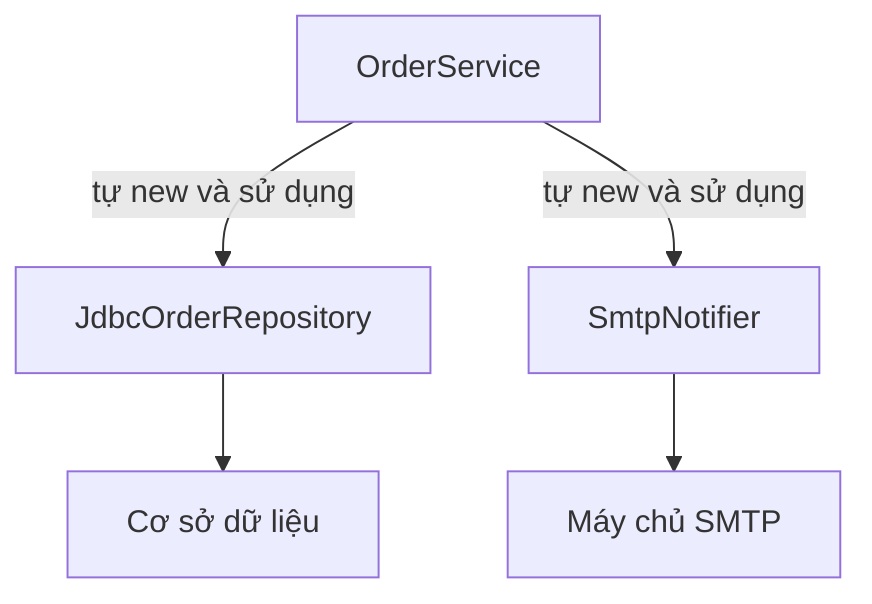
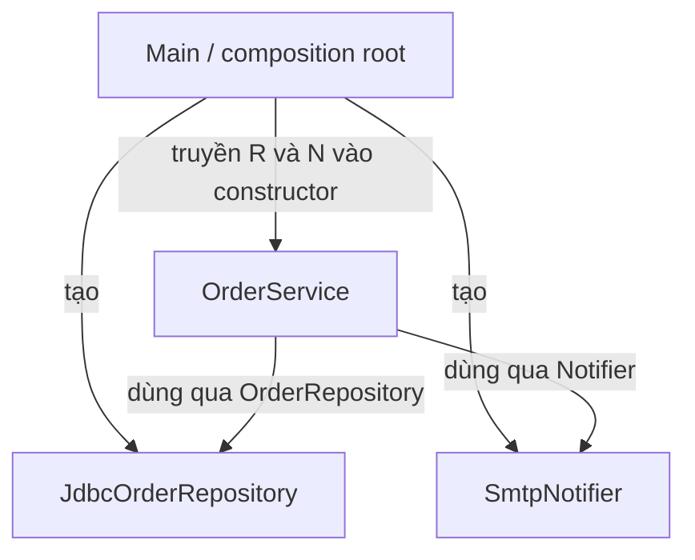

# Vì sao tự tạo mọi phụ thuộc bên trong lớp gây khó thay đổi và kiểm thử

Trong một ứng dụng Java, một lớp thường cần đến các đối tượng khác để hoàn thành công việc: truy cập cơ sở dữ liệu, gọi HTTP API, gửi email, đọc đồng hồ hệ thống hoặc ghi log. Các đối tượng được lớp đó sử dụng để thực hiện trách nhiệm của mình được gọi là **phụ thuộc (dependency)**.

Vấn đề xuất hiện khi lớp vừa thực hiện nghiệp vụ, vừa tự quyết định **phải tạo phụ thuộc nào, bằng cấu hình gì và vào thời điểm nào**. Khi đó, một thay đổi về hạ tầng có thể kéo theo sửa mã nghiệp vụ; một bài kiểm thử nghiệp vụ đơn giản cũng có thể cần cơ sở dữ liệu hoặc mạng thật.

Đây là động lực quan trọng của **Dependency Injection (DI)** và **Inversion of Control (IoC)**: tách việc *sử dụng* phụ thuộc khỏi việc *tạo và lắp ghép* các đối tượng. Ta sẽ thấy vấn đề cụ thể trước, rồi cải tiến bằng Java thuần và constructor injection, chưa cần DI container.

## 1. Tình huống: một lớp xử lý đơn hàng tự tạo tất cả phụ thuộc

Giả sử `OrderService` thực hiện hai việc khi tiếp nhận đơn hàng:

1. Lưu đơn hàng.
2. Gửi thông báo xác nhận cho khách hàng.

Một cách viết có vẻ thuận tiện là:

```java
// Ví dụ minh họa cấu trúc; các lớp hạ tầng được giả định đã tồn tại.
public final class OrderService {
    private final OrderRepository repository =
            new JdbcOrderRepository("jdbc:postgresql://db:5432/shop");
    private final Notifier notifier =
            new SmtpNotifier("smtp.example.test");

    public void place(Order order) {
        repository.save(order);
        notifier.send(order.email(), "Đã nhận đơn " + order.id());
    }
}
```

Ở đây `OrderRepository` và `Notifier` có thể đã là interface. Tuy nhiên, `OrderService` vẫn ghi cứng lựa chọn triển khai bằng `new JdbcOrderRepository(...)` và `new SmtpNotifier(...)`. Việc khai báo trường bằng interface **chưa đủ** để tách lớp khỏi cách khởi tạo phụ thuộc.



`OrderService` đang gánh hai loại quyết định khác nhau:

- **Quyết định nghiệp vụ:** khi tiếp nhận đơn, cần lưu đơn rồi gửi thông báo.
- **Quyết định lắp ghép:** dùng JDBC hay một cách lưu khác, dùng SMTP hay hàng đợi, địa chỉ máy chủ là gì, khi nào tạo hoặc dùng lại kết nối.

Điểm gây khó khăn là các quyết định lắp ghép nằm ngay trong lớp nghiệp vụ. Không phải mọi lệnh `new` đều có vấn đề; vấn đề nằm ở việc lớp tự tạo những **cộng tác viên (collaborator)** mà nó cần thay thế, cấu hình hoặc kiểm soát vòng đời từ bên ngoài.

## 2. Vì sao thay đổi một phụ thuộc lại buộc sửa mã nghiệp vụ?

Hãy xem ba yêu cầu phát sinh trong quá trình phát triển:

| Yêu cầu mới | Khi lớp tự khởi tạo phụ thuộc | Hệ quả |
| --- | --- | --- |
| Chuyển thông báo từ SMTP sang hàng đợi | Phải sửa biểu thức `new SmtpNotifier(...)` ngay trong `OrderService` | Một thay đổi hạ tầng chạm vào mã nghiệp vụ |
| Dùng cơ sở dữ liệu thử nghiệm cho môi trường kiểm thử | Phải sửa cấu hình bên trong lớp hoặc thêm nhánh điều kiện | Môi trường triển khai bị trộn với hành vi xử lý đơn |
| Dùng chung một HTTP client hoặc connection pool | Mỗi đối tượng dịch vụ có thể tự tạo tài nguyên riêng | Khó chủ động chia sẻ, giới hạn hoặc đóng tài nguyên |

Có thể thay chuỗi địa chỉ máy chủ bằng biến môi trường, nhưng cách đó chỉ giải quyết **giá trị cấu hình**; nó không giải quyết câu hỏi lớn hơn: ai chọn implementation, ai tạo đối tượng, ai sở hữu vòng đời? Nếu muốn dùng một implementation hoàn toàn khác, lớp vẫn đang tự quyết định.

Một hệ thống có nhiều dịch vụ tự tạo repository hoặc client còn dễ lặp lại cách đọc cấu hình, khởi tạo và xử lý lỗi kết nối. Thay đổi một quy tắc chung khi ấy phải dò tìm nhiều vị trí `new`, làm tăng nguy cơ bỏ sót.

### Phụ thuộc bị ẩn trong mã triển khai

Nhìn vào API `new OrderService()` của ví dụ ban đầu, người gọi không thấy dịch vụ cần cơ sở dữ liệu và hệ thống email. Chỉ khi đọc thân lớp hoặc chạy chương trình mới phát hiện các điều kiện cần thiết.

Điều này tạo nên **phụ thuộc ngầm**: chữ ký khởi tạo không nói rõ lớp cần những cộng tác viên nào. Khi phụ thuộc thay đổi, người lắp ghép ứng dụng không có một điểm điều khiển rõ ràng để cấu hình lại toàn bộ đồ thị đối tượng.

## 3. Vì sao cách viết này làm kiểm thử khó hơn?

Giả sử chỉ muốn kiểm tra quy tắc: *sau khi lưu đơn thành công, dịch vụ yêu cầu gửi đúng thông báo*. Đây là hành vi của `OrderService`, không phải bài kiểm tra JDBC hay máy chủ SMTP.

Với thiết kế đầu tiên, bài kiểm thử gọi:

```java
OrderService service = new OrderService();
service.place(order);
```

nhưng không có cách thông thường để bảo `OrderService` dùng một repository lưu trong bộ nhớ và một bộ ghi nhận thông báo. Việc khởi tạo các cộng tác viên đã bị khóa bên trong lớp.

Các tác động thường gặp là:

1. **Phải chuẩn bị hạ tầng ngoài ý muốn.** Test có thể cần database, SMTP, thông tin đăng nhập và dữ liệu dọn dẹp sau chạy.
2. **Kết quả thiếu ổn định.** Mạng chậm, máy chủ ngừng hoạt động, trạng thái cơ sở dữ liệu thay đổi hoặc cấu hình môi trường sai có thể làm test thất bại dù quy tắc nghiệp vụ không đổi.
3. **Khó quan sát hành vi.** Test muốn biết `save` được gọi với đơn nào, thông báo chứa nội dung gì, nhưng cộng tác viên thật thường không cung cấp cơ chế ghi nhận đơn giản.
4. **Khó mô phỏng lỗi hiếm.** Chẳng hạn, muốn kiểm tra trường hợp lưu đơn thất bại trước khi gửi email; không dễ yêu cầu một repository do lớp tự tạo phải ném lỗi đúng lúc.
5. **Chi phí thực thi cao.** Một kiểm thử logic vài mili giây có thể phải khởi động dịch vụ, chờ kết nối và dọn tài nguyên.

Điều này **không có nghĩa là không thể kiểm thử**: vẫn có thể viết integration test hoặc dùng công cụ can thiệp vào constructor. Tuy nhiên, đó là những giải pháp phức tạp hơn mức cần thiết đối với một unit test của nghiệp vụ.

Sự phân biệt quan trọng:

| Loại kiểm thử | Điều muốn xác minh | Phụ thuộc phù hợp |
| --- | --- | --- |
| Unit test cho `OrderService` | Thứ tự hành vi, dữ liệu truyền đi, cách xử lý khi phụ thuộc báo lỗi | Cộng tác viên giả/lưu trong bộ nhớ/ghi nhận lời gọi |
| Integration test cho `JdbcOrderRepository` | Câu SQL, ánh xạ dữ liệu, giao dịch với database | Cơ sở dữ liệu thử nghiệm thật |
| Integration test cho `SmtpNotifier` | Kết nối và giao thức gửi thông báo | Máy chủ SMTP thử nghiệm hoặc môi trường tích hợp tương đương |

DI giúp unit test thay thế cộng tác viên dễ dàng; **nó không thay thế nhu cầu kiểm thử tích hợp** giữa ứng dụng và hạ tầng thật.

## 4. Tự tạo phụ thuộc còn làm khó kiểm soát scope và vòng đời

Không phải mọi dependency đều có chi phí và vòng đời giống nhau:

- `Clock` hoặc bộ sinh mã có thể cần được kiểm soát để kết quả test xác định trước.
- HTTP client hay connection pool có thể cần được dùng lại thay vì tạo trùng lặp.
- Đối tượng giữ trạng thái theo request có thể không an toàn nếu vô tình dùng chung giữa nhiều request.
- Đối tượng có `close()` cần một nơi xác định rõ trách nhiệm giải phóng tài nguyên.

Nếu lớp nghiệp vụ tự `new` những đối tượng này, nó đồng thời tự ấn định thời điểm tạo và phạm vi sử dụng. Đổi từ tạo mới cho mỗi dịch vụ sang dùng chung một instance thường lại phải sửa lớp nghiệp vụ. Nếu tạo phụ thuộc trong mỗi lần gọi phương thức, vấn đề có thể nghiêm trọng hơn:

```java
public void place(Order order) {
    OrderRepository repository = new JdbcOrderRepository(/* cấu hình */);
    repository.save(order);
    // ...
}
```

Ví dụ trên không chỉ khó thay repository khi test mà còn có thể tạo tài nguyên lặp lại ở mỗi lời gọi. **Không thể kết luận mọi lần `new` đều tốn kém**: tác động thực tế phụ thuộc vào cách adapter được cài đặt. Vấn đề thiết kế chắc chắn hơn là nơi xử lý nghiệp vụ đã tự quyết định cả chính sách khởi tạo.

## 5. Cải tiến: đưa việc tạo phụ thuộc ra ngoài bằng constructor injection

Ta giữ nguyên trách nhiệm xử lý đơn hàng, nhưng để nơi khác tạo và chuyển các cộng tác viên vào `OrderService`.

```java
import java.util.Objects;

public final class OrderService {
    private final OrderRepository repository;
    private final Notifier notifier;

    public OrderService(OrderRepository repository, Notifier notifier) {
        this.repository = Objects.requireNonNull(repository, "repository");
        this.notifier = Objects.requireNonNull(notifier, "notifier");
    }

    public void place(Order order) {
        repository.save(order);
        notifier.send(order.email(), "Đã nhận đơn " + order.id());
    }
}
```

`OrderService` bây giờ chỉ biết **hợp đồng hành vi** của `OrderRepository` và `Notifier`. Nó không biết JDBC được cấu hình thế nào, email được gửi qua SMTP hay hàng đợi, cũng không cần quyết định lúc nào khởi tạo các đối tượng đó.

Người tạo `OrderService` phải cung cấp đủ cộng tác viên thông qua constructor, vì vậy hai dependency được thể hiện rõ ở API. Các trường `final` giúp giữ nguyên tham chiếu sau khi khởi tạo; `requireNonNull` giúp phát hiện lỗi lắp ghép sớm.



Nơi tập trung tạo và nối các đối tượng này thường được gọi là **composition root** (điểm lắp ghép ứng dụng), chẳng hạn `main()` hoặc mã khởi động của một dịch vụ. Ở production, nó có thể tạo adapter JDBC và SMTP bằng cấu hình thật; trong test, nó có thể truyền đối tượng giả. Các lệnh `new` **không biến mất**: chúng được chuyển đến nơi có trách nhiệm lắp ghép.

Đó cũng là biểu hiện của **IoC**: `OrderService` không còn tự kiểm soát việc tạo các cộng tác viên. **DI** là kỹ thuật cụ thể để bên ngoài cung cấp những cộng tác viên đó. Chưa cần Spring, Guice hay DI container để áp dụng cách thiết kế này.

## 6. Thực hành bằng Java thuần: kiểm thử mà không cần database hoặc SMTP

Ví dụ sau là một tệp `Main.java` độc lập, chạy với Java 17 trở lên. Nó dùng hai interface nhỏ, một service nhận dependency qua constructor và các implementation kiểm thử viết bằng lambda. Không cần JUnit hay thư viện DI.

```java
import java.util.ArrayList;
import java.util.List;
import java.util.Objects;

record Order(String id, String email) {}

@FunctionalInterface
interface OrderRepository {
    void save(Order order);
}

@FunctionalInterface
interface Notifier {
    void send(String recipient, String message);
}

final class OrderService {
    private final OrderRepository repository;
    private final Notifier notifier;

    OrderService(OrderRepository repository, Notifier notifier) {
        this.repository = Objects.requireNonNull(repository, "repository");
        this.notifier = Objects.requireNonNull(notifier, "notifier");
    }

    void place(Order order) {
        Objects.requireNonNull(order, "order");
        repository.save(order);
        notifier.send(order.email(), "Đã nhận đơn " + order.id());
    }
}

public class Main {
    public static void main(String[] args) {
        List<Order> saved = new ArrayList<>();
        List<String> sent = new ArrayList<>();

        // Test double: lưu dữ liệu và ghi nhận thông báo trong bộ nhớ.
        OrderRepository inMemoryRepository = order -> saved.add(order);
        Notifier recordingNotifier =
                (recipient, message) -> sent.add(recipient + ": " + message);

        OrderService service =
                new OrderService(inMemoryRepository, recordingNotifier);
        Order order = new Order("A-101", "buyer@example.test");

        service.place(order);

        check(saved.equals(List.of(order)), "Phải lưu đúng đơn hàng");
        check(sent.equals(List.of(
                "buyer@example.test: Đã nhận đơn A-101")),
                "Phải tạo đúng thông báo");

        // Test đường lỗi: lưu thất bại thì không được gửi thông báo.
        List<String> sentAfterFailure = new ArrayList<>();
        OrderRepository failingRepository = ignored -> {
            throw new IllegalStateException("Storage unavailable");
        };
        Notifier failureRecorder =
                (recipient, message) -> sentAfterFailure.add(message);

        boolean failed = false;
        try {
            new OrderService(failingRepository, failureRecorder).place(order);
        } catch (IllegalStateException expected) {
            failed = true;
        }

        check(failed, "Lỗi lưu đơn phải được truyền ra");
        check(sentAfterFailure.isEmpty(),
                "Không gửi thông báo khi chưa lưu được đơn");

        System.out.println("PASS");
    }

    private static void check(boolean condition, String message) {
        if (!condition) {
            throw new AssertionError(message);
        }
    }
}
```

Lưu đoạn mã vào `Main.java` rồi chạy:

```bash
javac -encoding UTF-8 Main.java
java Main
```

Kết quả mong đợi:

```text
PASS
```

Hai tình huống được kiểm tra bằng những đối tượng do test chủ động cung cấp:

1. Khi lưu thành công, repository nhận đúng `Order` và notifier nhận đúng nội dung.
2. Khi repository ném `IllegalStateException`, notifier không được gọi.

Điểm quyết định không phải công cụ mock hay lambda, mà là **service không tự tạo các cộng tác viên**. Vì vậy, test thay hành vi của phụ thuộc mà không thay mã nghiệp vụ. Trong hệ thống thực tế, có thể dùng lớp fake riêng hoặc thư viện mock nếu chúng giúp kiểm thử dễ đọc hơn.

**Giới hạn của ví dụ:** nếu lưu đơn thành công nhưng gửi email thất bại, DI tự nó không xử lý được vấn đề nhất quán dữ liệu, giao dịch hay retry. Đây là các quyết định nghiệp vụ và kiến trúc cần giải quyết riêng.

## 7. Khi nào `new` là bình thường, khi nào nên tiêm phụ thuộc?

Mục tiêu không phải loại bỏ tất cả `new` khỏi mã Java.

| Việc tạo đối tượng | Cách nhìn phù hợp |
| --- | --- |
| `new Order("A-101", email)` để biểu diễn dữ liệu đơn hàng | Bình thường: đối tượng giá trị được tạo cho thao tác đang thực hiện |
| `new ArrayList<>()` làm danh sách tạm trong một phương thức | Thường bình thường: chi tiết triển khai cục bộ, không cần thay thế từ bên ngoài |
| `new JdbcOrderRepository(...)` trong `OrderService` | Nên xem xét DI: đây là cộng tác viên hạ tầng cần thay đổi/cấu hình/giả lập |
| `new HttpClient...` hoặc tạo connection pool trong từng request | Cần xem xét nơi sở hữu và phạm vi dùng lại tài nguyên |
| `new OrderService(repository, notifier)` tại composition root | Phù hợp: chính nơi này có trách nhiệm tạo và nối các đối tượng |

Một số câu hỏi hữu ích khi quyết định:

- Đây là **giá trị cục bộ** hay **dịch vụ mà lớp hợp tác cùng**?
- Khi chạy trong test, ta có muốn cung cấp implementation khác hoặc hành vi lỗi theo ý muốn không?
- Phụ thuộc có cấu hình, kết nối, trạng thái, tài nguyên hoặc vòng đời cần quản lý từ bên ngoài không?
- Nếu thay implementation, có hợp lý khi buộc sửa lớp đang sử dụng nó không?

Nếu câu trả lời nghiêng về cộng tác viên cần thay thế hoặc điều khiển, constructor injection thường là điểm khởi đầu rõ ràng. Tuy nhiên, **không nhất thiết phải tạo interface cho mọi dependency**. Một lớp cụ thể cũng có thể được truyền qua constructor khi không có nhu cầu đa triển khai hoặc tạo abstraction; interface hữu ích khi nó diễn đạt một hợp đồng ổn định mà phía sử dụng thật sự cần.

## 8. Lộ trình sửa một lớp đang tự khởi tạo phụ thuộc

Với mã hiện có, có thể refactor từng bước để giữ nguyên hành vi:

1. **Liệt kê các cộng tác viên** được tạo trong field initializer, constructor hoặc phương thức, đặc biệt đối tượng truy cập I/O, đồng hồ, hệ thống ngoài.
2. **Xác định trách nhiệm**: lớp cần thao tác nào từ cộng tác viên; cân nhắc interface nhỏ ở ranh giới sử dụng nếu có nhiều implementation hoặc cần test double.
3. **Thêm tham số constructor**, gán vào trường `final` và xác thực các dependency bắt buộc.
4. **Chuyển phần `new` ra nơi lắp ghép** để cấu hình và truyền các đối tượng vào service; quyết định rõ ai đóng các tài nguyên cần đóng.
5. **Viết unit test với cộng tác viên kiểm soát được**, bao gồm đường thành công, đường lỗi và dữ liệu được chuyển đi.
6. **Giữ integration test phù hợp** để bảo đảm adapter JDBC, SMTP hoặc thành phần thật vẫn hoạt động đúng.

Tránh hai cách sửa nửa vời:

```java
// Vẫn khóa implementation ngay bên trong lớp sử dụng:
private final OrderRepository repository = new JdbcOrderRepository(/* ... */);

// Chỉ giấu lệnh new sang một helper gọi từ chính service:
private final OrderRepository repository = RepositoryFactory.create();
```

Trong trường hợp thứ hai, factory có thể có ích ở nơi lắp ghép, nhưng nếu `OrderService` **tự gọi factory cố định**, việc chọn và thay phụ thuộc vẫn nằm ngoài tầm điều khiển của người tạo service. Điều cần thay đổi là **quyền quyết định đưa cộng tác viên nào vào lớp**.

## 9. Tự kiểm tra mức độ hiểu

**Tình huống A.** `ReportService` gọi `LocalDate.now()` để quyết định báo cáo thuộc tháng nào. Một test chạy ngày cuối tháng thường thất bại khi sang tháng mới. Nên cân nhắc truyền `Clock` qua constructor rồi dùng `LocalDate.now(clock)`. Lúc test có thể dùng `Clock.fixed(...)` để ngày giờ xác định trước.

**Tình huống B.** `PaymentService` tạo `new ArrayList<>()` để gom lỗi xác thực đầu vào rồi trả kết quả. Chỉ riêng lệnh `new` này chưa phải lý do để thêm DI: danh sách tạm là chi tiết triển khai cục bộ, không phải cộng tác viên hạ tầng cần tiêm.

**Tình huống C.** `OrderService` đã nhận `Notifier` từ constructor, nhưng `Main` vẫn dùng `new SmtpNotifier(...)`. Đây là thiết kế hợp lý: mã lắp ghép cần tạo implementation thật ở một nơi; `OrderService` chỉ sử dụng hợp đồng `Notifier`.

## Ghi nhớ

- **Tự tạo cộng tác viên bên trong lớp** trộn nghiệp vụ với lựa chọn implementation, cấu hình và vòng đời.
- Sự ràng buộc đó làm thay đổi hạ tầng lan sang mã nghiệp vụ; unit test khó cô lập side effect và mô phỏng tình huống lỗi.
- **Constructor injection** công khai dependency và cho phép người gọi quyết định dùng đối tượng thật hay đối tượng kiểm thử.
- **Composition root** là nơi tạo, cấu hình và lắp ghép các đối tượng; DI thực hiện được bằng Java thuần trước khi học DI container.
- `new` cho đối tượng giá trị hoặc dữ liệu tạm vẫn là bình thường; mục tiêu là quản lý ranh giới giữa **sử dụng** và **khởi tạo các cộng tác viên cần kiểm soát**.
