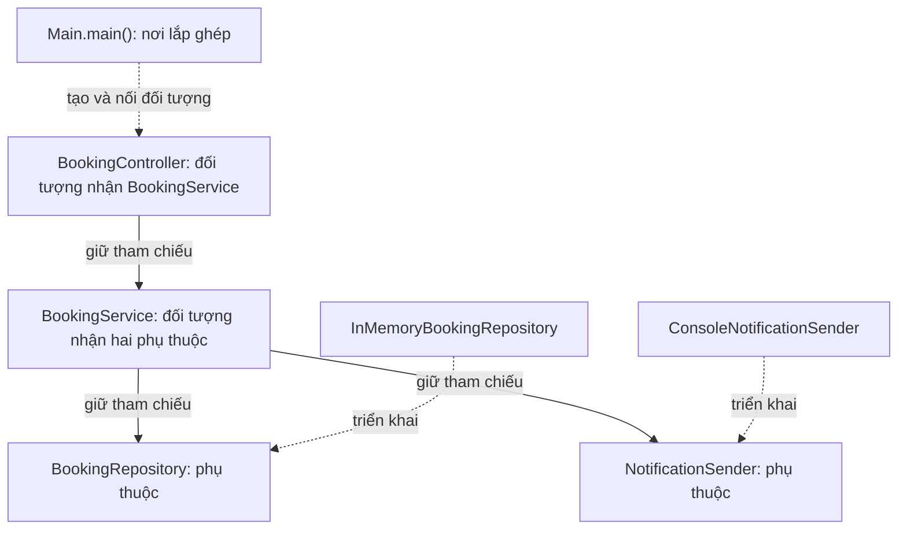

# Vai trò của nơi lắp ghép, đối tượng nhận và phụ thuộc được truyền vào

## 1. Vì sao cần phân biệt ba vai trò?

Trong **Dependency Injection (DI)**, một đối tượng vẫn sử dụng các đối tượng khác để hoàn thành công việc, nhưng nó không tự quyết định cách khởi tạo và lựa chọn những đối tượng đó. Việc **tạo và lắp ghép** được chuyển ra bên ngoài. Đây là một cách thực hiện **Inversion of Control (IoC)**: quyền kiểm soát việc cung cấp cộng tác viên nằm ở phía mã lắp ghép thay vì nằm trong mã nghiệp vụ.

Muốn hiểu một hệ thống DI, hãy luôn tìm được ba vai trò:

| Vai trò | Trả lời câu hỏi | Ví dụ trong ứng dụng đặt chỗ |
| --- | --- | --- |
| **Nơi lắp ghép** (*composition root*) | Ai chọn lớp triển khai, tạo đối tượng, kết nối chúng và quyết định thời gian tồn tại? | `Main.main()` tạo repository, bộ gửi thông báo, service và controller. |
| **Đối tượng nhận phụ thuộc** (*consumer*, *dependent object*) | Ai cần cộng tác viên để thực hiện trách nhiệm của mình? | `BookingService` cần lưu xác nhận và gửi thông báo. |
| **Phụ thuộc được truyền vào** (*injected dependency*) | Đối tượng/cộng tác viên nào được cấp từ bên ngoài? | `BookingRepository` và `NotificationSender` được đưa vào constructor của `BookingService`. |

Ba vai trò mô tả **quan hệ tại một điểm lắp ghép**, không phải ba loại lớp cố định. `BookingService` là **đối tượng nhận** khi được cấp repository và sender; nhưng khi được truyền tiếp cho `BookingController`, chính `BookingService` lại là **phụ thuộc của controller**. Một đối tượng có thể đóng cả hai vai trò ở các vị trí khác nhau trong đồ thị đối tượng.

Điểm cốt lõi của module **DEPENDENCY_INJECTION** là tách **việc sử dụng phụ thuộc** khỏi **quá trình tạo và lắp ghép đối tượng**. Có thể thực hiện điều này hoàn toàn bằng Java thuần trước khi cân nhắc một DI container.

## 2. Quan hệ giữa nơi lắp ghép, đối tượng nhận và phụ thuộc

Giả sử ứng dụng xử lý yêu cầu xác nhận đặt chỗ. `BookingController` nhận yêu cầu; `BookingService` thực hiện quy trình nghiệp vụ; `BookingRepository` ghi nhận xác nhận; `NotificationSender` thông báo cho khách hàng.



Đọc sơ đồ theo hai hướng khác nhau:

- **Ở thời điểm khởi tạo:** mã trong `Main.main()` quyết định dùng các lớp triển khai cụ thể nào và đưa các tham chiếu phù hợp vào constructor.
- **Ở thời điểm chạy nghiệp vụ:** controller gọi service; service gọi repository và sender qua những tham chiếu đã nhận. Service không cần biết mã nào đã tạo repository hoặc sender.

Trong ví dụ này, `BookingRepository` và `NotificationSender` là **interface**. Interface giúp thay thế triển khai dễ hơn, nhưng **DI không bắt buộc phụ thuộc phải là interface**: truyền một đối tượng cụ thể qua constructor vẫn là injection. Lựa chọn abstraction khi nó thực sự diễn đạt một hợp đồng hữu ích.

## 3. Ví dụ Java thuần: constructor injection từ composition root

Toàn bộ ví dụ sau nằm trong một tệp `Main.java`. Nó không cần Spring, annotation, bộ quét class hay thư viện DI nào.

```java
import java.util.HashMap;
import java.util.Map;
import java.util.Objects;

public class Main {
    // Hợp đồng mà service cần; service không tự chọn triển khai.
    interface BookingRepository {
        void confirm(String bookingId);
    }

    interface NotificationSender {
        void send(String recipient, String message);
    }

    // Hai triển khai cụ thể được lựa chọn tại composition root.
    static final class InMemoryBookingRepository implements BookingRepository {
        private final Map<String, Boolean> confirmed = new HashMap<>();

        InMemoryBookingRepository() {
            confirmed.put("B-001", false);
        }

        @Override
        public void confirm(String bookingId) {
            if (!confirmed.containsKey(bookingId)) {
                throw new IllegalArgumentException("Không tìm thấy đặt chỗ: " + bookingId);
            }
            confirmed.put(bookingId, true);
            System.out.println("Đã xác nhận đặt chỗ " + bookingId);
        }
    }

    static final class ConsoleNotificationSender implements NotificationSender {
        @Override
        public void send(String recipient, String message) {
            System.out.println("Gửi tới " + recipient + ": " + message);
        }
    }

    // Consumer: chỉ giữ và sử dụng những phụ thuộc được truyền vào.
    static final class BookingService {
        private final BookingRepository repository;
        private final NotificationSender sender;

        BookingService(BookingRepository repository, NotificationSender sender) {
            this.repository = Objects.requireNonNull(repository, "repository");
            this.sender = Objects.requireNonNull(sender, "sender");
        }

        void confirm(String bookingId, String customerEmail) {
            repository.confirm(bookingId);
            sender.send(customerEmail, "Đặt chỗ " + bookingId + " đã được xác nhận.");
        }
    }

    // Controller nhận BookingService, tương tự cách service nhận cộng tác viên.
    static final class BookingController {
        private final BookingService bookingService;

        BookingController(BookingService bookingService) {
            this.bookingService = Objects.requireNonNull(bookingService, "bookingService");
        }

        void confirm(String bookingId, String email) {
            bookingService.confirm(bookingId, email);
        }
    }

    public static void main(String[] args) {
        // COMPOSITION ROOT: tạo đối tượng theo thứ tự phụ thuộc trước.
        BookingRepository repository = new InMemoryBookingRepository();
        NotificationSender sender = new ConsoleNotificationSender();
        BookingService service = new BookingService(repository, sender);
        BookingController controller = new BookingController(service);

        // Sau khi lắp ghép, mã xử lý yêu cầu chỉ sử dụng các đối tượng.
        controller.confirm("B-001", "an@example.com");
    }
}
```

Biên dịch và chạy (với JDK và tệp lưu ở UTF-8):

```bash
javac -encoding UTF-8 Main.java
java Main
```

Kết quả minh họa:

```text
Đã xác nhận đặt chỗ B-001
Gửi tới an@example.com: Đặt chỗ B-001 đã được xác nhận.
```

### Ai làm việc gì ở từng dòng lắp ghép?

| Đoạn mã trong `main` | Ý nghĩa |
| --- | --- |
| `new InMemoryBookingRepository()` | Nơi lắp ghép chọn một triển khai repository và tạo nó. |
| `new ConsoleNotificationSender()` | Nơi lắp ghép chọn cách gửi thông báo cho môi trường hiện tại. |
| `new BookingService(repository, sender)` | **Constructor injection:** service nhận hai cộng tác viên đã tạo, không tự tạo chúng. |
| `new BookingController(service)` | Controller nhận service; service trở thành phụ thuộc được truyền vào ở tầng này. |
| `controller.confirm(...)` | Đồ thị đã sẵn sàng; luồng nghiệp vụ bắt đầu. |

`bookingId` và `customerEmail` trong `confirm(...)` là **dữ liệu của một lần gọi**, không phải phụ thuộc ổn định của `BookingService`. Ngược lại, repository và sender là cộng tác viên được service dùng xuyên suốt vòng đời của nó. Phân biệt hai loại tham số này giúp không biến constructor thành nơi nhận mọi dữ liệu nghiệp vụ.

## 4. Ranh giới trách nhiệm: nơi nào nên biết lớp triển khai?

### Composition root biết cách tạo và nối các phần

Composition root thường nằm ở điểm khởi động ứng dụng, ví dụ `main()` của chương trình dòng lệnh hoặc logic bootstrap của dịch vụ web. Nó có thể đọc cấu hình, lựa chọn implementation, tạo các đối tượng theo thứ tự phụ thuộc và chuyển quyền điều khiển sang thành phần xử lý yêu cầu.

Một nơi lắp ghép tốt có trách nhiệm rõ ràng:

1. **Chọn triển khai:** dùng sender ghi console ở môi trường học tập, sender gửi email ở ứng dụng thật.
2. **Khởi tạo và kết nối:** tạo những phụ thuộc cần thiết trước, truyền chúng vào consumer.
3. **Quản lý vòng đời:** quyết định đối tượng nào dùng chung, đối tượng nào tạo theo yêu cầu, và khi nào đóng tài nguyên.
4. **Bảo đảm đồ thị hợp lệ:** phát hiện thiếu phụ thuộc ngay khi tạo đối tượng, thay vì đợi lỗi xuất hiện trong một luồng nghiệp vụ hiếm gặp.

Composition root có thể gọi `new`: đây chính là nơi tập trung quyết định khởi tạo. Các lớp nghiệp vụ vẫn có thể tạo **giá trị tạm** như `ArrayList`, DTO hay `BigDecimal`; cần tách khỏi chúng việc tự tạo **cộng tác viên mang hành vi và cấu hình hệ thống** như repository, HTTP client, email sender.

Trong hệ thống lớn, có thể chia mã cấu hình thành các hàm hoặc module hỗ trợ. Điều quan trọng là các quyết định lắp ghép có một điểm kiểm soát rõ ràng tại biên ứng dụng; không cần dồn toàn bộ thành một phương thức dài.

### Consumer biết hợp đồng sử dụng, không biết cách xây dựng

`BookingService` chịu trách nhiệm về trình tự xác nhận đặt chỗ. Nó biết `BookingRepository.confirm` và `NotificationSender.send` có thể làm gì, nhưng không cần biết repository dùng database nào, sender dùng SMTP hay API nào, hoặc ai đã khởi tạo chúng.

Constructor injection giúp:

- **Phụ thuộc bắt buộc được thể hiện công khai** trong chữ ký constructor.
- **Trạng thái hợp lệ ngay sau khởi tạo:** sau khi kiểm tra `null`, service có đủ cộng tác viên để làm việc.
- **Dễ thay đổi triển khai:** thay cách gửi thông báo ở điểm lắp ghép mà không sửa service.
- **Dễ kiểm thử độc lập:** cấp fake/stub thay cho database và dịch vụ bên ngoài.

Tránh kiểu service tự lựa chọn và tự tạo cộng tác viên:

```java
// Mẫu gắn chặt: khó thay implementation khi kiểm thử hay đổi môi trường.
final class TightlyCoupledBookingService {
    private final Main.NotificationSender sender = new Main.ConsoleNotificationSender();
    // ... nghiệp vụ phụ thuộc trực tiếp vào lớp cụ thể ở đây.
}
```

Đoạn trên chỉ minh họa vấn đề: `TightlyCoupledBookingService` phải biết tên `ConsoleNotificationSender`. Đổi sang gửi email yêu cầu thay cả mã nghiệp vụ. Khi dùng constructor injection, `BookingService` phụ thuộc vào `NotificationSender`; mã lắp ghép quyết định triển khai.

### Phụ thuộc được truyền vào có thể có phụ thuộc riêng

Trong ứng dụng thật, một sender gửi email có thể cần `EmailClient`, cấu hình timeout và thông tin xác thực. Những đối tượng này lại được tạo/lắp ở biên phù hợp. Không nên để `BookingService` biết chuỗi khởi tạo sâu bên dưới. Đó là ý nghĩa của **đồ thị đối tượng** (*object graph*): consumer giữ tham chiếu tới cộng tác viên trực tiếp, còn composition root cung cấp đường đi để xây dựng toàn bộ đồ thị.

## 5. Thử nghiệm độc lập bằng Java thuần

Vì `BookingService` được cấp phụ thuộc từ bên ngoài, có thể đưa vào một fake repository và một sender ghi nhận lời gọi để kiểm tra hành vi mà không chạy database hoặc gửi email thật.

Đặt thêm lớp không có `public` sau lớp `Main` trong cùng tệp `Main.java` ở mục 3:

```java
class BookingServiceTest {
    static final class FakeRepository implements Main.BookingRepository {
        String lastConfirmedId;

        @Override
        public void confirm(String bookingId) {
            lastConfirmedId = bookingId;
        }
    }

    static final class RecordingSender implements Main.NotificationSender {
        String lastRecipient;
        String lastMessage;

        @Override
        public void send(String recipient, String message) {
            lastRecipient = recipient;
            lastMessage = message;
        }
    }

    public static void main(String[] args) {
        FakeRepository repository = new FakeRepository();
        RecordingSender sender = new RecordingSender();
        Main.BookingService service = new Main.BookingService(repository, sender);

        service.confirm("B-002", "test@example.com");

        if (!"B-002".equals(repository.lastConfirmedId)) {
            throw new AssertionError("Repository chưa được gọi đúng");
        }
        if (!"test@example.com".equals(sender.lastRecipient)
                || !sender.lastMessage.contains("B-002")) {
            throw new AssertionError("Thông báo chưa được gửi đúng");
        }
        System.out.println("PASS: BookingService dùng đúng phụ thuộc đã tiêm");
    }
}
```

Chạy lại lệnh biên dịch, sau đó chạy `java BookingServiceTest`. Nếu không có `AssertionError`, chương trình in `PASS: BookingService dùng đúng phụ thuộc đã tiêm`.

Ví dụ kiểm thử này chứng minh **service sử dụng đúng các phụ thuộc được cấp và truyền dữ liệu đúng**. Nó chưa kiểm tra lỗi database, giao dịch, hay việc gửi thông báo có thành công ngoài hệ thống thật hay không; các trường hợp đó thuộc phạm vi kiểm thử khác.

## 6. Nơi lắp ghép quyết định scope và vòng đời

DI giải quyết cách một đối tượng **nhận phụ thuộc**. Bài toán **scope/lifecycle** trả lời đối tượng đó được tạo bao nhiêu lần và sống bao lâu. Với Java thuần, lập trình viên tự đưa ra các quyết định này; không có scope tự động chỉ vì đang dùng constructor injection.

| Phạm vi sử dụng | Cách lắp ghép phổ biến | Phù hợp khi | Điều cần chú ý |
| --- | --- | --- | --- |
| **Dùng chung toàn ứng dụng** (*application/singleton-like*) | Tạo một lần lúc khởi động, truyền cùng tham chiếu tới nhiều consumer. | Client có thể dùng chung, service không có trạng thái thay đổi theo từng yêu cầu. | Cần an toàn luồng nếu nhiều yêu cầu truy cập đồng thời; đóng tài nguyên khi ứng dụng kết thúc. |
| **Theo yêu cầu** (*request-scoped*) | Tạo trong quá trình bắt đầu một yêu cầu, truyền cho các thành phần của chính yêu cầu đó. | Trạng thái/giao dịch chỉ thuộc một yêu cầu. | Không giữ đối tượng này trong singleton sau khi yêu cầu kết thúc. |
| **Mỗi lần tạo** (*transient/prototype-like*) | Tạo đối tượng mới mỗi khi cần lắp consumer. | Đối tượng nhẹ hoặc cần trạng thái độc lập. | Có thể tăng chi phí tạo đối tượng; không mặc nhiên chia sẻ dữ liệu. |

Với ví dụ `Main`, repository, sender, service và controller đều được tạo một lần trong lần chạy đó. `InMemoryBookingRepository` dùng `HashMap` để minh họa nên **không an toàn cho truy cập đồng thời**; không nên coi việc chia sẻ nó giữa các request là cấu hình production hợp lệ khi chưa giải quyết đồng bộ hoặc thay bằng triển khai thích hợp.

Nếu phụ thuộc nắm tài nguyên như kết nối hoặc thread pool, composition root (hoặc thành phần quản lý vòng đời mà nó thiết lập) phải có cách giải phóng tài nguyên đúng lúc. Tránh đóng tài nguyên dùng chung ở trong một consumer chỉ vì consumer vừa sử dụng xong. Với phụ thuộc kiểu `AutoCloseable`, có thể áp dụng `try-with-resources` tại phạm vi sở hữu phù hợp.

Không nên đẩy dữ liệu chỉ biết **khi có request** vào constructor của singleton. Khi cần tạo một đối tượng mới theo tham số tại runtime, composition root có thể cấp một *factory* cho consumer hoặc cho lớp điều phối tạo đối tượng đó; phần nghiệp vụ vẫn không cần gọi trực tiếp đến hạ tầng cụ thể.

## 7. Những nhầm lẫn dễ gặp

| Nhầm lẫn | Cách hiểu đúng |
| --- | --- |
| “Có interface là đã dùng DI.” | Chỉ có interface chưa đủ. Điều quyết định là consumer **nhận** cộng tác viên từ ngoài thay vì tự tạo/chọn nó. |
| “DI chỉ hoạt động khi dùng Spring.” | Constructor injection bằng `new` và truyền tham số trong Java thuần là DI hoàn chỉnh ở mức cơ chế. Container giúp tự động hóa lắp ghép khi hệ thống phức tạp. |
| “Composition root không được dùng `new`.” | Composition root **là nơi nên dùng `new`** để lắp các cộng tác viên của hệ thống. |
| “Mọi đối tượng phải được tiêm.” | Đối tượng giá trị hoặc dữ liệu tạm không nhất thiết cần injection; chú ý cộng tác viên có hành vi, cấu hình và vòng đời riêng. |
| “Tham số phương thức nào cũng là injected dependency.” | `bookingId` là dữ liệu của lần xử lý. `BookingRepository` là cộng tác viên bền vững được cung cấp qua constructor. |
| “Có DI thì không còn cần quan tâm scope.” | DI không tự quyết định dùng chung hay tạo mới; cách lắp ghép quyết định vòng đời và các rủi ro đi kèm. |
| “Service có thể lấy phụ thuộc bất kỳ lúc nào từ một registry toàn cục.” | Gọi `ServiceLocator.get(...)` bên trong service che giấu phụ thuộc, làm khó đọc và khó kiểm thử; constructor làm chúng hiện rõ. |

Một dấu hiệu cần xem xét lại thiết kế là consumer có constructor rất dài hoặc những phụ thuộc tạo thành vòng như `A -> B -> A`. DI container không tự sửa được trách nhiệm bị trộn lẫn hay quan hệ vòng; nên tách chức năng hoặc xem lại chiều phụ thuộc.

## 8. Bài thực hành tự kiểm tra

**Bài 1 — Chỉ ra vai trò.** Trong mã mục 3, xác định ai lắp ghép `BookingService`, ai nhận `BookingService`, và ai cung cấp triển khai của `NotificationSender`. Giải thích vì sao cùng một `BookingService` có thể vừa là consumer vừa là dependency.

**Bài 2 — Thay triển khai không đổi nghiệp vụ.** Thêm lớp lồng `SilentNotificationSender implements NotificationSender` vào `Main`, với `send(...)` không in gì. Thay đúng một dòng ở `main()` để `BookingService` dùng triển khai này. Kiểm tra rằng class `BookingService` không cần sửa.

**Bài 3 — Cân nhắc vòng đời.** Nếu chuyển `Main` sang server nhận nhiều request đồng thời, việc dùng chung `InMemoryBookingRepository` có rủi ro gì? Đề xuất một repository an toàn hơn hoặc một chiến lược scope phù hợp. Phân biệt việc tạo repository mới theo request với việc lưu dữ liệu đặt chỗ lâu dài.

### Tự đối chiếu

- **Bài 1:** `Main.main()` lắp service; `BookingController` nhận service; `Main.main()` chọn `ConsoleNotificationSender`. Service nhận repository/sender nhưng lại được truyền vào controller.
- **Bài 2:** thay dòng khởi tạo sender bằng `NotificationSender sender = new SilentNotificationSender();`. Phần điều phối và logic xác nhận vẫn gọi cùng hợp đồng `send`.
- **Bài 3:** `HashMap` có thể gặp race condition; với server thực tế nên dùng hạ tầng lưu trữ có kiểm soát đồng thời/giao dịch. Tạo repository mới ở mỗi request **không tự động** giúp dữ liệu tồn tại xuyên request nếu mỗi repository giữ một `HashMap` riêng.

Điều cần nắm vững để học các chủ đề tiếp theo là: **composition root chọn và sở hữu việc lắp ghép; consumer chỉ bộc lộ và sử dụng nhu cầu của mình; injected dependency là cộng tác viên được cấp qua ranh giới đó**. Nắm ba vai trò này sẽ giúp đọc cấu hình DI container, thiết kế scope và viết bài kiểm thử bằng Java thuần mà không nhầm việc xây dựng đối tượng với việc thực hiện nghiệp vụ.
