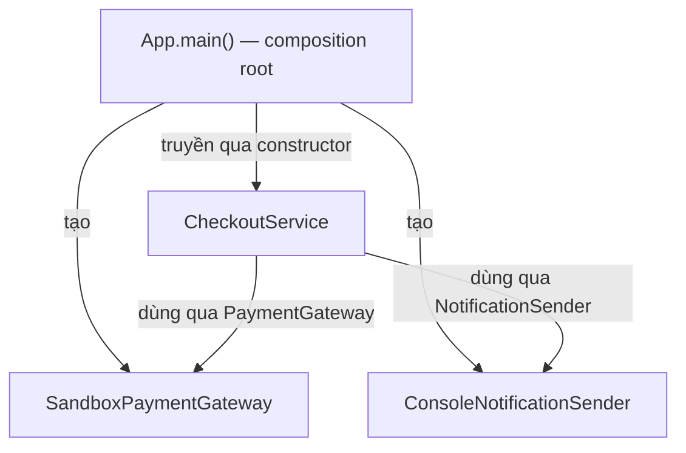

# DI là kỹ thuật thiết kế và có thể thực hiện không cần framework

## 1. Bài toán: một lớp vừa làm nghiệp vụ, vừa tự tạo phụ thuộc

**Dependency Injection (DI, tiêm phụ thuộc)** là kỹ thuật thiết kế trong đó một đối tượng **nhận các đối tượng mà nó cần để làm việc từ bên ngoài**, thay vì tự quyết định cách khởi tạo hoặc tìm kiếm chúng. DI giúp tách ba trách nhiệm:

1. **Sử dụng phụ thuộc:** lớp nghiệp vụ gọi các khả năng cần thiết để hoàn thành công việc.
2. **Tạo phụ thuộc:** một nơi khác quyết định dùng hiện thực nào và khởi tạo nó với cấu hình gì.
3. **Lắp ghép phụ thuộc:** một nơi khác kết nối các đối tượng thành ứng dụng hoạt động được.

DI là **kỹ thuật thiết kế**, không phải tính năng độc quyền của Spring hay bất kỳ DI container nào. Ta có thể áp dụng DI bằng các constructor và lệnh `new` thông thường trong Java. Container chỉ giúp tự động hóa việc tạo, nối và quản lý một số đối tượng khi hệ thống phức tạp hơn.

Xét chức năng thanh toán đơn hàng: `CheckoutService` cần một cổng thanh toán và một kênh gửi thông báo. Cách viết sau khiến lớp nghiệp vụ tự chọn cả hai hiện thực:

```java
// Trích đoạn minh họa cách ghép nối chặt, chưa phải chương trình hoàn chỉnh.
final class CheckoutService {
    private final SandboxPaymentGateway payment = new SandboxPaymentGateway();
    private final ConsoleNotificationSender notification = new ConsoleNotificationSender();

    void checkout(String email, long amountVnd) {
        payment.charge(amountVnd);
        notification.send(email, "Thanh toán thành công");
    }
}
```

Ở đây `CheckoutService` phụ thuộc trực tiếp vào cách thanh toán và cách gửi thông báo cụ thể. Muốn đổi sang cổng thanh toán khác, gửi email thay vì in ra console, hoặc kiểm thử mà không thực hiện tác vụ bên ngoài, ta phải thay đổi hoặc tìm cách can thiệp vào lớp nghiệp vụ.

Vấn đề **không nằm ở việc dùng từ khóa `new`**. Tạo một giá trị đơn giản trong phương thức là bình thường. Vấn đề xuất hiện khi một lớp **vừa phụ trách quy tắc nghiệp vụ, vừa sở hữu quyết định chọn và cấu hình các dịch vụ mà nó phụ thuộc**.

## 2. Tách việc sử dụng khỏi việc khởi tạo bằng constructor injection

Trong **constructor injection**, các phụ thuộc bắt buộc được truyền qua hàm tạo. Lớp nhận chúng rồi sử dụng, mà không cần biết chúng được khởi tạo ở đâu.

Ví dụ dưới đây chỉ dùng Java thuần (Java 11 trở lên). Lưu toàn bộ thành `App.java`:

```java
import java.util.Objects;

interface PaymentGateway {
    void charge(long amountVnd);
}

interface NotificationSender {
    void send(String recipient, String message);
}

final class CheckoutService {
    private final PaymentGateway payment;
    private final NotificationSender notification;

    CheckoutService(PaymentGateway payment, NotificationSender notification) {
        this.payment = Objects.requireNonNull(payment, "payment");
        this.notification = Objects.requireNonNull(notification, "notification");
    }

    void checkout(String email, long amountVnd) {
        if (email == null || email.isBlank()) {
            throw new IllegalArgumentException("Email không hợp lệ");
        }
        if (amountVnd <= 0) {
            throw new IllegalArgumentException("Số tiền phải lớn hơn 0");
        }

        payment.charge(amountVnd);
        notification.send(email, "Thanh toán thành công: " + amountVnd + " VND");
    }
}

final class SandboxPaymentGateway implements PaymentGateway {
    @Override
    public void charge(long amountVnd) {
        System.out.println("[Sandbox] Đã thu " + amountVnd + " VND");
    }
}

final class ConsoleNotificationSender implements NotificationSender {
    @Override
    public void send(String recipient, String message) {
        System.out.println("[Thông báo tới " + recipient + "] " + message);
    }
}

public final class App {
    public static void main(String[] args) {
        PaymentGateway gateway = new SandboxPaymentGateway();
        NotificationSender sender = new ConsoleNotificationSender();

        CheckoutService checkout = new CheckoutService(gateway, sender);
        checkout.checkout("an@example.com", 150_000);
    }
}
```

Chạy trong thư mục chứa `App.java`:

```bash
javac App.java
java App
```

**Điểm mấu chốt:** `CheckoutService` chỉ khai báo hai điều nó cần qua `PaymentGateway` và `NotificationSender`. `App.main()` quyết định dùng `SandboxPaymentGateway` và `ConsoleNotificationSender`, tạo chúng bằng `new`, rồi truyền vào constructor. Không có framework, annotation hay cơ chế quét lớp nào tham gia.

Lần lượt có hai hướng quan hệ khác nhau:

- **Phụ thuộc khi lập trình:** `CheckoutService` biết các *hợp đồng* `PaymentGateway` và `NotificationSender`.
- **Lắp ghép lúc chạy:** `App.main()` chọn các *đối tượng cụ thể* và cung cấp chúng cho `CheckoutService`.



Ở ví dụ này, `App.main()` là một **composition root**: vị trí gần điểm khởi động ứng dụng, nơi lựa chọn hiện thực và lắp ghép đồ thị đối tượng. Đặt quyết định khởi tạo tại đây khiến phần nghiệp vụ tập trung vào hành vi, đồng thời làm rõ ứng dụng được cấu hình thế nào.

## 3. DI, IoC và DIP liên quan thế nào?

Ba thuật ngữ thường xuất hiện cạnh nhau nhưng có vai trò khác nhau:

| Khái niệm | Ý nghĩa | Áp dụng vào ví dụ |
| --- | --- | --- |
| **Inversion of Control (IoC)** — đảo ngược quyền điều khiển | Một thành phần nhường quyền quyết định hoặc điều phối một phần hoạt động cho nơi khác. Đây là ý tưởng rộng. | `CheckoutService` không tự quyết định tạo gateway nào. |
| **Dependency Injection (DI)** — tiêm phụ thuộc | Kỹ thuật cung cấp đối tượng phụ thuộc cho đối tượng sử dụng từ bên ngoài. Đây là một cách thực hiện IoC. | Constructor nhận `PaymentGateway` và `NotificationSender`. |
| **Dependency Inversion Principle (DIP)** — nguyên lý đảo ngược phụ thuộc | Mã nghiệp vụ cấp cao không nên bị ràng buộc với chi tiết triển khai cấp thấp; cả hai nên hướng tới abstraction phù hợp. | `CheckoutService` phụ thuộc vào interface thay vì lớp gateway cụ thể. |

**DI không bắt buộc phải có interface.** Truyền một đối tượng thuộc lớp cụ thể qua constructor vẫn là DI. Interface hữu ích khi ta thật sự cần thay thế hiện thực, tạo ranh giới kiến trúc hoặc kiểm thử độc lập. Ngược lại, chỉ khai báo interface cho mọi lớp, kể cả lớp không có nhu cầu biến đổi, có thể làm mã khó theo dõi mà không đem lại lợi ích.

**IoC cũng không đồng nghĩa với DI container.** IoC còn thể hiện ở callback, event handler hoặc framework gọi mã ứng dụng. DI là một kỹ thuật cụ thể để đảo ngược quyền *cung cấp phụ thuộc*.

## 4. Các cách đưa phụ thuộc vào đối tượng

| Cách | Thời điểm cung cấp | Khi nào phù hợp | Điều cần lưu ý |
| --- | --- | --- | --- |
| **Constructor injection** | Khi tạo đối tượng | Phụ thuộc bắt buộc, cần đảm bảo đối tượng luôn ở trạng thái hợp lệ | Constructor quá nhiều tham số có thể cho thấy lớp đang ôm quá nhiều trách nhiệm |
| **Method/parameter injection** | Trong từng lời gọi phương thức | Phụ thuộc chỉ cần cho một thao tác hoặc thay đổi theo lần gọi | Giao diện phương thức cần thể hiện đúng dữ liệu và dịch vụ mà thao tác cần |
| **Setter injection** | Sau khi đối tượng đã được tạo | Cấu hình tùy chọn, có thể thay đổi có kiểm soát | Dễ tạo trạng thái chưa khởi tạo đủ; phải xử lý `null`, tính hợp lệ và đồng bộ nếu có đa luồng |

Ví dụ về **method injection**: định dạng bản tóm tắt riêng cho mỗi lần xuất báo cáo có thể được truyền ngay lúc gọi `export(report, formatter)`. Nó không nhất thiết phải là trạng thái tồn tại suốt vòng đời của đối tượng. Trong khi đó, một gateway thanh toán bắt buộc có thể phù hợp hơn với constructor injection.

Với các service nghiệp vụ thông thường, hãy **ưu tiên constructor injection cho phụ thuộc bắt buộc**. Việc kiểm tra `Objects.requireNonNull` tại constructor giúp báo lỗi gần điểm lắp ghép, thay vì chờ đến khi một request thực hiện mới gặp `NullPointerException`.

## 5. Kiểm thử mà không cần container, máy chủ hay dịch vụ thật

Khi phụ thuộc được cung cấp từ ngoài, một bài kiểm thử có thể truyền vào **test double**: đối tượng đơn giản ghi nhận lời gọi và trả về hành vi có kiểm soát. Dưới đây là kiểm thử bằng Java thuần, không cần JUnit hay Spring.

Tạo `CheckoutServiceTest.java` cạnh `App.java`:

```java
public final class CheckoutServiceTest {
    static final class RecordingGateway implements PaymentGateway {
        int calls;
        long lastAmount;

        @Override
        public void charge(long amountVnd) {
            calls++;
            lastAmount = amountVnd;
        }
    }

    static final class RecordingSender implements NotificationSender {
        int calls;
        String lastRecipient;

        @Override
        public void send(String recipient, String message) {
            calls++;
            lastRecipient = recipient;
        }
    }

    static void check(boolean condition, String message) {
        if (!condition) {
            throw new AssertionError(message);
        }
    }

    static void testSuccessfulCheckout() {
        RecordingGateway gateway = new RecordingGateway();
        RecordingSender sender = new RecordingSender();
        CheckoutService service = new CheckoutService(gateway, sender);

        service.checkout("an@example.com", 150_000);

        check(gateway.calls == 1, "Phải thu tiền đúng một lần");
        check(gateway.lastAmount == 150_000, "Số tiền phải chính xác");
        check(sender.calls == 1, "Phải gửi đúng một thông báo");
        check("an@example.com".equals(sender.lastRecipient), "Sai người nhận");
    }

    static void testInvalidAmountDoesNotCallDependencies() {
        RecordingGateway gateway = new RecordingGateway();
        RecordingSender sender = new RecordingSender();
        CheckoutService service = new CheckoutService(gateway, sender);

        boolean rejected = false;
        try {
            service.checkout("an@example.com", 0);
        } catch (IllegalArgumentException expected) {
            rejected = true;
        }

        check(rejected, "Phải từ chối số tiền không hợp lệ");
        check(gateway.calls == 0, "Không được thu tiền");
        check(sender.calls == 0, "Không được gửi thông báo");
    }

    public static void main(String[] args) {
        testSuccessfulCheckout();
        testInvalidAmountDoesNotCallDependencies();
        System.out.println("Tất cả kiểm thử đều đạt.");
    }
}
```

Chạy bằng JDK:

```bash
javac App.java CheckoutServiceTest.java
java CheckoutServiceTest
```

Hai đối tượng `RecordingGateway` và `RecordingSender` không kết nối mạng, không thu tiền và không gửi thông báo. Chúng cho phép kiểm tra cả **kết quả hợp lệ** lẫn **việc không tạo tác dụng phụ khi dữ liệu sai**. Một bộ kiểm thử thực tế còn nên xét trường hợp cổng thanh toán ném lỗi: nếu `charge` thất bại, thông báo thành công không được gửi.

DI làm cho loại kiểm thử này dễ viết vì code nghiệp vụ không bị buộc phải tự tạo gateway thật. Tuy nhiên, **DI không tự đảm bảo kiểm thử tốt**; quy tắc nghiệp vụ, xử lý lỗi, dữ liệu đầu vào và các đường đi quan trọng vẫn phải được kiểm chứng.

## 6. Composition root: lắp ghép thủ công sao cho dễ quản lý

Đối với ứng dụng nhỏ, việc dùng `new` tại composition root thường là đủ. Một cách tổ chức dễ kiểm soát là:

1. Xác định các lớp nghiệp vụ và phụ thuộc bắt buộc của chúng.
2. Định nghĩa abstraction ở ranh giới có nhu cầu thay thế, chẳng hạn `PaymentGateway`.
3. Truyền phụ thuộc bằng constructor; giữ lớp nghiệp vụ không biết đến cách khởi tạo và cấu hình hạ tầng.
4. Ở điểm khởi động, tạo đối tượng hạ tầng trước rồi tạo service dùng chúng.
5. Cấp phát, tái sử dụng và đóng tài nguyên ở nơi **sở hữu vòng đời** của tài nguyên.

Ví dụ, nếu chuyển từ sandbox sang gateway thật, thay đổi có thể chỉ nằm tại composition root:

```java
// Minh họa điểm lắp ghép; RealPaymentGateway là hiện thực do ứng dụng cung cấp.
PaymentGateway gateway = new RealPaymentGateway(apiKey, endpoint);
NotificationSender sender = new EmailNotificationSender(mailClient);
CheckoutService checkout = new CheckoutService(gateway, sender);
```

Trong mã production, khóa truy cập và endpoint nên đến từ cấu hình an toàn tại điểm khởi động. Bản thân `CheckoutService` không cần biết chúng được đọc từ đâu.

Nếu nhiều tầng phải truyền cùng một phụ thuộc qua constructor, đó không tự động là lỗi. Nhưng nếu nhiều lớp trung gian chỉ mang đối tượng đi qua mà không sử dụng, cần xem lại ranh giới module, đối tượng điều phối hoặc cách tổ chức composition root; không vội dùng biến toàn cục để che giấu các quan hệ ấy.

## 7. Scope và vòng đời cũng là quyết định thiết kế

**Scope** mô tả phạm vi mà một phiên bản đối tượng được dùng chung. **Lifecycle** mô tả khi nó được tạo, có hiệu lực và được giải phóng. Dù không có DI container, ứng dụng vẫn phải quyết định hai điều này.

| Phạm vi | Cách lắp ghép thủ công | Ví dụ và lưu ý |
| --- | --- | --- |
| **Toàn ứng dụng (application-wide)** | Tạo một lần khi khởi động, truyền cùng tham chiếu tới các thành phần cần dùng | Client cấu hình sẵn, service không giữ trạng thái theo người dùng; xem xét thread safety nếu có nhiều luồng |
| **Theo request/tác vụ** | Tạo một bộ đối tượng cho mỗi request hoặc tác vụ, giải phóng khi tác vụ kết thúc | Ngữ cảnh truy vấn, transaction hoặc trạng thái riêng của một yêu cầu; không truyền đối tượng sống ngắn vào đối tượng sống lâu nếu sẽ dùng sau khi scope kết thúc |
| **Mỗi lần cần (transient)** | Gọi `new` cho mỗi nơi hoặc mỗi lần dùng | Bộ xử lý có trạng thái riêng; cần cân nhắc chi phí khởi tạo và dọn dẹp tài nguyên |

Một instance được chia sẻ toàn ứng dụng **không mặc nhiên an toàn trong môi trường đa luồng**. Nếu service giữ trạng thái mutable theo từng request (ví dụ `currentUser`), nhiều request có thể ghi đè dữ liệu của nhau. Ngược lại, tạo instance mới mỗi request cũng không tự giải quyết vấn đề nếu bên trong nó vẫn dùng chung một thành phần mutable không an toàn.

**Ai tạo và sở hữu tài nguyên thì nên xác định rõ ai đóng nó.** Với kết nối, luồng dữ liệu hoặc client cần giải phóng, hãy dùng `try-with-resources` khi thích hợp hoặc giao cho thành phần quản lý vòng đời tương ứng. Tránh để một service tự ý đóng một phụ thuộc được chia sẻ bởi nhiều service khác. DI chỉ cung cấp tham chiếu; nó không tự xử lý đóng tài nguyên.

Khi hệ thống lớn, các DI container có thể giúp khai báo và thực thi scope, khởi tạo theo thứ tự phụ thuộc, cấu hình và lifecycle. Tuy nhiên, ta vẫn phải hiểu scope và trách nhiệm sở hữu tài nguyên; cấu hình sai có thể gây rò rỉ hoặc dùng chung trạng thái không đúng.

## 8. Những nhầm lẫn và lỗi thiết kế thường gặp

| Cách làm | Vì sao cần cân nhắc | Hướng xử lý |
| --- | --- | --- |
| `new` gateway, repository hoặc mail client ngay trong lớp nghiệp vụ | Nơi sử dụng bị buộc vào chi tiết khởi tạo, khó thay thế và kiểm thử | Chuyển quyết định tạo và chọn hiện thực tới composition root |
| `ServiceLocator.get(PaymentGateway.class)` bên trong service | Phụ thuộc bị ẩn; constructor không thể hiện đầy đủ yêu cầu của đối tượng | Khai báo phụ thuộc rõ qua constructor hoặc tham số phương thức |
| Truyền nguyên DI container vào service để service tự tìm đối tượng | Làm ranh giới giữa nghiệp vụ và cơ chế lắp ghép trở nên mờ | Giữ container tại composition root; truyền đối tượng cần thiết |
| Tạo interface cho mọi lớp chỉ vì muốn "có DI" | Tăng số lượng loại mà không tạo ranh giới hữu ích | Dùng interface khi có hợp đồng trừu tượng thực sự; lớp cụ thể cũng tiêm được |
| Dùng setter cho một phụ thuộc bắt buộc | Service có thể bị gọi trước khi cấu hình đủ | Dùng constructor và kiểm tra bất biến ngay khi khởi tạo |
| Phụ thuộc vòng tròn `A -> B -> A` | Gây khó khởi tạo, khó hiểu trách nhiệm và vòng đời | Xem lại phân tách trách nhiệm, tách một dịch vụ chung hoặc sự kiện phù hợp |
| Một constructor nhận quá nhiều service | Có thể là dấu hiệu một lớp đang làm quá nhiều việc | Tách use case hoặc trách nhiệm trước khi tìm cách giấu danh sách phụ thuộc |

**Có dùng DI thì có phải cấm mọi `new` không?** Không. Tạo các value object, collection hoặc đối tượng nội bộ ngắn hạn vốn thuộc trách nhiệm của lớp vẫn hợp lý. Điều nên tránh là che giấu việc lựa chọn, cấu hình và quản lý những dịch vụ bên ngoài mà lớp nghiệp vụ phụ thuộc.

**Có dùng DI thì tự động tuân thủ DIP không?** Không. Một service nhận trực tiếp `ConcreteDatabaseClient` qua constructor là DI, nhưng vẫn bị ràng buộc vào lớp cụ thể. Có cần abstraction hay không còn phụ thuộc mục tiêu thiết kế và mức độ ổn định của ranh giới đó.

## 9. Khi nào cần DI container?

| Tình huống | Cách tiếp cận hợp lý |
| --- | --- |
| Chương trình nhỏ, vài service, ít cách cấu hình | Constructor injection và composition root viết tay thường rõ ràng, đủ dùng |
| Ứng dụng có nhiều module, nhiều hiện thực theo môi trường, cấu hình tạo đối tượng lặp lại | Cân nhắc DI container để giảm mã ghép nối và tập trung cấu hình |
| Cần quản lý vòng đời phức tạp, request scope, resource cleanup hoặc tích hợp framework | Container có thể hỗ trợ, nhưng phải hiểu rõ scope và mối quan hệ phụ thuộc |
| Đang học, viết prototype hoặc kiểm thử nghiệp vụ độc lập | Bắt đầu bằng Java thuần để nắm chắc cơ chế, rồi mới ánh xạ sang container |

Khi dùng Spring hoặc một framework khác sau này, bạn có thể gặp annotation để khai báo component, constructor để nhận bean, và cấu hình scope. **Những công cụ đó tự động hóa một nguyên lý đã thấy trong `App.main()`**: chọn đối tượng, tạo chúng và truyền vào nơi sử dụng. Framework không làm thay quyết định về ranh giới nghiệp vụ, abstraction hợp lý hoặc tính an toàn vòng đời.

## 10. Tự luyện tập và kiểm tra hiểu biết

**Bài tập 1 — Thay hiện thực mà không sửa nghiệp vụ.** Viết `FailingPaymentGateway` luôn ném `IllegalStateException` trong `charge`. Truyền nó qua constructor của `CheckoutService`, kiểm tra rằng `NotificationSender` không được gọi khi thanh toán thất bại. Chỉ sửa code ở chỗ tạo đối tượng và phần kiểm thử.

**Bài tập 2 — Phân biệt lựa chọn thiết kế.** Với mỗi ví dụ sau, quyết định có nên injection hay tạo trực tiếp: (a) `ArrayList` tạm để gom dữ liệu trong phương thức; (b) `EmailClient` cần endpoint và token; (c) `CurrencyFormatter` thay đổi theo mỗi request; (d) `PaymentGateway` có hai hiện thực sandbox và production. Giải thích quyết định bằng quyền sở hữu và khả năng thay thế phụ thuộc, thay vì chỉ đếm số lệnh `new`.

**Bài tập 3 — Vòng đời.** Giả sử `NotificationSender` dùng chung cho toàn ứng dụng, còn `CheckoutContext` chứa mã giao dịch riêng của từng request. Vẽ nơi khởi tạo và thời điểm kết thúc của mỗi đối tượng. Điều gì sai nếu `NotificationSender` ghi `currentTransactionId` vào field dùng chung?

Để tự kiểm tra, hãy trả lời được ba câu hỏi: **Ai cần phụ thuộc? Ai tạo và chọn phụ thuộc? Ai sở hữu vòng đời của nó?** Nếu tách bạch được ba trách nhiệm đó bằng Java thuần, bạn đã nắm phần cốt lõi của Dependency Injection trước khi sử dụng DI container.
