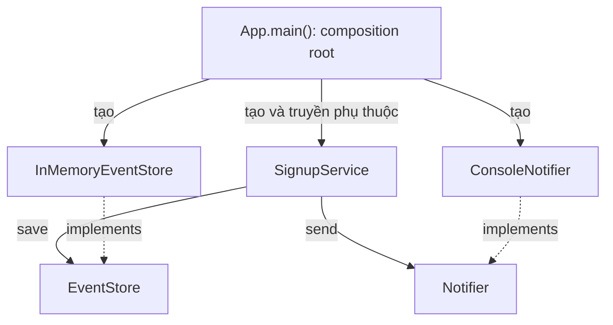

# Kiến thức nền và lộ trình học từ tham chiếu đối tượng tới lắp ghép ứng dụng

Trong Java, một ứng dụng thường gồm nhiều đối tượng cộng tác: dịch vụ đăng ký sử dụng nơi lưu dữ liệu, nơi lưu dữ liệu sử dụng kết nối, bộ xử lý yêu cầu sử dụng dịch vụ nghiệp vụ. Khi chương trình lớn lên, câu hỏi không chỉ là **một đối tượng làm gì**, mà còn là **ai tạo đối tượng đó, ai đưa các phụ thuộc cho nó, và các đối tượng được dùng chung trong bao lâu**.

Đây là nền tảng để học **Dependency Injection (DI)** và **Inversion of Control (IoC)**. Mục tiêu của DI là tách mã **sử dụng** một phụ thuộc khỏi mã **khởi tạo và lắp ghép** phụ thuộc ấy. Ta bắt đầu bằng Java thuần để thấy rõ cơ chế, sau đó mới tìm hiểu cách DI container tự động hóa việc lắp ghép.

Sau bài này, bạn cần có khả năng:

- Phân biệt đối tượng, biến tham chiếu, phụ thuộc, thao tác khởi tạo và thao tác sử dụng.
- Nhìn một đoạn mã và xác định nơi đang quyết định lớp triển khai, nơi đang tạo đối tượng và nơi đang điều khiển vòng đời của chúng.
- Giải thích quan hệ giữa IoC, DI và Dependency Inversion Principle (DIP) mà không xem chúng là ba tên gọi của cùng một thứ.
- Tự lắp một đồ thị đối tượng nhỏ bằng **constructor injection**, kiểm thử nó bằng Java thuần và nhận ra bước tiếp theo cần học về scope, vòng đời, factory và DI container.

## 1. Bắt đầu với đối tượng và tham chiếu trong Java

Xét hai dòng mã:

```java
Notifier notifier = new ConsoleNotifier();
SignupService signupService = new SignupService(notifier);
```

Để hiểu hai dòng này, cần tách bốn khái niệm:

| Khái niệm | Ý nghĩa trong ví dụ |
| --- | --- |
| **Đối tượng (object)** | Thực thể `ConsoleNotifier` được tạo khi chạy `new ConsoleNotifier()`. |
| **Tham chiếu (reference)** | Biến `notifier` giữ một tham chiếu đến đối tượng ấy; bản thân biến không phải là đối tượng. |
| **Khởi tạo (construction)** | `new` gọi constructor để tạo đối tượng; biểu thức `new` trả về tham chiếu đến đối tượng mới. |
| **Sử dụng (collaboration)** | `SignupService` nhận tham chiếu `notifier` để gọi hành vi gửi thông báo khi cần. |

Trong Java, truyền một tham chiếu vào constructor là **truyền giá trị của tham chiếu**. Đối tượng nhận được một tham chiếu đến **cùng đối tượng**, không phải bản sao của toàn bộ đối tượng. Vì vậy, hai dịch vụ có thể cùng sử dụng một notifier hoặc mỗi dịch vụ dùng một notifier khác nhau, tùy cách ta lắp ghép.

Một field `final` như `private final Notifier notifier;` giúp đối tượng không thể gán lại field ấy sau khi khởi tạo. `final` **không** làm đối tượng `Notifier` trở nên bất biến và cũng không tự xác định khi nào đối tượng được đóng hoặc thu hồi.

## 2. Từ “có tham chiếu” đến “có phụ thuộc”

Một lớp có **phụ thuộc (dependency)** vào thành phần khác khi hành vi của nó cần đến thành phần đó. Ví dụ, đăng ký tài khoản cần lưu tên đăng ký và gửi thông báo. Hai chức năng này có thể được diễn đạt thành các hợp đồng:

```java
interface EventStore {
    void save(String username);
}

interface Notifier {
    void send(String message);
}
```

Lớp `SignupService` phụ thuộc vào khả năng **lưu** và **gửi**, chưa nhất thiết phải biết dữ liệu lưu trong bộ nhớ hay cơ sở dữ liệu, và thông báo được in ra console hay gửi email.

Một cách viết ban đầu thường gặp là để chính dịch vụ tự quyết định việc khởi tạo:

```java
final class SignupService {
    private final InMemoryEventStore store = new InMemoryEventStore();
    private final ConsoleNotifier notifier = new ConsoleNotifier();

    void register(String username) {
        store.save(username);
        notifier.send("Welcome, " + username + "!");
    }
}
```

Đoạn mã này có thể hoạt động cho bản thử nghiệm nhỏ. Tuy nhiên, `SignupService` đồng thời đảm nhiệm ba quyết định: **thực hiện nghiệp vụ**, **chọn lớp triển khai phụ thuộc** và **tạo các phụ thuộc**. Khi cần chuyển sang cơ sở dữ liệu thật, thay cách thông báo hoặc kiểm thử độc lập, ta phải can thiệp vào mã của dịch vụ. Việc tạo một `InMemoryEventStore` riêng cho từng `SignupService` cũng có thể vô tình làm dữ liệu không được chia sẻ như mong muốn.

Điểm quan trọng: **vấn đề không nằm ở từ khóa `new` tự thân**. Tạo đối tượng là công việc bắt buộc ở đâu đó. Vấn đề là quyết định khởi tạo và cấu hình các thành phần bên ngoài đang bị trộn vào nơi xử lý nghiệp vụ.

## 3. Tách sử dụng, khởi tạo và lắp ghép

Với **constructor injection**, đối tượng công bố những gì nó cần qua tham số constructor. Mã ở bên ngoài chịu trách nhiệm cung cấp các phụ thuộc đó:

```java
import java.util.Objects;

final class SignupService {
    private final EventStore store;
    private final Notifier notifier;

    SignupService(EventStore store, Notifier notifier) {
        this.store = Objects.requireNonNull(store, "store");
        this.notifier = Objects.requireNonNull(notifier, "notifier");
    }

    void register(String username) {
        store.save(username);
        notifier.send("Welcome, " + username + "!");
    }
}
```

Mẫu thiết kế ở đây có ba vai trò rõ ràng:

1. **Hợp đồng phụ thuộc**: `EventStore` và `Notifier` mô tả năng lực mà dịch vụ cần.
2. **Đối tượng sử dụng**: `SignupService` nhận và dùng các phụ thuộc, không tự chọn một lớp triển khai cụ thể.
3. **Mã lắp ghép**: nơi khác tạo `InMemoryEventStore`, `ConsoleNotifier` rồi truyền chúng vào constructor của `SignupService`.

Constructor injection giúp dịch vụ được tạo trong **trạng thái sẵn sàng sử dụng**: hai phụ thuộc bắt buộc phải có ngay tại thời điểm xây dựng. Kiểm tra `null` trong constructor còn khiến lỗi cấu hình xuất hiện sớm, sát nguồn gốc của lỗi. Tuy nhiên, cách này không thay thế việc thiết kế hợp đồng rõ ràng; đối tượng được truyền vào vẫn cần thực hiện đúng hành vi đã hứa.

### IoC, DI và DIP khác nhau thế nào?

| Thuật ngữ | Câu hỏi trọng tâm | Áp dụng trong ví dụ |
| --- | --- | --- |
| **Inversion of Control (IoC)** | Ai quyết định và điều phối việc cung cấp thành phần? | Việc chọn, tạo, nối các phụ thuộc chuyển ra khỏi `SignupService` và được điều phối từ bên ngoài. |
| **Dependency Injection (DI)** | Phụ thuộc được đưa đến đối tượng bằng cách nào? | `SignupService` nhận `EventStore` và `Notifier` qua constructor. |
| **Dependency Inversion Principle (DIP)** | Mã nghiệp vụ phụ thuộc vào mức trừu tượng hay chi tiết triển khai? | `SignupService` phụ thuộc vào các hợp đồng `EventStore`, `Notifier`, thay vì phụ thuộc trực tiếp vào lớp lưu bộ nhớ hay thông báo console. |

**DI là một kỹ thuật có thể dùng để thực hiện IoC; DIP là nguyên tắc thiết kế phụ thuộc.** Ta hoàn toàn có thể truyền một lớp cụ thể qua constructor mà không tạo interface: đó vẫn là constructor injection. Ngược lại, chỉ thêm interface mà vẫn `new` một triển khai cụ thể bên trong dịch vụ thì chưa tách được trách nhiệm lắp ghép. DI container là công cụ tự động hóa một phần DI, không phải điều kiện để có DI hoặc IoC.

## 4. Một ứng dụng Java thuần từ đầu đến cuối

Ví dụ dưới đây dùng Java 17 trở lên và không cần thư viện, annotation hay framework. Đặt nội dung vào `App.java`:

```java
import java.util.ArrayList;
import java.util.List;
import java.util.Objects;

interface EventStore {
    void save(String username);
}

interface Notifier {
    void send(String message);
}

final class InMemoryEventStore implements EventStore {
    private final List<String> users = new ArrayList<>();

    @Override
    public void save(String username) {
        users.add(username);
    }

    List<String> snapshot() {
        return List.copyOf(users);
    }
}

final class ConsoleNotifier implements Notifier {
    @Override
    public void send(String message) {
        System.out.println(message);
    }
}

final class SignupService {
    private final EventStore store;
    private final Notifier notifier;

    SignupService(EventStore store, Notifier notifier) {
        this.store = Objects.requireNonNull(store, "store");
        this.notifier = Objects.requireNonNull(notifier, "notifier");
    }

    void register(String username) {
        if (username == null || username.isBlank()) {
            throw new IllegalArgumentException("username must not be blank");
        }

        store.save(username);
        notifier.send("Welcome, " + username + "!");
    }
}

public class App {
    public static void main(String[] args) {
        // Composition root: nơi chọn triển khai, tạo và nối các đối tượng.
        InMemoryEventStore store = new InMemoryEventStore();
        Notifier notifier = new ConsoleNotifier();
        SignupService signupService = new SignupService(store, notifier);

        // Sau khi lắp ghép xong, ứng dụng sử dụng dịch vụ nghiệp vụ.
        signupService.register("an");
        System.out.println(store.snapshot());
    }
}
```

Chạy trong thư mục chứa tệp:

```bash
javac App.java
java App
```

Kết quả dự kiến:

```text
Welcome, an!
[an]
```

Ở đây, `App.main()` đóng vai trò **composition root**: điểm cấp cao nơi chương trình chọn triển khai cụ thể, khởi tạo các đối tượng và nối chúng thành đồ thị phụ thuộc (**object graph**). `SignupService` không cần biết ai gọi constructor, đối tượng lưu trữ đến từ đâu, hay chương trình đang chạy bằng CLI hay web server.



Các mũi tên nét liền từ `SignupService` đến interface thể hiện **phụ thuộc trong mã nguồn**; các mũi tên từ composition root thể hiện **lắp ghép khi chạy**. Một đối tượng `InMemoryEventStore` cụ thể được đưa vào tham số `EventStore`, nên dịch vụ gọi được phương thức `save` mà không cần biết lớp cụ thể. Nếu sau này thay bằng `DatabaseEventStore implements EventStore`, ta thay cấu hình lắp ghép và triển khai lưu trữ; mã nghiệp vụ vẫn có thể giữ nguyên **nếu hợp đồng và yêu cầu hành vi không đổi**.

Việc `App.main()` biết các lớp cụ thể là có chủ đích. Một composition root cần đủ thông tin để kết nối ứng dụng. Không nên cố giấu tất cả các lần gọi `new` hoặc tạo interface chỉ để loại bỏ mọi tên lớp cụ thể khỏi chương trình.

## 5. Kiểm thử khi đối tượng nhận phụ thuộc từ bên ngoài

Một lợi ích trực tiếp của DI là có thể kiểm tra `SignupService` độc lập với console hoặc cơ sở dữ liệu. Ta cung cấp **test double** đơn giản: các hàm nhận dữ liệu và ghi lại lời gọi. Trong cùng thư mục với `App.java`, tạo tệp `SignupServiceTest.java`:

```java
import java.util.ArrayList;
import java.util.List;

public class SignupServiceTest {
    public static void main(String[] args) {
        List<String> savedUsers = new ArrayList<>();
        List<String> sentMessages = new ArrayList<>();

        EventStore store = savedUsers::add;
        Notifier notifier = sentMessages::add;
        SignupService service = new SignupService(store, notifier);

        service.register("an");

        if (!savedUsers.equals(List.of("an"))) {
            throw new AssertionError("User was not saved: " + savedUsers);
        }
        if (!sentMessages.equals(List.of("Welcome, an!"))) {
            throw new AssertionError("Notification mismatch: " + sentMessages);
        }

        System.out.println("PASS");
    }
}
```

```bash
javac App.java SignupServiceTest.java
java SignupServiceTest
```

`EventStore` và `Notifier` mỗi interface có một phương thức trừu tượng nên có thể dùng method reference làm triển khai thử nghiệm. Bài kiểm tra xác nhận cả kết quả lưu trữ lẫn thông điệp gửi đi; không phải kết nối tới dịch vụ thật. Khi dự án có bộ kiểm thử chuyên dụng như JUnit, ta chuyển các điều kiện này sang assertion trong test case, nhưng **cơ chế DI của mã nghiệp vụ không thay đổi**.

Để thử khả năng thay thế, hãy tạo `SilentNotifier implements Notifier` hoặc một `RecordingNotifier` lưu thông điệp vào danh sách, sau đó đưa nó vào composition root. Nếu phải sửa `SignupService` để thay notifier, cần xem lại ranh giới giữa nghiệp vụ và lắp ghép.

## 6. Tham chiếu chung dẫn đến câu hỏi về scope và vòng đời

Trong ví dụ, `store` được tạo **một lần** rồi được truyền cho `SignupService`. Java không tự sao chép `store` khi truyền vào constructor. Ta cũng có thể lắp hai dịch vụ cùng dùng đối tượng ấy:

```java
InMemoryEventStore sharedStore = new InMemoryEventStore();
Notifier sharedNotifier = new ConsoleNotifier();

SignupService first = new SignupService(sharedStore, sharedNotifier);
SignupService second = new SignupService(sharedStore, sharedNotifier);

first.register("an");
second.register("binh");

System.out.println(sharedStore.snapshot()); // [an, binh]
```

Hai đối tượng `SignupService` khác nhau giữ tham chiếu đến cùng một `sharedStore`. Điều này dẫn đến hai câu hỏi thiết kế cần tách biệt:

- **Scope (phạm vi sử dụng / tái sử dụng)**: Với một lần khởi động ứng dụng, một request, một tác vụ, hay mỗi lần sử dụng, ta tạo đối tượng mới hay dùng lại đối tượng cũ?
- **Lifecycle (vòng đời)**: Ai khởi tạo đối tượng, ai chịu trách nhiệm quản lý tài nguyên của nó, khi nào đóng hoặc giải phóng tài nguyên?

Ví dụ trong bộ nhớ trên chỉ minh họa chia sẻ tham chiếu ở một luồng thực thi. `ArrayList` bên trong `InMemoryEventStore` không an toàn nếu nhiều luồng cùng ghi mà không có cơ chế đồng bộ. Trong ứng dụng thật, lựa chọn scope phải xét **trạng thái có thể thay đổi, tính an toàn luồng, chi phí tạo đối tượng và tài nguyên được giữ**. Dịch vụ không có trạng thái theo request thường có thể tái sử dụng, trong khi dữ liệu gắn với request không nên vô tình chia sẻ giữa các request.

Đối tượng giữ kết nối mạng, kết nối cơ sở dữ liệu, file handle hoặc thread pool còn đòi hỏi quy ước đóng tài nguyên. Trong Java thuần, mã tạo và sở hữu tài nguyên thường cần quản lý việc `close()` (chẳng hạn bằng `try-with-resources` nếu kiểu tài nguyên implements `AutoCloseable`). **Garbage collection không thay thế việc đóng tài nguyên ngoài heap đúng thời điểm.** DI container có thể hỗ trợ scope và callback vòng đời, nhưng người thiết kế vẫn phải xác định quyền sở hữu phù hợp.

## 7. Lộ trình từ Java cơ bản đến DI container

Bạn có thể học theo thứ tự sau; mỗi chặng tạo tiền đề trực tiếp cho chặng tiếp theo.

| Chặng | Cần nắm | Bài tập / dấu hiệu đã hiểu |
| --- | --- | --- |
| **1. Class, object, reference** | Constructor, field, `new`, truyền tham số, interface, đa hình; cùng tham chiếu nghĩa là cùng đối tượng. | Tạo hai dịch vụ dùng chung một đối tượng, rồi tạo hai đối tượng riêng; giải thích khác biệt về trạng thái. |
| **2. Mô hình phụ thuộc** | Phân biệt **uses-a** và **creates-a**, phụ thuộc ở thời điểm biên dịch và các liên kết khi chạy. | Vẽ mũi tên phụ thuộc của một dịch vụ đang tự `new` các thành phần khác. |
| **3. Constructor injection và DIP** | Công bố phụ thuộc bắt buộc, kiểm tra `null`, phụ thuộc vào hợp đồng khi có lý do thay thế triển khai. | Đưa các lần tạo `EventStore` và `Notifier` ra khỏi `SignupService`. |
| **4. Composition root và object graph** | Chọn triển khai, xác định thứ tự khởi tạo, nối các thành phần, phát hiện vòng phụ thuộc. | Tự viết `main()` lắp đầy đủ một đường đi từ điểm vào ứng dụng đến nơi lưu trữ. |
| **5. Kiểm thử Java thuần** | Fake, stub, ghi lại lời gọi, kiểm tra nghiệp vụ độc lập khỏi I/O. | Dùng `List` và method reference để xác nhận lưu dữ liệu và gửi thông báo. |
| **6. Scope, lifecycle, factory** | Dùng chung hay tạo mới, đối tượng có trạng thái, đóng tài nguyên, tình huống cần tạo phụ thuộc theo dữ liệu lúc chạy. | Giải thích vì sao không nên dùng chung một đối tượng mang trạng thái request giữa các request; thử một factory đơn giản. |
| **7. DI container / framework** | Đăng ký thành phần, quy tắc chọn triển khai, constructor resolution, scope, lifecycle callback, lỗi cấu hình. | Lắp lại ví dụ bằng container và so sánh đồ thị đối tượng cuối cùng với bản viết bằng Java thuần. |

### Khi nào cần factory hoặc provider?

Constructor injection phù hợp với những phụ thuộc đã biết tại thời điểm lắp ghép. Nếu chương trình cần **tạo một đối tượng mới theo mỗi tác vụ** hoặc **chọn triển khai dựa trên dữ liệu chỉ xuất hiện lúc chạy**, một factory/provider có thể nhận trách nhiệm tạo đối tượng theo yêu cầu. Không nên ép một đối tượng có vòng đời ngắn thành phụ thuộc được chia sẻ lâu dài chỉ để mọi thứ đều được truyền trực tiếp qua constructor.

### Khi nào chuyển sang container?

Hãy bắt đầu với `main()` hoặc một lớp cấu hình lắp ghép nhỏ. Khi số lượng thành phần và quy tắc vòng đời đủ phức tạp, container có thể giúp khai báo và tạo đồ thị đối tượng nhất quán. Tuy nhiên, container chỉ tự động hóa việc quản lý các quan hệ mà bạn thiết kế; **nó không tự sửa interface kém rõ ràng, vòng phụ thuộc hay quyết định scope sai**. Kinh nghiệm lắp ghép thủ công là cơ sở để đọc lỗi container và xác định đúng nơi sửa.

## 8. Những ngộ nhận dễ mắc ở giai đoạn đầu

| Ngộ nhận | Cách hiểu chính xác |
| --- | --- |
| “Dùng DI thì không được dùng `new`.” | `new` vẫn cần xuất hiện tại composition root, factory hoặc nơi tạo giá trị nội bộ; cần tách quyết định lắp ghép **phụ thuộc bên ngoài** khỏi nghiệp vụ. |
| “Có interface nghĩa là đã dùng DI.” | Interface xác định hợp đồng; việc phụ thuộc được **đưa từ bên ngoài** mới là cơ chế injection. |
| “DI luôn phải có interface cho mọi lớp.” | Có thể inject lớp cụ thể; chỉ tạo abstraction khi nó phục vụ một ranh giới hoặc khả năng thay thế có ý nghĩa. |
| “DI, IoC và DIP là một.” | IoC là sự chuyển quyền điều phối, DI là một kỹ thuật cung cấp phụ thuộc, DIP là nguyên tắc hướng phụ thuộc mã nguồn. |
| “Truyền đối tượng vào là tự quản lý được vòng đời.” | Constructor chỉ nhận tham chiếu; nơi lắp ghép vẫn phải quyết định tái sử dụng, đồng bộ trạng thái và đóng tài nguyên. |
| “Container sẽ giải quyết mọi phụ thuộc.” | Container có thể tạo và nối đối tượng, nhưng không thay thế việc thiết kế graph, xử lý cycle, chọn scope và quản lý tài nguyên đúng. |

## 9. Bài thực hành kết nối các kiến thức

Từ `App.java` ở trên, hãy thực hiện tuần tự:

1. **Đọc đồ thị:** Chỉ ra nơi `new` được gọi, nơi phụ thuộc được khai báo và nơi `SignupService` sử dụng phụ thuộc. Đánh dấu lớp nào biết `ConsoleNotifier`.
2. **Đổi cách lắp ghép:** Tạo `RecordingNotifier` ghi các thông điệp vào `List<String>`. Thay đúng một dòng chọn notifier tại composition root, giữ nguyên mã `SignupService`.
3. **Thử vòng đời:** Lắp hai `SignupService` dùng cùng `InMemoryEventStore`; kiểm tra rằng `snapshot()` nhận đủ dữ liệu từ cả hai. Sau đó dùng hai store khác nhau và giải thích vì sao trạng thái tách biệt.
4. **Thêm kiểm thử lỗi đầu vào:** Gọi `register("  ")`, xác nhận `IllegalArgumentException`; kiểm tra rằng không ghi tên đăng ký hay gửi thông báo.
5. **Thiết kế trước khi dùng container:** Vẽ object graph có thêm một `SignupController` nhận `SignupService` qua constructor. Ghi rõ điểm vào ứng dụng, thứ tự tạo đối tượng và đối tượng nào được tái sử dụng.

Tự kiểm tra hiểu bài bằng ba câu hỏi: **(1)** Một dịch vụ nhận `Notifier` qua constructor có nhất thiết phải biết lớp `ConsoleNotifier` không? **(2)** Hai biến tham chiếu cùng trỏ tới một `InMemoryEventStore` có tạo ra hai kho lưu trữ độc lập không? **(3)** Ai nên quyết định tạo và đóng một thành phần giữ kết nối cơ sở dữ liệu: mã đăng ký tài khoản hay phần quản lý lắp ghép/tài nguyên?

Khi trả lời và thực hành được các câu hỏi này, bạn đã có mô hình nền tảng để đi sâu vào constructor design, composition root, object graph, scope, lifecycle, factory/provider, testing và cuối cùng là DI container. Điểm xuyên suốt là **để các đối tượng tập trung vào hành vi của mình, còn việc tạo và kết nối các phụ thuộc trở thành quyết định rõ ràng ở ranh giới ứng dụng**.
