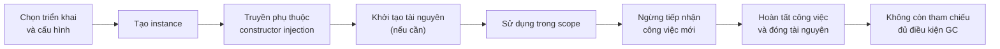
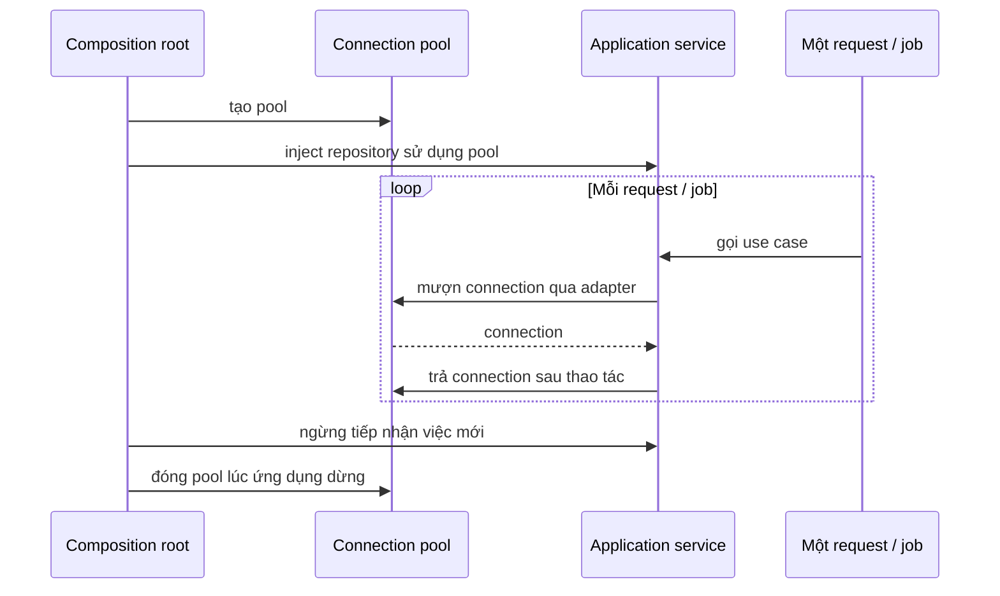

# Vòng đời đối tượng và phạm vi tồn tại (scope) của một instance

Trong chương **Vòng đời và phạm vi** của module **Dependency Injection (DI)**, việc truyền một phụ thuộc qua constructor mới giải quyết được câu hỏi **“đối tượng này nhận cộng tác viên từ đâu?”**. Một ứng dụng hoạt động đúng còn cần trả lời: **“cộng tác viên ấy được tạo khi nào, dùng chung với ai, và ai chịu trách nhiệm kết thúc việc sử dụng nó?”**

Khi học **Dependency Injection** và **Inversion of Control (IoC)**, ta tách mã **sử dụng** phụ thuộc khỏi mã **tạo và lắp ghép**. Nhưng nếu lắp một đối tượng mang dữ liệu riêng của một request vào service dùng chung cho mọi request, ứng dụng vẫn có thể rò trạng thái. Nếu tạo connection pool nhưng không đóng nó khi tiến trình dừng, việc inject đúng kiểu cũng không giúp tài nguyên được giải phóng. Vì vậy, **scope** và **lifecycle** là hai quyết định thiết kế đi cùng với constructor injection, composition root và kiểm thử bằng Java thuần, trước khi chuyển sang DI container.

Sau bài này, bạn có thể:

- Phân biệt **instance**, **scope**, **lifecycle**, **quyền sở hữu tài nguyên**, **khả năng truy cập (reachability)** và **phạm vi biến trong Java**.
- Giải thích các lựa chọn dùng chung theo ứng dụng, tạo mới mỗi lần cấp, theo request, session hoặc job; hiểu vì sao tên scope phụ thuộc vào môi trường chạy.
- Nhận ra nguy cơ khi một đối tượng sống lâu giữ tham chiếu tới đối tượng đáng lẽ chỉ sống trong một request hoặc tác vụ.
- Tự lắp ghép và đóng các phụ thuộc tại **composition root** bằng Java thuần, đồng thời kiểm thử hành vi, tính cách ly trạng thái và đóng tài nguyên.
- Hiểu phần DI container có thể tự động hóa và những trách nhiệm thiết kế vẫn thuộc về người viết chương trình.

## 1. Phân biệt instance, scope, lifecycle và quyền sở hữu

Xét ví dụ:

```java
PricePolicy policy = new PricePolicy();
BookingService first = new BookingService(policy);
BookingService second = new BookingService(policy);
```

Có **một instance** `PricePolicy` và **hai instance** `BookingService`. Hai service nhận cùng một giá trị tham chiếu đến `policy`; constructor injection **không sao chép** đối tượng `PricePolicy`. Nếu thay câu lệnh tạo `policy` bằng hai lệnh `new PricePolicy()` khác nhau, mỗi service sẽ nhận một instance riêng.

Các khái niệm liên quan nhưng trả lời những câu hỏi khác nhau:

| Khái niệm | Câu hỏi | Ví dụ |
| --- | --- | --- |
| **Instance** | Đối tượng cụ thể nào được tạo và nhận diện tại runtime? | Đối tượng `PricePolicy` do một lần gọi `new` tạo ra |
| **Scope** | Trong một phạm vi sử dụng, các lần yêu cầu phụ thuộc có nhận **cùng instance** hay **instance khác**? | Một `PricePolicy` cho cả ứng dụng, hay một đối tượng cho mỗi request |
| **Lifecycle** | Đối tượng được tạo, thiết lập, dùng và kết thúc trách nhiệm sử dụng khi nào? | Tạo repository khi khởi động, dùng qua nhiều request, đóng pool lúc dừng |
| **Ownership** | Ai chịu trách nhiệm tạo, phối hợp và đóng tài nguyên? | Composition root quản lý pool; adapter đóng connection của một transaction |
| **Reachability** | Object còn được tham chiếu từ các điểm có thể truy cập của JVM không? | Field trên một singleton tiếp tục giữ đối tượng request sau khi request kết thúc |
| **Lexical scope** | Tên biến Java nhìn thấy được ở đoạn mã nào? | Biến `local` chỉ truy cập được trong một khối `{ ... }` |

**Scope trong DI không đồng nghĩa với phạm vi nhìn thấy của biến Java.** Ví dụ:

```java
Object saved;
{
    Object local = new Object();
    saved = local;
}
// Biến local ra khỏi phạm vi nhìn thấy, nhưng saved vẫn tham chiếu
// đến cùng đối tượng. Không thể suy ra object đã bị thu hồi.
```

Một scope như “request” hoặc “application” là **quy tắc cấp và tái sử dụng instance theo ngữ cảnh**, không phải thời hạn chính xác mà JVM giữ object trên heap. Một object có thể tiếp tục được tham chiếu sau khi request kết thúc do lỗi lưu tham chiếu; ngược lại, object không còn dùng đến có thể trở thành đối tượng đủ điều kiện thu gom trước khi một scope logic kết thúc.

## 2. Các giai đoạn điển hình của vòng đời

Không phải mọi class đều có đầy đủ các giai đoạn dưới đây; một đối tượng dữ liệu đơn giản có thể chỉ được tạo, dùng, rồi trở nên không còn được tham chiếu. Với các service và tài nguyên có quản lý, hãy hình dung:



Một số chi tiết cần hiểu chính xác:

1. **Tạo và cấu hình:** Composition root hoặc container chọn concrete class, cấp tham số constructor và hoàn tất những bước khởi tạo cần thiết. Constructor injection cho phép công bố các phụ thuộc bắt buộc ngay từ lúc tạo.
2. **Sẵn sàng sử dụng:** Với đối tượng có bước khởi tạo hai giai đoạn, chẳng hạn kết nối mạng hoặc đăng ký listener sau constructor, mã sở hữu phải bảo đảm không công bố object quá sớm.
3. **Sử dụng:** Một instance có thể phục vụ một tác vụ, một request hoặc nhiều request. Scope quyết định chính sách cấp instance; mức độ dùng chung phải phù hợp với trạng thái và tính an toàn luồng.
4. **Kết thúc sử dụng:** Cần ngừng nhận tác vụ mới, đợi hoặc hủy tác vụ đang chạy theo chính sách, rồi đóng những tài nguyên mà ứng dụng sở hữu. Thứ tự có thể quan trọng: consumer thường ngừng trước khi phụ thuộc của nó bị đóng.
5. **Thu gom bộ nhớ:** Khi không còn reachable, object **có thể** được garbage collector thu gom vào thời điểm JVM lựa chọn. GC không hứa thực hiện ngay sau khi một scope logic kết thúc.

Đặc biệt, `close()`, `shutdown()` hay callback hủy bean **không đồng nghĩa với thu gom rác**. Chúng là thao tác kết thúc **tài nguyên/hành vi** có chủ đích. Một object đã `close()` vẫn có thể còn trên heap; ngược lại, chờ GC không phải cách đáng tin cậy để đóng file, socket, connection hoặc thread pool đúng thời điểm.

## 3. Các phạm vi thường gặp và giới hạn của chúng

Tên scope có thể khác giữa các framework. Bảng dưới đây mô tả ý tưởng phổ biến, **không phải cam kết chung của mọi DI container**.

| Phạm vi | Quy tắc cấp instance | Phù hợp với | Điều cần chú ý |
| --- | --- | --- | --- |
| **Application / container singleton** | Thường một instance cho một đăng ký trong **một container/ứng dụng** | Chính sách bất biến, cấu hình đã kiểm tra, service không giữ trạng thái theo request, client/pool được thiết kế để dùng chung | Không phải singleton cho toàn bộ các JVM; phải kiểm tra thread-safety và shutdown |
| **Transient / prototype** | Thường tạo instance mới khi nơi lắp ghép yêu cầu | Đối tượng có trạng thái riêng hoặc thao tác không nên chia sẻ | Tùy framework, dependency prototype đã inject vào singleton có thể chỉ được tạo **một lần khi singleton được dựng** |
| **Request** | Thường một instance cho một HTTP request/ngữ cảnh request | Thông tin request, unit of work, một số transaction-scoped collaborator | Chỉ tồn tại khi có request context; không nên giữ tham chiếu sau khi request kết thúc |
| **Session** | Thường dùng chung trong một phiên người dùng | Trạng thái thật sự gắn với session | Phiên có thể kéo dài, tăng tiêu thụ bộ nhớ; nhiều request cùng session vẫn có thể đồng thời |
| **Job / task** | Một instance cho mỗi lần xử lý message, job hoặc tác vụ | Payload, trạng thái retry, unit of work theo job | Đây có thể là **quy ước tự thiết kế**, không phải scope dựng sẵn của container |
| **Thread** | Một instance gắn với một thread | Một số tích hợp cũ hoặc trường hợp đặc thù | Thread pool tái sử dụng thread qua nhiều request/job; thread scope **không tương đương** request/job scope |

Một “singleton” trong DI thường có nghĩa **dùng lại một instance theo phạm vi quản lý của container hoặc một đăng ký**. Hai tiến trình hoặc hai container độc lập vẫn có thể tạo hai singleton khác nhau. Không nên coi annotation singleton là “một đối tượng duy nhất trên toàn hệ thống phân tán”.

**Phân biệt scope với thời gian tồn tại vật lý:** Container có thể ngừng cấp một request-scoped instance ngay khi request xong và gọi callback cleanup; nếu mã khác còn giữ tham chiếu thì object có thể tiếp tục tồn tại trên heap. Trường hợp này thường phản ánh một **lỗi rò trạng thái hoặc ownership**, không phải tính năng hợp lệ của request scope.

### 3.1. Một ví dụ về số lượng instance

Giả sử có `PricingPolicy` không giữ dữ liệu request và `RequestContext` chứa request ID:

```text
Application graph khởi động:
  pricingPolicy #1
  bookingService #1  ----> pricingPolicy #1

Request A:
  context A   -----> bookingService #1

Request B:
  context B   -----> bookingService #1
```

Điều này có thể an toàn khi `bookingService` **không lưu** `context A/B` vào field và `pricingPolicy` không có trạng thái có thể thay đổi nguy hiểm. Nếu biến `context` thành field của `bookingService` dùng chung, hai request có thể nhìn thấy dữ liệu của nhau.

## 4. Quyết định scope theo trạng thái và hành vi

Đừng chọn scope chỉ dựa vào tên class. Hai lớp cùng tên `Repository` có thể có cơ chế sử dụng khác nhau: một repository giữ tham chiếu đến connection pool dùng chung, repository khác giữ một connection chỉ hợp lệ trong một transaction.

Khi đánh giá một dependency, hãy hỏi:

1. **Có trạng thái thay đổi không?** Nếu có, trạng thái ấy thuộc ứng dụng, phiên người dùng, request hay một tác vụ?
2. **Có thể gọi đồng thời không?** Nếu instance dùng chung, mọi phương thức và dependency phía dưới có chịu được nhiều thread không?
3. **Chi phí tạo đối tượng là gì?** Một policy thuần Java rẻ hơn việc mở socket hoặc khởi tạo pool, nhưng chi phí không đủ để quyết định scope nếu việc chia sẻ tạo lỗi nghiệp vụ.
4. **Đối tượng sở hữu tài nguyên nào?** File, HTTP connection, JDBC connection, executor, scheduler, subscription hoặc lock cần quy tắc kết thúc rõ.
5. **Dữ liệu phụ thuộc xuất hiện lúc nào?** Cấu hình lúc khởi động có thể inject vào constructor; request ID chỉ biết khi request đến nên thường đi theo tham số phương thức hoặc request scope.

Trong Java, field `final` chỉ bảo đảm **không gán lại tham chiếu** sau khi khởi tạo hợp lệ. Nó không bảo đảm đối tượng được tham chiếu bất biến hay thread-safe:

```java
private final java.util.List<String> events = new java.util.ArrayList<>();

void record(String event) {
    events.add(event); // List vẫn thay đổi; ArrayList không tự an toàn đa luồng
}
```

Nếu cần chia sẻ một service giữa các request, ưu tiên service không giữ trạng thái riêng của request; đồng thời kiểm tra thread-safety của các adapter và tài nguyên nó dùng. Chỉ chuyển sang collection đồng bộ hay thêm lock khi có yêu cầu đồng thời cụ thể; không dùng synchronized để che một mô hình scope sai.

## 5. Ví dụ Java thuần: một graph ứng dụng, nhiều request

Ví dụ sau minh họa **application scope**, **request scope tự quản lý**, **constructor injection**, **composition root** và **cleanup**. Ta tạo một repository cho cả tiến trình, một `OrderService` dùng lại, nhưng mỗi lần gọi tạo `RequestContext` riêng. Ví dụ chạy tuần tự để dễ quan sát; repository dùng `ArrayList` chỉ dành cho demo đơn luồng.

Lưu nội dung vào `ScopeLifecycleDemo.java` (Java 17 trở lên):

```java
import java.util.ArrayList;
import java.util.List;
import java.util.Objects;

public class ScopeLifecycleDemo {
    record Order(String requestId, String product, int priceCents) { }
    record RequestContext(String requestId) { }

    @FunctionalInterface
    interface OrderRepository {
        void save(Order order);
    }

    static final class InMemoryOrderRepository
            implements OrderRepository, AutoCloseable {
        private final List<Order> saved = new ArrayList<>();
        private boolean closed;

        @Override
        public void save(Order order) {
            if (closed) {
                throw new IllegalStateException("Repository was closed");
            }
            saved.add(Objects.requireNonNull(order));
        }

        List<Order> snapshot() {
            return List.copyOf(saved);
        }

        boolean isClosed() {
            return closed;
        }

        @Override
        public void close() {
            closed = true; // Mô phỏng việc kết thúc quyền sử dụng tài nguyên.
        }
    }

    static final class DiscountPolicy {
        private final int discountPercent;

        DiscountPolicy(int discountPercent) {
            if (discountPercent < 0 || discountPercent > 100) {
                throw new IllegalArgumentException("Invalid discount");
            }
            this.discountPercent = discountPercent;
        }

        int apply(int priceCents) {
            if (priceCents < 0) {
                throw new IllegalArgumentException("Negative price");
            }
            // Phép tính đơn giản để minh họa một policy bất biến.
            return Math.toIntExact((long) priceCents
                    * (100 - discountPercent) / 100);
        }
    }

    static final class OrderService {
        private final OrderRepository repository;
        private final DiscountPolicy policy;

        OrderService(OrderRepository repository, DiscountPolicy policy) {
            this.repository =
                    Objects.requireNonNull(repository, "repository");
            this.policy = Objects.requireNonNull(policy, "policy");
        }

        Order place(String product, int priceCents, RequestContext context) {
            if (product == null || product.isBlank()) {
                throw new IllegalArgumentException("Invalid product");
            }
            Objects.requireNonNull(context, "context");
            if (context.requestId() == null
                    || context.requestId().isBlank()) {
                throw new IllegalArgumentException("Invalid request ID");
            }

            Order order = new Order(
                    context.requestId(), product, policy.apply(priceCents));
            repository.save(order);
            return order;
        }
    }

    // Composition root và chủ sở hữu tài nguyên của ứng dụng.
    static final class ApplicationGraph implements AutoCloseable {
        final InMemoryOrderRepository repository;
        final OrderService service;

        private ApplicationGraph(
                InMemoryOrderRepository repository, OrderService service) {
            this.repository = repository;
            this.service = service;
        }

        static ApplicationGraph create() {
            InMemoryOrderRepository repository =
                    new InMemoryOrderRepository();
            DiscountPolicy policy = new DiscountPolicy(10);
            OrderService service = new OrderService(repository, policy);
            return new ApplicationGraph(repository, service);
        }

        Order handle(String requestId, String product, int priceCents) {
            // Dữ liệu riêng của mỗi lời gọi; không giữ trong field của service.
            RequestContext context = new RequestContext(requestId);
            return service.place(product, priceCents, context);
        }

        @Override
        public void close() {
            repository.close();
        }
    }

    public static void main(String[] args) {
        ApplicationGraph graph = ApplicationGraph.create();
        InMemoryOrderRepository repository = graph.repository;

        try (graph) {
            Order first = graph.handle("REQ-01", "book", 1_000);
            Order second = graph.handle("REQ-02", "pen", 2_000);

            if (first.priceCents() != 900
                    || second.priceCents() != 1_800) {
                throw new AssertionError("Wrong discount");
            }
            if (!repository.snapshot().equals(List.of(first, second))) {
                throw new AssertionError("Request data was mixed");
            }
            System.out.println("Saved orders: "
                    + repository.snapshot().size());
        }

        if (!repository.isClosed()) {
            throw new AssertionError("Resource was not closed");
        }
        System.out.println("Repository closed: "
                + repository.isClosed());

        // Kiểm thử use case bằng Java thuần, không cần DI container.
        List<Order> stored = new ArrayList<>();
        OrderService tested = new OrderService(
                stored::add, new DiscountPolicy(0));
        Order sample = tested.place(
                "notebook", 500, new RequestContext("TEST-01"));
        if (!stored.equals(List.of(sample)) || sample.priceCents() != 500) {
            throw new AssertionError("Pure Java test failed");
        }
        System.out.println("Pure Java test: PASS");
    }
}
```

Biên dịch và chạy:

```bash
javac ScopeLifecycleDemo.java
java ScopeLifecycleDemo
```

Kết quả dự kiến:

```text
Saved orders: 2
Repository closed: true
Pure Java test: PASS
```

Đọc ví dụ theo scope:

| Đối tượng | Ai tạo? | Phạm vi logic | Ai đóng? |
| --- | --- | --- | --- |
| `DiscountPolicy` | `ApplicationGraph.create()` | Một instance cho graph ứng dụng | Không có tài nguyên cần đóng |
| `InMemoryOrderRepository` | `ApplicationGraph.create()` | Dùng lại trong graph ứng dụng | `ApplicationGraph.close()` |
| `OrderService` | `ApplicationGraph.create()` | Dùng lại qua các lời gọi `handle` | Không có `close` riêng |
| `RequestContext` | `ApplicationGraph.handle()` | Một lần gọi, mang request ID riêng | Không có tài nguyên cần đóng |
| `Order` | `OrderService.place()` | Một kết quả nghiệp vụ của lần gọi | Không có tài nguyên cần đóng |

Ví dụ dùng `AutoCloseable` ở repository để **mô phỏng** tài nguyên có vòng đời cần quản lý. Trong hệ thống thực, nó có thể là connection pool, HTTP client hoặc subscription. `try (graph)` bảo đảm `graph.close()` được gọi khi rời khối, kể cả khi có exception. Việc `close()` đặt cờ `closed` **không đại diện cho cách đóng database thật**; adapter thật phải giải phóng đúng tài nguyên mà nó sở hữu.

**Lưu ý quan trọng:** Hai lần gọi `handle` ở đây không tạo một scope request từ DI container. Chúng **tự tạo** `RequestContext` trong code tại mỗi lời gọi. Điều đó đã đủ để thực hành cách ly dữ liệu bằng Java thuần trước khi sử dụng framework.

## 6. Scope mismatch: khi đối tượng sống lâu giữ đối tượng sống ngắn

Một lỗi phổ biến là **captive dependency**: thành phần dự kiến sống lâu giữ tham chiếu tới thành phần được thiết kế để sống ngắn hơn.

Ví dụ xấu:

```java
final class RequestContext {
    final String userId;

    RequestContext(String userId) {
        this.userId = userId;
    }
}

final class SharedCheckoutService {
    private final RequestContext context;

    SharedCheckoutService(RequestContext context) {
        this.context = context;
    }

    String currentUser() {
        return context.userId;
    }
}

// Nếu SharedCheckoutService được giữ suốt đời ứng dụng,
// nó có thể giữ userId của request đầu tiên cho các request sau.
```

Không nhất thiết có lỗi biên dịch: constructor nhận đúng kiểu. Vấn đề là **lời hứa về scope bị phá vỡ**. Khi mỗi request cần một `RequestContext` riêng, ta có một số lựa chọn:

- **Truyền dữ liệu từng request qua tham số phương thức** nếu service dùng chung không cần giữ nó. Đây thường là cách đơn giản nhất bằng Java thuần.
- **Tạo service theo mỗi request** nếu chính service có trạng thái riêng không thể tách thành tham số.
- **Inject factory/provider hoặc proxy có scope phù hợp** nếu consumer sống lâu cần lấy dependency ngắn hạn tại thời điểm thực thi. Cơ chế proxy và quy tắc tạo mới phụ thuộc framework; phải hiểu chính xác cách nó hoạt động.

Không nên tự động sửa bằng cách đổi tất cả thành singleton. Làm vậy có thể biến dữ liệu người dùng, transaction hoặc request-local resource thành trạng thái dùng chung nguy hiểm.

### Phụ thuộc prototype cũng có thể bị “giữ lại”

Giả sử một container tạo một `TaskBuffer` mới mỗi khi được yêu cầu. Nếu container tạo singleton `BatchService` rồi inject một `TaskBuffer` **một lần qua constructor**, singleton vẫn giữ **chính instance đã được cấp khi nó được dựng**:

```text
Tạo BatchService một lần
  -> inject TaskBuffer #1 vào constructor

Lần gọi A -> BatchService dùng TaskBuffer #1
Lần gọi B -> BatchService vẫn dùng TaskBuffer #1
```

Chỉ đánh dấu `TaskBuffer` là prototype không có nghĩa là field đã inject sẽ tự đổi giá trị ở mỗi lời gọi. Nếu yêu cầu là tạo buffer mới cho mỗi tác vụ, cần chuyển trách nhiệm tạo đúng thời điểm cho factory/provider hoặc tạo buffer cục bộ ngay trong phương thức khi thích hợp.

## 7. Quyền sở hữu và đóng tài nguyên

Với một graph có connection pool, HTTP client và worker executor, “xong request” và “dừng ứng dụng” là hai mốc khác nhau:



Đừng hiểu hình trên là application service phải trực tiếp gọi API pool. Trong thiết kế thực tế, một **repository adapter/transaction manager** làm việc với pool; sơ đồ chỉ minh họa nơi tài nguyên được mượn và trả. Hợp đồng domain nên tập trung vào thao tác nghiệp vụ như `findById`, `save` hoặc `commit`, không yêu cầu consumer quản lý `Connection`.

Nguyên tắc quản lý ownership:

1. **Nơi tạo và sở hữu tài nguyên lâu dài** phải biết khi nào kết thúc nó. Composition root hoặc DI container có thể điều phối đóng client/pool/executor khi ứng dụng dừng.
2. **Nơi mở tài nguyên cho một thao tác** phải đóng theo phạm vi thao tác, thường bằng `try-with-resources` nếu đối tượng implements `AutoCloseable`.
3. **Đối tượng chỉ được mượn** không nên tự ý đóng tài nguyên mà caller hoặc chủ sở hữu khác còn cần. Hợp đồng cần nói rõ ai có quyền gọi `close()`.
4. **Thứ tự shutdown quan trọng:** ngừng nhận request/job mới, xử lý công việc đang chạy theo chính sách, sau đó đóng những dependency mà chúng cần. Tránh đóng pool trong lúc job vẫn phải dùng nó.
5. **Khởi tạo thất bại một phần** cũng cần cleanup: nếu đã tạo tài nguyên A rồi tạo B thất bại, mã lắp ghép phải xử lý đóng A; chỉ dựa vào `close` của graph tạo thành công có thể bỏ sót trường hợp này.

Ví dụ tài nguyên theo thao tác bằng Java:

```java
// Adapter sở hữu connection được mượn trong một lần ghi:
// try (Connection connection = dataSource.getConnection()) {
//     // Thực hiện thao tác JDBC theo quy tắc transaction.
// }
// dataSource/pool sống lâu hơn và có chủ sở hữu riêng.
```

Khi một `Connection` từ pool được `close()`, thao tác thực tế thường là **trả connection về pool** theo hợp đồng pool, không nhất thiết đóng socket vật lý. Cách xử lý transaction/commit/rollback và ngoại lệ phải tuân theo thư viện và cấu hình hạ tầng cụ thể.

## 8. Scope trong CLI, web và worker

Điểm vào ứng dụng ảnh hưởng mạnh đến scope phù hợp:

| Bối cảnh | Đối tượng dài hạn | Đối tượng ngắn hạn | Mốc cleanup |
| --- | --- | --- | --- |
| **CLI chạy một lệnh** | Cấu hình, repository, service cho lần chạy lệnh | Dữ liệu args, file handle, tác vụ con | Kết thúc lệnh hoặc batch |
| **Web server** | HTTP client/pool, service không có trạng thái request, router/controller nếu an toàn | Request context, transaction, dữ liệu xác thực/request | Kết thúc request; tài nguyên ứng dụng đóng khi server dừng |
| **Background worker** | Consumer/scheduler, pool, service dùng chung | Payload, retry metadata, job context, transaction của từng job | Kết thúc job; scheduler/client đóng khi worker dừng |

**Request scope không nên được giả định là tồn tại trong CLI hoặc worker** nếu runtime không có request context. Với worker, một “job scope” có thể do chính ứng dụng tự tạo. Một thread của executor có thể xử lý job A rồi job B; do đó dùng `ThreadLocal` thay cho job scope mà quên `remove()` dễ làm lộ dữ liệu từ job trước sang job sau.

Không nên lấy `System.getenv` trong từng service hoặc tạo resource bằng `new` ngay trong use case chỉ để “cho mỗi request”. Composition root nên cấp các dependency dài hạn ổn định; adapter ở ranh giới hoặc factory theo scope cấp dữ liệu và tài nguyên ngắn hạn tại đúng thời điểm.

## 9. Factory/provider khi cần tạo phụ thuộc đúng lúc

Constructor injection phù hợp với dependency **ổn định** trong suốt vòng đời consumer. Nếu mỗi tác vụ cần một phiên xử lý mới, constructor có thể nhận **factory** thay vì nhận một phiên dùng chung.

```java
interface WorkSession extends AutoCloseable {
    void execute(String jobId);
    @Override void close();
}

@FunctionalInterface
interface WorkSessionFactory {
    // Hợp đồng phải quy định rõ quyền sở hữu instance trả về.
    WorkSession open();
}

final class JobRunner {
    private final WorkSessionFactory sessions;

    JobRunner(WorkSessionFactory sessions) {
        this.sessions = java.util.Objects.requireNonNull(sessions);
    }

    void run(String jobId) {
        try (WorkSession session = sessions.open()) {
            session.execute(jobId);
        }
    }
}
```

`JobRunner` có thể dùng chung và giữ tham chiếu `sessions` trong field `final`, nhưng mỗi lần `run` lấy một phiên theo hợp đồng `open()` và đóng sau khi dùng. **Factory quyết định quy tắc cấp instance**; riêng tên factory, `Supplier` hay provider **không tự bảo đảm** trả đối tượng mới mỗi lần. Cần nêu rõ điều đó trong hợp đồng và kiểm thử.

Trong DI container, factory, provider hoặc scoped proxy có thể giải quyết mâu thuẫn giữa lifetime của consumer và dependency. Tuy nhiên, chúng cũng làm việc tạo tài nguyên xảy ra **muộn hơn**, nên cần kiểm tra chi phí, lỗi lúc tạo, tính đồng thời và nơi đóng tài nguyên.

## 10. Kiểm thử scope và lifecycle bằng Java thuần

Khi chưa dùng DI container, không cần giả lập toàn bộ framework. Hãy kiểm chứng các ràng buộc quan trọng:

| Điều cần chứng minh | Cách kiểm tra |
| --- | --- |
| **Tái sử dụng đúng instance** | Tạo graph một lần, gọi hai use case và quan sát chúng cùng dùng repository được lắp từ root |
| **Dữ liệu request không lẫn nhau** | Truyền hai `RequestContext` khác nhau; xác nhận kết quả tương ứng mà không có field giữ request ID |
| **Đóng tài nguyên đúng một chủ sở hữu** | Fake resource ghi nhận `close()`, thực hiện `try-with-resources` và kiểm tra trạng thái sau khi thoát |
| **Không dùng sau close** | Cho fake ném `IllegalStateException` nếu nhận thao tác sau khi đóng; kiểm tra chủ thể gọi không sử dụng sai |
| **Factory cấp instance theo chính sách** | Fake factory đếm số lần `open()` và số phiên đã đóng sau mỗi job |
| **Lỗi giữa chừng vẫn cleanup** | Làm hành vi trong `try` ném exception, xác nhận `close()` vẫn được gọi |

Ví dụ bổ sung trong chương trình test:

```java
List<String> saved = new ArrayList<>();
OrderService service = new OrderService(
        order -> saved.add(order.requestId()),
        new DiscountPolicy(0));

service.place("book", 500, new RequestContext("R-1"));
service.place("pen", 300, new RequestContext("R-2"));

if (!saved.equals(List.of("R-1", "R-2"))) {
    throw new AssertionError("Request context was mixed");
}
```

Đây là đoạn test bổ sung dùng các nested class từ `ScopeLifecycleDemo.java`, nên khi đặt **bên ngoài** class demo cần gọi chúng qua `ScopeLifecycleDemo.OrderService`, `ScopeLifecycleDemo.DiscountPolicy` và `ScopeLifecycleDemo.RequestContext`, đồng thời import `List`, `ArrayList`. Khi chèn **trong** `ScopeLifecycleDemo.main`, có thể dùng tên ngắn như trên.

Khi chuyển sang JUnit hoặc integration test, ta có thể kiểm tra thêm scope do container thực sự cấp, callback init/destroy, shutdown của server và quy tắc transaction. Nhưng kiểm thử logic nghiệp vụ bằng fake và constructor injection vẫn nên độc lập khỏi container khi có thể.

## 11. Những ngộ nhận dễ dẫn đến lỗi

| Ngộ nhận | Cách hiểu chính xác |
| --- | --- |
| “Đã dùng constructor injection thì scope được quyết định tự động.” | Constructor chỉ nhận dependency; **mã lắp ghép/container** quyết định cấp instance nào và tái sử dụng bao lâu. |
| “Field `final` làm service singleton an toàn với nhiều thread.” | `final` bảo vệ việc gán lại field; trạng thái của object và các dependency vẫn cần kiểm tra thread-safety. |
| “Singleton nghĩa là một instance cho cả hệ thống.” | Thường là một instance theo registration/container/graph; nhiều JVM hoặc container tạo nhiều instance riêng. |
| “Prototype luôn mới ở mỗi lời gọi của singleton.” | Dependency đã inject vào constructor singleton thường được giữ nguyên; muốn lấy mới khi chạy cần factory/provider hoặc cơ chế tương đương. |
| “Request scope là phạm vi của một thread.” | Thread pool có thể tái sử dụng thread; một request cũng có thể chuyển giữa nhiều thread. |
| “Hết request thì JVM thu gom object ngay.” | Hết scope logic không quyết định thời điểm GC; tham chiếu tồn tại lâu có thể giữ object lại. |
| “GC sẽ đóng hết file, socket, pool.” | Tài nguyên bên ngoài cần được đóng theo ownership; không dựa vào thời điểm GC. |
| “DI container tự chọn scope tối ưu.” | Container thực thi cấu hình; người thiết kế vẫn phải xét trạng thái, đồng thời, transaction và lifecycle. |

## 12. Bài thực hành và câu hỏi tự kiểm tra

1. **Đếm instance:** Trong `ScopeLifecycleDemo`, xác định những object được tạo một lần trong `ApplicationGraph.create` và những object được tạo hai lần khi gọi `handle` hai lần. Giải thích vì sao `OrderService` không cần tạo mới cho mỗi request trong ví dụ tuần tự.
2. **Đổi cách lắp ghép:** Cho mỗi lệnh `handle` dùng một `InMemoryOrderRepository` riêng. So sánh kết quả với cấu hình dùng chung một repository; giải thích trường hợp nào phù hợp và ai phải đóng mỗi repository.
3. **Phát hiện captive dependency:** Sửa một service để lưu `RequestContext` vào field, rồi mô phỏng hai user gọi xen kẽ. Nêu nguy cơ nếu instance được dùng chung toàn ứng dụng và cách sửa phù hợp.
4. **Quyền sở hữu tài nguyên:** Giả sử repository dùng connection pool. Chỉ ra ai tạo pool, ai mượn và trả connection trong một request, và ai đóng pool khi server dừng.
5. **Lỗi và cleanup:** Làm `OrderService.place` ném exception giữa thao tác, vẫn bảo đảm `ApplicationGraph.close` được gọi bằng `try-with-resources`; thử fake đếm số lần `close`.
6. **Worker và thread pool:** Giả sử một thread xử lý nhiều job nối tiếp. Mô tả vì sao lưu job ID vào `ThreadLocal` mà không dọn dẹp là nguy hiểm; chọn cách truyền dữ liệu theo tham số hoặc quản lý scope theo job.

Tự kiểm tra hiểu biết:

- Phạm vi biến Java khác scope của DI ở điểm nào?
- Vì sao một object đã được gọi `close()` vẫn có thể tồn tại trên heap?
- Có thể có hai application singleton trong hai tiến trình khác nhau không?
- Vì sao một service dùng chung không nên giữ trực tiếp đối tượng chứa dữ liệu riêng của request?
- Một factory được inject qua constructor có luôn tạo instance mới ở mỗi lần gọi không?
- Khi bắt đầu dùng Spring, CDI hoặc container khác, trách nhiệm thiết kế scope và cleanup có biến mất không?

Mấu chốt của **vòng đời và phạm vi** là phân tách **ai tạo**, **ai sử dụng**, **ai được dùng chung**, **ai đóng**, và **khi nào từng quyết định có hiệu lực**. Constructor injection làm dependency hiển lộ, composition root quyết định cách lắp graph, Java thuần giúp kiểm chứng hành vi và ownership, còn DI container hỗ trợ thực thi các quy tắc scope/lifecycle khi ứng dụng phát triển. Một thiết kế đúng cần phù hợp với trạng thái và tài nguyên thực tế, bất kể đang sử dụng container hay chưa.
