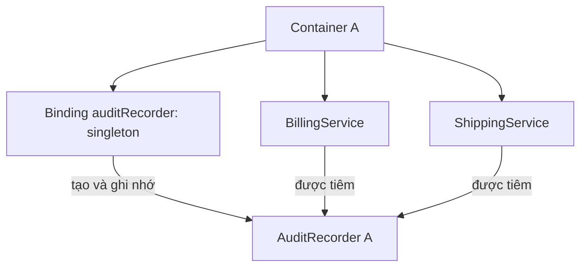
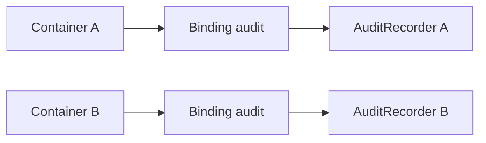
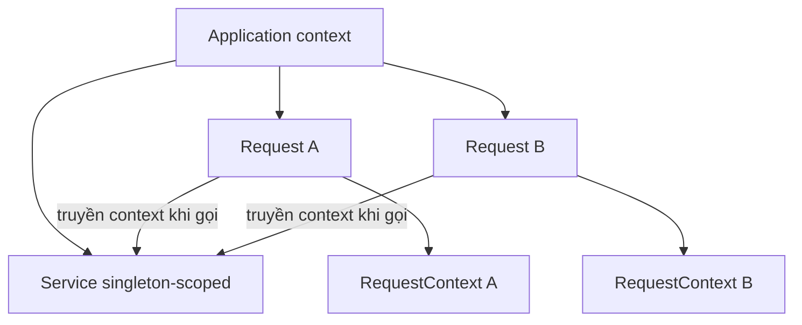

# Khác biệt giữa scope singleton của container và mẫu Singleton

Trong **Dependency Injection (DI)**, từ *singleton* xuất hiện trong hai ngữ cảnh dễ bị đánh đồng:

- **Singleton scope của DI container:** container **tái sử dụng một instance cho một đăng ký phụ thuộc (binding/bean definition)** trong phạm vi quản lý của nó.
- **Mẫu thiết kế Singleton (Singleton pattern):** chính lớp/kiểu tự kiểm soát việc tạo và truy cập instance duy nhất theo phạm vi bảo đảm của cách triển khai.

Cả hai đều có thể khiến nhiều đối tượng nhận **cùng một tham chiếu**, nhưng khác nhau ở **ai kiểm soát số lượng instance, tính duy nhất được tính trong phạm vi nào, khả năng cấu hình, thay thế và quản lý vòng đời**.

Bài học thuộc chương **Vòng đời và phạm vi** của module **Dependency Injection**. Ta sẽ phân biệt hai khái niệm, mô phỏng singleton scope bằng Java thuần, lắp ghép ở *composition root*, kiểm tra identity của instance, rồi xét thread safety, scope và vòng đời trước khi dùng DI container thật.

## 1. Bắt đầu với câu hỏi “duy nhất ở đâu?”

Giả sử **BillingService** và **ShippingService** đều ghi sự kiện vào một **AuditRecorder**. Ứng dụng muốn hai service cùng sử dụng **một recorder trong một lần chạy** để theo dõi sự kiện tập trung.

Với DI thủ công, ta có thể viết:

```java
AuditRecorder shared = new AuditRecorder();
BillingService billing = new BillingService(shared);
ShippingService shipping = new ShippingService(shared);
```

Mã lắp ghép tạo một recorder rồi truyền **đúng instance đó** vào hai constructor. Không cần sửa **AuditRecorder** thành Singleton pattern, cũng không cần container. Quan hệ chia sẻ được quyết định **tại composition root**.

Với *singleton scope*, container tự động hóa việc này: đối với một binding cụ thể, mỗi lần yêu cầu dependency trong scope, container cấp lại cùng instance. Trong khi đó, Singleton pattern thường đặt chính sách chỉ có một instance **bên trong lớp**, qua constructor riêng tư và một điểm truy cập tĩnh.

| Câu hỏi | Singleton scope của container | Singleton pattern |
| --- | --- | --- |
| **Ai kiểm soát số lượng instance?** | Container và cấu hình binding ở composition root | Lớp và cơ chế truy cập mà nó triển khai |
| **Một instance được tính theo đâu?** | Thường **mỗi binding** trong một **container/context** | Phạm vi mà cách triển khai bảo đảm; instance tĩnh thường gắn với một **class loader** của Java |
| **Hai container có thể tạo hai instance?** | Có, nếu từng container tự tạo binding độc lập | Hai container dùng cùng class loader và gọi cùng điểm truy cập tĩnh có thể nhận chung object |
| **Hai binding cùng một kiểu có thể tạo hai instance?** | Có; mỗi binding quản lý instance riêng | Lớp bị giới hạn bằng điểm truy cập tĩnh duy nhất thường không cho caller lựa chọn nhiều instance |
| **Có cần constructor riêng tư?** | Không; container có thể tái sử dụng object của lớp bình thường | Thường có constructor private hoặc dùng enum |
| **Có thể tiêm fake trong test?** | Thường dễ nếu mã nghiệp vụ phụ thuộc vào hợp đồng qua constructor | Khó hơn khi service gọi trực tiếp phương thức tĩnh để lấy global instance |
| **Ai đóng tài nguyên?** | Theo lifecycle contract của container và registration | Cần cơ chế cleanup riêng; lớp không tự có lifecycle do là Singleton |

**Điểm cốt lõi:** singleton không tự có nghĩa “chỉ tồn tại đúng một đối tượng kiểu này trong toàn JVM, mọi class loader, mọi tiến trình hoặc mọi máy chủ”.

## 2. Singleton scope thuộc về một đăng ký trong container

**Binding** hay **registration** là quy tắc chỉ ra implementation nào sẽ được cung cấp cho một dependency. Tùy DI container, binding được nhận diện bằng kiểu, tên, qualifier, khóa hoặc định nghĩa bean. Khi một binding có **singleton scope**, container thường ghi nhớ instance đã tạo và cấp lại đúng object đó cho các consumer trong cùng phạm vi.



Hai service có thể được container **tạo mới mỗi lần** nhưng vẫn nhận cùng **AuditRecorder A**. Scope của một phụ thuộc không tự áp đặt scope lên toàn bộ đối tượng đang sử dụng phụ thuộc đó.

### Cùng kiểu không đồng nghĩa cùng binding

Ứng dụng có thể có hai đăng ký cho **AuditRecorder**:

- **primaryAudit** dùng ghi sự kiện nghiệp vụ; trong binding này, mọi consumer chia sẻ một instance.
- **secondaryAudit** dùng ghi sự kiện quản trị; binding này cũng tái sử dụng một instance, nhưng là instance khác.

Như vậy **cùng một kiểu** vẫn có thể có **nhiều instance singleton-scoped**, vì tính duy nhất được xét **trong từng binding**. Ví dụ với Spring, singleton bean thường có nghĩa **một instance cho mỗi bean definition trong một application context**. Hai bean definition cùng class hoặc hai application context khác nhau có thể có các instance khác nhau. Không nên suy diễn quy tắc toàn JVM chỉ từ tên annotation.

### Container độc lập và quan hệ chia sẻ



Khi mỗi container **tự tạo** dependency, chúng thường sở hữu các instance riêng. Tuy nhiên, nếu composition root chủ động cung cấp **cùng object có sẵn** cho cả hai container, chúng vẫn có thể cùng dùng object ấy. Scope nói về **chính sách tái sử dụng trong binding**, không bắt buộc mọi container phải có các object khác nhau.

## 3. Singleton pattern nằm trong chính lớp

Một cách viết Singleton pattern thường gặp:

```java
public final class GlobalAuditRegistry {
    private static final GlobalAuditRegistry INSTANCE =
            new GlobalAuditRegistry();

    private GlobalAuditRegistry() {
    }

    public static GlobalAuditRegistry getInstance() {
        return INSTANCE;
    }
}
```

Các lời gọi **getInstance()** từ mã dùng cùng định nghĩa lớp trong cùng class loader trả về cùng đối tượng. Constructor **private** ngăn mã ngoài tạo object bằng constructor thông thường; trường **static final** được khởi tạo theo cơ chế khởi tạo lớp của Java.

Một service sử dụng Singleton trực tiếp có thể viết:

```java
final class ShippingService {
    void ship() {
        GlobalAuditRegistry.getInstance();
        // Các thao tác còn lại...
    }
}
```

Lúc này service **tự tra cứu một phụ thuộc toàn cục**. Constructor không thể hiện nhu cầu dùng registry; test khó cung cấp một recorder riêng. Nếu registry giữ trạng thái mutable, nhiều bài test hoặc nhiều tác vụ có thể ảnh hưởng lẫn nhau.

**Giới hạn của tính duy nhất:** trường static gắn với **định nghĩa lớp được nạp bởi một class loader**. Các class loader khác nhau có thể nạp những định nghĩa lớp độc lập; các JVM hoặc tiến trình cũng không chia sẻ bộ nhớ static. Một số cách triển khai Singleton còn cần lưu ý reflection hoặc serialization. Vì vậy, không thể dùng một Singleton cục bộ trong JVM để bảo đảm tính duy nhất trên toàn hệ thống phân tán.

Đôi khi Singleton pattern được triển khai bằng một **enum** để tận dụng bảo đảm riêng của Java về instance, khởi tạo và serialization. Dù bằng enum hay trường static, đây vẫn là **chính sách do kiểu quản lý**, khác với chính sách của một registration trong DI container.

## 4. Thực hành Java 17: mô phỏng singleton-scoped binding

Ví dụ sau dùng một lớp **SingletonBinding<T>** rất nhỏ: binding giữ một factory, tạo instance nhiều nhất một lần rồi trả lại object đó ở các lần yêu cầu tiếp theo. Một **MiniContainer** có hai binding riêng cùng kiểu, còn **GlobalSingleton** thể hiện Singleton pattern bằng trường static.

Đây chỉ là **mô phỏng dùng cho học tập**, chưa phải DI container hoàn chỉnh: không có cơ chế tự phát hiện dependency graph, qualifier tự động, kiểm tra chu trình hoặc lifecycle callback. Mục đích là quan sát **identity và phạm vi tái sử dụng**. Lưu toàn bộ mã vào **Main.java**:

```java
import java.util.Objects;
import java.util.concurrent.atomic.AtomicInteger;
import java.util.function.Supplier;

// Mỗi binding quản lý tối đa một instance.
final class SingletonBinding<T> {
    private final Supplier<? extends T> factory;
    private T instance;
    private boolean initialized;

    SingletonBinding(Supplier<? extends T> factory) {
        this.factory = Objects.requireNonNull(factory, "factory");
    }

    synchronized T get() {
        if (!initialized) {
            instance = Objects.requireNonNull(
                    factory.get(), "factory result");
            initialized = true;
        }
        return instance;
    }
}

// Một lớp bình thường, không tự áp đặt Singleton pattern.
final class AuditRecorder {
    private final AtomicInteger events = new AtomicInteger();

    void record(String event) {
        Objects.requireNonNull(event, "event");
        events.incrementAndGet();
    }

    int eventCount() {
        return events.get();
    }
}

final class BillingService {
    private final AuditRecorder audit;

    BillingService(AuditRecorder audit) {
        this.audit = Objects.requireNonNull(audit, "audit");
    }

    void charge() {
        audit.record("charged");
    }
}

final class ShippingService {
    private final AuditRecorder audit;

    ShippingService(AuditRecorder audit) {
        this.audit = Objects.requireNonNull(audit, "audit");
    }

    void ship() {
        audit.record("shipped");
    }
}

// Mỗi MiniContainer sở hữu hai binding cùng kiểu AuditRecorder.
final class MiniContainer {
    private final SingletonBinding<AuditRecorder> primaryAudit =
            new SingletonBinding<>(AuditRecorder::new);
    private final SingletonBinding<AuditRecorder> secondaryAudit =
            new SingletonBinding<>(AuditRecorder::new);

    AuditRecorder primaryAudit() {
        return primaryAudit.get();
    }

    AuditRecorder secondaryAudit() {
        return secondaryAudit.get();
    }

    // Service được tạo theo yêu cầu nhưng nhận cùng primaryAudit.
    BillingService billing() {
        return new BillingService(primaryAudit());
    }

    ShippingService shipping() {
        return new ShippingService(primaryAudit());
    }
}

// Singleton pattern: lớp tự quản lý điểm truy cập static.
final class GlobalSingleton {
    private static final GlobalSingleton INSTANCE = new GlobalSingleton();

    private GlobalSingleton() {
    }

    static GlobalSingleton getInstance() {
        return INSTANCE;
    }
}

public class Main {
    public static void main(String[] args) {
        MiniContainer first = new MiniContainer();

        AuditRecorder a1 = first.primaryAudit();
        AuditRecorder a2 = first.primaryAudit();
        check(a1 == a2,
                "Cùng binding trong container phải trả cùng instance");

        BillingService billing = first.billing();
        ShippingService shipping = first.shipping();
        billing.charge();
        shipping.ship();
        check(a1.eventCount() == 2,
                "Hai service phải dùng cùng recorder");

        // Cùng kiểu nhưng thuộc hai singleton binding độc lập.
        AuditRecorder secondary = first.secondaryAudit();
        check(a1 != secondary,
                "Hai binding cùng kiểu có thể có hai instance");
        check(secondary == first.secondaryAudit(),
                "Binding thứ hai cũng tái sử dụng instance");
        check(secondary.eventCount() == 0,
                "Binding thứ hai không nhận sự kiện của binding đầu");

        // Container mới có bộ binding mới.
        MiniContainer second = new MiniContainer();
        check(first.primaryAudit() != second.primaryAudit(),
                "Hai container tự tạo instance riêng");

        // Singleton pattern không phụ thuộc MiniContainer.
        GlobalSingleton global1 = GlobalSingleton.getInstance();
        GlobalSingleton global2 = GlobalSingleton.getInstance();
        check(global1 == global2,
                "Singleton pattern dùng chung instance trong class loader");

        System.out.println("PASS");
    }

    private static void check(boolean condition, String message) {
        if (!condition) {
            throw new AssertionError(message);
        }
    }
}
```

Biên dịch và chạy bằng **JDK 17 trở lên**:

```bash
javac -encoding UTF-8 Main.java
java Main
```

Kết quả mong đợi:

```text
PASS
```

Các tình huống được xác minh:

1. Hai lần resolve **primaryAudit** trong cùng container trả về **cùng identity**.
2. **BillingService** và **ShippingService** nhận cùng recorder, vì vậy tổng số sự kiện là 2.
3. **primaryAudit** và **secondaryAudit** có **hai instance riêng** dù cùng kiểu; mỗi binding vẫn tái sử dụng object của chính nó.
4. Hai **MiniContainer** độc lập tự tạo hai recorder riêng.
5. **GlobalSingleton.getInstance()** dựa vào trường static, không dựa vào lifecycle của MiniContainer.

Toán tử **==** với tham chiếu kiểm tra **identity**. Không thay bằng **equals()** nếu muốn biết hai biến có trỏ tới đúng một object hay không; hai object có thể bằng nhau về giá trị mà vẫn khác identity.

Phương thức **SingletonBinding.get()** dùng **synchronized** để bảo đảm việc tạo instance không bị thực hiện đồng thời nhiều lần trên cùng binding. Điều này **không** làm mọi phương thức của dependency trả về trở nên thread-safe. Riêng recorder ở ví dụ dùng **AtomicInteger** để đếm sự kiện; một recorder ghi danh sách mutable hoặc sử dụng network client vẫn cần đánh giá riêng.

## 5. Scope quyết định phạm vi tái sử dụng và vòng đời

Một object singleton-scoped được tạo hoặc cấp sẵn theo quy tắc của container và dùng lại trong **phạm vi context** đó. Khi context kết thúc, container **có thể** hỗ trợ lifecycle callback, đóng dependency hoặc chạy cleanup **theo hợp đồng và cấu hình cụ thể**. Không phải mọi container đều tự động gọi **close()** trên mọi object được đăng ký.

Một instance tĩnh theo Singleton pattern thường được giữ đến khi lớp/class loader không còn sử dụng hoặc chương trình kết thúc. Nếu instance giữ socket, file, thread pool hoặc tài nguyên cần giải phóng sớm, lớp hoặc mã điều phối phải có cơ chế dọn dẹp rõ ràng. Singleton pattern không tự mang lại lifecycle manager.

| Đặc điểm | Singleton-scoped binding | Instance tĩnh của Singleton pattern |
| --- | --- | --- |
| **Khởi tạo** | Eager hoặc lazy tùy container và cấu hình | Theo cách triển khai; static final được tạo khi lớp được khởi tạo |
| **Tái sử dụng** | Các lần resolve cùng binding/context | Các lần truy cập cùng điểm static của lớp |
| **Kết thúc vòng đời** | Thường theo context và lifecycle contract | Thường gắn với lớp/class loader hoặc cleanup riêng |
| **Thay implementation** | Đổi registration tại composition root | Service gọi trực tiếp lớp static cần thay thiết kế hoặc thêm abstraction |
| **Tạo nhiều cấu hình trong một JVM** | Nhiều context/binding có thể có instance riêng | Điểm truy cập tĩnh thường làm việc tạo nhiều instance cấu hình khác nhau khó hơn |

### Một singleton-scoped dependency không biến mọi consumer thành singleton

Container có thể tạo **BillingService** mới mỗi lần resolve nhưng luôn tiêm cùng **AuditRecorder**. Ngược lại, service có scope singleton cũng có thể nhận dependency theo request **khi cách truy cập được thiết kế phù hợp**, chẳng hạn nhận context qua tham số hoặc provider theo scope.

Lỗi thường gặp là **singleton service giữ hẳn RequestContext của request đầu tiên** trong trường và vô tình dùng lại dữ liệu đó cho request sau. Request context cần riêng cho mỗi request dù service có được tái sử dụng toàn ứng dụng.



Ở sơ đồ này, service được dùng lại còn **context luôn thuộc request riêng**. Các DI container có thể cung cấp request scope hoặc scoped provider, nhưng hiểu đúng ranh giới này trước khi dùng container là điều quan trọng.

## 6. Singleton pattern không tự tạo ra Dependency Injection

So sánh hai thiết kế:

```java
// Phụ thuộc ngầm: service tự tìm trạng thái toàn cục.
final class BadService {
    void execute() {
        GlobalSingleton.getInstance();
    }
}
```

```java
// Dependency công khai: caller tiêm cộng tác viên qua constructor.
final class BetterService {
    private final AuditRecorder audit;

    BetterService(AuditRecorder audit) {
        this.audit = java.util.Objects.requireNonNull(audit, "audit");
    }

    void execute() {
        audit.record("executed");
    }
}
```

Đoạn thứ hai dùng **constructor injection**: composition root có thể truyền một instance chung cho nhiều service, chọn một recorder riêng cho một test hoặc thay bằng implementation khác. **AuditRecorder** không cần tự biết ứng dụng muốn bao nhiêu instance.

Singleton pattern và DI **không loại trừ nhau**: có thể đăng ký **GlobalSingleton.getInstance()** trong container, rồi tiêm instance đó vào service. Nhưng lúc này tính duy nhất đến từ **trường static của lớp**, còn DI giải quyết **cách cung cấp** object cho consumer. Nếu lớp đã áp đặt một instance toàn cục, container không thể tự giúp nó tạo nhiều cấu hình độc lập theo nhu cầu test hoặc tenant.

Không nên cố biến mọi object thành Singleton. Việc tạo **ArrayList**, object giá trị hay cộng tác viên tại composition root bằng **new** đều có thể hợp lý. DI/IoC tách **quyền sử dụng** khỏi **quyền chọn và lắp ghép** những cộng tác viên cần điều khiển từ ngoài.

## 7. Dùng chung object không tự bảo đảm thread safety

Singleton scope chỉ nói về **số lượng và phạm vi tái sử dụng**; nó **không** bảo đảm các thao tác trên instance an toàn khi chạy đa luồng.

```java
final class UnsafeCounter {
    private int count;

    void increment() {
        count++; // Không phải thao tác nguyên tử trong đa luồng.
    }

    int value() {
        return count;
    }
}
```

Nếu nhiều request gọi **increment()** đồng thời, có thể mất cập nhật. Container tạo đúng một instance không giải quyết được race condition. Tùy hợp đồng, cần xem xét object bất biến, **AtomicInteger**, khóa đồng bộ hoặc phạm vi sống ngắn hơn.

Trước khi chia sẻ dependency, hãy xác định:

1. Nó có trạng thái mutable không? Trạng thái ấy thuộc **ứng dụng**, **người dùng**, **request** hay **transaction**?
2. Nó có thể được nhiều luồng gọi cùng lúc không? Hợp đồng thread safety của implementation nói gì?
3. Nó có giữ socket, executor, connection pool hay file cần đóng không? **Ai có trách nhiệm đóng?**
4. Nó có được chia sẻ giữa các application context hoặc tenant không? Có nguy cơ rò rỉ trạng thái không?

Một connection pool được thiết kế cho nhiều luồng có thể dùng chung ở application scope, còn một database connection hoặc transaction/session mang trạng thái theo request thường **không phù hợp để chia sẻ toàn ứng dụng**. Chia sẻ pool/factory khác với chia sẻ một connection/session đang thực hiện công việc.

## 8. Kiểm thử hành vi và kiểm thử scope là hai nhiệm vụ khác nhau

**Unit test cho service** tập trung vào hành vi: truyền fake recorder qua constructor, gọi chức năng rồi kiểm tra số lần ghi sự kiện. Nó có thể chạy bằng Java thuần, không cần container.

**Kiểm thử wiring và scope** tập trung vào cách lắp ghép: hai consumer có nhận đúng cùng object không; hai binding phải tách biệt có thật sự tách biệt không; context mới có tạo instance mới đúng mong đợi không; lifecycle được dọn theo hợp đồng chưa.

Hai service có thể vượt qua mọi unit test riêng lẻ nhưng ứng dụng vẫn sai khi composition root vô tình truyền **hai recorder khác nhau**, khiến sự kiện không được tổng hợp cùng chỗ. Đó là lý do cần kiểm chứng riêng quan hệ object graph.

Singleton pattern với trạng thái mutable có thể khiến dữ liệu từ bài test này còn tồn tại ở bài test tiếp theo trong cùng class loader. Với singleton-scoped binding thông thường, test có thể tạo context mới để có object mới, **nếu** context tự tạo instance và không trỏ tới một global Singleton có sẵn.

## 9. Những nhầm lẫn thường gặp

| Nhận định sai | Cách hiểu đúng |
| --- | --- |
| “Annotation singleton bảo đảm một object trong cả JVM.” | Phạm vi phải xem theo **binding/context** của container. |
| “Singleton pattern và singleton scope chỉ khác cú pháp.” | Chúng khác **nơi kiểm soát identity**, cấu hình và vòng đời. |
| “Container cần lớp có constructor private mới tạo singleton.” | Container có thể quản lý lớp có constructor thông thường. |
| “Một singleton tự nhiên thread-safe.” | Một instance dùng chung có thể bị tranh chấp dữ liệu mutable. |
| “Cùng class thì mọi bean singleton là cùng object.” | Hai bean definition/registration có thể có hai instance. |
| “Singleton luôn được tự đóng khi không còn ai dùng.” | Cleanup phải được thiết kế và cấu hình theo lifecycle contract. |
| “DI container tự giải quyết mọi lỗi scope.” | Scope sai, request context bị giữ quá lâu hay đóng tài nguyên sớm vẫn là lỗi kiến trúc. |

## 10. Bài tập thực hành

**Bài 1 — Hai context:** chạy lại ví dụ với hai **MiniContainer** và so sánh tham chiếu recorder. Giải thích vì sao hai object khác nhau dù chúng cùng lớp và đều thuộc singleton-scoped binding.

**Bài 2 — Hai binding cùng kiểu:** thay đổi **primaryAudit** và **secondaryAudit** để ghi hai loại sự kiện. Kiểm tra mỗi binding có một instance ổn định, nhưng hai bộ đếm không ảnh hưởng lẫn nhau.

**Bài 3 — Gỡ phụ thuộc ngầm:** một **ReportService** gọi **MetricsRegistry.getInstance()** ngay trong phương thức. Hãy sửa để service nhận **MetricsRecorder** qua constructor và để composition root cung cấp instance. Viết unit test với fake.

**Bài 4 — Chọn scope:** đề xuất phạm vi cho một **Clock** bất biến, một connection pool, một **RequestContext** chứa thông tin người dùng, một transaction đang mở và một formatter stateless. Giải thích điều kiện về thread safety và ownership.

**Bài 5 — Vòng đời:** một container tạo network client và tiêm cho ba service. Điều gì xảy ra nếu một service tự đóng client khi các service còn lại đang dùng? Xác định nơi quản lý vòng đời phù hợp.

## 11. Tự kiểm tra hiểu bài

**Câu 1.** Lớp có constructor public được container quản lý singleton scope có hợp lệ không? **Có.** Scope do container/binding quyết định, không cần lớp triển khai Singleton pattern.

**Câu 2.** Hai context cùng khai báo singleton-scoped **AuditRecorder** có bắt buộc trả cùng object không? **Không.** Nếu từng context tự tạo dependency, chúng có instance riêng; việc cấp một instance có sẵn cho cả hai là lựa chọn lắp ghép khác.

**Câu 3.** **GlobalSingleton.getInstance()** có bảo đảm chỉ một instance trong mọi JVM không? **Không.** Static không chia sẻ giữa các JVM, và class loader khác nhau cũng có thể có định nghĩa lớp cùng tên nhưng độc lập.

**Câu 4.** Hai singleton binding cùng kiểu có thể tạo hai instance không? **Có.** Tính duy nhất thường áp dụng theo từng binding/bean definition.

**Câu 5.** Singleton service có thể xử lý request context không? **Có**, nếu nhận đúng context theo từng request qua tham số hoặc scoped provider, thay vì giữ lâu dài context của một request trong trường dùng chung.

**Câu 6.** Vì sao một object singleton-scoped không mặc nhiên thread-safe? **Vì** container kiểm soát khởi tạo/tái sử dụng, còn các phương thức trên state mutable vẫn có thể bị gọi đồng thời và tranh chấp.

## Ghi nhớ

- **Singleton scope của DI container** là chính sách tái sử dụng một instance theo **binding trong một phạm vi container/context**. Có thể có nhiều instance cùng kiểu ở các binding hoặc context khác nhau.
- **Singleton pattern** đưa quyền kiểm soát và điểm truy cập instance vào **lớp/kiểu**, thường dùng trường static; tính duy nhất có giới hạn theo cơ chế triển khai như class loader.
- **Constructor injection và composition root** cho phép dùng chung chính xác một instance mà không cần ép lớp thành Singleton pattern, thuận lợi cho việc thay thế và kiểm thử.
- **Scope không bảo đảm thread safety** và không tự quyết định quyền sở hữu, thời điểm đóng tài nguyên hoặc ranh giới request/transaction.
- Thực hành lắp ghép và xác minh **object identity** bằng Java thuần giúp hiểu chính xác scope trước khi mở rộng sang DI container.
