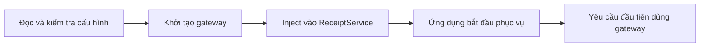
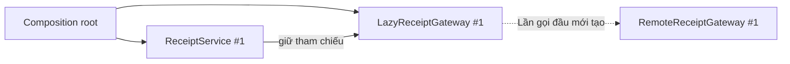
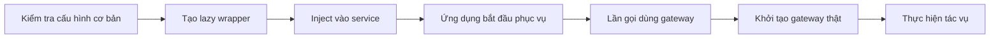

# Thời điểm tạo sớm, tạo muộn và hệ quả đối với phát hiện lỗi

## 1. Một phụ thuộc được tạo vào lúc nào?

Khi viết **Dependency Injection (DI)** bằng Java thuần, ta thường thấy constructor injection:

```java
ReceiptGateway gateway = new RemoteReceiptGateway(config);
ReceiptService service = new ReceiptService(gateway);
```

Điều dễ bị bỏ qua là **thời điểm tạo** `RemoteReceiptGateway`. Nếu tạo nó ngay khi khởi động, lỗi liên quan đến khởi tạo có thể xuất hiện **trước khi ứng dụng nhận yêu cầu**. Nếu chỉ tạo nó khi chức năng xuất biên nhận được gọi lần đầu, những lỗi đó có thể xuất hiện **trong lúc phục vụ một yêu cầu**.

Đây là chủ đề của nhóm **Vòng đời và phạm vi** trong module **DEPENDENCY_INJECTION**. Module học **Dependency Injection** và **Inversion of Control (IoC)** để tách việc *sử dụng phụ thuộc* khỏi *quá trình tạo, lắp ghép đối tượng*, đồng thời thực hành **constructor injection**, **composition root**, quản lý **scope/vòng đời** và kiểm thử bằng Java thuần trước khi mở rộng sang DI container.

Hai chiến lược cơ bản:

- **Tạo sớm** (*eager initialization*): tạo dependency trong quá trình lắp ghép/khởi động, trước khi luồng nghiệp vụ cần sử dụng nó.
- **Tạo muộn** (*lazy initialization*): trì hoãn tạo dependency đến lần đầu một tác vụ thật sự cần nó.

Điểm quan trọng là **thời gian khởi tạo ảnh hưởng đến nơi lỗi bộc lộ, độ trễ của yêu cầu đầu tiên và tài nguyên bị chiếm giữ**. Nó **không quyết định tự động** dependency được dùng chung hay tạo mới bao nhiêu lần.

| Câu hỏi | Tạo sớm | Tạo muộn |
| --- | --- | --- |
| Dependency được tạo khi nào? | Thường trong bootstrap/composition root. | Khi có yêu cầu đầu tiên cần nó, hoặc ở ranh giới được chỉ định. |
| Lỗi xảy ra trong constructor được phát hiện khi nào? | Trong khởi động/lắp ghép. | Trong lần dùng kích hoạt khởi tạo. |
| Chi phí tạo object nằm ở đâu? | Thời gian khởi động. | Độ trễ của lần dùng đầu tiên. |
| Có tạo object nếu chức năng không bao giờ dùng? | Có, nếu được đưa vào nhánh eager. | Thường không. |
| Có bảo đảm tài nguyên ngoài đang khỏe? | **Không**, chỉ tạo object chưa đủ để chứng minh kết nối ngoài hoạt động. | **Không**, lần dùng đầu có thể thất bại; tài nguyên cũng có thể hỏng về sau. |
| Có tự quyết định singleton/request/transient? | Không. | Không. Cần chính sách cache/tạo mới và scope riêng. |

**Ví dụ xuyên suốt:** ứng dụng đặt chỗ có `ReceiptService` phụ trách phát hành biên nhận. Service phụ thuộc `ReceiptGateway`, có thể là adapter gọi API ngoài. Biên nhận có thể là chức năng ít được sử dụng, nhưng nếu nó là bắt buộc khi triển khai, lỗi không nên bị che giấu chỉ vì việc tạo gateway được hoãn lại.

## 2. Eager: tạo trong composition root và phát hiện lỗi sớm

Với tạo sớm, **composition root** lựa chọn implementation và tạo object trước khi trao quyền xử lý:

```java
ReceiptConfig config = loadAndValidateConfig();
ReceiptGateway gateway = new RemoteReceiptGateway(config); // Tạo ngay.
ReceiptService service = new ReceiptService(gateway);
startApplication(service);
```

Các hàm/kiểu `ReceiptConfig`, `loadAndValidateConfig` và `startApplication` ở đây chỉ mô tả ý tưởng; ví dụ hoàn chỉnh ở mục 5 dùng những class tự định nghĩa để chạy không cần framework.

Một timeline thường gặp:



Nếu constructor của gateway ném exception, lời gọi tạo service ở phía sau sẽ không xảy ra, và code khởi động có cơ hội báo lỗi **trước khi tuyên bố hệ thống sẵn sàng**. Đây là dạng **fail-fast** đối với những điều kiện **thực sự được kiểm tra trong giai đoạn khởi tạo**.

### Khi tạo sớm có giá trị

1. **Phụ thuộc quan trọng của chức năng cốt lõi:** nếu thiếu nó ứng dụng không đáp ứng được chức năng chủ đạo, phát hiện lỗi khi triển khai thường thuận lợi hơn khi có khách hàng gọi vào.
2. **Cần xác nhận cấu hình/lắp ghép ngay:** constructor có thể kiểm tra địa chỉ, khóa cấu hình bắt buộc, phiên bản nội bộ hoặc đồ thị dependency còn thiếu.
3. **Muốn tránh chi phí tạo object ở yêu cầu đầu tiên:** có thể thực hiện bước chuẩn bị ngay trong khởi động.
4. **Đơn giản về vận hành:** một quy trình khởi động thất bại rõ ràng có thể dễ giám sát hơn lỗi bất ngờ trong một luồng ít dùng.

### Những giới hạn cần nhớ

**Tạo instance sớm không đồng nghĩa kết nối thành công.** Nhiều HTTP client, JDBC wrapper hoặc connection pool được tạo mà **chưa thật sự gửi request hay kiểm tra database**. Một lỗi mạng có thể chỉ xuất hiện ở phương thức đầu tiên, dù object đã được tạo sớm. Muốn biết dịch vụ ngoài có đang khả dụng cần thiết kế bước kết nối, kiểm tra sức khỏe (*health check*) hoặc *readiness probe* riêng phù hợp với yêu cầu. Ngược lại, một kiểm tra đã thành công lúc khởi động cũng không bảo đảm mạng sẽ luôn hoạt động.

Eager còn làm tăng thời gian khởi động và có thể giữ tài nguyên của các chức năng không được sử dụng. Nếu phụ thuộc thứ yếu thất bại, cần quyết định chính sách rõ: ứng dụng **bắt buộc dừng** hay có thể chạy ở **chế độ suy giảm chức năng** đã được thiết kế? Không nên tự động coi mọi lỗi adapter đều có mức nghiêm trọng như nhau.

## 3. Lazy: hoãn khởi tạo và chuyển thời điểm phát hiện lỗi

Với tạo muộn, có thể cấp một đối tượng *đại diện* (*lazy wrapper*) có cùng hợp đồng với dependency thật. Service giữ wrapper qua constructor; wrapper tạo dependency thật khi nhận lời gọi đầu tiên.



Trong lần khởi động, `ReceiptService` đã có một `ReceiptGateway` hợp lệ về mặt kiểu và tham chiếu, nhưng gateway thật có thể **chưa tồn tại**. Nếu khởi tạo gateway thật thất bại, lỗi sẽ bộc lộ khi wrapper được sử dụng.

Timeline:



Điều này có hai hệ quả rõ:

- **Lợi ích:** ứng dụng không mất thời gian khởi tạo một phụ thuộc đắt tiền mà người dùng có thể không bao giờ cần.
- **Đánh đổi:** yêu cầu đầu tiên chịu thêm độ trễ; lỗi khởi tạo chuyển sang đường xử lý yêu cầu, khó nhận ra trước khi tính năng được sử dụng.

**Lazy không nhất thiết tốt hơn eager.** Chọn cách nào phụ thuộc vào tầm quan trọng của dependency, chi phí khởi tạo, kỳ vọng độ trễ, khả năng quan sát lỗi, và chính sách sẵn sàng của hệ thống.

### Không đồng nhất “lazy” với “factory tạo mỗi lần”

```java
Supplier<ReceiptGateway> factory = () -> new RemoteReceiptGateway(config);
```

`Supplier.get()` ở đây sẽ tạo **object mới mỗi lần được gọi**. Nó chỉ là một **công thức tạo**, chưa phải “khởi tạo một lần khi cần rồi dùng lại”. Nếu muốn **lazy + shared**, phải có cơ chế lưu (*cache*) instance sau lần tạo đầu tiên. Nếu muốn **lazy + transient**, lại cần giữ hành vi tạo mỗi lần. Hai lựa chọn khác nhau về **scope** và cần được phát biểu rõ.

## 4. Ba loại lỗi và thời điểm thực sự phát hiện được

Đánh giá eager/lazy phải xem lỗi đến từ đâu. Không phải lỗi nào cũng có thể phát hiện tại thời điểm xây dựng object.

| Nhóm lỗi | Ví dụ | Có thể phát hiện sớm đến đâu? | Hàm ý thiết kế |
| --- | --- | --- | --- |
| **Cấu hình tĩnh không hợp lệ** | URL sai cú pháp, thiếu biến cấu hình bắt buộc, timeout âm. | Thường **ngay khi bootstrap**, kể cả dùng lazy. | Tách việc đọc và **validate cấu hình** khỏi việc tạo tài nguyên đắt tiền. |
| **Lỗi khi tạo/chuẩn bị dependency** | Factory ném exception, thiếu tài nguyên bắt buộc tại thời điểm khởi tạo, khởi tạo client thất bại. | Eager: lúc bootstrap; lazy: lúc kích hoạt lần đầu. | Chọn vị trí xử lý lỗi và giám sát phù hợp với mức quan trọng của chức năng. |
| **Lỗi vận hành khi thực hiện tác vụ** | Mất kết nối sau khởi động, API trả lỗi, timeout, dữ liệu xung đột. | Khi **gọi nghiệp vụ thực tế**; đôi khi probe trước đó hỗ trợ phát hiện nhưng không bảo đảm tương lai. | Cần timeout, retry có giới hạn, idempotency, transaction hoặc phản hồi lỗi phù hợp. |

Một nguyên tắc quan trọng: **dùng lazy không phải lý do để trì hoãn các lỗi cấu hình có thể kiểm tra ngay**. Có thể kiểm tra schema cấu hình, định dạng URL và sự hiện diện của tham số bắt buộc khi ứng dụng bắt đầu, rồi vẫn trì hoãn việc tạo client đắt tiền. Điều này vừa giảm chi phí khởi động vừa tránh rủi ro lỗi cấu hình hiển nhiên chỉ xuất hiện khi người dùng bấm vào chức năng ít dùng.

## 5. Ví dụ Java thuần: so sánh thời điểm lỗi

Ví dụ sau tạo một gateway mô phỏng để **quan sát trực tiếp thời điểm khởi tạo**. Không có request HTTP thật. Gateway có thể **chủ động ném lỗi giả lập trong constructor** để so sánh eager và lazy; vì thế thông báo lỗi trong ví dụ là lỗi khởi tạo đã được mô phỏng, **không phải bằng chứng kết nối mạng thất bại**.

Lưu vào một tệp `Main.java`, chạy với **JDK 11 trở lên**:

```java
import java.net.URI;
import java.util.Objects;
import java.util.function.Supplier;

public class Main {
    interface ReceiptGateway {
        String issue(String bookingId);
    }

    // Kiểm tra cấu hình rẻ tiền ngay tại ranh giới khởi động.
    static final class ReceiptConfig {
        private final URI endpoint;
        private final boolean simulateInitFailure;

        ReceiptConfig(String url, boolean simulateInitFailure) {
            URI parsed = URI.create(
                    Objects.requireNonNull(url, "url"));
            if (!"https".equalsIgnoreCase(parsed.getScheme())
                    || parsed.getHost() == null) {
                throw new IllegalArgumentException(
                        "Receipt endpoint phải là URL HTTPS hợp lệ");
            }
            this.endpoint = parsed;
            this.simulateInitFailure = simulateInitFailure;
        }
    }

    // Adapter mô phỏng một dependency có bước khởi tạo đáng chú ý.
    static final class RemoteReceiptGateway implements ReceiptGateway {
        private final URI endpoint;

        RemoteReceiptGateway(ReceiptConfig config) {
            Objects.requireNonNull(config, "config");
            System.out.println("Bắt đầu khởi tạo gateway thật (mô phỏng)");

            if (config.simulateInitFailure) {
                throw new IllegalStateException(
                        "Mô phỏng lỗi khi khởi tạo gateway");
            }
            this.endpoint = config.endpoint;
        }

        @Override
        public String issue(String bookingId) {
            // Chỉ trả chuỗi, không thực sự gọi API ngoài.
            return "Biên nhận " + bookingId + " qua " + endpoint.getHost();
        }
    }

    // Lazy wrapper: tạo gateway thật ở lần dùng đầu tiên, sau đó dùng lại.
    static final class LazyReceiptGateway implements ReceiptGateway {
        private final Supplier<? extends ReceiptGateway> factory;
        private volatile ReceiptGateway delegate;

        LazyReceiptGateway(Supplier<? extends ReceiptGateway> factory) {
            this.factory = Objects.requireNonNull(factory, "factory");
        }

        private ReceiptGateway underlying() {
            ReceiptGateway current = delegate;

            if (current == null) {
                synchronized (this) {
                    current = delegate;
                    if (current == null) {
                        current = Objects.requireNonNull(
                                factory.get(), "factory tạo ra null");
                        delegate = current;
                    }
                }
            }
            return current;
        }

        @Override
        public String issue(String bookingId) {
            return underlying().issue(bookingId);
        }
    }

    // Consumer không biết đang nhận eager hay lazy implementation.
    static final class ReceiptService {
        private final ReceiptGateway gateway;

        ReceiptService(ReceiptGateway gateway) {
            this.gateway = Objects.requireNonNull(gateway, "gateway");
        }

        String issue(String bookingId) {
            if (bookingId == null || bookingId.isBlank()) {
                throw new IllegalArgumentException(
                        "bookingId không được rỗng");
            }
            return gateway.issue(bookingId);
        }
    }

    // main() đóng vai trò composition root.
    // args: <eager|lazy> <ok|fail> <use|skip>
    public static void main(String[] args) {
        if (args.length != 3) {
            System.out.println(
                    "Cách chạy: java Main <eager|lazy> <ok|fail> <use|skip>");
            return;
        }

        String mode = args[0];
        String initResult = args[1];
        String action = args[2];

        if (!("eager".equals(mode) || "lazy".equals(mode))) {
            throw new IllegalArgumentException("Mode không được hỗ trợ");
        }
        if (!("ok".equals(initResult) || "fail".equals(initResult))) {
            throw new IllegalArgumentException("Kết quả giả lập không hợp lệ");
        }
        if (!("use".equals(action) || "skip".equals(action))) {
            throw new IllegalArgumentException("Action không hợp lệ");
        }

        // Kiểm tra URL luôn diễn ra sớm ở cả hai mode.
        ReceiptConfig config = new ReceiptConfig(
                "https://receipts.example.test", "fail".equals(initResult));
        Supplier<ReceiptGateway> factory =
                () -> new RemoteReceiptGateway(config);

        ReceiptGateway gateway;
        if ("eager".equals(mode)) {
            gateway = factory.get();
        } else {
            gateway = new LazyReceiptGateway(factory);
        }

        ReceiptService service = new ReceiptService(gateway);
        System.out.println("Hoàn tất lắp ghép: " + mode);

        if ("use".equals(action)) {
            System.out.println(service.issue("B-101"));
            System.out.println(service.issue("B-102"));
        } else {
            System.out.println("Chưa có yêu cầu phát hành biên nhận");
        }
    }
}
```

### Chạy các kịch bản

Biên dịch một lần:

```bash
javac -encoding UTF-8 Main.java
```

**Kịch bản A — eager, khởi tạo thành công, có sử dụng**

```bash
java Main eager ok use
```

```text
Bắt đầu khởi tạo gateway thật (mô phỏng)
Hoàn tất lắp ghép: eager
Biên nhận B-101 qua receipts.example.test
Biên nhận B-102 qua receipts.example.test
```

Ở đây gateway thật được tạo **trước** khi lắp ghép xong `ReceiptService`.

**Kịch bản B — lazy, khởi tạo thành công, có sử dụng**

```bash
java Main lazy ok use
```

```text
Hoàn tất lắp ghép: lazy
Bắt đầu khởi tạo gateway thật (mô phỏng)
Biên nhận B-101 qua receipts.example.test
Biên nhận B-102 qua receipts.example.test
```

Gateway thật được tạo **sau** khi dòng “Hoàn tất lắp ghép” xuất hiện, nhưng **chỉ một lần** dù `issue` được gọi hai lần.

**Kịch bản C — eager, lỗi khởi tạo, không cần chức năng**

```bash
java Main eager fail skip
```

```text
Bắt đầu khởi tạo gateway thật (mô phỏng)
Exception in thread "main" java.lang.IllegalStateException: Mô phỏng lỗi khi khởi tạo gateway
...
```

Ứng dụng không đến được dòng “Hoàn tất lắp ghép”, dù tác vụ phát hành biên nhận sẽ không được dùng.

**Kịch bản D — lazy, lỗi khởi tạo, không cần chức năng**

```bash
java Main lazy fail skip
```

```text
Hoàn tất lắp ghép: lazy
Chưa có yêu cầu phát hành biên nhận
```

Không có lời gọi tới gateway thật nên lỗi mô phỏng **chưa phát sinh**. Điều này không có nghĩa gateway đã hoạt động tốt.

**Kịch bản E — lazy, lỗi khởi tạo, lần dùng đầu**

```bash
java Main lazy fail use
```

```text
Hoàn tất lắp ghép: lazy
Bắt đầu khởi tạo gateway thật (mô phỏng)
Exception in thread "main" java.lang.IllegalStateException: Mô phỏng lỗi khi khởi tạo gateway
...
```

Ứng dụng đã hoàn tất lắp ghép nhưng **lần dùng đầu** thất bại. Trong server thật, exception cần được xử lý theo chính sách của đường request; đoạn demo dòng lệnh cố ý để exception xuất hiện nhằm minh họa thời điểm lỗi.

### Tại sao ví dụ vừa dùng factory, vừa dùng wrapper?

`Supplier<ReceiptGateway>` chỉ diễn đạt “làm thế nào để tạo gateway”. `LazyReceiptGateway` bổ sung chính sách **chỉ gọi factory khi cần và cache một instance**. `ReceiptService` vẫn nhận một đối tượng của hợp đồng `ReceiptGateway` và không biết nó đang dùng wrapper lazy.

Đây là **constructor injection**: service có đủ dependency bắt buộc ngay sau khi được tạo. Tuy nhiên, **khả năng bên trong dependency lazy hoạt động thành công** vẫn chưa được kiểm tra cho tới khi thực sự sử dụng. Đây là một đánh đổi cần được mô tả trong thiết kế.

## 6. Tạo muộn có an toàn khi nhiều request cùng đến?

Nếu hai luồng đồng thời gọi `service.issue(...)` lần đầu, cả hai có thể cố khởi tạo gateway. Một lazy wrapper ngây thơ:

```java
// Không an toàn nếu nhiều thread gọi cùng lúc.
if (delegate == null) {
    delegate = factory.get();
}
```

có thể tạo **nhiều instance ngoài ý muốn**. Nếu factory mở kết nối, khởi tạo tài nguyên hoặc đăng ký listener, hậu quả có thể lớn hơn chi phí tạo object.

Trong ví dụ mục 5, `LazyReceiptGateway` dùng:

- `volatile delegate` để bảo đảm tính hiển thị và công bố tham chiếu đúng theo Java Memory Model.
- `synchronized (this)` để tại thời điểm khởi tạo chỉ một luồng thực hiện đoạn kiểm tra và tạo instance.
- Kiểm tra `delegate == null` lần hai trong synchronized, vì trong lúc một luồng chờ khóa, luồng khác có thể đã khởi tạo thành công.

Cách này nhắm đến **khởi tạo đúng một instance khi thành công** cho **một wrapper**. Nếu factory ném exception, `delegate` vẫn là `null`; một lời gọi tiếp theo sẽ có thể **thử khởi tạo lại**. Đó là lựa chọn chính sách trong ví dụ, **không phải bảo đảm retry thành công**. Hệ thống thật cần xác định rõ nên retry với giới hạn/backoff, lưu trạng thái lỗi, báo lỗi vĩnh viễn hay để quản lý vận hành can thiệp.

**Đã khởi tạo wrapper an toàn không có nghĩa gateway thật an toàn luồng.** Nếu nhiều request dùng chung instance gateway, phương thức `issue` của implementation vẫn phải đáp ứng yêu cầu đồng thời. Có thể cần client an toàn luồng, pool hoặc scope khác.

## 7. Kiểm thử riêng thời điểm tạo và caching bằng Java thuần

Để tránh nhầm giữa “supplier được tạo” và “factory được gọi”, có thể viết một bài kiểm tra với bộ đếm. Thêm class sau **bên ngoài class `Main`** nhưng trong cùng tệp `Main.java` của mục 5:

```java
class LazyInitializationTest {
    public static void main(String[] args) {
        java.util.concurrent.atomic.AtomicInteger creations =
                new java.util.concurrent.atomic.AtomicInteger();

        // Khai báo factory chưa tạo gateway thật.
        Main.LazyReceiptGateway lazy = new Main.LazyReceiptGateway(() -> {
            creations.incrementAndGet();
            return bookingId -> "fake:" + bookingId;
        });

        Main.ReceiptService service = new Main.ReceiptService(lazy);

        if (creations.get() != 0) {
            throw new AssertionError("Lazy đã khởi tạo quá sớm");
        }

        if (!"fake:B-1".equals(service.issue("B-1"))) {
            throw new AssertionError("Sai kết quả lần gọi đầu");
        }
        if (!"fake:B-2".equals(service.issue("B-2"))) {
            throw new AssertionError("Sai kết quả lần gọi sau");
        }
        if (creations.get() != 1) {
            throw new AssertionError(
                    "Gateway phải được tạo đúng một lần khi thành công");
        }

        Main.ReceiptGateway failing = new Main.LazyReceiptGateway(() -> {
            throw new IllegalStateException("Lỗi giả lập");
        });

        // Tạo wrapper không chạy factory gây lỗi.
        Main.ReceiptService failingService =
                new Main.ReceiptService(failing);

        boolean failedOnUse = false;
        try {
            failingService.issue("B-3");
        } catch (IllegalStateException expected) {
            failedOnUse = true;
        }
        if (!failedOnUse) {
            throw new AssertionError("Lỗi phải xuất hiện khi dùng lần đầu");
        }

        System.out.println("PASS: lazy tạo đúng lúc, cache instance và dời lỗi");
    }
}
```

Chạy:

```bash
javac -encoding UTF-8 Main.java
java LazyInitializationTest
```

Kết quả dự kiến:

```text
PASS: lazy tạo đúng lúc, cache instance và dời lỗi
```

Bài test trên xác minh hành vi **tuần tự** của lazy wrapper. Nó không phải kiểm thử tải hay chứng minh triển khai gateway bên ngoài đáp ứng an toàn luồng. Nếu mã chạy trong server nhiều luồng, kiểm thử đồng thời có ý nghĩa phải phối hợp nhiều luồng gọi lần đầu và kiểm tra số lần factory được gọi; test cũng cần tính đến việc factory cố ý ném lỗi.

Một bài test riêng nên kiểm tra **cấu hình không hợp lệ bị từ chối sớm**:

```java
// Trong một hàm test, ví dụ:
boolean rejected = false;
try {
    new Main.ReceiptConfig("http://insecure.example.test", false);
} catch (IllegalArgumentException expected) {
    rejected = true;
}
if (!rejected) {
    throw new AssertionError("Cấu hình không hợp lệ phải bị từ chối");
}
```

Các kiểm tra này tách rõ hai hợp đồng: cấu hình hợp lệ **ngay khi bootstrap** và dependency được khởi tạo **khi cần**.

## 8. Eager/lazy và scope là hai chiều độc lập

**Thời điểm tạo** không phải **phạm vi dùng lại**. Có thể kết hợp theo nhiều cách:

| Thời điểm | Scope/dùng lại | Ví dụ | Điều cần chú ý |
| --- | --- | --- | --- |
| Eager | Dùng chung ở phạm vi ứng dụng | Tạo một `ReceiptGateway` tại startup và truyền cho nhiều service. | Khởi động chịu chi phí tạo; mọi consumer dùng chung một instance. |
| Lazy | Dùng chung ở phạm vi ứng dụng | Một `LazyReceiptGateway` được dùng chung; gateway thật tạo lần đầu và cache. | Trễ/lỗi dồn vào lần dùng đầu; cần khởi tạo an toàn khi đồng thời. |
| Lazy | Mỗi request một instance | Khi request bắt đầu hoặc lần dùng trong request, tạo adapter riêng. | Quản lý tài nguyên và trạng thái theo request, tránh trộn dữ liệu giữa các request. |
| Lazy | Mỗi lời gọi một instance (*transient*) | Factory được gọi mỗi lần cần gateway. | Chi phí tạo lặp lại; không có cache nếu không thiết kế thêm. |

Ở Java thuần, scope thực tế phụ thuộc việc **đặt `new` ở đâu và dùng lại tham chiếu nào**. Trong DI container, có thể có các scope như singleton, request và prototype, nhưng tên gọi và thời điểm khởi tạo chính xác **phụ thuộc container/cấu hình cụ thể**. Đừng suy luận rằng “singleton chắc chắn eager” hoặc “prototype chắc chắn lazy” khi chưa kiểm tra đặc tả container.

### Ví dụ cùng kiểu nhưng khác danh tính

```java
// Dùng chung một lazy wrapper cho hai service.
Main.ReceiptGateway shared = new Main.LazyReceiptGateway(factory);
Main.ReceiptService first = new Main.ReceiptService(shared);
Main.ReceiptService second = new Main.ReceiptService(shared);

// Mỗi service được cấp một wrapper và cache riêng.
Main.ReceiptService third = new Main.ReceiptService(
        new Main.LazyReceiptGateway(factory));
Main.ReceiptService fourth = new Main.ReceiptService(
        new Main.LazyReceiptGateway(factory));
```

Ở đây `factory` là một biến `Supplier<Main.ReceiptGateway>` giả định đã có. `first` và `second` có cùng wrapper và sẽ chia sẻ instance gateway bên trong **sau khi khởi tạo thành công**. `third` và `fourth` có wrapper riêng nên mỗi wrapper có thể tạo một gateway riêng, trừ khi bản thân factory đã được thiết kế để trả lại một instance dùng chung.

Không cần DI container để quan sát khác biệt này: chính **đồ thị đối tượng** và chính sách cache quyết định danh tính instance.

## 9. Lifecycle và tài nguyên: lazy có thể không bao giờ được tạo

Một dependency nắm tài nguyên có thể cần đóng, ví dụ HTTP client chuyên dụng, thread pool hoặc connection pool. Khi dùng eager, composition root biết đã tạo dependency và có thể quản lý đóng ở cuối vòng đời ứng dụng.

Với lazy, có thêm tình huống **wrapper tồn tại nhưng dependency thật chưa hề được tạo**. Chính sách đóng phải phân biệt:

1. **Chưa khởi tạo:** đóng wrapper không nên vô tình kích hoạt tạo client chỉ để đóng nó.
2. **Đã khởi tạo:** tài nguyên thật cần được đóng theo đúng quyền sở hữu và thứ tự.
3. **Đang có request sử dụng:** không nên đóng tài nguyên dùng chung khi consumer khác còn hoạt động.
4. **Khởi tạo thất bại một phần:** cần làm rõ tài nguyên nào đã mở và ai chịu trách nhiệm dọn dẹp.

Ví dụ minh họa có thể xây `LazyCloseableGateway` giữ tham chiếu `AutoCloseable` và có `close()` đúng ngữ nghĩa. Nhưng thiết kế đó đòi hỏi phối hợp concurrency giữa `issue`, `underlying` và `close`; không nên mặc định chỉ thêm `close()` vào wrapper đơn giản là đủ an toàn. Trong ứng dụng thật, composition root/DI container cần chịu trách nhiệm quản lý toàn bộ vòng đời, còn service nghiệp vụ không nên tự đóng một adapter dùng chung sau mỗi yêu cầu.

Đặc biệt, **GC của JVM không thay thế `close()`** cho tài nguyên cần giải phóng tường minh. Và việc một trường được khai báo `final` không khiến tài nguyên được đóng hay instance trở nên an toàn khi chia sẻ.

## 10. Readiness, fail-fast và chính sách chịu lỗi của ứng dụng

Một ứng dụng được hệ thống triển khai đánh dấu **ready** khi nào? Câu trả lời phải dựa trên **khả năng phục vụ các chức năng được cam kết**, không chỉ dựa trên việc `main()` chạy qua vài câu lệnh.

### Dependency thiết yếu

Nếu mọi yêu cầu đều phải truy cập `BookingRepository`, ứng dụng thường cần xác nhận **cấu hình hợp lệ, khả năng kết nối hoặc điều kiện sẵn sàng tối thiểu** trước khi nhận lưu lượng. Khi đó eager và một bước kiểm tra readiness có thể thuận lợi. Nhưng probe thất bại không nên dẫn tới vòng khởi động vô hạn nếu chính sách triển khai không xử lý được; cần kết hợp giám sát và cơ chế hồi phục phù hợp.

### Dependency ít dùng, chức năng có thể trì hoãn

Một `ReceiptGateway` chỉ dành cho chức năng xuất biên nhận không bắt buộc ở mọi request có thể được tạo muộn. Khi đó vẫn cần:

- Kiểm tra sớm **cấu hình tĩnh** của gateway.
- Xác định **thời gian chờ tối đa** và cách thông báo cho request đầu tiên nếu khởi tạo thất bại.
- Quy định trạng thái **suy giảm chức năng** nếu gateway không sẵn sàng.
- Có metric/log cho **lỗi lần khởi tạo**, thời gian tạo, số lần thử và thời gian xử lý request đầu tiên.
- Đưa ra chính sách retry hay khởi tạo lại một cách có giới hạn, tránh nhiều request đồng thời gây bão kết nối.

**Readiness probe** có thể thử một thao tác kiểm tra sức khỏe riêng, nhưng với lazy việc đó có thể **chủ động khởi tạo dependency sớm**, làm mất lợi ích trì hoãn. Đây không phải mâu thuẫn: đó là lựa chọn vận hành có chủ đích. Nếu chức năng phải luôn sẵn sàng trước khi nhận lưu lượng, việc chấp nhận chi phí warm-up là hợp lý.

### Ba mốc thời gian phải đọc riêng

```text
T0: Cấu hình ứng dụng được đọc/kiểm tra.
T1: Object graph tối thiểu được lắp ghép.
T2: Dependency thật đã được khởi tạo và/hoặc kiểm tra sức khỏe.
T3: Một tác vụ nghiệp vụ thật đã chạy thành công.
```

Với eager, `T2` có thể ở trước `T1` hoàn tất. Với lazy, `T2` có thể ở sau `T1`. Không nên tự kết luận rằng `T1` tương đương `T2` hoặc `T3`. Phân biệt các mốc giúp không gán nhầm thành công khởi động thành bảo đảm nghiệp vụ.

## 11. Sai lầm thường gặp

| Sai lầm | Hệ quả | Cách xử lý |
| --- | --- | --- |
| “Constructor injection nghĩa là mọi dependency đều đã khởi tạo thật.” | Với lazy wrapper, consumer có đủ reference nhưng adapter thật chưa có. | Phân biệt hợp đồng injection và trạng thái khởi tạo bên trong dependency. |
| “Đã eager thì chắc chắn phát hiện mất kết nối.” | Constructor của client có thể chưa mở kết nối. | Thiết kế bước kiểm tra readiness phù hợp, đừng suy luận từ `new`. |
| “Lazy giúp ứng dụng luôn khỏe nếu startup thành công.” | Lỗi lần dùng đầu xuất hiện sau khi sẵn sàng nhận request. | Xác định rõ mức độ thiết yếu của tính năng và cách phản hồi lỗi. |
| “`Supplier.get()` tự cache singleton.” | Một lambda tạo object có thể chạy lại mỗi lần gọi. | Sử dụng wrapper cache hoặc factory có hợp đồng vòng đời cụ thể. |
| “Lazy singleton tự an toàn khi nhiều luồng.” | Nhiều luồng có thể cùng tạo instance và gây tác dụng phụ trùng. | Đồng bộ khởi tạo, công bố tham chiếu đúng và kiểm tra concurrency. |
| “Lazy wrapper an toàn luồng thì adapter thật cũng an toàn.” | Adapter có trạng thái vẫn có thể race khi nhiều request dùng chung. | Kiểm tra thread-safety của chính adapter hoặc chọn scope phù hợp. |
| “Có thể hoãn cả kiểm tra URL và tham số bắt buộc.” | Lỗi cấu hình hiển nhiên chỉ nổ ở chức năng ít dùng. | Validate các điều kiện rẻ tiền ngay tại bootstrap. |
| “Lỗi khởi tạo lần đầu sẽ tự retry đúng cách.” | Nếu không định nghĩa chính sách, có thể retry quá mức hoặc không retry. | Thiết kế rõ cache lỗi, retry/backoff, thời gian chờ và giám sát. |
| “Khi shutdown cứ gọi `get()` để lấy rồi đóng.” | Có thể tạo tài nguyên mới trong lúc đang dừng ứng dụng. | Theo dõi trạng thái đã khởi tạo và đóng chỉ những tài nguyên đã tạo. |
| “DI container tự chọn cấu hình tối ưu.” | Container chỉ thi hành scope/chiến lược đã khai báo hoặc mặc định. | Thiết kế hợp đồng, readiness và vòng đời trước khi cấu hình container. |

## 12. Bài thực hành và tự đối chiếu

**Bài 1 — Dự đoán thứ tự log.** Với ví dụ `Main.java` ở mục 5, hãy dự đoán các dòng log khi chạy `eager ok skip`, `lazy ok skip`, `eager fail use` và `lazy fail use`. Đâu là trường hợp chưa có request nhưng constructor thật vẫn chạy? Đâu là trường hợp thông báo “Hoàn tất lắp ghép” xuất hiện trước lỗi?

**Bài 2 — Tách validation khỏi khởi tạo.** Thử đổi URL của `ReceiptConfig` thành `http://receipts.example.test`. Điều gì xảy ra ở cả eager và lazy? Vì sao đây là cách tốt hơn việc đặt kiểm tra scheme ở bên trong `RemoteReceiptGateway` nếu URL có thể được xác nhận ngay?

**Bài 3 — So sánh scope.** Viết hai `ReceiptService` nhận cùng một `LazyReceiptGateway`; sau đó viết hai service nhận hai wrapper riêng được tạo từ cùng factory. Vẽ các node và edge trước/sau lần gọi đầu. Trong trường hợp nào gateway thật chắc chắn chỉ được tạo một lần theo chính sách của wrapper?

**Bài 4 — Kiểm thử lỗi bị trì hoãn.** Viết test truyền factory ném `IllegalStateException` vào `LazyReceiptGateway`. Chứng minh việc tạo service không ném lỗi, nhưng lời gọi `issue` đầu tiên sẽ ném. Nếu một lần gọi tiếp theo lại thử tạo, đó là chính sách gì? Khi nào chính sách đó có thể gây vấn đề?

**Bài 5 — Lựa chọn vận hành.** Hệ thống có hai dependency: database chính bắt buộc với mọi giao dịch và dịch vụ sinh báo cáo PDF chỉ dùng khoảng vài lần mỗi ngày. Đề xuất eager/lazy cho từng dependency, xác định kiểm tra gì tại bootstrap và phải đo/giám sát những gì khi runtime. Thảo luận trường hợp yêu cầu nghiệp vụ bắt buộc báo cáo PDF sẵn sàng ngay từ khi ứng dụng nhận lưu lượng.

### Gợi ý tự đối chiếu

- **Bài 1:** `eager ok skip` khởi tạo gateway thật rồi báo hoàn tất và không có request; `lazy ok skip` chỉ báo hoàn tất, không khởi tạo; `eager fail use` ném lỗi trước khi lắp ghép xong; `lazy fail use` báo hoàn tất rồi ném lỗi khi dùng.
- **Bài 2:** cả hai mode ném `IllegalArgumentException` khi tạo `ReceiptConfig` trước lúc chọn eager/lazy. Cấu hình có thể kiểm tra rẻ tiền nên được phát hiện sớm.
- **Bài 3:** hai service dùng cùng wrapper chia sẻ cache bên trong nó; hai wrapper có cache độc lập và mỗi cái có thể tự tạo gateway riêng. Nếu factory chủ động trả singleton thì kết quả thực tế có thể khác, nhưng không nên dựa vào giả định ngầm đó.
- **Bài 4:** ví dụ wrapper không cache thất bại nên lời gọi sau có thể **thử lại**; nếu factory luôn hỏng, nhiều request có thể liên tục gây lỗi và tạo tải không cần thiết. Cần định nghĩa retry, giám sát và bảo vệ tài nguyên.
- **Bài 5:** database thiết yếu thường cần validate cấu hình và có readiness check; báo cáo PDF ít dùng có thể lazy để tiết kiệm startup, nhưng khi tiêu chí sản phẩm đòi hỏi luôn sẵn sàng thì nên warm-up/kiểm tra trước. Cả hai đều cần xử lý lỗi runtime.

**Ghi nhớ:** eager và lazy là quyết định **khi nào tạo một dependency**, không thay đổi ý nghĩa hợp đồng nghiệp vụ. Eager đưa **lỗi khởi tạo được kiểm tra** về phía bootstrap; lazy đưa chúng đến lần dùng đầu tiên và có thể tiết kiệm tài nguyên khởi động. Cần kết hợp lựa chọn này với **validate cấu hình sớm**, **scope/vòng đời rõ ràng**, **concurrency đúng**, **readiness** và kiểm thử bằng Java thuần. Những nguyên tắc đó vẫn giữ nguyên khi về sau dùng DI container để tự động lắp ghép object graph.
