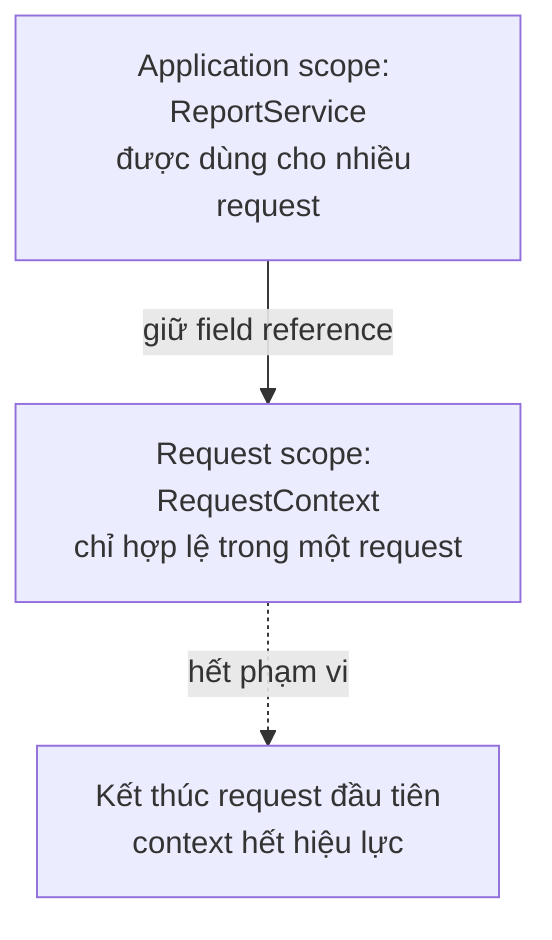
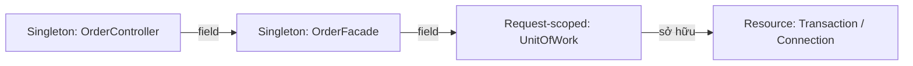
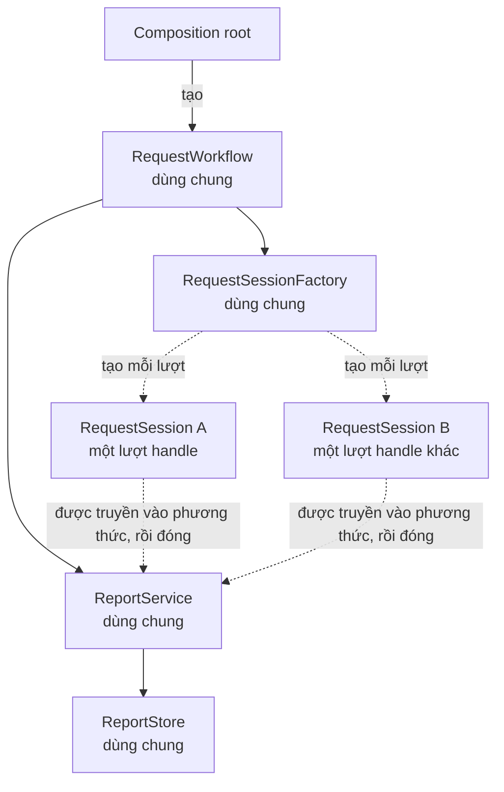

# Phụ thuộc bị giữ sống lâu hơn dự kiến (captive dependency)

Một thành phần có thể được tạo thành công và được tiêm đúng kiểu nhưng vẫn hoạt động sai vì **giữ tham chiếu đến một phụ thuộc lâu hơn thời gian phụ thuộc ấy được phép sử dụng**. Ví dụ, một service dùng chung suốt thời gian ứng dụng chạy giữ đối tượng chứa thông tin của request đầu tiên. Request tiếp theo có thể nhìn thấy dữ liệu cũ, hoặc truy cập một session đã đóng.

Tình huống đó thường được gọi là **captive dependency**: một đối tượng có vòng đời dài hơn (*captive owner*, tức đối tượng giữ phụ thuộc) đã “giữ lại” một dependency lẽ ra có vòng đời ngắn hơn. Lỗi có thể đi qua nhiều lớp trung gian và không được giải quyết chỉ bằng việc thêm interface, `@Inject` hoặc dùng DI container.

Bài thuộc chương **Vòng đời và phạm vi** của module **DEPENDENCY_INJECTION**. Mục tiêu là hiểu quan hệ giữa **scope, vòng đời, quyền sở hữu và khả năng sử dụng an toàn**; phát hiện captive dependency trong object graph; sửa bằng **constructor injection**, **composition root**, tham số phương thức hoặc factory; rồi kiểm tra bằng **Java thuần** trước khi học cơ chế scope của container.

## 1. Kết quả cần đạt

Sau bài này, bạn có thể:

- Giải thích được **captive dependency** và phân biệt thời gian một đối tượng **còn được tham chiếu** với thời gian nó **còn hợp lệ để sử dụng**.
- Vẽ đường tham chiếu trực tiếp hoặc gián tiếp từ một đối tượng sống lâu đến phụ thuộc sống ngắn và xác định vì sao có rủi ro.
- Phân biệt những lựa chọn thường gọi là **singleton/application scope**, **request scope**, **task scope** và **transient/prototype**, đồng thời hiểu các tên gọi có thể khác nhau theo DI container.
- Phân tích các biểu hiện: dữ liệu request bị giữ lại, tài nguyên đã đóng vẫn được gọi, trạng thái mutable bị dùng chung và vòng đời bị kéo dài ngoài dự kiến.
- Dùng Java thuần để sửa quan hệ lifetime, quản lý việc tạo/đóng tài nguyên bằng factory và `try-with-resources`.
- Nhận ra giới hạn của việc sửa bằng proxy, provider hay thay đổi annotation scope nếu vẫn không hiểu hành vi của dependency.

## 2. Scope, lifetime và quyền sở hữu không phải một khái niệm

Trước khi xem lỗi captive, cần phân biệt ba câu hỏi:

| Câu hỏi | Khái niệm | Ví dụ |
| --- | --- | --- |
| **Khi nào và trong ngữ cảnh nào tạo/chia sẻ instance?** | **Scope** (phạm vi phân phối instance) | Dùng một instance cho toàn ứng dụng hoặc một instance cho mỗi request |
| **Đến lúc nào instance còn được phép dùng?** | **Lifetime/vòng đời hợp lệ** | Một request session chỉ hợp lệ trước khi request kết thúc và session đóng |
| **Ai có trách nhiệm kết thúc việc dùng và giải phóng?** | **Ownership/quyền sở hữu** | Handler tạo session theo request và đóng session khi xử lý xong |

Trong Java, một object có thể **vẫn tồn tại trong heap** vì còn tham chiếu, dù tài nguyên mà nó đại diện đã hết hiệu lực. Một `Session` đã `close()` không tự biến mất khỏi bộ nhớ; phương thức của nó có thể ném lỗi hoặc trả dữ liệu không hợp lệ nếu tiếp tục bị gọi. Vì vậy, **còn sống về bộ nhớ** không đồng nghĩa **còn hợp lệ về nghiệp vụ hoặc tài nguyên**.

Một số kiểu scope hay gặp:

| Kiểu phạm vi | Cách sử dụng điển hình | Rủi ro cần xem |
| --- | --- | --- |
| **Application / singleton** | Một object được chia sẻ trong ứng dụng hoặc trong một container | Trạng thái dùng chung, an toàn đồng thời, vô tình giữ dữ liệu của request |
| **Request** | Một object theo từng yêu cầu HTTP hoặc lượt xử lý tương đương | Không được truy cập sau khi request kết thúc |
| **Session / conversation** | Một object gắn với phiên hoặc cuộc hội thoại | Không được giả định phiên có cùng lifetime với process |
| **Task / unit of work** | Một object cho mỗi tác vụ, transaction hoặc công việc nền | Công việc phải kết thúc và tài nguyên phải được đóng đúng lúc |
| **Transient / prototype** | Một instance mới khi được yêu cầu tạo hoặc resolve | Bên nhận phải biết ai sở hữu instance và nó có cần được hủy không |

Các tên gọi này **không phải một đặc tả chung cho mọi framework**. Ví dụ, một container có thể định nghĩa “singleton” là *một instance trong mỗi container*; một container khác có thể có quy tắc khác về số lần tạo prototype, thời điểm giải phóng, proxy và scope hoạt động. Đừng suy từ tên annotation rằng mọi runtime có cách quản lý giống nhau.

**Định nghĩa vận dụng:** một captive dependency xuất hiện khi một đối tượng sống lâu **giữ hoặc gián tiếp giữ** dependency chỉ được phép sử dụng trong một khoảng ngắn hơn, khiến việc sử dụng, thay đổi, tái sử dụng hay dọn dẹp dependency không còn đúng hợp đồng vòng đời.

## 3. Lỗi điển hình: singleton giữ dữ liệu request

Giả sử `ReportService` xử lý yêu cầu xuất báo cáo. Thông tin mỗi request được đặt trong `RequestContext`:

```java
// Mã minh họa tình huống sai; các kiểu được giả định tồn tại.
final class ReportService {
    private final RequestContext context;
    private final ReportStore store;

    ReportService(RequestContext context, ReportStore store) {
        this.context = context;
        this.store = store;
    }

    String render(String reportId) {
        return store.load(reportId, context.tenantId());
    }
}
```

Nếu `ReportService` được cấu hình **dùng chung lâu dài**, nhưng `RequestContext` chỉ được phép sử dụng trong **một request**, ta có quan hệ:



Diễn tiến dễ gây lỗi:

1. **Request A** bắt đầu; hệ thống tạo `RequestContext(A)`.
2. `ReportService` được tạo lần đầu, nhận `RequestContext(A)` trong constructor và được giữ lại để dùng cho các request khác.
3. **Request A** kết thúc; ngữ cảnh và tài nguyên liên quan không còn được phép dùng.
4. **Request B** gọi `ReportService.render()`. Service vẫn giữ **tham chiếu đến context A**, thay vì dữ liệu của B.

Kết quả tùy thiết kế của `RequestContext`: có thể đọc nhầm tenant/user, ném exception vì session đóng, hoặc sử dụng một trạng thái đã lỗi thời. Với hệ thống đa người dùng, đây còn có thể là lỗi **cách ly dữ liệu giữa request**.

Điểm đáng chú ý: lỗi phát sinh từ **hướng giữ tham chiếu và độ dài vòng đời**, không nhất thiết do hai lớp vi phạm kiểu dữ liệu. Constructor injection làm dependency **hiện rõ**, nhưng bản thân constructor injection **không tự kiểm tra scope**.

### 3.1. Trường hợp nào không phải captive dependency?

Việc một singleton nhận một instance được khai báo “transient” không tự động sai. Nếu đối tượng transient là **không trạng thái**, bất biến, được thiết kế để sử dụng lâu dài và không có lifetime bị giới hạn, giữ nó lâu hơn có thể hoàn toàn hợp lệ. Ngược lại, một đối tượng được đánh dấu singleton cũng có thể không an toàn nếu giữ dữ liệu mutable chung.

Tín hiệu cần đánh giá là:

- Dependency có **hết hiệu lực** khi request, transaction, task hoặc session kết thúc không?
- Dependency có **trạng thái theo người dùng/lượt gọi**, không được phép chia sẻ không?
- Dependency có yêu cầu `close/dispose` đúng lúc hoặc yêu cầu thread/transaction cụ thể không?
- Owner có đang dùng một instance **thay cho instance riêng của lượt gọi mới** không?

Không nên kết luận chỉ bằng phép so sánh số lượng instance, cũng không nên coi đổi mọi thứ thành singleton là cách sửa.

## 4. Đường giữ phụ thuộc có thể trực tiếp, gián tiếp hoặc bị che giấu

### 4.1. Giữ trực tiếp trong trường

```java
final class SharedHandler {
    private final RequestSession session;

    SharedHandler(RequestSession session) {
        this.session = session; // Giữ session nếu handler sống lâu.
    }
}
```

Nếu `SharedHandler` là application-scoped và `RequestSession` là request-scoped, đây là mối quan hệ cần kiểm tra ngay. Nhưng nếu cả handler và session cùng sống trong một request thì cách truyền này **không có vấn đề captive** theo định nghĩa ở trên.

### 4.2. Giữ gián tiếp qua nhiều lớp



Trong graph này, `OrderController` không trực tiếp chứa `UnitOfWork` nhưng giữ một `OrderFacade` giữ nó. Việc review chỉ từng constructor riêng lẻ dễ bỏ sót **chuỗi tham chiếu dài**.

### 4.3. Giữ qua callback, lambda và tác vụ bất đồng bộ

```java
// Phác họa lỗi lifetime, executor là đối tượng chạy task sau này.
void handle(RequestSession session, java.util.concurrent.Executor executor) {
    executor.execute(() -> useSession(session));
}
```

Nếu `handle` trả về và request đóng session **trước khi callback chạy**, lambda vẫn giữ tham chiếu đến session đã hết hiệu lực. Ở đây owner “giữ lâu” có thể là **hàng đợi task** thay vì một singleton service.

Khi chuyển công việc sang background, cần thiết kế **dữ liệu nào được phép tách khỏi request**, sao chép giá trị bất biến cần thiết và tạo resource riêng cho vòng đời task. Không nên “chữa” bằng cách kéo dài vô thời hạn một session đang chứa trạng thái request.

### 4.4. Giữ qua cache hoặc static field

Một cache lưu `RequestContext` hoặc `EntityManager` theo request có thể duy trì tham chiếu sau khi đơn vị công việc đã đóng. `static` field cũng có thể giữ tài nguyên vượt quá vòng đời dự kiến. Cần kiểm tra cả những nơi **giữ tham chiếu ngoài DI container**: listener, registry, map, thread-local và callback.

## 5. Ví dụ Java thuần: tái hiện lỗi và sửa ở đúng ranh giới

Ví dụ bên dưới có một kho báo cáo dùng chung và một `RequestSession` giả lập, có trạng thái `closed`. Mỗi session mang một mã request để dễ quan sát. Đây là **mô hình vòng đời trong bộ nhớ**: không có HTTP, cơ sở dữ liệu thật, kết nối hay DI container; mã request không phải cơ chế xác thực.

Ta thử hai cách:

- **Sai:** `CaptiveReportService` giữ `RequestSession` của request đầu tiên như một dependency lâu dài.
- **Đúng với bài toán này:** `ReportService` giữ duy nhất `ReportStore` có thể chia sẻ; mỗi lần xử lý nhận session của request đó. `RequestWorkflow` sở hữu factory và đóng session trong một `try-with-resources`.

Lưu toàn bộ vào một tệp **`Main.java`**:

```java
import java.util.Objects;

public class Main {
    interface ReportStore {
        String loadSummary(String reportId);
    }

    // Dependency có thể chia sẻ giữa các lượt gọi.
    static final class InMemoryReportStore implements ReportStore {
        @Override
        public String loadSummary(String reportId) {
            Objects.requireNonNull(reportId, "reportId");
            if (reportId.isBlank()) {
                throw new IllegalArgumentException("blank report ID");
            }
            return "summary(" + reportId + ")";
        }
    }

    // Mô phỏng tài nguyên chỉ hợp lệ trong một request.
    static final class RequestSession implements AutoCloseable {
        private final String requestId;
        private boolean closed;

        RequestSession(String requestId) {
            this.requestId = Objects.requireNonNull(requestId, "requestId");
            if (requestId.isBlank()) {
                throw new IllegalArgumentException("blank request ID");
            }
        }

        String activeRequestId() {
            if (closed) {
                throw new IllegalStateException("request session is closed");
            }
            return requestId;
        }

        @Override
        public void close() {
            closed = true;
        }
    }

    // SAI khi service được giữ sống lâu hơn RequestSession.
    static final class CaptiveReportService {
        private final ReportStore store;
        private final RequestSession session;

        CaptiveReportService(ReportStore store, RequestSession session) {
            this.store = Objects.requireNonNull(store, "store");
            this.session = Objects.requireNonNull(session, "session");
        }

        String render(String reportId) {
            return store.loadSummary(reportId)
                    + " @ " + session.activeRequestId();
        }
    }

    // Service dùng lâu dài, KHÔNG giữ session theo request.
    static final class ReportService {
        private final ReportStore store;

        ReportService(ReportStore store) {
            this.store = Objects.requireNonNull(store, "store");
        }

        String render(String reportId, RequestSession session) {
            Objects.requireNonNull(session, "session");
            return store.loadSummary(reportId)
                    + " @ " + session.activeRequestId();
        }
    }

    // Hợp đồng tạo session MỚI cho một lượt xử lý.
    interface RequestSessionFactory {
        RequestSession open(String requestId);
    }

    // Dùng được lâu dài vì chỉ giữ service và factory phù hợp.
    static final class RequestWorkflow {
        private final ReportService reports;
        private final RequestSessionFactory sessions;

        RequestWorkflow(
                ReportService reports,
                RequestSessionFactory sessions) {
            this.reports = Objects.requireNonNull(reports, "reports");
            this.sessions = Objects.requireNonNull(sessions, "sessions");
        }

        String handle(String requestId, String reportId) {
            // Mỗi lượt xử lý có session riêng và chủ sở hữu rõ ràng.
            try (RequestSession session = sessions.open(requestId)) {
                return reports.render(reportId, session);
            }
        }
    }

    // Composition root: chọn và lắp các dependency dùng lâu dài.
    static RequestWorkflow compose(ReportStore sharedStore) {
        ReportService reports = new ReportService(sharedStore);
        RequestSessionFactory factory = RequestSession::new;
        return new RequestWorkflow(reports, factory);
    }

    public static void main(String[] args) {
        ReportStore sharedStore = new InMemoryReportStore();

        // Tái hiện captive dependency: service sống vượt request A.
        CaptiveReportService captive;
        try (RequestSession requestA = new RequestSession("REQ-1")) {
            captive = new CaptiveReportService(sharedStore, requestA);
            System.out.println(
                    "Captive during first request: "
                            + captive.render("R-7"));
        }

        // Request A đã đóng, nhưng captive vẫn giữ tham chiếu.
        boolean detected = false;
        try {
            captive.render("R-7");
        } catch (IllegalStateException expected) {
            detected = true;
            System.out.println(
                    "Captive after first request: session closed");
        }
        if (!detected) {
            throw new AssertionError("expected captive dependency failure");
        }

        // Cách sửa: workflow dùng chung, session mới theo mỗi lượt gọi.
        RequestWorkflow workflow = compose(sharedStore);
        String resultA = workflow.handle("REQ-A", "R-7");
        String resultB = workflow.handle("REQ-B", "R-7");

        if (!resultA.equals("summary(R-7) @ REQ-A")
                || !resultB.equals("summary(R-7) @ REQ-B")) {
            throw new AssertionError("unexpected request isolation");
        }

        System.out.println("Safe request A: " + resultA);
        System.out.println("Safe request B: " + resultB);
        System.out.println("Plain Java verification: PASS");
    }
}
```

Chạy với JDK 11 trở lên:

```bash
javac -encoding UTF-8 Main.java
java Main
```

Kết quả dự kiến:

```text
Captive during first request: summary(R-7) @ REQ-1
Captive after first request: session closed
Safe request A: summary(R-7) @ REQ-A
Safe request B: summary(R-7) @ REQ-B
Plain Java verification: PASS
```

### 5.1. Tại sao bản đầu có lỗi?

Biến `captive` giữ `CaptiveReportService` ra ngoài khối request A. Bản thân service vẫn ở trong bộ nhớ, và trường `session` vẫn tham chiếu đến `RequestSession` của A. Khi hết khối `try-with-resources`, `close()` đã đánh dấu session không còn hợp lệ. Gọi lại `render` sau đó sẽ ném lỗi.

Nếu `RequestSession` **không tự phát hiện đóng**, cùng lỗi có thể biểu hiện âm thầm: service vẫn đọc được mã `REQ-1` cho lượt xử lý B. Đây là lý do quan trọng để kiểm tra **ngữ nghĩa và vòng đời**, không chỉ kiểm tra xem object có bị `null` hay không.

### 5.2. Tại sao bản sau an toàn hơn?

`RequestWorkflow` được giữ lâu dài nhưng chỉ giữ `ReportService` và một `RequestSessionFactory`, cả hai được thiết kế để sử dụng ở phạm vi ứng dụng. Mỗi lần `handle` được gọi, factory mở **session mới** và `try-with-resources` đóng nó trước khi kết thúc lượt xử lý.

`ReportService` nhận session của lượt gọi qua **tham số phương thức** và sử dụng ngay trong lời gọi; nó không lưu session vào trường hay giữ trong callback chạy sau đó. Vì vậy, trạng thái request A không bị giữ lại để dùng cho B.

Điểm cần nhấn mạnh: truyền dependency sống ngắn qua tham số phương thức **chỉ an toàn khi consumer không giữ lại nó vượt lifetime**. Nếu `render` lưu session vào cache, khởi chạy background task giữ session hoặc trả về closure sử dụng sau khi request đóng, lỗi captive vẫn quay lại.

### 5.3. Hai lớp dependency khác nhau trong cùng graph



Các mũi tên nét đứt mô tả **sự tham gia tạm thời khi chạy**, không có nghĩa `ReportService` giữ trường tham chiếu lâu dài đến cả hai session. Composition root quyết định kiến trúc chung; factory tạo phần có lifetime theo request tại thời điểm thực sự xử lý.

### 5.4. Giới hạn của ví dụ

`RequestSession` chỉ dùng biến `boolean closed` để mô phỏng lifetime; đây không phải session xác thực, transaction, JDBC connection hay cơ chế thread-safe. Ví dụ chạy tuần tự trên một thread. Trong ứng dụng thực tế, cần xác định chính xác lifetime của từng resource và cách xử lý request đồng thời, exception, cancellation và tác vụ bất đồng bộ. Ví dụ chứng minh **hướng quản lý lifetime**, không chứng minh một DI container đã tự chặn mọi captive dependency.

## 6. Các chiến lược sửa captive dependency

Không có một thao tác đổi annotation phù hợp cho mọi trường hợp. Chọn giải pháp theo **vì sao dependency cần sống ngắn** và **ai phải chịu trách nhiệm**.

| Cách sửa | Phù hợp khi | Điều cần tránh |
| --- | --- | --- |
| **Truyền dữ liệu từng lượt qua tham số** | Service dùng chung cần ID, giá trị hoặc context chỉ trong một lời gọi đồng bộ | Lưu context vào trường/cache hoặc giữ trong task sau khi request kết thúc |
| **Thu hẹp scope của consumer** | Consumer thực sự mang trạng thái riêng theo request/task | Dùng lại consumer đã kết thúc, hoặc phá chia sẻ được yêu cầu ở phần khác |
| **Tiêm factory/provider, tạo đúng lúc** | Consumer sống lâu cần tạo resource ngắn hạn cho từng công việc | Tạo một lần rồi cache kết quả; quên close hoặc xử lý lỗi |
| **Tiêm proxy theo scope** | Container hỗ trợ proxy giải quyết target đúng ngữ cảnh đang hoạt động | Giả định proxy sẽ chạy khi không có scope, hoặc giữ target thật sau khi resolve |
| **Tách dữ liệu bất biến khỏi resource sống ngắn** | Background task chỉ cần một vài giá trị được phép tồn tại sau request | Sao chép cả đối tượng session/transaction hoặc thông tin bí mật không cần thiết |
| **Đổi ownership và giao thức shutdown** | Resource có lifetime được quản lý bởi factory/host rõ ràng | Đóng tài nguyên khi consumer khác vẫn đang sử dụng |

### 6.1. Đưa dữ liệu request vào phương thức

Một service **stateless** sống lâu có thể nhận dữ liệu của từng request tại thời điểm xử lý:

```java
final class PriceService {
    private final PriceCatalog catalog; // Có thể chia sẻ.

    PriceService(PriceCatalog catalog) {
        this.catalog = catalog;
    }

    long quote(String customerId, String sku) {
        // customerId thuộc lượt gọi, không lưu vào field của service.
        return catalog.priceFor(customerId, sku);
    }
}
```

Đoạn mã minh họa cấu trúc; `PriceCatalog` được giả định là hợp đồng do ứng dụng định nghĩa. Phù hợp nếu thao tác chỉ cần giá trị `customerId` trong lúc gọi. Không nên truyền một đối tượng resource đã đóng hoặc phát tán quyền truy cập dữ liệu nhạy cảm nếu không cần.

### 6.2. Dùng factory hoặc provider có hợp đồng vòng đời rõ

Khi cần một resource như `UnitOfWork`, `Transaction` hoặc kết nối, factory có thể tạo resource **cho mỗi tác vụ**. Consumer hoặc handler sở hữu tài nguyên đó trong phạm vi xác định:

```java
// Mã phác họa: UnitOfWork và UnitOfWorkFactory là API ứng dụng.
void handle(Command command) {
    try (UnitOfWork unit = unitFactory.open()) {
        process(command, unit);
        unit.commit();
    }
}
```

**Lưu ý giao dịch:** không phải mọi `UnitOfWork.close()` tự rollback; phải quy định `commit/rollback/close` theo contract cụ thể. Cũng không phải mọi provider đều trả object mới: có provider trả object đang thuộc scope hiện tại. Hãy đọc đúng ngữ nghĩa của provider, thay vì coi “tiêm provider” là tự động sửa lỗi.

### 6.3. Thu hẹp scope của chính consumer

Nếu `ReportService` thực sự cần giữ `RequestSession` trong toàn bộ quá trình xử lý, ta có thể tạo **một `ReportService` cho mỗi request** và bỏ nó khi request kết thúc:

```java
// Phác họa wiring theo request, không phải tệp Java độc lập.
try (RequestSession session = sessionFactory.open(requestId)) {
    ReportServiceForRequest service =
            new ReportServiceForRequest(reportStore, session);
    service.render(reportId);
}
```

Khi đó, service và session có cùng phạm vi sử dụng. Nếu service có trạng thái được quản lý theo request, đây có thể là thiết kế hợp lý. Composition root chính của ứng dụng có thể cung cấp một **request handler factory** để tạo phần graph ngắn hạn mỗi lần có request.

### 6.4. Dùng scoped proxy khi container hỗ trợ

Một số DI container cho phép tiêm **proxy sống lâu** vào service sống lâu; mỗi lần gọi proxy, container tìm target tương ứng với request/task hiện tại. Cách này có thể tránh giữ trực tiếp đối tượng request đầu tiên.

Tuy nhiên, cần hiểu rõ:

- Proxy chỉ giải quyết đúng target khi có **scope đang hoạt động**; lời gọi ngoài request có thể thất bại.
- Thread khác hoặc tác vụ bất đồng bộ có thể không tự mang theo context của request.
- Nếu code lấy target thật rồi cache nó, quan hệ captive có thể xuất hiện lại.
- Proxy không tự làm trạng thái mutable thread-safe, không thay thế việc close và không bảo đảm xử lý transaction đúng.

Trước khi cấu hình proxy, hãy thử giải thích quan hệ lifetime bằng **factory hoặc tham số phương thức trong Java thuần**. Nếu không thể xác định owner và thời điểm sử dụng bằng cách đó, proxy có nguy cơ chỉ che giấu vấn đề.

## 7. DI container có thể phát hiện lỗi đến đâu?

Các DI container có quy tắc khác nhau. Một số container từ chối ngay cấu hình trực tiếp “singleton phụ thuộc scoped service” nếu chưa có proxy hoặc factory thích hợp; một số tạo proxy để resolve theo request; số khác cho phép graph được tạo nhưng developer vẫn phải quản lý lifetime đúng.

Vì vậy, không có kết luận phổ quát rằng **container luôn chặn** hoặc **container không bao giờ chặn** captive dependency.

### 7.1. Trường hợp transient bị “đóng băng” khi tiêm

Một cơ chế phổ biến là tạo dependency ở thời điểm container tạo consumer:

```text
Container tạo Service dùng chung
  -> resolve một Worker kiểu transient
  -> truyền Worker vào constructor Service
  -> Service giữ Worker trong field suốt đời của Service
```

Khi đó, `Worker` không được tạo lại ở **mỗi lần `Service` gọi phương thức** chỉ vì nó được đăng ký transient. Nếu nghiệp vụ cần worker mới cho mỗi công việc, phải dùng cơ chế factory/provider hoặc tạo graph theo tác vụ.

Nhưng việc giữ instance transient một thời gian dài **không luôn là lỗi**: nếu worker bất biến, không chứa trạng thái task và không có yêu cầu giải phóng sớm, nó có thể được thiết kế để dùng lâu. Tên scope nói lên **cách tạo/cung cấp instance**, còn hợp đồng thực tế quyết định **thời gian sử dụng hợp lệ**.

### 7.2. Vòng đời graph và scope của request

Trong một request HTTP, container thường có cơ chế tạo và hủy các thành phần request-scoped. Ở Java thuần, quy trình tương đương là:

```text
App root tồn tại lâu
  -> nhận request
  -> tạo phần graph theo request
  -> gọi use case
  -> hoàn thành hoặc hủy request
  -> đóng phần graph và tài nguyên theo request
App root tiếp tục phục vụ request kế tiếp
```

Đường đi của dependency phải tôn trọng ranh giới này. Một ứng dụng có nhiều scope như session, job, transaction hoặc WebSocket còn cần mô hình cụ thể cho từng loại; không thể giả định tất cả đều bằng thời gian HTTP request.

## 8. Rủi ro về dữ liệu, tính đồng thời và tài nguyên

### 8.1. Giữ nhầm dữ liệu của request đầu tiên

Singleton giữ `currentUserId` hoặc `tenantId` trong field được gán từ lần gọi đầu sẽ tạo hành vi sai khi phục vụ người khác. Một số lỗi kiểu này có thể trở thành **rò rỉ thông tin giữa tenant**. Nên lưu dữ liệu theo lượt gọi ở request object/context đúng scope, hoặc truyền giá trị cần thiết vào phương thức.

### 8.2. Phụ thuộc bị đóng nhưng vẫn được gọi

Một `EntityManager`, transaction, stream, statement hoặc session có thể vẫn được tham chiếu sau khi owner đã đóng. Lỗi có thể là exception, hành vi không xác định hoặc giữ tài nguyên ngầm. Không nên “sửa” bằng cách bỏ lệnh close: điều đó có thể tạo rò rỉ tài nguyên và vi phạm ranh giới transaction.

### 8.3. Dùng chung đối tượng vốn không thread-safe

Một object sống lâu có thể được gọi đồng thời. Nếu nó giữ state mutable của một request, hai thread có thể ghi đè dữ liệu. Ngay cả khi không có captive dependency theo nghĩa resource hết hạn, vẫn cần kiểm tra **thread-safety** và tính cô lập của mỗi lượt xử lý.

Đừng nhầm “singleton” với “thread-safe”. Singleton chỉ nói về phạm vi instance theo cơ chế cấp phát; tính an toàn đồng thời là một tính chất riêng của cách triển khai.

### 8.4. Dọn dẹp sai thứ tự hoặc sai owner

Nếu một factory tạo đối tượng ngắn hạn rồi đưa cho consumer khác giữ lâu dài, bên tạo có thể đóng quá sớm hoặc không ai đóng. Khi có nhiều tài nguyên lồng nhau, nên xác định rõ:

1. Ai **tạo** dependency?
2. Ai được **sử dụng** và trong ngữ cảnh nào?
3. Ai **sở hữu việc đóng**?
4. Sau khi close, còn callback/task nào có thể truy cập dependency không?
5. Nếu xử lý thất bại, tài nguyên nào cần rollback/hủy?

Việc tách construction và activation tại composition root giúp dễ quản lý vòng đời, nhưng không tự giải quyết **thời điểm kết thúc** của mỗi phần graph.

## 9. Cách đọc một object graph để phát hiện captive dependency

Khi review cấu hình DI hoặc code constructor injection, hãy bắt đầu từ các đối tượng **sống lâu nhất**:

1. **Xác định owner lâu dài:** application service, singleton controller, scheduler, listener, cache hoặc task queue.
2. **Liệt kê các field dependency:** xem từ owner đến dependency trực tiếp; tiếp tục lần theo dependency của từng dependency để tìm quan hệ gián tiếp.
3. **Ghi scope/lifetime mong muốn:** application, request, session, task, transaction hoặc resource local. Với đối tượng không khai báo scope, cần xem cách nó được tạo thực tế.
4. **Tìm chỗ dependency trở nên không hợp lệ:** kết thúc request, commit/rollback, close, timeout, cancellation hoặc shutdown.
5. **Tìm lượt dùng sau ranh giới ấy:** callback bất đồng bộ, lịch chạy định kỳ, request thứ hai, cache hoặc singleton tái sử dụng.
6. **Chọn nơi nhận dependency đúng thời điểm:** method argument, request-level factory, provider hoặc scoped proxy với điều kiện sử dụng rõ ràng.
7. **Ghi owner chịu trách nhiệm đóng:** dùng `try-with-resources` khi có thể; với tài nguyên chạy lâu, cần shutdown có thứ tự.
8. **Thử tình huống hai request và đóng giữa chừng:** kiểm tra state không lẫn, không sử dụng resource đã đóng và không giữ tham chiếu sau lifecycle.

Đây là một quy trình review mang tính nguyên tắc. Hệ thống có nhiều luồng, transaction và lifecycle callback cần bổ sung kiểm thử tích hợp vì mọi lỗi không thể phát hiện bằng một unit test Java thuần.

## 10. Phân biệt với các vấn đề lân cận

| Dấu hiệu | Có nhất thiết là captive dependency không? | Cần xem |
| --- | --- | --- |
| Singleton giữ một object immutable | **Không nhất thiết** | Object có lifetime hợp lệ xuyên suốt và không chứa dữ liệu scoped không? |
| Singleton giữ request context | **Thường là dấu hiệu mạnh** | Context có được thay đúng theo mỗi request, có còn hợp lệ sau request đầu không? |
| Service nhận transient trong constructor | **Không tự động** | Transient được định nghĩa cho mỗi lần resolve hay mỗi lần sử dụng? Có trạng thái hoặc cleanup riêng không? |
| Resource bị quên `close()` dù không ai giữ lâu | Có thể là **resource leak** riêng | Ai sở hữu và đóng? |
| Singleton có biến đếm mutable dùng đồng thời | Có thể là **race condition**, không cần captive | Đồng bộ, bất biến hoặc thiết kế state riêng theo request |
| Request dùng singleton repository thread-safe | **Có thể hoàn toàn hợp lệ** | Repository có phù hợp để chia sẻ và có sở hữu tài nguyên đúng không? |
| Callback giữ session sau khi request kết thúc | **Có thể là captive** | Callback sẽ chạy khi nào, ai sở hữu context và resource? |
| Container báo không có request scope đang hoạt động | **Có thể do truy cập sai context** | Lời gọi diễn ra ngoài scope, thiếu proxy, hay do task không mang context? |

Điều quan trọng là **tìm nguyên nhân cụ thể**. Một vấn đề liên quan đến scope có thể đồng thời là lỗi chia sẻ trạng thái hoặc cleanup; cũng có trường hợp chỉ là rò tài nguyên không phát sinh từ việc giữ dependency sống ngắn.

## 11. Bài thực hành thiết kế

Giả sử một dịch vụ xử lý thanh toán có cấu trúc:

```text
ApplicationPaymentFacade (dùng chung)
  -> PaymentWorkflow (dùng chung)
      -> TransactionSession (mỗi giao dịch)
          -> DatabaseConnection (đóng khi giao dịch kết thúc)
```

Trong triển khai hiện tại, `PaymentWorkflow` nhận `TransactionSession` qua constructor. Tác vụ đầu tiên xử lý thành công; tác vụ sau báo lỗi “transaction already closed”.

Hãy thực hiện theo các bước:

1. Vẽ lại object graph và đánh dấu thành phần nào vượt lifetime của thành phần nào.
2. Xác định liệu `PaymentWorkflow` có cần giữ session giữa các tác vụ hay không.
3. Đề xuất một `TransactionSessionFactory` với phương thức `open()` và chỉ rõ ai gọi `close()`.
4. Nêu cách truyền session vào bước xử lý **mà không giữ trong field lâu dài**; hoặc xem xét tạo workflow mới cho mỗi transaction nếu workflow thực sự có state theo transaction.
5. Mô tả hai tình huống lỗi: transaction ném exception trong xử lý và callback thanh toán chạy sau khi transaction đã đóng.
6. Nêu kiểm thử tối thiểu để chứng minh hai giao dịch liên tiếp không dùng lại session đã đóng.

**Gợi ý thiết kế:** application facade có thể giữ một workflow **stateless** và factory sống lâu; mỗi lần thanh toán, workflow mở transaction riêng bằng factory trong khối có cleanup, truyền transaction cho các hàm cần nó. Nếu cần transaction gắn với cả một đối tượng workflow, nên tạo workflow mới trong transaction scope. Đừng kéo dài session vượt giao dịch chỉ để tránh thay đổi cấu trúc.

## 12. Tự kiểm tra

**Tình huống A.** `NotificationService` được dùng chung trong ứng dụng. Constructor nhận `RequestContext` chứa locale và tenant của request đầu tiên. Request thứ hai cần locale khác. Vấn đề là gì?

**Gợi ý:** Service giữ context của request trước quá lâu; đây là captive dependency. Cần truyền locale/tenant của mỗi request đúng lúc hoặc tổ chức service theo request. Đừng giả định một instance request-scoped có thể trở thành nguồn dữ liệu đúng cho tất cả request.

**Tình huống B.** Một singleton có field kiểu `Formatter` được tạo bằng một factory transient, không giữ state, không cần close và được thiết kế để tái sử dụng. Có bắt buộc xem đây là lỗi captive?

**Gợi ý:** Không. Cần kiểm tra hợp đồng lifetime và thread-safety của `Formatter`. Tên transient cho biết cách cấp phát, chưa đủ để khẳng định việc giữ instance lâu là sai.

**Tình huống C.** Nhóm thay `RequestSession` bằng một provider tiêm vào singleton, nhưng constructor gọi `provider.get()` một lần rồi lưu kết quả trong field. Đã sửa lỗi chưa?

**Gợi ý:** Chưa chắc, thường vẫn sai. Provider chỉ có ích nếu resolve được thực hiện **đúng lúc** trong scope hợp lệ và target không bị giữ sau lifetime. Cần dùng provider tại mỗi lượt xử lý hoặc tạo phần graph ngắn hạn có owner rõ.

**Tình huống D.** Một controller giữ singleton service; service chỉ nhận `userId` qua tham số và không lưu, không khởi chạy callback sử dụng về sau. Có vấn đề captive chỉ vì request truyền dữ liệu cho singleton không?

**Gợi ý:** Không. Phụ thuộc không bị giữ quá lifetime; một lời gọi đồng bộ sử dụng giá trị request trong phạm vi hoạt động có thể hợp lệ. Cần xem thêm tính thread-safe của những dependency được chia sẻ.

**Tình huống E.** Một task queue giữ lambda tham chiếu đến transaction của request. Request kết thúc trước khi task được thực thi. Đây là loại rủi ro nào và sửa sao?

**Gợi ý:** Queue kéo dài lifetime tham chiếu đến transaction; task có thể dùng resource đã đóng. Chỉ chuyển những giá trị cần thiết được phép tồn tại sang task và mở transaction mới theo lifetime của task nếu cần.

## 13. Ghi nhớ

- **Captive dependency** là khi đối tượng hoặc cơ chế sống lâu giữ lại dependency chỉ hợp lệ trong một phạm vi ngắn hơn; vấn đề có thể trực tiếp hoặc gián tiếp.
- **Scope không đồng nhất với việc object còn trong bộ nhớ.** Một session đã đóng vẫn có thể còn tham chiếu nhưng không còn được phép sử dụng.
- **Constructor injection** làm lộ quan hệ phụ thuộc nhưng không tự ngăn captive dependency; cần hiểu graph, các ranh giới request/task và quyền sở hữu tài nguyên.
- **Singleton không tự động thread-safe; transient không tự động là ngắn hạn về mọi nghĩa.** Phải kiểm tra hành vi và cách container cấp phát instance.
- **Truyền dữ liệu theo lượt gọi, tạo resource qua factory hoặc thu hẹp scope của consumer** là các hướng sửa thường gặp. Proxy/provider chỉ giúp khi resolve và cleanup đúng ngữ cảnh.
- **Composition root quản lý graph dùng lâu; phần graph ngắn hạn cần nơi tạo và đóng rõ ràng.** Java thuần đủ để mô phỏng và kiểm tra trước khi chuyển sang DI container.

Khi phân tích một dependency có scope ngắn, hãy hỏi: **“Ai đang giữ nó, sẽ giữ đến bao giờ, lúc nào nó hết hiệu lực và có đường thực thi nào còn gọi nó sau thời điểm ấy không?”** Trả lời được bốn câu hỏi đó sẽ giúp tìm đúng nguyên nhân của captive dependency thay vì chỉ đổi annotation hoặc thời điểm khởi tạo.
