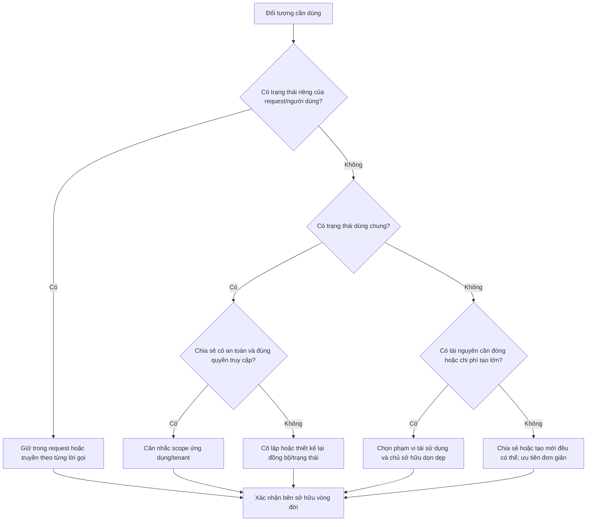
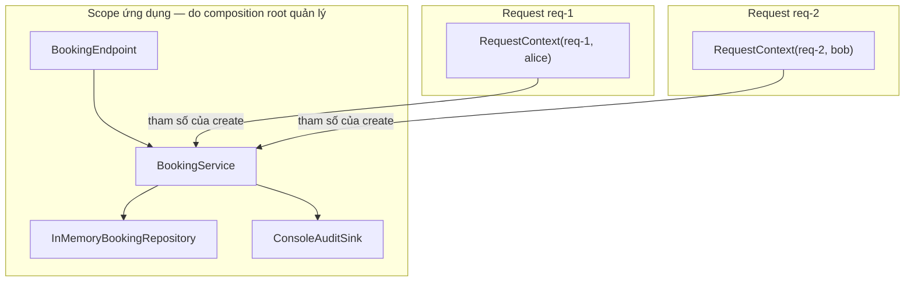
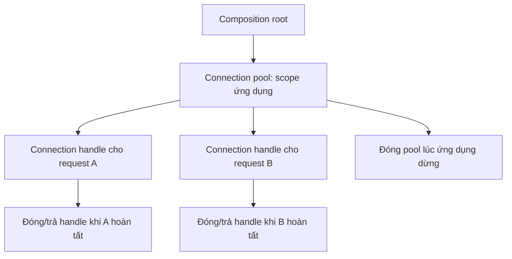

# Lựa chọn scope theo trạng thái, khả năng chia sẻ và quyền sở hữu

Khi dùng **Dependency Injection (DI)**, truyền một đối tượng vào constructor mới giải quyết được câu hỏi *lớp này nhận phụ thuộc từ đâu*. Ta còn phải quyết định **bao nhiêu instance được tạo, chúng được chia sẻ cho ai, tồn tại đến lúc nào và ai chịu trách nhiệm giải phóng tài nguyên**. Đó là nội dung của **scope và vòng đời** (*lifecycle*).

Ví dụ, một `BookingService` có thể được cả ứng dụng dùng chung nếu nó không giữ dữ liệu riêng của từng yêu cầu. Nhưng một `RequestContext` chứa thông tin của một request không được giữ mãi trong một service dùng chung. Còn một connection pool cần được khởi tạo và đóng đúng thời điểm, dù bản thân các kết nối được mượn từ pool có thể chỉ được dùng trong một thao tác.

Trong chương **Vòng đời và phạm vi**, ta sẽ lựa chọn scope dựa trên **trạng thái**, **khả năng chia sẻ** và **quyền sở hữu**. Bài sử dụng constructor injection, composition root và kiểm thử bằng Java thuần để làm rõ cơ chế trước khi mở rộng sang DI container. Đây là cách áp dụng **Inversion of Control (IoC)**: nơi lắp ghép quyết định tạo, chia sẻ và quản lý vòng đời của các cộng tác viên; lớp nghiệp vụ tập trung sử dụng chúng.

## 1. Phân biệt scope, lifetime và ownership

Ba khái niệm liên quan nhưng không đồng nhất:

| Khái niệm | Câu hỏi trọng tâm | Ví dụ |
| --- | --- | --- |
| **Scope** (phạm vi) | Những phần nào của chương trình được cấp cùng một instance? | Một instance chung cho ứng dụng, một instance riêng cho từng request |
| **Lifetime** (thời gian sống) | Instance được tạo từ lúc nào đến lúc nào? | Khởi động → dừng ứng dụng; bắt đầu → kết thúc request |
| **Ownership** (quyền sở hữu vòng đời) | Ai được quyền quản lý, đóng hoặc hủy tài nguyên? | Composition root sở hữu connection pool; tác vụ sở hữu handle đã mượn |

Một instance được tạo sớm có thể sống lâu nhưng ít thành phần dùng; một instance có thể được nhiều thành phần dùng chung trong cùng request nhưng bị hủy khi request kết thúc. Do vậy, **thời gian sống** và **khả năng chia sẻ** cần được đánh giá riêng.

Trong Java thuần, không có nhãn `@Singleton` hay `@RequestScoped` tự tạo ra phạm vi. Scope xuất hiện từ **nơi viết `new`, nơi giữ tham chiếu và nơi truyền instance**. DI container có thể tự động hóa các thao tác này, nhưng vẫn phải dựa trên quy tắc vòng đời đã lựa chọn.

> Không nên đồng nhất “singleton” với “thread-safe”. Một đối tượng có thể chỉ có một instance trong ứng dụng nhưng vẫn không an toàn nếu chứa trạng thái thay đổi mà nhiều luồng truy cập cùng lúc.

## 2. Ba câu hỏi trước khi quyết định scope

### 2.1. Trạng thái của đối tượng thuộc về ai?

**Stateless về nghiệp vụ** nghĩa là đối tượng không giữ dữ liệu biến đổi riêng của mỗi request. Ví dụ:

```java
final class FeeCalculator {
    int calculate(int amount) {
        return amount / 10;
    }
}
```

`FeeCalculator` không giữ thông tin giữa các lần gọi, nên có thể chia sẻ cùng instance nếu hành vi và các phụ thuộc khác cũng cho phép.

Ngược lại:

```java
final class BookingDraft {
    private String bookingId;
    private int amount;

    void setBooking(String bookingId, int amount) {
        this.bookingId = bookingId;
        this.amount = amount;
    }
}
```

`BookingDraft` giữ dữ liệu đang được tạo bởi một thao tác; chia sẻ instance này cho nhiều request có thể khiến yêu cầu sau ghi đè dữ liệu của yêu cầu trước. Scope **theo thao tác/request** hoặc thiết kế dữ liệu bất biến theo từng lời gọi sẽ phù hợp hơn.

Tuy nhiên, **stateful không đồng nghĩa tuyệt đối với “không thể chia sẻ”**. Repository chứa một bản đồ dữ liệu dùng chung có thể cần tồn tại lâu dài, miễn là chính sách đồng thời, nhất quán và quyền truy cập được thiết kế phù hợp. Trạng thái thuộc **ứng dụng** khác với trạng thái thuộc **một request**.

### 2.2. Có thể chia sẻ instance cho những ai?

Cần kiểm tra:

- Nhiều request có được phép nhìn cùng trạng thái không? Nếu có, chia sẻ instance có thể là chủ ý.
- Phụ thuộc có **an toàn khi gọi đồng thời** không? Các trường `final` chỉ giữ tham chiếu ổn định; chúng không bảo đảm đối tượng phía sau bất biến.
- Instance có giữ thông tin **tenant, người dùng, request hoặc giao dịch** không? Nếu có, chia sẻ ra ngoài biên tương ứng có thể gây lẫn dữ liệu.
- Việc tạo instance có tốn chi phí không? Có thể chia sẻ một client hoặc pool, nhưng phải tuân theo hợp đồng thread-safety và cách quản lý tài nguyên của nó.

Ví dụ một `ConcurrentHashMap` hỗ trợ các thao tác map cơ bản đồng thời, nhưng một chuỗi thao tác `if (!exists) save()` vẫn có thể cần xử lý nguyên tử riêng. Chọn một cấu trúc dữ liệu thread-safe **không bảo đảm tự động tính nhất quán nghiệp vụ** cho nhiều bước.

### 2.3. Ai tạo và ai có trách nhiệm kết thúc vòng đời?

Nếu composition root tạo một client dùng chung và inject cho ba service, **một service không được tự ý `close()` client ngay sau một request**, vì hai service còn lại có thể cần dùng. Ngược lại, nếu một request mở một handle chỉ dành cho request đó, tầng sở hữu request phải trả hoặc đóng handle khi xử lý xong, kể cả khi phát sinh exception.

Một quy tắc hữu ích: **bên tạo hoặc được chỉ định sở hữu tài nguyên chịu trách nhiệm dọn dẹp**, còn bên chỉ được *mượn sử dụng* không tự đóng tài nguyên chung. Đây là quy ước thiết kế; API `AutoCloseable` tự nó không thể biết quyền sở hữu thuộc bên nào.

## 3. Các scope thường gặp

| Scope | Thời gian sống thường gặp | Ví dụ phù hợp | Rủi ro cần kiểm soát |
| --- | --- | --- | --- |
| **Ứng dụng** (*application/singleton*) | Từ lúc dựng ứng dụng đến lúc dừng | Cấu hình bất biến, service stateless, connection pool dùng chung | Tranh chấp luồng, giữ dữ liệu request, quên đóng tài nguyên |
| **Request** | Một HTTP request hoặc đơn vị xử lý tương đương | Request context, trạng thái giao dịch của request | Bị giữ lại bởi đối tượng sống lâu hơn, giải phóng không đúng lúc |
| **Mỗi lần tạo** (*transient/prototype*) | Theo nơi giữ tham chiếu; không nhất thiết tự hủy ngay | Builder, đối tượng xử lý riêng biệt, thao tác có trạng thái cục bộ | Tạo quá nhiều, rò rỉ nếu chứa tài nguyên cần đóng |
| **Phiên/tenant** | Theo phiên đăng nhập hoặc tenant nếu hệ thống có khái niệm này | Trạng thái phiên hợp lệ, cache có chính sách phân vùng | Trộn dữ liệu, bộ nhớ tăng không giới hạn, khó xác định thời điểm hết hạn |

Tên scope có thể khác nhau giữa các DI container. Chẳng hạn, `prototype` thường có nghĩa **mỗi lần container được yêu cầu tạo ra một đối tượng mới**, không có nghĩa container tự giải phóng tài nguyên của đối tượng đó sau khi phương thức kết thúc. Nếu một singleton được inject sẵn một instance prototype vào constructor, instance đó **có thể bị giữ suốt đời singleton**; cần xem thời điểm lấy object thực tế.

“Một instance cho ứng dụng” cũng thường là **một instance trên mỗi container hoặc mỗi tiến trình**, không phải một object duy nhất trên toàn bộ cụm máy. Khi scale nhiều tiến trình, trạng thái trong bộ nhớ không tự đồng bộ giữa chúng.

## 4. Quyết định scope bằng sơ đồ



Sơ đồ là **công cụ đặt câu hỏi**, không phải quy tắc tự động. Một connection pool có trạng thái nội bộ vẫn thường được chia sẻ nếu implementation được thiết kế cho điều đó. Một `RequestContext` bất biến vẫn nên là dữ liệu của request và không được lưu trong service toàn cục. **Bản chất và quyền sở hữu dữ liệu** quan trọng hơn nhãn “có field” hay “không có field”.

## 5. Ví dụ Java thuần: ứng dụng chia sẻ service, mỗi request có context riêng

Ứng dụng minh họa tạo hai booking. Cả hai request dùng chung `BookingService`, `BookingRepository` và `AuditSink`, nhưng **mỗi request có `RequestContext` riêng**. Để truy cập kho dữ liệu bộ nhớ một cách hợp lý hơn trong ví dụ nhiều request, repository dùng `ConcurrentHashMap`; tính duy nhất của booking được đảm bảo bởi `putIfAbsent`. Audit sink giả lập một tài nguyên dùng chung có thể đóng, giúp minh họa quyền sở hữu.

Tạo file `ScopeSelectionDemo.java`:

```java
import java.time.Clock;
import java.time.Instant;
import java.util.Objects;
import java.util.concurrent.ConcurrentHashMap;
import java.util.concurrent.atomic.AtomicBoolean;

final class RequestContext {
    private final String requestId;
    private final String actorId;

    RequestContext(String requestId, String actorId) {
        this.requestId = requireText(requestId, "requestId");
        this.actorId = requireText(actorId, "actorId");
    }

    String requestId() {
        return requestId;
    }

    String actorId() {
        return actorId;
    }

    private static String requireText(String value, String name) {
        if (value == null || value.trim().isEmpty()) {
            throw new IllegalArgumentException(name + " khong duoc rong");
        }
        return value;
    }
}

final class Booking {
    private final String id;
    private final String createdBy;
    private final Instant createdAt;

    Booking(String id, String createdBy, Instant createdAt) {
        if (id == null || !id.matches("[A-Za-z0-9-]+")) {
            throw new IllegalArgumentException("bookingId khong hop le");
        }
        this.id = id;
        this.createdBy = Objects.requireNonNull(createdBy, "createdBy");
        this.createdAt = Objects.requireNonNull(createdAt, "createdAt");
    }

    String id() {
        return id;
    }

    String createdBy() {
        return createdBy;
    }

    Instant createdAt() {
        return createdAt;
    }
}

interface BookingRepository {
    void save(Booking booking);
    Booking find(String bookingId);
}

final class InMemoryBookingRepository implements BookingRepository {
    // Trang thai duoc chia se, su dung cau truc du lieu phu hop cho
    // cac thao tac don le tu nhieu luong.
    private final ConcurrentHashMap<String, Booking> bookings =
        new ConcurrentHashMap<>();

    @Override
    public void save(Booking booking) {
        Objects.requireNonNull(booking, "booking");
        if (bookings.putIfAbsent(booking.id(), booking) != null) {
            throw new IllegalArgumentException("bookingId da ton tai");
        }
    }

    @Override
    public Booking find(String bookingId) {
        return bookings.get(bookingId);
    }
}

interface AuditSink {
    void created(RequestContext context, Booking booking);
}

final class ConsoleAuditSink implements AuditSink, AutoCloseable {
    // Gia lap mot resource co the dong. Khong mo ket noi ngoai.
    private final AtomicBoolean closed = new AtomicBoolean(false);

    @Override
    public void created(RequestContext context, Booking booking) {
        if (closed.get()) {
            throw new IllegalStateException("AuditSink da dong");
        }
        System.out.println("AUDIT request=" + context.requestId()
            + " booking=" + booking.id()
            + " actor=" + context.actorId());
    }

    @Override
    public void close() {
        if (closed.compareAndSet(false, true)) {
            System.out.println("AUDIT CLOSED");
        }
    }
}

final class BookingService {
    private final BookingRepository repository;
    private final AuditSink audit;
    private final Clock clock;

    BookingService(BookingRepository repository, AuditSink audit, Clock clock) {
        this.repository = Objects.requireNonNull(repository, "repository");
        this.audit = Objects.requireNonNull(audit, "audit");
        this.clock = Objects.requireNonNull(clock, "clock");
    }

    Booking create(RequestContext context, String bookingId) {
        Objects.requireNonNull(context, "context");
        Booking booking = new Booking(
            bookingId, context.actorId(), clock.instant());
        repository.save(booking);
        audit.created(context, booking);
        return booking;
    }
}

final class BookingEndpoint {
    private final BookingService service;

    BookingEndpoint(BookingService service) {
        this.service = Objects.requireNonNull(service, "service");
    }

    Booking handleCreate(String requestId, String actorId, String bookingId) {
        // Mot context moi cho moi lan xu ly; khong luu vao field endpoint.
        RequestContext context = new RequestContext(requestId, actorId);
        return service.create(context, bookingId);
    }
}

final class ApplicationRuntime implements AutoCloseable {
    private final BookingEndpoint endpoint;
    private final ConsoleAuditSink ownedAuditSink;

    ApplicationRuntime(BookingEndpoint endpoint,
                       ConsoleAuditSink ownedAuditSink) {
        this.endpoint = Objects.requireNonNull(endpoint, "endpoint");
        this.ownedAuditSink =
            Objects.requireNonNull(ownedAuditSink, "ownedAuditSink");
    }

    BookingEndpoint endpoint() {
        return endpoint;
    }

    @Override
    public void close() {
        // Composition root so huu resource; service khong duoc tu dong.
        ownedAuditSink.close();
    }
}

final class CompositionRoot {
    private CompositionRoot() {
    }

    static ApplicationRuntime build() {
        BookingRepository repository = new InMemoryBookingRepository();
        ConsoleAuditSink audit = new ConsoleAuditSink();
        Clock clock = Clock.systemUTC();
        BookingService service = new BookingService(repository, audit, clock);
        BookingEndpoint endpoint = new BookingEndpoint(service);
        return new ApplicationRuntime(endpoint, audit);
    }
}

public class ScopeSelectionDemo {
    public static void main(String[] args) {
        try (ApplicationRuntime runtime = CompositionRoot.build()) {
            BookingEndpoint endpoint = runtime.endpoint();

            Booking first =
                endpoint.handleCreate("req-1", "alice", "BK-001");
            Booking second =
                endpoint.handleCreate("req-2", "bob", "BK-002");

            System.out.println("CREATED " + first.id()
                + " by " + first.createdBy());
            System.out.println("CREATED " + second.id()
                + " by " + second.createdBy());
        }
    }
}
```

Chạy với JDK 8 trở lên:

```bash
javac ScopeSelectionDemo.java
java ScopeSelectionDemo
```

Kết quả:

```text
AUDIT request=req-1 booking=BK-001 actor=alice
AUDIT request=req-2 booking=BK-002 actor=bob
CREATED BK-001 by alice
CREATED BK-002 by bob
AUDIT CLOSED
```

Đọc scope của từng thành phần:

| Instance | Ai tạo? | Ai dùng? | Scope và ownership |
| --- | --- | --- | --- |
| `BookingService` | `CompositionRoot.build()` | `BookingEndpoint` qua constructor | Dùng chung trong thời gian `ApplicationRuntime` hoạt động; không tự đóng audit |
| `InMemoryBookingRepository` | `CompositionRoot.build()` | `BookingService` | Dùng chung dữ liệu hai booking; trong ví dụ không có tài nguyên phải đóng |
| `ConsoleAuditSink` | `CompositionRoot.build()` | `BookingService` | Được dùng chung, nhưng `ApplicationRuntime` **sở hữu quyền đóng** |
| `Clock` | `CompositionRoot.build()` | `BookingService` | Có thể chia sẻ; ở ví dụ là clock do JDK cung cấp |
| `RequestContext` | `BookingEndpoint.handleCreate(...)` | Một lần gọi `BookingService.create(...)` | Mỗi request một instance; không được service giữ lại |
| `Booking` | `BookingService.create(...)` | Repository, audit, caller | Dữ liệu nghiệp vụ mới cho mỗi booking; repository có chủ ý giữ nó lâu hơn request |

**Đối tượng dữ liệu có thể tồn tại lâu hơn request** nếu nghiệp vụ chủ ý lưu nó. Điều không phù hợp là lưu cả `RequestContext` hoặc các tài nguyên gắn với request vào service sống lâu mà không có thiết kế rõ về bảo mật và vòng đời.

Sơ đồ scope của ví dụ:



Hai context cùng được **truyền qua phương thức** vào một service đã có sẵn. Service không ghi `this.currentUser = context.actorId()` hoặc `this.currentRequest = context`, nên request này không thay đổi trạng thái riêng của request kia trong service.

### Giới hạn cố ý của ví dụ

`ConsoleAuditSink` chỉ *mô phỏng* tài nguyên cần đóng; nó không mở socket hay kết nối thật. Kiểm tra `closed` và `record` không tạo một giao thức shutdown hoàn chỉnh cho chương trình đa luồng: thao tác ghi và `close` vẫn cần điều phối để không chạy đồng thời sai kỳ vọng. Trong ứng dụng server, phải dừng nhận request, chờ tác vụ đang xử lý hoàn tất theo chính sách rồi mới đóng tài nguyên. Ví dụ `try-with-resources` chạy tuần tự cho phép thấy rõ thứ tự đó.

Việc gọi `repository.save` trước `audit.created` cũng có khả năng lưu thành công nhưng audit thất bại. Nếu nghiệp vụ đòi hỏi tính nguyên tử hoặc bảo đảm sự kiện, cần thiết kế transaction/outbox phù hợp. Scope đúng không tự bảo đảm nhất quán của các thao tác khác nhau.

## 6. Ví dụ sai: singleton giữ dữ liệu riêng của request

Giả sử một ứng dụng có service được tạo một lần nhưng mã lại lưu context trong trường:

```java
final class UnsafeBookingService {
    private final BookingRepository repository;
    private RequestContext currentContext;

    UnsafeBookingService(BookingRepository repository) {
        this.repository = repository;
    }

    void setCurrentContext(RequestContext context) {
        currentContext = context;
    }

    void create(String bookingId) {
        // Trong khi request A dang chay, request B co the doi currentContext.
        Booking booking = new Booking(
            bookingId, currentContext.actorId(), java.time.Instant.now());
        repository.save(booking);
    }
}
```

Khi có hai request chạy gần nhau:

```text
Request A: setCurrentContext(alice)
Request B: setCurrentContext(bob)
Request A: create("BK-A")  -> co the gan actor=bob
```

Đây là lỗi **trộn trạng thái request** do dùng chung object chứa dữ liệu biến đổi của từng request. Giải pháp rõ ràng ở mức Java thuần là chuyển `RequestContext` thành **tham số** của `create(...)` như ở ví dụ đúng. Một phương án khác là tạo service theo request nếu toàn bộ thiết kế thực sự cần service giữ trạng thái request, nhưng phải bảo đảm không có nơi sống lâu giữ nhầm instance đó.

Trường hợp một instance sống lâu giữ tham chiếu tới instance sống ngắn hơn thường được gọi là **captive dependency**. Ví dụ, constructor của singleton nhận trực tiếp một `RequestSession` chỉ hợp lệ trong request hiện tại. Khi request kết thúc, singleton vẫn giữ session cũ. Lỗi có thể là dữ liệu sai, tài nguyên bị dùng sau khi đóng hoặc rò rỉ dữ liệu giữa các request.

Không phải lúc nào thêm một `Provider<RequestSession>` cũng tự chữa vấn đề: chỉ có ích khi provider thực sự lấy đúng đối tượng **trong scope hiện hành** và caller không giữ instance đã lấy vượt quá vòng đời được phép. Cần hiểu quy tắc container hoặc factory đang sử dụng.

## 7. Scope của dữ liệu khác scope của tài nguyên

Một số hệ thống dùng một **connection pool** làm tài nguyên cấp ứng dụng nhưng mỗi request chỉ mượn connection cho một khoảng thời gian ngắn:



Đường sở hữu ở đây gồm **hai tầng**:

- **Composition root sở hữu pool**: tạo pool khi khởi động và đóng khi ứng dụng dừng.
- **Tác vụ mượn handle sở hữu thời hạn mượn**: phải trả handle đúng hạn qua `close()` hoặc cơ chế tương đương, kể cả khi có exception. Trong nhiều thư viện, `close()` của pooled connection có nghĩa trả về pool, không phải đóng toàn bộ pool; điều này phụ thuộc API.

Mẫu Java minh họa:

```java
// Pseudocode: DataSource va Connection thuoc JDBC, khong ket noi DB that.
try (java.sql.Connection connection = dataSource.getConnection()) {
    // Thuc hien cac truy van trong mot thao tac/giao dich phu hop.
} // close() handle theo hop dong cua DataSource/pool
```

Nếu service được dùng chung, thay vì inject một `Connection` theo request vào constructor của service, thường nên inject một `DataSource` hoặc một repository có cơ chế lấy connection phù hợp, rồi **mượn connection trong phạm vi thao tác**. Cách này giúp không giữ một handle ngắn hạn trong object sống lâu.

Không gắn nhãn scope theo chi phí tạo đơn thuần. Một đối tượng rẻ nhưng chứa dữ liệu nhạy cảm theo request vẫn không nên dùng chung. Một đối tượng đắt nhưng không an toàn cho nhiều luồng cũng không thể mặc nhiên chuyển thành singleton chỉ để tiết kiệm chi phí.

## 8. Kiểm thử chọn scope và vòng đời bằng Java thuần

Các kiểm thử dưới đây không dùng container. Ta kiểm tra ba điều có thể quan sát:

1. Một service nhận **cùng repository** sẽ thấy dữ liệu đã được lưu qua hai request khác nhau.
2. `RequestContext` của từng lần gọi không bị trộn vào kết quả của request khác.
3. Tài nguyên thuộc sở hữu của composition root chỉ được đóng ở cuối phạm vi sở hữu; sau khi đóng thì adapter minh họa từ chối sử dụng.

Tạo file `ScopeSelectionDemoTest.java` trong cùng thư mục với `ScopeSelectionDemo.java`:

```java
import java.time.Clock;
import java.time.Instant;
import java.time.ZoneOffset;

public class ScopeSelectionDemoTest {
    static final class RecordingAudit implements AuditSink {
        int calls;
        String lastRequestId;
        String lastActorId;

        @Override
        public void created(RequestContext context, Booking booking) {
            calls++;
            lastRequestId = context.requestId();
            lastActorId = context.actorId();
        }
    }

    public static void main(String[] args) {
        InMemoryBookingRepository repository = new InMemoryBookingRepository();
        RecordingAudit audit = new RecordingAudit();
        Clock clock = Clock.fixed(
            Instant.parse("2026-01-01T00:00:00Z"), ZoneOffset.UTC);

        BookingService service = new BookingService(repository, audit, clock);
        BookingEndpoint endpoint = new BookingEndpoint(service);

        Booking first =
            endpoint.handleCreate("req-A", "alice", "BK-A");
        Booking second =
            endpoint.handleCreate("req-B", "bob", "BK-B");

        check(repository.find("BK-A") == first,
            "Repository khong giu booking A");
        check(repository.find("BK-B") == second,
            "Repository khong giu booking B");
        check("alice".equals(first.createdBy()),
            "Context cua request A bi sai");
        check("bob".equals(second.createdBy()),
            "Context cua request B bi sai");
        check(first.createdAt().equals(clock.instant()),
            "Thoi gian khong dung");
        check(audit.calls == 2, "Phai ghi audit hai lan");
        check("req-B".equals(audit.lastRequestId),
            "Audit request B khong dung");
        check("bob".equals(audit.lastActorId),
            "Audit actor B khong dung");

        // Hai repository rieng biet khong chia se map.
        InMemoryBookingRepository another = new InMemoryBookingRepository();
        check(another.find("BK-A") == null,
            "Repository rieng khong duoc thay du lieu cua repository kia");

        // ApplicationRuntime so huu resource va dong khi ket thuc.
        ConsoleAuditSink owned = new ConsoleAuditSink();
        ApplicationRuntime runtime = new ApplicationRuntime(
            new BookingEndpoint(new BookingService(repository, owned, clock)),
            owned);
        Booking third = runtime.endpoint()
            .handleCreate("req-C", "carol", "BK-C");
        runtime.close();
        boolean failedAfterClose = false;
        try {
            owned.created(new RequestContext("req-D", "carol"), third);
        } catch (IllegalStateException expected) {
            failedAfterClose = true;
        }
        check(failedAfterClose, "AuditSink phai tu choi sau khi close");

        System.out.println("ScopeSelectionDemoTest PASSED");
    }

    private static void check(boolean condition, String message) {
        if (!condition) {
            throw new AssertionError(message);
        }
    }
}
```

Chạy:

```bash
javac ScopeSelectionDemo.java ScopeSelectionDemoTest.java
java ScopeSelectionDemoTest
```

Kết quả minh họa:

```text
AUDIT request=req-C booking=BK-C actor=carol
AUDIT CLOSED
ScopeSelectionDemoTest PASSED
```

Test này xác nhận **đường lắp ghép, chia sẻ trạng thái tuần tự và quy tắc đóng trong ví dụ**. Nó chưa chứng minh toàn bộ hệ thống an toàn khi có nhiều luồng chạy song song; việc xác minh concurrency cần các kịch bản và công cụ thích hợp. Đặc biệt, ngay cả khi repository sử dụng `ConcurrentHashMap`, điều kiện nghiệp vụ gồm nhiều thao tác vẫn cần test riêng về tính nguyên tử.

## 9. Thay đổi scope ở composition root làm thay đổi điều gì?

Hai đoạn lắp ghép sau tạo kết quả khác nhau:

**Chia sẻ repository cho hai service:**

```java
BookingRepository shared = new InMemoryBookingRepository();
BookingService serviceA = new BookingService(shared, audit, clock);
BookingService serviceB = new BookingService(shared, audit, clock);
```

**Mỗi service có một repository riêng:**

```java
BookingService serviceA = new BookingService(
    new InMemoryBookingRepository(), audit, clock);
BookingService serviceB = new BookingService(
    new InMemoryBookingRepository(), audit, clock);
```

Ở trường hợp thứ nhất, cả hai service dùng cùng bản đồ booking; trường hợp thứ hai, dữ liệu tồn tại trong hai repository khác nhau. Dù **chữ ký constructor của `BookingService` không đổi**, phạm vi chia sẻ thay đổi do cách composition root cấp instance.

Nếu một repository cần chia sẻ dữ liệu giữa **nhiều tiến trình hoặc máy chủ**, tạo singleton trong từng tiến trình không giải quyết được điều đó. Cần dùng một cơ chế lưu trữ dùng chung (chẳng hạn DB) và thiết kế nhất quán phù hợp.

## 10. Chọn scope khi có DI container

Một DI container có thể quản lý application, request hoặc các scope khác, tự tạo dependency và gọi constructor. Tuy vậy, cần hiểu **hai chiều của quan hệ phụ thuộc**:

```text
SingletonService -> RequestSession
```

Nếu container cấp thẳng một instance `RequestSession` vào singleton và singleton giữ nó, ta có nguy cơ **phụ thuộc có vòng đời ngắn bị giữ quá lâu**. Một số container từ chối cấu hình này; số khác hỗ trợ proxy hoặc provider để lấy instance đúng request. Không có quy tắc chung cho mọi framework.

Khi lựa chọn scope, cần kiểm tra:

- **Cách container định nghĩa scope:** “singleton” trong container, trong module hay toàn ứng dụng? “request” tính theo HTTP request hay ngữ cảnh khác?
- **Thời điểm cấp phụ thuộc:** lúc tạo singleton hay lúc xử lý request? Một factory/provider có thực sự tạo hoặc lấy instance mới đúng scope không?
- **Hành vi khi kết thúc scope:** container có tự đóng object có `AutoCloseable` không, và với scope nào? Prototype/transient có thể cần caller tự dọn dẹp.
- **Ranh giới concurrency:** cùng một bean có thể được nhiều request gọi đồng thời không? Scope request có loại trừ hoàn toàn mọi vấn đề đồng thời không? (Không, nếu request tự tạo tác vụ song song.)

Học DI thủ công giúp nhìn rõ những việc container thực hiện thay chúng ta: giữ hoặc tạo mới instance, nối constructor, cung cấp proxy/factory khi cần và quản lý dọn dẹp theo chính sách. Container giảm lượng mã khởi tạo, **không thay thế quyết định kiến trúc**.

## 11. Các nhầm lẫn phổ biến

| Nhầm lẫn | Vì sao không đúng | Cách đánh giá |
| --- | --- | --- |
| “Có `private final` thì có thể dùng singleton” | `final` giữ tham chiếu, không khóa trạng thái mutable phía sau | Xem dữ liệu sở hữu, thao tác đồng thời, an toàn của phụ thuộc |
| “Stateful thì luôn phải tạo mới” | Cache/repository dùng chung có thể cần trạng thái cấp ứng dụng | Xác định trạng thái thuộc ứng dụng, tenant hay request |
| “Prototype chỉ sống đúng một lời gọi” | Object sống chừng nào còn tham chiếu; container có thể không tự dọn prototype | Xác định ai tạo, ai giữ, ai giải phóng |
| “Request scope luôn ngăn race condition” | Tác vụ song song trong cùng request vẫn có thể truy cập chung trạng thái | Đánh giá concurrency trên từng object |
| “Singleton trong một process là singleton toàn hệ thống” | Nhiều process tạo nhiều instance độc lập | Chọn hạ tầng lưu trữ/chia sẻ phù hợp |
| “Service được inject resource thì phải `close()` resource” | Service có thể chỉ mượn resource do composition root sở hữu | Nêu rõ ownership và thời điểm close |
| “DI container tự chọn scope tối ưu” | Container tuân theo cấu hình và quy tắc riêng | Quyết định dựa trên nghiệp vụ, xác minh cấu hình scope |

## 12. Checklist lựa chọn scope khi thiết kế

1. **Xác định loại trạng thái:** bất biến, trạng thái ứng dụng/tenant, dữ liệu request hay bộ đệm tạm của một thao tác?
2. **Xác định người được phép chia sẻ:** cùng service, cùng request, nhiều request hay nhiều tiến trình?
3. **Xem an toàn đồng thời:** nếu dùng chung, implementation và quy tắc nghiệp vụ có hỗ trợ đồng thời không?
4. **Chọn nơi tạo:** tạo một lần tại composition root, tạo trong ranh giới request, hay tạo mỗi lúc cần?
5. **Xác định ownership:** ai đóng resource, khi nào đóng và phải chờ tác vụ nào hoàn thành?
6. **Kiểm tra dependency có vòng đời lệch:** singleton có giữ reference của request/session/transaction không?
7. **Kiểm thử cả hai hướng:** verify instance được chia sẻ hoặc cô lập như mong muốn; verify tài nguyên được trả/đóng đúng thời điểm.
8. **Ghi rõ quy ước:** để người sửa mã sau này biết tại sao một dependency là shared hay request-scoped.

## 13. Bài tập tự luyện

**Bài 1 — Cache dùng chung.** Một `CurrencyRateCache` giữ kết quả tải dữ liệu từ nguồn bên ngoài. Nhiều service cần đọc cache, còn việc cập nhật chạy định kỳ. Bạn chọn scope nào và cần bảo đảm điều gì về tính nhất quán và an toàn luồng? *Gợi ý:* cache cấp ứng dụng có thể được chia sẻ nếu chính sách cập nhật và đồng thời được thiết kế rõ; không nên tạo cache mới cho mỗi request nếu mục tiêu là tái sử dụng dữ liệu.

**Bài 2 — Request context.** `OrderService` được tạo một lần trong composition root nhưng constructor nhận `RequestContext` của người dùng đầu tiên. Hãy chỉ ra nguy cơ và sửa để context được truyền theo từng phương thức hoặc cung cấp theo đúng request scope.

**Bài 3 — Tài nguyên cần đóng.** Một `DataSource` được tạo lúc khởi động và năm service cùng sử dụng. Có nên gọi `dataSource.close()` sau mỗi service call? *Đáp án định hướng:* không; nơi sở hữu pool thường đóng khi ứng dụng dừng, còn handle mượn được trả theo mỗi thao tác.

**Bài 4 — Dữ liệu không chia sẻ.** Tạo hai `InMemoryBookingRepository` rồi truyền cho hai service khác nhau. Service thứ nhất lưu `BK-01`, service thứ hai tìm `BK-01` có thấy không? *Đáp án:* không, vì đây là hai map độc lập. Nếu muốn chia sẻ, cấp cùng instance hoặc chọn kho dữ liệu dùng chung phù hợp.

**Bài 5 — Kiểm thử scope.** Sửa `ScopeSelectionDemoTest` để dùng một `RecordingAudit` mới cho mỗi lần tạo `BookingService`, rồi so sánh số lần gọi. Tiếp theo, tạo nhiều `RequestContext` khác nhau nhưng dùng chung một service và xác nhận actor không bị trộn.

**Bài 6 — Prototype và singleton.** `ReportBuilder` có trạng thái mutable để ghép từng phần báo cáo. Nếu container tạo một builder rồi inject nó vào singleton `ReportService`, liệu builder có trở thành “mới theo mỗi request” không? *Đáp án:* không; nếu service giữ tham chiếu, đó vẫn là cùng builder. Hãy tạo builder theo thao tác hoặc inject factory/provider có quy tắc lấy mới rõ ràng.

Điểm quyết định scope là **trạng thái thuộc về ai, instance có thể chia sẻ đến đâu và ai sở hữu vòng đời của tài nguyên**. Constructor injection làm các phụ thuộc rõ ràng; composition root hoặc DI container tổ chức việc tạo và lắp ghép. Khi ba câu hỏi này được trả lời nhất quán, hệ thống sẽ hạn chế trộn dữ liệu request, chia sẻ sai trạng thái và đóng tài nguyên không đúng thời điểm.
