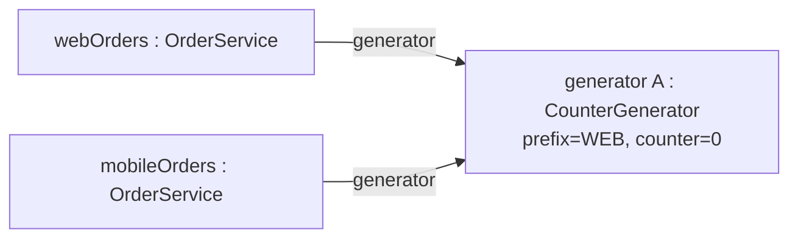
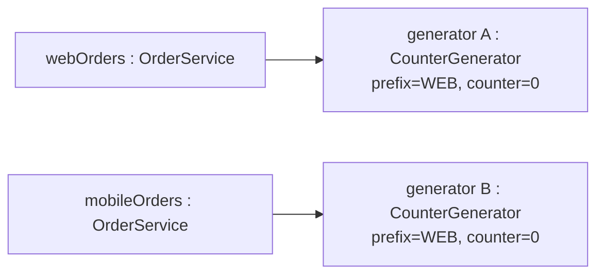
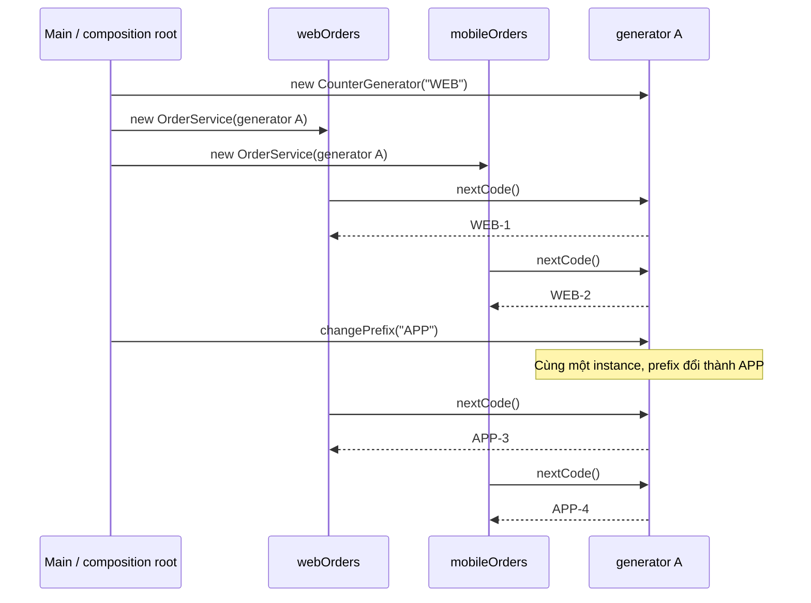

# Phân biệt tạo mới phụ thuộc với thay đổi trạng thái trên instance dùng chung

## Mục tiêu học tập

Sau bài này, bạn có thể:

- Phân biệt **tạo mới một dependency** với **gọi phương thức làm thay đổi trạng thái** của dependency đang tồn tại.
- Nhìn vào đồ thị đối tượng để xác định hai consumer đang dùng **cùng một instance** hay hai instance khác nhau, ngay cả khi chúng cùng nhận một interface.
- Giải thích vì sao tạo thêm **consumer** chưa chắc tạo thêm **dependency**, và vì sao truyền dependency qua constructor không tự quyết định scope của nó.
- Nhận ra rủi ro khi một service dùng chung chứa trạng thái thuộc từng request, hoặc khi một dependency có trạng thái được vô tình chia sẻ.
- Lựa chọn nơi tạo, phạm vi dùng chung, cách cập nhật cấu hình và trách nhiệm đóng tài nguyên bằng **Java thuần** trước khi làm việc với DI container.

Bài nằm trong chương **Vòng đời và phạm vi** của chủ đề **Dependency Injection (DI)** và **Inversion of Control (IoC)**. DI tách việc *sử dụng* một phụ thuộc khỏi việc *tạo và lắp ghép* nó; để đạt được lợi ích này trong thực tế, ta còn phải biết **instance nào được đưa vào consumer** và **trạng thái trên instance đó sống trong bao lâu**.

## 1. Ba khái niệm dễ bị lẫn

Trong Java, cần phân biệt ba sự kiện:

1. **Tạo instance:** `new CounterGenerator("WEB")` tạo một đối tượng với danh tính riêng, có trạng thái ban đầu riêng.
2. **Chia sẻ instance:** truyền cùng một tham chiếu `generator` cho nhiều consumer. Những consumer này truy cập **cùng một đối tượng**, nên có thể quan sát các thay đổi trên đối tượng đó.
3. **Thay đổi trạng thái:** gọi `generator.changePrefix("APP")` hoặc `generator.nextCode()` để cập nhật trường bên trong **đối tượng đã có**. Những lời gọi này không tự tạo thêm `CounterGenerator`.

Một biến chứa **tham chiếu**, không chứa bản sao tự động của đối tượng. Gán `another = generator` hay truyền `generator` qua constructor chỉ sao chép **giá trị tham chiếu**; hai biến có thể chỉ đến một instance.

```java
CounterGenerator first = new CounterGenerator("WEB");
CounterGenerator alias = first;                    // Cùng instance
CounterGenerator second = new CounterGenerator("WEB"); // Instance khác

System.out.println(first == alias);  // true
System.out.println(first == second); // false
```

Đoạn minh họa dùng lớp `CounterGenerator` được định nghĩa đầy đủ ở mục 3. Với các đối tượng Java thông thường, toán tử `==` trên hai tham chiếu kiểm tra **cùng danh tính đối tượng hay không**. Hai instance khác nhau có thể có cùng nội dung, cùng kiểu và trả ra cùng kết quả, nhưng `first == second` vẫn là `false`.

### Tạo mới và thay trạng thái khác nhau ở điều gì?

| Hành động | Danh tính instance | Trạng thái | Ai bị ảnh hưởng? |
| --- | --- | --- | --- |
| `new CounterGenerator("WEB")` | Tạo một danh tính **mới** | Khởi tạo bộ đếm mới và prefix mới | Chỉ những nơi được đưa tham chiếu mới vào |
| `CounterGenerator alias = existing` | **Không tạo mới** | Giữ nguyên trạng thái | `alias` và `existing` đều thấy cùng instance |
| `new OrderService(existing)` | Tạo **consumer mới** | Dependency `existing` không đổi danh tính | Consumer mới chia sẻ `existing` với consumer cũ nếu cùng truyền tham chiếu |
| `existing.nextCode()` | **Không tạo `CounterGenerator` mới** | Bộ đếm tăng trên instance hiện tại | Mọi consumer dùng instance đó thấy các lần gọi tiếp theo |
| `existing.changePrefix("APP")` | **Không tạo mới** | Prefix của instance hiện tại thay đổi | Mọi consumer cùng dùng instance đó có thể quan sát prefix mới |

**Lưu ý:** một phương thức trên dependency có thể tự tạo các **đối tượng khác** ở bên trong, ví dụ trả một DTO mới. Điều cần phân biệt ở đây là danh tính của **dependency được tiêm**: nó không tự thay đổi thành một instance mới chỉ vì phương thức đã được gọi.

## 2. Bài toán: hai nơi đặt hàng dùng chung bộ sinh mã

Giả sử ứng dụng có hai luồng tạo đơn hàng, `webOrders` và `mobileOrders`. Cả hai cần một khả năng sinh mã đơn `OrderCodeGenerator`.

Một triển khai `CounterGenerator` giữ hai phần trạng thái:

- `counter`: số thứ tự đã phát sinh, tăng mỗi lần gọi `nextCode()`;
- `prefix`: tiền tố của mã, có thể được cập nhật qua `changePrefix(...)`.

Nếu cả hai consumer dùng chung generator, bộ đếm được chia sẻ. Việc đổi prefix ở một nơi cũng đổi prefix mà consumer còn lại quan sát được. Nếu hai consumer nhận **hai generator độc lập**, mỗi bộ đếm và prefix có trạng thái riêng.

Trên thực tế, mã đơn cần bảo đảm duy nhất giữa nhiều luồng, nhiều tiến trình và sau khi ứng dụng khởi động lại. Bộ đếm trong bộ nhớ dưới đây **chỉ là ví dụ học về danh tính và trạng thái**, không phải cơ chế cấp mã sản xuất.

### Hai đồ thị đối tượng khác nhau

**Dùng chung một dependency:**



Đây là **hai instance `OrderService`**, nhưng chỉ **một instance `CounterGenerator`**. Đổi `prefix` hoặc tăng `counter` sẽ thay đổi trạng thái của đỉnh `generator A` trong đồ thị; **không thêm đỉnh mới**, cũng không thay đường tham chiếu từ hai service.

**Mỗi consumer có dependency riêng:**



Đồ thị thứ hai có **hai instance generator**. Chúng bắt đầu với cùng giá trị nhưng độc lập về danh tính và trạng thái. Khi một generator tăng bộ đếm, generator còn lại không tự tăng theo.

Đây là lý do cần vẽ **đồ thị instance lúc chạy**, thay vì chỉ đọc sơ đồ lớp `OrderService → OrderCodeGenerator`. Sơ đồ kiểu có thể giống nhau trong cả hai trường hợp; sự khác nhau nằm ở **các đối tượng cụ thể được lắp ghép**.

## 3. Ví dụ Java đầy đủ: dùng chung, đổi trạng thái và tạo mới

Lưu toàn bộ đoạn sau vào **`Main.java`**. Chương trình dùng Java thuần (JDK 8 trở lên), không cần DI container hoặc thư viện ngoài.

```java
import java.util.Objects;
import java.util.concurrent.atomic.AtomicInteger;

// Hợp đồng mà OrderService thực sự cần.
interface OrderCodeGenerator {
    String nextCode();
}

// Provider giữ trạng thái: counter và prefix.
final class CounterGenerator implements OrderCodeGenerator {
    private final AtomicInteger counter = new AtomicInteger();
    private volatile String prefix;

    CounterGenerator(String initialPrefix) {
        changePrefix(initialPrefix);
    }

    @Override
    public String nextCode() {
        // AtomicInteger tăng bộ đếm an toàn giữa các luồng.
        int number = counter.incrementAndGet();
        return prefix + "-" + number;
    }

    // Minh họa việc sửa trạng thái của CHÍNH instance hiện có.
    void changePrefix(String newPrefix) {
        Objects.requireNonNull(newPrefix, "newPrefix");
        if (newPrefix.trim().isEmpty()) {
            throw new IllegalArgumentException("prefix must not be blank");
        }
        prefix = newPrefix;
    }
}

// Consumer chỉ cần hợp đồng, không tự new generator.
final class OrderService {
    private final OrderCodeGenerator generator;

    OrderService(OrderCodeGenerator generator) {
        this.generator = Objects.requireNonNull(generator, "generator");
    }

    String createOrder() {
        return generator.nextCode();
    }
}

// Composition root: quyết định chia sẻ hoặc tạo các instance độc lập.
public class Main {
    public static void main(String[] args) {
        // Tình huống A: một generator, hai OrderService.
        CounterGenerator shared = new CounterGenerator("WEB");
        OrderService webOrders = new OrderService(shared);
        OrderService mobileOrders = new OrderService(shared);

        System.out.println("A1: " + webOrders.createOrder());
        System.out.println("A2: " + mobileOrders.createOrder());

        shared.changePrefix("APP"); // Chỉ sửa trạng thái của shared.
        System.out.println("A3: " + webOrders.createOrder());
        System.out.println("A4: " + mobileOrders.createOrder());

        // Tình huống B: hai generator được tạo bằng hai lần new.
        CounterGenerator first = new CounterGenerator("WEB");
        CounterGenerator second = new CounterGenerator("WEB");
        OrderService firstOrders = new OrderService(first);
        OrderService secondOrders = new OrderService(second);

        System.out.println("B1: " + firstOrders.createOrder());
        System.out.println("B2: " + secondOrders.createOrder());

        first.changePrefix("MOBILE"); // Không sửa state của second.
        System.out.println("B3: " + firstOrders.createOrder());
        System.out.println("B4: " + secondOrders.createOrder());

        System.out.println("Cùng instance generator? " + (first == second));
    }
}
```

Biên dịch và chạy:

```bash
javac -encoding UTF-8 Main.java
java Main
```

Kết quả dự kiến khi chạy tuần tự:

```text
A1: WEB-1
A2: WEB-2
A3: APP-3
A4: APP-4
B1: WEB-1
B2: WEB-1
B3: MOBILE-2
B4: WEB-2
Cùng instance generator? false
```

### Diễn giải từng nhóm kết quả

**Nhóm A — chung instance:**

1. `shared = new CounterGenerator("WEB")` tạo **một** dependency, `counter = 0`.
2. Hai lệnh `new OrderService(shared)` tạo **hai consumer**, nhưng cả hai giữ **cùng một tham chiếu `shared`**.
3. `webOrders.createOrder()` làm `counter` của `shared` tăng lên 1, trả `WEB-1`; `mobileOrders.createOrder()` tiếp tục làm nó tăng lên 2, trả `WEB-2`.
4. `shared.changePrefix("APP")` cập nhật **cùng đối tượng**; cả hai consumer đều dùng prefix `APP` từ lần gọi tiếp theo. Bộ đếm **không bị đặt lại**: kết quả tiếp tục là `APP-3` và `APP-4`.

**Nhóm B — hai instance:**

1. Hai lệnh `new CounterGenerator("WEB")` tạo hai đối tượng độc lập; mỗi cái có `counter = 0`.
2. Dù cùng nhận interface `OrderCodeGenerator`, `firstOrders` và `secondOrders` nhận **hai tham chiếu khác nhau**. Hai lần sinh đầu tiên đều cho `WEB-1`.
3. `first.changePrefix("MOBILE")` chỉ sửa `first`. Kết quả tiếp theo là `MOBILE-2` và `WEB-2`.
4. `first == second` trả `false`, xác nhận hai đối tượng khác danh tính.

Từ kết quả này, **giá trị giống nhau không chứng minh hai tham chiếu chỉ cùng một đối tượng**, và **giá trị thay đổi không chứng minh một đối tượng mới đã được tạo**.

## 4. Tạo consumer mới không làm mới dependency đang giữ

Trong ví dụ, hãy xét một trường hợp khác:

```java
CounterGenerator generator = new CounterGenerator("WEB");
OrderService one = new OrderService(generator);
OrderService two = new OrderService(generator);
```

Hai lệnh `new OrderService(...)` chỉ tạo **hai `OrderService`**. Constructor của chúng nhận một dependency **đã tồn tại**. Nếu `one.createOrder()` trả `WEB-1`, `two.createOrder()` sẽ trả `WEB-2` vì cùng gọi `generator`.

Ngược lại:

```java
OrderService one = new OrderService(new CounterGenerator("WEB"));
OrderService two = new OrderService(new CounterGenerator("WEB"));
```

Mỗi lần `new CounterGenerator(...)` bên trong lời gọi constructor đều tạo **một dependency mới**. Cả hai service sẽ phát sinh mã đầu tiên `WEB-1` trong ví dụ bộ đếm cục bộ.

Cả hai cách đều là **constructor injection**: consumer nhận phụ thuộc từ bên ngoài. Điểm khác nhau là **composition root quyết định dùng chung hay tạo riêng instance**; bản thân kỹ thuật injection không quyết định điều đó.

### Một nhầm lẫn khác: đặt lại state không phải tạo mới

Nếu `CounterGenerator` có thêm phương thức `reset()` đặt lại bộ đếm về 0, việc gọi `shared.reset()` vẫn **giữ nguyên danh tính** của `shared`. Mọi consumer đang tham chiếu `shared` tiếp tục thấy một đối tượng đó, nhưng với state đã bị đặt lại. Ngược lại, `shared = new CounterGenerator("WEB")` chỉ đổi **biến tham chiếu `shared`**; các `OrderService` được tạo trước đó **vẫn giữ tham chiếu đến generator cũ**, trừ khi chính chúng được lắp ghép lại hoặc thiết kế cho phép thay dependency.

Ví dụ:

```java
CounterGenerator original = new CounterGenerator("WEB");
OrderService existing = new OrderService(original);

CounterGenerator replacement = new CounterGenerator("APP");
// 'existing' vẫn sử dụng 'original', vì constructor đã nhận tham chiếu cũ.
OrderService newlyWired = new OrderService(replacement);
```

**Thay biến local, thay state của object và thay dependency đang được consumer giữ là ba thao tác khác nhau.** Trường `private final` trong `OrderService` làm tham chiếu `generator` của service không thể gán lại sau constructor, nhưng không ngăn chính `CounterGenerator` thay đổi trạng thái bên trong.

## 5. Tại sao trạng thái dùng chung vừa hữu ích vừa nguy hiểm?

**Dùng chung có chủ đích** có thể phù hợp khi nhiều consumer cần quan sát một nguồn thông tin chung, ví dụ một bộ đếm metrics trong tiến trình hoặc một client kết nối được thiết kế để tái sử dụng. Nhưng nếu dependency chứa dữ liệu thuộc một người dùng hoặc một request, việc dùng chung có thể gây sai lệch.

| State được chia sẻ | Có thể mong muốn khi... | Có thể sai khi... |
| --- | --- | --- |
| Bộ đếm metrics tổng | Tất cả consumer cùng ghi nhận một chỉ số tổng | Mỗi user cần bộ đếm độc lập nhưng lại bị gộp chung |
| Cache dùng chung | Khóa cache tách rõ dữ liệu giữa tenant/user, chính sách TTL và đồng thời hợp lệ | Cache dùng khóa thiếu ngữ cảnh làm lộ dữ liệu người dùng |
| Client kết nối | Client hỗ trợ dùng chung an toàn và nơi khởi tạo quản lý việc đóng | Client có session mutable dành riêng cho request nhưng bị giữ bởi service sống lâu |
| Cấu hình đang chạy | Có yêu cầu đổi cấu hình động, cơ chế đọc nhất quán và giám sát | Một thao tác thay config làm tất cả request đổi hành vi ngoài dự kiến |
| `currentUser` hoặc `currentOrder` | Được giữ trong **đối tượng thực sự có scope theo request**, không được chia sẻ | Nằm trong field của singleton dùng cho nhiều request đồng thời |

### Ví dụ phản diện: service dùng chung giữ dữ liệu request

```java
// Ví dụ thiết kế nguy hiểm khi instance này được chia sẻ giữa request.
final class UnsafeCheckoutService {
    private String currentCustomer;

    void setCurrentCustomer(String customer) {
        this.currentCustomer = customer;
    }

    String checkout() {
        return "Đang xử lý cho " + currentCustomer;
    }
}
```

Nếu request A gọi `setCurrentCustomer("A")`, rồi request B gọi `setCurrentCustomer("B")` trước khi A gọi `checkout()`, A có thể xử lý nhầm khách B. Đồng bộ hóa từng lời gọi setter hoặc getter riêng lẻ **chưa chắc đủ**, vì toàn bộ chuỗi “chọn khách rồi checkout” cần nhất quán.

Một thiết kế đơn giản hơn là **đưa dữ liệu vào đúng lời gọi**:

```java
final class CheckoutService {
    String checkout(String customerId) {
        return "Đang xử lý cho " + customerId;
    }
}
```

Khi đó, dữ liệu request nằm trong tham số và biến cục bộ của lần gọi, không nằm trong field dùng chung. Nếu có một đối tượng `CheckoutContext` phức tạp hơn, có thể tạo nó **riêng cho request** rồi truyền vào method. Đây là dữ liệu theo thao tác, không nhất thiết là dependency cần đưa vào DI container.

## 6. Thread safety không đồng nghĩa không có vấn đề scope

Trong `CounterGenerator`, ta dùng hai kỹ thuật:

- `AtomicInteger` giúp `incrementAndGet()` cập nhật **riêng bộ đếm** một cách nguyên tử giữa nhiều luồng.
- `volatile String prefix` giúp các luồng đọc thấy thay đổi của tham chiếu `prefix` theo các bảo đảm bộ nhớ của Java.

Nhưng hai điều đó **không biến toàn bộ thao tác thành một transaction** giữa việc đọc prefix và tăng counter. Khi `changePrefix(...)` chạy đồng thời với `nextCode()`, một mã có thể dùng prefix cũ hoặc prefix mới tùy thời điểm thực thi. Nếu nghiệp vụ yêu cầu một lần đổi cấu hình có hiệu lực đồng bộ cùng một mốc bộ đếm, phải thiết kế tính nhất quán mạnh hơn.

Và ngay cả khi việc cập nhật state **an toàn luồng**, state dùng chung vẫn có thể **sai về mặt nghiệp vụ**. Một biến `AtomicReference<String> currentCustomer` không khiến nhiều người dùng chung `currentCustomer` trở thành đúng; nó chỉ điều chỉnh cách cập nhật/đọc giá trị đó.

**Scope giải quyết ai chia sẻ instance. Thread safety giải quyết các luồng truy cập state như thế nào.** Cả hai cần được xem xét, nhưng không thể thay thế cho nhau.

Nếu prefix là cấu hình cố định trong một phiên chạy, có thể làm nó `final` và bỏ `changePrefix(...)`; lúc cần thay cấu hình, tạo một instance mới và lắp ghép các consumer mới theo chủ đích. Nếu prefix thực sự phải đổi khi ứng dụng đang chạy, hãy định nghĩa **hợp đồng cập nhật cấu hình và tác động đến các request đang xử lý** trước khi thêm setter vào dependency dùng chung.

## 7. Scope trong Java thuần và trong DI container

Một scope xác định quy tắc **tạo mới hay tái sử dụng** instance trong một ranh giới cụ thể. Trong Java thuần, quy tắc này hiện ra từ các lệnh `new`, biến giữ tham chiếu, factory và nơi lắp ghép. Khi chuyển sang DI container, nhiều quy tắc có thể được khai báo bằng cấu hình, nhưng bản chất vẫn là **instance nào được đưa tới consumer nào**.

| Scope theo ý nghĩa | Tình huống Java thuần | Điều cần hiểu |
| --- | --- | --- |
| **Dùng chung cho ứng dụng** | Tạo `shared` một lần ở `Main`, truyền cho nhiều service | Mọi consumer có thể quan sát state chung; cần xác định thread safety và quyền đóng |
| **Mỗi consumer một dependency** | Mỗi lần tạo service, tạo thêm `new CounterGenerator(...)` | Hai consumer có state riêng, dù được tạo từ cùng một class |
| **Mỗi request một instance** | Điểm vào request tạo context hoặc dependency phù hợp, truyền cho luồng xử lý | Không để consumer sống lâu giữ tham chiếu tới request đã kết thúc |
| **Mỗi thao tác một tài nguyên** | Factory `open()` tạo/thuê một session; đóng khi xử lý xong | Không giữ session đã đóng trong field dùng chung |

Các từ như **singleton**, **request-scoped**, **prototype/transient** là tên gọi thường gặp khi học DI container, nhưng ngữ nghĩa chính xác của mỗi framework có thể khác nhau. Chẳng hạn, một dependency được khai báo *prototype* không nhất thiết được tạo mới **ở mỗi lần gọi phương thức** của một singleton: nếu framework resolve prototype một lần khi tạo singleton rồi tiêm qua constructor, singleton vẫn giữ **instance đã nhận**. Muốn một instance mới theo từng thao tác, thường cần một factory/provider hoặc scope được kích hoạt đúng ngữ cảnh.

### Timeline: dùng chung instance không thay đổi sau mỗi thao tác



Sơ đồ cho thấy việc `changePrefix()` chỉ làm thay đổi **trạng thái** trên `generator A`, không thêm một đối tượng nào và không tự đổi tham chiếu `generator` trong hai service.

## 8. Khi nào nên tiêm factory thay vì một instance cụ thể?

Nếu nghiệp vụ cần **một đối tượng mới cho mỗi thao tác**, đừng giả định rằng chỉ cần thêm scope cho constructor là đủ. Có thể biểu diễn yêu cầu rõ ràng bằng **factory có hợp đồng hẹp**.

Ví dụ sau cần một phiên xuất báo cáo mới ở mỗi lần `export(...)`:

```java
interface ReportSession extends AutoCloseable {
    void write(String text);

    @Override
    void close();
}

interface ReportSessionFactory {
    ReportSession open(String reportId);
}

final class ReportService {
    private final ReportSessionFactory factory;

    ReportService(ReportSessionFactory factory) {
        this.factory = java.util.Objects.requireNonNull(factory, "factory");
    }

    void export(String reportId, String text) {
        try (ReportSession session = factory.open(reportId)) {
            session.write(text);
        }
    }
}
```

Ở đây, `ReportService` nhận một **factory ổn định** qua constructor. `ReportSession` có vòng đời ngắn, được `open()` trong lần thao tác và được `close()` qua `try-with-resources`. Hợp đồng phải nói rõ mỗi `open()` trả **một phiên độc lập** hay **một handle của pool**; tên `Factory` không tự bảo đảm tạo object mới cho mọi lời gọi.

Đối với tài nguyên có đóng/mở, cần phân biệt:

- **Ai tạo hoặc cấp tài nguyên?** Có thể là composition root, factory hoặc một pool.
- **Ai sở hữu và được phép đóng?** Có thể là caller nhận session hoặc hạ tầng quản lý pool; phải có hợp đồng cụ thể.
- **Ai giữ tham chiếu và trong bao lâu?** Một service dùng chung không được giữ phiên đã đóng hoặc phiên thuộc request khác.

Đối với `OrderCodeGenerator` trong mục 3, việc tạo một bộ đếm mới cho mỗi request **không nhất thiết là lựa chọn đúng**: bộ đếm sẽ lại bắt đầu từ 1 và mã có thể trùng. Factory chỉ nên được chọn khi **ngữ nghĩa nghiệp vụ yêu cầu độc lập về instance**, không phải như một công thức áp dụng cho mọi dependency có state.

## 9. Kiểm thử danh tính và trạng thái bằng Java thuần

Ta có thể kiểm tra sự khác nhau giữa **dùng chung** và **tạo mới** mà không dựa vào thời gian hoặc DI container. Kiểm thử bên dưới cũng dùng một fake để chứng minh `OrderService` chỉ gọi hợp đồng `OrderCodeGenerator`, không tự tạo implementation cụ thể.

Lưu **`InstanceScopeCheck.java`** cạnh `Main.java`:

```java
public class InstanceScopeCheck {
    static final class RecordingGenerator implements OrderCodeGenerator {
        int calls;

        @Override
        public String nextCode() {
            calls++;
            return "FAKE-" + calls;
        }
    }

    public static void main(String[] args) {
        // 1. Hai consumer chia sẻ cùng một dependency.
        CounterGenerator shared = new CounterGenerator("WEB");
        OrderService first = new OrderService(shared);
        OrderService second = new OrderService(shared);

        if (!"WEB-1".equals(first.createOrder())
                || !"WEB-2".equals(second.createOrder())) {
            throw new AssertionError("Bộ đếm chung chưa được chia sẻ");
        }

        shared.changePrefix("APP");
        if (!"APP-3".equals(second.createOrder())
                || !"APP-4".equals(first.createOrder())) {
            throw new AssertionError("Đổi trạng thái không phản ánh ở cả hai consumer");
        }

        // 2. Hai dependency độc lập có state riêng.
        CounterGenerator a = new CounterGenerator("WEB");
        CounterGenerator b = new CounterGenerator("WEB");
        if (a == b) {
            throw new AssertionError("Hai lần new không được cùng instance");
        }

        OrderService serviceA = new OrderService(a);
        OrderService serviceB = new OrderService(b);
        if (!"WEB-1".equals(serviceA.createOrder())
                || !"WEB-1".equals(serviceB.createOrder())) {
            throw new AssertionError("Bộ đếm riêng không bắt đầu độc lập");
        }

        a.changePrefix("MOBILE");
        if (!"MOBILE-2".equals(serviceA.createOrder())
                || !"WEB-2".equals(serviceB.createOrder())) {
            throw new AssertionError("State của hai generator không được độc lập");
        }

        // 3. Fake chứng minh consumer chỉ dùng hợp đồng đã tiêm.
        RecordingGenerator fake = new RecordingGenerator();
        OrderService tested = new OrderService(fake);
        if (!"FAKE-1".equals(tested.createOrder()) || fake.calls != 1) {
            throw new AssertionError("Consumer không gọi dependency như mong đợi");
        }

        System.out.println("PASS: phân biệt instance chung, instance mới và state");
    }
}
```

Chạy:

```bash
javac -encoding UTF-8 Main.java InstanceScopeCheck.java
java InstanceScopeCheck
```

Kiểm thử này cố tình **không gọi `System.identityHashCode(...)`** để khẳng định danh tính: mã hash có thể trùng giữa hai instance khác nhau. `a == b` cho biết hai biến có trỏ đến cùng đối tượng hay không; còn các kết quả `WEB-1`, `APP-3` cho biết **hành vi quan sát được từ state**. Hai phép kiểm tra bổ trợ nhau.

## 10. Checklist khi quyết định tạo mới hay chia sẻ

Khi thêm một dependency vào đồ thị đối tượng, hãy trả lời theo thứ tự:

1. **Đây là collaborator hay chỉ là dữ liệu của lần gọi?** Dữ liệu request thường thuộc tham số phương thức hoặc DTO thay vì field của service dùng chung.
2. **Dependency có state không?** Nếu có, state nào được cập nhật qua từng lời gọi và state đó thuộc người dùng, request, transaction hay toàn ứng dụng?
3. **Có nhiều consumer giữ cùng một instance không?** Vẽ các cạnh đến **đỉnh instance thực tế**, không chỉ tên interface.
4. **Nếu state bị cập nhật, những consumer nào quan sát được?** Xác định hành vi thay đổi cấu hình hoặc tăng bộ đếm ảnh hưởng đến phạm vi nào.
5. **Nếu cần state độc lập, nơi nào phải `new`?** Composition root, request boundary hay một factory? Tạo thêm consumer có đồng nghĩa tạo thêm dependency trong code hiện tại không?
6. **Có gọi đồng thời không?** Thao tác trên state có cần đồng bộ, bất biến hoặc tránh chia sẻ hoàn toàn không?
7. **Dependency có tài nguyên cần đóng không?** Ai sở hữu và lúc nào được đóng, nhất là với client dùng chung hoặc session theo request?
8. **Khi mở rộng sang DI container, scope nào mô tả đúng thực tế?** Cấu hình đó được resolve lúc tạo consumer hay mỗi lần thao tác?
9. **Có thể kiểm thử hai tình huống dùng chung và dùng riêng chỉ bằng Java thuần không?** Nếu khó, nên kiểm tra lại việc tạo/lắp ghép đã nằm đúng composition root hay chưa.

### Các ngộ nhận thường gặp

| Ngộ nhận | Cách hiểu đúng |
| --- | --- |
| “Gọi `new OrderService(shared)` hai lần sẽ có hai generator.” | Chỉ có hai consumer. Dependency `shared` vẫn là một instance. |
| “Mã trả về khác nhau nghĩa là dependency khác instance.” | Cùng một instance có thể tăng counter hoặc đổi trạng thái để trả kết quả khác. |
| “Hai instance trả cùng giá trị nghĩa là chúng là một.” | Hai instance riêng có thể có state ban đầu giống nhau, chẳng hạn đều trả `WEB-1`. |
| “`final` biến dependency thành bất biến.” | `final` chỉ khóa tham chiếu field, không khóa state mutable của đối tượng được tham chiếu. |
| “`AtomicInteger` làm dependency chia sẻ đúng cho mọi nghiệp vụ.” | Nó giúp tăng biến đếm an toàn, không giải quyết tính độc lập dữ liệu hay quy tắc scope. |
| “Đặt scope prototype thì mỗi lần gọi method sẽ có object mới.” | Việc resolve thường gắn với thời điểm injection; muốn tạo mỗi lần gọi cần cơ chế cấp mới tương ứng. |
| “Có DI container mới quản lý được scope.” | Java thuần cũng quản lý được qua `new`, các tham chiếu và factory; container tự động hóa quy tắc đã chọn. |

## 11. Bài tập vận dụng

Cho đoạn mã (giả sử các lớp từ `Main.java` đã có):

```java
CounterGenerator generator = new CounterGenerator("SHOP");
OrderService serviceA = new OrderService(generator);
OrderService serviceB = new OrderService(generator);

String code1 = serviceA.createOrder();
generator.changePrefix("VIP");
String code2 = serviceB.createOrder();

CounterGenerator other = new CounterGenerator("SHOP");
OrderService serviceC = new OrderService(other);
String code3 = serviceC.createOrder();
```

Hãy trả lời trước khi xem gợi ý:

1. Có bao nhiêu instance `OrderService` và bao nhiêu instance `CounterGenerator`?
2. `code1`, `code2`, `code3` lần lượt là gì, nếu các lời gọi chạy tuần tự?
3. `changePrefix("VIP")` có tạo mới dependency hay thay dependency của `serviceA` không?
4. Nếu một ứng dụng có nhiều tiến trình, liệu tạo một `CounterGenerator` dùng chung trong **một JVM** có bảo đảm mã đơn duy nhất toàn hệ thống không?
5. Nếu muốn prefix **không bao giờ thay đổi** trong vòng đời generator, nên sửa API ra sao?

**Gợi ý đáp án:** (1) Có ba `OrderService` và hai `CounterGenerator`; `serviceA` và `serviceB` dùng chung một generator. (2) `SHOP-1`, `VIP-2`, `SHOP-1`. (3) Chỉ cập nhật state của generator cũ; cả `serviceA` và `serviceB` vẫn giữ cùng tham chiếu. (4) Không. Mỗi JVM có bộ nhớ riêng; cần cơ chế cấp ID phối hợp/durable phù hợp yêu cầu duy nhất toàn hệ thống. (5) Dùng `private final String prefix`, đặt giá trị khi khởi tạo và bỏ phương thức `changePrefix(...)`; muốn prefix khác, tạo generator mới và lắp ghép lại consumer thích hợp.

Khi học sâu hơn về DI container, hãy luôn kiểm tra hai điều độc lập: **container đang tạo/cấp instance nào cho consumer** và **các phương thức đang thay đổi state trên instance ấy ra sao**. Chỉ khi phân biệt rõ hai điều này, bạn mới chọn đúng scope, quản lý vòng đời và kiểm thử được tác động của việc chia sẻ đối tượng.
