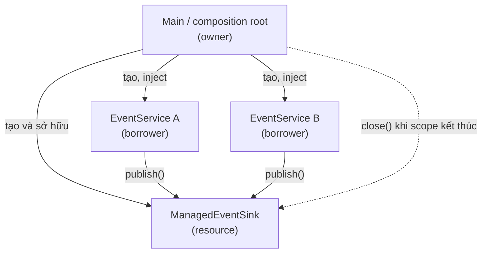

# Ai tạo, ai sử dụng và ai chịu trách nhiệm đóng tài nguyên

> **Chương:** Sở hữu tài nguyên  
> **Phạm vi:** Dependency Injection (DI), Inversion of Control (IoC), constructor injection, composition root và quản lý scope/vòng đời bằng Java thuần trước khi mở rộng sang DI container.

## 1. Mục tiêu học tập

Sau bài này, bạn có thể:

1. Phân biệt **tạo**, **sử dụng**, **sở hữu** và **đóng** tài nguyên trong một object graph.
2. Giải thích vì sao một service nhận dependency qua constructor thường **không nên tự đóng** dependency đó.
3. Thiết lập quy tắc sở hữu rõ ràng ở **composition root**, sử dụng `AutoCloseable` và `try-with-resources` khi phù hợp.
4. Xử lý trường hợp nhiều service dùng chung một client, tài nguyên sống theo request và khởi tạo ứng dụng thất bại giữa chừng.
5. Biết cách kiểm thử quy tắc “service chỉ sử dụng, owner mới đóng” bằng **Java thuần**.
6. Nhận diện rủi ro đóng quá sớm, quên đóng, đóng nhiều lần và dùng nhầm dependency khác scope.

## 2. Tài nguyên khác gì một đối tượng Java thông thường?

Trong ứng dụng Java, không phải đối tượng nào cũng cần hành động đóng. Một `Order` hoặc `Money` chỉ chứa dữ liệu thường có thể được giải phóng khi không còn được tham chiếu. Ngược lại, một số đối tượng đại diện cho **tài nguyên có vòng đời riêng**:

- Luồng đọc/ghi file (`InputStream`, `OutputStream`), file descriptor.
- Kết nối hoặc phiên giao dịch cơ sở dữ liệu (`Connection`, session).
- HTTP client hoặc connection pool, tùy API và cách triển khai.
- Executor/thread pool cần shutdown.
- Subscription, listener, lock/lease hoặc tài nguyên do thư viện ngoài cung cấp, tùy hợp đồng sử dụng.

Garbage collector quản lý **bộ nhớ của đối tượng Java có thể thu gom**, nhưng không phải một cơ chế đảm bảo tài nguyên bên ngoài sẽ được đóng **đúng thời điểm**. Ví dụ, chờ garbage collection mới mong file hoặc kết nối được giải phóng có thể khiến ứng dụng cạn tài nguyên trước khi thu gom diễn ra.

**Resource ownership (quyền sở hữu tài nguyên)** là quy ước xác định thành phần nào chịu trách nhiệm quản lý vòng đời, đặc biệt là quyết định **khi nào đóng**. Quyền sở hữu này là một phần của **hợp đồng** giữa các thành phần, không phải kết luận chỉ dựa vào việc một đối tượng đang giữ tham chiếu tới tài nguyên.

### 2.1. Bốn hành động cần tách bạch

| Hành động | Nghĩa | Ví dụ |
| --- | --- | --- |
| **Tạo (create)** | Khởi tạo client, connection hoặc adapter; có thể cấp phát tài nguyên ngoài JVM. | `new ManagedEventSink()`, `dataSource.getConnection()`. |
| **Sử dụng (use)** | Gọi phương thức phục vụ một tác vụ. | `service.record(...)` gọi `sink.publish(...)`. |
| **Sở hữu (own)** | Chịu trách nhiệm quản lý toàn bộ vòng đời theo hợp đồng, gồm cleanup. | Bootstrap giữ tài nguyên từ lúc tạo tới khi ứng dụng kết thúc. |
| **Đóng (close/release)** | Kết thúc quyền sử dụng tài nguyên và trả lại hoặc giải phóng tài nguyên theo API. | Gọi `close()`, `shutdown()` hoặc API release phù hợp. |

Thông thường thành phần **tạo tài nguyên có quyền sở hữu ban đầu** và cần đóng nó. Tuy nhiên, có thể **chuyển giao quyền sở hữu** bằng hợp đồng tường minh. Vì vậy không thể áp dụng máy móc “ai `new` thì người đó luôn `close`” trong mọi API.

Một đối tượng nhận dependency qua constructor có thể chỉ là **người mượn (borrower)**: được phép gọi các thao tác nghiệp vụ, nhưng không sở hữu quyền đóng đối tượng được cung cấp.

## 3. Vì sao DI làm câu hỏi sở hữu tài nguyên trở nên quan trọng?

Không dùng DI, một service có thể tự tạo một client bên trong nó. Khi áp dụng **constructor injection**, nơi tạo client được chuyển ra bên ngoài, còn service chỉ nhận client đã được chuẩn bị:

```java
final class EventService {
    private final EventSink sink;

    EventService(EventSink sink) {
        this.sink = java.util.Objects.requireNonNull(sink);
    }

    void record(String event) {
        sink.publish(event);
    }
}
```

`EventSink` là hợp đồng giả định của chức năng xuất sự kiện. Ai sẽ đóng tài nguyên của implementation? **Không thể kết luận chỉ từ chữ ký constructor**. Cần xác định rõ cách object graph được tạo và quy tắc sở hữu.

Trong cách lắp ghép thông dụng:

1. **Composition root** (mã khởi động) chọn implementation và tạo tài nguyên dùng chung.
2. Composition root **tiêm** tài nguyên hoặc giao diện của nó vào service.
3. Service **sử dụng** dependency, không tự ý đóng hoặc thay thế nó.
4. Khi kết thúc scope phù hợp, **owner** đóng tài nguyên một lần theo kế hoạch.

Điều này là một biểu hiện của **Inversion of Control (IoC)**: việc tạo và quản lý dependency được chuyển ra ranh giới lắp ghép. Service có thể tập trung vào nghiệp vụ, trong khi bootstrap quản lý cấu hình và vòng đời.



> **Quy tắc thực hành:** Nếu một dependency được inject từ bên ngoài và có thể được nhiều consumer sử dụng, hãy **mặc định coi consumer là người mượn**. Chỉ giao quyền đóng cho consumer khi có **hợp đồng chuyển giao quyền sở hữu** rõ ràng.

## 4. Ví dụ Java thuần: root sở hữu, service chỉ sử dụng

Ví dụ này cố tình đặt hai service sử dụng chung **một** adapter. Nếu service đầu tiên đóng adapter sau khi làm việc, service thứ hai sẽ không còn dùng được.

Tạo file `Main.java`:

```java
import java.util.Objects;

// Chỉ mô tả khả năng xuất sự kiện; consumer không cần biết close().
interface EventSink {
    void publish(String message);
}

// Adapter do composition root sở hữu.
final class ManagedEventSink implements EventSink, AutoCloseable {
    private boolean closed;

    @Override
    public void publish(String message) {
        if (closed) {
            throw new IllegalStateException("EventSink is already closed");
        }
        System.out.println("PUBLISH " + message);
    }

    @Override
    public void close() {
        if (!closed) {
            closed = true;
            System.out.println("CLOSE sink");
        }
    }
}

// Consumer: chỉ nhận interface EventSink và sử dụng nó.
final class EventService {
    private final EventSink sink;

    EventService(EventSink sink) {
        this.sink = Objects.requireNonNull(sink, "sink");
    }

    void record(String event) {
        if (event == null || event.trim().isEmpty()) {
            throw new IllegalArgumentException("event must not be blank");
        }
        sink.publish("event=" + event.trim());
    }
}

public class Main {
    public static void main(String[] args) {
        // Composition root tạo, sở hữu và đóng tài nguyên.
        try (ManagedEventSink ownedSink = new ManagedEventSink()) {
            EventService orders = new EventService(ownedSink);
            EventService audit = new EventService(ownedSink);

            orders.record("order-confirmed");
            audit.record("audit-created");
        } // close() tự động gọi ở đây, kể cả khi có exception.
    }
}
```

Biên dịch và chạy bằng JDK, không cần thư viện DI:

```bash
javac -encoding UTF-8 Main.java
java Main
```

Kết quả mong đợi:

```text
PUBLISH event=order-confirmed
PUBLISH event=audit-created
CLOSE sink
```

Ý nghĩa của từng phần:

- **`EventSink`** là hợp đồng cho consumer. Nó không cần kế thừa `AutoCloseable` chỉ vì một implementation sở hữu tài nguyên cần đóng.
- **`ManagedEventSink`** là implementation cụ thể. Nó mô phỏng trạng thái “đang mở/đã đóng” và triển khai `AutoCloseable`.
- **`EventService`** giữ dependency nhận từ constructor, gọi `publish`, **không chứa `close()` hoặc `new ManagedEventSink()`**.
- **`Main.main`** là composition root. Nó tạo instance, truyền cho hai consumer và dùng `try-with-resources` để kết thúc vòng đời instance đó.

Mã minh họa trên không mở socket hay kết nối thực. Dòng `CLOSE sink` là dấu hiệu dễ quan sát để học quy tắc sở hữu, không phải xác nhận rằng ứng dụng đã giải phóng một tài nguyên hệ điều hành.

### 4.1. Vì sao interface dùng cho consumer không cần `close()`?

Một interface chỉ công bố **những thao tác caller được phép dùng** giúp phân định quyền:

```java
interface EventSink {
    void publish(String message);
}
```

Consumer nhận kiểu `EventSink` nên **không có phương thức `close()` để gọi trực tiếp**. Owner vẫn giữ tham chiếu kiểu `ManagedEventSink`, nơi có khả năng đóng. Đây là một cách thể hiện “consumer được mượn quyền sử dụng” bằng API.

Điều này không phải hàng rào bảo mật tuyệt đối: code vẫn có thể ép kiểu hoặc gọi phương thức khác nếu biết implementation. Quyền sở hữu phải được giữ ở cả **hợp đồng thiết kế** và **thói quen sử dụng**, không chỉ ở hệ thống kiểu.

Nếu interface bắt buộc phải có `close()` vì bản thân hợp đồng là “mở một phiên và tự đóng phiên”, thì consumer có thể là owner của **phiên riêng**, chứ không nhất thiết là owner của **client/pool dùng chung**. Khi thiết kế cần phân biệt hai mức đó.

## 5. Ba mô hình sở hữu tài nguyên phổ biến

### 5.1. Owner tạo, sử dụng rồi đóng trong một scope ngắn

Ví dụ với file:

```java
import java.io.BufferedReader;
import java.nio.file.Files;
import java.nio.file.Path;

// Ví dụ độc lập, có thể đặt trong FilePreview.java.
final class FilePreview {
    static String readFirstLine(Path path) throws java.io.IOException {
        try (BufferedReader reader = Files.newBufferedReader(path)) {
            return reader.readLine();
        }
    }
}
```

Phương thức `readFirstLine` tạo `reader` và chịu trách nhiệm đóng nó trong chính scope phương thức. Nếu tệp trống, kết quả `readLine()` có thể là `null`; việc đóng vẫn diễn ra.

### 5.2. Bootstrap sở hữu tài nguyên dùng chung

Một HTTP client hoặc connection pool có thể được thiết kế để nhiều service sử dụng trong suốt vòng đời ứng dụng. Khi đó:

- Bootstrap tạo **một instance** và inject cho các service cần nó.
- Các service mượn quyền sử dụng; không tự shutdown/close client sau mỗi yêu cầu.
- Owner đóng client/pool theo quy trình shutdown của ứng dụng.

Chỉ dùng chung nếu tài nguyên và API của nó **hỗ trợ sử dụng đồng thời an toàn**. Việc tạo instance ở root không tự làm nó thread-safe.

### 5.3. Factory/pool sở hữu hạ tầng, caller sở hữu phiên/lease

Một `DataSource` có thể sống lâu, trong khi mỗi yêu cầu gọi `getConnection()` để nhận một `Connection` riêng. Ở nhiều connection pool, `connection.close()` **trả connection về pool** thay vì đóng socket vật lý. Tuy nhiên, đó là ngữ nghĩa do implementation/pool quy định.

Ví dụ:

```java
// Minh họa: "dataSource" đã được bootstrap tạo và quản lý.
try (java.sql.Connection connection = dataSource.getConnection()) {
    // Làm việc với connection trong một đơn vị công việc.
} // Đóng lease/connection theo contract JDBC và pool.
```

Ở đây có **hai vòng đời khác nhau**: vòng đời của pool (`DataSource` hoặc pool implementation) và vòng đời của connection được mượn. Người nhận connection chịu trách nhiệm đóng **lease**; mã bootstrap chịu trách nhiệm shutdown **pool** khi không còn request dùng nó.

| Tài nguyên | Ai thường tạo/cấp | Ai sử dụng | Ai kết thúc vòng đời? |
| --- | --- | --- | --- |
| Stream đọc file trong một hàm | Hàm đọc file | Chính hàm đó | Hàm đó dùng `try-with-resources`. |
| HTTP client/pool dùng chung | Bootstrap | Nhiều service | Bootstrap/lifecycle manager, theo API client. |
| Connection mượn từ pool | `DataSource` cấp | Request/repository/unit of work | Bên nhận lease gọi `close()`; pool do owner của pool quản lý. |
| Session theo request | Factory/scope manager | Các thao tác thuộc request | Owner của request scope hoặc session manager. |
| Adapter được inject từ root | Composition root | Một hoặc nhiều consumer | Composition root hoặc owner được chỉ định rõ. |

**Không suy luận ownership chỉ từ kiểu `AutoCloseable`.** Một object có `close()` chỉ nói rằng API *có khả năng* đóng. Ai *được phép* gọi và gọi *khi nào* vẫn cần hợp đồng về ownership.

## 6. `try-with-resources` và quy tắc đóng tài nguyên

Với Java, `AutoCloseable` là giao diện biểu diễn một tài nguyên có phương thức `close()`. Câu lệnh `try-with-resources` gọi `close()` tự động khi kết thúc block, cả khi block ném exception.

```java
try (Resource resource = openResource()) {
    use(resource);
}
```

`Resource`, `openResource()` và `use(...)` trong đoạn này là tên minh họa. Quy tắc áp dụng với implementation thực tế của `AutoCloseable`.

### 6.1. Nhiều tài nguyên: đóng theo thứ tự ngược

```java
// ResourceA và ResourceB là các kiểu AutoCloseable minh họa.
try (ResourceA first = openFirst();
     ResourceB second = openSecond(first)) {
    runApplication(first, second);
}
```

Các tài nguyên được **khởi tạo từ trái sang phải** và **đóng từ phải sang trái**. Nhờ đó tài nguyên `second` vốn có thể cần `first` thường được đóng trước `first`.

Nếu mở `first` thành công nhưng khởi tạo `second` thất bại, `try-with-resources` vẫn đóng `first`. Điều này quan trọng đối với quá trình bootstrapping: khởi động thất bại không được để lại những tài nguyên đã mở mà không có cleanup.

### 6.2. Nếu cả thao tác chính lẫn `close()` đều thất bại?

`try-with-resources` giữ exception từ thân `try` làm **exception chính**. Exception do `close()` ném ra được ghi nhận là **suppressed exception**, có thể xem bằng `Throwable.getSuppressed()`.

Điều này giúp không làm mất nguyên nhân lỗi nghiệp vụ chỉ vì việc dọn dẹp cũng lỗi. Khi viết mã shutdown phức tạp, đừng tự nuốt mọi exception mà không ghi nhận thông tin; cần biết tài nguyên nào đóng thất bại.

### 6.3. `close()` có luôn idempotent không?

**Không nên giả định.** Trong ví dụ `ManagedEventSink`, `close()` được cài đặt để gọi nhiều lần chỉ in `CLOSE sink` một lần. Đó là **quyết định của implementation mẫu**, không phải bảo đảm chung cho mọi `AutoCloseable`.

Hãy thiết kế sao cho **một owner** chịu trách nhiệm đóng tại một thời điểm rõ ràng. Nếu API cần hỗ trợ gọi đóng lặp lại, hãy thể hiện và kiểm thử tính chất đó trong hợp đồng cụ thể.

## 7. Phản ví dụ: service mượn dependency rồi tự đóng

Giả sử hai service được inject cùng một resource, nhưng service đầu tiên tự gọi `close()`:

```java
// PHẢN VÍ DỤ: service không phải owner của sink dùng chung.
final class WrongEventService {
    private final ManagedEventSink sink;

    WrongEventService(ManagedEventSink sink) {
        this.sink = sink;
    }

    void recordAndClose(String event) {
        sink.publish(event);
        sink.close(); // Đóng resource đang được borrower khác sử dụng.
    }
}
```

Sau `recordAndClose`, một service khác có cùng `sink` sẽ gặp `IllegalStateException` khi gọi `publish`, trong khi composition root vẫn có thể nghĩ ứng dụng đang hoạt động bình thường.

Sai lầm ở đây là **vi phạm hợp đồng sở hữu**: việc một consumer có tham chiếu tới resource không có nghĩa consumer được quyền kết thúc vòng đời của nó.

Trường hợp service **thực sự sở hữu** resource là khác: ví dụ một service tự tạo resource riêng và hợp đồng nói rõ nó quản lý việc đóng, hoặc caller **chuyển giao ownership** cho service. Khi đó service có thể triển khai `AutoCloseable` và đóng dependency trong `close()` của chính nó. Điều quan trọng là quyền sở hữu phải **tường minh**, tránh hai owner cùng đóng hoặc không ai đóng.

## 8. Kiểm thử quy tắc sở hữu bằng Java thuần

Một test tốt không chỉ kiểm service gọi đúng hành vi, mà còn kiểm **consumer không tự đóng resource** và **root đóng đúng lúc**.

Giữ `Main.java` ở mục 4 và tạo `ResourceOwnershipTest.java` cùng thư mục:

```java
final class RecordingSink implements EventSink, AutoCloseable {
    int publishedCount;
    int closeCount;
    boolean closed;

    @Override
    public void publish(String message) {
        if (closed) {
            throw new IllegalStateException("sink already closed");
        }
        publishedCount++;
    }

    @Override
    public void close() {
        closeCount++;
        closed = true;
    }
}

public class ResourceOwnershipTest {
    public static void main(String[] args) {
        RecordingSink owned = new RecordingSink();

        // Test đóng vai composition root, giữ quyền ownership.
        try (owned) {
            EventService first = new EventService(owned);
            EventService second = new EventService(owned);

            first.record("first");
            second.record("second");

            check(owned.publishedCount == 2, "Both services must publish");
            check(owned.closeCount == 0, "Borrowers must not close sink");
        }

        check(owned.closeCount == 1, "Owner closes exactly once");
        check(owned.closed, "Sink must be closed after scope");

        boolean refusedAfterClose = false;
        try {
            new EventService(owned).record("late");
        } catch (IllegalStateException expected) {
            refusedAfterClose = true;
        }
        check(refusedAfterClose, "Use after close must be rejected");

        // try-with-resources vẫn đóng khi phần thân ném exception.
        RecordingSink failing = new RecordingSink();
        boolean gotFailure = false;
        try (failing) {
            throw new IllegalArgumentException("simulated failure");
        } catch (IllegalArgumentException expected) {
            gotFailure = true;
        }
        check(gotFailure, "Expected exception must propagate");
        check(failing.closeCount == 1, "Failure path still closes sink");

        System.out.println("PASS");
    }

    private static void check(boolean ok, String message) {
        if (!ok) {
            throw new AssertionError(message);
        }
    }
}
```

Biên dịch và chạy (ví dụ dùng cú pháp `try (owned)`, hỗ trợ từ Java 9):

```bash
javac -encoding UTF-8 Main.java ResourceOwnershipTest.java
java ResourceOwnershipTest
```

Kết quả mong đợi: `PASS`.

Test minh họa ba cam kết độc lập:

1. Hai consumer **cùng dùng một instance**, không gọi `close()`.
2. Owner đóng resource khi kết thúc scope, kể cả có exception.
3. Sau khi đóng, implementation mẫu từ chối sử dụng tiếp để làm lộ lỗi vòng đời.

Nếu cần hỗ trợ Java 8, thay `try (owned)` bằng một khai báo resource trực tiếp trong `try`, ví dụ `try (RecordingSink resource = new RecordingSink())`; đồng thời điều chỉnh biến dùng bên trong theo `resource`. Cách viết `try (resource)` với biến đã khai báo trước chỉ hợp lệ từ Java 9 khi biến là final hoặc effectively final.

**Giới hạn:** Test này kiểm hành vi của fake và service trong phạm vi ví dụ. Nó chưa xác minh một thư viện HTTP/database thật trả connection về pool, hoàn tất flush, đóng socket hay dừng thread như dự kiến; phần đó cần kiểm thử tích hợp hoặc tài liệu hợp đồng API cụ thể.

## 9. Scope quyết định khi nào owner cần đóng

Trong DI, **scope** nói về khoảng thời gian và phạm vi chia sẻ dependency. Owner phải tồn tại đủ lâu để tài nguyên còn hợp lệ khi consumer dùng nó.

| Scope điển hình | Ví dụ | Vị trí quản lý ownership |
| --- | --- | --- |
| **Toàn ứng dụng** | Client/pool dùng chung (nếu API hỗ trợ) | Bootstrap hoặc lifecycle manager; đóng khi ứng dụng dừng. |
| **Theo request** | Session, unit of work, transaction handle | Request scope/factory; đóng khi xử lý xong request. |
| **Theo thao tác** | Stream để xuất báo cáo, file tạm | Phương thức/đối tượng thực hiện thao tác; đóng ngay sau tác vụ. |
| **Theo worker/job** | Client chỉ phục vụ một batch job | Job lifecycle; đóng sau khi toàn bộ job và công việc liên quan hoàn tất. |

### 9.1. Không giữ dependency sống ngắn trong singleton

Nếu một service singleton giữ trực tiếp `RequestSession` chỉ hợp lệ cho một request, service có thể tiếp tục sử dụng session sau khi request đã kết thúc và owner đã đóng nó. Đây là vấn đề **scope mismatch**, dù constructor injection hoàn toàn hợp lệ về kiểu.

Một hướng thiết kế là:

- Inject **factory/provider có vòng đời dài** vào singleton;
- tạo session theo **request hoặc đơn vị công việc**;
- đưa session vào đúng thao tác cần dùng;
- đóng session khi request/work unit kết thúc.

Factory có thể được inject, nhưng không có nghĩa mọi instance do factory tạo đều thuộc sở hữu của singleton. Contract của factory phải nói rõ **người gọi sở hữu phiên trả về** hay **scope manager sở hữu phiên đó**.

### 9.2. Không đóng tài nguyên trước khi công việc bất đồng bộ hoàn tất

Với tác vụ async, phạm vi `try-with-resources` phải bao trùm **thời gian thực sự còn sử dụng tài nguyên**. Nếu khởi chạy một tác vụ nền rồi thoát `try` ngay, resource có thể bị đóng trong lúc worker vẫn xử lý.

Ví dụ tư duy:

```java
// PHẢN VÍ DỤ minh họa ý tưởng, không phải code chạy độc lập.
try (ManagedClient client = openClient()) {
    startAsyncTask(() -> client.send(data));
} // client có thể đóng TRƯỚC khi tác vụ async gọi send().
```

Cần đợi tác vụ hoàn tất **trước khi đóng** hoặc chuyển quyền quản lý client sang lifecycle owner phù hợp với tác vụ. Chỉ gọi `CompletableFuture` hay executor không tự kéo dài scope của `try`.

### 9.3. Shutdown có trình tự và có deadline

Đối với ứng dụng lâu dài, quy trình shutdown thường phải:

1. Ngừng nhận công việc mới.
2. Cho phép công việc đang chạy hoàn tất hoặc hủy theo chính sách.
3. Đóng các dependency/người tiêu thụ cần đóng trước.
4. Đóng các resource nền tảng mà chúng dùng, chẳng hạn connection pool, ở giai đoạn cuối.
5. Ghi nhận lỗi đóng và tránh bỏ sót phần cleanup còn lại.

Thứ tự chính xác phụ thuộc contract của các thành phần; có thể tổ chức nhiều resource trong `try-with-resources` để hưởng cơ chế đóng ngược thứ tự tạo. Với các thành phần có callback hoặc worker riêng, thường cần lifecycle manager và quy trình shutdown chủ động hơn.

## 10. Mối quan hệ giữa ownership và DI container

Khi chuyển từ Java thuần sang một DI container, công cụ có thể giúp:

- Tạo object graph từ các binding/configuration.
- Quản lý scope như application, request hoặc custom scope.
- Gọi callback hủy/`close()` của một số bean mà **container sở hữu**, tùy framework và cấu hình.

Tuy nhiên, **không nên suy ra container đóng mọi đối tượng từng được inject**:

- Một đối tượng có thể do code ngoài tạo và chỉ **đưa vào container** để sử dụng.
- Một request resource có thể thuộc scope riêng, không sống bằng ứng dụng.
- Một kết nối được pool cấp là **lease** với cách đóng khác với đóng chính pool.
- Một số đối tượng hoặc thư viện cần API `shutdown()` riêng hay thứ tự dừng tùy biến.

Khi dùng container, cần đọc rõ **quy tắc ownership của container đối với từng bean/instance**. Một component được inject không tự nói lên ai là owner. Tư duy “tạo, dùng, đóng” đã học trong Java thuần vẫn áp dụng nguyên vẹn.

## 11. Những lỗi cần nhận diện khi review code

**Lỗi 1 — Đóng dependency mượn sau mỗi lời gọi.** Service gọi `client.close()` sau `send`, khiến service khác dùng chung client bị lỗi. Hãy chuyển trách nhiệm đóng về owner hoặc thay bằng resource có scope từng thao tác nếu đó thật sự là yêu cầu.

**Lỗi 2 — Không ai đóng tài nguyên.** Bootstrap tạo pool, service dùng nó, nhưng không có hook shutdown. Hãy gắn lifecycle rõ vào composition root/container.

**Lỗi 3 — Hai thành phần đều tưởng mình sở hữu.** Bootstrap và service cùng gọi `close()`; một số implementation không idempotent hoặc cleanup hai lần gây lỗi. Hãy có một owner hoặc hợp đồng chuyển giao rõ.

**Lỗi 4 — Dùng lại tài nguyên đã đóng.** Singleton giữ reference đến session đã hết request. Hãy kiểm tra tương quan giữa vòng đời consumer và dependency.

**Lỗi 5 — Đồng nhất “đóng lease” với “đóng pool”.** `Connection.close()` do pool cấp thường trả connection về pool; nó không thay thế thao tác shutdown pool khi ứng dụng dừng.

**Lỗi 6 — Tin garbage collector sẽ dọn kịp lúc.** Việc finalization/GC không phải phương án xác định thời điểm đóng file/connection. Ưu tiên cơ chế lifecycle chủ động.

**Lỗi 7 — Đóng sớm trong async.** Owner kết thúc scope trong khi tác vụ chưa dùng xong resource. Phải thiết kế điểm hoàn tất/cancel và ownership tương ứng.

**Lỗi 8 — Bỏ qua lỗi khi khởi tạo một phần.** Tạo pool xong, mở client kế tiếp thất bại, nhưng pool trước đó không được đóng. Dùng cấu trúc khởi tạo theo scope có cleanup ngay cả trên đường lỗi.

**Lỗi 9 — Dùng chung adapter không thread-safe.** Bootstrap tạo một instance để dùng chung, nhưng contract chỉ phù hợp cho một luồng. Ownership và **thread safety** là hai quyết định riêng, đều phải được kiểm tra.

## 12. Quy trình thiết kế ownership cho một dependency

Trước khi thêm một resource vào object graph, hãy trả lời theo thứ tự:

1. **Đây có phải tài nguyên cần release chủ động không?** Xem API cụ thể, không suy diễn từ tên class.
2. **Ai tạo hoặc cấp nó?** `new`, factory, pool, container hay API bên ngoài?
3. **Ai là owner theo hợp đồng?** Nếu chuyển giao quyền sở hữu, việc chuyển giao xảy ra lúc nào?
4. **Ai được mượn để sử dụng?** Có bao nhiêu consumer, có dùng chung giữa nhiều luồng không?
5. **Tài nguyên thuộc scope nào?** Application, request, transaction hay một tác vụ ngắn?
6. **Khi nào có thể đóng an toàn?** Mọi consumer đã hoàn tất chưa, công việc async đã kết thúc chưa?
7. **Đóng bằng API nào?** `close()`, `shutdown()`, trả lease cho pool hay hủy subscription?
8. **Làm sao kiểm thử đường lỗi?** Khởi tạo thất bại, service ném exception, resource đóng lỗi, shutdown lặp.

Đối với ứng dụng Java thuần, **composition root** là điểm hợp lý để ghi rõ các quyết định cho dependency dùng chung. Với tài nguyên theo request, owner có thể là request boundary hoặc unit-of-work manager; root thường tạo **factory** và chính sách scope thay vì tạo trước mọi instance.

## 13. Bài tập tự luyện

**Tình huống A — Hai service, một HTTP client.** `OrderService` và `InvoiceService` được inject cùng một client có hỗ trợ dùng chung an toàn. `OrderService` gọi `close()` trong `finally` của mỗi request. Xác định lỗi và nêu nơi hợp lý để đóng client.

**Tình huống B — Repository và connection pool.** Bootstrap tạo pool; mỗi lần xử lý yêu cầu, repository lấy `Connection`. Ai sở hữu pool? Ai phải đóng connection được mượn? Việc gọi `connection.close()` có nhất thiết đóng kết nối vật lý không?

**Tình huống C — Khởi động thất bại.** Tạo resource A thành công, khi tạo B thì ném exception. Hãy viết cấu trúc `try-with-resources` bảo đảm A được đóng, và giải thích thứ tự đóng khi cả A và B đều tạo thành công.

**Tình huống D — Async job.** Một service gửi dữ liệu qua resource nằm trong `try`, nhưng mới submit tác vụ thì thoát `try`. Rủi ro là gì? Nêu hai hướng thiết kế ownership phù hợp.

**Tình huống E — Phân biệt quyền sở hữu.** Một lớp nhận `EventSink` qua constructor; implementation có `close()` nhưng interface cho consumer không công bố phương thức đó. Điều gì được làm rõ nhờ thiết kế API này, và tại sao vẫn cần hợp đồng ownership bằng lời?

**Gợi ý đối chiếu:**

1. A: consumer đã đóng dependency dùng chung quá sớm; owner ở composition root/lifecycle manager đóng khi ứng dụng ngừng dùng.
2. B: bootstrap/lifecycle manager quản lý pool, request/unit of work sở hữu việc đóng lease; với pool, `close()` thường trả lease về pool.
3. C: khai báo A trước B trong `try-with-resources`; nếu B mở thất bại A vẫn được đóng, còn nếu cả hai mở thành công thì B đóng trước A.
4. D: tài nguyên có thể đóng trước khi worker dùng; đợi completion trong scope hoặc chuyển quản lý tài nguyên sang một owner có vòng đời bao trùm công việc.
5. E: consumer chỉ thấy quyền `publish`, còn owner giữ quyền đóng; kiểu không phải rào cản tuyệt đối, và vẫn phải xác định khi nào, ai có quyền kết thúc vòng đời.

## 14. Ghi nhớ

**Một dependency được inject không mặc nhiên thuộc sở hữu của consumer.** Trong nhiều thiết kế DI, composition root tạo và sở hữu tài nguyên dùng chung, còn service chỉ mượn quyền sử dụng qua một hợp đồng hẹp. `AutoCloseable` và `try-with-resources` giúp đóng tài nguyên xác định trong Java thuần, nhưng chỉ đúng khi scope bao trùm toàn bộ thời gian sử dụng và quyền sở hữu đã được phân định rõ.

Khi mở rộng sang DI container, hãy giữ những câu hỏi cốt lõi: **ai tạo, ai dùng, ai sở hữu và ai đóng**. Container có thể tự động hóa việc tạo, lắp ghép và callback vòng đời; nó không thay thế việc hiểu resource lease, scope, ownership transfer, shutdown và xử lý lỗi của ứng dụng.
