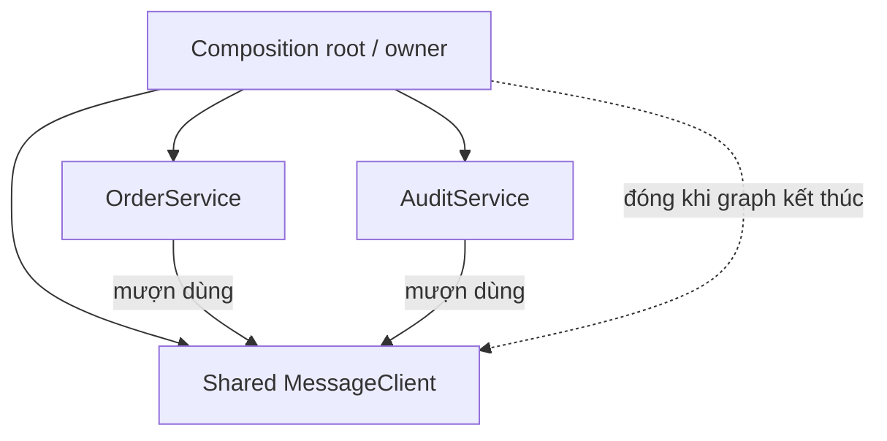

# Đối tượng được truyền từ bên ngoài và giới hạn quyền sở hữu

Trong một ứng dụng Java dùng **Dependency Injection (DI)**, lớp nghiệp vụ thường nhận repository, HTTP client, nguồn thời gian hoặc đối tượng gửi thông báo qua constructor. Nhưng có một câu hỏi mà chữ ký constructor chưa tự trả lời: **ai có quyền đóng, thay thế hoặc kết thúc vòng đời của đối tượng được truyền vào?**

Nếu một đối tượng được truyền cho hai service cùng sử dụng, service thứ nhất tự gọi `close()` sau khi hoàn thành công việc có thể khiến service thứ hai thất bại. Nếu không bên nào chịu trách nhiệm đóng tài nguyên, ứng dụng có thể giữ kết nối hoặc luồng dữ liệu lâu hơn cần thiết. Hiểu **ranh giới quyền sở hữu** giúp tránh cả hai dạng lỗi.

Bài học thuộc chương **Sở hữu tài nguyên** của module **DEPENDENCY_INJECTION**. Ta học cách tách việc *sử dụng phụ thuộc* khỏi việc *tạo, lắp ghép, quản lý scope và thu hồi tài nguyên*, thực hành **constructor injection**, **composition root**, **Inversion of Control (IoC)** và kiểm thử bằng Java thuần trước khi mở rộng sang DI container.

## 1. Được tiêm vào không đồng nghĩa với được sở hữu

Giả sử một lớp nhận một đối tượng qua constructor:

```java
final class ReportService {
    private final ReportSender sender;

    ReportService(ReportSender sender) {
        this.sender = java.util.Objects.requireNonNull(sender);
    }
}
```

Constructor cho biết `ReportService` **cần sử dụng** một `ReportSender`. Nó chưa cho biết `ReportService` có được phép `close()`, cấu hình lại, lưu trữ vô thời hạn hoặc chuyển giao sender cho đối tượng khác hay không.

Trong nhiều thiết kế DI, quy ước hợp lý là:

- **Composition root hoặc chủ thể cấp phụ thuộc** tạo hay tiếp nhận một tài nguyên, quyết định phạm vi sử dụng và chịu trách nhiệm kết thúc vòng đời theo hợp đồng.
- **Consumer nhận phụ thuộc** chỉ sử dụng những phương thức phù hợp với trách nhiệm nghiệp vụ của nó. Consumer không tự đóng tài nguyên được mượn nếu hợp đồng không chuyển giao quyền sở hữu.
- **Adapter quản lý tài nguyên bên trong** có thể sở hữu các phần tử con mà chính nó tạo (ví dụ socket, file handle), nhưng phải nhất quán với ai chịu trách nhiệm gọi `close()` trên adapter.

Trong ngữ cảnh này, “mượn dùng” là **quy ước thiết kế về vòng đời**. Java không có hệ thống kiểm tra quyền sở hữu tại thời điểm biên dịch như một số ngôn ngữ khác. `final` trên một trường chỉ ngăn gán lại tham chiếu, **không** bảo đảm đối tượng được tham chiếu còn mở, bất biến hoặc chỉ có một chủ sở hữu.

> Quy tắc thực hành: nếu không có hợp đồng chuyển giao quyền sở hữu rõ ràng, một lớp nhận phụ thuộc qua constructor nên xem đó là **đối tượng được cấp để sử dụng**, không phải tài nguyên mà nó tự ý hủy.

### 1.1. Phân biệt ba vai trò

| Vai trò | Trách nhiệm | Ví dụ |
| --- | --- | --- |
| **Nơi tạo và lắp ghép (composition root)** | Chọn triển khai, tạo đồ thị, ấn định scope, phối hợp cleanup | `main()` tạo một client rồi cấp cho hai service |
| **Consumer** | Gọi những hành vi đã được cấp, duy trì quy tắc nghiệp vụ | `OrderService` gửi yêu cầu bằng `MessageSink` |
| **Chủ sở hữu tài nguyên (owner)** | Quyết định điểm kết thúc sử dụng, gọi cleanup và xử lý lỗi khi đóng | Một object graph được tạo trong `try-with-resources` |

Các vai trò có thể nằm trong cùng một thành phần hoặc được phân chia. **Không phải lúc nào nơi khởi tạo cũng là owner cuối cùng**: một factory có thể tạo rồi *chuyển giao quyền sở hữu* cho người gọi. Điều quan trọng là hợp đồng phải nêu rõ chuyển giao đó, kể cả trách nhiệm đóng tài nguyên.

## 2. Những lựa chọn sở hữu cần xác định

Khi một đối tượng được truyền qua constructor hoặc factory, hãy chọn một trong các kiểu quan hệ sau một cách có chủ đích:

| Quan hệ | Ai quyết định kết thúc vòng đời? | Consumer được làm gì? | Tình huống |
| --- | --- | --- | --- |
| **Mượn dùng (borrowed)** | Owner bên ngoài | Sử dụng qua hợp đồng, không tự đóng | Hai service dùng chung một client |
| **Sở hữu riêng (owned)** | Chính đối tượng nhận, **nếu hợp đồng đã chỉ rõ** | Sử dụng và đóng khi hoàn tất | Một component tạo resource riêng cho một tác vụ |
| **Chuyển giao sở hữu (ownership transfer)** | Bên nhận sau khi chuyển giao | Nhận trách nhiệm đóng; bên cấp không còn sử dụng | Factory trả về một `AutoCloseable` cho caller |
| **Chia sẻ có quản lý (managed/shared)** | Owner chung hoặc container | Các consumer mượn dùng theo scope | Pool/client dùng chung trong phạm vi ứng dụng |

Sự khác biệt không dựa trên cú pháp `new` hay `@Inject`. Một instance có thể được tạo bằng `new` ngay trong factory nhưng **quyền đóng** được giao cho caller. Ngược lại, một client được tạo tại composition root có thể được đưa vào nhiều service; không service nào được coi mình là owner riêng.

### 2.1. Scope quyết định khoảng thời gian mượn dùng hợp lệ

Vòng đời consumer và vòng đời resource cần tương thích. Nếu một singleton giữ trực tiếp đối tượng chỉ hợp lệ trong một request, sau khi request kết thúc, singleton có thể vẫn giữ tham chiếu đến tài nguyên đã hết vòng đời. Ngược lại, một request service mượn client dùng chung của ứng dụng phải **trả quyền sử dụng** khi request kết thúc, nhưng không được đóng client dùng chung.

Hãy phân biệt:

- **Scope của consumer:** khoảng thời gian consumer được sử dụng.
- **Scope của phụ thuộc:** phạm vi mà một instance được tạo và tái sử dụng.
- **Quyền sở hữu:** bên chịu trách nhiệm thu hồi tài nguyên.
- **Thời gian mượn hợp lệ:** khoảng thời gian consumer có thể gọi phụ thuộc an toàn.

Một phụ thuộc không cần `close()`, ví dụ `Clock` bất biến trong ví dụ này, thường không có cleanup. Nhưng các khái niệm scope và trạng thái chia sẻ vẫn có ý nghĩa đối với mọi đối tượng.

## 3. Lỗi điển hình: consumer tự đóng tài nguyên được tiêm

Giả sử hai service cùng nhận một client có khả năng đóng:



Nếu `OrderService` thực hiện:

```java
final class BadOrderService {
    private final MessageClient client;

    BadOrderService(MessageClient client) {
        this.client = client;
    }

    void sendOrder(String id) {
        client.send("order:" + id);
        client.close(); // Sai nếu client được dùng chung và quyền sở hữu ở bên ngoài.
    }
}
```

thì lời gọi sau đó của `AuditService` có thể thất bại vì client đã đóng. `MessageClient` ở đoạn này chỉ là một kiểu minh họa cho lỗi thiết kế; không phải lớp JDK hay phần mã chạy ở mục tiếp theo.

Một biến thể khó phát hiện hơn là consumer không gọi `close()` trực tiếp nhưng lại gọi `shutdown()`, `dispose()` hoặc làm rỗng pool mà các consumer khác đang dùng. **Quyền thay đổi vòng đời** cần được xem là quyền riêng, tách khỏi quyền gửi yêu cầu nghiệp vụ.

## 4. Thiết kế hai hợp đồng: khả năng sử dụng và khả năng đóng

Java cung cấp `AutoCloseable` và cú pháp `try-with-resources` cho tài nguyên cần thu hồi. Nhưng một consumer chỉ cần gửi thông điệp thì không nhất thiết phải nhận interface có phương thức `close()`.

Ta có thể tách hai mặt của cùng một adapter:

```java
interface MessageSink {
    void send(String message);
}

final class NetworkMessageClient implements MessageSink, AutoCloseable {
    @Override
    public void send(String message) {
        // Gửi qua mạng: mã thực tế nằm ở adapter.
    }

    @Override
    public void close() {
        // Thu hồi tài nguyên mà adapter sở hữu.
    }
}
```

`OrderService` nhận **`MessageSink`**, còn composition root giữ tham chiếu **`NetworkMessageClient`** để đóng. Consumer không thấy `close()` trên kiểu `MessageSink`. Đây là cách sử dụng **Interface Segregation** để diễn tả đúng quyền mà mỗi bên cần.

Lưu ý: Java vẫn cho phép ép kiểu hoặc truy cập cùng instance bằng tham chiếu khác; tách interface không phải cơ chế bảo mật. Nó là **hợp đồng thiết kế rõ ràng** giúp giảm nhầm lẫn trong mã thông thường.

## 5. Ví dụ Java hoàn chỉnh: owner quản lý resource, service chỉ mượn dùng

Ví dụ sử dụng một “kênh gửi” giả lập bằng danh sách trong bộ nhớ, để có thể quan sát việc gửi và đóng mà không dùng mạng, file hay DI container. `RecordingChannel` đóng vai tài nguyên có vòng đời; hai service dùng chung `MessageSink`; `OwnedGraph` làm owner và đóng kênh khi đồ thị kết thúc.

Lưu đoạn mã vào **`ResourceOwnershipExample.java`**:

```java
import java.time.Clock;
import java.util.ArrayList;
import java.util.List;
import java.util.Objects;

public final class ResourceOwnershipExample {
    private ResourceOwnershipExample() {}

    // Consumer chỉ cần quyền gửi, không cần quyền đóng.
    public interface MessageSink {
        void send(String message);
    }

    // Adapter giả lập tài nguyên có thể đóng.
    public static final class RecordingChannel
            implements MessageSink, AutoCloseable {
        private final List<String> delivered = new ArrayList<>();
        private boolean closed;
        private int closeCount;

        @Override
        public void send(String message) {
            if (closed) {
                throw new IllegalStateException("Channel is closed");
            }
            delivered.add(Objects.requireNonNull(message, "message"));
        }

        public List<String> messages() {
            return List.copyOf(delivered);
        }

        public boolean isClosed() {
            return closed;
        }

        public int closeCount() {
            return closeCount;
        }

        @Override
        public void close() {
            // Đây là quyết định cụ thể của adapter ví dụ: đóng nhiều lần vẫn an toàn.
            if (!closed) {
                closed = true;
                closeCount++;
            }
        }
    }

    public static final class OrderService {
        private final MessageSink sink;
        private final Clock clock;

        public OrderService(MessageSink sink, Clock clock) {
            this.sink = Objects.requireNonNull(sink, "sink");
            this.clock = Objects.requireNonNull(clock, "clock");
        }

        public void dispatch(String orderId) {
            if (orderId == null || orderId.trim().isEmpty()) {
                throw new IllegalArgumentException("orderId is required");
            }
            sink.send("order:" + orderId + "@" + clock.instant());
            // Không đóng sink ở đây: service chỉ mượn dùng.
        }
    }

    public static final class AuditService {
        private final MessageSink sink;

        public AuditService(MessageSink sink) {
            this.sink = Objects.requireNonNull(sink, "sink");
        }

        public void record(String orderId) {
            sink.send("audit:" + orderId);
            // Cũng không đóng: kênh còn được dùng bởi consumer khác.
        }
    }

    // Object graph chịu trách nhiệm sở hữu kênh được tạo trong open().
    public static final class OwnedGraph implements AutoCloseable {
        public final OrderService orders;
        public final AuditService audit;
        private final RecordingChannel ownedChannel;

        private OwnedGraph(RecordingChannel channel, Clock clock) {
            ownedChannel = channel;
            orders = new OrderService(channel, clock);
            audit = new AuditService(channel);
        }

        public static OwnedGraph open(Clock clock) {
            Objects.requireNonNull(clock, "clock");
            RecordingChannel channel = new RecordingChannel();
            // Tạo đúng một channel rồi truyền cho cả hai service.
            return new OwnedGraph(channel, clock);
        }

        public List<String> messages() {
            return ownedChannel.messages();
        }

        public boolean isChannelClosed() {
            return ownedChannel.isClosed();
        }

        public int channelCloseCount() {
            return ownedChannel.closeCount();
        }

        @Override
        public void close() {
            ownedChannel.close();
        }
    }

    public static void main(String[] args) {
        // main() quyết định thời gian tồn tại của object graph.
        try (OwnedGraph graph = OwnedGraph.open(Clock.systemUTC())) {
            graph.orders.dispatch("OD-001");
            graph.audit.record("OD-001");

            for (String message : graph.messages()) {
                System.out.println(message);
            }
        } // try-with-resources tự gọi graph.close().
    }
}
```

Chạy bằng **JDK 11 trở lên**:

```bash
javac ResourceOwnershipExample.java
java ResourceOwnershipExample
```

Kết quả sẽ có dạng:

```text
order:OD-001@2026-01-10T10:15:30Z
audit:OD-001
```

Thời gian thực tế phụ thuộc lúc chạy; dòng thời gian trên chỉ minh họa định dạng. Hai thông điệp được gửi qua **cùng một `RecordingChannel`**. Khi ra khỏi khối `try`, `OwnedGraph.close()` được gọi và chuyển lệnh đóng đến kênh mà nó sở hữu.

### 5.1. Ai có quyền làm gì?

| Thành phần | Có thể gửi? | Có quyền đóng theo hợp đồng? | Lý do |
| --- | --- | --- | --- |
| `OrderService` | Có | Không | Chỉ giữ `MessageSink` do bên ngoài cấp |
| `AuditService` | Có | Không | Cũng chỉ giữ `MessageSink` |
| `RecordingChannel` | Có | Có khả năng tự thực thi `close()` | Adapter quản lý trạng thái và cleanup của chính nó |
| `OwnedGraph` | Không trực tiếp gọi nghiệp vụ gửi | **Có trách nhiệm gọi `close()`** | Owner tạo kênh và quản lý vòng đời chung |
| `main()` | Gọi service qua graph | Quyết định khi nào đóng graph | Sở hữu handle `OwnedGraph` được trả về từ `open()` |

Ở đây việc “`OwnedGraph` sở hữu kênh” là **quy ước rõ ràng trong API `open()/close()`**. Sau khi trả graph cho caller, caller sở hữu việc đóng **graph**, còn graph đóng các tài nguyên nội bộ. Nếu một ngày `OwnedGraph` còn sở hữu thêm file hay connection, trách nhiệm cleanup phải được mở rộng đồng bộ.

### 5.2. Tại sao một channel được chia sẻ không bị đóng sớm?

Giả sử `orders.dispatch(...)` hoàn thành, còn `audit.record(...)` chưa chạy. Nếu `orders` tự đóng kênh, `audit` sẽ gặp lỗi. Thiết kế ở trên trì hoãn việc đóng cho đến **khi toàn bộ scope sử dụng graph kết thúc**. Hai service vẫn có thể được giữ ở bộ nhớ sau thời điểm đó, nhưng không còn được gọi vào kênh đã đóng; **giữ tham chiếu không kéo dài vòng đời resource**.

Điều này cũng giải thích sự khác nhau giữa **scope** và **garbage collection**. `close()` giúp giải phóng tài nguyên theo thời điểm xác định. Java garbage collector thu hồi bộ nhớ của những object không còn được tham chiếu; không nên phụ thuộc vào thời điểm GC để đóng socket, file hoặc kết nối.

## 6. Kiểm tra vòng đời bằng Java thuần

Ta có thể kiểm tra quy tắc sở hữu mà không chạy Spring, không kết nối mạng và không dùng JUnit. Các test quan sát việc service có gọi `close()` sớm hay không, graph có đóng đúng lúc hay không, cùng một resource có được chia sẻ đúng phạm vi không và lỗi nghiệp vụ có ngăn cleanup hay không.

Lưu đoạn sau thành **`ResourceOwnershipCheck.java`** trong cùng thư mục:

```java
import java.time.Clock;
import java.time.Instant;
import java.time.ZoneOffset;
import java.util.List;

public final class ResourceOwnershipCheck {
    private static final Clock FIXED_CLOCK = Clock.fixed(
        Instant.parse("2026-01-10T10:15:30Z"), ZoneOffset.UTC);

    public static void main(String[] args) {
        injectedConsumerDoesNotOwnChannel();
        sharedChannelSurvivesFirstConsumer();
        graphClosesExactlyOnce();
        exceptionStillClosesGraph();
        separateGraphsOwnSeparateState();
        useAfterOwnerCloseIsRejected();
        System.out.println("PASS: 6 resource ownership checks");
    }

    private static void injectedConsumerDoesNotOwnChannel() {
        ResourceOwnershipExample.RecordingChannel channel =
            new ResourceOwnershipExample.RecordingChannel();
        try {
            ResourceOwnershipExample.OrderService consumer =
                new ResourceOwnershipExample.OrderService(channel, FIXED_CLOCK);
            consumer.dispatch("OD-BORROW");
            check(!channel.isClosed(),
                  "Consumer must not close injected channel");
            check(channel.closeCount() == 0,
                  "No close should happen during dispatch");
        } finally {
            // Test tạo channel nên test chịu trách nhiệm kết thúc vòng đời.
            channel.close();
        }
        check(channel.isClosed(), "Test owner must close its channel");
    }

    private static void sharedChannelSurvivesFirstConsumer() {
        ResourceOwnershipExample.RecordingChannel channel =
            new ResourceOwnershipExample.RecordingChannel();
        try {
            ResourceOwnershipExample.OrderService first =
                new ResourceOwnershipExample.OrderService(channel, FIXED_CLOCK);
            ResourceOwnershipExample.AuditService second =
                new ResourceOwnershipExample.AuditService(channel);

            first.dispatch("OD-SHARED");
            check(!channel.isClosed(), "First consumer closed shared channel");
            second.record("OD-SHARED");

            List<String> sent = channel.messages();
            check(sent.size() == 2, "Both consumers must reach one channel");
            check(sent.get(1).equals("audit:OD-SHARED"),
                  "Second consumer must still be able to send");
        } finally {
            channel.close();
        }
    }

    private static void graphClosesExactlyOnce() {
        ResourceOwnershipExample.OwnedGraph graph =
            ResourceOwnershipExample.OwnedGraph.open(FIXED_CLOCK);
        try (ResourceOwnershipExample.OwnedGraph borrowed = graph) {
            borrowed.orders.dispatch("OD-CLOSE");
            check(!borrowed.isChannelClosed(),
                  "Resource must remain open inside graph scope");
        }

        check(graph.isChannelClosed(),
              "Graph must close its owned channel when scope ends");
        check(graph.channelCloseCount() == 1,
              "Channel must be closed exactly once");

        // Adapter ví dụ chọn close() có tính idempotent.
        graph.close();
        check(graph.channelCloseCount() == 1,
              "Repeated close must have no extra effect in this adapter");
    }

    private static void exceptionStillClosesGraph() {
        ResourceOwnershipExample.OwnedGraph graph =
            ResourceOwnershipExample.OwnedGraph.open(FIXED_CLOCK);
        boolean sawFailure = false;
        try (ResourceOwnershipExample.OwnedGraph borrowed = graph) {
            borrowed.orders.dispatch("OD-FAIL");
            throw new IllegalStateException("simulated business failure");
        } catch (IllegalStateException expected) {
            sawFailure = "simulated business failure".equals(
                expected.getMessage());
        }
        check(sawFailure, "Failure must remain observable");
        check(graph.isChannelClosed() && graph.channelCloseCount() == 1,
              "Resource must close even when business action fails");
    }

    private static void separateGraphsOwnSeparateState() {
        ResourceOwnershipExample.OwnedGraph first =
            ResourceOwnershipExample.OwnedGraph.open(FIXED_CLOCK);
        ResourceOwnershipExample.OwnedGraph second =
            ResourceOwnershipExample.OwnedGraph.open(FIXED_CLOCK);

        try (ResourceOwnershipExample.OwnedGraph f = first;
             ResourceOwnershipExample.OwnedGraph s = second) {
            f.orders.dispatch("OD-ONLY-FIRST");
            check(f.messages().size() == 1, "First graph lost its message");
            check(s.messages().isEmpty(),
                  "Second graph unexpectedly shares first graph state");
        }
        check(first.channelCloseCount() == 1,
              "First graph must close its own channel");
        check(second.channelCloseCount() == 1,
              "Second graph must close its own channel");
    }

    private static void useAfterOwnerCloseIsRejected() {
        ResourceOwnershipExample.OwnedGraph graph =
            ResourceOwnershipExample.OwnedGraph.open(FIXED_CLOCK);
        ResourceOwnershipExample.OrderService stale = graph.orders;
        graph.close();

        boolean rejected = false;
        try {
            stale.dispatch("OD-LATE");
        } catch (IllegalStateException expected) {
            rejected = "Channel is closed".equals(expected.getMessage());
        }
        check(rejected, "Borrower must not use resource after owner closes it");
    }

    private static void check(boolean condition, String message) {
        if (!condition) {
            throw new AssertionError(message);
        }
    }
}
```

Biên dịch và chạy:

```bash
javac ResourceOwnershipExample.java ResourceOwnershipCheck.java
java ResourceOwnershipCheck
```

Khi mọi điều kiện đạt, kết quả:

```text
PASS: 6 resource ownership checks
```

| Phép kiểm | Bất biến (invariant) được xác minh |
| --- | --- |
| `injectedConsumerDoesNotOwnChannel` | Service mượn dùng không đóng tài nguyên do caller tạo |
| `sharedChannelSurvivesFirstConsumer` | Một consumer dùng xong không cắt quyền dùng của consumer khác |
| `graphClosesExactlyOnce` | Owner đóng channel khi scope kết thúc; adapter minh họa đóng lặp an toàn |
| `exceptionStillClosesGraph` | Khối `try-with-resources` đóng tài nguyên khi thân khối ném lỗi |
| `separateGraphsOwnSeparateState` | Hai graph có channel và vòng đời riêng |
| `useAfterOwnerCloseIsRejected` | Tham chiếu consumer còn tồn tại không cho phép dùng resource đã đóng |

Các kiểm tra dùng `check(...)` ném `AssertionError` nên không phụ thuộc cờ `-ea`. Kênh giả lập **không có tranh chấp luồng** và không mở kết nối thật; bài test chỉ xác minh quy tắc ownership của ví dụ. Cần kiểm thử tích hợp riêng cho cleanup socket, connection, transaction, listener hoặc thread pool trong ứng dụng thực tế.

## 7. `try-with-resources`, ngoại lệ và thứ tự đóng

Nếu một resource triển khai `AutoCloseable`, cú pháp `try-with-resources` cho phép gọi `close()` tự động khi ra khỏi khối, kể cả khi thân khối ném exception:

```java
try (ResourceOwnershipExample.OwnedGraph graph =
        ResourceOwnershipExample.OwnedGraph.open(java.time.Clock.systemUTC())) {
    graph.orders.dispatch("OD-200");
    graph.audit.record("OD-200");
} // graph.close() được gọi.
```

Khi khai báo nhiều resource trong một `try`, Java đóng chúng theo **thứ tự ngược với thứ tự khai báo**. Nếu lỗi xảy ra trong thân khối và `close()` cũng ném lỗi, lỗi đóng thường được ghi vào `getSuppressed()` của exception chính. Điều này tránh việc mất dấu nguyên nhân gốc.

Đoạn minh họa độc lập sau cho thấy cơ chế đó:

```java
final class SuppressedExample {
    static final class FailingClose implements AutoCloseable {
        @Override
        public void close() {
            throw new IllegalStateException("close failed");
        }
    }

    public static void main(String[] args) {
        try (FailingClose resource = new FailingClose()) {
            throw new IllegalArgumentException("work failed");
        } catch (IllegalArgumentException primary) {
            System.out.println(primary.getMessage()); // work failed
            System.out.println(primary.getSuppressed().length); // 1
            System.out.println(primary.getSuppressed()[0].getMessage());
            // close failed
        }
    }
}
```

Trong ứng dụng thật, không nên tự động bỏ qua lỗi `close()`. Cách xử lý tùy thuộc resource: phải ghi log, bổ sung thông tin chẩn đoán hoặc để exception được lan truyền. **`AutoCloseable` không bắt buộc mọi triển khai có `close()` idempotent**, vì vậy không nên gọi đóng nhiều lần chỉ dựa vào tên interface. `RecordingChannel` trong ví dụ *chủ động* làm `close()` idempotent để việc kiểm tra dễ hiểu.

### 7.1. Nếu lắp ghép thất bại giữa chừng thì sao?

Giả sử composition root tạo một connection thành công nhưng khi tạo service tiếp theo, constructor ném lỗi. Nếu resource đã được cấp phát nằm ngoài mọi khối cleanup, nó có thể bị bỏ quên. Cần bảo đảm **phần đã tạo được dọn dẹp ngay cả khi graph chưa lắp xong**.

Một cấu trúc thường dùng là giữ tài nguyên mới trong vùng `try` trong thời gian cấu hình; chỉ chuyển quyền sở hữu sang graph hoàn chỉnh khi việc lắp ghép thành công. Nếu code phải bắt lỗi rồi đóng thủ công, hãy giữ nguyên exception gây lỗi và bổ sung lỗi cleanup như thông tin phụ thay vì che mất nguyên nhân. Với nhiều resource phụ thuộc nhau, tài nguyên phụ thuộc vào resource khác thường phải được đóng trước tài nguyên mà nó sử dụng.

Trong ví dụ chạy được ở mục 5, `OwnedGraph.open(...)` chỉ tạo một adapter bộ nhớ với constructor đơn giản; nó chưa minh họa quy trình xử lý thất bại khi mở nhiều resource thật. Đây là phần cần mở rộng khi thêm DB, file hoặc network.

## 8. Những ranh giới quan trọng khi resource được chia sẻ

### 8.1. Chia sẻ adapter không đồng nghĩa với chia sẻ quyền đóng

Một `DataSource` hoặc HTTP client được tạo tại application scope có thể được đưa vào nhiều component. Consumer cần gọi các thao tác nghiệp vụ theo contract; thành phần sở hữu application scope chịu trách nhiệm shutdown khi không còn consumer nào cần.

Ngược lại, một `Connection` hoặc transaction gắn với một tác vụ thường có vòng đời ngắn hơn. Nếu component mượn connection do caller quản lý, nó không nên tự đóng connection khi caller còn cần dùng cho các bước khác trong cùng transaction. Nếu component **tự mở** connection thông qua `DataSource.getConnection()`, nó phải tuân thủ hợp đồng của tầng quản lý transaction và đóng/trả lại connection đúng điểm. Trách nhiệm sở hữu phải xét **instance thực tế và ngữ cảnh transaction**, không suy ra chỉ từ kiểu `Connection`.

### 8.2. Singleton không tự bảo đảm an toàn luồng

Một resource dùng chung cho nhiều request có thể bị truy cập đồng thời. Khi lựa chọn scope ứng dụng, phải kiểm tra implementation có thread-safe không, trạng thái nào được phép thay đổi và thao tác nào cần nguyên tử. `RecordingChannel` dùng `ArrayList` và trường boolean thông thường để minh họa tuần tự; **không an toàn cho nhiều luồng gửi/đóng đồng thời**.

Việc đóng resource đồng thời với các lời gọi đang xử lý còn cần chính sách riêng: từ chối lời gọi mới, chờ tác vụ đang chạy hoàn tất, timeout hoặc hủy có kiểm soát. Chỉ gom mọi thứ vào một singleton không xử lý được bài toán này.

### 8.3. Đối tượng sống lâu không nên giữ resource sống ngắn

Ví dụ, một service singleton giữ request-scoped connection trong trường:

```java
final class IncorrectLongLivedService {
    private final RequestConnection connection;

    IncorrectLongLivedService(RequestConnection connection) {
        this.connection = connection;
    }
}
```

`RequestConnection` là kiểu minh họa. Nếu instance connection kết thúc cùng request đầu tiên nhưng service vẫn sống lâu, các request sau sẽ gặp tài nguyên đã đóng hoặc ngữ cảnh sai. Có thể truyền connection theo từng thao tác hoặc cấp factory/provider truy xuất đúng scope, tùy kiến trúc. **Một provider không xóa trách nhiệm đóng**: vẫn phải biết ai sở hữu đối tượng được tạo và thời điểm release.

### 8.4. Không đóng resource mà mình không tạo hoặc không được giao sở hữu

Đọc từ `System.in` hoặc ghi ra `System.out` là ví dụ quen thuộc: code thư viện không nên tự đóng những stream toàn cục này sau một thao tác, vì các phần khác của ứng dụng còn dùng. Tương tự, một phương thức nhận `InputStream` do caller truyền cần mô tả rõ nó chỉ đọc hay sẽ nhận trách nhiệm đóng. Nếu không có lời hứa chuyển giao, giả định “consumer mượn dùng” thường an toàn và dễ phối hợp hơn.

### 8.5. Interface không biểu diễn được toàn bộ quy tắc sở hữu

`void send(...)`, `AutoCloseable` hoặc `Supplier<Connection>` đều chưa tự nói ai chịu trách nhiệm cho từng instance. Ví dụ, một factory trả về resource mới có thể chuyển trách nhiệm đóng cho caller, trong khi provider cho mượn từ pool có thể đòi caller “trả về pool” thông qua `close()` của wrapper. Phải đọc và ghi rõ hợp đồng. Trong code cần thiết, tên hàm như `openOwnedSession()`, tài liệu Javadoc hoặc kiểu bao `OwnedSession` giúp truyền đạt vòng đời tốt hơn so với các tên như `getSession()` mơ hồ.

## 9. DI container giúp gì và vẫn chưa quyết định điều gì?

DI container có thể tạo instance, áp dụng phạm vi như singleton/request/prototype, thực hiện callback khởi tạo và hủy khi container quản lý vòng đời. Tuy nhiên:

- Một instance **do container quản lý** thường tuân theo các hook lifecycle và scope của container đó.
- Một instance **được cấp từ bên ngoài** cho container hoặc do ứng dụng tự tạo có thể có quy tắc cleanup khác, phụ thuộc API và cấu hình; không thể mặc định container sẽ đóng tất cả object thấy được.
- Nếu một service tự tạo resource trong method, container thường không biết để quản lý tài nguyên tạm đó; method vẫn phải bảo đảm cleanup.
- Container không tự nhận biết an toàn luồng, tính bất biến, chính sách kết thúc giao dịch hoặc việc một consumer đang còn sử dụng resource khi owner đóng.

Do đó, học **DI thủ công** trước giúp ta thấy rõ hợp đồng sở hữu: ai cấp, ai mượn, ai có quyền đóng và scope kết thúc ở đâu. Khi dùng framework, ta chuyển các quyết định đó thành cấu hình và lifecycle phù hợp, thay vì mong annotation tự giải quyết mọi vấn đề.

## 10. Quy trình rà soát quyền sở hữu trước khi viết hoặc sửa mã

1. **Liệt kê các resource thực sự cần cleanup.** Connection, stream, socket, thread pool, subscription hoặc client có `close()/shutdown()`.
2. **Xác định nơi tạo và hợp đồng chuyển giao.** Resource do main, factory, pool, container hay method tạo? Người nhận đang mượn hay sở hữu?
3. **Vẽ các consumer cùng chia sẻ instance.** Tìm nguy cơ một consumer đóng làm hỏng phần còn lại của đồ thị.
4. **So khớp scope.** Owner phải sống đủ lâu để consumer sử dụng, nhưng không giữ resource lâu hơn cần thiết.
5. **Tách API nghiệp vụ khỏi API đóng nếu phù hợp.** Consumer dùng interface nhỏ; owner giữ handle `AutoCloseable` để cleanup.
6. **Định nghĩa điểm kết thúc và đường lỗi.** Dùng `try-with-resources`, shutdown hook hoặc lifecycle của container theo ngữ cảnh; xử lý trường hợp lắp ghép một phần.
7. **Kiểm tra bằng Java thuần.** Fake ghi nhận `close()`, thử hai consumer chia sẻ, thử lỗi giữa luồng và thử dùng sau khi đóng.
8. **Kiểm tra tích hợp và đồng thời.** Adapter thật có thể có timeout, connection pooling, retry và lệnh đóng không tức thời; xác minh các bảo đảm này trong môi trường phù hợp.

### Bài tập tình huống

Ứng dụng có `EmailClient` implement `AutoCloseable`, được tạo một lần tại composition root rồi truyền vào `InvoiceService` và `ReminderService`. Sau khi gửi hóa đơn đầu tiên, `InvoiceService` gọi `client.close()` để “tránh rò rỉ tài nguyên”. Người dùng sau đó không nhận được email nhắc thanh toán.

Hãy tự trả lời:

1. **Ai là owner phù hợp** của `EmailClient` trong thiết kế này? Vì sao `InvoiceService` không nên đóng?
2. Nếu `EmailClient` có cả `send(...)` và `close()`, bạn sẽ tách hợp đồng để consumer chỉ biết khả năng nào?
3. Nếu hệ thống đổi sang tạo một client **riêng cho mỗi job**, composition root cần đặt việc tạo và đóng ở ranh giới nào?
4. Test Java thuần cần ghi nhận những sự kiện nào để bắt lỗi “consumer thứ nhất đóng sớm”?
5. Khi service được dùng chung qua nhiều request, điều kiện nào cần xác minh trước khi chia sẻ client?

Một hướng giải là cung cấp `EmailSender` chỉ có phương thức gửi cho hai service; composition root giữ `EmailClient` thật và đóng đúng một lần khi application scope kết thúc. Nếu client tạo theo job, scope job trở thành owner và dùng `try-with-resources` trong phạm vi job. Test double theo dõi thứ tự `send`/`close` và khẳng định consumer thứ hai vẫn gửi được trước cleanup cuối cùng. Với nhiều request đồng thời, phải xác minh thread safety và chính sách shutdown của client thật.

**Ghi nhớ:** **Được tiêm phụ thuộc để sử dụng không tự động trao quyền sở hữu phụ thuộc đó.** Constructor injection công bố *cần gì*, composition root quyết định *tạo và lắp ghép thế nào*, còn hợp đồng ownership xác định *ai có quyền đóng và khi nào*. Giữ các trách nhiệm này rõ ràng giúp quản lý vòng đời an toàn từ Java thuần đến ứng dụng dùng DI container.
