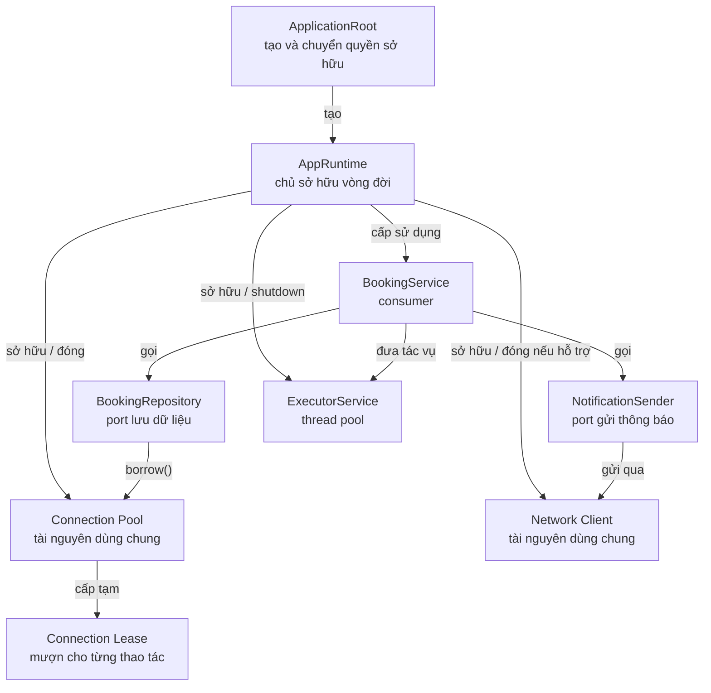

# Kết nối, thread pool và client mạng trong đồ thị phụ thuộc

Trong chương **Sở hữu tài nguyên** của module **Dependency Injection (DI)**, việc nối các object qua constructor mới chỉ là một nửa công việc. Nếu một đối tượng phụ thuộc vào **kết nối database**, **thread pool** hoặc **network client**, ta còn phải biết **ai tạo, ai được sử dụng, ai đóng và đóng vào thời điểm nào**. Một sơ đồ phụ thuộc có thể đúng về kiểu và vẫn sai về vòng đời: kết nối bị đóng quá sớm, thread chạy sau khi client đã đóng, hoặc tài nguyên không được thu hồi khi ứng dụng dừng.

DI và **Inversion of Control (IoC)** tách nơi **sử dụng phụ thuộc** khỏi nơi **tạo và lắp ghép** chúng. Với tài nguyên có trạng thái, cần thêm một khái niệm: **quyền sở hữu vòng đời** (*resource ownership*). **Composition root** hoặc runtime do root tạo thường sở hữu tài nguyên dài hạn; lớp nghiệp vụ nhận hợp đồng cần dùng qua **constructor injection** và không tự quyết định khi nào chúng được đóng. Bài học trình bày các nguyên tắc này bằng Java thuần trước khi dùng DI container.

Sau bài học, bạn có thể:

- Phân biệt **người tạo**, **chủ sở hữu** và **bên mượn/sử dụng** tài nguyên trong một object graph.
- Chọn vòng đời thích hợp cho JDBC connection, connection pool, `ExecutorService` và HTTP/network client.
- Giải thích vì sao `AutoCloseable`, `final`, singleton hoặc interface **không tự quyết định** ai được gọi `close()`.
- Thiết kế composition root có đường khởi động, shutdown và rollback khi khởi động lỗi.
- Kiểm thử việc trả kết nối, ngừng thread pool và đóng client bằng Java thuần, không cần database hay mạng thật.
- Nhận ra những trường hợp rủi ro khi tác vụ bất đồng bộ còn dùng phụ thuộc trong lúc ứng dụng đang shutdown.

## 1. Quyền sở hữu khác với quan hệ phụ thuộc

Giả sử `BookingService` được tiêm `BookingRepository` và `NotificationSender`. Nó cần những đối tượng này để hoàn tất yêu cầu, nhưng **không nhất thiết sở hữu** tài nguyên nằm bên dưới. `BookingRepository` có thể mượn một connection từ pool; `NotificationSender` có thể sử dụng HTTP client và executor dùng chung.

Ba vai trò sau thường khác nhau:

| Vai trò | Câu hỏi cần trả lời | Ví dụ |
| --- | --- | --- |
| **Người tạo** (*creator*) | Ai gọi constructor hoặc factory để có instance? | `ApplicationRoot` tạo connection pool |
| **Chủ sở hữu** (*owner*) | Ai quyết định thời điểm instance hết vòng đời và chịu trách nhiệm thu hồi? | `AppRuntime.close()` đóng pool khi toàn ứng dụng dừng |
| **Bên sử dụng/mượn** (*borrower*) | Ai chỉ được phép gọi hành vi hoặc dùng tài nguyên trong một khoảng thời gian? | Repository mượn connection từ pool trong một giao dịch |

Người tạo thường ban đầu là chủ sở hữu, nhưng **quyền sở hữu có thể được chuyển**: composition root tạo tài nguyên rồi trả về một `AppRuntime implements AutoCloseable`, từ đó runtime chịu trách nhiệm đóng. Bên sử dụng không nên tự đóng tài nguyên dùng chung chỉ vì đang giữ tham chiếu tới nó.

### 1.1. Ví dụ một đồ thị có hai loại cạnh



Sơ đồ phân biệt **cạnh dùng phụ thuộc** với **cạnh sở hữu tài nguyên**. Chúng có thể trùng nhau, nhưng không nên mặc định. Ví dụ `BookingService` dùng executor, còn runtime mới có quyền gọi `shutdown()`.

### 1.2. Quy tắc xuất phát

**Thành phần được cấp một tài nguyên để sử dụng không tự động được quyền đóng nó.** Hợp đồng phải nêu rõ tài nguyên được **chuyển quyền sở hữu** hay chỉ **cho mượn**. Nếu API không nói rõ, hãy xác định quyền sở hữu ngay tại composition root và thể hiện bằng wrapper hoặc phương thức có tên rõ ràng.

`AutoCloseable` cho biết một object có cơ chế đóng; việc implements `AutoCloseable` **không chứng minh** rằng bất kỳ consumer nào cũng được tự ý đóng nó. Tương tự, `private final HttpClient client` chỉ giữ tham chiếu ổn định; không tự quản lý shutdown.

## 2. Vòng đời khác nhau của ba nhóm tài nguyên

| Loại tài nguyên | Cách sử dụng thường gặp | Ai sở hữu/thu hồi? | Lỗi thiết kế cần tránh |
| --- | --- | --- | --- |
| **JDBC `Connection`** | Lấy cho transaction hoặc một thao tác, dùng rồi đóng | Phương thức mượn có trách nhiệm `close()`, thường để trả logical connection về pool | Giữ một connection trong singleton rồi chia sẻ cho nhiều request |
| **Connection pool / `DataSource` cụ thể** | Tạo và cấp các connection trong suốt thời gian ứng dụng chạy | Runtime/composition root đóng pool khi shutdown | Đóng pool trong mỗi repository call hoặc không đóng khi dừng |
| **`ExecutorService`** | Nhận và chạy task trên nhóm thread dùng chung | Thành phần quản lý runtime gọi `shutdown()`, chờ kết thúc và có chính sách xử lý timeout | Mỗi request tạo một pool không đóng; consumer tùy ý `shutdownNow()` pool dùng chung |
| **Network/HTTP client** | Gửi yêu cầu đến một dịch vụ bên ngoài, có thể dùng nhiều lần | Theo API cụ thể: root đóng client có `close`, hoặc quản lý tài nguyên liên quan | Tạo client đắt tiền cho mỗi lời gọi, hoặc đóng khi còn request đang chạy |
| **InputStream/Socket/Response body** | Phát sinh trong từng request/response | Thao tác mở/mượn cần đóng theo hợp đồng API | Bỏ quên stream/body khiến connection hoặc buffer không được giải phóng |

**Chính sách vòng đời phải dựa trên hợp đồng của thư viện cụ thể.** Chẳng hạn `javax.sql.DataSource` không cam kết tất cả implementation có phương thức `close()`; một pool library cụ thể thường cung cấp cách shutdown riêng. Với `java.net.http.HttpClient` trong **Java 11**, bạn cũng không thể mặc định dùng `try-with-resources` trực tiếp với `HttpClient`, vì API ở phiên bản này chưa cung cấp `AutoCloseable`. Những phiên bản JDK hoặc HTTP library khác có thể có API shutdown riêng.

### 2.1. Connection và connection pool không phải một thứ

Trong hệ thống dùng pool, `DataSource.getConnection()` thường trả về **logical connection** (một handle được quản lý), còn pool giữ các physical connection bên dưới. Gọi `Connection.close()` của logical connection thường **trả nó về pool**, không có nghĩa đóng cả pool vật lý.

Một repository dùng JDBC theo kiểu:

```java
// Minh họa riêng; cần DataSource, SQL và schema phù hợp trong dự án thực.
final class JdbcBookingRepository {
    private final javax.sql.DataSource dataSource;

    JdbcBookingRepository(javax.sql.DataSource dataSource) {
        this.dataSource = java.util.Objects.requireNonNull(dataSource);
    }

    void save(String bookingId) throws java.sql.SQLException {
        String sql = "INSERT INTO bookings (booking_id) VALUES (?)";
        try (java.sql.Connection connection = dataSource.getConnection();
             java.sql.PreparedStatement statement =
                     connection.prepareStatement(sql)) {
            statement.setString(1, bookingId);
            statement.executeUpdate();
        } // Đóng statement; close logical connection để trả về pool.
    }
}
```

Điều kiện quan trọng là repo **không gọi shutdown trên pool**. Pool vẫn cần cho các lần đặt thuê khác. Với transaction có nhiều thao tác, connection/transaction có thể được quản lý ở một boundary rộng hơn một phương thức repository; khi đó không nên tự ý lấy một connection mới cho mỗi câu SQL nếu điều này phá transaction.

### 2.2. Thread pool và task có hai vòng đời

Một `ExecutorService` dùng chung có thể sống theo application. Nhưng **mỗi `Runnable` hoặc `Callable` chỉ sống theo một công việc**. Code gửi một task vào pool không đồng nghĩa task đã hoàn tất khi phương thức trả về.

```java
// executor thuộc runtime; consumer chỉ được cấp Executor nếu chỉ cần submit.
java.util.concurrent.CompletableFuture<Void> work =
        java.util.concurrent.CompletableFuture.runAsync(
                () -> notificationSender.send("BOOKED"), executor);
// work.join() chờ công việc hoàn tất và báo lỗi qua CompletionException.
```

Nếu client bị đóng **trước khi task chạy xong**, task có thể gặp lỗi hoặc mất thông báo. Quy trình shutdown phải ngừng nhận công việc mới, chờ/kiểm soát công việc đã nhận, rồi mới đóng các tài nguyên mà chúng sử dụng.

`ExecutorService.shutdown()` ngừng nhận task mới nhưng **không chờ** những task đã gửi xong. `awaitTermination(...)` là thao tác chờ. `shutdownNow()` chỉ **cố gắng** hủy task đang chạy (thường bằng interrupt), không bảo đảm task dừng tức thì. Task blocking hoặc bỏ qua interrupt có thể vẫn hoạt động.

### 2.3. Network client cần hợp đồng shutdown riêng

Một HTTP client thường sở hữu connection management, buffer hoặc thread nội bộ, hoặc sử dụng executor được cấp ngoài. Nên tạo và tái sử dụng client theo phạm vi hợp lý, đặt timeout và chính sách retry rõ ràng, rồi đóng theo đúng API của thư viện.

Ví dụ tạo HTTP client ở Java 11:

```java
// Minh họa riêng, không cần gửi request thật.
java.util.concurrent.ExecutorService ioExecutor =
        java.util.concurrent.Executors.newFixedThreadPool(4);
java.net.http.HttpClient httpClient = java.net.http.HttpClient.newBuilder()
        .executor(ioExecutor)
        .connectTimeout(java.time.Duration.ofSeconds(5))
        .build();

// ioExecutor do nơi tạo/sở hữu quản lý, không để từng service shutdown.
// Khi dừng: bảo đảm các HTTP task đã xong rồi shutdown ioExecutor.
```

Lưu ý `connectTimeout` chỉ điều chỉnh **giai đoạn kết nối**; thời hạn hoàn thành một request có thể cần được đặt riêng (ví dụ trên `HttpRequest.Builder.timeout(...)`). Khi tự cấp executor cho HTTP client, cần phối hợp shutdown với các request còn đang thực hiện theo đúng giới hạn của Java và thư viện sử dụng. Ví dụ trên minh họa cấu hình; nó **không có đường shutdown hoàn chỉnh** vì chưa tạo runtime hay gửi request. Phần tiếp theo cung cấp ví dụ tự chứa quản lý lifecycle.

## 3. Vì sao không được đóng phụ thuộc ngay trong service nghiệp vụ?

Một thiết kế dễ gây lỗi:

```java
final class FragileBookingService {
    private final java.util.concurrent.ExecutorService executor;

    FragileBookingService(java.util.concurrent.ExecutorService executor) {
        this.executor = executor;
    }

    void booked(String id) {
        executor.submit(() -> System.out.println("Confirmed " + id));
        executor.shutdown(); // Sai nếu executor được chia sẻ cho nhiều service.
    }
}
```

Nếu service khác cũng dùng executor này, lời gọi `shutdown()` làm các request mới bị từ chối bằng `RejectedExecutionException`. `FragileBookingService` chỉ được giao **quyền gửi task**, không được giao **quyền quản lý vòng đời**.

Thiết kế tốt hơn có thể cấp kiểu **`Executor`** thay cho `ExecutorService`:

```java
final class BookingService {
    private final java.util.concurrent.Executor notificationsExecutor;

    BookingService(java.util.concurrent.Executor notificationsExecutor) {
        this.notificationsExecutor =
                java.util.Objects.requireNonNull(notificationsExecutor);
    }
}
```

`Executor` chỉ công bố `execute(Runnable)`, không có phương thức `shutdown()`. Việc giới hạn kiểu giúp phản ánh đúng năng lực consumer cần, dù không phải một biện pháp bảo mật. Root vẫn giữ tham chiếu `ExecutorService` thật để quản lý shutdown. Cách này phù hợp với **Interface Segregation**: consumer không cần quyền quản lý toàn bộ pool.

Tương tự, BookingService nên nhận `BookingRepository` thay vì nhận trực tiếp pool rồi tự đóng; nhận `NotificationSender` thay vì nhận một HTTP client phức tạp chỉ để gửi một thông báo.

## 4. Ví dụ Java thuần: lắp ghép và thu hồi tài nguyên

Ví dụ đầy đủ sau không mở database hoặc gọi mạng thật. Nó tạo một **pool và connection lease giả lập**, một **network client giả lập có `close()`**, và một **`ExecutorService` thật** để minh họa quyền sở hữu và thứ tự thu hồi. Cách mô phỏng này cho phép chạy và kiểm tra bằng Java 11 mà không cần cài thêm thư viện.

Quy ước trách nhiệm:

- `BookingService` được tiêm repository, sender và `Executor`. Nó dùng các hợp đồng, **không gọi `close()` hoặc `shutdown()`**.
- `PooledBookingRepository` mượn connection cho từng thao tác bằng `try-with-resources`; đóng lease để **trả về pool**.
- `ApplicationRoot` tạo tài nguyên và chuyển quyền sở hữu cho `AppRuntime`.
- `AppRuntime.close()` yêu cầu executor dừng nhận task mới và **chờ task kết thúc**, rồi đóng network client và pool.

Lưu toàn bộ đoạn sau thành `ResourceOwnershipDemo.java` và dùng Java 11 trở lên:

```bash
javac ResourceOwnershipDemo.java
java ResourceOwnershipDemo
```

```java
import java.util.ArrayList;
import java.util.List;
import java.util.Objects;
import java.util.concurrent.CompletableFuture;
import java.util.concurrent.Executor;
import java.util.concurrent.ExecutorService;
import java.util.concurrent.Executors;
import java.util.concurrent.TimeUnit;

public final class ResourceOwnershipDemo {
    // 1. Port của ứng dụng: không để lộ quyền đóng tài nguyên.
    interface BookingRepository {
        void save(String bookingId);
    }

    interface NotificationSender {
        void send(String bookingId);
    }

    // 2. Mô phỏng pool: sở hữu danh sách bản ghi và các lease.
    // Đây không phải triển khai JDBC hay pool dùng trong production.
    static final class DemoConnectionPool implements AutoCloseable {
        private final List<String> saved = new ArrayList<>();
        private int activeLeases;
        private boolean closed;

        synchronized ConnectionLease borrow() {
            if (closed) {
                throw new IllegalStateException("Pool is closed");
            }
            activeLeases++;
            return new ConnectionLease(this);
        }

        synchronized void insert(String id) {
            if (closed) {
                throw new IllegalStateException("Pool is closed");
            }
            saved.add(Objects.requireNonNull(id));
        }

        synchronized void release() {
            if (activeLeases < 1) {
                throw new IllegalStateException("No active lease");
            }
            activeLeases--;
        }

        synchronized int savedCount() {
            return saved.size();
        }

        synchronized int activeLeases() {
            return activeLeases;
        }

        synchronized boolean isClosed() {
            return closed;
        }

        @Override
        public synchronized void close() {
            if (activeLeases != 0) {
                throw new IllegalStateException("Leases still active");
            }
            closed = true;
        }
    }

    // Borrower chỉ trả lease; không có quyền đóng cả pool.
    static final class ConnectionLease implements AutoCloseable {
        private final DemoConnectionPool owner;
        private boolean released;

        ConnectionLease(DemoConnectionPool owner) {
            this.owner = Objects.requireNonNull(owner);
        }

        void insert(String bookingId) {
            if (released) {
                throw new IllegalStateException("Lease already released");
            }
            owner.insert(bookingId);
        }

        @Override
        public void close() {
            if (!released) {
                released = true;
                owner.release();
            }
        }
    }

    static final class PooledBookingRepository implements BookingRepository {
        private final DemoConnectionPool pool;

        PooledBookingRepository(DemoConnectionPool pool) {
            this.pool = Objects.requireNonNull(pool);
        }

        @Override
        public void save(String bookingId) {
            try (ConnectionLease connection = pool.borrow()) {
                connection.insert(bookingId);
            } // Đóng lease, trả cho pool; pool vẫn mở.
        }
    }

    // 3. Network client giả lập có lifecycle rõ ràng.
    static final class SimulatedNetworkClient
            implements NotificationSender, AutoCloseable {
        private final List<String> messages = new ArrayList<>();
        private boolean closed;

        @Override
        public synchronized void send(String bookingId) {
            if (closed) {
                throw new IllegalStateException("Network client closed");
            }
            messages.add(Objects.requireNonNull(bookingId));
            System.out.println("Da gui thong bao: " + bookingId);
        }

        synchronized int sentCount() {
            return messages.size();
        }

        synchronized boolean isClosed() {
            return closed;
        }

        @Override
        public synchronized void close() {
            closed = true;
        }
    }

    // 4. Application service: chỉ nhận quyền dùng, không sở hữu pool/client.
    static final class BookingService {
        private final BookingRepository repository;
        private final NotificationSender sender;
        private final Executor notificationsExecutor;

        BookingService(
                BookingRepository repository,
                NotificationSender sender,
                Executor notificationsExecutor) {
            this.repository = Objects.requireNonNull(repository);
            this.sender = Objects.requireNonNull(sender);
            this.notificationsExecutor =
                    Objects.requireNonNull(notificationsExecutor);
        }

        CompletableFuture<Void> book(String bookingId) {
            if (bookingId == null || bookingId.isBlank()) {
                throw new IllegalArgumentException("Booking ID is required");
            }
            repository.save(bookingId);
            return CompletableFuture.runAsync(
                    () -> sender.send(bookingId), notificationsExecutor);
        }
    }

    // 5. Runtime sở hữu các tài nguyên dài hạn.
    static final class AppRuntime implements AutoCloseable {
        final DemoConnectionPool pool;
        final SimulatedNetworkClient client;
        final ExecutorService executor;
        final BookingService bookings;

        AppRuntime(
                DemoConnectionPool pool,
                SimulatedNetworkClient client,
                ExecutorService executor,
                BookingService bookings) {
            this.pool = Objects.requireNonNull(pool);
            this.client = Objects.requireNonNull(client);
            this.executor = Objects.requireNonNull(executor);
            this.bookings = Objects.requireNonNull(bookings);
        }

        @Override
        public void close() {
            // Bước 1: ngừng nhận task mới, chờ các task hiện có kết thúc.
            executor.shutdown();
            try {
                if (!executor.awaitTermination(5, TimeUnit.SECONDS)) {
                    executor.shutdownNow(); // Chỉ cố gắng hủy task còn chạy.
                    if (!executor.awaitTermination(5, TimeUnit.SECONDS)) {
                        throw new IllegalStateException(
                                "Tasks still running; dependent resources remain open");
                    }
                }
            } catch (InterruptedException failure) {
                executor.shutdownNow();
                Thread.currentThread().interrupt();
                throw new IllegalStateException(
                        "Interrupted while waiting for executor", failure);
            }

            // Bước 2: khi đã xác nhận không còn task chạy, đóng phụ thuộc.
            try {
                client.close();
            } finally {
                pool.close();
            }
        }
    }

    // 6. Composition root quyết định và lắp ghép toàn bộ object graph.
    static final class ApplicationRoot {
        static AppRuntime start() {
            DemoConnectionPool pool = new DemoConnectionPool();
            ExecutorService executor = null;
            SimulatedNetworkClient client = null;
            try {
                executor = Executors.newFixedThreadPool(2);
                client = new SimulatedNetworkClient();
                BookingRepository repository = new PooledBookingRepository(pool);
                BookingService bookings =
                        new BookingService(repository, client, executor);
                return new AppRuntime(pool, client, executor, bookings);
            } catch (RuntimeException | Error failure) {
                // Startup lỗi: root vẫn sở hữu, phải thu hồi tài nguyên đã tạo.
                if (executor != null) {
                    try {
                        executor.shutdownNow();
                    } catch (RuntimeException closeFailure) {
                        failure.addSuppressed(closeFailure);
                    }
                }
                if (client != null) {
                    try {
                        client.close();
                    } catch (RuntimeException closeFailure) {
                        failure.addSuppressed(closeFailure);
                    }
                }
                try {
                    pool.close();
                } catch (RuntimeException closeFailure) {
                    failure.addSuppressed(closeFailure);
                }
                throw failure;
            }
        }
    }

    public static void main(String[] args) {
        AppRuntime app = ApplicationRoot.start();
        try (AppRuntime runtime = app) {
            // join() giúp main quan sát kết quả async trước khi shutdown.
            runtime.bookings.book("BK-001").join();
            if (runtime.pool.savedCount() != 1
                    || runtime.pool.activeLeases() != 0
                    || runtime.client.sentCount() != 1) {
                throw new AssertionError("Resources were used incorrectly");
            }
            System.out.println("Lease dang muon: "
                    + runtime.pool.activeLeases());
        }
        if (!app.pool.isClosed()
                || !app.client.isClosed()
                || !app.executor.isTerminated()) {
            throw new AssertionError("Resources were not closed");
        }
        System.out.println("Da dong pool, client va executor");

        testWithoutContainer();
    }

    static void testWithoutContainer() {
        List<String> stored = new ArrayList<>();
        List<String> notified = new ArrayList<>();
        BookingRepository fakeRepository = stored::add;
        NotificationSender fakeSender = notified::add;
        Executor directExecutor = Runnable::run;

        // Test consumer bằng phụ thuộc đơn giản; không tạo thread/network/DB.
        BookingService service =
                new BookingService(fakeRepository, fakeSender, directExecutor);
        service.book("TEST-01").join();
        if (stored.size() != 1
                || notified.size() != 1
                || !"TEST-01".equals(stored.get(0))
                || !"TEST-01".equals(notified.get(0))) {
            throw new AssertionError("Unexpected booking flow");
        }
        System.out.println("Kiem thu Java thuan: PASS");
    }
}
```

Kết quả dự kiến:

```text
Da gui thong bao: BK-001
Lease dang muon: 0
Da dong pool, client va executor
Kiem thu Java thuan: PASS
```

Chú ý các quyết định quan trọng trong ví dụ:

1. `PooledBookingRepository.save` mượn một `ConnectionLease` và trả nó bằng `try-with-resources`. `DemoConnectionPool` vẫn mở sau khi lưu, sẵn sàng cho request khác.
2. `BookingService` chỉ thấy `BookingRepository`, `NotificationSender` và `Executor`. Nó không có API để đóng pool, đóng client hay shutdown executor.
3. `CompletableFuture` biểu thị công việc gửi thông báo bất đồng bộ. `join()` trong chương trình học giúp kiểm tra kết quả; code production cần chính sách tracking, timeout và retry riêng.
4. `AppRuntime` sở hữu tài nguyên chia sẻ. Khi đóng, nó **drain executor trước**, rồi mới đóng client và pool.
5. Khi `ApplicationRoot.start()` gặp lỗi khởi tạo, root chưa chuyển quyền sở hữu nên phải giải phóng những tài nguyên đã tạo; các lỗi đóng bổ sung được gắn vào lỗi gốc bằng `addSuppressed`.
6. Test bằng `Runnable::run` thực thi ngay trên cùng luồng; qua đó xác minh hành vi consumer mà không cần fake một `ExecutorService` phức tạp.

**Giới hạn của mô hình:** `DemoConnectionPool` và `SimulatedNetworkClient` chỉ ghi vào RAM; chúng không thay thế một pool JDBC hoặc HTTP client production. Phần shutdown có timeout minh họa quyết định an toàn: nếu task vẫn chưa dừng sau `shutdownNow()`, mã **báo lỗi và không tự đóng các tài nguyên mà task còn có thể dùng**. Hệ thống thật cần chiến lược giám sát, dừng đầu vào, hủy công việc, cảnh báo hoặc kết thúc tiến trình theo cam kết vận hành. Không có một timeout phù hợp cho mọi ứng dụng.

## 5. Sở hữu tài nguyên và thứ tự đóng

Một đồ thị phụ thuộc không vòng thường giúp xác định **thứ tự khởi tạo**: tạo các tài nguyên cơ sở, sau đó tạo adapter và service sử dụng chúng. Khi shutdown, phải cân nhắc **thứ tự ngược với các phụ thuộc còn hoạt động**:

```text
Startup:
  1. Đọc và xác thực cấu hình
  2. Mở connection pool
  3. Tạo thread pool, network client và adapter
  4. Tạo service qua constructor injection
  5. Bắt đầu nhận request

Shutdown:
  1. Ngừng nhận request / ngừng tạo tác vụ mới
  2. Chờ hoặc xử lý các tác vụ đang chạy
  3. Đóng network client và adapter sở hữu tài nguyên
  4. Đóng connection pool, executor và tài nguyên gốc còn lại
```

Các bước trên là **hướng suy luận**, không phải một trình tự cứng. Nếu HTTP client đang dùng thread pool do root cấp, không thể shutdown executor trước khi các request cần nó hoàn tất. Nếu transaction đang dùng connection, cũng không thể đóng pool trước khi transaction kết thúc. Một cách an toàn là dựng **đồ thị phụ thuộc về thời gian chạy**, xác định thành phần còn sử dụng tài nguyên nào và dừng chúng trước khi thu hồi tài nguyên đó.

### 5.1. Tài nguyên đóng được phải có chủ sở hữu rõ

| Tình huống | Cách làm |
| --- | --- |
| Runtime tạo pool và chia sẻ cho nhiều repository | Runtime sở hữu pool; repository chỉ mượn connection |
| Một phương thức mở file để đọc một lần | Phương thức đó dùng `try-with-resources` nếu quyền đóng thuộc về nó |
| Module cung cấp một HTTP client cho hai service | Root/runtime module sở hữu client; hai service không được đóng tùy ý |
| Factory trả về một session dùng một lần | API factory nêu rõ caller nhận ownership và phải `close()` |
| Một service được inject client từ bên ngoài | Mặc định xem client như phụ thuộc được cấp để sử dụng; xác nhận hợp đồng sở hữu trước khi đóng |

**Không suy luận ownership chỉ từ tên biến.** Một phương thức `getConnection()` có thể trả connection caller phải đóng; một phương thức `getClient()` có thể trả client chia sẻ không được đóng. Hợp đồng phải nói rõ, đặc biệt trong API nội bộ đa module.

### 5.2. Giải phóng tài nguyên khi startup thất bại

Composition root có thể đã mở pool rồi mới phát hiện API token không hợp lệ. Nếu root chỉ throw exception, pool có thể tiếp tục giữ thread hoặc socket. Nên dùng **try/catch với cleanup**, hoặc thiết kế một builder/runtime handle có rollback:

```java
// Mẫu ý tưởng: tài nguyên nào tạo thành công thì cleanup nếu bước sau lỗi.
try {
    // createPool();
    // createClient();
    // createServices();
    // transferOwnershipToRuntime();
} catch (RuntimeException failure) {
    // shutdown các phần đã tạo theo thứ tự an toàn;
    // lỗi cleanup nên được ghi nhận/suppressed, giữ lỗi gốc.
    throw failure;
}
```

Trong hệ thống lớn, một helper chuyên thu hồi có thể hữu ích; điều quan trọng là vẫn có **một nơi điều phối trách nhiệm**. Không nên phụ thuộc vào garbage collector để tự động gọi `close()` đúng lúc: GC quản lý bộ nhớ, không bảo đảm thời điểm giải phóng connection, thread, socket hay file descriptor.

## 6. Scope và lifetime của consumer phải tương thích với dependency

Scope trả lời câu hỏi **instance được tạo/chia sẻ trong phạm vi nào**; ownership trả lời **ai được đóng**. Hai quyết định cần được xét cùng nhau:

| Consumer | Dependency | Quan hệ hợp lý | Nguy cơ |
| --- | --- | --- | --- |
| Singleton booking service | Stateless pricing policy | Có thể dùng chung nếu policy an toàn đồng thời | Policy ngầm lưu dữ liệu request |
| Singleton repository | Connection pool | Repository mượn connection mỗi thao tác | Giữ một `Connection` duy nhất trong field singleton |
| Request handler | Request-specific transaction | Transaction sống theo request/transaction | Để transaction thoát ra sau khi request kết thúc |
| Shared notification service | Shared HTTP client | Client sống theo runtime; service chỉ dùng | Đóng client sau mỗi thông báo |
| Background worker | Scoped context/database session | Tạo scope cho mỗi task, đóng sau task | Dùng lại session của request đã kết thúc |
| Shared application service | `Executor` từ runtime | Chỉ gửi công việc; root quản lý shutdown | Service shutdown pool khiến consumer khác lỗi |

Một **captive dependency** xuất hiện khi object sống lâu giữ tham chiếu tới object lẽ ra chỉ sống trong scope ngắn, chẳng hạn singleton giữ một session gắn với request. `private final` làm tham chiếu không đổi nhưng **không làm quan hệ này an toàn**. DI container có thể có công cụ phát hiện scope sai, nhưng khi viết Java thuần bạn vẫn cần phân tích thủ công.

### 6.1. Thread-safety không xuất hiện nhờ `final`

Một `ExecutorService` được quản lý tốt không làm mọi object được task sử dụng trở nên an toàn đa luồng. `HashMap` hoặc `ArrayList` được chia sẻ mà không đồng bộ có thể phát sinh race condition. Trong ví dụ, pool và client giả được đồng bộ cho các thao tác cần thiết; với adapter thật, cần kiểm tra cam kết thread-safety của thư viện, transaction boundary và trạng thái mutable của từng lớp.

Thread pool cũng không tự mang theo các giá trị `ThreadLocal` của request theo cách an toàn. Nếu logic phụ thuộc thông tin request (trace ID, security context), phải có cơ chế truyền ngữ cảnh rõ ràng và cleanup sau mỗi task để tránh rò rỉ thông tin giữa các công việc.

### 6.2. Số lượng thread và connection là giới hạn tài nguyên

Pool được tạo có giới hạn để ứng dụng không tạo vô hạn connection/thread. `Executors.newFixedThreadPool(n)` giới hạn số worker thread nhưng sử dụng hàng đợi công việc không giới hạn theo thiết kế mặc định, nên **không tự bảo đảm giới hạn số task đang chờ**. Nếu tải tăng liên tục, hàng đợi có thể chiếm nhiều bộ nhớ; production nên cân nhắc `ThreadPoolExecutor` với queue giới hạn, chính sách từ chối, backpressure và đo đạc.

Tương tự, pool database cần giới hạn connection và timeout chờ connection. Một service gọi DB trong task background cần tính đến tương quan giữa kích thước executor và connection pool để tránh nhiều task cùng chờ vô hạn.

## 7. Tác vụ bất đồng bộ và lỗi sau khi phương thức trả về

Khi `BookingService.book(...)` lưu booking xong rồi trả `CompletableFuture` cho thông báo, cần nhận biết những thời điểm lỗi:

1. Lưu booking thất bại ngay trong phương thức: không nên gửi thông báo thành công.
2. Lưu booking thành công nhưng **đưa task vào executor bị từ chối** vì shutdown hoặc quá tải: phương thức có thể ném `RejectedExecutionException` sau khi booking đã được lưu.
3. Task đã được chấp nhận nhưng network client gửi lỗi: `CompletableFuture` hoàn tất thất bại; nếu caller bỏ qua future, lỗi có thể không được xử lý đúng.
4. Task đã chạy xong nhưng kết quả không rõ do timeout hoặc mất phản hồi: retry cần hợp đồng **idempotency** hoặc cơ chế kiểm tra trạng thái để tránh gửi/ghi trùng.

**DI không tạo tính nguyên tử** giữa database và mạng. Khi yêu cầu nghiệp vụ cần bảo đảm "lưu booking rồi chắc chắn gửi sự kiện", hãy nghiên cứu transactional outbox, queue bền vững, retry và idempotency thay vì trông cậy vào việc cùng một service giữ hai tham chiếu `final`.

### 7.1. Vì sao không nên fire-and-forget tùy tiện?

```java
// Sai về mặt trách nhiệm lỗi nếu caller cần chắc chắn thông báo được gửi:
executor.execute(() -> sender.send("BOOKED"));
return; // Không còn đối tượng theo dõi trạng thái, lỗi hoặc completion.
```

Nếu chủ ý chạy nền, cần ít nhất một cơ chế **theo dõi completion, xử lý exception và shutdown**. `CompletableFuture` là một cách biểu diễn task trong Java thuần, nhưng tự nó không mang lại retry, độ bền hay bảo đảm giao dịch.

### 7.2. Shutdown phải ngừng đầu vào trước khi drain

Mã minh họa gọi `join()` trước khi đóng runtime để giữ ví dụ xác định. Một server thật có nhiều request đồng thời cần **ngừng tiếp nhận request mới** trước khi gọi `ExecutorService.shutdown()`. Nếu vẫn còn handler có thể gọi `BookingService.book`, nó có thể lưu booking rồi gặp `RejectedExecutionException` lúc gửi task. Phải phối hợp giữa lớp ingress, cơ chế active-request tracking và các tài nguyên dùng chung.

## 8. Áp dụng với DI container mà không mất nguyên tắc ownership

Khi chuyển từ Java thuần sang Spring, CDI hoặc container khác, bạn thường khai báo object bằng provider/factory, scope và lifecycle hook. Container có thể gọi cleanup cho những đối tượng **do nó quản lý và có cấu hình hủy phù hợp**; các phụ thuộc được tạo ở ngoài rồi inject vào chưa chắc được container đóng tự động.

Nguyên tắc áp dụng không thay đổi:

- Xác định **ai sở hữu connection pool, executor, network client** trước khi đăng ký bean/provider.
- Phân biệt singleton service với connection/transaction theo request.
- Chỉ để container đóng những tài nguyên thuộc vòng đời container theo hợp đồng rõ ràng.
- Không cho consumer gọi `close()`/`shutdown()` trên phụ thuộc chia sẻ.
- Kiểm thử startup/shutdown, cấu hình scope, task background và xử lý timeout bằng integration test khi có hạ tầng thật.

Trong một ứng dụng có nhiều module, có thể tách factory tạo pool hoặc client trong module hạ tầng, nhưng **composition root cấp ứng dụng** vẫn phải điều phối mối liên hệ và bảo đảm đường đóng tổng thể. Tránh mỗi module tự tạo một singleton global hoặc tự shutdown tài nguyên mà module khác vẫn sử dụng.

## 9. Lỗi thường gặp và cách sửa

| Lỗi | Hệ quả | Cách cải thiện |
| --- | --- | --- |
| Repository singleton giữ một JDBC `Connection` trong field | Dễ sai transaction, lỗi chia sẻ đồng thời, connection sống sai scope | Inject pool/`DataSource`; mượn connection theo transaction và trả bằng `close()` |
| Service gọi `executor.shutdown()` sau một request | Các consumer khác không gửi task được | Tiêm `Executor`; runtime sở hữu `ExecutorService` |
| Tạo executor trong mỗi lần xử lý và không đóng | Tăng thread, giữ bộ nhớ và tài nguyên | Pool dùng chung theo nhu cầu, quản lý từ root |
| Đóng HTTP client khi async request còn chạy | Task lỗi, có thể mất phản hồi | Dừng ingress, chờ/drain task rồi đóng client |
| Không đóng response body hoặc stream | Giữ connection/buffer lâu hơn cần | Dùng API đóng đúng scope, thường `try-with-resources` |
| Tin rằng `final` hoặc singleton nghĩa là thread-safe | Race condition khi phụ thuộc có mutable state | Đánh giá trạng thái và synchronization của từng adapter |
| Tin rằng GC sẽ thu hồi socket/connection đúng lúc | Cạn pool, socket, file descriptor | Ownership và shutdown tường minh |
| Đóng pool ở mỗi repository call | Các request sau không thể mượn connection | Chỉ đóng **lease/connection**, để runtime đóng pool |
| Root startup lỗi nhưng bỏ qua tài nguyên đã mở | Rò rỉ thread/socket, giữ kết nối | Rollback và thu hồi có kiểm soát, giữ lỗi gốc |
| Đăng ký client và executor singleton ở các module không liên quan, mỗi nơi tự đóng | Tranh chấp ownership, shutdown không xác định | Một nơi điều phối quyền sở hữu và thứ tự đóng |
| Chỉ kiểm tra unit test, không test shutdown với adapter thật | Không phát hiện timeout/connection leak thực tế | Bổ sung integration test theo runtime và thư viện cụ thể |

## 10. Bài tập tự kiểm tra

**Bài 1 — Mượn hay sở hữu?** `BookingRepository` nhận `DataSource` từ root. Mỗi lần `save` nó gọi `getConnection()` rồi `try-with-resources` để đóng connection. Repository có nên gọi `pool.close()` trước khi trả về không?

*Gợi ý:* Không. Repository chỉ mượn connection cho thao tác; chủ sở hữu pool là root/runtime, đóng khi ứng dụng kết thúc hoặc khi pool được thay thế có chủ đích.

**Bài 2 — Scope sai.** Một singleton `PaymentService` giữ `Connection` có trạng thái transaction trong trường `private final`. Khi hai request cùng thanh toán, điều gì có thể xảy ra?

*Gợi ý:* Trạng thái transaction có thể bị trộn, connection bị dùng sai đồng thời hoặc đã đóng. `final` chỉ cố định tham chiếu. Dùng pool và lấy connection theo transaction/request; xác định ranh giới giao dịch.

**Bài 3 — Ai đóng executor?** Hai service dùng cùng `ExecutorService`. `EmailService` gọi `shutdownNow()` khi gửi xong một email. Tác động là gì và sửa thế nào?

*Gợi ý:* Các task từ service khác bị từ chối hoặc gián đoạn. Cấp `Executor` cho consumer nếu chỉ cần gửi task, giữ `ExecutorService` tại runtime để shutdown một lần khi thích hợp.

**Bài 4 — Thứ tự shutdown.** Task gửi email đang chạy trên pool, sử dụng client mạng. Runtime đóng client ngay rồi mới chờ executor. Hãy sửa thứ tự.

*Gợi ý:* Ngừng nhận công việc mới, chờ hoặc hủy task theo chính sách, xác nhận task không còn dùng client, sau đó mới đóng client và pool/tài nguyên bên dưới.

**Bài 5 — Java 11 HTTP client.** Có được viết `try (HttpClient client = HttpClient.newHttpClient())` và kỳ vọng biên dịch trên Java 11 không?

*Gợi ý:* Không. `java.net.http.HttpClient` của Java 11 không implements `AutoCloseable`. Xem API tương ứng phiên bản JDK đang dùng; quản lý tài nguyên gắn với client, như executor do ứng dụng cấp, theo vòng đời rõ ràng.

**Bài 6 — Kiểm thử ownership.** Với `ResourceOwnershipDemo`, nếu repository quên đóng `ConnectionLease`, hậu quả gì khi `AppRuntime.close()` gọi `pool.close()`?

*Gợi ý:* `activeLeases` còn lớn hơn 0 và pool giả sẽ ném `IllegalStateException`. Đây là cơ chế kiểm tra nhằm phát hiện connection chưa được trả. Với pool thật, cần theo dõi active connections và đặt timeout/leak detection theo thư viện.

**Bài 7 — Notification không chắc chắn.** Booking đã được lưu nhưng task gửi thông báo bị từ chối vì executor đang shutdown. DI có thể tự rollback database không?

*Gợi ý:* Không. Phải thiết kế transactional boundary và xử lý lỗi/retry/outbox theo yêu cầu nghiệp vụ, đồng thời không tiếp nhận yêu cầu mới khi runtime đang dừng.

## 11. Checklist trước khi hoàn thiện đồ thị phụ thuộc

- Đã liệt kê mọi tài nguyên cần **đóng hoặc shutdown** trong object graph chưa?
- Với mỗi tài nguyên, đã xác định **creator, owner và borrower**, kể cả khi ownership chuyển từ root sang runtime chưa?
- Consumer chỉ nhận **năng lực cần dùng** (ví dụ `Executor`, repository port) thay vì API toàn quyền shutdown chưa?
- Có tách **connection/transaction ngắn hạn** khỏi **pool dài hạn** không?
- Có dùng `try-with-resources` ở nơi nhận ownership của stream, lease hoặc response cần đóng không?
- Đã xác định thứ tự **dừng ingress → drain/cancel tasks → đóng client/pool** theo quan hệ phụ thuộc thật chưa?
- Startup lỗi giữa chừng có thu hồi các tài nguyên đã tạo và giữ nguyên lỗi gốc không?
- Scope của service, connection, executor, HTTP client và state theo request có tương thích không?
- Có chính sách timeout, backpressure, exception tracking và idempotency cho tác vụ bất đồng bộ không?
- Có thể kiểm tra bằng **Java thuần** với fake connection/network client, sau đó kiểm thử tích hợp với hạ tầng thật khi cần không?

Trong Dependency Injection, **đồ thị đối tượng** không chỉ cho biết *ai gọi ai* mà còn phải trả lời *ai giữ, ai mượn và ai kết thúc vòng đời của tài nguyên*. **Constructor injection** cho thấy các phụ thuộc cần dùng, còn **composition root/runtime** tạo và sở hữu connection pool, thread pool và network client theo hợp đồng rõ ràng. Thiết kế được quyền sở hữu và thứ tự shutdown ngay từ Java thuần giúp tránh lỗi khó phát hiện khi ứng dụng mở rộng sang DI container.
