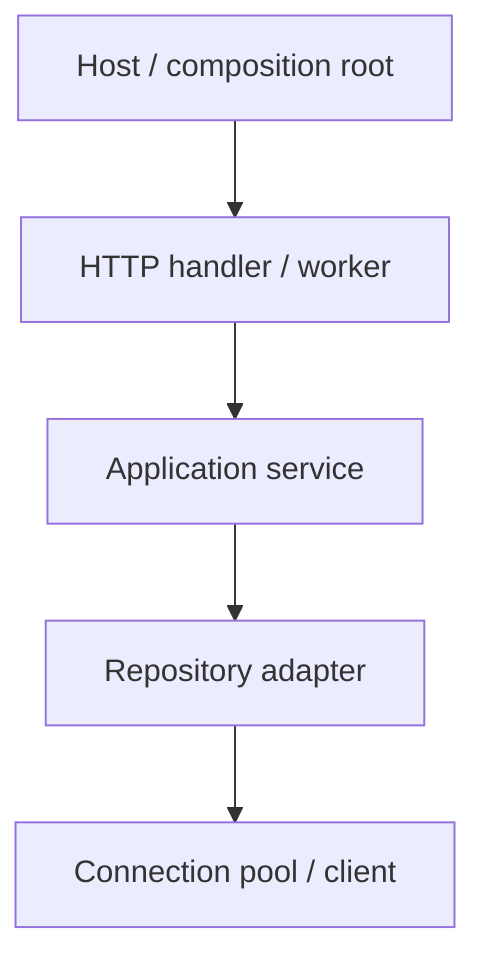

# AutoCloseable và tổ chức đóng tài nguyên trong Java

Trong chương **Sở hữu tài nguyên** của module **Dependency Injection**, constructor injection giúp một đối tượng nhận các phụ thuộc từ bên ngoài, còn composition root chịu trách nhiệm chọn và lắp ghép chúng. Nhưng việc **nhận một tham chiếu** không có nghĩa là đối tượng nhận tham chiếu đó **sở hữu tài nguyên** bên trong. Đặc biệt, khi phụ thuộc mở file, giữ socket, quản lý kết nối cơ sở dữ liệu hoặc vận hành thread pool, hệ thống cần một quy tắc rõ ràng về **ai được quyền đóng và đóng khi nào**.

**Dependency Injection (DI)** và **Inversion of Control (IoC)** tách việc *sử dụng* khỏi việc *tạo và lắp ghép* phụ thuộc. Để tách biệt này hoạt động an toàn, phải làm rõ thêm việc *quản lý vòng đời* và *sở hữu tài nguyên*. Java cung cấp hợp đồng `AutoCloseable` và cú pháp `try-with-resources` để diễn đạt thời điểm kết thúc tài nguyên một cách xác định. Các cơ chế đó dùng được trong **Java thuần**, trước khi mở rộng sang DI container.

Sau bài học, bạn có thể:

- Phân biệt người **sở hữu** (*owner*) và người **mượn để sử dụng** (*borrower*) một dependency.
- Giải thích hợp đồng `AutoCloseable`, sự khác biệt với `Closeable` và vì sao garbage collection không thay cho `close()`.
- Sử dụng `try-with-resources` đúng khi một hay nhiều tài nguyên cùng tham gia, kể cả khi có lỗi.
- Hiểu thứ tự đóng ngược và cơ chế **suppressed exceptions** khi thân khối và phương thức `close()` cùng thất bại.
- Thiết kế composition root để tạo, truyền, dọn tài nguyên và xử lý khởi tạo thất bại một phần.
- Kiểm thử **constructor injection** và cleanup bằng Java thuần, rồi liên hệ scope và lifecycle của DI container.

## 1. Một đối tượng được inject không tự động trở thành tài nguyên do consumer sở hữu

Giả sử ứng dụng xác nhận đơn hàng có dịch vụ:

```java
interface BookingRepository {
    void save(String bookingId);
}

interface ConfirmationSender {
    void send(String bookingId);
}

final class BookingService {
    private final BookingRepository repository;
    private final ConfirmationSender sender;

    BookingService(BookingRepository repository, ConfirmationSender sender) {
        this.repository = java.util.Objects.requireNonNull(repository);
        this.sender = java.util.Objects.requireNonNull(sender);
    }

    void confirm(String bookingId) {
        repository.save(bookingId);
        sender.send(bookingId);
    }
}
```

`BookingService` **sử dụng** repository và sender. Nó không biết chúng là adapter in-memory, JDBC hay HTTP. Nếu repository phía dưới dùng một connection pool và sender dùng một HTTP client, chính `BookingService` cũng không biết cách khởi tạo hoặc dừng những tài nguyên đó. Đây là ranh giới mong muốn.

Một lỗi thiết kế là sửa service thành:

```java
// Minh họa thiết kế không phù hợp:
final class BadBookingService implements AutoCloseable {
    private final ManagedRepository repository;

    BadBookingService(ManagedRepository repository) {
        this.repository = repository;
    }

    @Override
    public void close() {
        repository.close(); // Có chắc service là owner không?
    }
}
```

Nếu hai service cùng được inject **một** repository dùng chung, đóng service đầu tiên có thể đóng repository mà service thứ hai vẫn cần. Kết quả là lỗi **use-after-close**. Mã trên chỉ có thể đúng khi hợp đồng thiết kế **chuyển hẳn ownership** của repository cho service và bảo đảm không ai khác dùng nó sau đó.

Trong nhiều ứng dụng, cách phân vai hữu ích là:

| Thành phần | Vai trò | Trách nhiệm điển hình |
| --- | --- | --- |
| **Composition root / application host** | Tạo và lắp ghép đối tượng sống dài | Biết tài nguyên nào do ứng dụng sở hữu; điều phối đóng khi ứng dụng dừng |
| **Application service** | Dùng các port đã được inject | Thực thi nghiệp vụ; không tự đóng tài nguyên được cấp để dùng chung |
| **Repository / gateway adapter** | Che giấu cơ chế I/O | Mở và đóng tài nguyên theo từng thao tác nếu adapter sở hữu chúng |
| **Request / job handler** | Tạo và chuyển dữ liệu của một lần thực thi | Dọn tài nguyên chỉ thuộc request/job đó |
| **DI container** | Có thể tạo và quản lý object graph theo cấu hình | Thực hiện callback vòng đời cho các instance thuộc quyền quản lý của nó |

**Quy tắc cốt lõi:** Một component có thể được inject một đối tượng `AutoCloseable` chỉ để **mượn sử dụng**. Việc có phương thức `close()` trên kiểu đối tượng không đồng nghĩa mọi caller đều được phép gọi nó.

## 2. AutoCloseable là hợp đồng gì?

Trong Java, `java.lang.AutoCloseable` có một phương thức:

```java
public interface AutoCloseable {
    void close() throws Exception;
}
```

Đối tượng triển khai `AutoCloseable` có thể được dùng ở phần khai báo tài nguyên của `try-with-resources`. Khi rời khối, Java gọi `close()` một cách có cấu trúc, bao gồm khi thân khối ném exception.

`java.io.Closeable` **kế thừa** `AutoCloseable` và khai báo `close() throws IOException`. Hai hợp đồng này liên quan nhưng không đồng nhất:

| Nội dung | `AutoCloseable` | `Closeable` |
| --- | --- | --- |
| Gói | `java.lang` | `java.io` |
| Phương thức | `void close() throws Exception` | `void close() throws IOException` |
| Mục đích điển hình | Bất kỳ đối tượng có bước kết thúc rõ ràng | Luồng I/O và các tài nguyên có ngữ nghĩa đóng kiểu I/O |
| Đóng lặp lại | Không được bảo đảm idempotent bởi giao diện chung | Hợp đồng `Closeable` quy định đóng đối tượng đã đóng không gây tác dụng phụ |
| Dùng với `try-with-resources` | Có | Có |

Một implementation có thể **thu hẹp checked exception** hoặc không khai báo `throws`:

```java
final class SessionHandle implements AutoCloseable {
    private boolean closed;

    @Override
    public void close() {
        closed = true; // Không cần khai báo throws Exception.
    }
}
```

Nếu biến tài nguyên được khai báo với kiểu tĩnh `AutoCloseable`, trình biên dịch vẫn phải xét khả năng `close()` ném `Exception`. Dùng kiểu cụ thể có `close()` không khai báo checked exception có thể làm API sử dụng gọn hơn.

### `close()` có phải luôn giải phóng bộ nhớ?

Không. `close()` thường có nghĩa là **kết thúc việc sử dụng tài nguyên theo hợp đồng của đối tượng**, ví dụ flush/đóng luồng, trả connection được mượn về pool, ngắt subscription hoặc dừng client. Nó không trực tiếp “xóa object khỏi heap”.

Garbage collector quản lý bộ nhớ của các object không còn reachable; nó **không bảo đảm** thời điểm đóng socket, file descriptor hoặc thread pool. Đối tượng đã được `close()` vẫn có thể còn tham chiếu trong ứng dụng; đối tượng không còn reachable cũng không phải lý do để bỏ qua cleanup có chủ đích.

**Không giả định `close()` luôn gọi nhiều lần được.** Một số implementation thiết kế idempotent, nhưng `AutoCloseable` không buộc mọi implementation phải như vậy. Vì thế ownership phải rõ để tránh hai chủ sở hữu cùng đóng một resource.

## 3. Try-with-resources: đóng ở đúng ranh giới sử dụng

Trước `try-with-resources`, mã dùng `finally` để tự đóng tài nguyên; cách này dễ trở nên rườm rà và dễ làm mất lỗi gốc nếu `close()` cũng thất bại.

Với `try-with-resources`:

```java
import java.io.BufferedReader;
import java.nio.charset.StandardCharsets;
import java.nio.file.Files;
import java.nio.file.Path;

Path path = Path.of("settings.txt");
try (BufferedReader reader = Files.newBufferedReader(
        path, StandardCharsets.UTF_8)) {
    String firstLine = reader.readLine();
    System.out.println(firstLine);
}
// Java tự gọi reader.close() khi rời khối.
```

Điều cần ghi nhớ:

1. Biểu thức trong khai báo tài nguyên phải tạo hoặc tham chiếu tới một kiểu `AutoCloseable` phù hợp.
2. `close()` được gọi khi rời khối **bình thường**, khi `return` hoặc khi có exception.
3. Nhiều tài nguyên được đóng theo **thứ tự ngược** với thứ tự khai báo.
4. Nếu tài nguyên thứ hai không mở được, tài nguyên thứ nhất đã mở vẫn được đóng.
5. Không nên dùng `try-with-resources` bao quanh một dependency **được mượn** có vòng đời dài hơn lời gọi hiện tại.

Ví dụ thứ tự đóng:

```java
final class NamedResource implements AutoCloseable {
    private final String name;

    NamedResource(String name) {
        this.name = name;
        System.out.println("open " + name);
    }

    @Override
    public void close() {
        System.out.println("close " + name);
    }
}

try (NamedResource first = new NamedResource("first");
     NamedResource second = new NamedResource("second")) {
    System.out.println("work");
}
```

Kết quả:

```text
open first
open second
work
close second
close first
```

Điều này đặc biệt hữu ích khi **thành phần thứ hai dùng thành phần thứ nhất**: đóng consumer trước, sau đó đóng dependency.

### Từ Java 9: dùng biến đã được khai báo

Nếu resource là biến local hoặc parameter `final` / *effectively final*, ta có thể viết:

```java
NamedResource resource = new NamedResource("owned");
try (resource) {
    System.out.println("work");
}
// resource vẫn là một biến tham chiếu hợp lệ ở đây,
// nhưng đối tượng đã bị gọi close().
```

Đặc điểm quan trọng: khi rời khối, Java **không đặt resource thành null**. Mã vẫn có thể giữ tham chiếu tới resource đã đóng; không nên tiếp tục dùng các thao tác yêu cầu trạng thái đang mở.

## 4. Nếu thân khối và close cùng lỗi: suppressed exceptions

Giả sử một thao tác ghi file ném lỗi, sau đó đóng file cũng ném lỗi. Lỗi nào cần hiện ra?

Trong `try-with-resources`, exception từ **thân khối** là lỗi chính (*primary exception*); lỗi phát sinh khi đóng được thêm vào danh sách **suppressed exceptions**, để không che mất nguyên nhân gốc.

```java
try (AutoCloseable resource = () -> {
    throw new IllegalStateException("close failed");
}) {
    throw new IllegalArgumentException("business failed");
} catch (Exception error) {
    System.out.println(error.getMessage());
    for (Throwable suppressed : error.getSuppressed()) {
        System.out.println("Suppressed: " + suppressed.getMessage());
    }
}
```

Kết quả dự kiến:

```text
business failed
Suppressed: close failed
```

Nếu **thân khối không lỗi** nhưng nhiều tài nguyên đóng thất bại, exception từ tài nguyên đóng trước sẽ là lỗi chính; những lỗi đóng về sau bị suppress. Với `try (A a = ...; B b = ...)`, `b.close()` chạy trước `a.close()`.

Trong logging/giám sát, hãy giữ lại thông tin `getSuppressed()`, nhất là khi chẩn đoán lỗi shutdown hoặc lỗi khi giải phóng transaction. **Đừng** viết `finally { resource.close(); }` tùy tiện nếu một exception từ `close()` có thể che khuất exception từ công việc chính.

## 5. Sở hữu và mượn tài nguyên: quy ước cần thể hiện trong thiết kế

Hãy phân biệt ba thao tác:

- **Tạo và sở hữu:** Mã gọi constructor/factory để nhận resource và cam kết đóng nó khi kết thúc vòng đời đã định.
- **Mượn sử dụng:** Mã nhận resource từ bên ngoài để gọi hành vi; nó không mặc nhiên được đóng resource.
- **Chuyển giao ownership:** Một factory hoặc API nói rõ caller trở thành owner và phải đóng resource; sau khi chuyển giao, bên cấp không được tiếp tục quản lý việc đóng như owner.

Ví dụ về mượn:

```java
final class TextExportService {
    // Writer chỉ được mượn trong một lần gọi.
    void export(java.io.Writer writer, String report) throws java.io.IOException {
        writer.write(report);
        // Không đóng writer vì caller vẫn là owner.
    }
}

// Caller sở hữu file writer:
try (java.io.Writer file = java.nio.file.Files.newBufferedWriter(
        java.nio.file.Path.of("report.txt"))) {
    new TextExportService().export(file, "Monthly report");
}
```

Ví dụ về factory chuyển giao ownership:

```java
interface SessionFactory {
    // Mỗi lần open() trả một session mà caller phải đóng.
    WorkSession open();
}

interface WorkSession extends AutoCloseable {
    void run(String taskId);
    @Override void close();
}

final class TaskRunner {
    private final SessionFactory sessions;

    TaskRunner(SessionFactory sessions) {
        this.sessions = sessions;
    }

    void run(String taskId) {
        try (WorkSession session = sessions.open()) {
            session.run(taskId);
        }
    }
}
```

`TaskRunner` **mượn** `SessionFactory` dài hạn được inject qua constructor, nhưng **sở hữu** `WorkSession` do `open()` cấp cho từng tác vụ theo hợp đồng. Chỉ riêng kiểu `AutoCloseable` chưa nói rõ ai sở hữu; phần mô tả API/factory phải xác định quyền đóng. Không nên đưa một session có vòng đời ngắn vào singleton service rồi giữ nó trong field.

## 6. Ví dụ hoàn chỉnh: composition root sở hữu, service mượn

Ví dụ sau chỉ dùng **Java 17 trở lên**, không cần thư viện bên ngoài hay DI container. `BookingService` được constructor-inject hai port. `ApplicationGraph` tạo và sở hữu hai adapter; khi đóng graph, adapter được đóng theo thứ tự ngược với khai báo.

Đặt toàn bộ mã vào `ResourceOwnershipDemo.java`:

```java
import java.util.ArrayList;
import java.util.List;
import java.util.Objects;

public class ResourceOwnershipDemo {
    interface BookingRepository {
        void save(String bookingId);
    }

    interface ConfirmationSender {
        void send(String bookingId);
    }

    // Adapter giả lập tài nguyên do ApplicationGraph sở hữu.
    static final class ManagedRepository
            implements BookingRepository, AutoCloseable {
        private final List<String> saved = new ArrayList<>();
        private boolean closed;

        @Override
        public void save(String bookingId) {
            if (closed) {
                throw new IllegalStateException("Repository is closed");
            }
            saved.add(bookingId);
        }

        List<String> snapshot() {
            return List.copyOf(saved);
        }

        boolean isClosed() {
            return closed;
        }

        @Override
        public void close() {
            if (!closed) {
                closed = true;
                System.out.println("close repository");
            }
        }
    }

    static final class ManagedSender
            implements ConfirmationSender, AutoCloseable {
        private boolean closed;

        @Override
        public void send(String bookingId) {
            if (closed) {
                throw new IllegalStateException("Sender is closed");
            }
            System.out.println("confirmed " + bookingId);
        }

        boolean isClosed() {
            return closed;
        }

        @Override
        public void close() {
            if (!closed) {
                closed = true;
                System.out.println("close sender");
            }
        }
    }

    static final class BookingService {
        private final BookingRepository repository;
        private final ConfirmationSender sender;

        BookingService(
                BookingRepository repository, ConfirmationSender sender) {
            this.repository =
                    Objects.requireNonNull(repository, "repository");
            this.sender = Objects.requireNonNull(sender, "sender");
        }

        void confirm(String bookingId) {
            if (bookingId == null || bookingId.isBlank()) {
                throw new IllegalArgumentException("Invalid booking ID");
            }
            repository.save(bookingId);
            sender.send(bookingId);
        }
    }

    // Chủ sở hữu của tài nguyên sống theo ứng dụng.
    static final class ApplicationGraph implements AutoCloseable {
        final ManagedRepository repository;
        final ManagedSender sender;
        final BookingService service;

        private ApplicationGraph(
                ManagedRepository repository, ManagedSender sender) {
            this.repository = repository;
            this.sender = sender;
            this.service = new BookingService(repository, sender);
        }

        static ApplicationGraph open() {
            ManagedRepository repository = new ManagedRepository();
            ManagedSender sender = null;
            try {
                sender = new ManagedSender();
                return new ApplicationGraph(repository, sender);
            } catch (RuntimeException | Error startupFailure) {
                // Nếu khởi tạo graph thất bại một phần,
                // tài nguyên đã tạo phải được dọn.
                if (sender != null) {
                    try {
                        sender.close();
                    } catch (RuntimeException cleanupFailure) {
                        startupFailure.addSuppressed(cleanupFailure);
                    }
                }
                try {
                    repository.close();
                } catch (RuntimeException cleanupFailure) {
                    startupFailure.addSuppressed(cleanupFailure);
                }
                throw startupFailure;
            }
        }

        @Override
        public void close() {
            // Thứ tự đóng ngược: sender trước, repository sau.
            // Khai báo tài nguyên bằng alias không tạo object mới.
            try (ManagedRepository ownedRepository = repository;
                 ManagedSender ownedSender = sender) {
                // Không cần thân khối: mục tiêu là đóng hai adapter.
            }
        }
    }

    public static void main(String[] args) {
        ApplicationGraph graph = ApplicationGraph.open();
        try (graph) {
            graph.service.confirm("B-01");
            if (!graph.repository.snapshot().equals(List.of("B-01"))) {
                throw new AssertionError("Booking was not persisted");
            }
        }

        if (!graph.repository.isClosed() || !graph.sender.isClosed()) {
            throw new AssertionError("Graph did not close resources");
        }
        System.out.println("PASS: graph closed");

        // Kiểm thử nghiệp vụ bằng Java thuần và test doubles.
        List<String> saved = new ArrayList<>();
        List<String> sent = new ArrayList<>();
        BookingService testService = new BookingService(
                saved::add, sent::add);
        testService.confirm("B-TEST");

        if (!saved.equals(List.of("B-TEST"))
                || !sent.equals(List.of("B-TEST"))) {
            throw new AssertionError("Pure Java test failed");
        }
        System.out.println("PASS: pure Java test");
    }
}
```

Biên dịch và chạy:

```bash
javac ResourceOwnershipDemo.java
java ResourceOwnershipDemo
```

Kết quả dự kiến:

```text
confirmed B-01
close sender
close repository
PASS: graph closed
PASS: pure Java test
```

Những ranh giới quan trọng trong ví dụ:

1. **`BookingService` dùng, không sở hữu:** Nó nhận interface qua constructor, không có phương thức `close()` và không biết adapter cụ thể có tài nguyên gì.
2. **`ApplicationGraph` tạo và sở hữu:** Nó giữ tham chiếu tới hai resource, truyền chúng vào service, và đóng khi application scope kết thúc.
3. **Thứ tự shutdown có chủ đích:** Sender được đóng trước repository. Nếu một consumer thực sự còn cần dependency trong lúc dọn tài nguyên, graph phải sắp xếp **consumer dừng trước dependency**.
4. **Lỗi khởi tạo giữa chừng được xét tới:** Nếu sau khi tạo repository mà phần còn lại của graph thất bại, `open()` cố đóng các resource đã tạo và giữ lỗi khởi tạo làm lỗi chính.
5. **Kiểm thử Java thuần:** Mỗi port được thay bằng method reference, không cần chạy I/O, container hoặc framework.

Hai adapter mẫu cố ý thiết kế `close()` lặp lại không gây thêm tác dụng để dễ quan sát. Đây là **quyết định của implementation**, không phải bảo đảm chung cho mọi `AutoCloseable`. Ngoài ra, `ArrayList` cùng flag `closed` không được đồng bộ; ví dụ chỉ chạy tuần tự. Với server đa luồng, cần xác định rõ quy tắc không gọi service khi shutdown và bảo đảm thread-safety cho adapter thực.

## 7. Tổ chức cleanup khi khởi tạo thất bại một phần

Một rủi ro khác là tạo nhiều tài nguyên nối tiếp:

```java
Repository repository = openRepository();
Gateway gateway = openGateway(); // Nếu lỗi tại đây?
Service service = new Service(repository, gateway);
```

Nếu `openGateway()` lỗi sau khi `openRepository()` thành công, chưa có graph hoàn chỉnh để gọi `graph.close()`. Repository đã mở phải được dọn tại **điểm đang quản lý quá trình khởi tạo**.

Ta có thể áp dụng một trong hai cách:

- **Khối sở hữu tạm thời:** Trong giai đoạn khởi tạo, resource nào đã được tạo thành công thì còn nằm dưới trách nhiệm cleanup của bootstrap. Khi graph hoàn chỉnh và ownership chuyển sang graph, bootstrap không được tự đóng resource ấy ngay.
- **Cấu trúc cleanup khi lỗi:** Dùng `try/catch` để đóng các resource đã tạo theo thứ tự ngược, rồi ném lại lỗi gốc. Nếu đóng cũng lỗi, ghi lại dưới dạng suppressed thay vì che lỗi khởi tạo.

Ví dụ `ApplicationGraph.open()` ở trên dùng cách thứ hai. Trong hệ thống phức tạp, có thể tạo một đối tượng quản lý tập hợp resource (*resource owner / close stack*) hoặc dùng cơ chế lifecycle của DI container. Dù chọn cách nào, hợp đồng cần làm rõ **thời điểm chuyển ownership** và bảo đảm không còn hai chủ cùng đóng resource.

`try-with-resources` cũng tự dọn các resource **đã tạo thành công trước đó** khi việc khởi tạo resource tiếp theo thất bại:

```java
try (NamedResource first = new NamedResource("first");
     NamedResource second = openSecondResourceThatMayFail()) {
    use(first, second);
}
// Nếu openSecondResourceThatMayFail() ném exception,
// first vẫn được close theo cơ chế của try-with-resources.
```

Đây là đoạn minh họa có các phương thức giả định `openSecondResourceThatMayFail` và `use`; ý chính là cơ chế cleanup, không phải chương trình đầy đủ. **Không** đặt một `try-with-resources` quanh tất cả resource dài hạn nếu chúng vẫn phải sống sau khi thoát khỏi khối bootstrap.

## 8. Mỗi loại tài nguyên có một quy ước sở hữu riêng

`AutoCloseable` là một cơ chế ngôn ngữ, nhưng cách “đóng” trong thực tế phụ thuộc hợp đồng tài nguyên:

| Tài nguyên | Chủ sở hữu điển hình | Vòng đời và thao tác kết thúc | Điểm dễ sai |
| --- | --- | --- | --- |
| `Files.newBufferedReader` / `newBufferedWriter` | Mã mở tệp cho một tác vụ | `try-with-resources`, đóng khi đọc/ghi xong | Trả `Reader` cho caller rồi lại đóng nó trước khi caller dùng |
| JDBC `Connection` lấy từ pool | Adapter/transaction boundary mượn connection | `try-with-resources` và `close()` theo hợp đồng pool, thường là **trả về pool** | Giữ connection trong singleton hoặc chia sẻ một connection giữa request |
| Connection pool / `DataSource` cụ thể | Application host hoặc container | Dừng khi toàn ứng dụng dừng; API đóng tùy triển khai | Giả định **mọi** `javax.sql.DataSource` đều implements `AutoCloseable` |
| HTTP client | Composition root hoặc client factory | Thường tái sử dụng theo app; cleanup theo API/JDK cụ thể | Tạo/dừng client cho mỗi yêu cầu mà không cần thiết, hoặc giả định mọi phiên bản JDK có `close()` |
| Executor / scheduler | Host, worker bootstrap | Ngừng nhận việc mới, `shutdown()`, chờ hoặc hủy tác vụ theo chính sách | Không chờ task hoàn tất, đóng dependency trước khi task ngừng |
| Message consumer/subscription | Worker bootstrap hoặc listener owner | Stop polling, xử lý ack/retry, đóng subscription/client | Dừng khi vẫn còn message đang xử lý mà không có chiến lược phục hồi |
| `Writer` do caller truyền vào | Caller nếu hợp đồng quy định vậy | Callee chỉ viết; caller quyết định `flush/close` | Callee đóng stream mà caller còn sử dụng |

Đặc biệt, một `DataSource` chỉ là **hợp đồng cấp connection**; interface chuẩn `javax.sql.DataSource` không khai báo `close()`. Một implementation pool cụ thể có thể có API đóng riêng. Tương tự, trên **Java 17**, `ExecutorService` sử dụng `shutdown()` / `awaitTermination()`; không nên mặc định viết `try (ExecutorService executor = ...)` như với những API `AutoCloseable` trên các phiên bản JDK mới hơn.

## 9. Scope quyết định **khi nào** ownership kết thúc

Đưa một resource vào constructor không xác định nó thuộc scope nào. Có thể lắp cùng một class service với dependency sống theo ứng dụng, theo request hoặc theo job.

| Scope | Instance thường được tái sử dụng như thế nào? | Owner đóng khi nào? |
| --- | --- | --- |
| **Application / container** | Một hoặc vài instance do graph/container quản lý, dùng qua nhiều tác vụ | Khi host dừng, sau khi không còn công việc cần dùng |
| **Request** | Mỗi request có một unit of work/context riêng | Khi request hoàn tất, kể cả lỗi; chú ý xử lý async nếu request chưa thực sự kết thúc |
| **Job / task** | Mỗi job có phiên xử lý và trạng thái riêng | Khi job thành công, thất bại hoặc bị hủy theo chính sách |
| **Transient / prototype** | Tạo khi được yêu cầu | Không thể suy ra chủ sở hữu chỉ từ tên scope; cần hợp đồng rõ |
| **Session** | Giữ qua nhiều request thuộc một phiên | Khi phiên kết thúc/hết hạn; cân nhắc nhiều request đồng thời |

**Scope mismatch** xảy ra khi một consumer sống lâu giữ trực tiếp dependency có vòng đời ngắn hơn. Ví dụ singleton service giữ một `Connection` hay `RequestContext` được tạo riêng cho request đầu tiên. Sau khi request kết thúc, connection có thể đã đóng còn context giữ dữ liệu người dùng cũ; request tiếp theo sẽ đọc sai hoặc dùng resource đã đóng.

Giải pháp có thể là:

- Truyền dữ liệu request/job qua **tham số phương thức** nếu đó là dữ liệu, không phải dịch vụ lâu dài.
- Tạo service với scope theo request/job nếu service thực sự giữ trạng thái riêng.
- Inject **factory/provider** qua constructor để lấy resource ngắn hạn khi cần và đóng trong scope của thao tác.
- Sử dụng scoped proxy của container khi đúng ngữ nghĩa framework, nhưng phải hiểu cách nó giải quyết instance theo ngữ cảnh.

Container có thể gọi callback kết thúc bean được quản lý, nhưng một resource do mã nghiệp vụ **tự tạo bằng `new` bên ngoài container** thường không tự nhiên trở thành tài nguyên do container sở hữu. Phải đăng ký/lắp ghép và xác định owner đúng theo framework.

### Singleton không đồng nghĩa thread-safe

Nếu repository sống theo application scope, nhiều request có thể dùng chung nó. Một field `final` giữ tham chiếu ổn định, nhưng **không** làm object được tham chiếu bất biến hoặc an toàn đa luồng. Đồng thời, shutdown cũng có thể chạy song song với request:

```text
Request A: đang dùng repository...
Shutdown: gọi repository.close()
Request A: tiếp tục dùng repository -> lỗi use-after-close
```

Vì vậy quy trình shutdown thường cần **ngừng tiếp nhận việc mới**, đợi tác vụ đang chạy hoàn thành hoặc hủy theo chính sách, rồi mới đóng dependency được chúng dùng. Những quyết định này tồn tại cả khi dùng DI container.

## 10. Thứ tự dừng và đóng của object graph

Nếu `OrderService` cần `Repository`, và repository cần một client/pool, thứ tự tạo thường đi từ dependency tới consumer; còn thứ tự kết thúc thường đi từ consumer về dependency.



Khi dừng:

1. **Ngừng nhận request/job mới** ở điểm vào.
2. **Đợi hoặc hủy** những tác vụ vẫn đang xử lý theo chính sách, tránh dùng resource sau khi đóng.
3. **Dừng các thành phần chủ động** như scheduler, consumer, listener.
4. **Đóng adapter và resource** theo quan hệ phụ thuộc, để không ai còn cần resource đã đóng.
5. **Ghi nhận lỗi đóng** và tiếp tục cleanup các resource độc lập khi có thể; tránh để một lỗi che toàn bộ quá trình shutdown.

Một object graph phức tạp có thể có dependency dùng chung cho nhiều consumer. Nếu cả hai consumer đều đóng cùng pool, ta tạo **double-close**. Nên có **một owner rõ ràng cho resource dùng chung** và các consumer chỉ mượn nó. Một close stack hoặc cấu hình container có thể tổ chức việc đóng tài nguyên do nó thực sự sở hữu.

**Không suy diễn** rằng mọi DI container tự động chọn đúng thứ tự shutdown, đóng mọi resource tùy ý hoặc xử lý được mọi tác vụ async. Hãy đọc hợp đồng lifecycle của container/framework đang dùng và kiểm thử hành vi dừng của chính ứng dụng.

## 11. Các lỗi thường gặp và cách kiểm tra

| Lỗi | Hậu quả | Hướng khắc phục |
| --- | --- | --- |
| Consumer đóng một dependency được inject và còn được dùng chung | Thành phần khác gọi vào resource đã đóng | Tách owner khỏi borrower; chỉ owner điều phối `close()` |
| Quên đóng resource khi tác vụ ném exception | Rò file handle/connection/socket | Đặt `try-with-resources` tại scope mà mã sở hữu resource |
| Đóng tài nguyên trong `finally` rồi làm mất lỗi chính | Khó xác định nguyên nhân thất bại | Dùng `try-with-resources` và kiểm tra suppressed exceptions |
| Chỉ cleanup sau khi graph tạo thành công | Rò resource khi khởi tạo lỗi giữa chừng | Đóng những resource đã tạo, giữ lỗi khởi tạo là lỗi chính |
| Gọi `close()` hai lần với giả định mọi implementation đều idempotent | Có thể gây lỗi hoặc tác dụng phụ | Quy định một owner; chỉ giả định idempotence nếu hợp đồng cụ thể cho phép |
| Dùng connection sống theo request trong singleton service | Lỗi use-after-close, rò trạng thái giữa request | Giữ pool dài hạn, lấy connection theo thao tác/transaction |
| Đóng pool trước khi ngừng scheduler/HTTP handler | Tác vụ còn chạy lỗi giữa chừng | Dừng entry point, xử lý in-flight, rồi đóng resource |
| Dựa vào GC để đóng JDBC/file/client | Không có thời điểm cleanup xác định | Đóng chủ động theo vòng đời |
| Thấy `AutoCloseable` liền đặt nó vào `try` ở mọi nơi | Có thể đóng nhầm tài nguyên chỉ được mượn | Xem API/hợp đồng ownership trước khi đóng |

## 12. Bài thực hành và câu hỏi tự kiểm tra

### Bài tập 1 — Phân biệt người sử dụng và chủ sở hữu

Trong `ResourceOwnershipDemo.java`, liệt kê từng nơi tạo `ManagedRepository`, `ManagedSender` và `BookingService`. Chỉ ra class nào được phép gọi `close()` lên hai adapter. Vì sao `BookingService` không cần implements `AutoCloseable`?

### Bài tập 2 — Kiểm thử đóng khi có exception

Thêm một phương thức vào `BookingService` có thể ném `IllegalArgumentException` khi booking ID không hợp lệ. Gọi nó trong `try (graph)` rồi bắt exception **bên ngoài khối**, xác nhận cả repository và sender đều `isClosed() == true`.

### Bài tập 3 — Suppressed exceptions

Tạo hai resource `AutoCloseable`: resource thứ nhất ném lỗi trong `close()`, resource thứ hai cũng ném lỗi trong `close()`. Kiểm tra thứ tự đóng, exception chính và `getSuppressed()` khi:

- Thân khối thực hiện thành công.
- Thân khối ném exception trước khi đóng.

Giải thích vì sao một dòng `finally { close(); }` đơn giản có thể làm che lỗi ở thân khối.

### Bài tập 4 — Lỗi khởi tạo giữa chừng

Giả sử `new ManagedSender()` được thay bằng factory có thể ném exception. Mô phỏng thất bại tại bước này, kiểm tra repository đã mở được đóng. Nếu đóng repository cũng thất bại, giữ lỗi tạo sender là lỗi chính và thêm lỗi cleanup bằng `addSuppressed`.

### Bài tập 5 — Thiết kế ownership cho web/worker

Một ứng dụng web có connection pool dùng chung, repository adapter, một `BookingService` dùng qua nhiều request và một `Connection` mượn cho mỗi request. Hãy vẽ graph, ghi rõ scope, người tạo, người mượn, người đóng. Sau đó chuyển thành worker xử lý queue, xác định lúc đóng transaction, lúc dừng consumer và lúc đóng pool.

### Câu hỏi tự kiểm tra

- `AutoCloseable` khác `Closeable` ở hợp đồng checked exception và đóng lặp lại thế nào?
- Tại sao một object được constructor-inject không mặc nhiên trở thành tài nguyên do consumer sở hữu?
- Khi `try-with-resources` khai báo hai resource, resource nào được đóng trước?
- Nếu thân khối và `close()` đều ném exception, lỗi đóng được tìm ở đâu?
- Tại sao một object đã `close()` vẫn có thể còn trên heap?
- Khi dùng DI container, trách nhiệm xác định **ownership, scope, thứ tự shutdown và thread-safety** còn thuộc về ai?

**AutoCloseable** giúp diễn đạt thao tác kết thúc tài nguyên có cấu trúc; **try-with-resources** giúp gọi thao tác ấy kể cả khi có lỗi. Nhưng chất lượng của việc tổ chức tài nguyên phụ thuộc trước hết vào ranh giới **sở hữu hay mượn**, scope phù hợp và thứ tự shutdown. Khi application service chỉ dùng các port được constructor-inject, composition root quản lý tài nguyên do nó tạo, và các tài nguyên ngắn hạn được đóng tại đúng phạm vi sử dụng, ta có thể kiểm chứng thiết kế bằng **Java thuần** trước khi chuyển sang cơ chế lifecycle của DI container.
