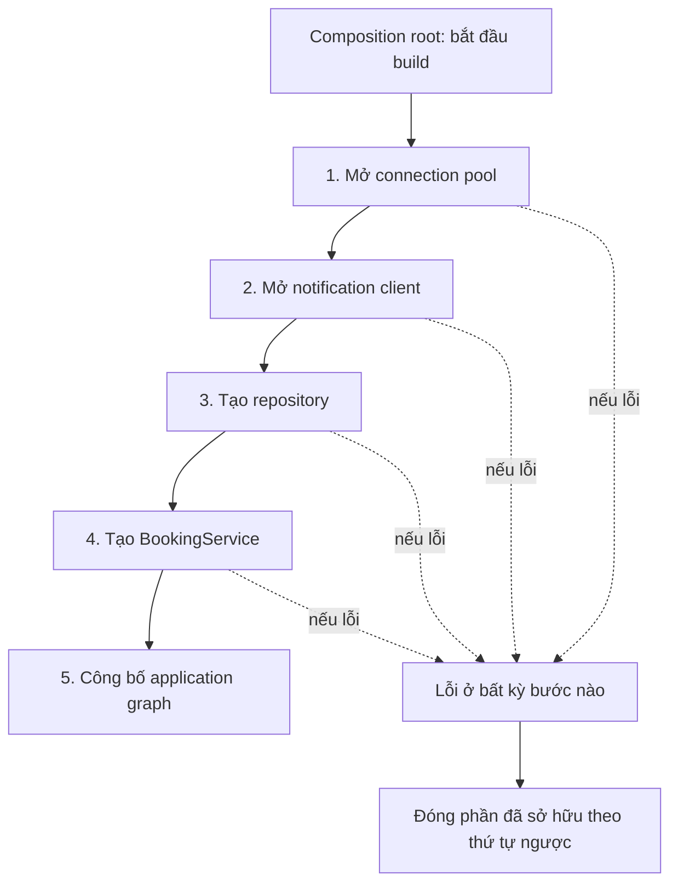
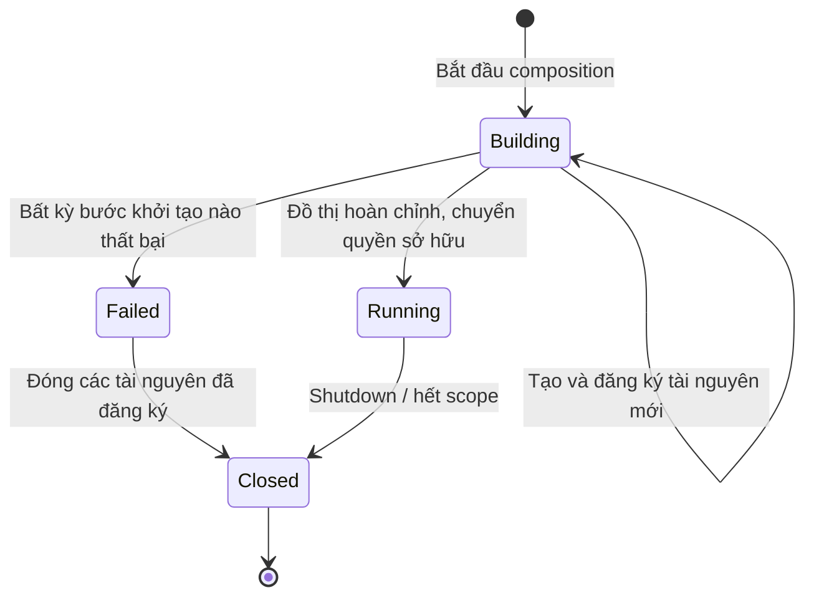
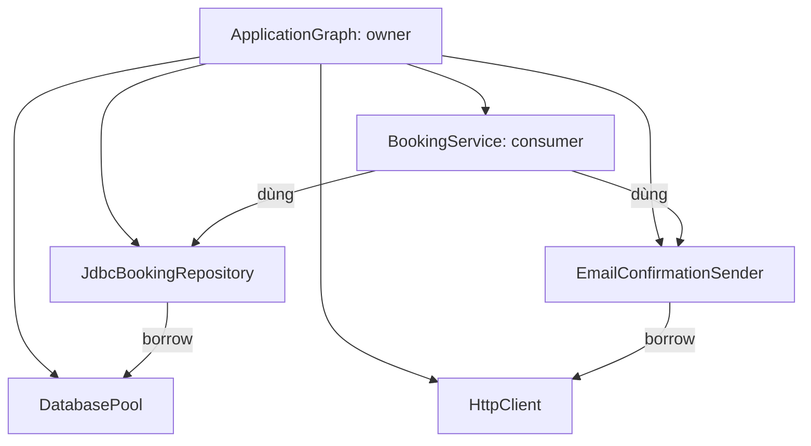

# Dọn dẹp khi khởi tạo một phần đồ thị thất bại

## 1. Vấn đề: đồ thị chưa lắp xong nhưng tài nguyên đã được mở

Trong **Dependency Injection (DI)**, một ứng dụng thường khởi tạo các phụ thuộc theo thứ tự: tạo client hoặc connection pool, tạo repository sử dụng chúng, tạo service nhận repository qua constructor, rồi đưa service vào controller. Quá trình này hình thành một **đồ thị đối tượng** (*object graph*).

Giả sử bước đầu đã mở một connection pool, bước tiếp theo đã tạo HTTP client, nhưng việc khởi tạo service hoặc adapter thứ ba bị lỗi. Ứng dụng chưa nhận yêu cầu nào, song **các tài nguyên ở phần đồ thị đã tạo vẫn có thể đang mở**. Nếu mã bootstrap chỉ ném exception rồi bỏ qua chúng, connection, file descriptor, thread hoặc đăng ký listener có thể bị giữ ngoài ý muốn.

Trong nhóm **Sở hữu tài nguyên** của module **DEPENDENCY_INJECTION**, ta cần giải quyết câu hỏi:

> Khi việc lắp ghép đồ thị thất bại ở bất kỳ bước nào, ai chịu trách nhiệm dọn dẹp những tài nguyên đã khởi tạo thành công?

Đây là một phần quan trọng khi học **Dependency Injection** và **Inversion of Control (IoC)**: tách **việc dùng phụ thuộc** khỏi **việc tạo và lắp ghép**, thực hành **constructor injection**, **composition root**, quản lý **scope/vòng đời** và kiểm thử bằng Java thuần trước khi dùng DI container.

Một nguyên tắc có thể áp dụng ngay:

**Bên đã nhận quyền sở hữu tài nguyên phải bảo đảm đóng nó nếu không thể chuyển giao quyền sở hữu thành công.** Nếu lắp ghép hoàn chỉnh, quyền sở hữu được chuyển sang thành phần quản lý vòng đời của đồ thị đã chạy; nếu lắp ghép thất bại, bên đang xây dựng đồ thị phải dọn dẹp.

### Ví dụ chuỗi khởi tạo



Đồ thị không nhất thiết có tất cả những lớp trên; sơ đồ diễn đạt trình tự tạo và cách xử lý khi **một phần đã khởi tạo thành công**. Tài nguyên nào chưa từng tạo thì không có gì để đóng. Tài nguyên đã mở thành công cần được dọn ở đúng cấp sở hữu.

## 2. Phân biệt phụ thuộc, tài nguyên và quyền sở hữu

Không phải đối tượng nào được inject cũng là tài nguyên phải `close()`. Một `BookingService` chỉ giữ tham chiếu và không tự mở tài nguyên có thể không cần đóng. Ngược lại, adapter sử dụng thread pool, socket, bộ quản lý kết nối hoặc file có thể cần đóng đúng lúc.

| Đối tượng | Có thể cần dọn dẹp? | Ai nên sở hữu? |
| --- | --- | --- |
| `BookingService` chỉ xử lý nghiệp vụ | Thường không có `close()` riêng nếu không nắm tài nguyên. | Composition root lắp ghép nhưng có thể không cần thao tác dọn dẹp riêng cho service. |
| `DatabasePool` được tạo một lần cho ứng dụng | Có; pool cần đóng sau khi các consumer ngừng sử dụng. | Thành phần quản lý vòng đời ứng dụng, thường được thiết lập từ composition root. |
| `BookingRepository` dùng pool được cấp từ ngoài | Chỉ đóng tài nguyên **do chính nó sở hữu**; không tự đóng pool dùng chung. | Repository sở hữu những gì nó tạo và nhận chuyển giao rõ ràng. |
| `NotificationClient` có socket hoặc executor | Thường có; tùy API client. | Bên đã tạo và nhận quyền đóng, có thể là root ứng dụng. |
| `Clock` hoặc một value object bất biến | Thường không. | Không cần thiết lập cơ chế close. |
| Đối tượng theo request | Có thể có session, transaction hoặc buffer cần dọn. | Scope của request, không giữ lại sau khi request kết thúc. |

**Chia sẻ tham chiếu không đồng nghĩa chia sẻ quyền đóng.** Hai service có thể cùng nhận một connection pool. Nếu một service tự `close()` pool sau lời gọi của mình, service còn lại có thể thất bại. Vì thế phải phân biệt:

- **Consumer:** dùng dependency để thực hiện nghiệp vụ.
- **Owner:** có trách nhiệm dọn dẹp và quyết định vòng đời của resource.
- **Borrower:** được cấp tham chiếu để sử dụng trong một phạm vi, nhưng **không** được tự ý kết thúc tài nguyên của owner.

DI chỉ cho biết cách cấp dependency. Nó **không tự thiết lập** quyền sở hữu khi ta lắp ghép bằng Java thuần. Constructor nhận một `AutoCloseable` không có nghĩa consumer tự động được phép đóng nó.

## 3. Vì sao đoạn mã lắp ghép ngây thơ bị rò rỉ tài nguyên?

Xét mô hình sau (các class chỉ minh họa):

```java
DatabasePool pool = new DatabasePool();      // Pool đã được mở.
NotificationClient client = new NotificationClient(); // Client đã mở.

BookingRepository repository = new JdbcBookingRepository(pool);
BookingService service = new BookingService(repository, client);

// Nếu constructor của repository hoặc service ném lỗi,
// ai đóng pool và client?
```

Nếu bất kỳ constructor nào ở giữa ném exception, luồng điều khiển bỏ qua các bước sau. Hai tài nguyên ban đầu không tự đóng chỉ vì phương thức thoát do exception.

Một cách viết chưa đủ an toàn khác:

```java
DatabasePool pool = new DatabasePool();
NotificationClient client = new NotificationClient();

try {
    return buildApplication(pool, client);
} catch (Exception failure) {
    pool.close();
    client.close();
    throw failure;
}
```

Đoạn này vẫn có vấn đề:

1. Nếu tạo `NotificationClient` thất bại, mã **chưa vào khối `try`**, nên `pool` có thể bị bỏ quên.
2. Nếu `pool.close()` ném exception, lời gọi `client.close()` phía sau có thể không chạy.
3. Exception từ thao tác đóng có thể che mất lỗi gốc khi khởi tạo.
4. Chưa làm rõ ai đóng các resource sau khi build thành công và có thể dẫn tới **đóng hai lần** hoặc **đóng ngay trước khi dùng**.

Cần quản lý tài nguyên **ngay từ thời điểm chúng được tạo**, có cơ chế dọn phần đã sở hữu ở mọi đường lỗi và **chuyển giao ownership đúng thời điểm**.

## 4. Hai trạng thái của ownership: đang build và đã chạy

Có thể xem quá trình lắp ghép như một giao thức chuyển quyền sở hữu đơn giản:



Tại thời điểm **Building**, mã xây dựng đồ thị chịu trách nhiệm cho các tài nguyên đã nhận. Tại thời điểm **Running**, một `ApplicationGraph` hoặc lifecycle manager đã nhận quyền sở hữu và sẽ đóng chúng khi ứng dụng kết thúc. Nếu **Failed**, builder dọn dẹp phần đã có; không có graph hoàn chỉnh được công bố cho caller.

| Mốc | Ai đang sở hữu tài nguyên? | Điều kiện để đi tiếp |
| --- | --- | --- |
| Sau khi tạo `Store` | Builder/composition root | Store được đăng ký để dọn nếu bước sau lỗi. |
| Sau khi tạo `Sender` | Builder/composition root | Sender cũng đã được đăng ký để dọn. |
| Sau khi tạo `Service` | Builder/composition root | Những bất biến bắt buộc của service đã được thiết lập. |
| Sau khi hoàn tất `ApplicationGraph` | Graph đang chạy | Builder **chuyển quyền sở hữu** sau khi graph được tạo thành công. |
| Khi graph kết thúc | Graph/lifecycle manager | Đóng theo thứ tự phù hợp và không để consumer dùng tiếp. |

**Không chuyển ownership trước khi graph thật sự sẵn sàng.** Nếu đánh dấu builder đã bàn giao ngay trước một bước còn có thể ném exception, bước thất bại sẽ để lại tài nguyên không ai chịu trách nhiệm đóng.

### Đóng theo thứ tự ngược khởi tạo

Nếu `NotificationClient` được tạo **sau** `DatabasePool` và phụ thuộc vào pool, hãy đóng client **trước** pool. Tổng quát, khi một resource A sử dụng resource B, hãy dừng/đóng A trước khi đóng B. Thứ tự này thường tương ứng với **ngược thứ tự tạo** khi các resource được tạo theo chiều phụ thuộc.

Đây là quy tắc thực hành, không phải thuật toán duy nhất cho mọi đồ thị. Với resource độc lập, thứ tự có thể không quan trọng; với callback, background thread hoặc chia sẻ đa consumer, cần **dừng hoạt động mới, chờ công việc đang chạy kết thúc, rồi đóng dependency** theo hợp đồng của hệ thống.

## 5. Ví dụ Java thuần: cleanup cả khi build lỗi và khi chạy thành công

Ví dụ dưới đây minh họa **một ownership protocol có kiểm soát**. Mỗi tài nguyên được đăng ký ngay sau khi tạo. Nếu thất bại ở bước tiếp theo, `BuildScope.close()` đóng phần đã đăng ký. Nếu mọi bước thành công, builder chuyển ownership cho `RunningApp`. Khi `RunningApp` kết thúc, nó đóng những resource của mình bằng `try-with-resources`.

Mã chạy với **JDK 11 trở lên**, không cần thư viện DI. Lưu thành `Main.java`:

```java
import java.util.ArrayDeque;
import java.util.ArrayList;
import java.util.Deque;
import java.util.List;
import java.util.Objects;

public class Main {
    interface BookingStore {
        void save(String bookingId);
    }

    interface ConfirmationSender {
        void send(String bookingId);
    }

    // Resource mô phỏng kho lưu trữ có vòng đời riêng.
    static final class DemoStore implements BookingStore, AutoCloseable {
        private final List<String> events;
        private boolean closed;

        DemoStore(List<String> events) {
            this.events = Objects.requireNonNull(events, "events");
            events.add("OPEN store");
        }

        @Override
        public void save(String bookingId) {
            if (closed) {
                throw new IllegalStateException("Store đã đóng");
            }
            events.add("STORE " + bookingId);
        }

        @Override
        public void close() {
            if (!closed) {
                closed = true;
                events.add("CLOSE store");
            }
        }
    }

    // Resource mô phỏng một client gửi thông báo.
    static final class DemoSender
            implements ConfirmationSender, AutoCloseable {
        private final List<String> events;
        private boolean closed;

        DemoSender(List<String> events) {
            this.events = Objects.requireNonNull(events, "events");
            events.add("OPEN sender");
        }

        @Override
        public void send(String bookingId) {
            if (closed) {
                throw new IllegalStateException("Sender đã đóng");
            }
            events.add("SEND " + bookingId);
        }

        @Override
        public void close() {
            if (!closed) {
                closed = true;
                events.add("CLOSE sender");
            }
        }
    }

    // Consumer dùng dependency qua hợp đồng, không sở hữu quyền đóng.
    static final class BookingService {
        private final BookingStore store;
        private final ConfirmationSender sender;

        BookingService(BookingStore store, ConfirmationSender sender) {
            this.store = Objects.requireNonNull(store, "store");
            this.sender = Objects.requireNonNull(sender, "sender");
        }

        void confirm(String bookingId) {
            if (bookingId == null || bookingId.isBlank()) {
                throw new IllegalArgumentException("bookingId không hợp lệ");
            }
            store.save(bookingId);
            sender.send(bookingId);
        }
    }

    // Chủ sở hữu tạm trong khi đang xây dựng một phần đồ thị.
    static final class BuildScope implements AutoCloseable {
        private final Deque<AutoCloseable> owned = new ArrayDeque<>();
        private boolean transferred;

        <T extends AutoCloseable> T own(T resource) {
            if (transferred) {
                throw new IllegalStateException("Scope đã chuyển quyền");
            }
            owned.push(Objects.requireNonNull(resource, "resource"));
            return resource;
        }

        // Chỉ gọi sau khi RunningApp được tạo hoàn chỉnh.
        void transferOwnership() {
            transferred = true;
            owned.clear();
        }

        @Override
        public void close() throws Exception {
            if (transferred) {
                return; // RunningApp sẽ quản lý các resource này.
            }

            Exception firstFailure = null;

            // pop() lấy resource được đăng ký sau cùng trước.
            while (!owned.isEmpty()) {
                AutoCloseable resource = owned.pop();
                try {
                    resource.close();
                } catch (Exception closeFailure) {
                    if (firstFailure == null) {
                        firstFailure = closeFailure;
                    } else {
                        firstFailure.addSuppressed(closeFailure);
                    }
                }
            }

            if (firstFailure != null) {
                throw firstFailure;
            }
        }
    }

    // Chủ sở hữu của đồ thị sau khi build thành công.
    static final class RunningApp implements AutoCloseable {
        private final BookingService service;
        private final DemoStore store;
        private final DemoSender sender;

        RunningApp(BookingService service,
                   DemoStore store,
                   DemoSender sender) {
            this.service = Objects.requireNonNull(service, "service");
            this.store = Objects.requireNonNull(store, "store");
            this.sender = Objects.requireNonNull(sender, "sender");
        }

        void run(String bookingId) {
            service.confirm(bookingId);
        }

        @Override
        public void close() {
            // Khai báo store trước sender để sender được đóng trước.
            try (DemoStore ownedStore = store;
                 DemoSender ownedSender = sender) {
                // Không cần thao tác trong body.
            }
        }
    }

    // Composition root: tạo, đăng ký và chuyển giao resource.
    static RunningApp build(String failAfter, List<String> events)
            throws Exception {
        Objects.requireNonNull(events, "events");

        if (!List.of("ok", "after-store", "after-sender",
                     "after-service").contains(failAfter)) {
            throw new IllegalArgumentException("Kịch bản không hợp lệ");
        }

        try (BuildScope scope = new BuildScope()) {
            DemoStore store = scope.own(new DemoStore(events));
            failIfRequested(failAfter, "after-store");

            DemoSender sender = scope.own(new DemoSender(events));
            failIfRequested(failAfter, "after-sender");

            BookingService service = new BookingService(store, sender);
            events.add("CREATE service");
            failIfRequested(failAfter, "after-service");

            RunningApp graph = new RunningApp(service, store, sender);
            scope.transferOwnership(); // Đồ thị đã hoàn chỉnh.
            return graph;
        }
    }

    private static void failIfRequested(String requested, String step) {
        if (requested.equals(step)) {
            throw new IllegalStateException("Lỗi giả lập: " + step);
        }
    }

    public static void main(String[] args) {
        String scenario = args.length == 0 ? "ok" : args[0];
        List<String> events = new ArrayList<>();

        try (RunningApp graph = build(scenario, events)) {
            graph.run("B-101");
        } catch (Exception failure) {
            events.add("FAIL: " + failure.getMessage());
        }

        for (String event : events) {
            System.out.println(event);
        }
    }
}
```

### Đọc đường đi thành công

Chạy:

```bash
javac -encoding UTF-8 Main.java
java Main ok
```

Kết quả dự kiến:

```text
OPEN store
OPEN sender
CREATE service
STORE B-101
SEND B-101
CLOSE sender
CLOSE store
```

Khi `build(...)` thành công, `BuildScope` **không đóng** hai resource vì đã chuyển quyền cho `RunningApp`. Chúng vẫn dùng được trong `graph.run(...)`; sau đó `try (RunningApp graph = ...)` đóng đồ thị, với **sender trước store**.

Để ý rằng `BookingService` không gọi `close()` trên hai phụ thuộc. Service chỉ sử dụng hợp đồng `BookingStore` và `ConfirmationSender`; trách nhiệm dọn dẹp thuộc về thành phần nắm vòng đời đồ thị.

### Đọc những đường đi thất bại

**Trường hợp 1 — lỗi ngay sau khi tạo store:**

```bash
java Main after-store
```

```text
OPEN store
CLOSE store
FAIL: Lỗi giả lập: after-store
```

Lúc đó chưa hề tạo sender. `BuildScope` chỉ đóng **store đã đăng ký**, không cố đóng một object chưa tồn tại.

**Trường hợp 2 — lỗi sau khi tạo sender:**

```bash
java Main after-sender
```

```text
OPEN store
OPEN sender
CLOSE sender
CLOSE store
FAIL: Lỗi giả lập: after-sender
```

Cả hai resource đều đã tạo, nên cả hai được đóng; thứ tự dọn dẹp **ngược với thứ tự đăng ký**.

**Trường hợp 3 — lỗi sau khi tạo service:**

```bash
java Main after-service
```

```text
OPEN store
OPEN sender
CREATE service
CLOSE sender
CLOSE store
FAIL: Lỗi giả lập: after-service
```

Một `BookingService` đã được tạo, nhưng `RunningApp` chưa được công bố. Vì service không tự sở hữu resource, builder đóng các resource đã đăng ký. Không có việc chuyển quyền sở hữu ở đường lỗi này.

### Vì sao `BuildScope` có `transferOwnership()`?

Nếu chỉ dùng:

```java
// Ví dụ sai: build trả graph nhưng resource đóng ngay lúc return.
try (DemoStore store = new DemoStore(events);
     DemoSender sender = new DemoSender(events)) {
    BookingService service = new BookingService(store, sender);
    return new RunningApp(service, store, sender);
}
```

`try-with-resources` sẽ đóng sender và store **trước khi caller nhận graph**. Khi caller gọi service, cả hai resource đã bị đóng. `BuildScope` trong ví dụ chính giữ ownership trong giai đoạn chưa hoàn chỉnh, rồi **ngừng đóng khi đã bàn giao thành công**.

Đoạn mã trên chỉ minh họa sai lầm, không cần ghép vào `Main.java` để chạy lại.

## 6. Kiểm chứng bằng Java thuần: các nhánh thất bại đều dọn đúng

Để test cả **hành vi thất bại** và **thứ tự đóng**, có thể dùng danh sách sự kiện đã có trong ví dụ; không cần mạng, database hoặc DI container.

Thêm class sau **bên ngoài `Main`**, ở cuối tệp `Main.java`:

```java
class GraphCleanupTest {
    static void verify(String scenario,
                       boolean expectFailure,
                       java.util.List<String> expectedEvents)
            throws Exception {
        java.util.List<String> events = new java.util.ArrayList<>();
        boolean failed = false;

        try (Main.RunningApp graph = Main.build(scenario, events)) {
            graph.run("B-101");
        } catch (IllegalStateException expected) {
            failed = true;
        }

        if (failed != expectFailure) {
            throw new AssertionError("Sai kết quả lỗi: " + scenario);
        }
        if (!expectedEvents.equals(events)) {
            throw new AssertionError(
                    "Sai thứ tự resource: " + scenario + " -> " + events);
        }
    }

    public static void main(String[] args) throws Exception {
        verify("after-store", true, java.util.List.of(
                "OPEN store",
                "CLOSE store"));

        verify("after-sender", true, java.util.List.of(
                "OPEN store",
                "OPEN sender",
                "CLOSE sender",
                "CLOSE store"));

        verify("after-service", true, java.util.List.of(
                "OPEN store",
                "OPEN sender",
                "CREATE service",
                "CLOSE sender",
                "CLOSE store"));

        verify("ok", false, java.util.List.of(
                "OPEN store",
                "OPEN sender",
                "CREATE service",
                "STORE B-101",
                "SEND B-101",
                "CLOSE sender",
                "CLOSE store"));

        System.out.println("PASS: cleanup đúng ở mọi nhánh demo");
    }
}
```

Chạy:

```bash
javac -encoding UTF-8 Main.java
java GraphCleanupTest
```

Kết quả:

```text
PASS: cleanup đúng ở mọi nhánh demo
```

Test này kiểm chứng các nhánh thất bại **sau khi tài nguyên đã được đăng ký**, trình tự dọn dẹp và việc tài nguyên còn sử dụng được sau khi chuyển ownership. Nó chưa kiểm chứng exception phát sinh **ngay bên trong constructor của một resource**, lỗi khi `close()`, hay hành vi khi nhiều luồng cùng tạo/đóng graph. Các trường hợp đó cần phân tích riêng.

## 7. Khe hở nguy hiểm: constructor mở tài nguyên rồi tự thất bại

`BuildScope.own(new DemoSender(events))` chỉ có thể nhận tham chiếu **nếu `new DemoSender(...)` đã thành công**. Giả sử constructor của adapter thực tế:

1. Mở socket hoặc file.
2. Thực hiện đăng ký/cấu hình.
3. Bước đăng ký ném exception trước khi constructor trả về.

Khi đó builder **chưa nhận được object để đăng ký**. Chỉ có chính **constructor hoặc factory tạo adapter** biết tài nguyên nào đã được mở ở bên trong. Vì vậy, ranh giới khởi tạo resource phải **tự dọn phần đã mở trước khi ném lỗi**.

Một factory Java thuần minh họa ý tưởng bằng `BufferedWriter`:

```java
import java.io.BufferedWriter;
import java.io.IOException;
import java.nio.file.Files;
import java.nio.file.Path;

static BufferedWriter openPreparedWriter(Path path) throws IOException {
    BufferedWriter writer = Files.newBufferedWriter(path);

    try {
        // Công việc cấu hình có thể phát sinh IOException sau khi mở file.
        writer.write("HEADER");
        writer.newLine();

        // Chỉ trả về khi chuẩn bị hoàn tất: caller tiếp nhận ownership.
        return writer;
    } catch (IOException | RuntimeException failure) {
        try {
            writer.close();
        } catch (IOException closeFailure) {
            failure.addSuppressed(closeFailure);
        }
        throw failure;
    }
}
```

Đây là **một phương thức minh họa riêng**, không đặt trực tiếp sau các `import` của `Main.java` đã có ở mục 5. Khi dùng trong class thực tế, hãy đặt phương thức bên trong class và thêm các import cần thiết.

Điểm cần học không nằm ở định dạng file. Nó nằm ở **ranh giới chuyển giao**:

- Nếu `Files.newBufferedWriter(...)` **thành công**, factory hiện đang giữ resource.
- Nếu chuẩn bị writer **thất bại**, factory đóng writer trước khi ném lỗi.
- Nếu chuẩn bị writer **thành công**, factory trả writer cho caller và **caller chịu trách nhiệm đóng**.
- Nếu `close()` cũng lỗi, lỗi dọn dẹp được thêm như **suppressed exception**, giúp không đánh mất nguyên nhân ban đầu.

Không thể trông chờ graph builder đóng một resource mà builder **chưa bao giờ nhận được**. Điều này cũng áp dụng cho constructor mở thread, đăng ký callback, mở connection hoặc tạo nhiều resource phụ bên trong.

### Đăng ký ngay sau khi tạo thành công

Mẫu tốt trong builder là:

```java
DemoStore store = scope.own(new DemoStore(events));
```

Ngay khi constructor trả về một object hợp lệ, builder đăng ký nó vào danh sách sở hữu trước khi tiến hành thao tác khởi tạo có thể thất bại tiếp theo.

Nếu adapter có hai giai đoạn “tạo” rồi “start”, hãy đăng ký nó **trước khi gọi `start()`**, để lỗi trong `start()` vẫn khiến builder đóng adapter. Với một công đoạn mà bản thân nó mở thêm resource rồi thất bại giữa chừng, phương thức đó vẫn phải tự bảo đảm dọn phần resource nội bộ mà nó chưa bàn giao.

## 8. Khi chính thao tác close cũng thất bại

Tài nguyên có thể ném exception lúc đóng. Một triển khai cleanup đáng tin cậy cần:

- Cố gắng đóng **tất cả** các resource còn đang sở hữu, không dừng ngay ở resource đầu tiên bị lỗi.
- Giữ được **lỗi chính của quá trình build** để việc debug không bị đánh lạc hướng.
- Ghi nhận lỗi dọn dẹp để vận hành biết có thể còn tài nguyên chưa được giải phóng hoàn toàn.

### `try-with-resources` và suppressed exceptions

Java có cơ chế sẵn cho trường hợp lỗi trong body và lỗi khi đóng:

```java
class FailingClose implements AutoCloseable {
    private final String name;

    FailingClose(String name) {
        this.name = name;
    }

    @Override
    public void close() throws Exception {
        throw new Exception("close " + name);
    }
}

// Đoạn mã minh họa trong một phương thức:
try (FailingClose first = new FailingClose("first");
     FailingClose second = new FailingClose("second")) {
    throw new IllegalStateException("build failed");
} catch (IllegalStateException primary) {
    System.out.println(primary.getMessage()); // build failed
    for (Throwable suppressed : primary.getSuppressed()) {
        System.out.println(suppressed.getMessage());
    }
}
```

Kết quả chính:

```text
build failed
close second
close first
```

Trong đó:

- `IllegalStateException("build failed")` vẫn là **exception chính**.
- Hai lỗi `close` được thêm vào `primary.getSuppressed()` theo thứ tự đóng: `second` rồi `first`.
- Java tiếp tục thử đóng `first` ngay cả khi đóng `second` thất bại.

`BuildScope.close()` ở mục 5 cũng cố gắng đóng tất cả object đã đăng ký và gom các lỗi dọn dẹp. Khi `BuildScope.close()` ném exception **trong lúc body của try-with-resources đang ném lỗi khởi tạo**, Java thêm exception cleanup vào danh sách **suppressed** của lỗi khởi tạo. Khi chỉ việc đóng thất bại mà body không có exception, lỗi đóng sẽ được ném ra trực tiếp.

**Không nên làm mất lỗi ban đầu** bằng kiểu:

```java
catch (Exception buildFailure) {
    resource.close(); // Có thể ném lỗi mới và che mất buildFailure.
    throw buildFailure;
}
```

Nếu bắt lỗi thủ công, cần xử lý lỗi đóng và dùng `addSuppressed` hoặc cơ chế tương đương. Tất nhiên, không nên nuốt lỗi cleanup rồi giả vờ mọi thứ đã ổn nếu vận hành cần biết tài nguyên chưa đóng thành công.

### Giới hạn thực tế

`AutoCloseable.close()` có thể là thao tác không idempotent hoặc không thread-safe tùy thư viện. Một số resource khi `close()` lỗi có thể rơi vào trạng thái không xác định; gọi lại `close()` không mặc nhiên an toàn. Ví dụ `DemoStore`/`DemoSender` chủ động làm close idempotent để dễ quan sát, nhưng đó **không phải bảo đảm chung của Java**.

## 9. Thứ tự đóng trong đồ thị có dependency chia sẻ

Ví dụ nhỏ có hai resource độc lập nên ta đóng theo thứ tự ngược lúc tạo. Trong hệ thống thật, các thành phần có thể chia sẻ tài nguyên:



Nếu `JdbcBookingRepository` chỉ **mượn** pool và `EmailConfirmationSender` chỉ **mượn** HTTP client, hai adapter không nên tự đóng các client dùng chung. Owner có thể quản lý theo trình tự:

1. Dừng nhận công việc mới và cho công việc đang chạy kết thúc theo chính sách shutdown.
2. Dừng/đóng các thành phần có lifecycle riêng đang phụ thuộc vào pool/client.
3. Đóng pool và HTTP client sau khi không còn người sử dụng.
4. Ghi nhận các lỗi phát sinh khi dọn dẹp và xử lý ở mức ứng dụng.

Không có nghĩa `BookingService` luôn cần triển khai `AutoCloseable`. Nếu service chỉ giữ tham chiếu, việc shutdown có thể do owner điều phối và đóng những resource thật sự sở hữu. **Thứ tự đóng cần theo quan hệ phụ thuộc và hoạt động thực tế**, thay vì đơn thuần đảo ngược thứ tự các dòng `new` khi đồ thị phức tạp.

### Ownership là “một nơi chịu trách nhiệm cuối cùng”

Với tài nguyên dùng chung, cần thống nhất một owner chịu trách nhiệm đóng cuối cùng. Nếu nhiều nơi cùng cho rằng mình sở hữu quyền close, dễ **double close** hoặc đóng khi nơi khác còn đang dùng. Nếu không nơi nào chịu trách nhiệm, dễ **leak**.

Khi chuyển quyền sở hữu, hãy chỉ rõ điểm chuyển và cơ chế cleanup nếu chuyển không thành công. Với các API Java có contract đặc thù, tuân thủ quy định của chính thư viện về quyền đóng và quản lý lifecycle.

## 10. Scope, eager/lazy và tình huống đặc biệt

Việc dọn dẹp phần đồ thị khởi tạo thất bại luôn phải được xét theo **scope**:

| Scope | Ai là owner phù hợp? | Nếu khởi tạo giữa chừng thất bại |
| --- | --- | --- |
| **Application scope** | Bootstrap/`ApplicationGraph` hoặc lifecycle manager. | Đóng những tài nguyên ứng dụng đã tạo trước khi kết thúc startup hoặc trả lỗi khởi động. |
| **Request scope** | Bộ quản lý request/transaction. | Dọn session, transaction, stream đã mở trong request; không đóng singleton dùng chung. |
| **Transient instance** | Factory/caller được trả instance, theo contract. | Factory tự dọn phần chưa bàn giao; caller quản lý resource đã nhận. |
| **Lazy resource** | Wrapper/lifecycle manager giữ quyền sở hữu sau lần tạo thành công. | Nếu lần tạo đầu thất bại, dọn resource nội bộ đã mở; nếu chưa từng tạo thì không đóng một đối tượng giả định. |

### Eager: lỗi thường dễ nhận thấy trong bootstrap

Khi nhiều tài nguyên được khởi tạo ngay lúc startup, lỗi của bước N xảy ra khi một số bước trước đã thành công. Đây là trường hợp cần **cleanup phần đã tạo** rất rõ ràng. Tuy nhiên, tạo object sớm **không bảo đảm** hạ tầng đã được kiểm tra sức khỏe; adapter có thể chỉ thực sự mở kết nối khi gọi lần đầu.

### Lazy: thất bại có thể xảy ra sau khi ứng dụng chạy

Một lazy wrapper có thể chưa tạo client thật lúc graph được công bố. Khi lần dùng đầu mở client rồi thất bại, **factory/lazy wrapper** phải dọn phần đã mở bên trong; lifecycle manager không nên cố đóng tài nguyên chưa từng tồn tại. Nếu tạo thành công, owner phải theo dõi để đóng lúc kết thúc scope.

Nếu nhiều luồng cùng kích hoạt lazy lần đầu, việc tạo/công bố resource và cleanup cần đồng bộ phù hợp để tránh nhiều bản sao, double close hoặc close trong lúc đang dùng. Constructor injection không tự giải quyết các race condition đó.

### Thất bại không đồng nghĩa rollback nghiệp vụ

`close()` giúp giải phóng **tài nguyên** như file, socket hay pool. Nó **không tự hoàn tác** một khoản tiền đã thu, bản ghi đã ghi vào database hoặc email đã gửi. Nếu quá trình khởi tạo tác động đến hệ thống ngoài (tạo bảng, đăng ký subscription, gửi event), cần chính sách bù trừ, transaction hoặc khả năng idempotent tương ứng. Không nên nhầm dọn dẹp resource với rollback của các tác động nghiệp vụ.

## 11. Khi dùng DI container thì ai chịu trách nhiệm?

Một DI container có thể tự tạo các bean/instance, quản lý một số scope và gọi lifecycle hooks khi kết thúc. Điều đó **không có nghĩa mọi container đều cam kết tự dọn tất cả tài nguyên đã mở nếu graph khởi tạo giữa chừng bị lỗi**.

Mỗi container có cơ chế riêng đối với:

- Bean đã được tạo hoàn chỉnh và đăng ký vòng đời;
- Object hoặc tài nguyên được mở **trong constructor/factory nhưng chưa hoàn tất đăng ký**;
- Resource có scope singleton/request/prototype hay scope tùy chỉnh;
- Thứ tự gọi callback dọn dẹp và cách xử lý lỗi trong callback;
- Tài nguyên được tạo ngoài container hoặc được truyền vào dưới dạng borrowed reference.

Khi mở rộng từ Java thuần sang container, hãy đọc **hợp đồng lifecycle của framework cụ thể**. Trách nhiệm tự cleanup resource nội bộ khi constructor/factory thất bại vẫn là nguyên tắc an toàn; không nên mặc định container thấy được một resource chưa bao giờ được trả lại cho nó.

Trong Java thuần, composition root có thể dùng `try-with-resources`, một `BuildScope` có quy tắc chuyển giao rõ ràng, hoặc một builder/factory được thiết kế tương đương. Container tự động hóa wiring chứ không thay thế việc hiểu ownership.

## 12. Những lỗi phổ biến khi dọn dẹp phần đồ thị

| Lỗi | Hệ quả | Cách sửa |
| --- | --- | --- |
| Chỉ đăng ký cleanup sau khi toàn bộ graph đã tạo xong. | Lỗi giữa chừng khiến resource mở trước đó bị bỏ quên. | Đăng ký resource ngay sau khi khởi tạo thành công. |
| Constructor mở tài nguyên rồi thất bại mà không tự đóng. | Builder không nhận được object để cleanup. | Constructor/factory tự đóng phần tài nguyên nội bộ chưa bàn giao. |
| Dùng `try-with-resources` để bao cả graph trả về mà không chuyển ownership. | Graph được trả sau khi resource đã đóng. | Chuyển quyền sở hữu trước khi scope tạm kết thúc hoặc dùng owner riêng cho graph. |
| Chuyển ownership **trước** bước có thể thất bại. | Nếu bước sau ném lỗi, không còn owner dọn tài nguyên. | Chỉ chuyển khi graph được tạo thành công và sẵn sàng bàn giao. |
| Đóng resource đầu tiên bị lỗi rồi bỏ các resource còn lại. | Có thể giữ nhiều tài nguyên mở. | Tiếp tục đóng phần còn lại; gom lỗi cleanup. |
| Lỗi `close()` che mất lỗi xây dựng graph. | Khó biết nguyên nhân gốc. | Giữ exception gốc và ghi thêm suppressed exceptions. |
| Consumer tự đóng dependency dùng chung. | Consumer khác đang dùng resource bị hỏng. | Đặt quyền đóng tại owner của scope. |
| Double close một client khi cả adapter và root đều nghĩ mình sở hữu. | Lỗi hoặc shutdown sớm tùy thư viện. | Quy định rõ owned/borrowed và điểm bàn giao. |
| Đóng connection pool trước khi worker ngừng sử dụng. | Request đang chạy thất bại. | Shutdown theo thứ tự phụ thuộc và có giai đoạn drain. |
| Cho rằng close tự hoàn tác việc gửi email hoặc ghi database. | Tác động ngoài vẫn còn sau khi lỗi. | Thiết kế transaction/compensation/idempotency riêng. |
| Cho rằng `final` hoặc DI container tự bảo đảm cleanup. | Resource vẫn có thể bị rò rỉ khi lỗi khởi tạo. | Quản lý lifecycle, scope và owner rõ ràng. |

## 13. Checklist cho composition root và factory

Khi thêm một resource vào đồ thị, hãy kiểm tra tuần tự:

1. **Resource được tạo ở đâu?** Nơi tạo có thể đăng ký cleanup ngay sau khi tạo thành công không?
2. **Ai sở hữu sau mỗi bước?** Builder, graph đã chạy, request scope hay một factory nội bộ?
3. **Nếu bước N thất bại, những bước nào đã tạo resource thành công?** Có danh sách hoặc scope để đóng toàn bộ phần đó không?
4. **Nếu constructor/factory mở một resource rồi ném lỗi, ai có thể đóng nó?** Đừng trông chờ caller đóng object chưa được trả về.
5. **Đã chuyển ownership đúng lúc chưa?** Tránh bàn giao quá sớm hoặc trả graph chứa resource đã đóng.
6. **Có phụ thuộc chia sẻ không?** Xác định owned/borrowed để tránh double close.
7. **Có đóng theo thứ tự hợp lý không?** Ngừng sử dụng trước khi đóng dependency bên dưới.
8. **Nếu `close()` lỗi thì sao?** Những resource khác vẫn được thử đóng? Lỗi gốc vẫn được giữ?
9. **Nếu tài nguyên lazy chưa từng được tạo?** Shutdown có vô tình kích hoạt khởi tạo để rồi đóng không?
10. **Đã tách cleanup resource khỏi rollback nghiệp vụ chưa?** Tác động ngoài cần giao thức xử lý riêng.

## 14. Bài thực hành và gợi ý tự đối chiếu

### Bài 1 — Dự đoán thứ tự đóng

Giả sử bootstrap tạo `DataSource`, sau đó `MessageClient`, rồi `EventListener`; cả ba cần `close()`. Bước tạo `Controller` thất bại. Hãy vẽ sơ đồ các resource đã tạo và viết thứ tự dọn dẹp hợp lý nếu listener cần message client, còn message client cần datasource.

### Bài 2 — Tìm lỗi ownership

Xem đoạn mã:

```java
try (DemoStore store = new DemoStore(events);
     DemoSender sender = new DemoSender(events)) {
    BookingService service = new BookingService(store, sender);
    return new RunningApp(service, store, sender);
}
```

Giải thích vì sao graph trả về có thể hỏng ngay khi caller dùng. Đề xuất cách sử dụng `BuildScope` hoặc một owner khác để đảm bảo đóng khi build lỗi, đồng thời giữ resource mở sau khi build thành công.

### Bài 3 — Mở rộng test có lỗi close

Thay `DemoSender.close()` ở ví dụ bằng implementation có thể ném exception giả lập. Xác định khi build thất bại ở `after-sender` thì `DemoStore.close()` có còn được thử hay không. Hãy quan sát suppressed exceptions và lý do cần giữ lỗi xây dựng graph là exception chính.

### Bài 4 — Phân biệt tạo thất bại ở hai thời điểm

So sánh trường hợp `new DemoSender(...)` ném exception **trước khi trả instance** với trường hợp object `DemoSender` đã tạo xong, được đăng ký vào `BuildScope`, nhưng phương thức `start()` ném exception. Ở mỗi tình huống, ai có đủ thông tin để cleanup?

### Bài 5 — Scope và chia sẻ

Hai service dùng chung một `HttpClient` do application root tạo. Một service gặp lỗi trong constructor; các service còn lại chưa được công bố. Ai đóng client? Nếu graph đã chạy và một service xử lý request gặp lỗi, có nên service đó tự đóng client không? Giải thích theo ownership và thời điểm chuyển giao.

### Gợi ý tự đối chiếu

- **Bài 1:** nếu mọi resource đã tạo và sở hữu, dừng/đóng `EventListener` trước `MessageClient`, rồi `DataSource` sau cùng. Thứ tự cần phù hợp quan hệ phụ thuộc thực tế.
- **Bài 2:** `try-with-resources` đóng sender/store khi thoát khối, kể cả lúc `return`. Cần cơ chế chuyển ownership cho `RunningApp` sau khi hoàn tất build; builder chỉ đóng các resource của đường thất bại.
- **Bài 3:** `BuildScope.close()` tiếp tục lấy resource còn lại dù lần đóng đầu ném lỗi. Nếu body đã ném lỗi build, lỗi cleanup được `try-with-resources` đưa vào `getSuppressed()` của exception chính.
- **Bài 4:** khi constructor chưa trả object, nó/factory sở hữu việc dọn những tài nguyên **nội bộ** đã mở. Khi object đã được builder đăng ký, builder có thể đóng nó nếu `start()` thất bại; `start()` vẫn phải quản lý phần resource chưa bàn giao do nó tự mở.
- **Bài 5:** nếu chưa chuyển giao, builder/root phải dọn client. Sau khi graph chạy, việc đóng client dùng chung thuộc application owner ở shutdown, không thuộc một service chỉ vì request của nó thất bại.

**Ghi nhớ:** khi xây dựng một object graph bằng DI thủ công, **mỗi resource phải có owner rõ ràng trong toàn bộ quá trình khởi tạo**. Builder sở hữu tài nguyên đã tạo **cho tới khi chuyển giao thành công**; nếu graph thất bại giữa chừng, builder đóng những gì đã được đăng ký. Factory tự dọn những tài nguyên nó mở nhưng chưa bàn giao. Sau khi chạy thành công, lifecycle owner đóng theo thứ tự phù hợp và bảo toàn thông tin lỗi cleanup. Nguyên tắc này giúp thiết kế composition root, scope và kiểm thử bằng Java thuần vững chắc trước khi dùng DI container.
