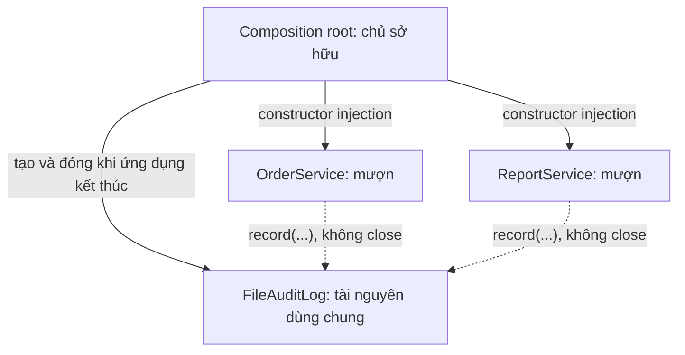

# Tránh đóng hai lần hoặc sử dụng tài nguyên đã đóng

## 1. Vấn đề: còn tham chiếu nhưng tài nguyên không còn dùng được

Trong Java, một biến có thể tiếp tục giữ tham chiếu tới đối tượng sau khi đối tượng ấy đã đóng file, socket, connection hoặc một tài nguyên khác. Đối tượng vẫn tồn tại trong bộ nhớ, nhưng thao tác trên nó có thể thất bại.

Hai lỗi cần phân biệt là:

1. **Đóng hai lần (double close):** nhiều nơi cùng gọi `close()` trên một tài nguyên, hoặc cùng một nơi đóng lại tài nguyên đã đóng.
2. **Sử dụng sau khi đóng (use after close):** một thành phần tiếp tục đọc, ghi hoặc gọi API của tài nguyên khi vòng đời hợp lệ của nó đã kết thúc.

Ví dụ, `OrderService` và `ReportService` cùng nhận một logger. Nếu `OrderService` tự đóng logger sau khi ghi đơn hàng, `ReportService` có thể lỗi khi ghi báo cáo, mặc dù nó vẫn giữ tham chiếu Java hợp lệ đến chính logger đó.

Đây là chủ đề **Sở hữu tài nguyên** trong module **Dependency Injection (DI)**. Khi học **Dependency Injection** và **Inversion of Control (IoC)**, việc chuyển quyền tạo và lắp ghép đối tượng ra **composition root** giúp trả lời câu hỏi ai sở hữu và khi nào được đóng dependency. Bài này thực hành Java thuần, constructor injection, scope, vòng đời và kiểm thử trước khi xem xét DI container.

Sau bài học, bạn có thể xác định trách nhiệm đóng tài nguyên trong object graph, tránh double close và use-after-close, chọn đúng phạm vi `try-with-resources`, tổ chức shutdown theo vòng đời và kiểm tra những quy tắc này bằng test double.

## 2. Sở hữu, mượn và chia sẻ là ba quan hệ cần tách rõ

Một thao tác truyền tham chiếu như `new OrderService(log)` **không tạo bản sao** của `log` và **không tự chuyển quyền sở hữu**. Constructor injection chỉ làm dependency trở nên tường minh. Trách nhiệm đóng phải được xác định bằng hợp đồng và cách lắp ghép.

| Quan hệ | Ý nghĩa | Quy tắc đối với `close()` |
| --- | --- | --- |
| **Sở hữu (owner)** | Thành phần chịu trách nhiệm quản lý vòng đời của tài nguyên | Đóng tại đúng thời điểm kết thúc phạm vi sở hữu |
| **Mượn để sử dụng (borrower)** | Thành phần nhận tham chiếu để thao tác trong phạm vi được cho phép | Không tự đóng tài nguyên của bên cấp, trừ khi hợp đồng trao quyền |
| **Chia sẻ (sharing)** | Hai hay nhiều thành phần trỏ tới cùng một instance | Chỉ chia sẻ quyền sử dụng; quyền đóng vẫn cần người chịu trách nhiệm rõ ràng |
| **Chuyển giao sở hữu (ownership transfer)** | API quy định bên nhận tiếp quản việc đóng | Bên nhận đóng; bên gửi không tiếp tục dùng hoặc tự đóng theo hợp đồng đó |

Với một logger dùng chung, sơ đồ trách nhiệm nên như sau:



**Quy tắc làm việc hữu ích:** một dependency được inject thường được xem là **tài nguyên mượn**, trừ khi hợp đồng công khai quy định bên nhận sở hữu nó. Đây là **quy ước thiết kế**, không phải cơ chế được compiler Java tự kiểm tra.

### 2.1. GC không thay thế cơ chế đóng

Garbage collector xử lý việc thu hồi bộ nhớ cho đối tượng không còn truy cập được. Nó không bảo đảm việc giải phóng file descriptor, khóa, kết nối hoặc transaction xảy ra vào đúng lúc chương trình cần. Vì vậy, với tài nguyên phải đóng, hãy xác định điểm kết thúc vòng đời và gọi `close()` theo hợp đồng, thường bằng `try-with-resources`.

### 2.2. Không phải mọi loại `close()` có cùng hợp đồng

Java phân biệt hai interface quan trọng:

- `AutoCloseable` định nghĩa `close()` và cho phép dùng `try-with-resources`. Interface này **không bảo đảm** mọi implementation có thể gọi `close()` lặp lại mà không có tác dụng phụ, dù thiết kế idempotent thường được khuyến khích.
- `java.io.Closeable` mở rộng `AutoCloseable` và quy định việc gọi `close()` trên một stream đã đóng không có tác dụng. Tuy nhiên, không vì một implementation cụ thể cho phép đóng lặp mà nên để nhiều thành phần cùng quản lý vòng đời.

Các thư viện ngoài JDK có thể dùng `close()` để trả kết nối về pool, hoàn tất phiên hoặc cập nhật trạng thái. Một lần đóng trùng có thể bị bỏ qua, bị từ chối hoặc gây hiệu ứng phụ tùy hợp đồng. **Đừng dựa vào giả định “đóng lần hai luôn an toàn”.**

## 3. Các đường đi phổ biến dẫn tới double close và use-after-close

### 3.1. Consumer tự đóng dependency được inject

```java
// Ví dụ SAI: service nhận tài nguyên dùng chung rồi tự đóng nó.
final class BadOrderService {
    private final FileAuditLog auditLog;

    BadOrderService(FileAuditLog auditLog) {
        this.auditLog = auditLog;
    }

    void place(String orderId) throws java.io.IOException {
        try (FileAuditLog borrowed = auditLog) {
            borrowed.record("ORDER " + orderId);
        } // Đóng logger ngay khi place() kết thúc.
    }
}
```

Nếu composition root còn inject cùng `FileAuditLog` cho service khác và cũng dự định đóng nó lúc shutdown, đoạn này tạo ra hai chủ thể cùng thực hiện `close()`. Một service khác tiếp tục gọi `record` sẽ dùng tài nguyên đã đóng. Lỗi nằm ở **ranh giới sở hữu**, không nằm ở bản thân `try-with-resources`.

**Cách sửa:** service chỉ nhận giao diện thao tác `AuditLog`; root giữ đối tượng `FileAuditLog` có `close()` và quản lý toàn bộ vòng đời của nó.

### 3.2. Dùng `try-with-resources` ở sai scope

`try-with-resources` luôn đóng resource được khai báo khi rời khối, kể cả khi thân khối ném exception. Vì vậy, dòng sau có thể **sai** nếu `sharedConnection` được cho mượn và còn được dùng ở nơi khác:

```java
// Sai khi sharedConnection không thuộc quyền sở hữu của phương thức.
try (java.sql.Connection connection = sharedConnection) {
    // xử lý ...
}
// Connection đã bị gọi close(), dù owner chưa kết thúc scope.
```

Ngược lại, `try-with-resources` là lựa chọn đúng khi phương thức **tự tạo** hoặc **được chuyển giao sở hữu** tài nguyên sống ngắn. Không thể quyết định chỉ bằng việc tham chiếu được truyền qua một tham số hay một trường.

### 3.3. Owner đóng trước khi tất cả consumer kết thúc

Giả sử root đóng logger trước khi một tác vụ bất đồng bộ ghi log cuối cùng. Tác vụ có thể cầm tham chiếu hợp lệ nhưng đụng tài nguyên đã đóng:

```text
T0: Root tạo logger và inject cho Worker
T1: Worker bắt đầu công việc bất đồng bộ
T2: Root gọi logger.close()
T3: Worker gọi logger.record(...)  -> use after close
```

Giải pháp thuộc **vòng đời**: dừng nhận công việc mới, đợi hoặc hủy các công việc đang dùng tài nguyên theo hợp đồng, rồi mới đóng dependency dùng chung. Một cờ `closed` đơn giản chỉ giúp phát hiện lỗi; nó không tự giải quyết cuộc đua giữa `record()` và `close()` trên các luồng khác nhau.

### 3.4. Hai wrapper cùng đóng một tài nguyên nền

Ví dụ `BufferedReader` có thể bao bọc `InputStreamReader`, từ đó bao bọc một `InputStream`. Đóng wrapper ngoài thường đóng cả tài nguyên mà nó bao bọc:

```java
// Dư thừa trách nhiệm đóng cùng một stream:
try (java.io.InputStream stream = java.nio.file.Files.newInputStream(path);
     java.io.BufferedReader reader = new java.io.BufferedReader(
         new java.io.InputStreamReader(
             stream, java.nio.charset.StandardCharsets.UTF_8))) {
    System.out.println(reader.readLine());
}
// Đầu tiên reader.close() đóng cả stream; sau đó stream.close() được gọi tiếp.
```

Với các lớp `Closeable` chuẩn, lần đóng thứ hai thường không gây lỗi, nhưng việc đăng ký đồng thời **wrapper sở hữu delegate** và **delegate** vẫn gây trách nhiệm trùng lặp. Cách đơn giản hơn nếu chỉ cần đọc văn bản:

```java
try (java.io.BufferedReader reader = java.nio.file.Files.newBufferedReader(
        path, java.nio.charset.StandardCharsets.UTF_8)) {
    System.out.println(reader.readLine());
}
```

Khi tự thiết kế wrapper, cần ghi rõ `close()` của wrapper có đóng delegate hay không. Không suy đoán tất cả wrapper và thư viện có cùng chính sách.

## 4. Ví dụ hoàn chỉnh: composition root sở hữu tài nguyên dùng chung

Ví dụ tiếp theo xây dựng một application Java thuần:

- `FileAuditLog` quản lý `BufferedWriter` và triển khai `AutoCloseable`.
- `OrderService` và `ReportService` nhận **hợp đồng sử dụng** `AuditLog` qua constructor.
- `App.main` tạo một instance logger, inject cho cả hai service và đóng logger sau khi hai service làm xong.

Tạo file **`App.java`** (JDK 11 trở lên):

```java
import java.io.BufferedWriter;
import java.io.IOException;
import java.nio.charset.StandardCharsets;
import java.nio.file.Files;
import java.nio.file.Path;
import java.nio.file.StandardOpenOption;
import java.util.Objects;

// Hợp đồng service cần: chỉ ghi, không quản lý vòng đời.
interface AuditLog {
    void record(String event) throws IOException;
}

// Hiện thực hạ tầng: sở hữu BufferedWriter bên trong.
final class FileAuditLog implements AuditLog, AutoCloseable {
    private final BufferedWriter writer;
    private boolean closed;

    FileAuditLog(Path path) throws IOException {
        writer = Files.newBufferedWriter(
            path,
            StandardCharsets.UTF_8,
            StandardOpenOption.CREATE,
            StandardOpenOption.APPEND
        );
    }

    @Override
    public void record(String event) throws IOException {
        if (closed) {
            throw new IllegalStateException("Audit log is closed");
        }
        writer.write(event);
        writer.newLine();
    }

    @Override
    public void close() throws IOException {
        if (closed) {
            return; // Quyết định riêng của implementation này.
        }
        closed = true;
        writer.close();
    }
}

final class OrderService {
    private final AuditLog auditLog;

    OrderService(AuditLog auditLog) {
        this.auditLog = Objects.requireNonNull(auditLog, "auditLog");
    }

    void place(String orderId) throws IOException {
        auditLog.record("ORDER " + orderId);
    }
}

final class ReportService {
    private final AuditLog auditLog;

    ReportService(AuditLog auditLog) {
        this.auditLog = Objects.requireNonNull(auditLog, "auditLog");
    }

    void export(String reportId) throws IOException {
        auditLog.record("REPORT " + reportId);
    }
}

public final class App {
    public static void main(String[] args) throws IOException {
        // Composition root: chủ sở hữu của logger dùng chung.
        try (FileAuditLog ownedLog = new FileAuditLog(Path.of("audit.log"))) {
            OrderService orders = new OrderService(ownedLog);
            ReportService reports = new ReportService(ownedLog);

            orders.place("O-17");
            reports.export("R-09");
        } // Root gọi close() sau lần sử dụng cuối cùng.
    }
}
```

Biên dịch và chạy:

```bash
javac App.java
java App
```

File `audit.log` sẽ có thêm hai dòng:

```text
ORDER O-17
REPORT R-09
```

Lưu ý `StandardOpenOption.APPEND` nên các lần chạy sau sẽ **ghi nối tiếp**, không xóa nội dung cũ. Mục tiêu của bài là kiểm soát thời gian sống, không phải xây dựng hệ thống audit production. Ví dụ này dùng tuần tự; `BufferedWriter` cùng cờ `closed` không được bảo vệ để gọi `record` và `close` đồng thời. Nếu nhiều luồng sử dụng cùng instance, cần cơ chế đồng bộ, queue hoặc logger có hợp đồng thread-safe phù hợp.

### 4.1. Vì sao ví dụ tránh được hai lỗi?

1. Chỉ `App` nắm trách nhiệm đóng `ownedLog`. Hai service nhận `AuditLog`, không có phương thức `close()` trên hợp đồng chúng được inject.
2. `try-with-resources` đặt trong phạm vi bao trùm toàn bộ lần sử dụng hai service; owner không đóng sớm.
3. Nếu `orders.place(...)` hoặc `reports.export(...)` ném exception, root vẫn gọi `close()` khi rời khối.
4. `FileAuditLog.close()` trong ví dụ có cơ chế **bỏ qua lần đóng thứ hai khi chạy tuần tự**. Đây chỉ là phòng vệ của implementation; thiết kế đúng vẫn là **một owner**, không dựa vào việc gọi `close()` lặp lại.
5. `record` từ chối lời gọi sau khi đóng bằng `IllegalStateException`. Cờ này giúp phát hiện việc sử dụng sai vòng đời, nhưng **không làm tham chiếu cũ tự mất hiệu lực**.

Đây cũng là minh họa **IoC**: service không quyết định hiện thực logger, cách mở file hoặc lúc đóng; việc ấy được chuyển ra ngoài tới composition root. DI container có thể hỗ trợ việc lắp ghép sau này, nhưng trách nhiệm xác định ownership vẫn cần thiết.

## 5. Đóng an toàn khi có exception

Với một tài nguyên do chính khối lệnh sở hữu, ưu tiên:

```java
try (java.io.InputStream input = java.nio.file.Files.newInputStream(path)) {
    // Đọc input. Nếu thao tác ném exception, input vẫn được đóng.
    input.read();
}
```

Tránh lặp lại lời gọi đóng trong `finally` nếu resource đã được quản lý bằng `try-with-resources`:

```java
java.io.InputStream input = java.nio.file.Files.newInputStream(path);
try (java.io.InputStream owner = input) {
    input.read();
} finally {
    // KHÔNG gọi input.close() nữa: try-with-resources đã xử lý.
}
```

### 5.1. Nhiều tài nguyên: đóng theo thứ tự ngược khi khai báo

`try-with-resources` đóng các resource **theo thứ tự ngược lại** thứ tự khai báo. Điều này quan trọng khi một resource phụ thuộc vào một resource nền:

```java
try (FirstResource first = openFirst();
     SecondResource second = openSecond(first)) {
    // Sử dụng cả hai.
}
// Đóng second trước, sau đó first.
```

Đoạn trên là mã minh họa vì `FirstResource` và `SecondResource` chưa được định nghĩa. Trong ứng dụng thật, hãy sắp thứ tự đóng để thành phần phụ thuộc ngừng hoạt động **trước** thành phần mà nó cần. Nếu `second.close()` đã đóng luôn `first`, không nên đưa cả hai vào cùng danh sách resource theo mặc định.

### 5.2. Lỗi trong thân khối và lỗi khi đóng

`close()` có thể ném exception. Khi thân khối `try` đã ném exception và `close()` cũng ném, Java giữ exception từ thân khối làm exception chính và đính các lỗi đóng vào danh sách **suppressed exceptions**, có thể truy cập bằng `Throwable.getSuppressed()`. Khi thân khối không có lỗi nhưng `close()` thất bại, lỗi đóng sẽ được ném ra theo khai báo.

Khi điều tra sự cố, cần xem cả exception chính và suppressed exceptions. Không nên viết `catch (Exception ignored)` quanh `close()` để “tránh lỗi shutdown” vì có thể làm mất thông tin giải phóng tài nguyên thất bại.

## 6. Factory tạo tài nguyên ngắn hạn: ai đóng?

Không phải dependency nào cũng tồn tại suốt ứng dụng. Stream nhập dữ liệu thường chỉ hợp lệ cho **một lần thao tác**. Có thể inject một factory, sau đó phương thức sử dụng **sở hữu stream mới tạo** theo hợp đồng:

```java
interface InputFactory {
    // Hợp đồng: mỗi lần open() trả về stream mới;
    // bên gọi sở hữu và có trách nhiệm đóng stream.
    java.io.InputStream open() throws java.io.IOException;
}

final class ImportService {
    private final InputFactory inputFactory;

    ImportService(InputFactory inputFactory) {
        this.inputFactory = java.util.Objects.requireNonNull(inputFactory);
    }

    long countBytes() throws java.io.IOException {
        try (java.io.InputStream owned = inputFactory.open()) {
            long count = 0;
            while (owned.read() != -1) {
                count++;
            }
            return count;
        }
    }
}

// Composition root chọn hiện thực factory:
InputFactory factory = () -> java.nio.file.Files.newInputStream(path);
ImportService importer = new ImportService(factory);
```

Ở đây `ImportService` mượn **factory** được inject, nhưng phương thức `countBytes` nhận **quyền sở hữu mỗi stream** do factory trả về. Hai đối tượng có scope khác nhau. Nếu factory trả về cùng một stream đã dùng, hợp đồng “stream mới mỗi lần” bị vi phạm, có thể gây đọc thiếu dữ liệu hoặc use-after-close.

Trong một API khác, factory có thể trả về resource mượn từ một pool với quy tắc `close()` riêng. Vì vậy phải đọc và viết rõ hợp đồng **ai đóng, đóng khi nào và đóng có tác dụng gì**; tên phương thức `get`, `open` hay `create` một mình không đủ xác định ownership.

## 7. Kiểm thử số lần đóng và việc sử dụng sau đóng bằng Java thuần

Test double giúp kiểm tra đúng hành vi vòng đời, không cần mở file thật và không cần DI container. Ta tạo `CountingAuditLog` thực thi `AuditLog` và `AutoCloseable`:

- Mỗi lần đóng tăng `closeCalls`; đóng hai lần thì ném exception để lộ lỗi.
- Khi đã đóng, `record` từ chối sử dụng.
- Test tạo hai service từ cùng một instance, gọi chúng trong scope và để root/test sở hữu việc đóng.

Tạo file **`AppTest.java`** bên cạnh `App.java`:

```java
import java.io.IOException;
import java.util.ArrayList;
import java.util.Arrays;
import java.util.List;

final class CountingAuditLog implements AuditLog, AutoCloseable {
    final List<String> events = new ArrayList<>();
    int closeCalls;
    boolean closed;

    @Override
    public void record(String event) {
        if (closed) {
            throw new IllegalStateException("use after close");
        }
        events.add(event);
    }

    @Override
    public void close() {
        closeCalls++;
        if (closed) {
            throw new IllegalStateException("double close");
        }
        closed = true;
    }
}

public final class AppTest {
    public static void main(String[] args) throws IOException {
        CountingAuditLog log = new CountingAuditLog();
        OrderService orders = new OrderService(log);
        ReportService reports = new ReportService(log);

        try (CountingAuditLog owner = log) {
            orders.place("O-1");
            reports.export("R-1");
        }

        check(log.closeCalls == 1, "resource must close exactly once");
        check(log.closed, "resource must be closed");
        check(log.events.equals(Arrays.asList("ORDER O-1", "REPORT R-1")),
              "unexpected events: " + log.events);

        // Chứng minh service giữ tham chiếu nhưng không còn được phép dùng.
        boolean rejected = false;
        try {
            orders.place("O-2");
        } catch (IllegalStateException expected) {
            rejected = true;
        }
        check(rejected, "use after close must be rejected");
        check(log.closeCalls == 1, "service must not close borrowed log");

        // Ngoại lệ trong thân khối không làm mất bước đóng.
        CountingAuditLog onFailure = new CountingAuditLog();
        try (CountingAuditLog owner = onFailure) {
            throw new IllegalArgumentException("simulated failure");
        } catch (IllegalArgumentException expected) {
            // Thân khối kết thúc bằng lỗi như dự kiến.
        }
        check(onFailure.closeCalls == 1, "close on failure");

        System.out.println("PASS");
    }

    private static void check(boolean condition, String message) {
        if (!condition) {
            throw new AssertionError(message);
        }
    }
}
```

Chạy:

```bash
javac App.java AppTest.java
java AppTest
```

Kết quả mong đợi là `PASS`. Test này xác nhận **root thực hiện đúng một lần đóng**, các service dùng chung mà không tự đóng, và lời gọi sau thời điểm kết thúc vòng đời bị phát hiện.

Trong test, việc fake cố tình ném lỗi khi double close là để **phát hiện lỗi thiết kế**; nó không tuyên bố rằng mọi `AutoCloseable` thực tế phải ném lỗi ở lần đóng tiếp theo. Cũng không cần biến mọi test thành kiểm tra `closeCalls`: chỉ thêm kiểm tra vòng đời khi nó là hành vi quan trọng của loại resource đó.

## 8. Thiết kế resource có `close()` an toàn

### 8.1. Tránh coi idempotent close là cách thay thế ownership

Một implementation có thể chủ động cho `close()` là **idempotent**: gọi hai lần tuần tự có cùng tác dụng như gọi một lần. Trong `FileAuditLog` ở mục 4, điều này được thực hiện bằng cờ `closed`. Đó là biện pháp phòng vệ tốt khi một tài nguyên được đóng do shutdown nhiều tầng, nhưng không nên lấy nó để hợp thức hóa việc các consumer tự đóng cùng một dependency.

Lý do: ngay cả khi lần đóng thứ hai là no-op, **lần đóng đầu tiên vẫn có thể xảy ra quá sớm**. Một consumer khác có thể bị lỗi use-after-close. Thiết kế hợp lệ vẫn cần một owner và điểm đóng rõ ràng.

### 8.2. Khi đóng thất bại, phải xác định trạng thái tiếp theo

Giả sử `close()` của resource ném `IOException` trong lúc giải phóng. Không nên mặc định rằng gọi `close()` lần nữa sẽ sửa được vấn đề. Hợp đồng cần cho biết có thể retry hay không, resource còn hợp lệ không và lỗi được báo cáo thế nào. Tùy API, có thể coi resource đã bước vào trạng thái terminal dù một phần dọn dẹp thất bại.

Trong ví dụ `FileAuditLog`, cờ được chuyển sang `closed = true` **trước** khi `writer.close()`, để các lần `record` tiếp theo không tiếp tục dùng resource sau khi bắt đầu đóng. Đây là lựa chọn cho minh họa tuần tự; thư viện thật có thể cần nhiều trạng thái hơn.

### 8.3. Vấn đề đồng thời cần cơ chế vòng đời, không chỉ một cờ

Trên nhiều luồng, hai hành động có thể chạy xen kẽ:

```text
Thread A: kiểm tra closed == false
Thread B: gọi close(), giải phóng writer
Thread A: gọi write() trên writer đã đóng
```

Đánh dấu cờ `volatile` chỉ hỗ trợ nhìn thấy thay đổi trạng thái, **không tự biến cả thao tác kiểm tra và sử dụng thành một đơn vị nguyên tử**. Nếu cho phép dùng chung giữa các luồng, cần hợp đồng đồng bộ `record`/`close`, cơ chế lease/reference counting có kiểm soát, hoặc phối hợp shutdown để mọi công việc hoàn tất trước khi đóng. Chọn cách nào tùy tải và ngữ nghĩa ứng dụng.

Đối với tác vụ bất đồng bộ, đừng truyền dependency thuộc request-scoped cho callback được phép chạy sau khi request kết thúc. Có thể snapshot dữ liệu cần thiết hoặc tạo resource có vòng đời bao trùm callback; ranh giới này phải do thành phần quản lý scope quyết định.

## 9. Phân tích vòng đời theo scope

| Scope | Ví dụ resource | Chủ sở hữu phù hợp | Điểm đóng |
| --- | --- | --- | --- |
| Toàn ứng dụng | HTTP client, logger, connection pool | Application composition root | Sau khi dừng các consumer và tác vụ nền |
| Theo request | Request context chứa resource, unit of work | Thành phần quản lý request | Khi xử lý request thực sự hoàn tất |
| Theo transaction | Transaction/connection đã checkout | Quản lý transaction/đơn vị công việc | Khi commit/rollback hoặc trả connection theo hợp đồng |
| Theo thao tác | File stream, writer tạm | Phương thức hoặc object nhận sở hữu | Ngay sau khi thao tác kết thúc |
| Theo test | Fake `AutoCloseable`, DB fixture | Test setup/fixture | Khi kết thúc test hoặc fixture scope |

**Scope và ownership liên quan nhưng không đồng nhất.** Scope cho biết tài nguyên tồn tại trong bối cảnh nào; ownership xác định ai quản lý việc kết thúc. DI container có thể tạo scope và đóng tài nguyên mà nó quản lý, nhưng các resource được mở bằng factory bên trong một phương thức vẫn cần người chịu trách nhiệm riêng.

### 9.1. Đóng theo thứ tự phụ thuộc

Nếu `WorkerService` cần `MessageClient` để hoàn tất công việc, và `MessageClient` cần `ConnectionPool`, trình tự shutdown hợp lý là:

1. Ngừng nhận thêm công việc tại `WorkerService`.
2. Chờ/cancel các công việc đang dùng client theo hợp đồng.
3. Đóng `MessageClient` nếu nó có trách nhiệm dọn dẹp.
4. Sau đó đóng `ConnectionPool`, khi không còn consumer cần nó.

Không nên giả định rằng **thứ tự tạo** và **thứ tự đóng** giống nhau; thông thường đóng theo thứ tự ngược với chuỗi sở hữu/phụ thuộc. Với `try-with-resources`, thứ tự đóng ngược đã được Java thực hiện cho các resource khai báo trong cùng một khối.

## 10. Lỗi thường gặp và cách xử lý

| Dấu hiệu | Vấn đề tiềm ẩn | Hướng xử lý |
| --- | --- | --- |
| Service có trường dependency được inject nhưng tự gọi `close()` | Chiếm quyền sở hữu, đóng sớm tài nguyên dùng chung | Consumer chỉ mượn; root hoặc owner rõ ràng đóng |
| Hai `try-with-resources` quản lý alias tới cùng instance | Có thể đóng lặp, scope của một alias kết thúc sớm | Chỉ một scope sở hữu instance; các alias khác không đóng |
| Resource đã đóng nhưng job nền vẫn dùng | Use-after-close, lỗi ngẫu nhiên theo thời điểm | Chờ/hủy job rồi mới đóng; theo dõi vòng đời |
| Wrapper và delegate đều được đăng ký để đóng | Trùng trách nhiệm đóng resource nền | Xác định wrapper nào sở hữu delegate |
| Đặt `close()` trong `finally` sau khi đã dùng try-with-resources | Đóng lặp ngoài ý muốn | Để một cơ chế đóng duy nhất xử lý |
| Bỏ qua exception khi `close()` thất bại | Mất thông tin tài nguyên giải phóng không thành công | Báo cáo lỗi và xem suppressed exceptions |
| Xem `final` hoặc còn reference là dấu hiệu resource hợp lệ | `final` chỉ ngăn gán lại tham chiếu | Kiểm tra vòng đời, ownership và trạng thái |
| Đóng resource của factory ngay sau khi inject cho singleton | Consumer giữ dependency đã hết hạn | Đảm bảo lifetime dependency bao trùm consumer |
| Chia sẻ object mutable giữa nhiều luồng và chỉ dùng cờ `closed` | Race giữa use và close | Đồng bộ hoặc phối hợp shutdown theo hợp đồng |
| Dựa vào close idempotent để hai service cùng đóng | Có thể không double-close lỗi, nhưng vẫn đóng sớm | Quy định một owner; các service còn lại mượn |

## 11. Bài tập tự kiểm tra

**Bài 1 — Hai service, một HTTP client.** Composition root tạo một HTTP client và inject cho `UserService` và `InvoiceService`. `UserService` gọi `close()` khi xử lý xong một request. Hãy xác định lỗi và viết lại điểm đóng.

*Gợi ý:* client thuộc scope ứng dụng và được root quản lý; cả hai service chỉ mượn. Đóng sau khi ngừng toàn bộ tác vụ cần client.

**Bài 2 — Hai alias tới cùng một stream.** Bên gọi tạo một `InputStream`, truyền cho hai consumer. Consumer đầu dùng `try-with-resources` ngay quanh tham chiếu nhận được; consumer thứ hai tiếp tục đọc. Có thể xảy ra lỗi gì?

*Gợi ý:* consumer đầu đã đóng stream của bên sở hữu. Nếu phải đọc độc lập, mở hai stream riêng hoặc thống nhất một luồng đọc phân phối dữ liệu phù hợp.

**Bài 3 — Lỗi trong `close()`.** Một khối `try-with-resources` ném `IllegalStateException` trong thân, rồi `close()` ném `IOException`. Exception nào là chính, truy cập exception còn lại bằng cách nào?

*Gợi ý:* exception từ thân khối là chính; exception từ `close()` được gắn vào `getSuppressed()`.

**Bài 4 — Callback chạy muộn.** Một tác vụ bất đồng bộ giữ `RequestScopedConnection` được inject, nhưng request đóng connection trước khi callback chạy. Hãy đề xuất cách tổ chức vòng đời.

*Gợi ý:* chuyển dữ liệu cần thiết sang giá trị bất biến, hoặc tạo resource có scope bao trùm toàn bộ thao tác; đợi tác vụ hoàn tất rồi mới đóng owner nếu hợp đồng cho phép.

**Bài 5 — Viết test ownership.** Bổ sung một fake có biến `closeCalls` và `closed`. Kiểm tra rằng hai service sử dụng được khi resource còn mở, chỉ owner gọi `close()`, và việc sử dụng sau đó bị từ chối.

*Gợi ý:* dùng constructor injection và test double Java thuần như mục 7; không cần dựng DI container hoặc file thật.

## 12. Checklist trước khi đưa resource vào object graph

1. **Ai tạo resource?** Composition root, factory hay phương thức nghiệp vụ?
2. **Ai sở hữu quyền đóng?** Hợp đồng nhận tham chiếu là borrow hay transfer?
3. **Có nhiều alias không?** Các consumer dùng chung instance nhưng có ai vô tình gọi `close()`?
4. **Đúng phạm vi `try-with-resources` chưa?** Scope có bao trùm tất cả lần sử dụng hợp lệ?
5. **Dependency có sống đủ lâu không?** Có callback hoặc worker nào dùng sau shutdown?
6. **Close có thể ném lỗi không?** Ai ghi nhận, xử lý và báo cáo lỗi?
7. **Wrapper có đóng delegate không?** Có hai cơ chế cùng đóng tài nguyên nền?
8. **Đã xét concurrency chưa?** Sự kiện đóng và sử dụng có thể chạy đồng thời?
9. **Có test vòng đời thiết yếu chưa?** Kiểm tra số lần đóng và hành vi sau khi đóng bằng fake.

## 13. Ghi nhớ

**Tránh double close bằng cách xác định một chủ sở hữu rõ ràng; tránh use-after-close bằng cách bảo đảm tài nguyên còn sống cho đến khi tất cả consumer hoàn tất.** Constructor injection cung cấp dependency nhưng không chuyển quyền sở hữu mặc định. Composition root thường quản lý tài nguyên dùng chung sống dài; tài nguyên ngắn hạn có thể được trao quyền sở hữu cho từng thao tác qua factory.

`try-with-resources` là công cụ đóng tài nguyên đáng tin cậy **khi đặt ở đúng owner và scope**. Idempotent close chỉ là biện pháp phòng vệ; vẫn phải kiểm soát thời điểm đóng, thứ tự shutdown, ngoại lệ và các tác vụ đồng thời. Những nguyên tắc này giúp học và kiểm thử Dependency Injection bằng Java thuần trước khi dùng DI container để quản lý scope và vòng đời phức tạp hơn.
