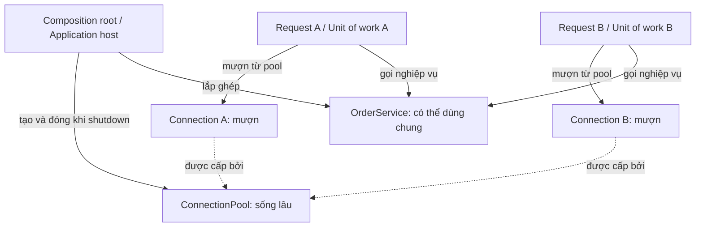
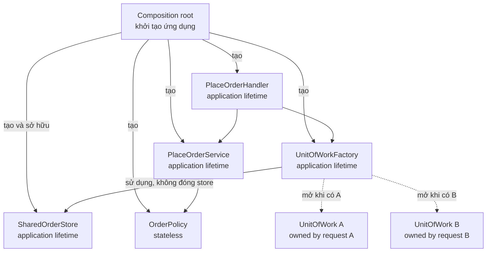

# Tài nguyên dùng chung và tài nguyên thuộc một yêu cầu

Trong một ứng dụng Java, không phải mọi đối tượng đều nên được tạo mới hoặc đóng ở cùng một thời điểm. Một **connection pool** có thể phục vụ nhiều yêu cầu trong suốt thời gian ứng dụng chạy, nhưng một **kết nối mượn từ pool** thường chỉ được sử dụng trong phạm vi một thao tác hoặc giao dịch rồi trả lại. Một application service có thể được chia sẻ, trong khi dữ liệu người dùng, transaction và trạng thái xử lý phải thuộc từng yêu cầu.

Khi áp dụng **Dependency Injection (DI)**, câu hỏi “tiêm đối tượng nào?” phải đi cùng ba câu hỏi khác: **ai tạo, ai được sử dụng và ai chịu trách nhiệm giải phóng?** Nếu một service đóng tài nguyên mà nó chỉ mượn, service khác có thể hỏng. Nếu một singleton giữ tài nguyên của request đầu tiên, những request sau có thể đọc nhầm dữ liệu hoặc dùng một tài nguyên đã đóng.

Bài học nằm trong chương **Sở hữu tài nguyên** của module **DEPENDENCY_INJECTION**. Chúng ta sẽ tách việc sử dụng dependency khỏi việc tạo và lắp ghép, sử dụng **constructor injection** và **composition root**, rồi thực hành bằng Java thuần trước khi đối chiếu với scope và vòng đời của DI container.

## 1. Kết quả cần đạt

Sau bài học, bạn có thể:

- Phân biệt **tài nguyên dùng chung** với **tài nguyên thuộc một yêu cầu** dựa trên phạm vi sử dụng và hợp đồng vòng đời.
- Phân biệt **sở hữu tài nguyên** (chịu trách nhiệm đóng) với **được phép sử dụng** (mượn tham chiếu trong một khoảng thời gian).
- Thiết kế object graph trong đó composition root quản lý tài nguyên sống lâu, còn request handler quản lý tài nguyên của mỗi lượt xử lý.
- Sử dụng factory và `try-with-resources` để tạo, dùng, giải phóng tài nguyên ngắn hạn đúng lúc.
- Giải thích vì sao `close()` của một kết nối mượn từ pool có ý nghĩa khác với đóng chính pool, tùy theo hợp đồng thư viện.
- Nhận diện lỗi chia sẻ trạng thái request, dùng resource sau khi đóng, đóng nhầm tài nguyên dùng chung và rò rỉ resource.
- Kiểm thử các ranh giới vòng đời trong Java thuần mà không cần container hoặc kết nối mạng.

## 2. Chia sẻ, vòng đời và quyền sở hữu là ba chiều khác nhau

Một dependency có thể là object thuần không cần đóng, hoặc đại diện cho tài nguyên ngoài JVM cần được giải phóng. Để chọn vòng đời đúng, cần đặt riêng ba câu hỏi:

| Chiều cần xem | Câu hỏi thực tế | Ví dụ |
| --- | --- | --- |
| **Sharing / chia sẻ** | Những nơi nào được nhận cùng một instance? | Hai service dùng chung một repository adapter không trạng thái |
| **Lifetime / vòng đời hợp lệ** | Instance hoặc tài nguyên còn được phép sử dụng đến lúc nào? | Unit of work hợp lệ đến cuối giao dịch |
| **Ownership / quyền sở hữu** | Ai phải đóng hoặc trả lại tài nguyên, kể cả khi lỗi? | Handler mở session thì phải đóng session; host tạo pool thì đóng pool |

**Một đối tượng có thể được nhiều nơi sử dụng mà chỉ có một chủ sở hữu.** Ví dụ composition root tạo một pool, tiêm pool hoặc một factory dựa trên pool vào nhiều thành phần. Các thành phần đó dùng khả năng của pool theo hợp đồng, còn root/host chịu trách nhiệm đóng pool khi ứng dụng dừng.

Ngược lại, handler có thể nhận một tài nguyên chỉ có hiệu lực trong request từ factory. Dù factory là đối tượng dùng chung, **tài nguyên được factory trả về không vì thế trở thành dùng chung**. Quyền sở hữu tài nguyên được chuyển cho handler nếu hợp đồng `open()` quy định handler phải đóng kết quả.

### 2.1. “Sống lâu” không đồng nghĩa với “thread-safe”

Một đối tượng application-scoped có thể được nhiều thread gọi cùng lúc. Nếu nó chứa `ArrayList` mutable hoặc trạng thái `currentUserId` được cập nhật theo request, việc dùng chung có thể tạo race condition hoặc lẫn dữ liệu. Không thể suy ra tính an toàn đồng thời chỉ từ scope.

Tương tự, một đối tượng request-scoped không tự động thread-safe: request có thể phát sinh nhiều task chạy song song. Cần xét **thực tế đồng thời**, không chỉ tên annotation.

### 2.2. “Đã close” không đồng nghĩa với “không còn tham chiếu”

Trong Java, một object vẫn có thể còn trong heap sau khi `close()` được gọi. Điều thay đổi là **hợp đồng sử dụng**: stream, session hoặc connection có thể không còn hợp lệ. Giữ tham chiếu đến object đã đóng là khả năng gây **use-after-close**; đừng đợi garbage collector để giải phóng các tài nguyên ngoài JVM.

`AutoCloseable` cho phép biểu diễn thao tác đóng nhưng **không quy định chung** rằng `close()` luôn trả kết nối về pool, đóng socket vật lý hoặc rollback transaction. Điều này phụ thuộc loại tài nguyên và thư viện cụ thể.

## 3. Những tài nguyên nào thường được chia sẻ, những tài nguyên nào nên theo yêu cầu?

| Thành phần | Phạm vi điển hình | Chủ sở hữu thường gặp | Điều phải kiểm tra |
| --- | --- | --- | --- |
| Connection pool / datasource pool | Ứng dụng hoặc một module lâu sống | Composition root, application host hoặc container | Có hỗ trợ truy cập đồng thời, ai đóng pool khi shutdown |
| Client HTTP được thiết kế để tái sử dụng | Có thể dùng chung lâu dài | Root/host theo tài liệu thư viện | Thread-safety, timeout, cơ chế shutdown nếu có |
| Cache dùng chung | Ứng dụng, theo tenant hoặc theo module | Thành phần chịu trách nhiệm cache | Khóa phân vùng, TTL, đồng thời, invalidation |
| Cấu hình bất biến / `Clock` | Thường dùng chung | Root hoặc framework | Có dữ liệu request/secret không nên giữ không |
| Connection mượn từ pool | Một thao tác/giao dịch, tùy chính sách | Code mượn connection hoặc transaction manager | Thời điểm trả về pool, transaction, không lưu vào singleton |
| Transaction / unit of work | Một đơn vị công việc | Request/task handler hoặc transaction manager | Commit, rollback, close khi có lỗi |
| Request context / danh tính người dùng | Một request/task hợp lệ | Request boundary hoặc framework | Không giữ qua request khác, không trộn tenant |
| Stream đọc file tạm | Một thao tác tiêu thụ dữ liệu | Code mở stream, trừ khi chuyển ownership rõ | Close khi hoàn thành hoặc lỗi |
| Bộ đệm tạm phục vụ một yêu cầu | Một lượt xử lý | Handler hoặc operation scope | Không lộ dữ liệu sang request khác |

Đây là **các lựa chọn thường gặp**, không phải luật tuyệt đối. Một client chỉ sử dụng được trong một thread thì không thể chia sẻ tùy tiện; một connection có thể được giữ trong suốt transaction gồm nhiều lời gọi chứ không chỉ trong một phương thức. Quyết định đúng xuất phát từ hợp đồng của dependency và ranh giới nghiệp vụ.

### 3.1. Ví dụ connection pool và connection mượn

Sơ đồ sau minh họa hai mức sở hữu:



Tùy loại pool, gọi `close()` trên **connection wrapper được mượn** thường trả connection về pool, còn đóng **pool** giải phóng tài nguyên quản lý của pool. Không nên tự suy đoán: một `java.sql.Connection` trực tiếp có thể đóng kết nối vật lý, trong khi connection lấy từ pool có thể là proxy với ngữ nghĩa trả lại. Nhiều `DataSource` không khai báo `AutoCloseable` trong interface chung; API đóng pool thuộc triển khai cụ thể.

Vì vậy, **người mượn hoàn thành nghĩa vụ trả resource**, còn **chủ pool quản lý vòng đời của pool**. Hai hành động đều có thể dùng tên `close` nhưng khác mức sở hữu.

## 4. Hai lỗi đối xứng: giữ quá lâu và đóng quá sớm

### 4.1. Singleton giữ một đối tượng request-scoped

```java
// Mã khái niệm minh họa lỗi scope.
final class CheckoutService {
    private final RequestSession session;

    CheckoutService(RequestSession session) {
        this.session = session;
    }

    void checkout() {
        session.writeOrder();
    }
}
```

Nếu `CheckoutService` dùng chung cả ứng dụng nhưng `RequestSession` chỉ hợp lệ trong request đầu tiên, service sẽ giữ dependency đã hết hiệu lực. Đây là **captive dependency**. Lỗi có thể là session đã đóng, dùng nhầm tenant hoặc trạng thái từ request cũ.

Giải pháp phụ thuộc nhu cầu: đưa `RequestSession` vào tham số của lượt xử lý; tạo service riêng theo request; hoặc tiêm factory/provider và giải quyết session trong scope hợp lệ. **Không nên sửa bằng cách giữ session mở vô thời hạn**.

### 4.2. Service đóng tài nguyên dùng chung mà nó chỉ mượn

```java
// Mã khái niệm minh họa lỗi ownership.
final class OrderService {
    private final SharedClient client;

    OrderService(SharedClient client) {
        this.client = client;
    }

    void process(Order order) {
        client.send(order);
        client.close(); // Sai nếu root/host sở hữu client dùng chung.
    }
}
```

Đóng `SharedClient` sau một yêu cầu có thể làm những yêu cầu khác thất bại. Trong thiết kế này service **được cấp quyền sử dụng**, chứ **không nhận quyền sở hữu để đóng**. Chỉ root/host đang quản lý vòng đời chung được quyết định khi nào client phải dừng, sau khi ngừng nhận yêu cầu mới và hoàn tất những công việc đang sử dụng nó.

### 4.3. Tạo tài nguyên mỗi request nhưng không đóng

```java
// Mã khái niệm: transactionFactory là dependency được tiêm.
void handle(Command command) {
    UnitOfWork unit = transactionFactory.open();
    unit.process(command);
    unit.commit();
    // Thiếu close khi thành công và khi có exception.
}
```

Tài nguyên có thể bị giữ đến hết thời gian GC, timeout hoặc container cleanup; những sự kiện đó **không thay cho cleanup theo hợp đồng**. Với `AutoCloseable`, hãy dùng `try-with-resources` hoặc một cơ chế lifecycle có bảo đảm tương đương. Nếu `UnitOfWork.close()` cần rollback khi chưa commit, phải ghi rõ điều này trong contract thay vì mặc định mọi triển khai đều làm thế.

## 5. Ranh giới ownership trong một ứng dụng DI thủ công

Mô hình dễ kiểm soát là phân thành **object graph sống lâu** và **phần graph theo yêu cầu**.



**Composition root** chịu trách nhiệm tạo và đóng `SharedOrderStore` khi ứng dụng kết thúc. `PlaceOrderHandler` giữ các dependency có thể dùng chung và **mỗi lần `handle(...)`** mượn/tạo một `UnitOfWork` mới. Handler đóng chính unit of work ấy khi hoàn thành; nó không đóng shared store.

Phân biệt việc **tạo** và **sở hữu**: factory có thể tạo resource rồi **chuyển quyền chịu trách nhiệm đóng** cho caller theo hợp đồng. Vì vậy, không thể chỉ nhìn nơi xuất hiện `new` để kết luận ai phải gọi `close()`.

## 6. Ví dụ Java thuần: resource dùng chung và resource theo yêu cầu

Ví dụ này xây dựng một kho đơn hàng dùng chung trong bộ nhớ và một `UnitOfWork` theo yêu cầu. Unit of work tạm giữ một đơn hàng; khi gọi `commit()`, nó ghi vào shared store; khi `close()`, nó giải phóng trạng thái tạm. **Đây là mô hình giảng dạy, không phải transaction database thực sự**: không có JDBC, pool, mạng, nhiều thread hoặc rollback một commit đã thực hiện.

Lưu toàn bộ mã vào **`Main.java`**; chạy với JDK 11 trở lên.

```java
import java.util.ArrayList;
import java.util.List;
import java.util.Objects;

public class Main {
    // Hợp đồng cho chính sách nghiệp vụ, có thể dùng chung.
    interface OrderPolicy {
        void validate(String orderId);
    }

    static final class RequiredOrderIdPolicy implements OrderPolicy {
        @Override
        public void validate(String orderId) {
            Objects.requireNonNull(orderId, "orderId");
            if (orderId.isBlank()) {
                throw new IllegalArgumentException("order ID is blank");
            }
        }
    }

    // Hợp đồng resource theo một đơn vị công việc.
    interface OrderUnitOfWork extends AutoCloseable {
        void stage(String orderId);
        void commit();

        @Override
        void close();
    }

    interface UnitOfWorkFactory {
        // Caller nhận quyền sở hữu và phải close kết quả.
        OrderUnitOfWork open(String requestId);
    }

    // Tài nguyên dùng chung do application root sở hữu.
    static final class SharedOrderStore implements AutoCloseable {
        private final List<String> committed = new ArrayList<>();
        private boolean closed;

        void ensureOpen() {
            if (closed) {
                throw new IllegalStateException("shared store is closed");
            }
        }

        void append(String record) {
            ensureOpen();
            committed.add(record);
        }

        List<String> snapshot() {
            ensureOpen();
            return List.copyOf(committed);
        }

        boolean isClosed() {
            return closed;
        }

        @Override
        public void close() {
            if (!closed) {
                closed = true;
                System.out.println("Shared store closed");
            }
        }
    }

    // Resource của đúng một request: không được giữ sang request sau.
    static final class InMemoryOrderUnitOfWork implements OrderUnitOfWork {
        private final SharedOrderStore store;
        private final String requestId;
        private String pendingOrderId;
        private boolean committed;
        private boolean closed;

        InMemoryOrderUnitOfWork(SharedOrderStore store, String requestId) {
            this.store = Objects.requireNonNull(store, "store");
            this.requestId = Objects.requireNonNull(requestId, "requestId");
            if (requestId.isBlank()) {
                throw new IllegalArgumentException("request ID is blank");
            }
            store.ensureOpen();
        }

        private void ensureUsable() {
            if (closed) {
                throw new IllegalStateException("unit of work is closed");
            }
        }

        @Override
        public void stage(String orderId) {
            ensureUsable();
            if (committed || pendingOrderId != null) {
                throw new IllegalStateException("already staged or committed");
            }
            pendingOrderId = Objects.requireNonNull(orderId, "orderId");
        }

        @Override
        public void commit() {
            ensureUsable();
            if (committed || pendingOrderId == null) {
                throw new IllegalStateException("nothing to commit");
            }
            store.append(requestId + "/" + pendingOrderId);
            committed = true;
        }

        @Override
        public void close() {
            if (!closed) {
                closed = true;
                pendingOrderId = null;
                System.out.println("Request resource closed: " + requestId);
            }
        }
    }

    // Factory sống lâu, nhưng mỗi lần open() trả một resource mới.
    static final class InMemoryUnitOfWorkFactory implements UnitOfWorkFactory {
        private final SharedOrderStore sharedStore;

        InMemoryUnitOfWorkFactory(SharedOrderStore sharedStore) {
            this.sharedStore =
                    Objects.requireNonNull(sharedStore, "sharedStore");
        }

        @Override
        public OrderUnitOfWork open(String requestId) {
            OrderUnitOfWork unit =
                    new InMemoryOrderUnitOfWork(sharedStore, requestId);
            System.out.println("Request resource opened: " + requestId);
            return unit;
        }
    }

    // Service nghiệp vụ được chia sẻ, không giữ UnitOfWork theo request.
    static final class PlaceOrderService {
        private final OrderPolicy policy;

        PlaceOrderService(OrderPolicy policy) {
            this.policy = Objects.requireNonNull(policy, "policy");
        }

        void place(String orderId, OrderUnitOfWork unit) {
            policy.validate(orderId);
            unit.stage(orderId);
        }
    }

    // Handler sở hữu resource ngắn hạn trong đúng một lời gọi.
    static final class PlaceOrderHandler {
        private final PlaceOrderService service;
        private final UnitOfWorkFactory units;

        PlaceOrderHandler(
                PlaceOrderService service,
                UnitOfWorkFactory units) {
            this.service = Objects.requireNonNull(service, "service");
            this.units = Objects.requireNonNull(units, "units");
        }

        void handle(String requestId, String orderId) {
            try (OrderUnitOfWork unit = units.open(requestId)) {
                service.place(orderId, unit);
                unit.commit();
            } // Đóng cả khi validate/commit ném lỗi.
        }
    }

    // Root giữ handle của resource dùng chung để đóng khi shutdown.
    static final class Application implements AutoCloseable {
        final SharedOrderStore store;
        final PlaceOrderHandler handler;

        Application(SharedOrderStore store, PlaceOrderHandler handler) {
            this.store = Objects.requireNonNull(store, "store");
            this.handler = Objects.requireNonNull(handler, "handler");
        }

        @Override
        public void close() {
            store.close();
        }
    }

    // Composition root: tạo graph sống lâu, chưa mở UnitOfWork nào.
    static Application compose() {
        SharedOrderStore store = new SharedOrderStore();
        OrderPolicy policy = new RequiredOrderIdPolicy();
        PlaceOrderService service = new PlaceOrderService(policy);
        UnitOfWorkFactory factory = new InMemoryUnitOfWorkFactory(store);
        PlaceOrderHandler handler = new PlaceOrderHandler(service, factory);
        return new Application(store, handler);
    }

    public static void main(String[] args) {
        Application app = compose();
        try (app) {
            app.handler.handle("REQ-1", "O-1");
            app.handler.handle("REQ-2", "O-2");

            // Thử đường lỗi: resource vẫn được đóng khi validate thất bại.
            boolean rejected = false;
            try {
                app.handler.handle("REQ-BAD", " ");
            } catch (IllegalArgumentException expected) {
                rejected = true;
                System.out.println("Invalid order rejected");
            }
            if (!rejected) {
                throw new AssertionError("invalid order was accepted");
            }

            List<String> expected = List.of("REQ-1/O-1", "REQ-2/O-2");
            if (!app.store.snapshot().equals(expected)) {
                throw new AssertionError("unexpected shared store content");
            }
            System.out.println("Committed: " + app.store.snapshot());
        } // Application đóng shared store sau các request.

        if (!app.store.isClosed()) {
            throw new AssertionError("shared store was not closed");
        }
        System.out.println("Plain Java verification: PASS");
    }
}
```

Biên dịch và chạy:

```bash
javac -encoding UTF-8 Main.java
java Main
```

Kết quả dự kiến:

```text
Request resource opened: REQ-1
Request resource closed: REQ-1
Request resource opened: REQ-2
Request resource closed: REQ-2
Request resource opened: REQ-BAD
Request resource closed: REQ-BAD
Invalid order rejected
Committed: [REQ-1/O-1, REQ-2/O-2]
Shared store closed
Plain Java verification: PASS
```

### 6.1. Đọc ranh giới sở hữu qua mã

1. `compose()` tạo **một** `SharedOrderStore`, policy, service, factory và handler. Nó chưa mở bất kỳ `OrderUnitOfWork` nào.
2. `PlaceOrderHandler.handle(...)` gọi `units.open(requestId)` để nhận resource riêng cho request hiện tại. Hợp đồng factory quy định **caller phải đóng** kết quả.
3. `PlaceOrderService` chỉ cần `OrderPolicy` ở constructor. Resource theo request được truyền vào phương thức `place(...)` và không được lưu vào trường của service.
4. Khối `try-with-resources` đảm bảo `unit.close()` được gọi cả khi validate hoặc commit ném exception.
5. `unit.close()` giải phóng trạng thái tạm của request; **không gọi `SharedOrderStore.close()`**.
6. Sau khi các request kết thúc, `Application.close()` mới đóng shared store. Nếu shutdown diễn ra khi còn request đang chạy, host thực tế phải ngừng nhận việc và phối hợp hoàn thành/hủy các request trước khi đóng store.

Trong ví dụ, `stage` chỉ giữ **một** ID, `commit` ghi **một** record; vì thế không cần mô hình transaction phức tạp. Một transaction thật có thể có nhiều thao tác và tính nguyên tử/rollback riêng. Đừng suy ra rằng chỉ cần `try-with-resources` là mọi thay đổi được tự động rollback hoặc commit đúng.

### 6.2. Giới hạn về đồng thời

`SharedOrderStore` dùng `ArrayList` và các biến `boolean` **không được đồng bộ**. Ví dụ cố ý chạy tuần tự để trình bày ownership; không dùng implementation này trực tiếp cho nhiều HTTP request đồng thời. Trong ứng dụng thực tế, shared store hoặc adapter phải hỗ trợ truy cập đồng thời theo hợp đồng, hoặc được bảo vệ bằng cơ chế phù hợp. Việc tạo `OrderUnitOfWork` riêng cho mỗi request không tự làm shared store thread-safe.

### 6.3. Một chủ sở hữu, nhiều consumer

Trong graph này, factory được phép dùng shared store, nhưng **không có quyền đóng shared store**. `Application` giữ quyền sở hữu ở tầng root. Ngược lại, handler không tạo `InMemoryOrderUnitOfWork` bằng `new` trực tiếp, nhưng khi `open()` trả về, handler **nhận trách nhiệm đóng** resource.

Quyền sở hữu là **hợp đồng**, không phải thuộc tính tự động của interface hay từ khóa `final`. Nếu muốn thay implementation sang database, chỉ cần adapter/factory mới tôn trọng hợp đồng tương ứng; lớp nghiệp vụ vẫn dùng `OrderUnitOfWork` và không cần biết nơi lưu dữ liệu.

## 7. Dùng shared resource trong thành phần sống lâu: cần chú ý điều gì?

Một service có constructor injection của shared resource thường hợp lý:

```java
// Mã khái niệm, giả định SharedClient an toàn để dùng lâu và dùng chung.
final class CatalogService {
    private final SharedClient client;

    CatalogService(SharedClient client) {
        this.client = java.util.Objects.requireNonNull(client);
    }

    Catalog load(String id) {
        return client.fetch(id);
    }
}
```

Điều này phù hợp **nếu** `SharedClient` được thiết kế để tái sử dụng và root/host còn giữ nó hoạt động trong suốt lifetime của `CatalogService`. Cần kiểm tra tài liệu của client để biết thread-safety, timeout, retry và shutdown. Một instance được đăng ký singleton trong DI container không tự trở thành an toàn đồng thời.

Ngược lại, khi `CatalogService` nhận một `RequestConnection` rồi lưu ở trường trong lúc bản thân service sống lâu, có thể sinh **captive dependency**. Hãy dùng factory/provider hoặc truyền connection/unit of work theo phạm vi thao tác, trừ khi service cũng được tạo riêng trong phạm vi cùng lifetime.

### 7.1. Chia sẻ object không nhất thiết chia sẻ dữ liệu nghiệp vụ giữa tenant

Một cache hoặc repository dùng chung thường phải có khóa phân vùng tenant, chính sách authorization và ranh giới transaction. **Dùng chung hạ tầng** không có nghĩa mọi request được phép thấy cùng dữ liệu. Việc tách resource theo request cũng không thay thế kiểm tra quyền truy cập.

Nếu chia sẻ một cache mà chỉ đánh khóa theo `orderId`, hai tenant có cùng ID có thể đụng nhau. Điều này không nhất thiết là lỗi vòng đời; nó là lỗi về **khóa, cách ly và hợp đồng dữ liệu** cần được thiết kế riêng.

### 7.2. Lệnh `close()` gọi ở tầng nào?

Phân biệt:

- **Đóng lease theo request:** trả lại connection, kết thúc session hoặc giải phóng buffer tạm; thường do handler/task boundary làm.
- **Đóng shared client/pool:** dừng sử dụng instance chung sau khi các consumer kết thúc; thường do application root hoặc container lifecycle làm.
- **Đóng một stream do service trực tiếp mở:** service có thể là owner nếu contract factory giao ownership và stream chỉ dùng trong một phương thức.

Không nên tạo một quy tắc như “tất cả `close()` phải nằm trong `Main`”. Root quản lý **tài nguyên dùng lâu**, nhưng operation/request owner cần đóng tài nguyên **ngắn hạn tại đúng điểm kết thúc công việc**.

## 8. Exception, cancellation và thứ tự shutdown

### 8.1. Khi request thất bại

`try-with-resources` gọi `close()` khi thoát khối, kể cả khi code bên trong ném exception. Nếu cả thao tác chính và `close()` cùng ném lỗi, Java giữ lỗi chính và gắn lỗi đóng như **suppressed exception**. Khi chẩn đoán, cần kiểm tra cả hai thay vì chỉ nhìn thông báo ngoài cùng.

```java
// Mẫu cấu trúc: unitFactory được tiêm, UnitOfWork implements AutoCloseable.
try (UnitOfWork unit = unitFactory.open()) {
    unit.execute(command);
    unit.commit();
} // Nếu execute/commit ném exception, close vẫn được gọi.
```

Tuy nhiên, `close()` có rollback hay không phụ thuộc hợp đồng của `UnitOfWork`. Một implementation có thể tự rollback transaction chưa commit, implementation khác đòi gọi `rollback()` rõ ràng. Cần định nghĩa logic rollback/cleanup có ý nghĩa nghiệp vụ và kiểm thử nó.

### 8.2. Khi ứng dụng dừng

Thứ tự shutdown tổng quát thường là:

1. **Ngừng nhận yêu cầu hoặc công việc mới.**
2. **Đợi hoặc hủy công việc đang chạy** theo timeout và chính sách đã định.
3. **Đóng tài nguyên theo request/task** còn thuộc quyền sở hữu của các công việc ấy.
4. **Đóng các shared resource** như pool, client hoặc broker connection do root sở hữu.
5. **Ghi nhận lỗi đóng** và tiếp tục cố gắng giải phóng những tài nguyên còn lại.

Nếu root đóng pool ngay khi một request đang giữ connection, request đó có thể lỗi. Nếu root không bao giờ đóng pool, ứng dụng có thể rò socket/thread hoặc gây lỗi khi khởi động lại. Thứ tự đóng nên **đảo theo quan hệ sử dụng thực tế**, không chỉ theo thứ tự tên class.

### 8.3. Khi factory tạo tài nguyên thất bại giữa chừng

Nếu factory mở một socket, sau đó tạo session thất bại, factory phải có chiến lược dọn dẹp **những phần đã tạo nhưng chưa chuyển ownership** cho caller. Caller chỉ có thể đóng resource nếu nó đã nhận được handle hợp lệ. Đây là lý do trách nhiệm cleanup cần được thiết kế ngay trong tầng tạo adapter.

## 9. Ranh giới bất đồng bộ và background task

Một lỗi thường gặp là tạo resource theo request rồi đưa nó cho một callback chạy **sau khi request kết thúc**:

```java
// Mã phác họa anti-pattern, không phải ví dụ Java độc lập.
void handle(RequestSession session, Executor executor) {
    executor.execute(() -> generateReport(session));
} // Request có thể đóng session trước khi task chạy.
```

Lambda giữ tham chiếu đến `session`, dù owner của request đã đóng nó. Khi task chạy, nó có thể gặp use-after-close hoặc dùng dữ liệu context không còn hợp lệ.

Hướng thiết kế an toàn hơn là chuyển **dữ liệu bất biến tối thiểu** cần cho task, còn task mở resource riêng cho lifetime của mình:

```java
// Mã khái niệm, không phải một chương trình hoàn chỉnh.
void handle(String reportId, Executor executor) {
    String idForTask = reportId;
    executor.execute(() -> {
        try (UnitOfWork unit = unitFactory.open()) {
            reportWorker.generate(idForTask, unit);
            unit.commit();
        }
    });
}
```

Ngay cả khi thay bằng factory, cần xử lý **lỗi bất đồng bộ, queue bị từ chối, cancellation, timeout, task vẫn chạy khi shutdown** và việc chuyển dữ liệu có quyền truy cập phù hợp. Tránh dùng thông tin xác thực request một cách ngầm định trong background task; nếu task cần quyền, phải có mô hình ủy quyền và thời hạn rõ ràng.

## 10. Khi dùng DI container và scope

DI container có thể tạo singleton, request bean, transient/prototype và các scoped proxy, nhưng nó không tự biết **quyền sở hữu tài nguyên nghiệp vụ** của từng adapter. Cần xác định rõ:

- Bean nào được tạo một lần trong container; bean nào được tạo cho mỗi request, session hoặc job?
- Nếu singleton nhận dependency request-scoped, container dùng proxy/provider hay tạo target thật rồi giữ lại? Lời gọi có diễn ra trong scope hoạt động không?
- Nếu tiêm một đối tượng transient/prototype, ai chịu trách nhiệm đóng nó? Container có tự hủy các instance đó không?
- Nếu component đã được inject, nó có thực sự sẵn sàng (đã start, kết nối hợp lệ) chưa?
- Ai dừng listener, chờ request hoàn tất và đóng shared resources khi shutdown?

Hành vi **khác nhau theo framework**. Một số container tự quản lý lifecycle cho bean singleton; một số không tự đóng mọi object được tạo qua provider hoặc scope ngắn; có framework sử dụng proxy để tra cứu target theo ngữ cảnh. Đừng suy diễn từ tên annotation. Hãy kiểm tra tài liệu framework và kiểm thử cấu hình thực.

### 10.1. Scoped proxy không thay thế ownership

Một proxy có thể giúp singleton gọi đúng resource request-scoped tại thời điểm request đang hoạt động. Nhưng nếu code **trích target thật rồi lưu lại** hoặc chạy ngoài request scope, lỗi vẫn xảy ra. Proxy cũng không thay người phát triển quyết định **commit/rollback** hoặc trách nhiệm **đóng resource đã mượn**.

### 10.2. Transient không nhất thiết được tạo lại ở mỗi lời gọi

Nếu container tạo service dùng chung và **resolve một transient** ở constructor, service có thể giữ instance transient đó suốt đời của nó. Khi cần resource mới theo mỗi request, nên tiêm **factory/provider phù hợp** hoặc tạo phần graph request riêng. Kiểm tra xem provider trả instance mới, instance theo scope hay proxy; mỗi cơ chế có quy tắc khác nhau.

## 11. Checklist thiết kế và review ownership

Khi thêm hoặc sửa dependency, có thể đánh giá theo trình tự:

1. **Mô tả tài nguyên thật.** Đây là service/stateless object, connection, pool, transaction, stream, request context hay dữ liệu bất biến?
2. **Xác định phạm vi sử dụng hợp lệ.** Resource được dùng cho một lời gọi, một request, một transaction, một task hay toàn ứng dụng?
3. **Ghi hợp đồng tạo và chuyển ownership.** Factory mở một lease thì ai nhận trách nhiệm đóng? Một dependency được inject có được phép đóng bởi consumer không?
4. **Xác định cấu trúc object graph.** Component sống lâu có giữ field trỏ đến resource sống ngắn không? Có đường tham chiếu gián tiếp qua facade, callback hoặc cache không?
5. **Kiểm tra an toàn đồng thời.** Có nhiều request hoặc thread dùng chung instance không? Data structure hoặc client có hỗ trợ không?
6. **Chỉ rõ đường thành công và lỗi.** Khi công việc thành công thì commit/close thế nào; khi validate, I/O, transaction hoặc shutdown ném lỗi thì cleanup thế nào?
7. **Kiểm tra thứ tự kết thúc.** Stop nguồn nhận việc trước, chờ/hủy request, đóng lease rồi mới đóng shared resource khi phù hợp.
8. **Kiểm tra async boundaries.** Callback/task có giữ resource sau thời hạn, chạy khi shutdown hoặc cần factory/scope riêng không?
9. **Thử bằng Java thuần trước.** Tiêm dependency qua constructor và dùng test double để khẳng định thời điểm tạo, số lần close, không chia sẻ state request và không đóng shared resource sớm.
10. **Kiểm thử tích hợp adapter thật khi cần.** Hành vi pool, transaction rollback, thread-safety và lifecycle hook phải được xác nhận bằng môi trường tương ứng.

Không cần đặt `AutoCloseable` lên mọi đối tượng Java. Một value object bất biến hay service chỉ chứa logic thuần thường không có tài nguyên cần đóng. Thêm lifecycle giả tạo vào những đối tượng đó làm thiết kế phức tạp mà không giải quyết được vấn đề thực.

## 12. Bài tập phân tích object graph

Giả sử ứng dụng có cấu trúc:

```text
Application (sống đến shutdown)
  -> PaymentService (dùng chung)
      -> PaymentGatewayClient (dùng chung, kết nối tới nhà cung cấp)
  -> RequestHandler (dùng chung)
      -> UnitOfWorkFactory (dùng chung)
          -> DatabasePool (dùng chung)

Mỗi request:
  RequestHandler.handle(...)
    -> UnitOfWork (mượn một connection)
       -> gọi PaymentService và lưu dữ liệu
    -> commit/rollback
    -> close UnitOfWork
```

Hãy trả lời:

1. Ai nên đóng `PaymentGatewayClient` và `DatabasePool`? Khi nào?
2. Ai chịu trách nhiệm đóng `UnitOfWork` được factory trả về?
3. Nếu `PaymentService` lưu `UnitOfWork` vào field để tái sử dụng, hệ quả là gì?
4. Nếu handler gọi `DatabasePool.close()` sau khi xử lý một request thành công thì chuyện gì xảy ra với request tiếp theo?
5. Nếu request gửi payment thành công nhưng transaction database rollback, DI có giải quyết được tính nhất quán không?

**Gợi ý:** Root/host sở hữu shared resources và đóng khi shutdown; handler/transaction boundary sở hữu lease; service không được giữ `UnitOfWork` sống ngắn. Lỗi thanh toán thành công nhưng ghi dữ liệu thất bại cần chiến lược nghiệp vụ như idempotency, outbox/saga hoặc bù trừ tùy bài toán; DI không cung cấp transaction phân tán.

## 13. Tự kiểm tra

**Tình huống A.** Root tạo một client mạng dùng chung và truyền vào hai service. Service A gọi `client.close()` sau mỗi lượt xử lý. Có vấn đề gì?

**Gợi ý:** Service A chỉ được cấp quyền dùng, không có ownership để đóng client chia sẻ. Nó có thể khiến service B và các request sau dùng client đã đóng. Root/host nên quản lý thời điểm shutdown.

**Tình huống B.** Một factory được đăng ký singleton, nhưng mỗi `open()` trả một `UnitOfWork` mới. Các unit of work có tự động trở thành singleton không?

**Gợi ý:** Không. Lifetime của factory và lifetime của **object mà factory tạo** là hai quyết định khác nhau. Cần giữ hợp đồng tạo mới và quy định caller phải đóng.

**Tình huống C.** `OrderService` sống lâu nhận `RequestSession` trong constructor. Session đóng khi request kết thúc. Điều gì có thể xảy ra?

**Gợi ý:** Service giữ session quá lifetime, có thể gặp captive dependency, dữ liệu request cũ hoặc use-after-close. Hãy truyền session theo lượt xử lý hoặc tạo service cùng scope request.

**Tình huống D.** Một service stateless được dùng chung và nhận một `Clock` bất biến qua constructor. Có bắt buộc tạo `Clock` mới cho từng request để tránh captive dependency không?

**Gợi ý:** Không. `Clock` được thiết kế để chia sẻ phù hợp có thể sống cùng ứng dụng. Xác định theo hợp đồng resource, không theo việc có bao nhiêu request.

**Tình huống E.** Request handler sử dụng `try-with-resources` cho connection mượn từ pool. Có thể mặc định `connection.close()` sẽ đóng pool không?

**Gợi ý:** Không. Với proxy của pool, close thường trả connection về pool; pool có lifecycle riêng. Với connection không qua pool, close có thể đóng kết nối vật lý. Phải dựa trên API/hợp đồng triển khai.

**Tình huống F.** Một callback chạy sau request, giữ tham chiếu đến `UnitOfWork` đã đóng. Có nên kéo dài vòng đời unit of work để callback sử dụng được không?

**Gợi ý:** Thường không nên. Task cần dữ liệu được phép chuyển qua ranh giới và resource mới theo lifetime của task; phải thiết kế lỗi, cancellation và quyền truy cập rõ ràng.

## 14. Ghi nhớ

- **Tài nguyên dùng chung** có lifetime do root/host quản lý; **tài nguyên theo yêu cầu** được mở, dùng và giải phóng trong ranh giới yêu cầu hoặc đơn vị công việc thích hợp.
- **Chia sẻ không đồng nghĩa sở hữu.** Service có thể mượn shared dependency mà không được đóng nó; caller có thể nhận ownership của resource do factory tạo.
- **Constructor injection** làm các dependency sống lâu hiện rõ; **factory/tham số phương thức** giúp sử dụng resource sống ngắn đúng thời điểm.
- **Close lease không nhất thiết là close pool.** Ý nghĩa của `close` tùy hợp đồng của resource cụ thể.
- **Cấp phát đúng scope vẫn chưa đủ.** Cần kiểm tra thread-safety, dữ liệu theo tenant, commit/rollback, xử lý lỗi và thứ tự shutdown.
- **DI container hỗ trợ scope và lifecycle nhưng không thay thế quyết định ownership.** Java thuần là nơi tốt để làm rõ các ranh giới trước khi chuyển vào framework.

Khi lắp một dependency vào object graph, hãy hỏi: **“Nó được dùng chung với ai, còn hợp lệ đến khi nào, ai được phép đóng nó, và nếu request thất bại thì ai vẫn phải cleanup?”** Bốn câu hỏi đó thường chỉ ra ranh giới tài nguyên đúng hơn một quy tắc “singleton hay request” áp dụng máy móc.
