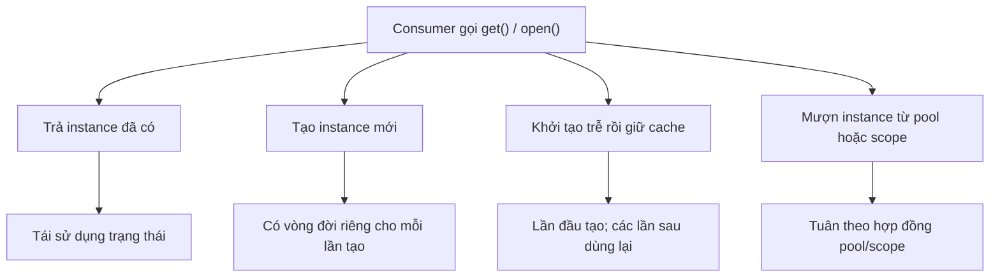
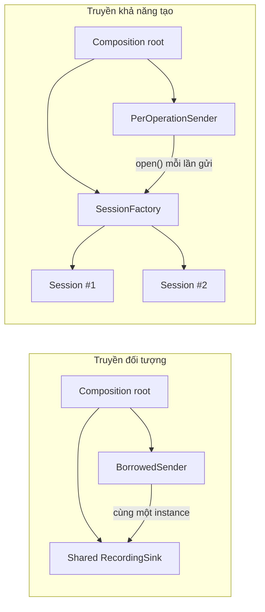

# Phân biệt truyền đối tượng với truyền khả năng tạo đối tượng

Trong **Dependency Injection (DI)**, một lớp có thể nhận sẵn đối tượng để sử dụng:

```java
OrderService(OrderRepository repository)
```

Nhưng đôi khi lớp cần khả năng **lấy hoặc tạo một đối tượng khi phát sinh công việc**:

```java
OrderService(Supplier<OrderSession> sessions)
```

Hai constructor trông khá giống nhau, song có ý nghĩa khác biệt. Trường hợp đầu cung cấp **một instance đã được chọn** tại thời điểm lắp ghép; trường hợp sau cung cấp **một phép toán có thể trả về instance khi được gọi**. Phép toán đó có thể tạo mới, tái sử dụng, lấy từ pool hoặc tìm instance đúng scope. Nếu không quy định rõ cách hoạt động, chỉ nhìn thấy `Supplier<T>` hay `Provider<T>` là chưa đủ để kết luận một đối tượng mới sẽ xuất hiện.

Bài này nằm trong chương **Factory và Provider** của module **DEPENDENCY_INJECTION**. Mục tiêu là phân biệt truyền đối tượng với truyền khả năng tạo/truy xuất đối tượng, hiểu lựa chọn đó ảnh hưởng đến **Inversion of Control (IoC)**, **constructor injection**, **composition root**, scope và vòng đời như thế nào, rồi kiểm tra bằng **Java thuần** trước khi học cách DI container triển khai các cơ chế tương tự.

## 1. Câu hỏi cốt lõi: consumer nhận một instance hay nhận một cách lấy instance?

Giả sử `BookingService` cần một client để gửi thông báo. Có hai thiết kế:

**A. Truyền trực tiếp đối tượng**

```java
final class BookingService {
    private final MessageSink sink;

    BookingService(MessageSink sink) {
        this.sink = java.util.Objects.requireNonNull(sink);
    }

    void confirm(String bookingId) {
        sink.send("confirmed:" + bookingId);
    }
}
```

Constructor nhận `MessageSink`. Khi tạo service, composition root phải **đã có một tham chiếu** đến sink. Các lời gọi `confirm(...)` sử dụng chính tham chiếu đó, trừ khi bản thân sink chuyển tiếp đến những tài nguyên khác.

**B. Truyền khả năng tạo hoặc lấy đối tượng**

```java
final class BookingServiceWithSupplier {
    private final java.util.function.Supplier<MessageSink> sinks;

    BookingServiceWithSupplier(
            java.util.function.Supplier<MessageSink> sinks) {
        this.sinks = java.util.Objects.requireNonNull(sinks);
    }

    void confirm(String bookingId) {
        MessageSink sink = java.util.Objects.requireNonNull(sinks.get());
        sink.send("confirmed:" + bookingId);
    }
}
```

Constructor chỉ nhận **một hàm trả về `MessageSink`**. Service chưa cần lấy sink trong lúc lắp ghép. Mỗi lần chạy `confirm(...)`, nó gọi `get()` và dùng kết quả trả về.

Hai đoạn mã ở trên chỉ minh họa cấu trúc; `MessageSink` là một hợp đồng sẽ được định nghĩa đầy đủ ở phần thực hành. **Điểm cần nắm:** `get()` có nghĩa *truy xuất đối tượng theo quy tắc của supplier*, không có nghĩa bắt buộc `new`.

### 1.1. Bảng so sánh

| Khía cạnh | Truyền đối tượng `T` | Truyền khả năng lấy/tạo đối tượng `Supplier<T>` hoặc factory |
| --- | --- | --- |
| Giá trị constructor nhận | Tham chiếu tới một instance | Một đối tượng/hàm có thao tác trả về instance |
| Thời điểm consumer có `T` | Khi service được khởi tạo | Khi gọi `get()` hoặc phương thức factory |
| Độ ổn định của tham chiếu consumer dùng | Thường giữ cùng tham chiếu trong trường `final` | Tùy kết quả mỗi lần gọi factory |
| Khả năng tạo mới theo yêu cầu | Consumer không tự tạo thông qua tham chiếu `T` | Có, **nếu** factory được thiết kế như vậy |
| Tính lazy | Consumer đã nhận `T`, nhưng `T` có thể tự khởi tạo tài nguyên nội bộ một cách lazy | Có thể trì hoãn việc lấy/tạo `T` đến lúc cần |
| Scope | Do composition root/container quyết định khi cấp `T` | Cũng do composition root/container và hợp đồng factory quyết định |
| Quyền đóng | Phải theo hợp đồng ownership của `T` | Cần quy định rõ owner của **mỗi instance trả về** |
| Độ phức tạp | Thường đơn giản, dễ thấy đồ thị | Thêm quyết định về thời điểm và số lần lấy instance |

Vì vậy, **ưu tiên truyền trực tiếp đối tượng nếu một instance ổn định là đủ**. Chỉ truyền factory/provider khi consumer có nhu cầu thật sự về **thời điểm tạo, ngữ cảnh tạo, số lần tạo hoặc vòng đời riêng cho từng thao tác**.

## 2. `Supplier`, factory và provider: giống và khác

Trong Java thuần, `java.util.function.Supplier<T>` là một functional interface có phương thức `T get()`. Nó diễn tả một hành động **không nhận tham số và trả về giá trị**.

```java
java.util.function.Supplier<StringBuilder> newBuilder =
    StringBuilder::new;
StringBuilder a = newBuilder.get();
StringBuilder b = newBuilder.get();
System.out.println(a == b); // false, do hàm này tạo mới mỗi lần gọi.
```

Nhưng vẫn là `Supplier<StringBuilder>`, ta có thể trả về cùng một instance:

```java
StringBuilder shared = new StringBuilder();
java.util.function.Supplier<StringBuilder> sameBuilder = () -> shared;
System.out.println(sameBuilder.get() == sameBuilder.get()); // true
```

Kết quả khác nhau vì **hành vi của lambda**, không phải vì tên kiểu `Supplier`. Một supplier còn có thể lưu cache sau lần đầu tạo, trả object hiện hành từ một request scope, hoặc trả một proxy.

### Factory là hợp đồng tạo/lấy đối tượng theo ngữ nghĩa cụ thể

**Factory** thường là một interface hoặc class có phương thức mang ý nghĩa rõ hơn `get()`, đôi khi nhận tham số để tạo đối tượng phù hợp với ngữ cảnh:

```java
interface ReportSessionFactory {
    ReportSession openFor(String tenantId);
}
```

Ví dụ này chỉ mô tả hợp đồng; `ReportSession` là kiểu giả định. Tên `openFor(...)` nói rằng việc gọi liên quan tới việc mở một session cho tenant được chỉ định. Nếu session là resource cần đóng, hợp đồng còn phải quy định **ai có trách nhiệm đóng** sau khi mở.

**Provider** là tên thường gặp trong DI framework cho một đối tượng cho phép lấy dependency khi cần. Ví dụ, các API như `Provider<T>.get()` hoặc `ObjectProvider<T>` có thể tương tác với scope/container. Những API đó có quy tắc cụ thể của từng framework; không thể kết luận một provider luôn tạo instance mới hay luôn trả singleton chỉ từ tên phương thức.

| Công cụ | Điểm mạnh | Điều cần làm rõ |
| --- | --- | --- |
| `Supplier<T>` (JDK) | Nhỏ, dễ dùng với lambda hoặc method reference | Kết quả có mới không? Ai sở hữu kết quả? |
| Factory tự định nghĩa | Tên hành vi rõ, có thể nhận tham số và quy định lỗi | Factory tạo mới, lấy từ pool hay dùng chung? |
| Provider của DI container | Lấy đối tượng theo cấu hình và scope của container | Scope, cách giải quyết phụ thuộc, quy tắc cleanup |
| Truyền trực tiếp `T` | API consumer đơn giản, dễ kiểm thử | Instance được chia sẻ trong phạm vi nào? |

**Nhận factory/provider qua constructor vẫn là DI.** Đối tượng nghiệp vụ không tự quyết định dùng lớp triển khai cụ thể nào; composition root quyết định sẽ cấp *factory nào* và factory đó cung cấp tài nguyên ra sao. Tuy nhiên, nếu service tự gọi một global registry/service locator để lấy factory, phụ thuộc có thể lại bị ẩn.

## 3. Phân biệt ba chiến lược thường bị gọi chung là “lazy”

Khả năng lấy đối tượng khi cần **không đồng nghĩa** với tạo object mới ở mỗi lần gọi.



- **Trả instance đã có:** `() -> sharedClient`. Consumer gọi nhiều lần vẫn có thể nhận cùng một tham chiếu.
- **Tạo mới mỗi lần:** `Client::new` hoặc factory chủ động gọi `new`. Dễ tạo vòng đời riêng cho mỗi tác vụ, nhưng có chi phí tạo và cleanup.
- **Lazy + cache:** chỉ tạo khi lần đầu cần, sau đó giữ cùng instance. Nếu nhiều luồng cùng gọi, cách đồng bộ/cache phải được thiết kế rõ.
- **Pool/scope:** mỗi lần gọi lấy một instance theo chính sách bên ngoài, có thể là cùng instance hoặc khác instance; “mượn” và “trả” cần đúng hợp đồng.

Nếu ứng dụng cần **mỗi tác vụ một session**, hãy viết điều đó thành hợp đồng rõ ràng, chẳng hạn `SessionFactory.open()` trả một session mới do caller chịu trách nhiệm đóng. Nếu chỉ dùng `Supplier<Session>` mơ hồ, người đọc rất khó biết liệu đóng kết quả có làm ảnh hưởng các consumer khác hay không.

## 4. Ví dụ Java hoàn chỉnh: dùng một sink được cấp và tạo session theo từng thao tác

Ta giả lập một kênh gửi thông báo đặt chỗ. Có hai mô hình sử dụng:

1. **`BorrowedSender` nhận một `MessageSink` trực tiếp**. Nó sử dụng sink được cấp và **không đóng** sink. Chủ sở hữu bên ngoài quyết định khi nào đóng.
2. **`PerOperationSender` nhận `SessionFactory`**. Mỗi lần gửi, nó yêu cầu factory mở **một session mới**, sử dụng rồi đóng session bằng `try-with-resources`.

Trong ví dụ này, **hợp đồng của factory chủ động cam kết mở session mới**. Đây là lựa chọn của ứng dụng, không phải đặc tính tự động của mọi provider.



Lưu toàn bộ mã sau vào `FactoryVsInstanceExample.java` (JDK 11 trở lên):

```java
import java.util.ArrayList;
import java.util.List;
import java.util.Objects;

public final class FactoryVsInstanceExample {
    private FactoryVsInstanceExample() {}

    // Consumer gửi thông báo chỉ cần quyền send().
    public interface MessageSink {
        void send(String message);
    }

    // Session là resource được mở cho một lần gửi; caller phải đóng.
    public interface MessageSession extends MessageSink, AutoCloseable {
        @Override
        void close();
    }

    // Hợp đồng của factory trong ví dụ: mỗi open() trả một session MỚI.
    public interface SessionFactory {
        MessageSession open();
    }

    private static String confirmation(String bookingId) {
        if (bookingId == null || bookingId.trim().isEmpty()) {
            throw new IllegalArgumentException("bookingId must not be blank");
        }
        return "confirmed:" + bookingId;
    }

    public static final class BorrowedSender {
        private final MessageSink sink;

        public BorrowedSender(MessageSink sink) {
            this.sink = Objects.requireNonNull(sink, "sink");
        }

        public void send(String bookingId) {
            sink.send(confirmation(bookingId));
            // Không gọi close(): sink thuộc quyền quản lý của bên cấp.
        }
    }

    public static final class PerOperationSender {
        private final SessionFactory factory;

        public PerOperationSender(SessionFactory factory) {
            this.factory = Objects.requireNonNull(factory, "factory");
        }

        public void send(String bookingId) {
            // Kiểm tra trước khi cấp phát session, tránh tạo vô ích.
            String message = confirmation(bookingId);
            MessageSession opened =
                Objects.requireNonNull(factory.open(), "factory.open()");

            // Theo hợp đồng, caller sở hữu session trả về từ open().
            try (MessageSession session = opened) {
                session.send(message);
            }
        }
    }

    // Sink được composition root sở hữu, có thể dùng cho nhiều lời gọi.
    public static final class RecordingSink
            implements MessageSink, AutoCloseable {
        private final List<String> messages = new ArrayList<>();
        private boolean closed;
        private int closeCount;

        @Override
        public void send(String message) {
            if (closed) {
                throw new IllegalStateException("Sink is closed");
            }
            messages.add(Objects.requireNonNull(message, "message"));
        }

        public List<String> messages() {
            return List.copyOf(messages);
        }

        public boolean isClosed() {
            return closed;
        }

        public int closeCount() {
            return closeCount;
        }

        @Override
        public void close() {
            if (!closed) {
                closed = true;
                closeCount++;
            }
        }
    }

    // Mỗi session có danh tính và trạng thái đóng riêng.
    public static final class RecordingSession implements MessageSession {
        private final int id;
        private final List<String> events;
        private boolean closed;

        private RecordingSession(int id, List<String> events) {
            this.id = id;
            this.events = events;
        }

        @Override
        public void send(String message) {
            if (closed) {
                throw new IllegalStateException("Session is closed");
            }
            events.add("send:" + id + ":" + message);
        }

        public boolean isClosed() {
            return closed;
        }

        @Override
        public void close() {
            if (!closed) {
                closed = true;
                events.add("close:" + id);
            }
        }
    }

    // Factory trong ví dụ chủ động tạo mới mỗi lần open().
    public static final class RecordingSessionFactory
            implements SessionFactory {
        private final List<String> events = new ArrayList<>();
        private final List<RecordingSession> sessions = new ArrayList<>();

        @Override
        public MessageSession open() {
            int nextId = sessions.size() + 1;
            RecordingSession session =
                new RecordingSession(nextId, events);
            sessions.add(session);
            events.add("open:" + nextId);
            return session;
        }

        public int createdCount() {
            return sessions.size();
        }

        public boolean allClosed() {
            return sessions.stream().allMatch(RecordingSession::isClosed);
        }

        public List<String> events() {
            return List.copyOf(events);
        }
    }

    public static void main(String[] args) {
        // Composition root: cấp một đối tượng đã có.
        try (RecordingSink shared = new RecordingSink()) {
            BorrowedSender sender = new BorrowedSender(shared);
            sender.send("BK-1");
            sender.send("BK-2");
            System.out.println("Direct: " + shared.messages());
        } // Chủ sở hữu đóng shared khi kết thúc scope.

        // Composition root: cấp khả năng mở session mới.
        RecordingSessionFactory sessions = new RecordingSessionFactory();
        PerOperationSender sender = new PerOperationSender(sessions);
        sender.send("BK-3");
        sender.send("BK-4");
        System.out.println("Created: " + sessions.createdCount());
        System.out.println("Events: " + sessions.events());
    }
}
```

Biên dịch và chạy:

```bash
javac FactoryVsInstanceExample.java
java FactoryVsInstanceExample
```

Kết quả:

```text
Direct: [confirmed:BK-1, confirmed:BK-2]
Created: 2
Events: [open:1, send:1:confirmed:BK-3, close:1, open:2, send:2:confirmed:BK-4, close:2]
```

Lúc tạo `BorrowedSender`, composition root đã truyền một sink cụ thể. Dù `send(...)` được gọi hai lần, **không có lệnh tạo sink mới** trong service. Trong mô hình thứ hai, lúc tạo `PerOperationSender`, composition root chỉ truyền factory. `RecordingSessionFactory.open()` **chưa được gọi**; sau hai lần gửi mới có hai session khác nhau, mỗi session được đóng ở cuối thao tác tương ứng.

Chú ý phần `RecordingSessionFactory` lưu danh sách session chỉ để minh họa/test. Một factory thực tế có thể không giữ mọi session đã tạo, mà chuyển giao trách nhiệm đóng cho caller. Các `ArrayList` và cờ `boolean` trong ví dụ dùng tuần tự; chúng **không được thiết kế an toàn cho nhiều luồng đồng thời**.

## 5. Kiểm tra bằng Java thuần: việc tạo, tái sử dụng và đóng

Để chứng minh khác biệt, kiểm tra cần quan sát **số lần tạo**, **thời điểm tạo**, **danh tính instance** và **ai đóng**. Những điều này không thể suy ra đầy đủ chỉ bằng việc constructor nhận `Supplier<T>` hay `SessionFactory`.

Tạo tệp `FactoryVsInstanceCheck.java` cùng thư mục:

```java
import java.util.ArrayList;
import java.util.Arrays;
import java.util.List;
import java.util.function.Supplier;

public final class FactoryVsInstanceCheck {
    public static void main(String[] args) {
        directInjectionUsesBorrowedInstance();
        factoryCreatesOnlyWhenCalledAndClosesEachSession();
        invalidInputDoesNotOpenSession();
        failureInsideSessionStillClosesIt();
        supplierDoesNotPromiseNewInstance();
        invalidDependenciesFailClearly();
        System.out.println("PASS: 6 factory/provider checks");
    }

    private static void directInjectionUsesBorrowedInstance() {
        FactoryVsInstanceExample.RecordingSink shared =
            new FactoryVsInstanceExample.RecordingSink();
        try {
            FactoryVsInstanceExample.BorrowedSender first =
                new FactoryVsInstanceExample.BorrowedSender(shared);
            FactoryVsInstanceExample.BorrowedSender second =
                new FactoryVsInstanceExample.BorrowedSender(shared);

            first.send("BK-A");
            second.send("BK-B");

            check(shared.messages().equals(
                Arrays.asList("confirmed:BK-A", "confirmed:BK-B")),
                "Both consumers must use the supplied sink");
            check(!shared.isClosed() && shared.closeCount() == 0,
                "Borrowers must not close an externally owned sink");
        } finally {
            shared.close(); // Test sở hữu shared nên test đóng.
        }
        check(shared.isClosed() && shared.closeCount() == 1,
            "Owner must close the shared sink once");
    }

    private static void factoryCreatesOnlyWhenCalledAndClosesEachSession() {
        FactoryVsInstanceExample.RecordingSessionFactory factory =
            new FactoryVsInstanceExample.RecordingSessionFactory();
        FactoryVsInstanceExample.PerOperationSender sender =
            new FactoryVsInstanceExample.PerOperationSender(factory);

        check(factory.createdCount() == 0,
            "Constructing sender should not open a session");
        sender.send("BK-C");
        sender.send("BK-D");

        check(factory.createdCount() == 2,
            "The defined factory contract opens one session per operation");
        check(factory.allClosed(), "Every created session must be closed");
        check(factory.events().equals(Arrays.asList(
            "open:1", "send:1:confirmed:BK-C", "close:1",
            "open:2", "send:2:confirmed:BK-D", "close:2")),
            "Wrong creation/use/cleanup sequence");
    }

    private static void invalidInputDoesNotOpenSession() {
        FactoryVsInstanceExample.RecordingSessionFactory factory =
            new FactoryVsInstanceExample.RecordingSessionFactory();
        FactoryVsInstanceExample.PerOperationSender sender =
            new FactoryVsInstanceExample.PerOperationSender(factory);
        boolean rejected = false;
        try {
            sender.send(" ");
        } catch (IllegalArgumentException expected) {
            rejected = true;
        }
        check(rejected && factory.createdCount() == 0,
            "Validation should happen before resource creation");
    }

    private static void failureInsideSessionStillClosesIt() {
        List<String> events = new ArrayList<>();
        FactoryVsInstanceExample.SessionFactory failingFactory = () ->
            new FactoryVsInstanceExample.MessageSession() {
                @Override
                public void send(String message) {
                    events.add("send");
                    throw new IllegalStateException("send failed");
                }

                @Override
                public void close() {
                    events.add("close");
                }
            };

        FactoryVsInstanceExample.PerOperationSender sender =
            new FactoryVsInstanceExample.PerOperationSender(failingFactory);
        boolean failed = false;
        try {
            sender.send("BK-FAIL");
        } catch (IllegalStateException expected) {
            failed = "send failed".equals(expected.getMessage());
        }
        check(failed && events.equals(Arrays.asList("send", "close")),
            "try-with-resources must close session after send fails");
    }

    private static void supplierDoesNotPromiseNewInstance() {
        Object shared = new Object();
        Supplier<Object> reused = () -> shared;
        Supplier<Object> fresh = Object::new;

        check(reused.get() == reused.get(),
            "This supplier intentionally reuses one instance");
        check(fresh.get() != fresh.get(),
            "This supplier intentionally creates a new instance");
    }

    private static void invalidDependenciesFailClearly() {
        boolean missingFactory = false;
        try {
            new FactoryVsInstanceExample.PerOperationSender(null);
        } catch (NullPointerException expected) {
            missingFactory = "factory".equals(expected.getMessage());
        }

        FactoryVsInstanceExample.PerOperationSender returnsNull =
            new FactoryVsInstanceExample.PerOperationSender(() -> null);
        boolean nullSession = false;
        try {
            returnsNull.send("BK-NULL");
        } catch (NullPointerException expected) {
            nullSession = "factory.open()".equals(expected.getMessage());
        }
        check(missingFactory && nullSession,
            "Missing dependency or invalid factory result must fail clearly");
    }

    private static void check(boolean condition, String message) {
        if (!condition) {
            throw new AssertionError(message);
        }
    }
}
```

Chạy:

```bash
javac FactoryVsInstanceExample.java FactoryVsInstanceCheck.java
java FactoryVsInstanceCheck
```

Khi các phép kiểm đạt:

```text
PASS: 6 factory/provider checks
```

| Phép kiểm | Điều được chứng minh | Giới hạn |
| --- | --- | --- |
| `directInjectionUsesBorrowedInstance` | Hai consumer sử dụng sink được cấp; chỉ owner đóng | Không kiểm tra một client mạng thật |
| `factoryCreatesOnlyWhenCalledAndClosesEachSession` | Factory không mở lúc tạo service, mở mỗi lần gọi, đóng đúng từng session | Là chính sách của factory **trong ví dụ** |
| `invalidInputDoesNotOpenSession` | Dữ liệu sai được loại trước khi cấp tài nguyên | Không thử mọi quy tắc hợp lệ |
| `failureInsideSessionStillClosesIt` | `try-with-resources` chạy cleanup khi `send` ném lỗi | Không minh họa lỗi phát sinh trong `close` |
| `supplierDoesNotPromiseNewInstance` | Hai supplier cùng kiểu có chính sách reuse khác nhau | Không bao quát cache/pool/scope framework |
| `invalidDependenciesFailClearly` | Constructor và điểm lấy resource phát hiện `null` rõ ràng | Không tự kiểm tra cấu hình bên trong adapter |

Các kiểm tra dùng `AssertionError` qua `check(...)`, vì vậy không phụ thuộc cờ `-ea`. Chúng kiểm tra **quy ước consumer và factory**. Một adapter thật vẫn cần kiểm thử tích hợp cho thời gian mở kết nối, timeout, lỗi đóng, transaction, giới hạn pool và tính an toàn luồng.

## 6. Ai sở hữu đối tượng do factory trả về?

Đây là câu hỏi quan trọng nhất khi factory trả một thứ có `close()`:

- Với **phụ thuộc trực tiếp `MessageSink`**, `BorrowedSender` chỉ được cấp quyền `send(...)`. `RecordingSink` do composition root tạo và đóng khi kết thúc scope.
- Với **`SessionFactory.open()` của ví dụ**, hợp đồng nêu rõ mỗi lần mở trả session mới mà caller phải đóng. Vì vậy `PerOperationSender` dùng `try-with-resources` cho mỗi lần gửi.
- Với **pool hoặc provider do container quản lý**, `get()` có thể trả tài nguyên **đang được quản lý ở nơi khác**. Không được mặc định gọi `close()` trên kết quả nếu hợp đồng không giao trách nhiệm đó cho consumer.

Phân biệt **quyền lấy instance** với **quyền sở hữu instance**. Việc consumer gọi `factory.open()` không phải lúc nào cũng đồng nghĩa consumer sở hữu kết quả; chính **hợp đồng factory** mới quyết định điều này. Trong code mục 4, chúng ta đã chủ động thiết kế hợp đồng chuyển giao trách nhiệm đóng.

### 6.1. Trường hợp dùng connection pool

Một đối tượng `DataSource` có thể là phụ thuộc dùng chung và được tiêm trực tiếp:

```java
final class SqlOrderRepository {
    private final javax.sql.DataSource dataSource;

    SqlOrderRepository(javax.sql.DataSource dataSource) {
        this.dataSource = java.util.Objects.requireNonNull(dataSource);
    }

    void performWork() throws java.sql.SQLException {
        try (java.sql.Connection connection = dataSource.getConnection()) {
            // Thao tác SQL phù hợp với transaction ở đây.
        }
    }
}
```

Trong kiểu sử dụng `DataSource` thông thường, repository **mượn DataSource** và có trách nhiệm `close()` trên connection đã lấy nếu chính nó sở hữu phạm vi sử dụng connection đó. Với pool, `connection.close()` thường trả connection logic về pool theo hợp đồng của pool, không nhất thiết đóng socket vật lý. `DataSource` dùng chung có vòng đời riêng do owner ứng dụng/container quyết định.

**Ngoại lệ quan trọng:** nếu repository tham gia một transaction do bên ngoài quản lý, chiến lược mượn/trả connection phải tuân theo transaction manager. Không tự thêm `getConnection()/close()` vào mọi repository khi framework đang đảm nhiệm một transaction scope khác.

### 6.2. Scope không tự biến đổi khi truyền provider

Ví dụ, một service sống suốt ứng dụng nhận một `Supplier<RequestContext>`. Nếu supplier biết cách lấy `RequestContext` đang hoạt động, service có thể truy xuất đúng ngữ cảnh tại thời điểm gọi. Nhưng supplier cũng có thể lưu sẵn context của request đầu tiên và trả lại mãi.

Trong cả hai trường hợp, **kiểu dữ liệu của trường** vẫn chỉ là `Supplier<RequestContext>`. Cần xác định cơ chế scope ở composition root/provider/container và thời điểm hợp lệ của context. Đừng dùng provider để che một phụ thuộc vào request context mà không thiết kế cách truy xuất và cleanup.

## 7. Những lợi ích và chi phí thực tế

### 7.1. Khi truyền đối tượng trực tiếp là phù hợp

Truyền trực tiếp thường tốt khi:

- Phụ thuộc sử dụng ổn định qua vòng đời consumer, chẳng hạn `Clock`, formatter bất biến, policy không giữ state theo request.
- Client dùng chung đã được thiết kế an toàn đồng thời và có owner quản lý vòng đời.
- Consumer không cần chọn biến thể theo đầu vào hay tạo session riêng.
- Muốn lỗi cấu hình quan trọng xuất hiện sớm tại composition root, thay vì trong một luồng xử lý muộn.

Constructor injection rõ ràng giữ đồ thị đối tượng dễ đọc: muốn tạo service phải cung cấp đầy đủ những gì nó cần.

### 7.2. Khi truyền khả năng tạo/truy xuất là phù hợp

Factory/provider có ích khi:

- Mỗi tác vụ cần một **đối tượng trạng thái mới**, ví dụ phiên xử lý/đơn vị công việc độc lập.
- Việc tạo phụ thuộc tốn chi phí, chỉ một số nhánh thực thi mới cần đến nó (**lazy**).
- Cần tham số tại thời điểm tạo, ví dụ tenant, cấu hình giao dịch hoặc loại tác vụ.
- Phải truy xuất một instance **theo scope hiện hành**, không thể giữ mãi một instance trong service sống lâu.
- Caller cần quyết định chính xác lúc mở và đóng tài nguyên theo ranh giới một thao tác.

Các lợi ích đi kèm chi phí: nhiều đường thực thi có thể gây lỗi tạo resource muộn, tạo dư tài nguyên, làm tăng độ khó khi kiểm soát scope hoặc che giấu chính sách tái sử dụng. Vì vậy, không nên tự động thay mọi `T` bằng `Supplier<T>` chỉ vì có vẻ linh hoạt hơn.

## 8. Những nhầm lẫn và phản ví dụ thường gặp

### 8.1. “Cứ gọi `get()` là có object mới”

Sai. `Supplier<T>` chỉ quy định có phương thức `get()`. Trong Java thuần, `() -> existing` trả object có sẵn, `Type::new` tạo mới và một hàm có cache có thể trả mới ở lần đầu rồi tái sử dụng. Trong DI container, scope và cấu hình provider quyết định kết quả.

### 8.2. “Truyền object thì không thể lazy”

Không chính xác. Một object được tiêm trực tiếp có thể **lazy initialize tài nguyên bên trong nó** hoặc là proxy chỉ kết nối khi cần. Ngược lại, factory có thể tạo trước các object rồi trả về chúng sau. Khi phân tích lazy, hãy hỏi **cái gì được trì hoãn**: việc tạo tham chiếu, tạo instance, mở connection hay chạy một nghiệp vụ tốn chi phí?

### 8.3. “Provider giải quyết mọi vấn đề scope”

Provider chỉ mang một cách lấy đối tượng. Nó không bảo đảm instance trả về phù hợp request hiện hành, thread-safe, được đóng đúng lúc hay không rò state giữa các tenant. Những bảo đảm đó thuộc về **thiết kế provider và scope thực tế**.

### 8.4. “Factory lúc nào cũng phải nằm trong service nghiệp vụ”

Nếu service không cần quyết định **thời điểm hoặc ngữ cảnh tạo**, nhận factory chỉ khiến API dài hơn. Composition root có thể gọi factory để tạo phụ thuộc một lần rồi tiêm object sẵn vào service. Dùng factory bên trong consumer chỉ khi chính consumer cần kiểm soát việc lấy/khởi tạo theo một thao tác.

### 8.5. “Dùng `new` trong factory là vi phạm DI”

Không. `new` ở **composition root/factory thích hợp** chính là cách DI thủ công lắp ghép phụ thuộc. Vấn đề xuất hiện khi logic nghiệp vụ tự chọn các triển khai hạ tầng cố định, vì lúc đó quyền tạo phụ thuộc bị trộn vào trách nhiệm nghiệp vụ.

### 8.6. “Đóng kết quả `get()` luôn an toàn”

Không. Nếu provider trả cùng một singleton cho nhiều consumer, consumer đầu tiên đóng singleton sẽ làm các consumer khác gặp lỗi. Nếu factory trả đối tượng sở hữu riêng với hợp đồng bắt buộc caller đóng, không đóng sẽ gây rò rỉ. Cần biết **quyền sở hữu** trước khi quyết định cleanup.

### 8.7. “Factory có thể che vòng phụ thuộc constructor”

Truyền provider để trì hoãn lấy một đối tượng có thể tránh lỗi tạo vòng tại thời điểm khởi tạo, nhưng chưa chắc sửa được một thiết kế `A → B → A` thiếu ranh giới trách nhiệm. Nếu hai service vẫn cần gọi qua lại theo cách khó kiểm soát, cần xem xét tách trách nhiệm, tổ chức lại luồng điều khiển hoặc dùng sự kiện khi phù hợp. Provider không tự biến một chu trình nghiệp vụ thành thiết kế đúng.

## 9. Quy trình chọn cách tiêm trong dự án

1. **Xác định khả năng consumer thực sự cần.** Ví dụ, gửi một thông báo hay mở một session gửi cho mỗi tác vụ?
2. **Hỏi có cần instance mới không.** Nếu chỉ cần cùng instance ổn định, tiêm trực tiếp `T`.
3. **Nếu cần lấy khi sử dụng, quy định kết quả `get()/open()`.** Có tạo mới, dùng cache, dùng pool hay truy xuất scope hiện hành? Một lần gọi được bao nhiêu instance?
4. **Chọn hợp đồng đơn giản nhất.** Dùng `Supplier<T>` cho phép lấy không tham số khi ngữ nghĩa đã rõ; dùng factory có tên/đối số khi việc tạo cần chính sách riêng.
5. **Nói rõ trách nhiệm vòng đời.** Object trả về là borrowed hay owned? Ai gọi `close()`? Resource phải sống tới khi nào?
6. **Đặt việc tạo implementation tại composition root hoặc factory phù hợp.** Consumer chỉ biết interface/capability cần dùng.
7. **Kiểm thử hai cấp.** Test consumer với factory giả ghi nhận lời gọi; test factory thật hoặc adapter với resource thử nghiệm và kiểm tra cleanup.
8. **Kiểm tra scope và đồng thời.** Không chia sẻ mutable state ngoài ý muốn; không dùng resource đã đóng; phân biệt factory gọi theo request và factory nằm trong singleton.

### Tình huống tự kiểm tra

Một ứng dụng xử lý đơn hàng có `OrderService` sống suốt ứng dụng và `UnitOfWork` đại diện cho một transaction. Mỗi lần `placeOrder(...)` cần mở một `UnitOfWork` mới, xử lý nhiều bước trên cùng transaction rồi commit/rollback và đóng.

Hãy tự trả lời:

1. Nên truyền **một `UnitOfWork` cố định** hay **`UnitOfWorkFactory`** vào service? Vì sao?
2. Phương thức factory nên có ngữ nghĩa nào: `get()` chung chung, `open()` hay `beginTransaction()`?
3. Ai chịu trách nhiệm đóng transaction nếu nghiệp vụ ném exception?
4. Nếu factory thực tế trả cùng một `UnitOfWork` qua nhiều request, điều gì có thể sai?
5. Unit test Java thuần cần ghi lại những sự kiện nào để chứng minh `open → work → commit/rollback → close` theo chính sách nghiệp vụ?

Hướng giải: một factory có hợp đồng `open()` tạo **unit of work riêng cho mỗi thao tác**, consumer sử dụng và đóng trong đúng scope. Thành phần quản lý transaction phải xác định rõ khi nào commit, rollback và dispose. Dùng fake ghi nhận sự kiện để kiểm tra thứ tự và nhánh lỗi; dùng integration test để kiểm tra transaction thật. Nếu transaction được framework quản lý, phải theo đúng hợp đồng vòng đời của framework trước khi tự tạo hoặc đóng resource.

**Ghi nhớ:** **Tiêm đối tượng** cấp một instance đã được lựa chọn; **tiêm khả năng tạo/lấy đối tượng** cấp một cách truy xuất instance vào thời điểm cần. Khả năng lấy object không tự hứa tạo mới, lazy, singleton hay tự động cleanup. Chính **hợp đồng factory/provider, composition root, scope và quyền sở hữu** quyết định các hành vi ấy. Hiểu rõ sự khác biệt này là nền tảng để dùng DI thủ công đúng cách và chuyển sang DI container mà vẫn kiểm soát được đồ thị, tài nguyên và kiểm thử.
