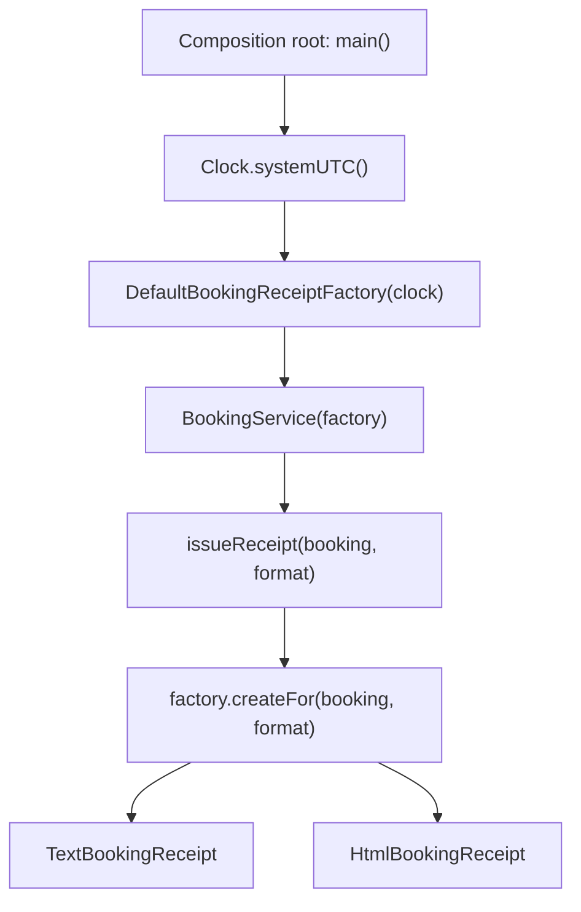
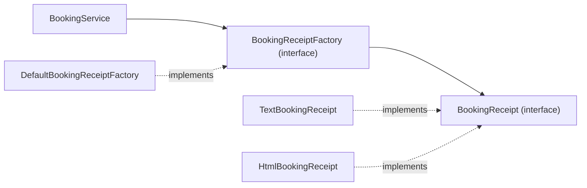
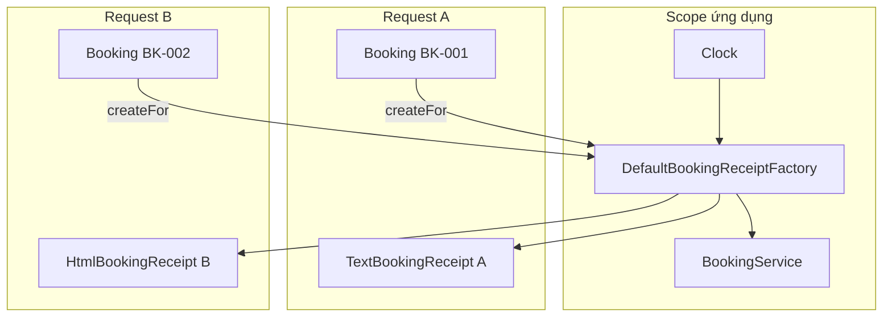

# Factory có kiểu rõ ràng cho nhu cầu nghiệp vụ cụ thể

Trong **Dependency Injection (DI)**, constructor injection giúp một lớp nhận các cộng tác viên cần thiết từ bên ngoài. Tuy nhiên, đôi khi lớp nghiệp vụ cần **tạo một đối tượng mới trong lúc xử lý yêu cầu**, khi thông tin cần để tạo đối tượng chỉ xuất hiện ở thời điểm đó. Ví dụ, `BookingService` phải phát hành biên nhận cho booking vừa hoàn tất. Người dùng có thể yêu cầu định dạng văn bản hoặc HTML, còn thời điểm phát hành chỉ được xác định khi tạo biên nhận.

Nếu `BookingService` tự viết `new TextBookingReceipt(...)`, `new HtmlBookingReceipt(...)` và nhánh `switch` cho từng định dạng, nó bắt đầu biết những chi tiết tạo đối tượng mà lẽ ra có thể được tách ra khỏi nghiệp vụ điều phối. Một **factory có kiểu rõ ràng, gắn với nhu cầu nghiệp vụ cụ thể** giúp mô tả chính xác yêu cầu: *tạo biên nhận cho booking này, ở định dạng này*. Factory nhận các tham số nghiệp vụ của lần tạo, sử dụng những phụ thuộc cấu hình đã được inject, rồi trả về một đối tượng có hợp đồng được xác định trước.

Bài này thuộc chương **Factory và Provider** của nội dung **Dependency Injection và Inversion of Control (IoC)**. Ta tập trung vào thiết kế factory chuyên biệt, cách nối factory tại composition root, khi nào cần tạo mới theo yêu cầu, vòng đời đối tượng tạo ra và cách kiểm thử bằng Java thuần. DI container có thể tự động tạo và inject factory, nhưng các nguyên tắc thiết kế vẫn có thể thực hành đầy đủ mà không cần framework.

## 1. Vấn đề: nhu cầu tạo đối tượng xuất hiện sau khi service đã được khởi tạo

Giả sử chương trình tạo một `BookingService` khi khởi động. Tại thời điểm này, chưa biết booking cụ thể hay định dạng biên nhận được người dùng yêu cầu:

```text
Khởi động:
  composition root tạo BookingService

Request A:
  booking = BK-001, format = TEXT
  -> cần biên nhận TEXT của BK-001

Request B:
  booking = BK-002, format = HTML
  -> cần biên nhận HTML của BK-002
```

Hai loại dữ liệu cần phân biệt:

| Loại thông tin | Ví dụ | Thời điểm có sẵn | Nơi phù hợp |
| --- | --- | --- | --- |
| Phụ thuộc/cấu hình ổn định | `Clock` dùng xác định thời điểm phát hành | Khi lắp ghép ứng dụng | Inject vào **factory** qua constructor |
| Dữ liệu riêng của thao tác | `Booking` và `ReceiptFormat` của request hiện tại | Khi service xử lý yêu cầu | Truyền vào **phương thức factory** |
| Đối tượng kết quả | Biên nhận mới cho một booking cụ thể | Sau khi gọi factory | Trả qua hợp đồng `BookingReceipt` |

Nếu buộc `BookingService` nhận sẵn một instance biên nhận trong constructor thì instance đó không thể đại diện đúng cho mọi booking tiếp theo. Nếu cho service tự tạo mọi biến thể, service bị gắn vào các implementation. Factory giải quyết hai vấn đề này bằng cách **inject khả năng tạo**, rồi **gọi tạo khi dữ liệu cụ thể đã có**.

## 2. Factory “có kiểu rõ ràng” là gì?

Một hợp đồng factory diễn đạt bằng ngôn ngữ nghiệp vụ có thể viết:

```java
interface BookingReceiptFactory {
    BookingReceipt createFor(Booking booking, ReceiptFormat format);
}
```

Ở đây:

- **`BookingReceiptFactory`** nêu rõ *thứ cần tạo*: biên nhận booking.
- **`createFor(...)`** nêu rõ *hành động*: tạo biên nhận cho một booking.
- **`Booking` và `ReceiptFormat`** là các tham số có kiểu xác định; caller không phải truyền một chuỗi tên class hay mảng tham số tùy ý.
- **`BookingReceipt`** là kiểu kết quả mà code nghiệp vụ sử dụng được, không phải `Object` rồi ép kiểu.

Factory không nhất thiết phải có các phương thức tên `create`; có thể dùng `createFor`, `openFor` hoặc `forBooking` khi điều đó giúp hợp đồng rõ hơn. Điều quan trọng là chữ ký giải thích được **nhu cầu nghiệp vụ cụ thể**, dữ liệu đầu vào và kiểu đầu ra.

So sánh hai thiết kế:

```java
// API chung chung: caller phải nhớ khóa, thứ tự tham số và kiểu ép.
Object create(String type, Object... arguments);

// API theo nghiệp vụ: được compiler kiểm tra các kiểu đầu vào/đầu ra.
BookingReceipt createFor(Booking booking, ReceiptFormat format);
```

Với API thứ nhất, lỗi đánh máy khóa `"htlm"`, truyền sai thứ tự tham số hoặc ép kết quả sang kiểu sai dễ chỉ lộ ra khi chạy. Với API thứ hai, tên phương thức và kiểu dữ liệu giúp IDE/compiler phát hiện nhiều sai sót ngay trong lúc viết mã. Factory vẫn cần kiểm tra các giá trị **không hợp lệ về nghiệp vụ** như `null` hoặc booking rỗng, vì hệ thống kiểu của Java không tự xác thực tất cả bất biến.

> **Typed factory không đồng nghĩa luôn phải tạo interface.** Có thể inject trực tiếp một class factory cụ thể khi không cần nhiều implementation hoặc fake. Interface trong bài này tạo ranh giới rõ ràng giữa service và quy tắc tạo biên nhận, đồng thời minh họa cách thay thế factory trong unit test.

## 3. Phân biệt factory chuyên biệt, provider và service locator

Các cơ chế này thường đều “đưa object cho caller”, nhưng cách chúng mô tả nhu cầu khác nhau:

| Cơ chế | Hình thức điển hình | Khi hữu ích | Điểm cần chú ý |
| --- | --- | --- | --- |
| **Factory chuyên biệt** | `BookingReceipt createFor(Booking, ReceiptFormat)` | Tạo đối tượng theo **dữ liệu nghiệp vụ lúc chạy** | Hợp đồng phải cụ thể, rõ quy tắc tạo và vòng đời |
| **Provider/Supplier** | `Supplier<BookingReceipt>` với `get()` | Lấy đối tượng lúc cần khi không cần tham số đầu vào từ caller | Không trực tiếp thể hiện booking/format của lần tạo; cần thêm ngữ cảnh hoặc wrapper nếu phải truyền dữ liệu |
| **Constructor injection trực tiếp** | `BookingService(BookingRepository repository)` | Service cần một cộng tác viên ổn định suốt vòng đời | Không phù hợp nếu cần một object mới mang dữ liệu khác ở mỗi request |
| **Service locator tổng quát** | `registry.get(BookingRepository.class)` | Tra cứu động trong một số hạ tầng đặc thù | Nếu dùng trong nghiệp vụ, phụ thuộc bị che khỏi constructor |
| **Hàm `new` cục bộ** | `new Booking(id, amount)` | Tạo đối tượng dữ liệu đơn giản thuộc trách nhiệm của method | Không cần factory nếu không có quy tắc tạo đáng tách hoặc biến thể đáng kể |

Một `Supplier<T>` chỉ có `get()`, vì vậy phù hợp nếu việc tạo **không cần đầu vào bổ sung ở lời gọi**. Có thể dùng `Function<Booking, BookingReceipt>` khi factory thật sự chỉ có một tham số và logic đơn giản. Tuy nhiên, với yêu cầu có nhiều tham số nghiệp vụ và tên thao tác có ý nghĩa, **interface factory chuyên biệt thường thể hiện ý định tốt hơn** một hàm tổng quát.

Một provider không bảo đảm mỗi lần gọi trả một instance mới; nó có thể trả cùng instance, một object thuộc scope hiện tại hoặc đối tượng mới tùy hợp đồng và cấu hình. Tương tự, factory cũng không mặc nhiên luôn tạo mới: nếu caller cần instance mới, **phải viết rõ ngữ nghĩa đó**. Ví dụ của bài chủ ý tạo một biên nhận mới cho mỗi lần phát hành.

## 4. Đồ thị phụ thuộc và nơi đặt quyết định tạo



Ở **thời điểm khởi động**, composition root tạo `Clock` và factory rồi inject factory vào service. Ở **thời điểm xử lý nghiệp vụ**, service đưa booking và định dạng yêu cầu vào factory; factory chọn class biên nhận và tạo instance cho lần gọi đó.

Phân biệt hai tầng quyết định:

1. **Composition root chọn implementation của factory** và những phụ thuộc ổn định mà factory cần. Ví dụ: `new DefaultBookingReceiptFactory(clock)`.
2. **Factory chọn cách tạo đối tượng nghiệp vụ dựa trên dữ liệu request**, ví dụ `TEXT` hay `HTML`. Đây là quy tắc tạo nằm trong vai trò của factory; nó không cần nằm trong service.

Vì vậy, việc đặt một `switch (format)` trong factory **không trái với nguyên tắc chọn implementation tại composition root**. Composition root chọn **ai thực hiện vai trò tạo biên nhận**; factory giải quyết **biến thể của kết quả theo yêu cầu nghiệp vụ**. Nếu format thực chất chỉ là cấu hình cố định cho cả ứng dụng, chọn một renderer cố định ở startup và inject trực tiếp có thể đơn giản hơn.

Ở mức mã nguồn:



Service biết **hợp đồng tạo** và **hợp đồng kết quả**, không biết cách kết xuất văn bản/HTML hay class kết quả cụ thể. Một factory có thể được thay thế bằng fake khi test service.

## 5. Ví dụ Java thuần: factory tạo biên nhận theo định dạng

Ta triển khai hai loại biên nhận. Mỗi biên nhận giữ dữ liệu booking và thời điểm phát hành; đây là **đối tượng giá trị mới được tạo cho từng yêu cầu**. Factory dùng `Clock` được inject để xác định thời điểm, vì vậy có thể dùng đồng hồ cố định khi kiểm thử.

Tạo file `TypedReceiptFactoryDemo.java`:

```java
import java.time.Clock;
import java.time.Instant;
import java.util.Objects;

enum ReceiptFormat {
    TEXT,
    HTML
}

final class Booking {
    private final String id;
    private final int amount;

    Booking(String id, int amount) {
        if (id == null || !id.matches("[A-Za-z0-9-]+")) {
            throw new IllegalArgumentException("bookingId khong hop le");
        }
        if (amount < 0) {
            throw new IllegalArgumentException("amount phai >= 0");
        }
        this.id = id;
        this.amount = amount;
    }

    String id() {
        return id;
    }

    int amount() {
        return amount;
    }
}

interface BookingReceipt {
    String bookingId();
    ReceiptFormat format();
    Instant issuedAt();
    String render();
}

interface BookingReceiptFactory {
    BookingReceipt createFor(Booking booking, ReceiptFormat format);
}

final class TextBookingReceipt implements BookingReceipt {
    private final Booking booking;
    private final Instant issuedAt;

    TextBookingReceipt(Booking booking, Instant issuedAt) {
        this.booking = Objects.requireNonNull(booking, "booking");
        this.issuedAt = Objects.requireNonNull(issuedAt, "issuedAt");
    }

    @Override
    public String bookingId() {
        return booking.id();
    }

    @Override
    public ReceiptFormat format() {
        return ReceiptFormat.TEXT;
    }

    @Override
    public Instant issuedAt() {
        return issuedAt;
    }

    @Override
    public String render() {
        return "TEXT BOOKING " + booking.id()
            + " amount=" + booking.amount()
            + " issuedAt=" + issuedAt;
    }
}

final class HtmlBookingReceipt implements BookingReceipt {
    private final Booking booking;
    private final Instant issuedAt;

    HtmlBookingReceipt(Booking booking, Instant issuedAt) {
        this.booking = Objects.requireNonNull(booking, "booking");
        this.issuedAt = Objects.requireNonNull(issuedAt, "issuedAt");
    }

    @Override
    public String bookingId() {
        return booking.id();
    }

    @Override
    public ReceiptFormat format() {
        return ReceiptFormat.HTML;
    }

    @Override
    public Instant issuedAt() {
        return issuedAt;
    }

    @Override
    public String render() {
        // Booking.id() chi chap nhan chu, so va dau gach ngang,
        // nen ID trong vi du nay khong chen duoc the HTML.
        return "<article><h1>Booking " + booking.id()
            + "</h1><p>Amount: " + booking.amount()
            + "</p><time>" + issuedAt
            + "</time></article>";
    }
}

final class DefaultBookingReceiptFactory implements BookingReceiptFactory {
    private final Clock clock;

    DefaultBookingReceiptFactory(Clock clock) {
        this.clock = Objects.requireNonNull(clock, "clock");
    }

    @Override
    public BookingReceipt createFor(Booking booking, ReceiptFormat format) {
        Objects.requireNonNull(booking, "booking");
        Objects.requireNonNull(format, "format");

        Instant issuedAt = clock.instant();
        switch (format) {
            case TEXT:
                return new TextBookingReceipt(booking, issuedAt);
            case HTML:
                return new HtmlBookingReceipt(booking, issuedAt);
            default:
                throw new IllegalArgumentException("Format chua ho tro: " + format);
        }
    }
}

final class BookingService {
    private final BookingReceiptFactory receiptFactory;

    BookingService(BookingReceiptFactory receiptFactory) {
        this.receiptFactory =
            Objects.requireNonNull(receiptFactory, "receiptFactory");
    }

    BookingReceipt issueReceipt(Booking booking, ReceiptFormat format) {
        return receiptFactory.createFor(booking, format);
    }
}

public class TypedReceiptFactoryDemo {
    public static void main(String[] args) {
        // Composition root: lap ghep phu thuoc on dinh.
        Clock clock = Clock.systemUTC();
        BookingReceiptFactory factory = new DefaultBookingReceiptFactory(clock);
        BookingService service = new BookingService(factory);

        // Du lieu cua tung lan tao chi co khi xu ly nghiep vu.
        Booking booking = new Booking("BK-101", 350);
        BookingReceipt text =
            service.issueReceipt(booking, ReceiptFormat.TEXT);
        BookingReceipt html =
            service.issueReceipt(booking, ReceiptFormat.HTML);

        System.out.println(text.render());
        System.out.println(html.render());
    }
}
```

Chạy với JDK 8 trở lên:

```bash
javac TypedReceiptFactoryDemo.java
java TypedReceiptFactoryDemo
```

Kết quả có dạng (thời gian phát hành thay đổi theo lần chạy):

```text
TEXT BOOKING BK-101 amount=350 issuedAt=2026-11-18T02:00:00Z
<article><h1>Booking BK-101</h1><p>Amount: 350</p><time>2026-11-18T02:00:00Z</time></article>
```

Hai timestamp trong kết quả mẫu chỉ minh họa; trong chương trình chúng được lấy riêng qua `clock.instant()` cho từng lần gọi factory, nên có thể lệch nhau. Tất cả dữ liệu booking và format vẫn được giữ nhất quán theo từng biên nhận.

Chú ý cách phân chia trách nhiệm:

| Thành phần | Trách nhiệm | Điều không cần biết |
| --- | --- | --- |
| `BookingService` | Yêu cầu tạo biên nhận cho booking với format đã chọn | Class `TextBookingReceipt` hay `HtmlBookingReceipt` được tạo như thế nào |
| `BookingReceiptFactory` | Hợp đồng tạo biên nhận có kiểu rõ ràng | Cách composition root dựng factory cụ thể |
| `DefaultBookingReceiptFactory` | Chọn biến thể biên nhận và tạo đúng instance khi có dữ liệu | Quy trình xử lý request hoặc giao diện điều khiển |
| `BookingReceipt` | Hợp đồng của đối tượng kết quả | Thành phần nào đã tạo nó |
| `TypedReceiptFactoryDemo.main` | Chọn implementation factory, cấu hình đồng hồ, lắp service | Quy tắc kết xuất nội dung biên nhận |

Factory dùng `Clock` (phụ thuộc ổn định) ở constructor và nhận `Booking` cùng `ReceiptFormat` (dữ liệu động) ở `createFor(...)`. Việc tách hai loại đầu vào này là lý do thiết kế factory dễ kiểm thử và dễ hiểu hơn một phương thức tạo tổng quát nhận đủ mọi thứ qua `Object...`.

### Vì sao chọn enum?

`ReceiptFormat` là enum để caller chỉ chọn từ những format được định nghĩa. Nếu dùng chuỗi bất kỳ, mọi nơi gọi cần thống nhất cách viết `"text"` hay `"html"` và cách xử lý giá trị lạ. Enum giúp compiler bắt nhiều trường hợp sai kiểu, nhưng **không tự cập nhật mọi nhánh khi có format mới**: nếu thêm `PDF`, phải mở rộng cách tạo tương ứng hoặc từ chối rõ ràng. Trong ví dụ, nhánh `default` phát hiện format chưa được xử lý thay vì âm thầm trả kết quả sai.

HTML trong ví dụ được ghép từ ID đã được kiểm tra bằng whitelist; khi xuất HTML từ dữ liệu người dùng tùy ý, cần **escape nội dung theo ngữ cảnh** hoặc dùng template engine phù hợp. Đây là yêu cầu của phần kết xuất HTML, độc lập với nguyên tắc factory.

## 6. Kiểm thử factory và service bằng Java thuần

Thiết kế có factory riêng tạo ra **hai ranh giới kiểm thử**:

1. Kiểm thử `BookingService` chỉ cần biết service gọi đúng hợp đồng `BookingReceiptFactory` với dữ liệu yêu cầu.
2. Kiểm thử `DefaultBookingReceiptFactory` cần xác nhận định dạng được chọn đúng, object mới được tạo khi cần và thời điểm phát hành lấy từ `Clock` đã inject.

Tạo file `TypedReceiptFactoryTest.java` cùng thư mục với file ví dụ:

```java
import java.time.Clock;
import java.time.Instant;
import java.time.ZoneOffset;

public class TypedReceiptFactoryTest {
    static final class RecordingFactory implements BookingReceiptFactory {
        int calls;
        Booking receivedBooking;
        ReceiptFormat receivedFormat;
        private final BookingReceipt result;

        RecordingFactory(BookingReceipt result) {
            this.result = result;
        }

        @Override
        public BookingReceipt createFor(Booking booking, ReceiptFormat format) {
            calls++;
            receivedBooking = booking;
            receivedFormat = format;
            return result;
        }
    }

    public static void main(String[] args) {
        Booking booking = new Booking("BK-TEST", 250);
        Instant fixedInstant = Instant.parse("2026-01-01T00:00:00Z");
        Clock fixedClock = Clock.fixed(fixedInstant, ZoneOffset.UTC);

        // Test service: fake factory ghi nhan tham so.
        BookingReceipt sentinel = new TextBookingReceipt(
            booking, Instant.EPOCH);
        RecordingFactory fake = new RecordingFactory(sentinel);
        BookingService service = new BookingService(fake);
        BookingReceipt returned =
            service.issueReceipt(booking, ReceiptFormat.HTML);

        check(returned == sentinel, "Service phai tra ket qua cua factory");
        check(fake.calls == 1, "Factory phai duoc goi mot lan");
        check(fake.receivedBooking == booking, "Sai booking dua vao factory");
        check(fake.receivedFormat == ReceiptFormat.HTML,
            "Sai format dua vao factory");

        // Test factory that: ket qua co type va thoi gian dung.
        BookingReceiptFactory realFactory =
            new DefaultBookingReceiptFactory(fixedClock);
        BookingReceipt text =
            realFactory.createFor(booking, ReceiptFormat.TEXT);
        BookingReceipt html =
            realFactory.createFor(booking, ReceiptFormat.HTML);
        BookingReceipt anotherText =
            realFactory.createFor(booking, ReceiptFormat.TEXT);

        check(text instanceof TextBookingReceipt, "Sai implementation TEXT");
        check(html instanceof HtmlBookingReceipt, "Sai implementation HTML");
        check(text != anotherText, "Moi lan phat hanh can instance moi");
        check("BK-TEST".equals(text.bookingId()), "Sai bookingId");
        check(text.format() == ReceiptFormat.TEXT, "Sai format TEXT");
        check(html.format() == ReceiptFormat.HTML, "Sai format HTML");
        check(text.issuedAt().equals(fixedInstant), "Sai thoi gian TEXT");
        check(html.issuedAt().equals(fixedInstant), "Sai thoi gian HTML");
        check(text.render().contains("amount=250"), "Sai noi dung TEXT");
        check(html.render().contains("Amount: 250"), "Sai noi dung HTML");

        // Gia tri khong hop le bi chan ngay tai ranh gioi.
        boolean rejectedNullFormat = false;
        try {
            realFactory.createFor(booking, null);
        } catch (NullPointerException expected) {
            rejectedNullFormat = true;
        }
        check(rejectedNullFormat, "Phai tu choi format null");

        System.out.println("TypedReceiptFactoryTest PASSED");
    }

    static void check(boolean condition, String message) {
        if (!condition) {
            throw new AssertionError(message);
        }
    }
}
```

Biên dịch và chạy:

```bash
javac TypedReceiptFactoryDemo.java TypedReceiptFactoryTest.java
java TypedReceiptFactoryTest
```

Kết quả mong đợi:

```text
TypedReceiptFactoryTest PASSED
```

Ở test service, fake factory trả một đối tượng đánh dấu đã chuẩn bị sẵn. Service không cần biết đó là `TextBookingReceipt`; bài test chỉ chứng minh service **ủy quyền tạo đúng một lần** với booking và format tương ứng. Ở test factory thật, `Clock.fixed(...)` giúp xác nhận thời điểm ổn định và hai kiểu kết quả được tạo đúng.

Lưu ý: `text != anotherText` chứng minh **ngữ nghĩa tạo mới** của implementation hiện tại. Nếu nghiệp vụ yêu cầu tái sử dụng một object bất biến, hợp đồng factory có thể cho phép cache; khi đó nên viết điều đó vào API và điều chỉnh test, không mặc định rằng mọi factory đều phải `new`.

## 7. Khi nào nên dùng factory và khi nào nên giữ thiết kế đơn giản?

Không phải cứ có lệnh `new` là cần tạo factory. Hãy xét **tại sao** cần một cơ chế tạo riêng:

| Tình huống | Lựa chọn thường hợp lý | Lý do |
| --- | --- | --- |
| Service tạo một DTO/value object đơn giản từ tham số | `new Booking(...)` trong method | Thao tác tạo thuộc rõ trách nhiệm của method và không có biến thể đáng tách |
| Một service cần repository ổn định suốt vòng đời | Inject `BookingRepository` trực tiếp | Không cần factory để tạo lại cùng cộng tác viên |
| Mỗi request cần một kết quả mới theo input nghiệp vụ và có nhiều cách tạo | Inject `BookingReceiptFactory` | Service biết nhu cầu, factory xử lý quy tắc tạo |
| Mỗi lần cần một instance cùng loại, không có input từ request | `Supplier<T>` hoặc provider phù hợp | Hợp đồng `get()` đã đủ thông tin |
| Cần chọn giữa các chiến lược dùng chung, không tạo object mới | Inject chiến lược hoặc bộ định tuyến có kiểu rõ | Factory tạo mới có thể thêm độ phức tạp không cần thiết |
| Một tài nguyên ngoài phải được mở theo request rồi đóng | Factory chuyên biệt và hợp đồng sở hữu rõ | Phải quản lý cleanup, exception và scope của resource |

Nếu `BookingService` có thể gọi trực tiếp một `ReceiptRenderer.render(booking, format)` và không tồn tại đối tượng biên nhận riêng với vòng đời/identity cần biểu diễn, thiết kế renderer có thể đơn giản hơn factory. **Factory là công cụ mô hình hóa việc tạo đối tượng**, không phải giải pháp mặc định cho mọi phân nhánh nghiệp vụ.

Một dấu hiệu factory có giá trị là cách tạo cần phối hợp **tham số động**, **phụ thuộc ổn định**, **quy tắc lựa chọn kiểu đối tượng** và **bất biến khi khởi tạo**. Nếu một factory chỉ bọc đúng một lệnh `return new SimpleObject(x);` mà không tạo ra ranh giới thiết kế hữu ích, có thể bỏ qua tầng trung gian đó.

## 8. Scope, vòng đời và quyền sở hữu của factory và sản phẩm

Factory và đối tượng nó tạo ra **không mặc nhiên có cùng scope**.



Trong ví dụ:

- **Factory** chỉ giữ `Clock` và không giữ `Booking` hay `ReceiptFormat` của request trong trường mutable. Với implementation đồng hồ thích hợp và cách tạo thread-safe, factory có thể được chia sẻ trong ứng dụng.
- **BookingReceipt** được tạo mới cho mỗi lần gọi. Các trường của biên nhận là `final`, và `Booking` ví dụ cũng là dữ liệu bất biến; caller có thể giữ hoặc trả biên nhận mà không chia sẻ trạng thái đang tạo của request khác.
- **Composition root** sở hữu quyết định tạo factory và inject cho service. Caller nhận biên nhận, quyết định sử dụng, lưu hoặc bỏ kết quả theo nhu cầu nghiệp vụ.

Không nên viết:

```java
// Anti-pattern minh hoa: factory dung chung giu du lieu request trong field.
final class UnsafeReceiptFactory {
    private Booking currentBooking;

    void setBooking(Booking booking) {
        currentBooking = booking;
    }

    // Neu hai request goi xen ke, currentBooking co the bi ghi de.
}
```

Đặt dữ liệu riêng request trong tham số `createFor(booking, format)` giúp tránh phụ thuộc vào thứ tự gọi `setBooking(...)` rồi `create(...)` và tránh trạng thái chia sẻ không cần thiết.

Nếu factory **mở kết nối, tạo stream hoặc tạo đối tượng `AutoCloseable`**, phải xác định rõ ai đóng:

```java
// Pseudocode: cac lop trong doan nay chua duoc dinh nghia.
try (ExportSession session = exportSessionFactory.openFor(bookingId)) {
    session.write(data);
} // Caller dong session do minh muon su dung.
```

Ở mẫu trên, factory có thể giữ một connection pool dùng chung thuộc quyền sở hữu của composition root, trong khi **caller sở hữu thời gian sử dụng session cụ thể**. Không nên để service tự đóng pool sau mỗi lần dùng session. Cũng không nên giả định DI container sẽ tự gọi `close()` với mọi object được tạo theo yêu cầu: quy tắc cleanup của singleton, request, prototype/transient và object được tạo thủ công có thể khác nhau.

## 9. Tăng độ rõ của API khi yêu cầu tạo phức tạp

Nếu factory bắt đầu có nhiều tham số cùng kiểu, dễ truyền nhầm:

```java
// Kho hieu neu ca tenantId, bookingId, localeCode deu la String:
createFor(String tenantId, String bookingId,
          String localeCode, ReceiptFormat format);
```

Khi đó, có thể đóng gói **tham số của một yêu cầu tạo** thành object có tên và kiểm tra bất biến:

```java
// Minh hoa thiet ke API, khong thuoc chuong trinh chay o muc 5.
interface BookingReceiptFactory {
    BookingReceipt createFor(ReceiptRequest request);
}

final class ReceiptRequest {
    private final Booking booking;
    private final ReceiptFormat format;

    ReceiptRequest(Booking booking, ReceiptFormat format) {
        this.booking = java.util.Objects.requireNonNull(booking);
        this.format = java.util.Objects.requireNonNull(format);
    }

    Booking booking() {
        return booking;
    }

    ReceiptFormat format() {
        return format;
    }
}
```

Điểm cốt lõi không thay đổi: `ReceiptRequest` **có kiểu cụ thể cho nghiệp vụ**, còn factory trả về `BookingReceipt`. Object tham số có ích khi có nhiều trường hoặc cần xác thực chung; không nhất thiết tạo thêm class request nếu chữ ký ban đầu đã ngắn và rõ.

Khi số biến thể tăng, factory có thể sử dụng bảng ánh xạ `ReceiptFormat → ReceiptBuilder` hoặc các chiến lược đã được inject tại composition root. Chỉ nên làm điều đó khi số biến thể thật sự khiến một `switch` khó duy trì; tránh xây dựng một container thu nhỏ với key `String` và object tổng quát chỉ để chọn hai loại kết quả.

## 10. Anti-pattern thường gặp

### 10.1. Factory tổng quát biến thành service locator

```java
// Phac thao anti-pattern:
Object get(String componentName, Object... parameters);
```

Nếu mọi service đều phụ thuộc vào `GlobalFactory` để lấy repository, gateway, clock, renderer bằng khóa chuỗi, chữ ký constructor không còn cho thấy service thực sự cần những gì. Lúc này factory đã trở thành **service locator** trá hình. Nên inject trực tiếp những cộng tác viên ổn định, và chỉ inject factory chuyên biệt khi có nhu cầu **tạo đối tượng động** thật sự.

### 10.2. Chuyển toàn bộ business logic vào factory

Factory cần biết **cách tạo biên nhận hợp lệ**, nhưng không nên tự ý xác nhận thanh toán, cập nhật tồn kho hoặc gửi email chỉ vì đã được gọi để tạo một biên nhận. Nếu một phương thức có cả quy trình nghiệp vụ dài, cần xem trách nhiệm thuộc về application service hay domain service. Việc tạo có thể có kiểm tra bất biến, nhưng nên tránh side effect không được hợp đồng công bố.

### 10.3. Factory trả kiểu chung chung rồi ép kiểu

```java
// Phac thao API khong an toan ve kieu:
HtmlBookingReceipt receipt =
    (HtmlBookingReceipt) genericFactory.create("html", booking);
```

Thay vào đó, caller có thể nhận `BookingReceipt` qua `BookingReceiptFactory.createFor(...)` và sử dụng những thao tác được hợp đồng cho phép. Nếu caller cần hành vi chỉ có ở HTML, hãy xem lại việc định nghĩa hợp đồng hoặc tách API chuyên biệt, thay vì ép kiểu sau mỗi lời gọi.

### 10.4. Coi factory là lối tắt để giữ state request trong singleton

Đừng đưa `bookingId` của lần gọi gần nhất vào trường mutable của factory dùng chung. Nếu object được tạo phụ thuộc vào request, truyền dữ liệu đó **ngay khi gọi phương thức tạo**. Chỉ lưu trạng thái trong factory khi đó là trạng thái có phạm vi, đồng bộ và quyền sở hữu được thiết kế rõ.

### 10.5. Giấu lựa chọn triển khai hạ tầng trong factory nghiệp vụ

`BookingReceiptFactory` không nên tự đọc `System.getenv("DATABASE_URL")` và khởi tạo repository tùy tiện. Cấu hình môi trường thuộc composition root hoặc factory hạ tầng chuyên trách. Factory biên nhận chỉ nhận những cộng tác viên và cấu hình đã được cấp để tạo biên nhận; nếu có nhu cầu truy xuất dữ liệu, hợp đồng phụ thuộc ấy phải được khai báo rõ ràng.

### 10.6. Mặc định mọi lần gọi `get()` hoặc `create()` đều có instance mới

Một `Supplier<T>` có thể trả singleton đã cache. Một factory có thể trả đối tượng dùng chung nếu hợp đồng cho phép. Hãy xác định **identity, trạng thái và vòng đời** trước khi kiểm thử số lượng instance hoặc giả định về thread-safety.

## 11. Quy trình thiết kế factory theo nhu cầu nghiệp vụ

1. **Xác định tình huống cần tạo:** service cần đối tượng mới lúc nào, thông tin nào chỉ xuất hiện khi đó?
2. **Đặt tên theo nghiệp vụ:** `BookingReceiptFactory`, `createFor(Booking, ReceiptFormat)` rõ hơn `GeneralFactory.create(String, Object...)`.
3. **Chọn kiểu đầu vào và đầu ra:** dùng domain type, enum hoặc object yêu cầu có bất biến; tránh trả `Object`.
4. **Tách dữ liệu động và phụ thuộc ổn định:** dữ liệu request vào phương thức tạo; clock, policy hay adapter cần dùng vào constructor factory.
5. **Đặt quyết định lắp ghép ở composition root:** chọn implementation của factory, inject factory qua constructor vào service.
6. **Làm rõ ngữ nghĩa tạo:** tạo mới hay có thể cache; ai sở hữu object và ai đóng tài nguyên nếu có.
7. **Kiểm thử riêng service và factory:** service kiểm tra ủy quyền; factory kiểm tra quy tắc tạo, tham số sai, identity, thời điểm và loại kết quả.
8. **Đánh giá độ phức tạp:** nếu không có nhu cầu tạo động đáng kể, có thể dùng constructor injection trực tiếp hoặc một lệnh `new` đơn giản.

## 12. Bài tập tự luyện

**Bài 1 — Nhận diện nhu cầu factory.** `ReportService` cần xuất báo cáo ra CSV hoặc JSON theo lựa chọn của từng request. Hãy đề xuất một interface như `ReportExportFactory`, kiểu enum `ExportFormat` và kiểu đối tượng kết quả `ReportExport`. Chỉ rõ tham số nào thuộc constructor của factory, tham số nào thuộc method tạo.

**Bài 2 — So sánh với provider.** Một `JobRunner` cần một `JobContext` mới cho mỗi job, nhưng context không nhận tham số nào từ runner. Hãy dùng `Supplier<JobContext>` rồi giải thích khi nào cần interface `JobContextFactory.createFor(JobId id)` thay thế.

**Bài 3 — Loại bỏ service locator.** Service có mã `registry.get("receiptFactory")` rồi ép kiểu. Hãy thay bằng constructor `BookingService(BookingReceiptFactory receiptFactory)` và cho composition root tạo implementation cụ thể.

**Bài 4 — Kiểm thử dữ liệu động.** Mở rộng `TypedReceiptFactoryTest` với hai booking `BK-1` và `BK-2`. Dùng cùng instance `DefaultBookingReceiptFactory`, tạo hai biên nhận và kiểm tra mỗi biên nhận giữ đúng `bookingId` của nó; không có trường trạng thái dùng chung giữ booking cuối cùng.

**Bài 5 — Quy tắc vòng đời.** Một `ExportSessionFactory` được dùng chung nhưng mỗi `ExportSession` mở một stream mới. Hãy xác định nơi gọi `close()` cho stream, factory có được tự đóng stream ngay khi trả session không, và ai chịu trách nhiệm đóng tài nguyên dùng chung khi ứng dụng dừng.

**Bài 6 — Có thật sự cần factory?** Một `DiscountCalculator` bất biến, dùng lại cho mọi request và không cần input khi tạo. Hãy đánh giá lợi ích thực tế của việc inject `DiscountCalculatorFactory` so với inject thẳng `DiscountCalculator`. *Gợi ý:* ưu tiên cách đơn giản khi không có nhu cầu tạo mới hoặc chọn biến thể ở thời điểm chạy.

Factory có kiểu rõ ràng phát huy giá trị khi một nhu cầu nghiệp vụ đòi hỏi **tạo đối tượng vào đúng thời điểm**, với **đầu vào cụ thể**, **đầu ra được kiểm tra kiểu** và **ngữ nghĩa vòng đời rõ ràng**. Constructor injection và composition root vẫn quyết định cách cấp factory cho service; factory chịu trách nhiệm tạo các đối tượng động khi service cần. Đó là cách dùng DI/IoC mà vẫn giữ các phụ thuộc dễ đọc, dễ thay thế và dễ kiểm thử bằng Java thuần trước khi chuyển sang DI container.
