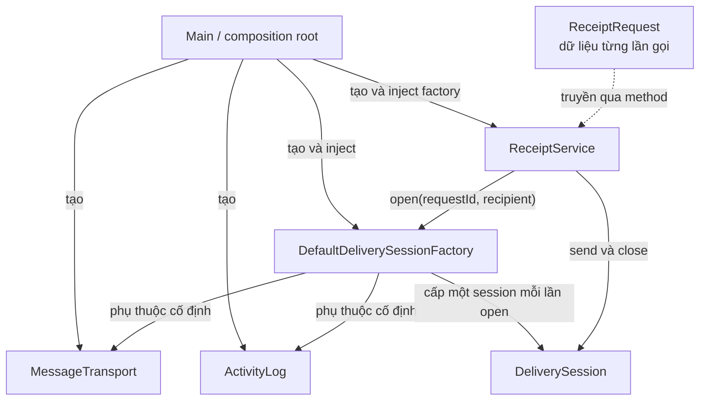
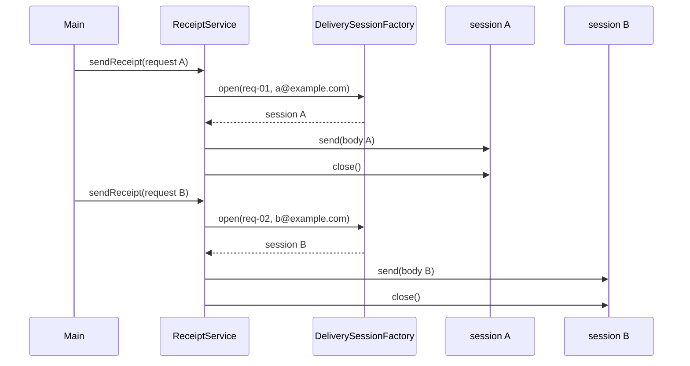

# Kết hợp phụ thuộc cố định với dữ liệu chỉ biết lúc chạy

## Mục tiêu học tập

Sau bài này, bạn có thể:

- Phân biệt **phụ thuộc ổn định khi lắp ghép** với **dữ liệu chỉ xuất hiện ở thời điểm xử lý** một request hoặc thao tác.
- Chọn giữa **constructor injection**, **tham số phương thức**, **factory có tham số** và **provider không tham số** theo nhu cầu thực tế.
- Tạo một đối tượng cần cả dependency cố định lẫn dữ liệu runtime mà không để consumer tự tạo client hạ tầng hoặc tự tìm dependency trong DI container.
- Quy định rõ **thời điểm tạo**, **scope**, **danh tính instance** và **quyền đóng tài nguyên** được factory trả về.
- Kiểm thử việc truyền dữ liệu và quản lý vòng đời bằng **Java thuần**, trước khi mở rộng sang các DI container hỗ trợ assisted injection.

Bài nằm trong chương **Factory và Provider** của module **Dependency Injection (DI)** và **Inversion of Control (IoC)**. DI giúp tách việc *sử dụng phụ thuộc* khỏi việc *tạo và lắp ghép đối tượng*. Nhưng không phải mọi thông tin cần để tạo đối tượng đều có sẵn khi ứng dụng khởi động: mã yêu cầu, người nhận, tenant hoặc định dạng xuất báo cáo có thể chỉ được biết khi một thao tác diễn ra.

## 1. Hai nhóm đầu vào có thời điểm xuất hiện khác nhau

Xét một chức năng gửi xác nhận đơn hàng:

- **Phụ thuộc cố định theo vòng đời của thành phần:** `MessageTransport` đảm nhiệm việc chuyển thông báo và `ActivityLog` ghi hoạt động. Composition root chọn implementation và tạo chúng khi lắp ghép ứng dụng. “Cố định” ở đây nói về **tham chiếu được chọn cho một instance**, không có nghĩa toàn ứng dụng phải dùng singleton hoặc dependency không có trạng thái.
- **Dữ liệu chỉ biết khi chạy:** `requestId` và `recipient` chỉ được biết khi yêu cầu gửi xác nhận đến. Hai giá trị này thuộc **lần xử lý cụ thể**, không phải cấu hình khởi động chung.

Ta muốn tạo một `DeliverySession` cho mỗi lần gửi. Session cần `MessageTransport`, `ActivityLog` **và** `requestId`, `recipient`. Một factory có thể giữ hai dependency ổn định trong field và nhận hai giá trị runtime lúc gọi `open(...)`.

| Thông tin | Có từ khi nào? | Nên nằm ở đâu? | Ví dụ |
| --- | --- | --- | --- |
| Hợp đồng chuyển thông báo | Khi chọn cấu hình ứng dụng | Constructor của factory hoặc service thích hợp | `MessageTransport` |
| Hợp đồng ghi hoạt động | Khi lắp ghép đối tượng | Constructor của factory | `ActivityLog` |
| Mã yêu cầu | Mỗi lần có yêu cầu mới | Tham số method / DTO của request | `requestId = "req-01"` |
| Người nhận | Mỗi lần gọi chức năng gửi | Tham số method / DTO của request | `recipient = "a@example.com"` |
| Phiên gửi thông báo | Khi thao tác cần dùng | Kết quả từ factory, dùng trong một phạm vi xác định | `DeliverySession` |

**Câu hỏi thiết kế:** *Ai chọn implementation? Ai biết dữ liệu runtime? Ai tạo session? Ai sử dụng và đóng session?* Mỗi vai trò cần được thể hiện rõ trong code.

## 2. Vì sao không đưa mọi thứ vào constructor của service?

Một service phục vụ nhiều request thường được tạo **một lần rồi tái sử dụng**. Nếu constructor của service nhận cả `recipient` hay `requestId`, service có thể vô tình gắn với một yêu cầu cụ thể:

```java
// Phản ví dụ: instance được dùng lại sẽ giữ nguyên thông tin yêu cầu cũ.
final class WrongReceiptService {
    private final String recipient;
    private final String requestId;

    WrongReceiptService(String recipient, String requestId) {
        this.recipient = recipient;
        this.requestId = requestId;
    }

    // Nếu được chia sẻ giữa nhiều request, hai field ở trên không phù hợp.
}
```

Một biến thể khác là lưu `currentRecipient` trong field và dùng setter trước mỗi lần gửi. Nếu hai request chạy đồng thời, request B có thể ghi đè giá trị mà request A sắp sử dụng. `volatile` hoặc setter đồng bộ riêng lẻ không tự giải quyết việc **phân tách dữ liệu theo request**.

Khi dữ liệu chỉ dùng để thực hiện **một lời gọi**, cách đơn giản nhất thường là **truyền qua tham số method**:

```java
service.sendReceipt(new ReceiptRequest(
        "DH-01", 150_000L, "req-01", "a@example.com"));
```

`ReceiptRequest` là **dữ liệu của nghiệp vụ**, không phải một collaborator có hành vi như `MessageTransport`. Không cần đưa `ReceiptRequest` vào container hoặc biến mỗi request thành một dependency của constructor. Service có thể giữ các cộng tác viên ổn định, còn dữ liệu thay đổi đi cùng lời gọi.

Nhưng nếu một **đối tượng cộng tác mới** phải được tạo từ cả dependency cố định và dữ liệu request, factory có tham số là cách diễn tả đúng nhu cầu đó.

## 3. Factory có tham số kết hợp hai nhóm đầu vào như thế nào?

Ta định nghĩa ba hợp đồng riêng:

```java
interface MessageTransport {
    void send(String recipient, String body);
}

interface DeliverySession extends AutoCloseable {
    void send(String body);

    @Override
    void close();
}

interface DeliverySessionFactory {
    DeliverySession open(String requestId, String recipient);
}
```

`MessageTransport` là khả năng chuyển thông báo. `DeliverySession` là một phiên gắn với **một request và một người nhận**, có bước đóng rõ ràng. `DeliverySessionFactory` định nghĩa chính xác **đối tượng nào được cấp** và **dữ liệu runtime cần có để cấp nó**.

Sơ đồ kết hợp dependency:



Trong sơ đồ, `MessageTransport` và `ActivityLog` là **dependency lâu dài của factory**; `requestId`, `recipient` đến từ **yêu cầu hiện tại**. Factory không cần biết `ReceiptService` là ai. Service cũng không cần biết `DefaultDeliverySession` được khởi tạo ra sao.

Một cách gọi cho mô hình này là **assisted injection**: một phần tham số tạo đối tượng do cơ chế DI cung cấp, phần còn lại do caller truyền vào lúc chạy. Trong Java thuần, ta thực hiện trực tiếp bằng constructor và factory method; chưa cần framework nào có tính năng “assisted”.

## 4. Ví dụ Java thuần hoàn chỉnh

Ví dụ chỉ in thông báo ra console và ghi log mô phỏng. Không gửi email thật và không kết nối hệ thống bên ngoài.

Lưu toàn bộ đoạn sau vào **`Main.java`** (JDK 8 trở lên):

```java
import java.util.Objects;

// Dữ liệu riêng của một lần yêu cầu gửi biên nhận.
final class ReceiptRequest {
    final String orderId;
    final long totalVnd;
    final String requestId;
    final String recipient;

    ReceiptRequest(String orderId, long totalVnd,
                   String requestId, String recipient) {
        this.orderId = requiredText(orderId, "orderId");
        this.requestId = requiredText(requestId, "requestId");
        this.recipient = requiredText(recipient, "recipient");
        if (totalVnd <= 0) {
            throw new IllegalArgumentException("totalVnd must be positive");
        }
        this.totalVnd = totalVnd;
    }

    static String requiredText(String value, String field) {
        Objects.requireNonNull(value, field);
        if (value.trim().isEmpty()) {
            throw new IllegalArgumentException(field + " must not be blank");
        }
        return value;
    }
}

// Dependency ổn định: cách tạo nội dung biên nhận.
interface ReceiptTemplate {
    String render(String orderId, long totalVnd);
}

final class SimpleReceiptTemplate implements ReceiptTemplate {
    @Override
    public String render(String orderId, long totalVnd) {
        return "Đơn " + orderId + " có tổng tiền " + totalVnd + " VND";
    }
}

// Các dependency hạ tầng được composition root cung cấp cho factory.
interface MessageTransport {
    void send(String recipient, String body);
}

interface ActivityLog {
    void record(String message);
}

final class ConsoleTransport implements MessageTransport {
    @Override
    public void send(String recipient, String body) {
        System.out.println("[DEMO] " + recipient + " <- " + body);
    }
}

final class ConsoleActivityLog implements ActivityLog {
    @Override
    public void record(String message) {
        System.out.println("[LOG] " + message);
    }
}

// Hợp đồng một phiên gửi gắn với một request và một recipient.
interface DeliverySession extends AutoCloseable {
    void send(String body);

    @Override
    void close();
}

interface DeliverySessionFactory {
    DeliverySession open(String requestId, String recipient);
}

// Provider thực hiện hành vi gửi cho một phiên ngắn hạn.
final class DemoDeliverySession implements DeliverySession {
    private final MessageTransport transport;
    private final ActivityLog log;
    private final String requestId;
    private final String recipient;
    private boolean closed;

    DemoDeliverySession(MessageTransport transport, ActivityLog log,
                        String requestId, String recipient) {
        this.transport = Objects.requireNonNull(transport, "transport");
        this.log = Objects.requireNonNull(log, "log");
        this.requestId = ReceiptRequest.requiredText(requestId, "requestId");
        this.recipient = ReceiptRequest.requiredText(recipient, "recipient");
    }

    @Override
    public void send(String body) {
        if (closed) {
            throw new IllegalStateException("session already closed");
        }
        log.record("SEND " + requestId);
        transport.send(recipient, body);
    }

    @Override
    public void close() {
        if (!closed) {
            closed = true;
            log.record("CLOSE " + requestId);
        }
    }
}

// Giữ dependency cố định; nhận dữ liệu runtime khi open().
final class DefaultDeliverySessionFactory implements DeliverySessionFactory {
    private final MessageTransport transport;
    private final ActivityLog log;

    DefaultDeliverySessionFactory(MessageTransport transport, ActivityLog log) {
        this.transport = Objects.requireNonNull(transport, "transport");
        this.log = Objects.requireNonNull(log, "log");
    }

    @Override
    public DeliverySession open(String requestId, String recipient) {
        DeliverySession session = new DemoDeliverySession(
                transport, log, requestId, recipient);
        log.record("OPEN " + requestId);
        return session;
    }
}

// Consumer chỉ phụ thuộc vào các hợp đồng cần dùng.
final class ReceiptService {
    private final ReceiptTemplate template;
    private final DeliverySessionFactory sessionFactory;

    ReceiptService(ReceiptTemplate template, DeliverySessionFactory sessionFactory) {
        this.template = Objects.requireNonNull(template, "template");
        this.sessionFactory = Objects.requireNonNull(sessionFactory, "sessionFactory");
    }

    void sendReceipt(ReceiptRequest request) {
        Objects.requireNonNull(request, "request");
        String body = template.render(request.orderId, request.totalVnd);

        // Dữ liệu request chỉ đi vào phiên của thao tác hiện tại.
        try (DeliverySession session =
                     sessionFactory.open(request.requestId, request.recipient)) {
            session.send(body);
        }
    }
}

// Composition root: quyết định implementation và đồ thị các instance.
public class Main {
    public static void main(String[] args) {
        MessageTransport transport = new ConsoleTransport();
        ActivityLog log = new ConsoleActivityLog();
        ReceiptTemplate template = new SimpleReceiptTemplate();

        DeliverySessionFactory factory =
                new DefaultDeliverySessionFactory(transport, log);
        ReceiptService service = new ReceiptService(template, factory);

        service.sendReceipt(new ReceiptRequest(
                "DH-01", 150_000L, "req-01", "a@example.com"));
        service.sendReceipt(new ReceiptRequest(
                "DH-02", 220_000L, "req-02", "b@example.com"));
    }
}
```

Chạy bằng JDK:

```bash
javac -encoding UTF-8 Main.java
java Main
```

Kết quả dự kiến:

```text
[LOG] OPEN req-01
[LOG] SEND req-01
[DEMO] a@example.com <- Đơn DH-01 có tổng tiền 150000 VND
[LOG] CLOSE req-01
[LOG] OPEN req-02
[LOG] SEND req-02
[DEMO] b@example.com <- Đơn DH-02 có tổng tiền 220000 VND
[LOG] CLOSE req-02
```

`Main` tạo một `ReceiptService`, một `DefaultDeliverySessionFactory`, một `MessageTransport` và một `ActivityLog` cho chương trình demo. `ReceiptService` được **dùng lại** cho cả hai request, nhưng mỗi lời gọi `open(...)` tạo **một `DemoDeliverySession` mới** giữ đúng `requestId` và `recipient` của lần gửi đó.

### Theo dõi từng thời điểm

| Thời điểm | Hành động | Dependency/dữ liệu liên quan |
| --- | --- | --- |
| **Khởi động** | Tạo transport, log, template và factory | Các dependency được chọn cố định tại composition root. |
| **Lắp ghép** | `new ReceiptService(template, factory)` | Constructor injection: service nhận collaborator ổn định. |
| **Request 1 tới** | Nhận `ReceiptRequest(..., "req-01", "a@example.com")` | Dữ liệu runtime đi qua tham số method. |
| **Tạo session 1** | `factory.open("req-01", "a@example.com")` | Factory phối hợp dependency cố định với dữ liệu runtime. |
| **Kết thúc request 1** | Gửi và `close()` session 1 | Chỉ session 1 kết thúc; factory, transport và service vẫn sống. |
| **Request 2 tới** | Tạo session 2 với `req-02` và người nhận B | Một instance khác, không kế thừa dữ liệu của session 1. |

Đó là cách **factory tham số hóa lúc chạy**: không phải tạo lại toàn bộ `ReceiptService` hay `MessageTransport` mỗi lần request đến; cũng không phải ghi đè `currentRecipient` trong một singleton để dùng cho request khác.

## 5. Factory và Provider: chọn công cụ theo nhu cầu tạo

Trong nhiều hệ sinh thái DI, *provider* được dùng cho đối tượng có thể được lấy **sau thời điểm consumer được khởi tạo**. *Factory* thường diễn tả việc tạo/cấp đối tượng với một hợp đồng rõ hơn, đặc biệt khi có **tham số runtime**. Tên gọi và API của từng framework có thể khác nhau, vì thế cần xem chính **hợp đồng** thay vì suy đoán từ tên.

| Câu hỏi | Provider không tham số | Factory có tham số |
| --- | --- | --- |
| Caller có cần đưa dữ liệu chỉ biết lúc chạy không? | Không, hoặc dữ liệu đã nằm trong một context được quy định rõ. | **Có**, ví dụ `open(requestId, recipient)`. |
| API tối thiểu | `T get()` hoặc `T create()` | `T create(Args args)` / `T open(String id, ...)` |
| Khi nào được lấy instance? | Khi gọi provider. | Khi gọi factory với đủ tham số. |
| Có chắc tạo instance mới mỗi lần? | **Không**, còn tùy hợp đồng/provider scope. | **Không**, trừ khi factory quy định điều đó. |
| Có thể che dependency nếu lạm dụng không? | Có, nếu provider là cổng tra cứu mọi kiểu. | Có, nếu factory tổng quát nhận bất kỳ `Class<T>` nào. |

Một provider không tham số bằng Java thuần có thể biểu diễn bởi `Supplier<T>`:

```java
import java.util.function.Supplier;

// Chỉ minh họa cú pháp, không dùng trong Main.java phía trên.
Supplier<StringBuilder> bufferProvider = StringBuilder::new;
StringBuilder first = bufferProvider.get();
StringBuilder second = bufferProvider.get();
System.out.println(first == second); // false với supplier cụ thể này
```

Đây là ví dụ **supplier này** được lập trình để gọi `new` mỗi lần; giao diện `Supplier<T>` **không tự cam kết** kết quả luôn là instance mới. Một provider lấy dependency từ scope hiện hành có thể trả cùng instance nhiều lần.

Với bài toán session, `Supplier<DeliverySession>` **không nhận được** `requestId` và `recipient` của lời gọi trừ khi chúng được nhét vào trạng thái hoặc context bên ngoài. Việc dùng biến toàn cục hoặc `ThreadLocal` để lén truyền hai giá trị này có thể gây lỗi khi xử lý đồng thời hay chuyển luồng bất đồng bộ. `DeliverySessionFactory.open(requestId, recipient)` biểu diễn dữ liệu cần thiết một cách tường minh hơn.

Khi chỉ cần truyền một kết quả theo **mỗi lần gọi** mà không cần quản lý object dài hơn lời gọi, đôi khi không cần factory: một method `send(String recipient, String body)` trên transport đã tiêm sẵn có thể đủ. Chỉ thêm factory khi có lý do thực tế như **phiên có trạng thái, tài nguyên cần đóng, chọn implementation theo dữ liệu runtime hoặc bảo đảm tạo object độc lập**.

## 6. Những cách triển khai dễ gây lỗi

### 6.1. Consumer tự tạo cả dependency hạ tầng

```java
// Phản ví dụ: service đang tự quyết định chọn transport và log.
void sendReceipt(ReceiptRequest request) {
    MessageTransport transport = new ConsoleTransport();
    ActivityLog log = new ConsoleActivityLog();
    try (DeliverySession session = new DemoDeliverySession(
            transport, log, request.requestId, request.recipient)) {
        session.send("Nội dung xác nhận");
    }
}
```

Đây là **đoạn minh họa rút gọn**, không phải phương thức thay thế nguyên vẹn trong `Main.java`. Nó vẫn chạy được về mặt ý tưởng, nhưng business service quyết định dùng transport nào, cách cấu hình và quản lý các phụ thuộc ổn định. Muốn dùng SMTP client, message queue hay fake để kiểm thử, phải sửa hoặc can thiệp vào lớp nghiệp vụ.

Việc tạo **đối tượng dữ liệu ngắn hạn** trong nghiệp vụ như `new ReceiptRequest(...)` không có cùng vấn đề. Điểm cần đưa ra ngoài consumer là **quyết định tạo collaborator cung cấp hành vi/tài nguyên hạ tầng**.

### 6.2. Giữ dữ liệu request trong field dùng chung

```java
// Phản ví dụ khi singleton dùng đồng thời nhiều request.
class UnsafeDeliveryService {
    private String currentRecipient;

    void setRecipient(String recipient) {
        currentRecipient = recipient;
    }

    String recipientForCurrentSend() {
        return currentRecipient;
    }
}
```

Request A có thể gọi `setRecipient("a@example.com")`, request B đổi thành `b@example.com` trước khi A đọc lại field. Khi đó dữ liệu của hai request bị trộn. Thay bằng đối tượng `ReceiptRequest` riêng cho mỗi lời gọi và đưa recipient vào `factory.open(...)` giúp cô lập dữ liệu theo thao tác.

Đặc biệt, một `ThreadLocal` không tự động giải quyết việc truyền request vào tác vụ async: callback có thể chạy ở một luồng khác. Nếu dùng context ngầm, toàn hệ thống phải có cơ chế lan truyền, dọn dẹp và xác định vòng đời rõ ràng; tham số tường minh thường dễ kiểm thử hơn.

### 6.3. Truyền cả container vào nghiệp vụ

```java
// Phản ví dụ dạng Service Locator.
class WrongService {
    private final Container container;

    WrongService(Container container) {
        this.container = container;
    }

    void run(String requestId, String recipient) {
        DeliverySessionFactory factory =
                container.resolve(DeliverySessionFactory.class);
        try (DeliverySession session = factory.open(requestId, recipient)) {
            session.send("Nội dung xác nhận");
        }
    }
}
```

Trong đoạn trên, `Container` là một API giả định có `resolve(...)`, dùng để minh họa anti-pattern; không có class `Container` trong chương trình chạy ở mục 4. Service phải biết cơ chế tra cứu tổng quát và che đi dependency thật. Thay `Container` bằng một field `DeliverySessionFactory` được tiêm qua constructor giữ hợp đồng rõ ràng, dễ thay fake và không kéo mã DI container vào lớp nghiệp vụ.

## 7. Scope, vòng đời và quyền sở hữu tài nguyên

Trong chương trình, factory được giữ trong `ReceiptService` nhưng **session chỉ tồn tại trong phạm vi `sendReceipt(...)`**. Khi `session.send(...)` thành công, `try-with-resources` đóng session; nếu `send` ném ngoại lệ, Java vẫn gọi `close()` khi rời khối.

Đồ thị hai lần xử lý có thể hình dung như sau:



Ở đây, factory và service có thể dùng chung lâu dài, nhưng **hai session là hai instance khác nhau** bởi vì implementation `DefaultDeliverySessionFactory.open(...)` tạo mới mỗi lần. Nếu thay bằng factory có pooling, `close()` có thể mang nghĩa **trả handle về pool**, không nhất thiết hủy kết nối vật lý. Hợp đồng factory cần nói rõ khi nào cấp instance mới, khi nào chia sẻ, và quyền đóng thuộc về ai.

| Thành phần | Vòng đời trong ví dụ | Bên chịu trách nhiệm |
| --- | --- | --- |
| `ReceiptService` | Tạo một lần, phục vụ hai yêu cầu | `Main` tạo và giữ tham chiếu. |
| `ReceiptTemplate` | Một instance dùng chung | `Main` chọn implementation. |
| `MessageTransport`, `ActivityLog` | Một instance của mỗi loại, được factory dùng lại | `Main` tạo, có trách nhiệm quản lý nếu implementation có tài nguyên. |
| `DefaultDeliverySessionFactory` | Một instance giữ hai dependency cố định | `Main` tạo và tiêm vào service. |
| `ReceiptRequest` | Dữ liệu của từng lần gọi | Caller tạo và đưa vào `sendReceipt(...)`. |
| `DemoDeliverySession` | Một instance cho từng `open(...)` | Service dùng rồi đóng session đúng một phạm vi. |

**Không nên gọi `close()` trên transport dùng chung** từ trong `DemoDeliverySession` nếu contract không chuyển quyền sở hữu transport cho session. Session demo chỉ đánh dấu phiên của mình đã đóng và ghi log. Một bản triển khai thực dùng socket/connection phải thiết kế rõ đối tượng nào sở hữu kết nối và cách trả về pool.

### Lưu ý với xử lý bất đồng bộ

Ví dụ dùng `send(...)` **đồng bộ**: thao tác gửi đã kết thúc theo hợp đồng trước khi rời khối `try`. Nếu đổi sang `CompletionStage<Void> sendAsync(...)`, **không được** mở session, lên lịch gửi rồi đóng ngay trong cùng khối `try` khi công việc nền chưa hoàn thành:

```java
// Phản ví dụ khi sendAsync chỉ mới lên lịch công việc.
try (DeliverySession session = factory.open(requestId, recipient)) {
    // future = session.sendAsync(body); // tác vụ có thể chưa chạy xong
} // session bị đóng quá sớm
```

Hợp đồng async phải quy định **mốc hoàn thành**, lỗi và thời điểm đóng. Một hướng là để tầng điều phối giữ session đến khi stage hoàn thành, bảo đảm đóng cả đường thành công và thất bại. Việc dùng callback hoặc quản lý scope bất đồng bộ cần được thiết kế riêng; constructor injection không tự giải quyết vòng đời này.

## 8. Kiểm thử truyền dữ liệu runtime và đóng session bằng Java thuần

Ta muốn kiểm chứng ba điều: `ReceiptService` gửi đúng thông tin từng request cho factory, mỗi lần `open()` trả một session độc lập, và session được **đóng ngay cả khi gửi thất bại**.

Lưu toàn bộ đoạn dưới thành **`ReceiptServiceCheck.java`** cạnh `Main.java`:

```java
import java.util.ArrayList;
import java.util.List;

public class ReceiptServiceCheck {
    static final class RecordingSession implements DeliverySession {
        final String requestId;
        final String recipient;
        final boolean failOnSend;
        String body;
        int sends;
        int closes;

        RecordingSession(String requestId, String recipient, boolean failOnSend) {
            this.requestId = requestId;
            this.recipient = recipient;
            this.failOnSend = failOnSend;
        }

        @Override
        public void send(String body) {
            sends++;
            this.body = body;
            if (failOnSend) {
                throw new IllegalStateException("demo failure");
            }
        }

        @Override
        public void close() {
            closes++;
        }
    }

    static final class RecordingFactory implements DeliverySessionFactory {
        final List<RecordingSession> sessions = new ArrayList<>();
        boolean failNext;

        @Override
        public DeliverySession open(String requestId, String recipient) {
            RecordingSession session =
                    new RecordingSession(requestId, recipient, failNext);
            failNext = false;
            sessions.add(session);
            return session;
        }
    }

    public static void main(String[] args) {
        RecordingFactory factory = new RecordingFactory();
        ReceiptService service =
                new ReceiptService(new SimpleReceiptTemplate(), factory);

        service.sendReceipt(new ReceiptRequest(
                "DH-01", 150_000L, "req-01", "a@example.com"));
        service.sendReceipt(new ReceiptRequest(
                "DH-02", 220_000L, "req-02", "b@example.com"));

        if (factory.sessions.size() != 2
                || factory.sessions.get(0) == factory.sessions.get(1)) {
            throw new AssertionError("Factory phải cấp hai session khác nhau");
        }

        RecordingSession one = factory.sessions.get(0);
        RecordingSession two = factory.sessions.get(1);
        if (!"req-01".equals(one.requestId)
                || !"a@example.com".equals(one.recipient)
                || !"req-02".equals(two.requestId)
                || !"b@example.com".equals(two.recipient)
                || !"Đơn DH-01 có tổng tiền 150000 VND".equals(one.body)
                || !"Đơn DH-02 có tổng tiền 220000 VND".equals(two.body)
                || one.sends != 1 || one.closes != 1
                || two.sends != 1 || two.closes != 1) {
            throw new AssertionError("Sai dữ liệu hoặc vòng đời của session");
        }

        factory.failNext = true;
        try {
            service.sendReceipt(new ReceiptRequest(
                    "DH-03", 300_000L, "req-03", "c@example.com"));
            throw new AssertionError("Phải báo lỗi khi gửi thất bại");
        } catch (IllegalStateException expected) {
            if (!"demo failure".equals(expected.getMessage())) {
                throw expected;
            }
        }

        RecordingSession failedSession = factory.sessions.get(2);
        if (failedSession.sends != 1 || failedSession.closes != 1) {
            throw new AssertionError("Session thất bại vẫn phải được đóng");
        }

        System.out.println("PASS: dữ liệu runtime và vòng đời session chính xác");
    }
}
```

Chạy:

```bash
javac -encoding UTF-8 Main.java ReceiptServiceCheck.java
java ReceiptServiceCheck
```

Phép kiểm tra không cần một client thật hay DI container. `ReceiptService` chỉ dùng hai interface `ReceiptTemplate` và `DeliverySessionFactory`; ta có thể thay implementation của factory mà không sửa consumer. Khi gửi thất bại, `try-with-resources` vẫn gọi `close()`, thể hiện rõ hợp đồng quyền sở hữu tài nguyên ở ranh giới method.

## 9. Khi chuyển sang DI container

Một DI container có thể quản lý `MessageTransport`, `ActivityLog`, `ReceiptTemplate`, `DeliverySessionFactory` và `ReceiptService` theo các scope đã cấu hình. Trong một số framework, **assisted injection** còn cho phép phát sinh factory mà không phải viết tay phần nối dependency cố định và dữ liệu runtime.

Nhưng DI container **không tự biết** `requestId` và `recipient` của mỗi lần gọi `sendReceipt(...)`. Những dữ liệu này phải được chuyển tới đúng nơi cần dùng qua API phù hợp hoặc qua một request scope đã được thiết kế rõ. Không nên để lớp nghiệp vụ tự gọi `container.resolve(...)` rồi tìm mọi phụ thuộc, vì như vậy làm mờ hợp đồng và chuyển trách nhiệm lắp ghép xuống consumer.

Đặc biệt, cấu hình **prototype/transient** của một class chưa đủ để bảo đảm service dùng chung sẽ nhận dependency mới **ở mỗi method call**. Nếu một prototype được resolve **một lần tại constructor** của service dùng chung, service vẫn giữ instance đã được tiêm. Khi cần session mới theo từng lần xử lý, phải thể hiện yêu cầu đó bằng factory/provider được gọi tại thời điểm phù hợp hoặc scope riêng theo framework.

## 10. Checklist chọn cách kết hợp phụ thuộc và dữ liệu runtime

1. **Thứ gì là hành vi ổn định?** Client, repository, logger và template có thể được chọn tại composition root và tiêm qua constructor.
2. **Thứ gì chỉ biết khi request đến?** `requestId`, `recipient`, `tenantId`, định dạng hoặc ngày cần xuất báo cáo nên đi qua method parameter/DTO của lần xử lý.
3. **Có thực sự cần tạo một collaborator mới không?** Nếu chỉ gọi được một phương thức trên dependency sẵn có, hãy cân nhắc dùng method trực tiếp trước khi thêm factory.
4. **Nếu cần tạo mới, factory nhận tham số nào?** Chỉ nhận dữ liệu runtime cần thiết; dependency ổn định đi vào constructor của factory.
5. **Provider không tham số có đủ thông tin không?** Nếu không, tránh giấu dữ liệu bằng biến toàn cục; dùng factory có tham số hoặc một request-context được quản lý rõ ràng.
6. **`open()` cấp mới hay tái sử dụng?** Quy định bằng hợp đồng, đặc biệt nếu đối tượng có trạng thái hoặc không được gọi đồng thời.
7. **Ai sở hữu và đóng tài nguyên?** Service, factory, pool hoặc container phải có trách nhiệm rõ; không đóng nhầm dependency dùng chung.
8. **Có nguy cơ dữ liệu hai request lẫn nhau không?** Không lưu `currentRecipient` trong singleton; xác nhận dữ liệu runtime được gắn với session riêng.
9. **Có xử lý async không?** Nếu có, đảm bảo tài nguyên sống đủ lâu đến lúc tác vụ thực sự hoàn thành.
10. **Có thay factory bằng fake được không?** Nếu có, kiểm thử sẽ không phụ thuộc vào chi tiết khởi tạo hay framework.

### Bài tập vận dụng

Giả sử một `ReportService` sống trong suốt quá trình chạy ứng dụng. Mỗi lần `export(...)` nhận `reportId`, `locale` và `fileName`, rồi cần mở một phiên xuất báo cáo dùng một `StorageClient` đã cấu hình sẵn và một `AuditLog` dùng chung.

Hãy thử thiết kế:

- `ReportService` nên nhận **`ReportSessionFactory` qua constructor** nếu cần mở session riêng mỗi lần.
- `ReportSessionFactory` nhận **`StorageClient` và `AuditLog` trong constructor**; method `open(reportId, locale, fileName)` nhận các giá trị runtime và trả session theo hợp đồng.
- `ReportService.export(...)` chuyển dữ liệu vào `factory.open(...)`, ghi báo cáo và đóng session đúng phạm vi.
- Nếu storage có tài nguyên dùng chung, factory/session không được tự ý đóng client thuộc quyền sở hữu của composition root; nếu mở stream riêng, phải làm rõ ai đóng stream.
- Trong kiểm thử, thay factory bằng fake ghi lại `reportId`, `locale`, `fileName`, số session được cấp và số lần đóng, thay vì khởi động storage thật.

Nền tảng của cách thiết kế này là **hai thời điểm không trùng nhau**: composition root chuẩn bị các phụ thuộc ổn định, còn request cung cấp dữ liệu runtime khi thao tác cần tạo đối tượng mới. Factory có hợp đồng hẹp nối hai nhóm thông tin đó, giúp consumer giữ đúng trách nhiệm sử dụng và làm cho scope, vòng đời, kiểm thử bằng Java thuần trở nên rõ ràng trước khi mở rộng sang DI container.
