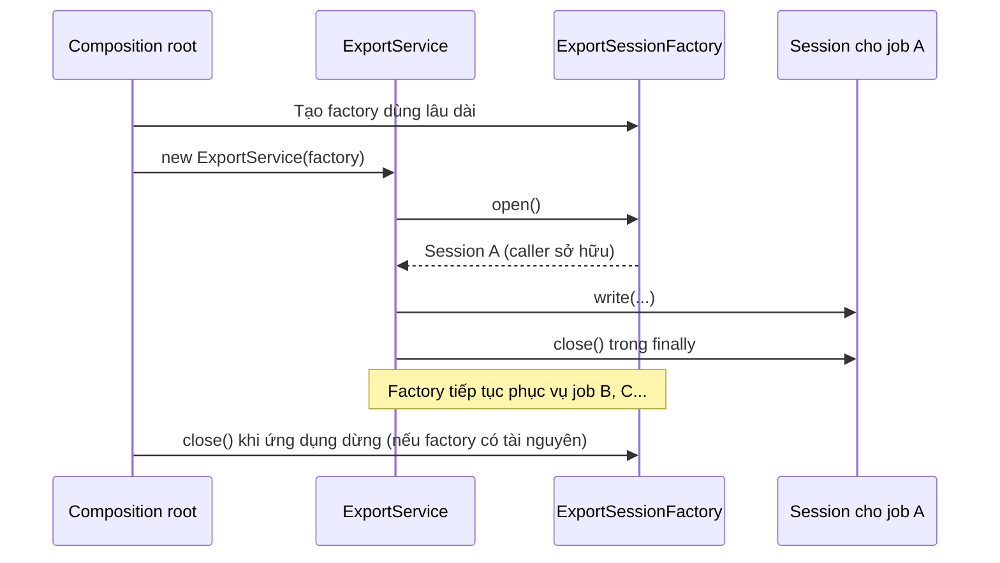
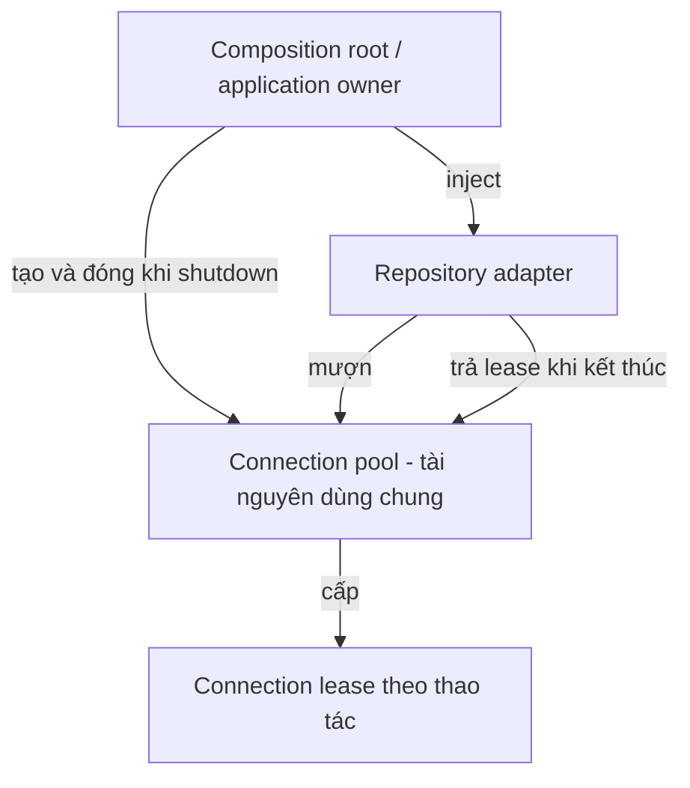

# Quyền sở hữu và đóng instance do factory tạo ra

Trong chương **Factory và Provider** của module **Dependency Injection (DI)**, ta dùng factory/provider khi một đối tượng cần được tạo hoặc lấy **đúng lúc thực hiện công việc**, thay vì nhận sẵn một instance cố định ngay trong constructor. Chẳng hạn, một dịch vụ xử lý báo cáo cần một phiên ghi mới cho mỗi lần xuất, còn factory có thể được tạo một lần tại **composition root** và được truyền vào dịch vụ bằng **constructor injection**.

Việc tách **sử dụng** phụ thuộc khỏi việc **tạo và lắp ghép** phụ thuộc là mục tiêu của DI và một cách thực hiện **Inversion of Control (IoC)**. Tuy nhiên, chuyển việc tạo đối tượng sang factory đưa đến câu hỏi tiếp theo: **ai sở hữu instance mà factory trả về và ai phải đóng nó?** Nếu không có câu trả lời rõ, ứng dụng có thể rò tài nguyên, đóng nhầm thành phần dùng chung hoặc tiếp tục dùng đối tượng đã đóng. DI container có thể hỗ trợ quản lý scope và vòng đời, nhưng không thay người thiết kế xác định hợp đồng sở hữu.

Sau bài này, bạn có thể:

- Phân biệt **factory/provider được inject** với **instance được factory/provider cấp** và các vòng đời tương ứng.
- Xác định khi nào factory **chuyển quyền sở hữu** cho caller, khi nào caller chỉ **mượn** instance, và khi nào caller giữ một **lease** của tài nguyên trong pool.
- Thiết kế hợp đồng tạo và đóng đối tượng rõ ràng, kết hợp `AutoCloseable` và `try-with-resources` trong Java thuần.
- Bảo đảm cleanup ở đường đi thành công, đường đi ném exception và trường hợp tạo đối tượng thất bại giữa chừng.
- Phân tích rủi ro scope mismatch, tác vụ bất đồng bộ, chia sẻ giữa các luồng và shutdown của composition root trước khi chuyển sang DI container.

## 1. Factory tạo ra đối tượng; quyền sở hữu là một hợp đồng riêng

Xét hai interface:

```java
interface ExportSession extends AutoCloseable {
    void write(String content);

    @Override
    void close();
}

interface ExportSessionFactory {
    ExportSession open();
}
```

`ExportSessionFactory` mô tả cách **lấy một session để xuất dữ liệu**. Nhưng chỉ nhìn chữ ký `open()` thì chưa biết:

- Mỗi lần gọi có tạo **session mới** hay trả cùng một instance?
- Session được phép dùng trên nhiều thread không?
- Session có giữ file handle, connection hoặc socket cần giải phóng không?
- Caller phải gọi `session.close()`, hay factory/container sẽ đóng?
- Nếu trả một session dùng chung, caller có được phép đóng không?
- Sau khi factory đóng, các session đã cấp còn sử dụng được không?

Không nên suy ra câu trả lời chỉ từ tên `Factory`, `Provider`, `Supplier` hoặc việc kiểu trả về implements `AutoCloseable`. Tất cả cần được quy định trong hợp đồng và được kiểm thử.

Ba mô hình sở hữu thường gặp:

| Mô hình | Factory trả về | Caller chịu trách nhiệm | Factory/chủ sở hữu dài hạn chịu trách nhiệm |
| --- | --- | --- | --- |
| **Chuyển quyền sở hữu** (*ownership transfer*) | Một đối tượng độc lập thuộc về caller | Dùng xong **đóng** instance, thường với `try-with-resources` | Không đóng lại instance đã chuyển giao; vẫn quản lý tài nguyên khác do mình sở hữu |
| **Cho mượn** (*borrowed instance*) | Tham chiếu đến đối tượng được quản lý và dùng chung | Sử dụng đúng thời hạn, **không tự đóng** | Đóng khi scope của owner kết thúc |
| **Cấp lease/handle** (*pooled resource*) | Một handle đại diện quyền sử dụng tạm thời | **Đóng/trả lease** đúng hạn | Giữ và quản lý pool hoặc tài nguyên vật lý bên dưới |

Trong mô hình lease, gọi `close()` trên handle **không nhất thiết** đóng kết nối vật lý: với một số connection pool, nó có nghĩa là **trả kết nối về pool**. Caller sở hữu **quyền sử dụng tạm thời**, còn pool sở hữu tài nguyên chung.

**Quy tắc cơ bản:** Một tài nguyên nên có **quy ước chủ sở hữu rõ ràng ở mỗi giai đoạn**. Những thành phần chỉ nhận tham chiếu để dùng không được tùy tiện đóng resource còn được thành phần khác sử dụng.

## 2. Phân biệt vòng đời của factory với sản phẩm được tạo

Một factory có thể sống theo ứng dụng, trong khi instance nó cấp chỉ sống trong một request hoặc job. Hai vòng đời này cần mô hình hóa riêng.



| Thành phần | Scope ví dụ | Ai tạo/cấp? | Ai đóng? |
| --- | --- | --- | --- |
| `ExportService` | Application | Composition root | Không cần `close()` nếu chỉ sử dụng các port được cấp |
| `ExportSessionFactory` | Application | Composition root hoặc container | Composition root/container nếu factory sở hữu tài nguyên dài hạn |
| `ExportSession` | Một lần xuất dữ liệu | `factory.open()` | Caller được chuyển quyền sở hữu theo hợp đồng `open()` |
| Dữ liệu `content` | Một lần gọi | Caller | Không có tài nguyên cần đóng |

Một factory **không nhất thiết** implements `AutoCloseable`. Chỉ nên có `close()` khi chính factory quản lý resource hoặc có một bước shutdown cần thiết. Ngược lại, factory quản lý thread pool, file index hoặc connection pool có thể cần được đóng **một lần khi ứng dụng dừng**, sau khi các tác vụ đang sử dụng nó hoàn tất.

Nếu một `Supplier<ExportSession>` được inject qua constructor và giữ trong field `final`, điều đó chỉ làm tham chiếu tới **supplier** ổn định; nó không bảo đảm `get()` trả instance mới hoặc tài nguyên đã đóng đúng cách.

## 3. Thiết kế hợp đồng factory để thể hiện ownership

Để tránh hiểu sai, nên đặt tên phương thức và ghi tài liệu ngay tại ranh giới factory:

```java
interface ReportSessionFactory {
    /**
     * Mỗi lần gọi trả một session có quyền sử dụng độc lập.
     * Caller sở hữu session được trả về và phải close đúng một lần.
     * Khi tạo thất bại, factory tự cleanup phần đã khởi tạo.
     */
    ReportSession openSession();
}

interface ReportSession extends AutoCloseable {
    void writeReport(String reportId);

    @Override
    void close();
}
```

Tên `openSession` gợi ý cần đóng, nhưng **phần hợp đồng bằng lời vẫn cần thiết**. Nếu phương thức trả một singleton không do caller sở hữu, hãy ghi rõ rằng việc gọi `close()` ở caller bị cấm hoặc không có ý nghĩa. Nếu trả lease, hợp đồng nên nói rõ `close()` là *release lease*, không phải hủy pool.

Các thuộc tính cần làm rõ:

| Thuộc tính hợp đồng | Câu hỏi phải trả lời |
| --- | --- |
| **Tính mới / tái sử dụng** | Mỗi `open` trả instance mới, session độc lập, cùng đối tượng, hay handle của pool? |
| **Ownership** | Ai phải đóng resource và có được phép chuyển tiếp quyền sở hữu cho thành phần khác không? |
| **Thời hạn sử dụng** | Có thể giữ instance sau khi request/job kết thúc không? |
| **Concurrent access** | Một instance có thể được sử dụng đồng thời bởi nhiều thread không? |
| **Thứ tự** | Có được đóng factory trước khi tất cả session đã cấp đóng không? |
| **Lỗi khi tạo** | Nếu `open` thất bại sau khi mở một phần resource, ai dọn phần đó? |
| **Lỗi khi đóng** | `close` có thể ném ngoại lệ nào, gọi lặp có an toàn không? |

Trong thiết kế mới, trả kiểu trừu tượng phù hợp với hành vi consumer cần, chẳng hạn `ReportSession`, thay vì trả `Connection` hoặc `HttpClient` cho mã nghiệp vụ chỉ để ghi báo cáo. Adapter phía dưới sẽ quyết định cách mượn và trả connection.

## 4. Try-with-resources ở đúng nơi nhận quyền sở hữu

Khi `factory.openSession()` trả đối tượng thuộc quyền sở hữu của caller, dùng `try-with-resources` ngay trong **phạm vi công việc** là cách rõ ràng nhất:

```java
final class ReportExportService {
    private final ReportSessionFactory factory;

    ReportExportService(ReportSessionFactory factory) {
        this.factory = java.util.Objects.requireNonNull(factory);
    }

    void export(String reportId) {
        try (ReportSession session = java.util.Objects.requireNonNull(
                factory.openSession(), "session")) {
            session.writeReport(reportId);
        }
    }
}
```

Đoạn mã này có các đặc điểm:

1. Service **mượn factory** ổn định do composition root inject. Nó không đóng factory sau mỗi tác vụ.
2. Mỗi lần `export` yêu cầu một session tại **thời điểm sử dụng**, không giữ session trong field của service.
3. Theo hợp đồng đã thiết kế, service **sở hữu session được trả về** và đóng khi tác vụ kết thúc, kể cả `writeReport` ném exception.
4. Nếu `openSession()` ném exception trước khi trả về session, caller không có handle nào để đóng; **factory phải cleanup những tài nguyên nó đã tạo một phần**.

`try-with-resources` gọi `close()` theo cấu trúc của Java. Với nhiều tài nguyên, Java đóng **theo thứ tự ngược** với thứ tự khai báo:

```java
try (Resource first = openFirst();
     Resource second = openSecond()) {
    use(first, second);
}
// second.close() chạy trước first.close().
// Nếu openSecond() thất bại, first vẫn được đóng.
```

Đoạn trên minh họa nguyên tắc với các tên `Resource`, `openFirst`, `openSecond` và `use` giả định; ví dụ hoàn chỉnh ở phần sau có thể biên dịch và chạy.

**Không** viết `try (ReportSession session = sharedSession)` nếu `sharedSession` chỉ được **cho mượn** và vẫn do người khác quản lý. Cú pháp Java không kiểm tra ownership cho bạn: nó vẫn gọi `close()` lên đối tượng được truyền vào.

## 5. Ví dụ hoàn chỉnh bằng Java thuần

Ví dụ dưới đây dùng **Java 17 trở lên**, không yêu cầu framework hoặc DI container. Một `TracingSessionFactory` được tạo tại composition root và sống suốt chương trình. Mỗi lần `ExportService.export` gọi factory, nó nhận một `ExportSession` do caller sở hữu. Lịch sử các thao tác giúp ta kiểm tra rằng session được đóng cả khi xử lý lỗi.

Lưu vào `FactoryOwnershipDemo.java`:

```java
import java.util.ArrayList;
import java.util.List;
import java.util.Objects;

public class FactoryOwnershipDemo {
    interface ExportSession extends AutoCloseable {
        void write(String content);

        @Override
        void close();
    }

    interface ExportSessionFactory {
        // Hợp đồng: mỗi lần open() cấp session riêng, caller phải close.
        ExportSession open();
    }

    static final class ExportService {
        private final ExportSessionFactory factory;

        ExportService(ExportSessionFactory factory) {
            this.factory = Objects.requireNonNull(factory, "factory");
        }

        void export(String content) {
            if (content == null || content.isBlank()) {
                throw new IllegalArgumentException("content must not be blank");
            }

            // Service mượn factory nhưng sở hữu session được trả về.
            try (ExportSession session =
                    Objects.requireNonNull(factory.open(), "session")) {
                session.write(content);
            }
        }
    }

    static final class TracingSessionFactory
            implements ExportSessionFactory, AutoCloseable {
        private final List<String> events = new ArrayList<>();
        private int nextId;
        private int active;
        private boolean closed;

        @Override
        public ExportSession open() {
            if (closed) {
                throw new IllegalStateException("Factory is closed");
            }
            int id = ++nextId;
            active++;
            events.add("open:" + id);

            return new ExportSession() {
                private boolean sessionClosed;

                @Override
                public void write(String content) {
                    if (sessionClosed) {
                        throw new IllegalStateException("Session is closed");
                    }
                    events.add("write:" + id + ":" + content);
                    if ("FAIL".equals(content)) {
                        throw new IllegalStateException(
                                "simulated write failure");
                    }
                }

                @Override
                public void close() {
                    if (sessionClosed) {
                        return; // Quyết định idempotent riêng của demo.
                    }
                    sessionClosed = true;
                    active--;
                    events.add("close:" + id);
                }
            };
        }

        int activeSessions() {
            return active;
        }

        List<String> events() {
            return List.copyOf(events);
        }

        @Override
        public void close() {
            if (closed) {
                return;
            }
            // Demo kiểm tra hợp đồng: đóng tất cả session trước factory.
            if (active != 0) {
                throw new IllegalStateException(
                        "Cannot close factory with active sessions");
            }
            closed = true;
            events.add("factory-close");
        }
    }

    public static void main(String[] args) {
        // Composition root sở hữu factory sống lâu hơn từng phiên.
        TracingSessionFactory factory = new TracingSessionFactory();
        try (factory) {
            ExportService service = new ExportService(factory);

            service.export("A");

            boolean failedAsExpected = false;
            try {
                service.export("FAIL");
            } catch (IllegalStateException expected) {
                failedAsExpected = "simulated write failure"
                        .equals(expected.getMessage());
            }

            if (!failedAsExpected || factory.activeSessions() != 0) {
                throw new AssertionError("Session leaked on failure");
            }
            List<String> expected = List.of(
                    "open:1", "write:1:A", "close:1",
                    "open:2", "write:2:FAIL", "close:2");
            if (!factory.events().equals(expected)) {
                throw new AssertionError(
                        "Wrong session lifecycle: " + factory.events());
            }
        }

        if (!factory.events().get(factory.events().size() - 1)
                .equals("factory-close")) {
            throw new AssertionError("Factory was not closed");
        }
        System.out.println("PASS: " + factory.events());
    }
}
```

Biên dịch và chạy:

```bash
javac FactoryOwnershipDemo.java
java FactoryOwnershipDemo
```

Kết quả dự kiến:

```text
PASS: [open:1, write:1:A, close:1, open:2, write:2:FAIL, close:2, factory-close]
```

**Giải thích:** Lượt thứ hai `write("FAIL")` cố ý ném lỗi; `try-with-resources` vẫn gọi `session.close()`, nên số session đang hoạt động giảm về 0. Sau khi toàn bộ công việc hoàn tất, composition root đóng factory. Service không gọi `factory.close()` vì nó chỉ **mượn** factory từ root.

Đây là **mô hình mô phỏng** cho mục tiêu học tập: danh sách sự kiện và bộ đếm trong `TracingSessionFactory` không được đồng bộ nên chỉ phù hợp với ví dụ chạy tuần tự. `close()` được thiết kế gọi lặp lại an toàn **riêng trong demo**; `AutoCloseable` không tự áp đặt đặc tính đó lên mọi implementation. Factory thực tế có thể sở hữu pool, client hoặc các tài nguyên phải được shutdown và chờ những tác vụ đang chạy.

## 6. Ai dọn tài nguyên khi việc tạo mới thất bại?

Xét factory mở một file rồi thiết lập kết nối/khởi tạo bộ ghi. Nếu bước thứ hai thất bại **trước khi trả đối tượng cho caller**, caller không thể gọi `close()` vì chưa nhận được resource.

| Lỗi xảy ra ở đâu? | Ai có handle? | Ai chịu trách nhiệm cleanup? |
| --- | --- | --- |
| `factory.open()` thất bại trước khi trả về | Chỉ factory giữ resource đã tạo một phần | **Factory** đóng các resource đã tạo thành công trước khi ném lại lỗi |
| `open()` trả session thành công, sau đó `write()` lỗi | Caller đã nhận session do mình sở hữu | **Caller** đóng session trong `try-with-resources` |
| `session.close()` lỗi | Caller đang đóng session | Caller báo/ghi nhận lỗi theo hợp đồng; factory/pool có thể cần khôi phục trạng thái nội bộ |
| `factory.close()` lỗi lúc ứng dụng dừng | Composition root sở hữu factory | **Composition root** xử lý và ghi nhận lỗi shutdown |

Một factory triển khai thực tế có thể dùng `try-with-resources` cho các thành phần được tạo trong quá trình khởi tạo, nhưng cần phân biệt **thời điểm chuyển giao ownership**. Ví dụ minh họa (giả định `FileHandle` và `SessionImpl` phù hợp):

```java
// Ví dụ cấu trúc, không phải chương trình độc lập:
FileHandle file = openFile();
try {
    SessionImpl session = new SessionImpl(file);
    // Từ đây session là owner của file theo hợp đồng constructor.
    return session;
} catch (RuntimeException | Error createFailure) {
    try {
        file.close();
    } catch (Exception cleanupFailure) {
        createFailure.addSuppressed(cleanupFailure);
    }
    throw createFailure;
}
```

Mẫu trên chỉ đúng nếu constructor `SessionImpl` **chưa chuyển ownership khi nó ném lỗi**. Với API có chuyển quyền sở hữu ngay trong quá trình tạo, phải tuân theo chính hợp đồng đó để tránh **đóng lặp**. Một lựa chọn khác là giữ tài nguyên đã tạo trong một cấu trúc cleanup tạm thời và chỉ bàn giao quyền sở hữu sau khi phiên được khởi tạo thành công.

### Nếu cả xử lý và đóng đều ném lỗi

`try-with-resources` giữ lỗi của **thân khối** làm lỗi chính; lỗi từ `close()` được thêm vào `getSuppressed()`:

```java
try (AutoCloseable session = () -> {
    throw new IllegalStateException("close failed");
}) {
    throw new IllegalArgumentException("processing failed");
} catch (Exception error) {
    System.out.println(error.getMessage());
    for (Throwable suppressed : error.getSuppressed()) {
        System.out.println("Suppressed: " + suppressed.getMessage());
    }
}
```

Kết quả:

```text
processing failed
Suppressed: close failed
```

Đừng thay cơ chế này bằng `finally { session.close(); }` thiếu xử lý lỗi, vì exception lúc đóng có thể che mất lỗi xử lý chính. Cũng không nên nuốt lỗi đóng rồi tuyên bố tác vụ luôn thành công: với file writer, lỗi flush/close có thể có ý nghĩa đối với tính toàn vẹn dữ liệu.

## 7. Factory trả tài nguyên của pool: đóng lease hay đóng tài nguyên thật?

Giả sử một `DataSource`/connection pool được composition root tạo khi ứng dụng khởi động:



Một adapter JDBC thường sử dụng mẫu:

```java
// Bên trong adapter, không phải application service:
try (java.sql.Connection connection = dataSource.getConnection()) {
    // Chuẩn bị statement và thực hiện I/O trong phạm vi thao tác.
}
// close() trên pooled connection thường trả nó về pool.
```

Ứng dụng có thể dùng tiếp pool cho request/job khác. **Không** đặt lệnh đóng pool trong từng lời gọi repository, và **không** inject một `Connection` đã mượn vào singleton service để tái sử dụng qua nhiều request. Connection/transaction có vòng đời ngắn cần ranh giới ownership khác với pool sống theo ứng dụng.

Một `DataSource` chỉ là hợp đồng cấp connection; API chuẩn `javax.sql.DataSource` **không** tự khai báo `close()`. Khi shutdown, composition root/container cần dùng API của implementation pool thực tế. Hợp đồng của driver/pool quyết định liệu `Connection.close()` thực sự đóng kết nối vật lý hay trả về pool.

## 8. Scope mismatch: factory dài hạn, instance ngắn hạn

Phụ thuộc **ngắn hạn** được tạo theo yêu cầu không nên bị giữ vô thời hạn trong một consumer dùng chung:

```java
// Thiết kế sai nếu sharedService dùng qua nhiều request:
final class BadExportService {
    private final ExportSession session;

    BadExportService(ExportSessionFactory factory) {
        this.session = factory.open(); // Một lần lúc xây service.
    }

    void export(String text) {
        session.write(text); // Nhiều request dùng chung session.
    }
}
```

Rủi ro gồm: hai request ghi vào cùng session không an toàn đồng thời, việc đóng bị bỏ quên, hoặc một request đóng session khiến request khác thất bại. Nếu yêu cầu là **một session mỗi tác vụ**, hãy giữ **factory** trong field ổn định và gọi `factory.open()` bên trong mỗi thao tác như `ExportService` ở ví dụ hoàn chỉnh.

| Nhu cầu | Cách lắp ghép phù hợp | Quy tắc đóng |
| --- | --- | --- |
| Dịch vụ không giữ trạng thái request cần policy bất biến | Inject policy trực tiếp qua constructor | Policy thường không cần đóng |
| Mỗi lần export có session riêng | Inject `SessionFactory`; mở trong phương thức | Đóng session sau mỗi lần export |
| Một request có nhiều bước cùng dùng unit of work | Tạo unit of work tại request boundary rồi cấp cho các bước liên quan | Đóng/commit/rollback ở boundary của request hoặc transaction |
| Job kéo dài nhiều bước hoặc chạy trên nhiều thread | Tạo tài nguyên theo **vòng đời job** và truyền handle tới các bước liên quan theo hợp đồng | Đóng khi toàn bộ job hoàn tất, kể cả nhánh lỗi/hủy |
| Một HTTP client/pool tái sử dụng qua nhiều request | Tạo tại composition root, inject adapter dùng client/pool | Đóng client/pool khi ứng dụng dừng |

**Không coi scope “prototype” hoặc “transient” là lời hứa tự động về cleanup.** Một số DI container cấp instance mới khi resolve, nhưng không quản lý đầy đủ bước hủy của từng instance transient. Ngay cả khi factory được inject vào singleton, việc **inject một sản phẩm một lần** cũng không biến nó thành sản phẩm mới ở mỗi lời gọi. Cơ chế provider, scoped proxy và callback vòng đời cần kiểm tra theo framework cụ thể.

## 9. Tác vụ bất đồng bộ: không đóng trước khi công việc hoàn tất

`try-with-resources` phù hợp khi công việc **đồng bộ** và kết thúc trước khi rời khối. Nếu phương thức chỉ **khởi chạy** tác vụ rồi trả về ngay, tài nguyên có thể bị đóng quá sớm:

```java
// Minh họa lỗi ý tưởng; giả định sendAsync nhận session để xử lý sau.
try (ExportSession session = factory.open()) {
    sendAsync(session); // Chỉ bắt đầu tác vụ, chưa chờ hoàn thành.
}
// session đã đóng, nhưng tác vụ bất đồng bộ có thể vẫn đang dùng.
```

Với một tác vụ bất đồng bộ, owner cần đảm bảo lifetime của session **bao phủ toàn bộ thời gian tác vụ dùng nó**. Có thể xử lý bằng:

- Tạo, sử dụng và đóng session **bên trong** tác vụ chạy bất đồng bộ; hoặc
- Chuyển ownership của session sang thành phần quản lý completion, để thành phần đó đóng sau khi tác vụ thành công, thất bại hoặc bị hủy theo hợp đồng.

Cần xử lý cẩn thận trường hợp tác vụ không được lập lịch thành công, bị từ chối, hủy giữa chừng hoặc callback cleanup cũng thất bại. Đừng chỉ đặt `close()` ở callback thành công. Nếu tài nguyên không thread-safe, việc chuyển session qua thread còn phải tuân theo hạn chế thread confinement của nó.

Khi shutdown, application owner nên **ngừng nhận công việc mới**, đợi hoặc hủy những công việc đang dùng session, rồi mới đóng factory/pool. Đóng factory trước khi các session còn hoạt động có thể gây lỗi giữa chừng hoặc thất thoát dữ liệu.

## 10. Quan hệ giữa factory/provider và DI container

Về mặt thiết kế, `Factory` thường diễn đạt rõ **quá trình tạo hoặc lựa chọn đối tượng**. `Provider` hoặc `Supplier<T>` thường diễn đạt hành vi **cấp một đối tượng khi được hỏi**. Tuy nhiên, các tên này **không mặc định** quy định tạo mới, scope hay quyền sở hữu:

```java
Object sharedInstance = new Object();
java.util.function.Supplier<Object> shared = () -> sharedInstance;
java.util.function.Supplier<Object> fresh = Object::new;
```

Hai supplier đều hợp lệ về cú pháp nhưng có quy tắc cấp instance khác nhau. Bởi vậy một consumer chỉ nên dựa vào **hợp đồng cụ thể được tài liệu hóa**, không dựa vào suy đoán từ interface.

Khi dùng DI container, composition root thường chuyển thành phần cấu hình của container; container có thể:

- Tạo factory/provider và inject vào consumer.
- Resolve dependency theo scope như singleton, request hoặc prototype tùy framework.
- Hỗ trợ callback khởi tạo và hủy cho những object mà container **thực sự quản lý**.
- Cung cấp proxy/lazy provider để lấy dependency tại thời điểm sử dụng.

Nhưng container không tự biết rằng một tài nguyên từ `factory.open()` cần được caller đóng, hay một kết nối được trả về từ pool chỉ là lease. Một tài nguyên do factory **tự tạo ngoài vòng đời quản lý** của container có thể cần cleanup thủ công. Phải kiểm tra quy định của framework về ownership, prototype cleanup, scope ngắn hạn và exception lúc destroy.

Ví dụ **không nên** dùng service locator `container.get(Session.class)` ngay bên trong mã nghiệp vụ để giấu nhu cầu thật. Inject `SessionFactory` hoặc một port thích hợp qua constructor khiến phụ thuộc rõ ràng và kiểm thử bằng Java thuần thuận tiện hơn.

## 11. Checklist trước khi quyết định ownership

Khi thiết kế factory hoặc review mã dùng factory, hãy xác minh:

1. **Mỗi lời gọi trả cái gì?** Instance mới, đối tượng được chia sẻ, pooled lease hay proxy?
2. **Ai được quyền gọi `close()`?** Caller, factory, container hay một owner riêng?
3. **Scope của instance là gì?** Một thao tác đồng bộ, request, job, session hay application?
4. **Factory còn cần sống sau khi sản phẩm được đóng không?** Nếu có, đừng đóng factory theo mỗi lần sử dụng.
5. **Tạo thất bại giữa chừng thì sao?** Factory dọn được các resource đã tạo trước khi ném lỗi chưa?
6. **Lỗi khi đóng được báo thế nào?** Có giữ exception chính và suppressed exceptions không?
7. **Có thể gọi đồng thời không?** Instance và factory có an toàn luồng hay cần một instance riêng?
8. **Có tác vụ bất đồng bộ không?** Owner có bảo đảm session chưa đóng trước khi công việc kết thúc không?
9. **Shutdown theo thứ tự nào?** Đã ngừng đầu vào và hoàn tất tác vụ trước khi đóng pool/client chưa?
10. **Được kiểm thử bằng Java thuần chưa?** Test double có kiểm tra cả đường đi thành công, lỗi, hủy và số lần đóng không?

## 12. Bài tập thực hành và tự kiểm tra

### Bài tập 1 — Nhận diện ownership

Với `FactoryOwnershipDemo.java`, ghi rõ owner của `TracingSessionFactory` và owner của mỗi `ExportSession`. Vì sao `ExportService` được phép đóng session nhưng không được phép đóng factory sau `export`?

### Bài tập 2 — Đếm instance và phát hiện rò tài nguyên

Sửa `ExportService.export` để bỏ `try-with-resources`. Chạy lại chương trình và quan sát assertion `activeSessions() != 0`. Khôi phục `try-with-resources`, giải thích chính xác lúc `close()` được gọi khi `write` ném exception.

### Bài tập 3 — Bảo vệ khi khởi tạo lỗi

Tưởng tượng `factory.open()` trước hết mở một `Writer`, sau đó tạo session. Hãy viết nhánh cleanup khi bước tạo session thất bại, bảo đảm `Writer` được đóng. Nếu `Writer.close()` cũng ném lỗi, giữ lỗi khởi tạo làm lỗi chính và thêm lỗi cleanup bằng `addSuppressed`.

### Bài tập 4 — Phân biệt pool và lease

Thiết kế `DatabaseSessionFactory` dùng connection pool. Ghi rõ:

- Ai tạo và đóng pool?
- Ai mượn connection theo transaction?
- Vì sao gọi `Connection.close()` trên pooled connection thường là trả lease về pool?
- Vì sao singleton service không nên lưu `Connection` được mượn từ một request?

### Bài tập 5 — Tác vụ chạy bất đồng bộ

Một worker lấy session rồi giao việc ghi cho `CompletableFuture`. Chỉ ra vì sao đóng session ngay sau khi trả về future có thể sai. Đề xuất nơi quản lý ownership cho đến khi future hoàn thành hoặc thất bại, kể cả khi không thể lập lịch tác vụ.

### Câu hỏi tự kiểm tra

- Factory tạo ra một instance có tự động trở thành owner lâu dài của instance đó không?
- Hai `Supplier<T>` có thể trả lần lượt một instance dùng chung và nhiều instance mới không?
- Tại sao `AutoCloseable` chưa đủ để quyết định bên nào phải gọi `close()`?
- Nếu `factory.open()` thất bại trước khi trả về, ai đóng những tài nguyên đã tạo một phần?
- Khi thân `try` và `close()` đều ném lỗi, lỗi nào là lỗi chính và lỗi nào bị suppress?
- DI container có tự đóng mọi instance từ một factory do mã ứng dụng tự gọi không?

**Factory/provider giải quyết thời điểm tạo và cấp phụ thuộc; ownership giải quyết quyền và trách nhiệm kết thúc việc sử dụng instance.** Khi hai hợp đồng được viết rõ, composition root có thể sở hữu factory sống dài hạn, consumer có thể nhận factory qua constructor injection, còn từng request/job sở hữu và đóng phiên xử lý ngắn hạn ở đúng ranh giới. Thực hành mô hình này bằng Java thuần giúp phát hiện sớm lỗi scope, use-after-close và rò tài nguyên trước khi mở rộng sang DI container.
