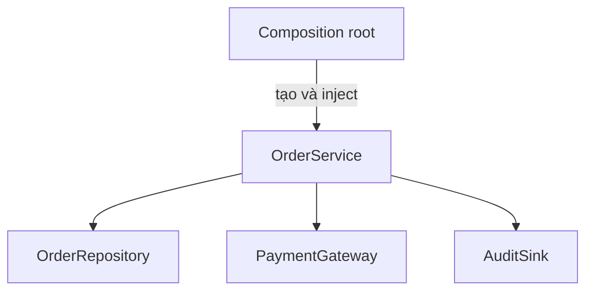
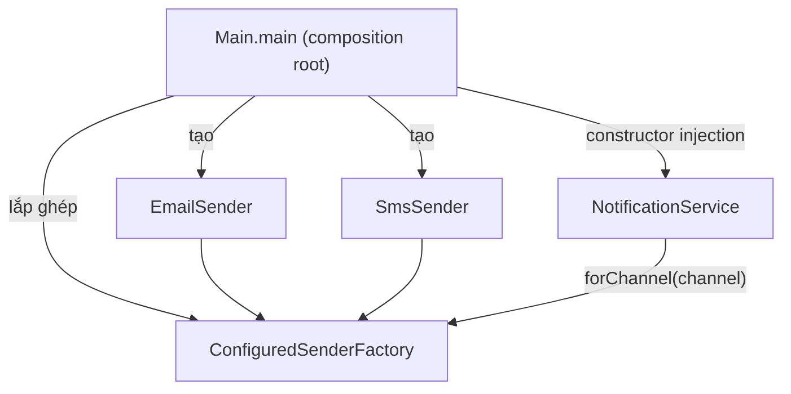

# Tránh biến provider tổng quát thành Service Locator ẩn

> **Chương:** Factory và Provider  
> **Bối cảnh:** Dependency Injection (DI), Inversion of Control (IoC), constructor injection, composition root và quản lý scope/vòng đời trong Java thuần trước khi dùng DI container.

## 1. Mục tiêu học tập

Sau bài học, bạn có thể:

1. Phân biệt **factory chuyên biệt**, **provider được định kiểu** và **Service Locator**.
2. Nhận biết vì sao API trả về dependency bất kỳ bằng `get(Class<T>)`, `resolve(String)` hay `Map<String, Object>` có thể che giấu phụ thuộc.
3. Quyết định khi nào nên inject trực tiếp một object, inject `Provider<T>` hoặc dùng một factory cho một họ đối tượng xác định.
4. Tổ chức việc chọn implementation tại **composition root**, vẫn cho phép chọn một biến thể theo từng lời gọi khi nghiệp vụ cần.
5. Viết ví dụ và kiểm thử bằng Java thuần với **constructor injection** và fake.
6. Nêu rõ chính sách **cùng instance hay instance mới**, scope, ownership và cách xử lý lỗi từ provider/factory.

## 2. Dấu hiệu ban đầu: service chỉ nhận một resolver

Giả sử `OrderService` cần ba cộng tác viên: `OrderRepository`, `PaymentGateway` và `AuditSink`. Một thiết kế dễ gặp là:

```java
// Phản ví dụ; Order, OrderRepository, PaymentGateway, AuditSink
// là các kiểu nghiệp vụ giả định đã khai báo ở nơi khác.
interface DependencyResolver {
    <T> T resolve(Class<T> type);
}

final class OrderService {
    private final DependencyResolver resolver;

    OrderService(DependencyResolver resolver) {
        this.resolver = resolver;
    }

    void placeOrder(Order order) {
        OrderRepository repository =
                resolver.resolve(OrderRepository.class);
        PaymentGateway gateway =
                resolver.resolve(PaymentGateway.class);
        AuditSink audit = resolver.resolve(AuditSink.class);
        // Xử lý đơn hàng...
    }
}
```

Constructor chỉ cho biết lớp cần `DependencyResolver`. Nhưng bên trong, `placeOrder` yêu cầu ba service thật sự khác nhau. Để test lớp này, caller phải tạo resolver có khả năng trả đúng các service; để chạy production, phải đăng ký các binding cần thiết. Những yêu cầu đó **không hiện diện trong constructor**.

Thiết kế này dẫn tới:

- **Hidden dependencies:** người đọc chữ ký constructor không biết service cần repository, gateway và audit.
- **Runtime configuration failures:** chương trình có thể biên dịch ngay cả khi registry thiếu `PaymentGateway`; lỗi chỉ xuất hiện khi nhánh tra cứu chạy.
- **Test setup phình to:** test dựng một registry giả hoặc cấu hình container thay vì truyền vài fake cần thiết.
- **Coupling với cơ chế tra cứu:** lớp nghiệp vụ phải biết cách tìm service, thay vì chỉ biết hợp đồng sử dụng.
- **Khó lần theo object graph:** các dependency có thể bị truy vấn rải rác trong nhiều method, tạo mới quá muộn hoặc sai scope.

Về hành vi, `DependencyResolver` ở đây chính là một **Service Locator**, dù nó được đưa vào qua constructor. **Inject một locator không đồng nghĩa với việc các dependency thực của service đã được khai báo theo DI.**

## 3. Factory, provider và Service Locator khác nhau thế nào?

| Kiểu API | Ví dụ | Phạm vi trả về | Consumer bộc lộ nhu cầu gì? |
| --- | --- | --- | --- |
| **Inject trực tiếp** | `OrderService(PaymentGateway gateway)` | Một dependency đã chuẩn bị | Nêu rõ kiểu dependency cần dùng. |
| **Provider được định kiểu** | `Provider<ReportSession>.get()` | Một kiểu `ReportSession` | Cần khả năng lấy session vào thời điểm sử dụng. |
| **Factory chuyên biệt** | `MessageSenderFactory.forChannel(channel)` | Các `MessageSender` theo kênh | Cần khả năng chọn sender theo ngữ cảnh đã định nghĩa. |
| **Service Locator tổng quát** | `resolver.resolve(PaymentGateway.class)` | Bất kỳ service/binding nào registry chứa | Chỉ thấy quyền truy cập registry, không thấy đầy đủ dependency. |

**Tên class không quyết định bản chất.** Một class tên `Factory` nhưng có phương thức `<T> T get(Class<T>)` cho mọi bean vẫn có thể là Service Locator. Ngược lại, một class tên `Provider<T>` với `T get()` không tự động là Service Locator.

### 3.1. Provider có generic type là trường hợp khác

```java
interface Provider<T> {
    T get();
}

// ReportSession là kiểu minh họa được định nghĩa trong ứng dụng.
final class ReportService {
    private final Provider<ReportSession> sessions;

    ReportService(Provider<ReportSession> sessions) {
        this.sessions = java.util.Objects.requireNonNull(sessions);
    }
}
```

`Provider<ReportSession>` chỉ có thể cung cấp `ReportSession` theo hợp đồng kiểu. Consumer **không thể dùng cùng API này để yêu cầu `PaymentGateway` hoặc `OrderRepository` tùy ý**. Một typed provider có thể hợp lý khi cần trì hoãn tạo dependency, mở một đối tượng mới mỗi thao tác hoặc resolve một object trong scope hợp lệ.

Tuy nhiên, phương thức `get()` tự nó **không nói** đối tượng có được tạo mới, cache, chia sẻ hay tự đóng hay không. Các điều này cần được công bố bằng contract. Nếu dependency ổn định và đã sẵn sàng, inject trực tiếp thường đơn giản hơn.

### 3.2. Những biến thể ẩn khác

Không cần có class tên `ServiceLocator` mới tạo ra vấn đề. Một service có thể truy cập:

- `ApplicationContext.getBean(...)` hoặc API truy vấn container chung.
- `Map<String, Object>` rồi ép kiểu thủ công theo khóa `"paymentGateway"`.
- `Function<Class<?>, Object>` được dùng để lấy nhiều loại service.
- Một `ApplicationFactory` có hàng chục hàm `getRepository()`, `getGateway()`, `getLogger()` và được inject vào mọi lớp.

Nếu những API này đem đến cho business service quyền **tra cứu toàn bộ object graph**, dependency bị che giấu giống Service Locator. Cần đánh giá **cách dùng** và mức độ rộng của API, không chỉ kiểu hay tên class.

## 4. Dependency ổn định: đưa thẳng vào constructor

Với những dependency bắt buộc trong suốt vòng đời `OrderService`, thiết kế đơn giản là:

```java
// Ví dụ thiết kế; các interface nghiệp vụ là kiểu minh họa.
final class OrderService {
    private final OrderRepository repository;
    private final PaymentGateway gateway;
    private final AuditSink audit;

    OrderService(
            OrderRepository repository,
            PaymentGateway gateway,
            AuditSink audit) {
        this.repository = java.util.Objects.requireNonNull(repository);
        this.gateway = java.util.Objects.requireNonNull(gateway);
        this.audit = java.util.Objects.requireNonNull(audit);
    }
}
```

Từng dependency hiện ra tại constructor. Test truyền fake trực tiếp; composition root có thể chọn implementation phù hợp với môi trường và lắp ghép trước khi xử lý yêu cầu.



Không bắt buộc mọi dependency phải là interface; inject một concrete class vẫn là DI. Trừu tượng hóa hữu ích khi cần ranh giới nghiệp vụ/hạ tầng hoặc khả năng thay implementation.

Nếu constructor có quá nhiều dependency không liên quan, đó có thể là dấu hiệu service chịu nhiều trách nhiệm. **Đổi toàn bộ thành một resolver chung chỉ che đi dấu hiệu đó**, không cải thiện thiết kế.

## 5. Trường hợp hợp lý để inject factory chuyên biệt

Một hệ thống thông báo chọn **email hay SMS theo từng yêu cầu**, vì vậy việc lựa chọn có hai cấp:

1. **Ở khởi động:** tạo adapter cụ thể, xác định cấu hình và quản lý vòng đời.
2. **Khi xử lý request:** chọn kênh nghiệp vụ theo thông tin của request.

Một factory có hợp đồng hẹp đáp ứng nhu cầu này:

```java
interface MessageSenderFactory {
    MessageSender forChannel(Channel channel);
}
```

Consumer có quyền yêu cầu **một `MessageSender` theo một `Channel`**, không có quyền lấy repository hay gateway tùy ý. Hợp đồng thể hiện nhu cầu chọn sender theo kênh; phần triển khai hạ tầng vẫn được quyết định ở composition root.

## 6. Ví dụ Java thuần chạy được

Tạo file `Main.java`. Các adapter `EmailSender` và `SmsSender` dưới đây **chỉ in console**, không gửi email hay SMS thật.

```java
import java.util.Objects;

enum Channel {
    EMAIL, SMS
}

interface MessageSender {
    void send(String destination, String content);
}

interface MessageSenderFactory {
    MessageSender forChannel(Channel channel);
}

final class EmailSender implements MessageSender {
    @Override
    public void send(String destination, String content) {
        System.out.println("EMAIL to " + destination + ": " + content);
    }
}

final class SmsSender implements MessageSender {
    @Override
    public void send(String destination, String content) {
        System.out.println("SMS to " + destination + ": " + content);
    }
}

// Factory hẹp: chọn các object đã được root tạo.
final class ConfiguredSenderFactory implements MessageSenderFactory {
    private final MessageSender emailSender;
    private final MessageSender smsSender;

    ConfiguredSenderFactory(MessageSender emailSender,
                            MessageSender smsSender) {
        this.emailSender = Objects.requireNonNull(
                emailSender, "emailSender");
        this.smsSender = Objects.requireNonNull(
                smsSender, "smsSender");
    }

    @Override
    public MessageSender forChannel(Channel channel) {
        Objects.requireNonNull(channel, "channel");
        switch (channel) {
            case EMAIL:
                return emailSender;
            case SMS:
                return smsSender;
            default:
                throw new IllegalArgumentException(
                        "Unsupported channel: " + channel);
        }
    }
}

final class NotificationService {
    private final MessageSenderFactory senders;

    NotificationService(MessageSenderFactory senders) {
        this.senders = Objects.requireNonNull(senders, "senders");
    }

    void confirmOrder(String orderId,
                      String destination,
                      Channel channel) {
        if (orderId == null || orderId.trim().isEmpty()) {
            throw new IllegalArgumentException("orderId is required");
        }
        if (destination == null || destination.trim().isEmpty()) {
            throw new IllegalArgumentException("destination is required");
        }
        MessageSender sender = Objects.requireNonNull(
                senders.forChannel(
                        Objects.requireNonNull(channel, "channel")),
                "sender");
        sender.send(destination, "Xác nhận đơn hàng " + orderId);
    }
}

public class Main {
    public static void main(String[] args) {
        // Composition root: quyết định các lớp cụ thể và scope.
        MessageSender email = new EmailSender();
        MessageSender sms = new SmsSender();
        MessageSenderFactory factory =
                new ConfiguredSenderFactory(email, sms);
        NotificationService notifications =
                new NotificationService(factory);

        // Chỉ tham số nghiệp vụ thay đổi theo từng lời gọi.
        notifications.confirmOrder(
                "ORD-101", "a@example.test", Channel.EMAIL);
        notifications.confirmOrder(
                "ORD-102", "+84000000000", Channel.SMS);
    }
}
```

Biên dịch và chạy bằng JDK:

```bash
javac -encoding UTF-8 Main.java
java Main
```

Kết quả mong đợi:

```text
EMAIL to a@example.test: Xác nhận đơn hàng ORD-101
SMS to +84000000000: Xác nhận đơn hàng ORD-102
```



**Vì sao thiết kế này không biến factory thành Service Locator?** `NotificationService` không tra cứu service bất kỳ theo `Class` hoặc key. Nó cần duy nhất năng lực chọn `MessageSender` cho một `Channel` đã xác định. Việc tạo `EmailSender` và `SmsSender` nằm tại ranh giới khởi động; service chỉ sử dụng hợp đồng.

**Lưu ý về tên factory:** `ConfiguredSenderFactory` **không tạo một sender mới sau mỗi lần `forChannel`**. Nó trả lại instance đã được truyền vào constructor. “Factory” ở đây là đối tượng cung cấp/chọn sản phẩm thuộc một họ có nghĩa; chính sách chia sẻ được quy định rõ. Nếu cần tạo mới, hãy thiết kế contract khác tương ứng.

### 6.1. Không phải trường hợp nào cũng cần factory

Nếu mọi thông báo của service đều đi qua cùng một kênh đã chọn khi khởi động, hãy cân nhắc inject `MessageSender` trực tiếp:

```java
final class SimpleNotificationService {
    private final MessageSender sender;

    SimpleNotificationService(MessageSender sender) {
        this.sender = java.util.Objects.requireNonNull(sender);
    }

    void notify(String destination, String message) {
        sender.send(destination, message);
    }
}
```

Factory chỉ đáng thêm vào khi có yêu cầu thực về **chọn biến thể, khởi tạo theo thời điểm hoặc scope**. Mỗi abstraction bổ sung đều có chi phí hiểu và bảo trì.

## 7. Kiểm thử bằng Java thuần, không dựng registry

Giữ `Main.java` ở mục 6 và tạo thêm `NotificationServiceTest.java` cùng thư mục:

```java
final class RecordingSender implements MessageSender {
    int callCount;
    String lastDestination;
    String lastContent;

    @Override
    public void send(String destination, String content) {
        callCount++;
        lastDestination = destination;
        lastContent = content;
    }
}

public class NotificationServiceTest {
    public static void main(String[] args) {
        RecordingSender email = new RecordingSender();
        RecordingSender sms = new RecordingSender();
        MessageSenderFactory factory =
                new ConfiguredSenderFactory(email, sms);
        NotificationService service = new NotificationService(factory);

        service.confirmOrder("ORD-A", "a@example.test", Channel.EMAIL);
        check(email.callCount == 1, "EMAIL should be used");
        check(sms.callCount == 0, "SMS must not be used yet");
        check("a@example.test".equals(email.lastDestination),
                "Wrong EMAIL destination");
        check("Xác nhận đơn hàng ORD-A".equals(email.lastContent),
                "Wrong EMAIL content");

        service.confirmOrder("ORD-B", "0900000000", Channel.SMS);
        check(email.callCount == 1, "EMAIL should not be reused");
        check(sms.callCount == 1, "SMS should be used");
        check("0900000000".equals(sms.lastDestination),
                "Wrong SMS destination");
        check("Xác nhận đơn hàng ORD-B".equals(sms.lastContent),
                "Wrong SMS content");

        boolean rejected = false;
        try {
            service.confirmOrder(" ", "ignored", Channel.EMAIL);
        } catch (IllegalArgumentException expected) {
            rejected = true;
        }
        check(rejected, "Blank order ID must be rejected");
        check(email.callCount == 1, "Invalid request must not send");

        boolean nullRejected = false;
        try {
            new NotificationService(null);
        } catch (NullPointerException expected) {
            nullRejected = true;
        }
        check(nullRejected, "Required factory must be non-null");

        System.out.println("PASS");
    }

    private static void check(boolean condition, String message) {
        if (!condition) {
            throw new AssertionError(message);
        }
    }
}
```

```bash
javac -encoding UTF-8 Main.java NotificationServiceTest.java
java NotificationServiceTest
```

Kết quả mong đợi: `PASS`. Test cho thấy service gửi qua đúng adapter, dữ liệu không hợp lệ bị từ chối và constructor thể hiện dependency bắt buộc. Nó không xác minh việc gửi qua mạng; phần này cần integration test với adapter thật.

## 8. Provider hợp lệ khi cần tạo hoặc lấy đối tượng đúng thời điểm

Một provider được định kiểu như `Provider<ReportSession>` hoặc `Supplier<ReportSession>` có thể phù hợp khi session phải xuất hiện theo **từng lần xử lý** thay vì được giữ trong toàn bộ vòng đời service.

Tuy vậy, `get()` không mặc nhiên có nghĩa “tạo instance mới”. Nó có thể trả lại singleton, một instance theo request hoặc đối tượng vừa tạo, tùy implementation. Contract nên làm rõ:

- Mỗi lần gọi trả **cùng hay khác instance**?
- Có trả `null` hoặc ném ngoại lệ không? Lỗi vận hành được báo ra sao?
- Kết quả có thể được dùng chung giữa nhiều luồng không?
- **Ai sở hữu và đóng** đối tượng trả về?
- Nếu khởi tạo một phần thất bại thì ai dọn dẹp tài nguyên đã mở?

### 8.1. Factory mở tài nguyên: caller sở hữu kết quả

```java
// Ví dụ độc lập minh họa hợp đồng tạo session.
interface ReportSession extends AutoCloseable {
    void export(String reportId);

    @Override
    void close();
}

interface ReportSessionFactory {
    /** Mở session mới; caller có trách nhiệm đóng. */
    ReportSession open();
}

final class ReportExporter {
    private final ReportSessionFactory sessions;

    ReportExporter(ReportSessionFactory sessions) {
        this.sessions = java.util.Objects.requireNonNull(sessions);
    }

    void export(String reportId) {
        try (ReportSession session = sessions.open()) {
            session.export(reportId);
        }
    }
}
```

Ở đây `ReportExporter` **mượn** `ReportSessionFactory` được inject, nhưng **sở hữu session mới** do `open()` trả về theo contract. `try-with-resources` đóng session khi kết thúc thao tác, kể cả lúc `export(...)` ném ngoại lệ.

Ngược lại, `ConfiguredSenderFactory.forChannel(...)` trả về **sender dùng chung** mà composition root đã tạo. `NotificationService` **không được đóng** sender đó sau mỗi lần gửi.

| Trường hợp | Ai thường sở hữu kết quả? | Quy tắc vòng đời |
| --- | --- | --- |
| `forChannel(EMAIL)` trả adapter dùng chung | Composition root | Consumer sử dụng nhưng không đóng. |
| `open()` tạo session ngắn hạn | Caller nếu contract quy định | Dùng và đóng trong cùng đơn vị công việc. |
| Pool cấp `Connection` | Pool sở hữu tài nguyên nền; caller sở hữu lease | `close()` của connection thường trả lease về pool; owner của pool shutdown pool. |
| Provider trả đối tượng theo request | Scope manager/owner theo contract | Không giữ trực tiếp trong singleton sau khi request hết hiệu lực. |

Từ khóa `Factory` hay `Provider` không xác lập ownership tự động. Điều này phải được ghi rõ trong API.

## 9. Scope, concurrency và vòng phụ thuộc

### 9.1. Provider không tự bảo đảm thread safety

Nếu factory luôn trả một adapter dùng chung, adapter đó phải đáp ứng yêu cầu dùng chung giữa các luồng. Nếu factory tạo một object mới mỗi lần, object có thể vẫn phụ thuộc vào tài nguyên nền không an toàn. **Scope và thread safety là các cam kết riêng**, không thể suy ra chỉ từ kiểu trả về `T`.

### 9.2. Không giữ tài nguyên request trong singleton

Một service sống suốt ứng dụng không nên lấy `RequestSession` từ provider đúng một lần trong constructor rồi lưu mãi khi session chỉ hợp lệ cho một request. Nếu cần session theo thao tác, hãy mở và đóng trong scope thao tác, hoặc inject một factory/scope manager rõ ràng.

### 9.3. Lazy provider không tự phá vòng logic

`Provider<B>` có thể trì hoãn tạo hoặc resolve `B` để tránh một số lỗi vòng khởi tạo. Nhưng nếu `A` gọi `B` rồi `B` gọi `A` không có điều kiện kết thúc, vòng hành vi vẫn tồn tại. Khi gặp circular dependency, nên kiểm tra phân chia trách nhiệm và object graph trước khi dùng lazy/proxy để đi vòng.

### 9.4. Xử lý lỗi cấp phát

Factory mở kết nối mới có thể ném exception do thiếu cấu hình hoặc dịch vụ ngoài không khả dụng. Hợp đồng phải nêu cách báo lỗi, điều kiện retry và dọn dẹp phần tài nguyên đã tạo. Với dependency bắt buộc và ổn định, kiểm tra cấu hình tại composition root thường giúp phát hiện lỗi sớm hơn.

## 10. Factory chuyên biệt khi nào bị biến tướng?

Những dấu hiệu cần review:

1. Một `ApplicationFactory` được inject vào mọi service và liên tục bổ sung `getRepository()`, `getPaymentGateway()`, `getClock()`...
2. Factory cung cấp `<T> T create(Class<T> type)` cho **bất kỳ class nào**, thay vì một họ sản phẩm có hợp đồng.
3. Service lấy `Map<String, Object>` hoặc `Supplier<Object>` rồi ép kiểu theo chuỗi cấu hình.
4. Cùng một dependency ổn định được tra cứu lặp lại tại runtime dù có thể inject trực tiếp.
5. Một thay đổi nghiệp vụ chỉ thêm một lệnh lookup mới sâu trong method, khiến constructor không phản ánh nhu cầu tăng thêm.

Một factory **không xấu** vì có nhiều implementation. `FormatterFactory.forLocale(locale)` hoặc `MessageSenderFactory.forChannel(channel)` có ý nghĩa nếu lựa chọn theo ngữ cảnh là một phần của hợp đồng. Câu hỏi quan trọng là: factory cung cấp **một năng lực cụ thể**, hay trao cho consumer **quyền tra cứu cả container**?

## 11. Đặt việc tra cứu container ở đúng ranh giới

Khi dùng một DI container, cơ chế registry/binding có thể cần thiết trong quá trình bootstrap. Composition root được phép biết concrete implementation, cấu hình và các API của container để xây object graph:

```text
Main / composition root
    ├── kiểm tra cấu hình
    ├── tạo EmailSender và SmsSender
    ├── tạo ConfiguredSenderFactory(email, sms)
    └── tạo NotificationService(senderFactory)
            └── mỗi request gọi forChannel(channel)
```

Với Java thuần, có thể tự viết các dòng `new` ở `Main.main`. Khi dùng Spring hoặc một container khác, binding và bootstrap có thể tạo/wire object graph tự động. **Lớp nghiệp vụ vẫn nên công bố dependency qua constructor hoặc một hợp đồng factory hẹp**, tránh trực tiếp gọi `container.getBean(...)` để yêu cầu bean bất kỳ.

Không phải mọi trường hợp dùng API container đều là lỗi: code ở tầng tích hợp framework, module wiring và scope manager có thể cần dùng nó. Hãy khoanh quyền truy cập ấy trong **ranh giới khởi động/hạ tầng**.

## 12. Quy trình refactor từ Service Locator ẩn

1. **Tìm mọi điểm tra cứu:** thống kê `resolve(Class)`, `get(String)` hoặc đọc từ registry trong từng service.
2. **Liệt kê dependency thực:** ghi rõ kiểu nào bắt buộc, kiểu nào tùy chọn, kiểu nào cần thay đổi theo request.
3. **Chuyển dependency ổn định sang constructor:** cho phép test truyền fake trực tiếp, xác thực `null` khi khởi tạo.
4. **Đổi lookup động thành factory hẹp khi cần:** ví dụ `MessageSenderFactory.forChannel(channel)`, `ReportSessionFactory.open()`.
5. **Lắp ghép ở composition root:** tạo adapter, thiết lập factory và scope, rồi truyền dependency vào consumer.
6. **Xóa resolver khỏi nghiệp vụ:** bỏ mã tra cứu service tổng quát, tránh để đường cũ tồn tại song song.
7. **Kiểm thử riêng từng phần:** service với fake, factory theo contract, bootstrap với cấu hình hợp lệ/sai và adapter thật bằng integration test phù hợp.

Nếu sau refactor constructor có quá nhiều dependency độc lập, hãy xem lại ranh giới trách nhiệm của lớp. Đừng bọc mọi thứ vào một `DependenciesBag` hoặc locator chỉ để chữ ký trông ngắn đi.

## 13. Các nhầm lẫn thường gặp

**“Mọi provider là Service Locator.”** Sai. Provider định kiểu `Provider<T>` có thể là dependency rõ ràng khi cần lazy hoặc per-call lifecycle; vấn đề là khả năng tra cứu tùy ý và việc che giấu dependency.

**“Đã truyền locator bằng constructor là đạt DI.”** Chưa đủ. Consumer vẫn tự quyết định lấy những service nào bên trong method.

**“Factory phải luôn tạo bằng `new`.”** Không bắt buộc. Factory có thể trả instance đã có, lấy từ pool hoặc tạo mới; cần ghi rõ semantics.

**“Có DI container thì không cần composition root.”** Container hỗ trợ lắp ghép, nhưng vẫn cần bootstrap, chính sách scope, ownership và quyết định chọn implementation.

**“Interface đảm bảo hai implementation tương đương.”** Compiler chỉ bảo vệ chữ ký và kiểu; còn hợp đồng hành vi, lỗi, retry và tài nguyên cần được thiết kế và kiểm thử.

**“Gom mọi dependency vào một factory là giảm coupling.”** Một factory tổng quát dùng khắp ứng dụng thường trở thành mối phụ thuộc tập trung và làm mờ object graph.

## 14. Bài tập tự luyện

**Bài 1 — Phân loại:** So sánh `A(PaymentGateway gateway)`, `B(Provider<PaymentGateway> gateway)` và `C(DependencyResolver resolver)`. Trường hợp nào rõ dependency trực tiếp? Trường hợp nào phù hợp lazy/per-call? Trường hợp nào dễ là Service Locator?

**Bài 2 — Refactor:** `ReportService` gọi `resolve(Clock.class)`, `resolve(ReportRepository.class)` và `resolve(PdfRenderer.class)`. Hãy viết constructor tường minh. Nếu renderer thay đổi theo định dạng báo cáo của mỗi request, bạn sẽ thiết kế factory hẹp như thế nào?

**Bài 3 — Kiểm thử:** Thêm vào `NotificationServiceTest` ca `Channel.SMS` với destination rỗng. Kiểm tra cả hai fake không bị gọi thêm. Test chứng minh điều gì và chưa chứng minh điều gì?

**Bài 4 — Resource ownership:** `ReportSessionFactory.open()` tạo một session cần đóng. Vì sao không nên giữ session đó trong singleton? Hãy mô tả `try-with-resources` cho một lần xuất báo cáo.

**Bài 5 — Factory biến tướng:** Một `ApplicationFactory` có `<T> T get(Class<T>)`, được inject vào hàng chục service. Vì sao đổi tên `ServiceLocator` thành `ApplicationFactory` không cải thiện tính tường minh?

**Gợi ý:** (1) `A` trực tiếp, `B` là provider định kiểu hợp lý khi có yêu cầu thời điểm/scope, `C` dễ che dependency. (2) Inject `Clock`, `ReportRepository`, `PdfRenderer`; nếu cần chọn theo format, inject `RendererFactory.forFormat(format)` trả về renderer thuộc cùng hợp đồng. (3) Test xác minh validation và không gây tác dụng phụ; chưa kiểm tra mạng. (4) Session theo đơn vị công việc nên được tạo, dùng và đóng trong scope; `try (ReportSession s = factory.open()) { ... }`. (5) API vẫn cho phép lấy mọi service, khiến constructor chỉ thể hiện locator và các dependency thực vẫn bị giấu.

## 15. Ghi nhớ

**Provider được định kiểu hẹp có thể là công cụ DI hữu ích; provider tổng quát cấp quyền tra cứu tùy ý dễ trở thành Service Locator ẩn.** Hãy cho constructor mô tả những dependency bắt buộc, chỉ dùng factory/provider khi thực sự cần chọn biến thể hoặc kiểm soát thời điểm tạo và scope. Đặt việc tạo, chọn concrete implementation tại **composition root**, quy định ai sở hữu tài nguyên, rồi kiểm thử độc lập bằng Java thuần trước khi dùng DI container.
