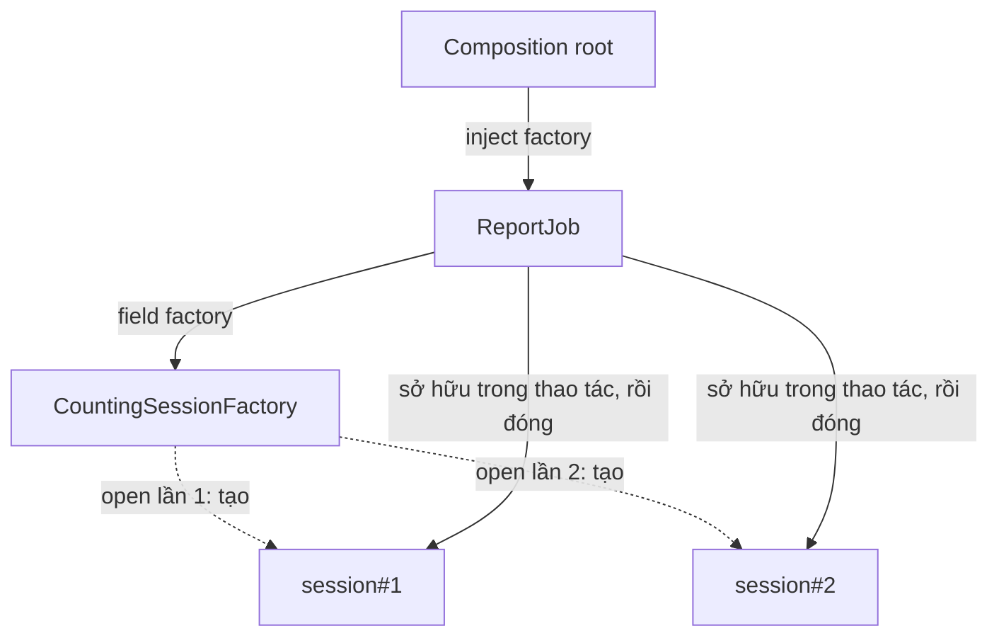
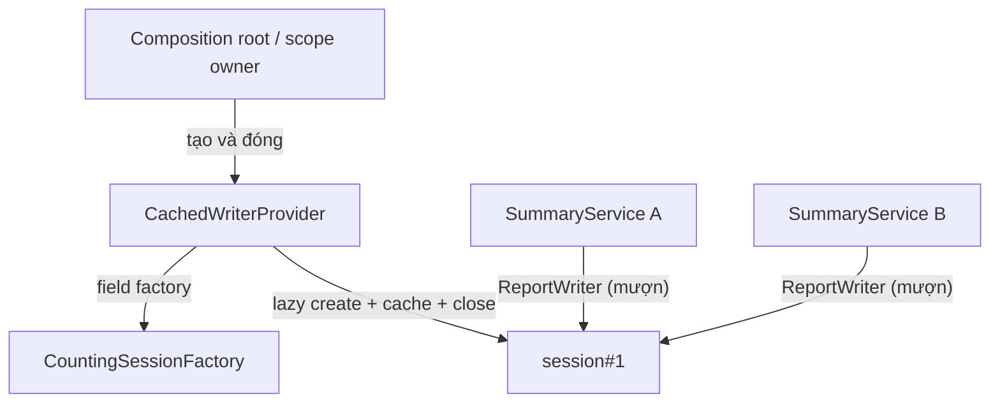

# Kiểm thử số lần tạo, danh tính và vòng đời của đối tượng trả về

Trong chương **Factory và Provider** của module **Dependency Injection (DI)**, việc gọi `factory.open()` hoặc `provider.get()` chưa đủ để kết luận có bao nhiêu đối tượng được tạo, những lần gọi nào dùng chung một instance, và ai phải đóng tài nguyên khi không còn sử dụng.

Hai đoạn mã trông tương tự có thể tạo ra đồ thị đối tượng khác hẳn nhau:

```java
// Mỗi lần open() được kỳ vọng tạo một phiên độc lập:
ReportSession first = factory.open();
ReportSession second = factory.open();

// Mỗi lần get() trong cùng scope được kỳ vọng trả một đối tượng dùng chung:
ReportWriter a = provider.get();
ReportWriter b = provider.get();
```

Nếu hợp đồng là “mỗi lần tạo mới”, ta cần kiểm chứng `first != second`. Nếu hợp đồng là “dùng chung trong một scope”, ta cần kiểm chứng `a == b`. Khi các phiên nắm giữ file, kết nối hoặc buffer, còn phải xác minh **đóng đúng lần, đúng thời điểm và đúng nơi sở hữu**.

Bài học này hướng dẫn cách viết phép thử **Java thuần**, không cần JUnit, mock framework hay DI container. Những kiến thức này giúp kiểm soát **constructor injection**, **composition root**, **scope** và **lifecycle**, trước khi giao việc lắp ghép cho container.

## 1. Ba thuộc tính cần kiểm thử là ba câu hỏi khác nhau

| Thuộc tính | Câu hỏi | Phép đo chính |
| --- | --- | --- |
| **Số lần tạo** (*creation count*) | Thực sự đã có bao nhiêu instance mới được tạo? | Bộ đếm ở factory hoặc constructor tạo đối tượng |
| **Danh tính** (*identity*) | Hai lần nhận dependency có trỏ tới cùng một instance không? | So sánh tham chiếu bằng `==` và `!=` |
| **Vòng đời** (*lifecycle*) | Đối tượng được tạo, sử dụng và đóng ở thời điểm nào; do ai đóng? | Ghi nhận sự kiện `create`, `use`, `close` và kiểm tra thứ tự |

Ba thuộc tính cần được xem độc lập. Một factory có thể được **gọi hai lần** mà chỉ tạo **một instance** nếu nó có cache. Hai object khác nhau có thể chứa **giá trị giống hệt nhau**. Một đối tượng vẫn được tham chiếu sau khi `close()` nhưng tài nguyên bên trong đã hết hiệu lực.

### 1.1. Phân biệt số lần gọi với số lần tạo

Xét:

```java
ReportWriter first = provider.get();
ReportWriter second = provider.get();
```

Có **hai lần gọi `get()`**. Nhưng có thể:

- Hai lần tạo ra hai instance khác nhau;
- Lần đầu tạo một instance, lần sau trả lại instance đã cache;
- Cả hai lần trả về một instance đã được tạo từ trước;
- Chỉ trả về một proxy và tạo đối tượng đích khi gọi một phương thức sau đó.

Vì vậy, bộ đếm chỉ đặt tại `get()` không chứng minh số instance đã được tạo. Khi kiểm thử, nên ghi nhận **sự kiện tạo tại nơi thực sự gọi constructor hoặc xây dựng resource**, đồng thời ghi riêng số lần gọi phương thức cung cấp.

### 1.2. Danh tính không phải bằng nhau theo giá trị

Trong Java:

```java
String first = new String("A");
String second = new String("A");

System.out.println(first.equals(second)); // true: nội dung bằng nhau
System.out.println(first == second);      // false: khác instance
```

Với các dependency dạng service, session hoặc client, câu hỏi “có chia sẻ cùng đối tượng không?” cần so sánh bằng **`==`**. `equals()` có thể được override theo dữ liệu và không biểu diễn cùng một tham chiếu. `System.identityHashCode` cũng không phải một ID duy nhất tuyệt đối: hai object khác nhau có thể có cùng hash code. Không dùng hash code làm bằng chứng duy nhất cho việc dùng chung.

### 1.3. Trách nhiệm đóng tài nguyên không chuyển theo tham chiếu

Truyền một đối tượng qua constructor hoặc trả về từ `get()` chỉ chuyển **giá trị tham chiếu**. Java không tự chuyển ownership. Hợp đồng phải nói rõ bên nhận đang:

- **Sở hữu** tài nguyên vừa nhận và phải đóng khi dùng xong;
- **Mượn** đối tượng dùng chung trong một scope, không được đóng nó;
- Hay được cấp **factory** để tự tạo những resource ngắn hạn và tự quản lý từng resource mới.

Điều này quyết định cách viết test vòng đời và cách tổ chức composition root.

## 2. Factory và provider phải có hợp đồng rõ ràng

Các tên `Factory`, `Provider`, `Supplier`, `get`, `create` và `open` không áp đặt sẵn scope theo quy tắc của Java. Một API có tên “factory” vẫn có thể cache, còn một provider vẫn có thể tạo mới mỗi lần gọi. **Tính chất cần kiểm thử phải đến từ hợp đồng được thiết kế**, không suy luận chỉ từ tên.

Trong bài này, ta chủ động chọn **hai hợp đồng khác nhau**:

| Hợp đồng trong ví dụ | Cách trả đối tượng | Ai sở hữu đối tượng trả về? | Khi nào đóng? |
| --- | --- | --- | --- |
| `ReportSessionFactory.open()` | Tạo **phiên mới** ở mỗi lần gọi thành công | Bên gọi `open()` | Sau từng thao tác, dùng `try-with-resources` |
| `ReportWriterProvider.get()` | Trả **cùng một writer** trong suốt vòng đời provider | Chính provider | Khi provider/scope được đóng |

Đây là các quy ước của ví dụ, không phải luật chung của mọi framework.

Để phân tách khả năng **sử dụng** khỏi khả năng **đóng**, ta định nghĩa:

```java
interface ReportWriter {
    void write(String value);
}

interface ReportSession extends ReportWriter, AutoCloseable {
    @Override
    void close();
}
```

Bên gọi factory nhận `ReportSession`, nên có API `close()` và trách nhiệm đóng. Bên gọi provider chỉ nhận `ReportWriter`, là bề mặt API dùng để ghi dữ liệu; phương thức `close()` không được đưa vào hợp đồng sử dụng đó. Provider giữ resource thật và tự đóng khi kết thúc scope.

**Lưu ý:** giới hạn interface giúp thể hiện ý định ownership, nhưng Java vẫn không có hệ thống kiểm tra ownership tĩnh. Nếu caller cố ép kiểu về implementation cụ thể, nó có thể phá quy ước. Tài liệu hợp đồng và test vẫn cần thiết.

## 3. Ví dụ hoàn chỉnh: đo số lần tạo, identity và sự kiện đóng

Tạo file `FactoryProviderLifecycleDemo.java`. Đây là một chương trình Java thuần vừa mô phỏng các dependency vừa chứa các phép kiểm chứng, để người học quan sát được mọi sự kiện.

```java
import java.util.ArrayList;
import java.util.List;
import java.util.Objects;

public class FactoryProviderLifecycleDemo {

    // Chỉ cấp khả năng sử dụng.
    interface ReportWriter {
        void write(String value);
    }

    // Tài nguyên có thể đóng sau khi dùng.
    interface ReportSession extends ReportWriter, AutoCloseable {
        @Override
        void close();
    }

    // Hợp đồng của bài: mỗi open() thành công tạo một session MỚI.
    interface ReportSessionFactory {
        ReportSession open();
    }

    // Hợp đồng của bài: cùng provider trả cùng writer trong scope.
    interface ReportWriterProvider extends AutoCloseable {
        ReportWriter get();

        @Override
        void close();
    }

    // Session giả lập, chỉ ghi sự kiện vào List để có thể kiểm tra.
    static final class RecordingSession implements ReportSession {
        final int id;
        private final List<String> events;
        boolean closed;
        int closeCalls;

        RecordingSession(int id, List<String> events) {
            this.id = id;
            this.events = Objects.requireNonNull(events, "events");
        }

        @Override
        public void write(String value) {
            if (closed) {
                throw new IllegalStateException("Session already closed");
            }
            events.add("write:" + id + ":" + value);

            // Tình huống lỗi giả lập để kiểm tra finally/close.
            if ("FAIL".equals(value)) {
                throw new IllegalStateException("Simulated write failure");
            }
        }

        @Override
        public void close() {
            closeCalls++;
            closed = true;
            events.add("close:" + id);
        }
    }

    // Đếm SỐ INSTANCE được tạo tại điểm tạo, không đếm get().
    static final class CountingSessionFactory
            implements ReportSessionFactory {

        private final List<String> events;
        private final List<RecordingSession> created = new ArrayList<>();

        CountingSessionFactory(List<String> events) {
            this.events = Objects.requireNonNull(events, "events");
        }

        @Override
        public ReportSession open() {
            int id = created.size() + 1;
            RecordingSession session = new RecordingSession(id, events);
            created.add(session);
            events.add("create:" + id);
            return session;
        }

        int creationCount() {
            return created.size();
        }

        RecordingSession createdAt(int index) {
            return created.get(index);
        }
    }

    // Provider có cache; nó SỞ HỮU session được tạo lần đầu.
    static final class CachedWriterProvider implements ReportWriterProvider {
        private final ReportSessionFactory factory;
        private ReportSession cached;
        private boolean closed;
        private int getCalls;

        CachedWriterProvider(ReportSessionFactory factory) {
            this.factory = Objects.requireNonNull(factory, "factory");
        }

        @Override
        public synchronized ReportWriter get() {
            if (closed) {
                throw new IllegalStateException("Provider already closed");
            }
            getCalls++;

            if (cached == null) {
                cached = Objects.requireNonNull(
                        factory.open(), "Factory returned null");
            }
            return cached;
        }

        int getCallCount() {
            return getCalls;
        }

        @Override
        public synchronized void close() {
            if (closed) {
                return;
            }
            closed = true;

            if (cached != null) {
                cached.close();
            }
        }
    }

    // Consumer A được inject FACTORY, tạo resource theo từng thao tác.
    static final class ReportJob {
        private final ReportSessionFactory factory;

        ReportJob(ReportSessionFactory factory) {
            this.factory = Objects.requireNonNull(factory, "factory");
        }

        void run(String value) {
            // Theo hợp đồng factory, job sở hữu session trả về.
            try (ReportSession session = factory.open()) {
                session.write(value);
            }
        }
    }

    // Consumer B được inject WRITER đã tạo sẵn; không tự đóng.
    static final class SummaryService {
        private final ReportWriter writer;

        SummaryService(ReportWriter writer) {
            this.writer = Objects.requireNonNull(writer, "writer");
        }

        void publish(String value) {
            writer.write(value);
        }
    }

    static void require(boolean condition, String message) {
        if (!condition) {
            throw new AssertionError(message);
        }
    }

    // Kiểm thử trường hợp factory tạo mới mỗi lần.
    static void testNewPerCall() {
        List<String> events = new ArrayList<>();
        CountingSessionFactory factory = new CountingSessionFactory(events);
        ReportJob job = new ReportJob(factory);

        require(factory.creationCount() == 0,
                "Factory must be initially empty");

        job.run("A");
        job.run("B");

        require(factory.creationCount() == 2,
                "Expected two constructed sessions");
        require(factory.createdAt(0) != factory.createdAt(1),
                "Each open() must return a different instance");
        require(factory.createdAt(0).closed
                        && factory.createdAt(1).closed,
                "Both operation sessions must be closed");
        require(factory.createdAt(0).closeCalls == 1
                        && factory.createdAt(1).closeCalls == 1,
                "Each session must be closed exactly once");

        require(events.equals(List.of(
                        "create:1", "write:1:A", "close:1",
                        "create:2", "write:2:B", "close:2")),
                "Wrong lifecycle order: " + events);
    }

    // Kiểm thử resource vẫn được đóng khi thao tác bị lỗi.
    static void testCloseOnFailure() {
        List<String> events = new ArrayList<>();
        CountingSessionFactory factory = new CountingSessionFactory(events);
        ReportJob job = new ReportJob(factory);

        boolean failed = false;
        try {
            job.run("FAIL");
        } catch (IllegalStateException expected) {
            failed = true;
        }

        require(failed, "Expected simulated write failure");
        require(factory.creationCount() == 1,
                "Exactly one session should have been created");
        require(factory.createdAt(0).closeCalls == 1,
                "try-with-resources must close after failure");
        require(events.equals(List.of(
                        "create:1", "write:1:FAIL", "close:1")),
                "Unexpected failure lifecycle: " + events);
    }

    // Kiểm thử provider lazy, cache và ownership.
    static void testCachedProvider() {
        List<String> events = new ArrayList<>();
        CountingSessionFactory factory = new CountingSessionFactory(events);
        CachedWriterProvider provider = new CachedWriterProvider(factory);

        require(factory.creationCount() == 0,
                "Provider construction must be lazy");

        ReportWriter first = provider.get();
        ReportWriter second = provider.get();

        require(provider.getCallCount() == 2,
                "get() should have been called twice");
        require(factory.creationCount() == 1,
                "Two gets must construct only one instance");
        require(first == second,
                "The same provider must return the same instance");

        SummaryService service = new SummaryService(first);
        service.publish("SUMMARY");

        require(factory.createdAt(0).closeCalls == 0,
                "Borrowing consumer must not close shared writer");

        provider.close();
        provider.close(); // Đóng provider lặp phải an toàn theo hợp đồng này.

        require(factory.createdAt(0).closeCalls == 1,
                "Provider must close its session exactly once");

        boolean rejected = false;
        try {
            provider.get();
        } catch (IllegalStateException expected) {
            rejected = true;
        }
        require(rejected, "Closed provider must reject get()");
        require(factory.creationCount() == 1,
                "Closed provider must not create more sessions");

        require(events.equals(List.of(
                        "create:1", "write:1:SUMMARY", "close:1")),
                "Unexpected cached provider lifecycle: " + events);
    }

    // Provider chưa dùng thì đóng mà không cần mở resource.
    static void testCloseBeforeFirstGet() {
        CountingSessionFactory factory =
                new CountingSessionFactory(new ArrayList<>());

        try (CachedWriterProvider unused =
                new CachedWriterProvider(factory)) {
            require(factory.creationCount() == 0,
                    "Creating provider must not create session");
        }

        require(factory.creationCount() == 0,
                "Closing unused provider must not create session");
    }

    // Mỗi provider đại diện một scope: trong scope thì dùng chung,
    // giữa hai scope thì không dùng chung.
    static void testTwoScopes() {
        CountingSessionFactory factory =
                new CountingSessionFactory(new ArrayList<>());

        try (CachedWriterProvider scopeOne =
                    new CachedWriterProvider(factory);
             CachedWriterProvider scopeTwo =
                    new CachedWriterProvider(factory)) {

            ReportWriter oneA = scopeOne.get();
            ReportWriter oneB = scopeOne.get();
            ReportWriter twoA = scopeTwo.get();

            require(oneA == oneB, "Same scope should reuse instance");
            require(oneA != twoA, "Different scopes need different instances");
            require(factory.creationCount() == 2,
                    "One instance must be created per used scope");
        }

        require(factory.createdAt(0).closeCalls == 1
                        && factory.createdAt(1).closeCalls == 1,
                "Each scope must close its own session once");
    }

    public static void main(String[] args) {
        testNewPerCall();
        testCloseOnFailure();
        testCachedProvider();
        testCloseBeforeFirstGet();
        testTwoScopes();
        System.out.println("PASS: creation, identity, lifecycle, scopes");
    }
}
```

Chạy với **JDK 11 trở lên**:

```bash
javac FactoryProviderLifecycleDemo.java
java FactoryProviderLifecycleDemo
```

Kết quả dự kiến:

```text
PASS: creation, identity, lifecycle, scopes
```

Nếu bất kỳ điều kiện nào không đúng, chương trình ném `AssertionError` kèm thông điệp chỉ rõ thuộc tính bị vi phạm.

### 3.1. Vì sao bộ kiểm thử này đo đúng sự kiện tạo?

`CountingSessionFactory.creationCount()` phản ánh kích thước danh sách `created`, được bổ sung **ngay khi một `RecordingSession` mới được khởi tạo trong `open()`**. Trong khi đó, `CachedWriterProvider.getCallCount()` tăng theo số lần `get()` được gọi.

Vì vậy:

```text
provider.get() lần 1 -> factory.open() -> create session#1
provider.get() lần 2 -> trả lại session#1
provider.get() lần 3 -> trả lại session#1

getCallCount = 3
creationCount = 1
```

Nếu chỉ đặt counter ở `get()`, test sẽ ghi 3 và có thể kết luận sai rằng ba session đã được tạo. Với factory thực có cache hoặc lớp proxy, nên đặt bộ đếm tại **đúng ranh giới tạo instance cần đo**, không chỉ tại phương thức public được gọi.

### 3.2. Vì sao dùng `==` và `!=`?

`testNewPerCall` kiểm tra:

```java
factory.createdAt(0) != factory.createdAt(1)
```

Hai phần tử là tham chiếu tới hai `RecordingSession` mà factory đã tạo. Phép `!=` chứng minh đó là **hai instance khác nhau**, bất kể các giá trị bên trong có thể giống nhau hay không.

`testCachedProvider` kiểm tra:

```java
first == second
```

Điều này xác nhận hai lần gọi cùng provider trả đúng **một object**. Nếu cần xem trạng thái nhiều object trong bộ ghi trace, có thể dùng `IdentityHashMap<Object, String>` để đặt nhãn không dựa trên `equals()`.

### 3.3. Vì sao kiểm tra cả số lần đóng và thứ tự?

`closeCalls == 1` xác minh resource đã được đóng **đúng một lần**. Nhưng nó không tự chứng minh việc đóng xảy ra **sau lần sử dụng cuối cùng**. Do đó test còn so chuỗi sự kiện:

```text
create:1
write:1:A
close:1
```

Một trình tự như `create → close → write` là lỗi vòng đời dù số lần tạo và đóng đều bằng một. Một resource đã đóng vẫn có thể còn được một service giữ tham chiếu; phép kiểm tra `dependency != null` không phát hiện được vấn đề ấy.

Với provider dùng chung, test xác nhận service chỉ **mượn** writer, resource chưa đóng khi service đang sử dụng, và provider đóng nó khi kết thúc scope.

## 4. Mô hình đồ thị và quyền sở hữu qua hai cách lắp ghép

### 4.1. Factory theo từng thao tác



Ở sơ đồ này, `ReportJob` **sở hữu từng session được trả về theo hợp đồng `open()`** và đóng khi thao tác kết thúc. Mũi tên tới session ở đây thể hiện **quan hệ sử dụng tạm thời trong lời gọi**, không có nghĩa job lưu hai session trong field đồng thời. Factory là dependency dài hơn, được inject qua constructor và có thể dùng lại giữa nhiều thao tác.

### 4.2. Provider dùng chung trong một scope



`SummaryService` chỉ nhận `ReportWriter` và không tự gọi `close()`. Provider giữ resource và chịu trách nhiệm kết thúc vòng đời. Nếu có hai provider được tạo độc lập từ cùng factory, mỗi provider có cache riêng và có thể tạo một session riêng khi lần đầu được gọi. Đó là điều `testTwoScopes` kiểm chứng.

**Đồ thị lúc chạy khác nhau theo thời điểm:** trước lần `get()` đầu tiên, provider tồn tại nhưng session chưa được tạo. Sau `get()`, có thêm nút session và cạnh cache. Sau `close()`, tham chiếu cached có thể vẫn tồn tại, nhưng resource không còn hợp lệ để sử dụng.

## 5. Kiểm thử các biến thể lỗi của factory và provider

Bộ test nên nhận diện **đúng lỗi cụ thể** nếu triển khai bị sửa nhầm.

| Lỗi vô tình trong implementation | Phép thử phát hiện | Biểu hiện |
| --- | --- | --- |
| Factory cache một session thay vì tạo mới | `testNewPerCall` | `creationCount != 2` hoặc hai tham chiếu bằng nhau |
| Provider tạo mới ở mỗi `get()` | `testCachedProvider` | `creationCount != 1` và `first != second` |
| Provider tạo eager ngay trong constructor | `testCachedProvider`, `testCloseBeforeFirstGet` | Số tạo lớn hơn 0 trước `get()` |
| Consumer đóng session dùng chung | `testCachedProvider` | `closeCalls` khác 0 trước khi provider đóng |
| Provider quên đóng cached session | `testCachedProvider` | `closeCalls == 0` khi kết thúc scope |
| Provider đóng hai lần khi `close()` được gọi lặp | `testCachedProvider` | `closeCalls == 2` |
| Factory/session không được đóng khi `write` ném lỗi | `testCloseOnFailure` | Thiếu `close:1` trong trace |
| Hai scope vô tình chia sẻ chung một cache toàn cục | `testTwoScopes` | `oneA == twoA` hoặc số tạo sai |
| Provider vẫn tạo/cấp resource sau khi đóng | `testCachedProvider` | `get()` không báo lỗi sau `close()` |

**Giới hạn của test:** `RecordingSession` chỉ là resource giả. Các phép đo xác minh logic tạo/cache/đóng của code đang thử, chưa chứng minh rằng JDBC connection, HTTP client hoặc file thật sẽ ứng xử như nhau. Với adapter thật, cần thêm integration test cho hợp đồng của resource và cách xử lý lỗi nền tảng.

### 5.1. Test với lỗi xuất hiện ngay trong `open()`

`try-with-resources` chỉ có thể đóng object **nếu biểu thức tạo resource đã trả về thành công**. Nếu `factory.open()` ném ngoại lệ trước khi trả ra session, caller chưa nhận một `ReportSession` nào để đóng.

Khi factory đang tạo nhiều tài nguyên nền, **chính factory phải dọn các tài nguyên đã mở một phần** nếu bước khởi tạo tiếp theo thất bại.

```java
// Mã phác họa trong factory: giả sử mở nguồn dữ liệu và writer.
Connection connection = openConnection();
try {
    Writer writer = openWriter(connection);
    return new CombinedSession(connection, writer);
} catch (RuntimeException | IOException error) {
    try {
        connection.close();
    } catch (Exception closeError) {
        error.addSuppressed(closeError);
    }
    throw error;
}
```

Đoạn này minh họa chính sách cleanup, **không thuộc file Java chạy độc lập ở mục 3**; `Connection`, `Writer`, `CombinedSession` và `openConnection/openWriter` tượng trưng cho tài nguyên thực, cần được định nghĩa và điều chỉnh chữ ký `throws` theo API thật. Ý nghĩa cần kiểm thử là: **khởi tạo thất bại ở bước thứ hai thì tài nguyên của bước thứ nhất được đóng**, và nguyên nhân gốc không bị che khuất.

Nếu một factory trả resource đã được tạo xong rồi về sau code sử dụng thất bại, trách nhiệm đóng chuyển theo **hợp đồng ownership của giá trị được trả về**. Hai thời điểm thất bại này cần các phép thử khác nhau.

### 5.2. Test provider khi chưa từng tạo resource

Với lazy provider, thứ tự sau là hợp lệ:

```text
create provider
close provider
```

Không có session nào được tạo, nên cũng không có session để đóng. `testCloseBeforeFirstGet` bảo vệ điều này. Nếu provider tự gọi `factory.open()` trong `close()` chỉ để có resource mà đóng, implementation đã thay đổi ngữ nghĩa lazy và tạo công việc không cần thiết.

### 5.3. Test trường hợp cache thất bại

Giả sử `get()` gọi factory nhưng factory ném ngoại lệ. Cần xác định **hợp đồng retry**:

- Provider có cho gọi `get()` lần nữa để thử lại không?
- Nó có nhớ trạng thái lỗi và luôn ném cùng lỗi không?
- Nếu tạo tài nguyên một phần, ai dọn dẹp?
- Có được biến lỗi khởi tạo thành `null` để tiếp tục không?

Trong `CachedWriterProvider` của ví dụ, nếu `factory.open()` ném ngoại lệ thì `cached` vẫn là `null`, provider vẫn chưa bị đóng và một lần gọi `get()` sau **có thể thử lại**. Đây là kết quả của cách viết cụ thể; nếu sản phẩm cần chính sách khác, phải ghi rõ và bổ sung test. Không nên mặc nhiên coi mọi lỗi là tình huống có thể retry.

## 6. Số instance mong muốn phụ thuộc vào scope

Cùng một factory có thể phục vụ nhiều phạm vi:

| Scope dự kiến | Quan hệ identity cần có | Ownership/vòng đời |
| --- | --- | --- |
| **Mỗi thao tác** | Mỗi lần `open()` trả một instance mới | Operation đóng sau khi dùng |
| **Một request** | Các consumer cùng request nhận một instance; request khác nhận instance khác | Request scope đóng khi kết thúc request |
| **Một phiên làm việc** | Dùng chung trong một session, tách giữa các session | Session owner chịu trách nhiệm |
| **Toàn ứng dụng** | Các consumer trong root/container tương ứng dùng chung một instance | Root/container đóng lúc shutdown |
| **Transient helper không giữ tài nguyên** | Tạo mới khi được yêu cầu; có thể không cần `close()` | Tập trung kiểm tra identity và hành vi |

Các tên scope là mô hình thiết kế. Một DI container có thể hỗ trợ `singleton`, `request`, `prototype` hay `transient` với quy ước riêng. Không được tự suy rằng “provider” luôn singleton hoặc “factory” luôn transient. Test cần xuất phát từ scope cụ thể của ứng dụng.

### 6.1. Kiểm tra cùng scope và khác scope

Trong `testTwoScopes`:

```java
ReportWriter oneA = scopeOne.get();
ReportWriter oneB = scopeOne.get();
ReportWriter twoA = scopeTwo.get();

require(oneA == oneB, "Same scope should reuse instance");
require(oneA != twoA, "Different scopes need different instances");
```

Đó là hai bất biến riêng:

1. **Tái sử dụng trong cùng scope**.
2. **Cách ly instance giữa các scope**.

Một test chỉ xác minh điều thứ nhất sẽ không phát hiện cache toàn cục bị chia sẻ giữa các request. Ngược lại, một test chỉ xác minh các request khác instance có thể bỏ sót việc cùng request tạo nhiều tài nguyên dư thừa.

### 6.2. Captive dependency: dùng object ngoài vòng đời của nó

Giả sử một service sống suốt ứng dụng giữ tham chiếu tới writer chỉ được cấp trong một request. Khi request kết thúc, provider đóng writer, nhưng service vẫn giữ reference. `writer != null` lúc ấy vẫn đúng, trong khi gọi `write` có thể thất bại.

Bất biến cần kiểm chứng: **mọi lần sử dụng dependency phải nằm trong thời gian dependency còn hợp lệ**. Nếu dependency sống theo request, truyền nó vào đúng request hoặc inject factory/provider có thể tạo đúng scope. Tránh để singleton giữ trực tiếp đối tượng request-scoped.

Trong môi trường có container và proxy, so sánh `==` trên proxy không nhất thiết cho biết identity của target thực ở mỗi request. Cần xác định rõ **đối tượng đang đo là proxy được inject hay instance mục tiêu được provider tạo**; khi kiểm tra scope, ưu tiên API giám sát và các hành vi có thể kiểm chứng theo hợp đồng của container.

## 7. Composition root chịu trách nhiệm tạo và hủy những gì?

Trong Java thuần, root có thể quyết định chọn factory, tạo provider và truyền writer cho service:

```java
// Mô hình wiring minh họa: realFactory do bootstrap cung cấp.
try (CachedWriterProvider provider = new CachedWriterProvider(realFactory)) {
    ReportWriter writer = provider.get();
    SummaryService service = new SummaryService(writer);
    service.publish("Da hoan thanh bao cao");
} // Root/scope đóng provider, provider đóng session đã cache.
```

*Đoạn này là minh họa, biến `realFactory` chưa được định nghĩa trong chương trình độc lập.*

Ở nhánh thao tác:

```java
ReportJob job = new ReportJob(realFactory);
job.run("Bao cao 1");
job.run("Bao cao 2");
```

Root sở hữu **factory** hoặc các tài nguyên của factory theo hợp đồng; mỗi lần `ReportJob.run` gọi `open`, job sở hữu **session trả về** và đóng nó. Factory và sản phẩm do factory tạo **không nhất thiết có cùng owner**.

Sơ đồ trách nhiệm:

```text
Composition root
  ├─ tạo/cấp factory
  ├─ tạo/cấp provider; đóng provider ở cuối scope
  │    └─ provider tạo/cache session và đóng session của chính nó
  └─ tạo ReportJob, inject factory
       └─ mỗi run() tạo session riêng và đóng sau khi run kết thúc
```

Nhờ constructor injection, consumer nhận rõ dependency cần sử dụng: `ReportJob` nhận factory, `SummaryService` nhận writer. Hai consumer không tự quyết định implementation hạ tầng hoặc lấy dependency từ một registry toàn cục.

### 7.1. Vì sao không inject session ngắn hạn vào service dài hạn?

Nếu `ReportJob` tồn tại lâu nhưng chỉ xử lý từng báo cáo trong thời gian ngắn, inject một `ReportSession` dùng một lần vào constructor rồi giữ mãi thường không phù hợp. Inject `ReportSessionFactory` giúp mỗi lần chạy tạo đúng resource thuộc về thao tác và đóng ngay khi xong.

Ngược lại, nếu nhiều service cần cùng một writer đã được thiết lập cho một phạm vi, tạo provider có cache trong scope rồi cấp `ReportWriter` cho consumer phù hợp hơn. Sự khác biệt nằm ở **vòng đời và hợp đồng sử dụng**, không chỉ ở việc mã dùng từ `get` hay `open`.

## 8. Kiểm thử an toàn khi có nhiều luồng

Ví dụ `CachedWriterProvider.get()` dùng `synchronized` để tránh hai thread cùng vượt qua điều kiện `cached == null` rồi tạo hai session. Nhưng cần phân biệt:

- **An toàn khởi tạo/cache:** các thread gọi `get()` sẽ không cùng tạo nhiều instance trong điều kiện bình thường.
- **An toàn sử dụng:** `RecordingSession.write` dùng `ArrayList`, không được thiết kế cho ghi đồng thời. Provider trả cùng writer không biến writer thành thread-safe.
- **An toàn đóng:** thread gọi `close()` trong lúc thread khác đang `write` vẫn có thể tạo xung đột về vòng đời. Khóa trong `get()/close()` không tự đồng bộ với `write()` bên ngoài provider.

Nếu yêu cầu nhiều luồng, cần định nghĩa rõ thời điểm cho phép đóng, số lượng người đang sử dụng và chính sách đồng bộ của resource. Kiểm thử cạnh tranh có thể dùng `CountDownLatch` hoặc `CyclicBarrier` để đồng bộ điểm bắt đầu, thay vì dựa vào `Thread.sleep` và hy vọng xảy ra race. Dù vậy, kiểm thử concurrent chỉ tăng độ tin cậy; không thay thế việc lập luận về đồng bộ và quyền sở hữu.

Trong bài này, tất cả phép thử đều **tuần tự và xác định** để làm rõ count, identity và lifecycle trước khi thêm yếu tố concurrency.

## 9. Cách thiết kế test để ít phụ thuộc implementation

Một test tốt phải ràng buộc vào **hợp đồng quan trọng**, đồng thời tránh kiểm tra những chi tiết không được hứa.

Ví dụ:

- Nếu port hứa “mỗi `open` tạo một phiên mới”, kiểm tra `!=` là phù hợp.
- Nếu port hứa “cùng scope dùng chung”, kiểm tra `==` trong scope là phù hợp.
- Nếu port chỉ hứa “trả một writer hoạt động”, kiểm tra bắt buộc `==` ở mọi lần `get` có thể là **đặt thêm ràng buộc ngoài hợp đồng**.
- Nếu adapter hứa đóng resource khi scope kết thúc, kiểm tra `closeCalls == 1` và thứ tự là hữu ích.
- Nếu `close()` được thiết kế idempotent, kiểm tra gọi lặp không làm đóng resource lần hai.

**Không cần suy đoán toàn bộ heap** để biết graph đúng. Trong bài học, factory giữ danh sách sản phẩm được tạo chỉ để đo. Ở ứng dụng thật, có thể dùng fake factory/spy, metric tại điểm tạo, API quan sát của container hoặc hook lifecycle để kiểm chứng mà không mở các field private của service.

Một rủi ro khi chỉ dùng counter: nếu code tăng counter nhưng không thật sự tạo resource, số liệu vẫn có thể “đúng” một cách giả tạo. Vì vậy, test cùng lúc nên giữ **tham chiếu object đã tạo**, dùng identity để xác nhận, và quan sát **hành vi hoặc sự kiện đóng**.

## 10. Checklist kiểm chứng khi thay đổi factory/provider

Khi thay một phần wiring, hãy tự hỏi:

| Câu hỏi | Cách kiểm tra |
| --- | --- |
| Có thực sự tạo mới theo hợp đồng? | Ghi count ngay tại điểm tạo và so identity của các sản phẩm |
| Có cache không, cache nằm ở scope nào? | Gọi `get` nhiều lần trong cùng scope và giữa hai scope |
| Provider lazy hay eager? | Đo count trước lần `get` đầu tiên |
| Bên nhận có quyền đóng không? | Kiểm tra kiểu API, ownership contract và số lần `close` |
| Lỗi sử dụng có làm rò rỉ resource? | Cho `write` ném lỗi rồi kiểm tra `close` |
| Đóng provider chưa từng dùng có tạo resource không? | `close` trước `get`, count vẫn bằng 0 |
| Có thể lấy resource sau khi scope đóng không? | Gọi `get` sau `close` và xác minh bị từ chối |
| Hai consumer dùng chung đúng instance chưa? | So `==` hoặc fake ghi nhận target nhận lời gọi |
| Có tạo và đóng đúng thứ tự không? | Event trace `create → use → close` |
| Thao tác đa luồng có đảm bảo không? | Kiểm tra thiết kế đồng bộ, sau đó test concurrency phù hợp |

Không nên gắn kiểm thử identity vào kiểu hạ tầng cụ thể nếu chỉ cần biết hai caller có chung resource. Constructor injection làm cho việc cấp fake dễ dàng: composition root của bài test tạo `CountingSessionFactory`, truyền vào `ReportJob` hoặc `CachedWriterProvider`, rồi quan sát kết quả mà không cần kết nối dịch vụ thật.

## 11. Bài tập thực hành

**Bài 1 — Tạo lỗi cache trong factory.** Sửa `CountingSessionFactory.open()` để luôn trả lại phiên đầu tiên khi đã có. Dự đoán điều kiện nào trong `testNewPerCall` thất bại và vì sao phép `==` bổ sung thông tin cho creation count.

**Bài 2 — Tạo lỗi transient trong provider.** Sửa `CachedWriterProvider.get()` để luôn gọi `factory.open()` và trả về session mới. Chạy lại `testCachedProvider`; phân tích rủi ro resource bị rò rỉ nếu provider chỉ đóng session cuối cùng.

**Bài 3 — Xem lỗi trong thao tác.** Bỏ `try-with-resources` trong `ReportJob.run`, giữ nguyên hành vi ghi. Giải thích vì sao hai lần chạy bình thường có thể vẫn ghi được nội dung, nhưng `testCloseOnFailure` và kiểm tra lifecycle phát hiện lỗi.

**Bài 4 — Scope theo request.** Giả sử mỗi request tạo một `CachedWriterProvider`, và mỗi request có hai service nhận writer qua `get()`. Vẽ đồ thị cho hai request đồng thời, đánh dấu các cạnh dùng chung trong một request và sự tách biệt giữa request. Viết test `==`/`!=` tương ứng.

**Bài 5 — Đóng sau khi consumer kết thúc.** Thêm một fake consumer ghi sự kiện `read` hoặc `write`. Sắp xếp root gọi consumer rồi đóng provider. Kiểm tra trace rằng sự kiện cuối của consumer nằm trước `close`; sau khi đóng, gọi lại phải có lỗi theo hợp đồng.

**Bài 6 — Khởi tạo thất bại giữa chừng.** Viết factory mô phỏng mở hai resource: resource A mở được, resource B ném lỗi. Ghi lại sự kiện và kiểm tra A được đóng dù `open()` không trả về object; giữ nguyên exception nguyên nhân hoặc thêm suppressed exception khi cleanup cũng lỗi.

## 12. Ghi nhớ

**Kiểm thử factory/provider cần đo ba điều riêng biệt:** *bao nhiêu object thực sự được tạo*, *các caller có nhận cùng instance hay không*, và *đối tượng được sử dụng, đóng đúng nơi và đúng thời điểm hay không*. Số lần gọi `get()` không tự nói lên số lần tạo; `equals()` không thay thế phép kiểm tra identity `==`; giữ reference không chứng minh resource còn mở.

Trong **DI và IoC**, composition root quyết định cách tạo và chia sẻ dependency, còn **constructor injection** giúp consumer nhận factory/provider hoặc đối tượng cần dùng một cách tường minh. Khi kiểm thử bằng Java thuần với factory đếm số lần tạo, object ghi sự kiện và các bất biến vòng đời, ta xác nhận được những cam kết quan trọng trước khi áp dụng DI container và hệ thống scope tự động.
