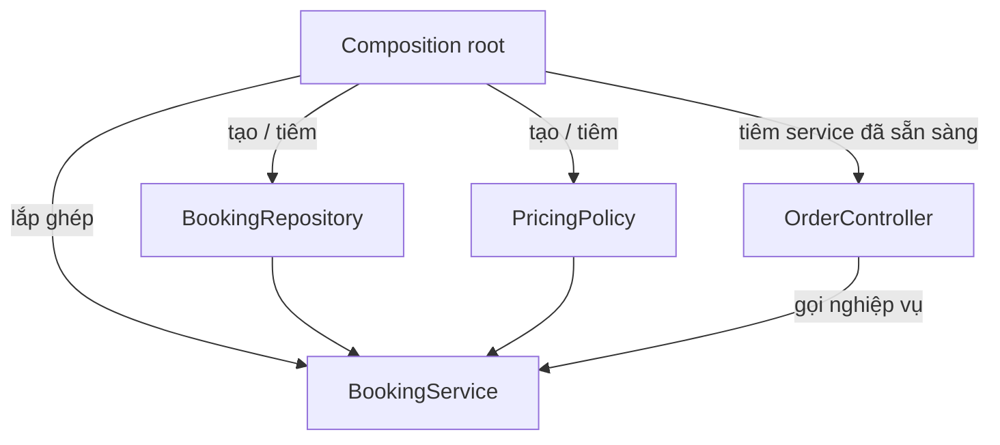
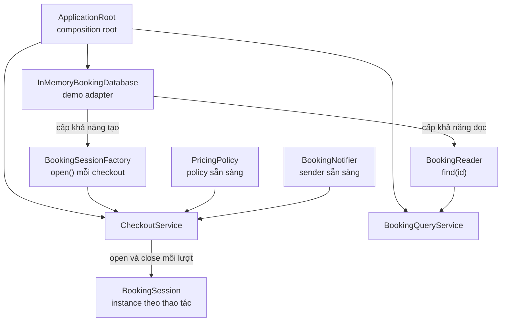

# Giới hạn sự lan truyền của factory ra ngoài nơi thực sự cần

Trong chương **Factory và Provider** của module **Dependency Injection (DI)**, factory là công cụ hữu ích khi ứng dụng cần tạo một đối tượng **vào thời điểm sử dụng**, thay vì nhận một instance cố định ngay khi khởi động. Nhưng nếu mọi service đều nhận factory hoặc provider, rồi tự chọn, tự tạo và tự quản lý cộng tác viên, logic lắp ghép sẽ dần lan ra khắp ứng dụng. Khi đó **Inversion of Control (IoC)** và **constructor injection** mất đi phần lớn tác dụng làm rõ phụ thuộc.

Nguyên tắc của bài này là: **chỉ đưa quyền tạo đối tượng đến thành phần thực sự cần quyết định thời điểm, tham số hoặc phạm vi tạo**. Nếu consumer chỉ cần gọi một hành vi trên cộng tác viên có thể được chuẩn bị sẵn, hãy **tiêm đối tượng/hợp đồng đó trực tiếp**. **Composition root** vẫn chịu trách nhiệm tạo và kết nối đồ thị phụ thuộc dài hạn; factory nhỏ, có mục đích rõ ràng, xử lý những đối tượng thật sự cần được tạo sau đó.

Sau bài học, bạn sẽ có thể:

- Phân biệt **tiêm một instance**, **tiêm factory** và **tiêm provider** theo nhu cầu của consumer.
- Nhận diện trường hợp factory bị truyền qua nhiều lớp mà các lớp đó không cần quyền tạo.
- Thiết kế factory có hợp đồng hẹp cho đối tượng theo request, session hoặc thao tác.
- Giữ quyền quyết định implementation và cấu hình trong composition root hoặc module assembler thích hợp.
- Quản lý ownership, scope và lỗi khi factory tạo tài nguyên cần đóng.
- Kiểm thử bằng Java thuần, kể cả trường hợp tạo session thành công nhưng commit thất bại.

## 1. Vì sao factory dễ bị lạm dụng?

Giả sử một `BookingService` chỉ cần chính sách tính giá. Có thể viết:

```java
interface PricingPolicy {
    long quote(int days);
}

final class BookingService {
    private final java.util.function.Supplier<PricingPolicy> pricingFactory;

    BookingService(java.util.function.Supplier<PricingPolicy> pricingFactory) {
        this.pricingFactory = java.util.Objects.requireNonNull(pricingFactory);
    }

    long quote(int days) {
        return pricingFactory.get().quote(days);
    }
}
```

Nếu chính sách giá là một đối tượng không trạng thái, đã biết lúc khởi động và có thể dùng chung, `BookingService` **không có nhu cầu nghiệp vụ phải tạo chính sách mới**. Truyền `Supplier<PricingPolicy>` chỉ làm xuất hiện thêm quyết định: mỗi lần `get()` trả cùng một instance hay một instance mới, trả `null` được không, có thể ném lỗi gì và ai quản lý vòng đời của kết quả?

Phiên bản phù hợp hơn cho trường hợp này:

```java
final class BookingService {
    private final PricingPolicy pricing;

    BookingService(PricingPolicy pricing) {
        this.pricing = java.util.Objects.requireNonNull(pricing);
    }

    long quote(int days) {
        return pricing.quote(days);
    }
}

// Composition root:
PricingPolicy policy = new WeeklyPricing(/* cấu hình đã kiểm tra */);
BookingService bookings = new BookingService(policy);
```

Hai đoạn trên minh họa **hai thiết kế thay thế**, không phải mã để đặt chung trong một file vì chúng khai báo trùng tên `BookingService`. Điểm khác biệt là consumer thứ hai chỉ biết **hợp đồng tính giá**; cách tạo và số lượng instance do composition root quyết định.

### 1.1. Phụ thuộc hành vi và quyền tạo là hai năng lực khác nhau

| Consumer cần gì? | Kiểu thường nên nhận | Quyết định thuộc về ai? |
| --- | --- | --- |
| Gọi phép tính trên policy đã sẵn sàng | `PricingPolicy` | Composition root tạo và chọn implementation |
| Ghi dữ liệu qua repository được lắp ghép sẵn | `BookingRepository` | Root/module assembler tạo adapter |
| Mở **một session mới cho mỗi giao dịch** | `BookingSessionFactory` | Consumer chọn lúc mở/đóng session; root tạo factory và tài nguyên cơ sở |
| Tạo object mới với tham số chỉ biết khi request tới | `DocumentFactory.create(templateId, locale)` | Consumer cấp dữ liệu runtime; factory sở hữu logic xây dựng |
| Chỉ cần chạy một callback | `Runnable`, `Supplier<T>` hoặc một functional interface có nghĩa rõ | Bên cấp callback quyết định cách thực hiện |

**Factory không sai vì có thêm một lớp trừu tượng.** Nó sai chỗ khi buộc consumer phải hiểu chi tiết khởi tạo không thuộc trách nhiệm của mình.

## 2. Dấu hiệu factory đã lan quá xa

Một thiết kế có mùi thường đi theo chuỗi:

```text
main
  -> OrderController(BookingFactory)
       -> BookingFacade(BookingFactory)
            -> CheckoutService(BookingFactory)
                 -> factory.createBookingService().book(...)
```

Nếu `OrderController` và `BookingFacade` không cần tạo booking service, chúng chỉ truyền factory qua trung gian. Cấu hình phụ thuộc trở nên xa nguồn sử dụng, các hàm kiểm thử phải dựng factory dù chỉ muốn xác nhận một lời gọi, và logic khởi tạo dễ lọt vào tầng nghiệp vụ.

Một cách sắp xếp có ý nghĩa hơn khi `BookingService` sống cùng ứng dụng:



Sơ đồ là mô tả liên kết có chủ đích: controller sử dụng service; root tạo các thành phần. Nếu controller không được yêu cầu quyết định cách và thời điểm tạo `BookingService`, nó chỉ nên nhận service đã được lắp ghép.

Các dấu hiệu đáng kiểm tra trong code review:

- Constructor nhận `UserServiceFactory` nhưng phương thức đầu tiên chỉ gọi `factory.get()` rồi giữ kết quả suốt vòng đời.
- Một interface factory chứa hàng chục phương thức `getX()`, `getY()`, `createZ()` không liên quan, và consumer phải nhìn thấy cả danh mục dịch vụ.
- Service gọi `provider.get()` ở nhiều chỗ dù dependency không thay đổi theo thời gian hoặc request.
- Nhiều lớp chuyển tiếp factory qua constructor mà không bao giờ tạo đối tượng.
- Test phải mock cả factory và đối tượng do factory trả về cho một quy tắc đơn giản.
- Consumer tự đọc môi trường, chọn implementation và mở network connection thông qua factory cụ thể.

Những dấu hiệu này là câu hỏi để phân tích, **không phải quy tắc tự động xóa mọi factory**. Ví dụ một factory được truyền qua tầng điều phối có thể hợp lệ khi tầng đó thật sự quyết định scope hoặc tham số tạo instance.

## 3. Khi nào consumer thực sự cần factory?

Factory thích hợp khi consumer phải đưa ra một **quyết định tạo** mà composition root không thể hoàn tất ngay tại thời điểm khởi động:

| Tình huống | Vì sao cần tạo sau? | Hợp đồng nên có |
| --- | --- | --- |
| Một unit of work hoặc session mới cho từng lần checkout | Scope được xác định theo thao tác | `BookingSessionFactory.open()`, session phải đóng sau dùng |
| Mỗi request có `tenantId`, `locale` hoặc định danh tài liệu | Tham số chỉ có lúc chạy | `DocumentFactory.create(tenantId, locale)` |
| Một command handler có state riêng cho từng tác vụ | Không được dùng chung mutable state giữa các request | Factory trả instance mới, có hợp đồng thread-safety rõ |
| Tạo tài nguyên tốn chi phí chỉ trong một nhánh hiếm khi chạy | Có nhu cầu thực sự về thời điểm tạo/lazy | Provider có chính sách lỗi và sở hữu vòng đời rõ |
| Chọn chiến lược theo loại yêu cầu lúc chạy | Composition root không biết trước tất cả giá trị ngữ cảnh | Một policy selector/factory nghiệp vụ có input và output rõ |

Trong các trường hợp đó, factory vẫn là **phụ thuộc được inject**, không phải một biến toàn cục hay lối tắt để tra cứu container. Consumer chỉ thấy API cần thiết. Root chịu trách nhiệm tạo factory với các dependency đã cấu hình.

Ngược lại, nếu phụ thuộc có thể sống xuyên suốt ứng dụng và không cần tham số lúc chạy, hãy thử truyền **instance hoặc port đã dựng sẵn** trước khi thêm factory.

## 4. Factory đặt ở ranh giới tạo đối tượng

Trong ứng dụng thuê xe, đặt giả thiết mỗi lần checkout phải mở một **session lưu trữ riêng** và đóng nó sau khi xử lý. Đây là nhu cầu vòng đời thực sự; `CheckoutService` không nên giữ một session duy nhất trong field để dùng cho mọi request.

Thiết kế có thể phân chia như sau:

- `PricingPolicy`: chính sách giá có thể dùng chung, **đưa trực tiếp** vào constructor.
- `BookingNotifier`: cổng gửi thông báo đã được lắp ghép, **đưa trực tiếp** vào constructor.
- `BookingSessionFactory`: mở **session mới cho từng lần checkout**; chỉ `CheckoutService` cần factory này.
- `BookingReader`: giao diện đọc dữ liệu cho `BookingQueryService`; truy vấn không cần biết cách mở session ghi.
- `ApplicationRoot`: khởi tạo adapter, policy, cấu hình và kết nối các service.



**Không đưa `BookingSessionFactory` vào `BookingQueryService` chỉ vì truy vấn và checkout cùng dùng database.** Query cần hành vi đọc; nó không cần quyết định tạo session ghi. Nếu truy vấn thật sự cũng có transaction hoặc scope riêng, có thể thiết kế một factory đọc phù hợp; điều đó phải xuất phát từ nhu cầu và API lưu trữ.

### 4.1. Ranh giới ownership

Một factory có thể *tạo* một session, nhưng **caller nhận được session có nghĩa vụ đóng** nếu hợp đồng quy định như vậy. Trong khi đó, factory có thể **mượn** pool dài hạn do application root sở hữu. Thứ tự được mong đợi:

```text
ApplicationRoot tạo connection pool hoặc adapter lâu dài
    -> CheckoutService mở session từ factory
        -> CheckoutService sử dụng session trong try-with-resources
        -> CheckoutService commit hoặc gặp lỗi
        -> session.close() trả tài nguyên mượn
    -> Khi ứng dụng dừng: runtime đóng tài nguyên dài hạn
```

Không nên để session dài hạn nằm trong singleton service, cũng không nên để service đóng cả pool sau một checkout.

## 5. Ví dụ Java 11 thuần: factory ở nơi thật sự cần

Ví dụ dưới đây dùng một file `FocusedFactoryDemo.java`, chạy bằng **Java 11 trở lên**. Nó minh họa:

1. Policy và notifier được truyền dưới dạng **instance đã chuẩn bị**.
2. Chỉ checkout nhận `BookingSessionFactory` vì mỗi thao tác cần một session mới.
3. Query service nhận `BookingReader` để đọc; nó không biết factory.
4. Session giả lập có `commit()` và `close()`, cho phép kiểm tra đường thành công và lỗi.
5. Composition root cấp tất cả dependency bằng constructor; không cần DI container, JDBC hoặc mạng thật.

```bash
javac FocusedFactoryDemo.java
java FocusedFactoryDemo
```

```java
import java.util.ArrayList;
import java.util.HashMap;
import java.util.List;
import java.util.Map;
import java.util.Objects;

public final class FocusedFactoryDemo {
    // Dữ liệu và cấu hình độc lập với cơ chế tạo session.
    static final class BookingSettings {
        final long dailyRate;
        final int maxDays;

        BookingSettings(long dailyRate, int maxDays) {
            if (dailyRate <= 0 || maxDays <= 0) {
                throw new IllegalArgumentException("Invalid settings");
            }
            this.dailyRate = dailyRate;
            this.maxDays = maxDays;
        }
    }

    static final class Booking {
        final String id;
        final int days;
        final long totalPrice;

        Booking(String id, int days, long totalPrice) {
            this.id = Objects.requireNonNull(id);
            this.days = days;
            this.totalPrice = totalPrice;
        }
    }

    interface PricingPolicy {
        long quote(int days);
    }

    static final class WeeklyPricing implements PricingPolicy {
        private final long dailyRate;

        WeeklyPricing(long dailyRate) {
            if (dailyRate <= 0) {
                throw new IllegalArgumentException("Invalid daily rate");
            }
            this.dailyRate = dailyRate;
        }

        @Override
        public long quote(int days) {
            if (days <= 0) {
                throw new IllegalArgumentException("Invalid days");
            }
            long gross = Math.multiplyExact(dailyRate, days);
            return days >= 7 ? gross - gross / 10 : gross;
        }
    }

    interface BookingNotifier {
        void confirmed(Booking booking);
    }

    // Scope theo thao tác: caller phải đóng session đã mở.
    interface BookingSession extends AutoCloseable {
        void save(Booking booking);
        void commit();
        @Override
        void close();
    }

    @FunctionalInterface
    interface BookingSessionFactory {
        // Mỗi lần gọi mở một session độc lập cho thao tác.
        BookingSession open();
    }

    @FunctionalInterface
    interface BookingReader {
        Booking find(String bookingId);
    }

    // Adapter giả lập: dùng RAM để làm rõ lifecycle, không phải JDBC.
    static final class InMemoryBookingDatabase {
        private final Map<String, Booking> committed = new HashMap<>();
        private int activeSessions;

        synchronized BookingSession openSession() {
            activeSessions++;
            return new MemorySession(this);
        }

        synchronized void persist(Booking booking) {
            if (committed.containsKey(booking.id)) {
                throw new IllegalStateException("Duplicate booking ID");
            }
            committed.put(booking.id, booking);
        }

        synchronized Booking find(String id) {
            return committed.get(id);
        }

        synchronized int count() {
            return committed.size();
        }

        synchronized int activeSessions() {
            return activeSessions;
        }

        synchronized void releaseSession() {
            if (activeSessions < 1) {
                throw new IllegalStateException("No active session");
            }
            activeSessions--;
        }
    }

    static final class MemorySession implements BookingSession {
        private final InMemoryBookingDatabase database;
        private Booking staged;
        private boolean committed;
        private boolean closed;

        MemorySession(InMemoryBookingDatabase database) {
            this.database = Objects.requireNonNull(database);
        }

        private void ensureOpen() {
            if (closed) {
                throw new IllegalStateException("Session already closed");
            }
        }

        @Override
        public void save(Booking booking) {
            ensureOpen();
            if (committed || staged != null) {
                throw new IllegalStateException("One booking per session");
            }
            staged = Objects.requireNonNull(booking);
        }

        @Override
        public void commit() {
            ensureOpen();
            if (committed || staged == null) {
                throw new IllegalStateException("Nothing to commit");
            }
            database.persist(staged);
            committed = true;
        }

        @Override
        public void close() {
            if (!closed) {
                closed = true;
                // Nếu chưa commit, booking staged bị bỏ; chỉ mô phỏng rollback.
                staged = null;
                database.releaseSession();
            }
        }
    }

    // Chỉ service này có trách nhiệm tạo session theo thao tác.
    static final class CheckoutService {
        private final PricingPolicy pricing;
        private final BookingSessionFactory sessions;
        private final BookingNotifier notifier;
        private final BookingSettings settings;

        CheckoutService(
                PricingPolicy pricing,
                BookingSessionFactory sessions,
                BookingNotifier notifier,
                BookingSettings settings) {
            this.pricing = Objects.requireNonNull(pricing);
            this.sessions = Objects.requireNonNull(sessions);
            this.notifier = Objects.requireNonNull(notifier);
            this.settings = Objects.requireNonNull(settings);
        }

        Booking checkout(String id, int days) {
            if (id == null || id.isBlank()) {
                throw new IllegalArgumentException("Booking ID required");
            }
            if (days < 1 || days > settings.maxDays) {
                throw new IllegalArgumentException("Days out of range");
            }

            Booking booking = new Booking(id, days, pricing.quote(days));
            try (BookingSession session =
                    Objects.requireNonNull(sessions.open(), "session")) {
                session.save(booking);
                session.commit();
            }
            // Gửi thông báo sau khi session đã commit và đóng.
            notifier.confirmed(booking);
            return booking;
        }
    }

    // Query chỉ cần đọc: không nhận factory hoặc quyền mở session ghi.
    static final class BookingQueryService {
        private final BookingReader reader;

        BookingQueryService(BookingReader reader) {
            this.reader = Objects.requireNonNull(reader);
        }

        Booking find(String bookingId) {
            if (bookingId == null || bookingId.isBlank()) {
                throw new IllegalArgumentException("Booking ID required");
            }
            Booking result = reader.find(bookingId);
            if (result == null) {
                throw new IllegalArgumentException("Unknown booking ID");
            }
            return result;
        }
    }

    public static void main(String[] args) {
        // Composition root: quyết định triển khai và lắp ghép phụ thuộc.
        BookingSettings settings = new BookingSettings(100_000L, 30);
        InMemoryBookingDatabase database = new InMemoryBookingDatabase();
        PricingPolicy pricing = new WeeklyPricing(settings.dailyRate);
        BookingSessionFactory sessionFactory = database::openSession;
        BookingReader reader = database::find;
        BookingNotifier notifier =
                booking -> System.out.println("Xac nhan " + booking.id);

        CheckoutService checkout = new CheckoutService(
                pricing, sessionFactory, notifier, settings);
        BookingQueryService query = new BookingQueryService(reader);

        Booking created = checkout.checkout("BK-001", 7);
        if (created.totalPrice != 630_000L
                || query.find("BK-001") != created
                || database.count() != 1
                || database.activeSessions() != 0) {
            throw new AssertionError("Unexpected booking state");
        }
        System.out.println("Tong tien: " + created.totalPrice + " VND");
        System.out.println("Session con mo: " + database.activeSessions());
        verifyFailureWithoutContainer();
    }

    static void verifyFailureWithoutContainer() {
        // Fake minh họa lỗi commit; try-with-resources phải đóng session.
        final class FailingSession implements BookingSession {
            boolean closed;
            boolean saved;

            @Override
            public void save(Booking booking) {
                saved = true;
            }

            @Override
            public void commit() {
                throw new IllegalStateException("Commit failed");
            }

            @Override
            public void close() {
                closed = true;
            }
        }

        FailingSession failingSession = new FailingSession();
        List<Booking> notifications = new ArrayList<>();
        CheckoutService failingCheckout = new CheckoutService(
                new WeeklyPricing(100_000L),
                () -> failingSession,
                notifications::add,
                new BookingSettings(100_000L, 10));

        try {
            failingCheckout.checkout("BK-ERROR", 2);
            throw new AssertionError("Commit failure was not reported");
        } catch (IllegalStateException expected) {
            if (!"Commit failed".equals(expected.getMessage())) {
                throw expected;
            }
        }
        if (!failingSession.saved || !failingSession.closed
                || !notifications.isEmpty()) {
            throw new AssertionError("Failed session was not cleaned up");
        }
        System.out.println("Kiem thu Java thuan: PASS");
    }
}
```

Kết quả dự kiến:

```text
Xac nhan BK-001
Tong tien: 630000 VND
Session con mo: 0
Kiem thu Java thuan: PASS
```

Giá thuê 7 ngày, đơn giá `100_000` VND/ngày, giảm 10% nên còn **630_000 VND**. Sau checkout, `activeSessions() == 0` xác nhận session đã được trả. Test lỗi cho thấy `try-with-resources` vẫn gọi `close()` khi `commit()` ném exception và không gửi thông báo xác nhận.

### Vì sao ví dụ giới hạn được phạm vi factory?

| Thành phần | Phụ thuộc được tiêm | Có cần tạo instance mỗi lượt gọi? |
| --- | --- | --- |
| `CheckoutService` | `PricingPolicy`, `BookingSessionFactory`, `BookingNotifier`, `BookingSettings` | **Có**, nhưng chỉ với `BookingSession` |
| `BookingQueryService` | `BookingReader` | **Không**; chỉ cần khả năng đọc |
| `WeeklyPricing` | Đơn giá đã kiểm tra trong constructor | Không; có thể tái sử dụng |
| `InMemoryBookingDatabase` | Không có trong ví dụ | Là adapter cơ sở được tạo ở root |
| `ApplicationRoot` (ở `main`) | Biết các triển khai cụ thể | Quyết định factory, reader và service nào được cấp |

Consumer có thể gọi `sessions.open()` vì nó **chịu trách nhiệm ranh giới giao dịch**. Không consumer nào khác buộc phải nhìn thấy factory này. Một use case khác chỉ cần tra cứu dữ liệu có thể nhận `BookingReader` đã được cung cấp và kiểm thử độc lập.

**Giới hạn minh họa:** in-memory session chỉ lưu một booking cho mỗi lượt, không mô phỏng đầy đủ ACID, khóa, rollback database hay truy cập đồng thời có transaction thật. Nếu notifier thất bại **sau commit**, booking đã tồn tại; hệ thống thực cần chính sách retry, idempotency hoặc transactional outbox tùy yêu cầu. Factory và DI không tự bảo đảm tính nguyên tử giữa database và mạng.

## 6. Factory, Provider và Supplier khác nhau ở đâu?

Trong tài liệu và framework, ba thuật ngữ này đôi khi được dùng gần nhau. Nên phân biệt theo **hợp đồng thực tế**, không dựa duy nhất vào tên:

| Khái niệm | API thường thấy | Ý nghĩa sử dụng |
| --- | --- | --- |
| **Factory có tên theo miền** | `BookingSessionFactory.open()`, `ReportFactory.create(locale)` | Làm rõ cái được tạo, tham số, trách nhiệm và ownership |
| **Provider** | `Provider<T>.get()` (tùy API/container) | Một đối tượng cung cấp `T` khi cần; scope, caching, lỗi tùy hợp đồng/container |
| **`Supplier<T>` của Java** | `Supplier<T>.get()` | Functional interface tổng quát trả `T`; **không cam kết** instance mới hay instance cũ |
| **Instance đã dựng** | `PricingPolicy` hoặc `BookingRepository` | Consumer chỉ gọi hành vi; không có quyền quyết định tạo |

`Supplier<T>` rất tiện khi nhu cầu đơn giản và hợp đồng mặc định đã đủ. Nhưng `supplier.get()` không nói nó luôn tạo mới, có cache, có thread-safe, có tài nguyên phải đóng hay có thể trả `null`. Nếu những điều đó quan trọng, một **factory có tên và JavaDoc/hợp đồng rõ** thường dễ dùng đúng hơn.

Provider của DI container có thể có quy tắc về singleton, request scope hoặc lazy initialization. **Không nên giả định rằng gọi `get()` sẽ luôn tạo một object mới.** Đọc tài liệu container và nêu rõ hành vi cần thiết. Trong Java thuần, ta có thể mô hình hóa bằng một interface nhỏ hoặc `Supplier<T>` mà không cần container.

### 6.1. Factory có tham số runtime

Một factory đáng có thể nhận dữ liệu mà root không biết khi khởi động:

```java
interface ExportJobFactory {
    // Một job mới, tách trạng thái theo tenant và request.
    ExportJob create(String tenantId, String exportFormat);
}

// ExportJob là kiểu nghiệp vụ được định nghĩa trong ứng dụng thực tế.
```

Đây là ví dụ chữ ký **minh họa**, không thuộc file `FocusedFactoryDemo.java`. Ứng dụng cần làm rõ: factory có cho phép định dạng nào, tạo thất bại ra sao, instance trả về có thread-safe không, có phải đóng không? Các quyết định đó mang ý nghĩa hơn việc đặt tên `IExportJobFactory` theo một quy tắc máy móc.

### 6.2. Tránh biến factory thành service locator

Một interface như:

```java
interface EverythingFactory {
    Object get(String name);
}
```

buộc consumer biết một hệ thống tên string và tự ép kiểu. Không nhìn constructor là biết consumer thật sự phụ thuộc vào những gì. Cách này thường mang đặc điểm của **service locator** và làm suy yếu lợi ích của DI.

Nếu một module thật sự cần tạo nhiều loại tài liệu, hãy dùng một hợp đồng cụ thể như `DocumentFactory.create(DocumentType type, Context context)`, có miền giá trị rõ và kiểm tra đầu vào. Đừng biến nó thành đường truy cập container tùy ý từ khắp ứng dụng.

## 7. Scope và ownership: factory phải nói rõ mình trả gì

Hai factory có thể có cùng chữ ký `get()` nhưng khác hoàn toàn về vòng đời:

```java
java.util.function.Supplier<PricingPolicy> shared =
        () -> existingPricingPolicy;

java.util.function.Supplier<PerRequestHandler> fresh =
        () -> new PerRequestHandler();
```

Ví dụ trên chỉ minh họa cách tạo supplier; `existingPricingPolicy` và `PerRequestHandler` là các tên giả định trong ứng dụng. Supplier đầu **luôn trả lại cùng object**, supplier sau **tạo instance mới**. Tên `Supplier` không thể hiện chênh lệch này.

Khi thiết kế factory, nên ghi rõ ít nhất:

1. **Tần suất:** mỗi lần gọi trả object mới hay có thể dùng lại?
2. **Scope:** instance thuộc request, transaction, background task hay toàn ứng dụng?
3. **Ownership:** caller có phải `close()`, `commit()` hoặc trả đối tượng cho pool không?
4. **Lỗi:** tạo thất bại ném exception gì, có retry hay timeout không?
5. **Đồng thời:** factory và sản phẩm có an toàn khi nhiều thread gọi không?
6. **Tham số:** những giá trị runtime nào hợp lệ và được xác thực ở đâu?

Với ví dụ `BookingSessionFactory.open()`, hợp đồng mong đợi là **mỗi lần mở được một session riêng, caller sở hữu session và phải đóng**. Một factory trả cùng một session singleton cho mọi checkout sẽ vi phạm ý nghĩa đó, dù code Java vẫn biên dịch.

### 7.1. Factory không phải chủ sở hữu vô hạn của sản phẩm

Nếu factory dùng connection pool được quản lý bởi root, nó tạo một **lease/session ngắn hạn**. Caller đóng session để trả connection; caller **không đóng pool**. Khi runtime ứng dụng dừng, root đóng pool sau khi không còn session đang hoạt động. Việc phân biệt tài nguyên **được sở hữu** và **được mượn** giúp tránh double close, đóng quá sớm hoặc rò rỉ connection.

### 7.2. Factory không thay thế thiết kế vòng đời

Một class singleton nhận `Supplier<RequestContext>` không tự động an toàn nếu `get()` trả một context đã hết hạn hoặc context được dùng ngoài request. Lazy creation cũng không sửa được phụ thuộc vòng về trách nhiệm nếu các service vẫn gọi lẫn nhau. DI container có thể hỗ trợ scoped provider, nhưng không quyết định hộ ta ngữ nghĩa của context, tài nguyên và transaction.

## 8. Kiểm thử đúng ranh giới thay vì mock factory ở mọi nơi

Hãy chọn kiểm thử dựa trên **vị trí quyết định tạo**:

| Thành phần | Điều cần kiểm tra | Cách kiểm thử bằng Java thuần |
| --- | --- | --- |
| `WeeklyPricing` | Công thức và điều kiện đầu vào | Gọi trực tiếp policy thật với ngày thuê khác nhau |
| `BookingQueryService` | Tìm được booking, từ chối ID sai/không tồn tại | Truyền `BookingReader` dạng lambda hoặc fake |
| `CheckoutService` | Mở session khi cần, lưu, commit, đóng, xử lý lỗi | Truyền fake `BookingSessionFactory` cùng session ghi nhận lời gọi |
| Adapter session thực | Mỗi lần mở là session đúng scope, đóng trả tài nguyên | Integration test với database/pool tương ứng |
| Composition root | Lắp đúng factory/reader/policy và phạm vi chia sẻ | Tạo ứng dụng với cấu hình thử và kiểm tra use case chạy |

Không có nhu cầu phải mock mọi class được inject. Một chính sách thuần có thể dùng instance thật; fake tập trung ở biên I/O hoặc phạm vi cần quan sát. Cũng không nên kiểm tra quá sát chi tiết `new` hoặc số hàm factory gọi nếu điều đó không phải hợp đồng quan trọng. Ví dụ, yêu cầu **mỗi checkout có session riêng** là thuộc hợp đồng, nên số lần mở và đóng session là điều nên kiểm tra.

Trong `verifyFailureWithoutContainer`, fake session ném lỗi ở `commit()`. Vì checkout chỉ gọi notifier sau khi commit, test xác nhận **không phát thông báo thành công** và session vẫn được đóng. Đó là kiểm thử hành vi có ý nghĩa. Khi bổ sung adapter JDBC thật, cần test transaction và cleanup thực tế vì fake không chứng minh được tính chính xác của driver.

## 9. Cách thu gọn factory đã lan trong codebase

Giả sử ban đầu cả controller, facade và use case đều nhận một factory lớn. Một quy trình refactor có kiểm soát:

1. **Vẽ chuỗi truyền factory**: ở mỗi lớp, ghi rõ phương thức factory nào thật sự được gọi và sản phẩm sống bao lâu.
2. **Phân loại nhu cầu**: tạo một lần khi khởi động, tạo theo request, tạo theo transaction hay chọn theo dữ liệu runtime.
3. **Đổi consumer chỉ cần hành vi sang nhận instance/port**: ví dụ `PricingPolicy` thay cho `Supplier<PricingPolicy>` khi không cần tạo mới.
4. **Giữ factory nhỏ ở consumer thực sự cần mở scope**: ví dụ `BookingSessionFactory` tại use case điều phối transaction.
5. **Chuyển việc chọn implementation về composition root**: module assembler có thể tạo các adapter nội bộ và chỉ xuất hợp đồng cần dùng.
6. **Xác định quyền đóng**: session/lease ngắn hạn đóng ở caller; pool/client dài hạn thuộc runtime.
7. **Kiểm thử hành vi**: các use case chính vẫn chạy, việc mở/đóng session đúng và không còn factory chuyển tiếp không cần thiết.

Không nhất thiết phải xóa factory khỏi thư viện công khai nếu nó là API ổn định mà client bên ngoài đang sử dụng. Có thể chuyển dần các consumer nội bộ sang hợp đồng hẹp và giữ lớp tương thích trong giai đoạn migration phù hợp.

## 10. Các lỗi thường gặp

| Lỗi thiết kế | Hậu quả | Cách cải thiện |
| --- | --- | --- |
| Inject `FooFactory` vào mọi lớp có sử dụng `Foo` | Rò rỉ quyết định tạo, khó đọc constructor | Inject `Foo` trực tiếp ở nơi không cần tạo mới |
| Dùng `Supplier<T>` nhưng ngầm kỳ vọng luôn trả instance mới | Chia sẻ trạng thái sai scope | Ghi rõ contract hoặc dùng factory có tên `open/create` |
| Gọi `factory.get()` mỗi dòng trong một phương thức dù cần một snapshot nhất quán | Có thể nhận nhiều instance/phiên bản cấu hình khác nhau | Lấy một lần tại scope cần thiết và dùng nhất quán |
| Consumer nhận container hoặc factory trả `Object` theo chuỗi tên | Biến DI thành service locator | Chỉ cấp port hoặc factory có kiểu và mục đích rõ |
| Tạo session mỗi request nhưng không đóng | Rò rỉ connection, giữ transaction | `try-with-resources` và quy ước ownership |
| Inject một session ngắn hạn vào singleton service | Session bị dùng sai request, dễ lỗi đồng thời | Inject factory tạo session theo thao tác |
| Service dùng factory để khởi tạo hạ tầng cố định ở mọi lời gọi | Tốn chi phí, khó kiểm soát tài nguyên | Root tạo adapter dùng chung, service nhận port |
| Factory tự đọc biến môi trường rải rác | Cấu hình khó kiểm soát | Root đọc/validate config và cấp cho factory |
| Dùng lazy/provider để che vòng phụ thuộc | Vòng trách nhiệm vẫn tồn tại | Xem lại boundary và luồng điều phối |
| Coi factory và instance trả về luôn thread-safe | Race condition với mutable state | Xác định rõ scope, synchronization và thread-safety |

## 11. Bài tập tự kiểm tra

**Bài 1 — Trực tiếp hay factory?** `InvoiceService` cần `TaxPolicy` không trạng thái và chỉ có một chính sách tính thuế được chọn khi khởi động. Bạn sẽ inject `TaxPolicy` hay `Supplier<TaxPolicy>`?

*Gợi ý:* Inject `TaxPolicy` trực tiếp nếu không có nhu cầu tạo mới hoặc chọn lại theo request. Composition root quyết định implementation.

**Bài 2 — Factory hợp lý.** `ReportService` cần tạo một `ExportJob` mới cho mỗi `tenantId` và định dạng xuất khác nhau. Có nên inject factory không?

*Gợi ý:* Có thể có. Một hợp đồng `ExportJobFactory.create(tenantId, format)` làm rõ dữ liệu runtime và mỗi job có state riêng. Cần ghi rõ ai sở hữu job và cách hủy nếu cần.

**Bài 3 — Factory chuyển tiếp.** `Controller` nhận `BookingSessionFactory` rồi truyền nguyên factory cho `Facade`, `Facade` chỉ chuyển tiếp đến `CheckoutService`. Nên giữ ở đâu?

*Gợi ý:* Nếu hai lớp đầu không tạo session, composition root có thể inject `CheckoutService` đã lắp ghép vào facade/controller; chỉ checkout giữ factory.

**Bài 4 — Mỗi lần gọi `get()` có mới không?** Một `Supplier<Connection>` trả cùng một connection cho mọi request. Có thể mặc nhiên xem đây là nguồn connection độc lập theo transaction?

*Gợi ý:* Không. `Supplier.get()` không bảo đảm tạo mới. Nếu cần session/connection riêng mỗi thao tác, phải có hợp đồng và quản lý lifecycle rõ, thường thông qua pool.

**Bài 5 — Commit thất bại.** Session đã được mở và `commit()` ném exception. Ai đóng session? Có gửi thông báo thành công không?

*Gợi ý:* Consumer nhận ownership session nên dùng `try-with-resources` để đóng; không gửi thông báo xác nhận như đã commit thành công. Quy trình thực tế cần xử lý trạng thái transaction không rõ khi lỗi I/O xảy ra.

**Bài 6 — Tra cứu không cần factory.** `BookingQueryService` chỉ đọc một booking theo ID, trong khi hệ thống có `BookingSessionFactory`. Vì sao việc tiêm `BookingReader` có thể rõ hơn?

*Gợi ý:* Query chỉ cần một hành vi đọc; không cần biết việc mở session ghi hay commit/close. Hợp đồng hẹp giảm quyền và giảm phần lắp ghép phải hiểu.

**Bài 7 — Thay policy theo request.** Chính sách giá thay đổi theo loại khách hàng tại thời điểm request. Khi nào nên dùng factory/policy selector?

*Gợi ý:* Khi consumer cần chọn một chính sách theo dữ liệu runtime và lựa chọn đó thuộc luồng nghiệp vụ. Có thể dùng một `PricingPolicySelector` có phương thức lựa chọn rõ, không phải registry trả service tùy ý.

## 12. Checklist khi đưa factory/provider vào một lớp

- Consumer có **thật sự phải quyết định thời điểm hoặc tham số tạo** không?
- Nếu chỉ cần hành vi, có thể inject **instance hoặc port đã sẵn sàng** không?
- Factory có hợp đồng **hẹp, đúng miền nghiệp vụ** thay vì API lookup tổng quát không?
- `get/open/create` trả **instance mới, instance được cache hay instance theo scope**? Điều đó đã được nêu rõ chưa?
- Caller có trách nhiệm **commit, close, release** sản phẩm không? Tài nguyên cơ sở thuộc root/runtime nào?
- Tham số runtime được xác thực và không làm factory phụ thuộc toàn bộ request/container không?
- Factory có bị truyền qua nhiều lớp không gọi nó? Có thể chuyển việc lắp ghép về root không?
- Factory hoặc sản phẩm có mutable state và nguy cơ dùng chung giữa nhiều thread không?
- Có thể kiểm thử bằng Java thuần với fake factory tại đúng biên tạo, trong khi vẫn dùng class thuần thật ở phần nghiệp vụ không?
- Khi đổi sang DI container, consumer còn giữ hợp đồng hẹp và vòng đời rõ ràng không?

**Giới hạn sự lan truyền của factory** là giữ quyền tạo đối tượng đúng nơi cần quyết định **thời điểm, tham số và scope**. Các phần còn lại nhận các cộng tác viên đã được lắp ghép qua constructor. Composition root giữ quyền chọn triển khai và tài nguyên dài hạn; factory chỉ cung cấp sản phẩm cần tạo muộn và nêu rõ ownership. Cách tổ chức này giữ đồ thị DI dễ đọc, dễ kiểm thử bằng Java thuần và dễ quản lý vòng đời khi chuyển sang DI container.
