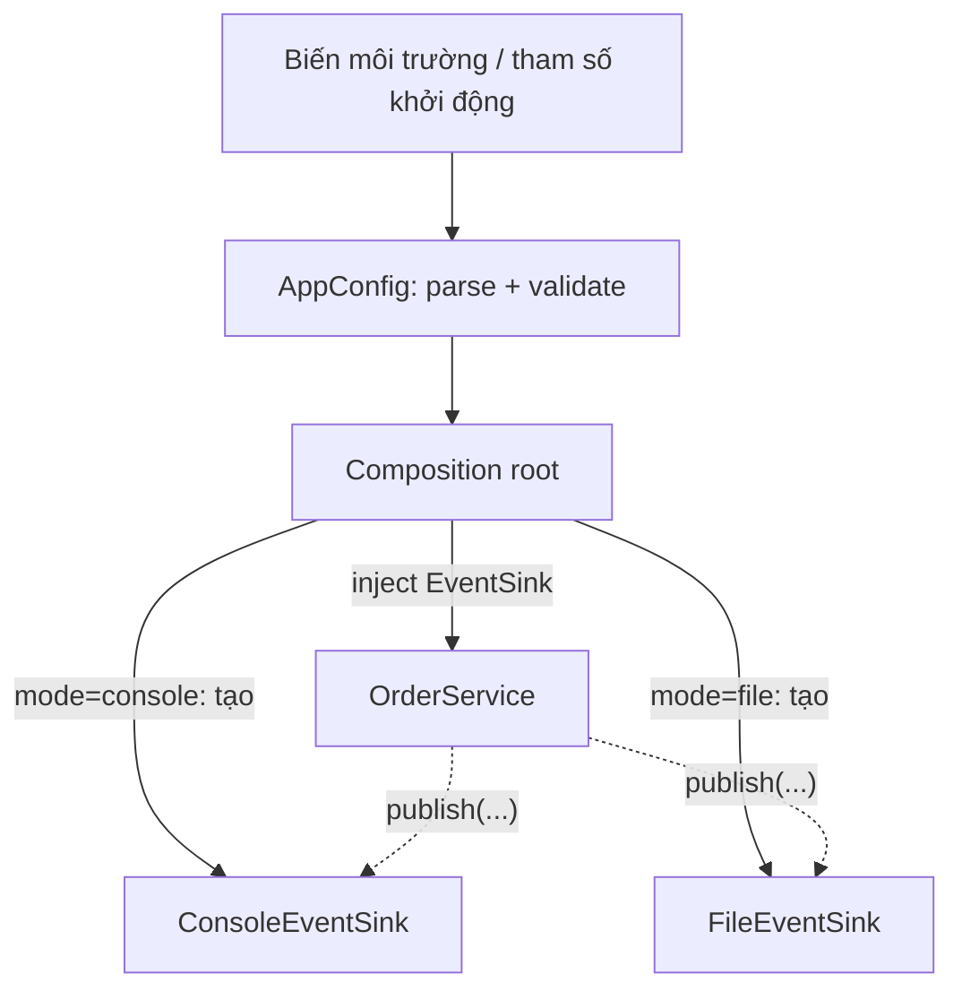
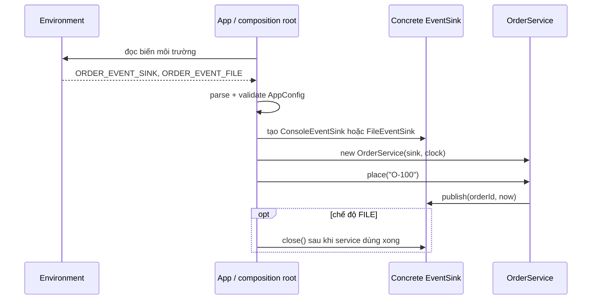

# Chọn triển khai theo cấu hình khởi động

## 1. Bài toán: cùng một hợp đồng, nhiều cách triển khai

Một ứng dụng có thể cần gửi sự kiện đến console khi chạy cục bộ, nhưng ghi sự kiện ra file khi chạy một bản triển khai khác. Dù môi trường thay đổi, mã nghiệp vụ vẫn chỉ cần thao tác `publish` với một hợp đồng thống nhất.

Nếu service tự đọc biến môi trường và `new` lớp cụ thể, nó sẽ vừa thực hiện nghiệp vụ, vừa phải biết cách chọn và tạo dependency. Điều này gây khó khăn khi bổ sung triển khai mới, kiểm thử service độc lập hoặc quản lý tài nguyên như file writer, connection pool và HTTP client.

Trong chương **Lựa chọn thành phần** của module **Dependency Injection (DI)**, ta giải quyết bài toán ấy bằng cách:

1. Đọc, chuẩn hóa và kiểm tra **cấu hình khởi động** ở ranh giới ứng dụng.
2. Chọn **một triển khai cụ thể** đáp ứng cùng abstraction.
3. Tạo đối tượng và lắp ghép các dependency tại **composition root**.
4. Inject abstraction vào service bằng constructor, rồi giữ lựa chọn đó ổn định trong vòng đời dự kiến.
5. Quản lý vòng đời tài nguyên và kiểm thử bằng Java thuần trước khi cần DI container.

Đây là cách áp dụng **Inversion of Control (IoC)**: service nhận dependency được chọn từ bên ngoài, còn quyết định *chọn hiện thực nào, tạo ở đâu và khi nào đóng* nằm ở tầng lắp ghép.

**Mục tiêu bài học:** phân biệt chọn triển khai tại startup với chọn theo từng lời gọi runtime; biết cách fail fast khi cấu hình sai; triển khai ví dụ Java không dùng framework; và xác định đúng nơi quản lý scope, ownership, shutdown và kiểm thử.

## 2. Cấu hình khởi động là gì?

**Cấu hình khởi động (startup configuration)** là dữ liệu ứng dụng đọc khi bắt đầu chạy để quyết định cách lắp ghép hệ thống. Nó có thể đến từ biến môi trường, tham số dòng lệnh, file cấu hình hoặc một nguồn cấu hình đã được nạp trước. Sau khi đọc và kiểm tra, ta thường chuyển nó thành **object cấu hình có kiểu rõ ràng**, tránh để service tự đọc chuỗi tùy ý.

Ví dụ:

| Thông số | Giá trị ví dụ | Ý nghĩa |
| --- | --- | --- |
| `ORDER_EVENT_SINK` | `console` | Chọn adapter ghi sự kiện ra stdout |
| `ORDER_EVENT_SINK` | `file` | Chọn adapter ghi sự kiện ra file |
| `ORDER_EVENT_FILE` | `orders.log` | Đường dẫn file, chỉ bắt buộc khi chế độ `file` |

Các giá trị này có thể thay đổi theo môi trường triển khai; business service vẫn phụ thuộc vào một interface `EventSink`, không trực tiếp phụ thuộc vào tên biến môi trường hay đường dẫn file.

### 2.1. “Chọn lúc khởi động” khác “chọn khi xử lý”

Giả sử một service được tạo một lần khi ứng dụng chạy:

```java
EventSink sink = selectAndCreate(config); // chọn một lần
OrderService service = new OrderService(sink);
```

Nếu `config` chọn `file` thì mọi lần gọi `service.place(...)` trong vòng đời instance đó sử dụng file sink đã inject. Việc một operator sửa biến môi trường bên ngoài **không làm instance đang chạy tự đổi triển khai**. Muốn áp dụng cấu hình mới, cần có cơ chế reload/rebuild được thiết kế riêng hoặc khởi động lại ứng dụng.

Nếu yêu cầu là chọn sink riêng cho **từng request**, **tenant** hoặc **loại sự kiện**, đó là bài toán chọn tại runtime: có thể truyền tham số theo lời gọi, inject router/factory hoặc xây dựng chính sách routing. Không nên buộc service tự gọi `System.getenv` trong mỗi phương thức để mô phỏng khả năng thay đổi runtime.

## 3. Vì sao nên chọn ở composition root?

### 3.1. Thiết kế dính vào cấu hình: khó kiểm thử và khó mở rộng

```java
// Ví dụ nên tránh: chọn hạ tầng bên trong service nghiệp vụ.
final class OrderService {
    private final EventSink sink;

    OrderService() {
        String mode = System.getenv("ORDER_EVENT_SINK");
        if ("file".equalsIgnoreCase(mode)) {
            sink = new FileEventSink(/* đường dẫn từ môi trường */);
        } else {
            sink = new ConsoleEventSink();
        }
    }
}
```

Đây là **pseudocode**, không biên dịch độc lập do bỏ qua phần tạo file và xử lý `IOException`. Nó minh họa ba vấn đề:

- Service bị ghép chặt với biến môi trường và các lớp hạ tầng; test phải điều khiển môi trường thật hoặc tạo dữ liệu ngoài ý muốn.
- Cấu hình bị sai như `fiel` dễ bị rơi vào nhánh mặc định và làm ứng dụng ghi sai đích.
- Trách nhiệm đóng `FileEventSink` không rõ, vì service vừa dùng vừa tạo tài nguyên có vòng đời riêng.

### 3.2. Tách lựa chọn thành hai tầng

Một cấu trúc rõ ràng hơn có hai phần:

- **Tầng cấu hình + composition root:** đọc cấu hình, kiểm tra tính hợp lệ, quyết định triển khai, tạo instance và truyền vào constructor.
- **Tầng nghiệp vụ:** chỉ biết abstraction và thao tác cần dùng, ví dụ `EventSink.publish(...)`.



Hai cạnh nét đứt diễn tả **hai khả năng triển khai**, không có nghĩa một instance `OrderService` buộc phải gọi cả hai sink. Tại startup, root chọn một nhánh rồi inject instance được chọn.

## 4. Thiết kế hợp đồng không phụ thuộc môi trường

Ta sử dụng hợp đồng:

```java
interface EventSink {
    void publish(String orderId, java.time.Instant createdAt)
            throws java.io.IOException;
}
```

`OrderService` phụ thuộc vào `EventSink`, không biết sink là console hay file:

```java
final class OrderService {
    private final EventSink sink;
    private final java.time.Clock clock;

    OrderService(EventSink sink, java.time.Clock clock) {
        this.sink = java.util.Objects.requireNonNull(sink, "sink");
        this.clock = java.util.Objects.requireNonNull(clock, "clock");
    }

    void place(String orderId) throws java.io.IOException {
        if (orderId == null || orderId.trim().isEmpty()) {
            throw new IllegalArgumentException("orderId must not be blank");
        }
        sink.publish(orderId, java.time.Instant.now(clock));
    }
}
```

Constructor injection cho thấy service **cần hai dependency**: một `EventSink` và một `Clock`. `Clock` có sẵn trong JDK, cho phép thay đồng hồ thật bằng `Clock.fixed` khi kiểm thử. `orderId` là **dữ liệu của mỗi thao tác**, không phải thông số để chọn triển khai khi khởi động.

Điều cần giữ ổn định là **ý nghĩa của contract**. Nếu console sink và file sink có ý nghĩa khác nhau (ví dụ một nơi chỉ best effort, nơi khác cam kết lưu bền vững), hợp đồng cần mô tả rõ độ tin cậy, xử lý lỗi và thứ tự sự kiện; chỉ giống chữ ký phương thức chưa đủ bảo đảm chúng thay thế được cho nhau.

## 5. Ví dụ hoàn chỉnh: chọn console hoặc file khi khởi động

Ví dụ dưới đây chạy với **JDK 11 trở lên**. Cấu hình bắt buộc xác định chế độ `console` hoặc `file`. Nếu chọn file, ứng dụng cần thêm đường dẫn file. `App` đọc cấu hình một lần, sau đó lắp ghép `OrderService` và giữ tài nguyên sống đến khi hoạt động kết thúc.

Tạo file **`App.java`**:

```java
import java.io.BufferedWriter;
import java.io.IOException;
import java.nio.charset.StandardCharsets;
import java.nio.file.Files;
import java.nio.file.Path;
import java.nio.file.StandardOpenOption;
import java.time.Clock;
import java.time.Instant;
import java.util.Locale;
import java.util.Map;
import java.util.Objects;

interface EventSink {
    void publish(String orderId, Instant createdAt) throws IOException;
}

// Adapter không giữ tài nguyên cần đóng.
final class ConsoleEventSink implements EventSink {
    @Override
    public void publish(String orderId, Instant createdAt) {
        System.out.println(orderId + " at " + createdAt);
    }
}

// Adapter có vòng đời: bên sở hữu phải gọi close().
final class FileEventSink implements EventSink, AutoCloseable {
    private final BufferedWriter writer;

    FileEventSink(Path path) throws IOException {
        writer = Files.newBufferedWriter(
            path,
            StandardCharsets.UTF_8,
            StandardOpenOption.CREATE,
            StandardOpenOption.APPEND
        );
    }

    @Override
    public void publish(String orderId, Instant createdAt) throws IOException {
        writer.write(orderId + " at " + createdAt);
        writer.newLine();
    }

    @Override
    public void close() throws IOException {
        writer.close();
    }
}

final class OrderService {
    private final EventSink sink;
    private final Clock clock;

    OrderService(EventSink sink, Clock clock) {
        this.sink = Objects.requireNonNull(sink, "sink");
        this.clock = Objects.requireNonNull(clock, "clock");
    }

    void place(String orderId) throws IOException {
        if (orderId == null || orderId.trim().isEmpty()) {
            throw new IllegalArgumentException("orderId must not be blank");
        }
        sink.publish(orderId, Instant.now(clock));
    }
}

enum SinkMode {
    CONSOLE, FILE
}

// Object cấu hình đã được parse và validate tại startup.
final class AppConfig {
    final SinkMode mode;
    final Path filePath; // Chỉ có giá trị khi mode == FILE.

    private AppConfig(SinkMode mode, Path filePath) {
        this.mode = mode;
        this.filePath = filePath;
    }

    static AppConfig fromEnvironment(Map<String, String> env) {
        Objects.requireNonNull(env, "env");
        String raw = env.get("ORDER_EVENT_SINK");
        if (raw == null || raw.trim().isEmpty()) {
            throw new IllegalArgumentException(
                "Missing ORDER_EVENT_SINK (console or file)");
        }

        String normalized = raw.trim().toLowerCase(Locale.ROOT);
        switch (normalized) {
            case "console":
                return new AppConfig(SinkMode.CONSOLE, null);
            case "file":
                String file = env.get("ORDER_EVENT_FILE");
                if (file == null || file.trim().isEmpty()) {
                    throw new IllegalArgumentException(
                        "ORDER_EVENT_FILE is required for file mode");
                }
                return new AppConfig(SinkMode.FILE, Path.of(file.trim()));
            default:
                throw new IllegalArgumentException(
                    "Unsupported ORDER_EVENT_SINK: " + raw);
        }
    }
}

public final class App {
    public static void main(String[] args) throws IOException {
        // Chỉ đọc môi trường một lần ở biên khởi động ứng dụng.
        AppConfig config = AppConfig.fromEnvironment(System.getenv());
        Clock clock = Clock.systemUTC();

        if (config.mode == SinkMode.CONSOLE) {
            runApplication(new ConsoleEventSink(), clock);
        } else {
            // Composition root sở hữu FileEventSink và đóng sau khi dùng.
            try (FileEventSink ownedSink =
                     new FileEventSink(config.filePath)) {
                runApplication(ownedSink, clock);
            }
        }
    }

    private static void runApplication(EventSink sink, Clock clock)
            throws IOException {
        // Cùng một constructor trong cả hai cấu hình.
        OrderService orders = new OrderService(sink, clock);
        orders.place("O-100");
    }
}
```

### 5.1. Chạy trên Windows PowerShell

Biên dịch ở thư mục chứa `App.java`:

```powershell
javac App.java
```

Chạy chế độ console:

```powershell
$env:ORDER_EVENT_SINK = "console"
java App
```

Kết quả có dạng:

```text
O-100 at 2026-01-01T12:34:56Z
```

Mốc thời gian trên chỉ để minh họa định dạng; khi chạy thật, nó là giờ UTC hiện tại do `Clock.systemUTC()` cấp.

Chuyển sang chế độ file bằng cách chạy **một tiến trình mới**:

```powershell
$env:ORDER_EVENT_SINK = "file"
$env:ORDER_EVENT_FILE = "orders.log"
java App
```

File `orders.log` được tạo nếu chưa có và ghi thêm sự kiện `O-100`. Dùng `StandardOpenOption.APPEND` nên chạy nhiều lần sẽ nối thêm, không ghi đè file. Trong Linux/macOS, có thể cấu hình tương ứng bằng `ORDER_EVENT_SINK=console java App`, hoặc `ORDER_EVENT_SINK=file ORDER_EVENT_FILE=orders.log java App`.

### 5.2. Đọc luồng lắp ghép



Chú ý ba ranh giới:

1. **Quyết định chọn triển khai** chỉ diễn ra tại startup. Không có `if (mode)` trong `OrderService`.
2. **Khởi tạo và inject** là hai việc nối tiếp: root chọn/tạo `ConsoleEventSink` hoặc `FileEventSink`, rồi truyền nó vào constructor.
3. **Vòng đời**: root sở hữu file sink và dùng `try-with-resources`; service chỉ mượn `EventSink`. Interface sử dụng không phơi bày `close()`, tránh việc service tự đóng tài nguyên chung.

Trong một ứng dụng server sống lâu, composition root cần giữ `FileEventSink` mở trong toàn bộ thời gian có consumer sử dụng và chỉ đóng sau khi dừng nhận request, đợi các tác vụ liên quan kết thúc. Ví dụ console trên chạy xong một thao tác rồi kết thúc ngay để thể hiện phạm vi dễ quan sát.

## 6. Xử lý cấu hình sai: fail fast và thông báo rõ

Một lỗi cấu hình xảy ra ở startup thường nên được phát hiện **trước khi ứng dụng nhận công việc**. `AppConfig.fromEnvironment` thể hiện các quy tắc:

| Cấu hình | Kết quả mong muốn |
| --- | --- |
| Không có `ORDER_EVENT_SINK` | Báo lỗi thiếu lựa chọn |
| `ORDER_EVENT_SINK=console` | Chọn `ConsoleEventSink` |
| `ORDER_EVENT_SINK=  ConSole  ` | Chuẩn hóa khoảng trắng và chữ hoa/thường rồi chọn console |
| `ORDER_EVENT_SINK=file` và có đường dẫn hợp lệ | Chọn `FileEventSink` |
| `ORDER_EVENT_SINK=file` nhưng thiếu `ORDER_EVENT_FILE` | Báo lỗi thiếu đường dẫn |
| `ORDER_EVENT_SINK=consol` | Báo lỗi giá trị không hỗ trợ, không âm thầm chọn mặc định |
| Đường dẫn file không thể mở/ghi | Việc tạo `FileEventSink` ném `IOException` và ứng dụng không bắt đầu xử lý nghiệp vụ |

Việc **bắt buộc** cấu hình hay **có mặc định** là quyết định thiết kế. Ví dụ này bắt buộc `ORDER_EVENT_SINK` để lỗi chính tả không biến thành một lựa chọn âm thầm. Trong công cụ phát triển nội bộ, có thể chọn mặc định `console` nếu tài liệu quy định rõ và mặc định đó an toàn. Với endpoint, chính sách ghi nhận quan trọng hoặc chế độ bảo mật, mặc định sai có thể gây hậu quả nghiêm trọng.

### 6.1. Chuẩn hóa trước, phân nhánh sau

Thay vì rải các so sánh chuỗi như `"file".equals(System.getenv(...))` ở nhiều service, parse chúng một lần thành `SinkMode`. Sau đó logic khởi tạo làm việc với enum đã được kiểm tra. Thêm một chế độ mới đòi hỏi cập nhật đoạn parse và composition root, nhưng không bắt buộc đổi `OrderService` nếu hợp đồng `EventSink` vẫn đáp ứng nhu cầu.

### 6.2. Không đưa bí mật vào log lỗi

Ví dụ dùng tên chế độ và đường dẫn file để minh họa. Với mật khẩu, token hoặc khóa riêng, chỉ báo **tên thuộc tính bị thiếu hoặc không hợp lệ**; không in trực tiếp giá trị bí mật vào exception, log hoặc màn hình kiểm thử. Bên cạnh validation, cần quy trình cung cấp secret và quyền truy cập phù hợp với môi trường.

### 6.3. Phân biệt validation với kiểm tra tài nguyên thật

`AppConfig` kiểm tra giá trị cấu hình có đúng dạng và đủ thông tin không. Việc file có thể mở, ổ đĩa còn dung lượng hay quyền ghi có hợp lệ là kiểm tra **tại thời điểm tạo/sử dụng hạ tầng**. Đưa tất cả I/O vào constructor của service nghiệp vụ sẽ che giấu lỗi cấu hình; đặt ở root giúp lỗi startup dễ xác định và không làm unit test chạm file thật.

## 7. Viết test độc lập với biến môi trường và file thật

Lựa chọn triển khai có ít nhất hai phần cần kiểm tra **riêng**:

- **Cấu hình:** đầu vào chuỗi được parse thành lựa chọn đúng, các trường hợp thiếu/sai bị từ chối.
- **Nghiệp vụ:** service sử dụng đúng abstraction được inject và hành vi của nó đúng với dữ liệu đầu vào.

Ta không cần chỉnh `System.getenv` toàn cục trong test. `AppConfig.fromEnvironment` nhận một `Map`, nên test truyền giá trị đã kiểm soát. `OrderService` cũng không cần file hay console thật: dùng một fake `EventSink` và `Clock.fixed`.

Tạo file **`AppTest.java`** cạnh `App.java`:

```java
import java.io.IOException;
import java.nio.file.Path;
import java.time.Clock;
import java.time.Instant;
import java.time.ZoneOffset;
import java.util.ArrayList;
import java.util.List;
import java.util.Map;

public final class AppTest {
    static final class RecordingSink implements EventSink {
        final List<String> received = new ArrayList<>();

        @Override
        public void publish(String orderId, Instant createdAt) {
            received.add(orderId + " at " + createdAt);
        }
    }

    public static void main(String[] args) throws IOException {
        // Cấu hình: test bằng Map, không phụ thuộc biến môi trường máy.
        AppConfig console = AppConfig.fromEnvironment(
            Map.of("ORDER_EVENT_SINK", "  CoNsOlE "));
        check(console.mode == SinkMode.CONSOLE, "wrong console mode");
        check(console.filePath == null, "console must not need a file");

        AppConfig file = AppConfig.fromEnvironment(
            Map.of("ORDER_EVENT_SINK", "file",
                   "ORDER_EVENT_FILE", "orders.log"));
        check(file.mode == SinkMode.FILE, "wrong file mode");
        check(Path.of("orders.log").equals(file.filePath), "wrong path");

        expectBadConfig(Map.of("ORDER_EVENT_SINK", "consol"));
        expectBadConfig(Map.of("ORDER_EVENT_SINK", "file"));
        expectBadConfig(Map.of());

        // Nghiệp vụ: cùng constructor với ứng dụng, nhưng fake và fixed Clock.
        RecordingSink fake = new RecordingSink();
        Instant fixed = Instant.parse("2025-01-01T00:00:00Z");
        Clock clock = Clock.fixed(fixed, ZoneOffset.UTC);
        OrderService orders = new OrderService(fake, clock);
        orders.place("O-test");

        check(fake.received.equals(
            List.of("O-test at 2025-01-01T00:00:00Z")),
            "wrong published event: " + fake.received);

        try {
            orders.place(" ");
            throw new AssertionError("expected invalid orderId");
        } catch (IllegalArgumentException expected) {
            // Không phát sự kiện khi id rỗng.
        }
        check(fake.received.size() == 1, "invalid order was published");
        System.out.println("PASS");
    }

    private static void expectBadConfig(Map<String, String> env) {
        try {
            AppConfig.fromEnvironment(env);
            throw new AssertionError("expected invalid config: " + env);
        } catch (IllegalArgumentException expected) {
            // Lỗi parse/validate như dự kiến.
        }
    }

    private static void check(boolean condition, String message) {
        if (!condition) {
            throw new AssertionError(message);
        }
    }
}
```

Chạy:

```bash
javac App.java AppTest.java
java AppTest
```

Kết quả kỳ vọng:

```text
PASS
```

Test này chứng minh `OrderService` không phụ thuộc triển khai console/file và `AppConfig` xử lý đúng giá trị đầu vào. **Nó chưa phải integration test của file sink**. Nếu phải bảo đảm dữ liệu thực sự được ghi xuống đĩa, viết một integration test riêng bằng file tạm, đọc lại nội dung và dọn tài nguyên sau test. Không cần lặp lại toàn bộ logic service trong loại test đó.

## 8. Kết hợp Factory khi phần khởi tạo bắt đầu phức tạp

Ban đầu, hai nhánh `if` tại composition root là đủ. Khi số adapter tăng, việc tạo một triển khai có thể cần endpoint, credentials, retry policy hoặc nhiều tài nguyên con. Khi ấy có thể tách một **factory dành cho khâu lắp ghép**:

```java
// Pseudocode: các kiểu ở đây đã được minh họa trong App.java.
final class SinkFactory {
    // Có thể nhận thêm config hạ tầng tại constructor.
    EventSink create(AppConfig config) throws java.io.IOException {
        if (config.mode == SinkMode.CONSOLE) {
            return new ConsoleEventSink();
        }
        return new FileEventSink(config.filePath);
    }
}
```

Factory đóng gói **logic tạo**; DI là việc **truyền instance vào service**. Nếu sản phẩm do factory tạo là `AutoCloseable`, phải giữ lại thông tin sở hữu để root đóng đúng lúc. Trong ví dụ `SinkFactory` ở trên, kiểu trả về `EventSink` không thể hiện quyền đóng; do vậy **không nên dùng nguyên xi factory ấy cho production** nếu không bổ sung hợp đồng ownership/handle phù hợp. Có thể để root làm việc với `CloseableSink` trong tầng lắp ghép, hoặc tạo một `ApplicationHandle` gói cả service và resource cần đóng.

Không nên tạo factory chỉ để giấu hai dòng `new`. Dùng nó khi logic lựa chọn/khởi tạo đủ phức tạp để có ý nghĩa riêng, hoặc khi cần **tạo instance mới cho từng thao tác**, thay vì cố định một instance ở startup.

### 8.1. Ví dụ một handle sở hữu tài nguyên

Nếu cần một cửa vào chung cho lifecycle, root có thể trả về một handle có cả service và thao tác đóng:

```java
// Phác thảo ý tưởng, không phải phần cần ghép vào App.java.
final class ApplicationHandle implements AutoCloseable {
    final OrderService orders;
    private final AutoCloseable ownedResource;

    ApplicationHandle(OrderService orders, AutoCloseable ownedResource) {
        this.orders = orders;
        this.ownedResource = ownedResource;
    }

    @Override
    public void close() throws Exception {
        ownedResource.close();
    }
}
```

Khi dùng kiểu này, bảo đảm `ownedResource` do root tạo/sở hữu thật sự và không bị một thành phần khác đóng trước. Tránh chuyển quyền đóng cho `OrderService` chỉ vì nó đang giữ tham chiếu đến `EventSink`.

## 9. Chọn lúc startup liên hệ gì đến Strategy, DIP và IoC?

| Khái niệm | Vai trò đối với ví dụ |
| --- | --- |
| **DI** | `OrderService` nhận `EventSink` và `Clock` qua constructor |
| **Composition root** | Đọc `AppConfig`, chọn adapter và lắp ghép service |
| **DIP (Dependency Inversion Principle)** | Service nghiệp vụ phụ thuộc vào `EventSink` thay vì hai lớp adapter |
| **Factory** | Có thể đóng gói quy trình tạo adapter khi nó phức tạp |
| **Strategy** | Cũng có thể là một implementation được chọn từ config, khi abstraction đại diện cho thuật toán/chính sách thay thế |
| **IoC** | Service giao quyết định tạo và lựa chọn cộng tác viên cho code lắp ghép |

Không phải bất kỳ cặp implementation nào cùng interface đều tự động là mẫu Strategy. `EventSink` ở đây đại diện cho **cổng xuất dữ liệu/hạ tầng**; việc chọn adapter là component selection. Nếu thay thuật toán tính thuế hoặc giảm giá theo cấu hình, abstraction tương ứng có thể là một **Strategy** được DI cung cấp, và composition root vẫn quyết định chọn instance nào.

DI container sau này có thể cho phép đăng ký các binding theo profile/qualifier/conditional configuration. Những cơ chế đó tự động hóa việc tạo và inject, còn các câu hỏi thiết kế vẫn giữ nguyên: **cấu hình nào được phép, khi nào lựa chọn có hiệu lực, scope của instance là gì và ai chịu trách nhiệm đóng?**

## 10. Ranh giới vòng đời, concurrency và thay đổi cấu hình

### 10.1. Một instance được chọn có scope cụ thể

Trong ví dụ, `FileEventSink` tồn tại trong khối `try-with-resources` của root. `OrderService` chỉ sử dụng sink khi root còn giữ nó mở. Nếu ứng dụng có nhiều service cùng nhận một sink, root đóng sau khi **tất cả** consumer ngừng sử dụng.

Ngược lại, một component chỉ hợp lệ trong một request hoặc transaction không nên được inject như một instance cố định vào service tồn tại suốt ứng dụng. Khi đó cần thiết kế factory/provider hoặc cơ chế tạo trong phạm vi thao tác. **Chọn triển khai khi startup** không có nghĩa mọi object được tạo ra phải là singleton.

### 10.2. Chia sẻ instance không tự bảo đảm thread safety

`FileEventSink` minh họa bằng `BufferedWriter`, chưa có cơ chế đồng bộ để nhiều thread cùng ghi hoặc đóng đồng thời. Nếu root inject một sink cho nhiều worker, cần bảo đảm implementation hỗ trợ concurrency hoặc sắp xếp truy cập đồng bộ. Việc dùng `final` cho trường dependency chỉ ngăn gán lại tham chiếu, không biến state bên trong thành thread-safe.

### 10.3. Muốn reload cấu hình phải thiết kế riêng

Một hệ thống muốn chuyển từ console sang file **khi đang chạy** phải giải quyết thêm:

- Ai nhận tín hiệu reload và kiểm tra cấu hình mới?
- Ai tạo adapter mới và xác nhận nó sẵn sàng?
- Các request đang dùng adapter cũ được xử lý thế nào?
- Khi nào được đóng adapter cũ để tránh use-after-close?
- Nếu chuyển đổi thất bại, có giữ triển khai cũ không?

Đây là quy trình thay thế component tại runtime, phức tạp hơn lựa chọn tĩnh tại startup. Đừng tự thêm `System.getenv` vào `OrderService` với kỳ vọng môi trường thay đổi sẽ lập tức làm đổi dependency đã inject.

## 11. Những sai lầm thường gặp

| Dấu hiệu | Hậu quả | Cách sửa |
| --- | --- | --- |
| Service đọc env rồi `new` adapter | Gắn logic nghiệp vụ với cấu hình/hạ tầng, test khó cô lập | Parse ở startup, inject abstraction |
| Giá trị config không hỗ trợ tự rơi về console | Sai cấu hình bị che khuất, có thể ghi nhầm đích | Fail fast hoặc dùng default được quy định rõ |
| Mỗi lần gọi service đều đọc lại config | Logic thay đổi ngoài ý muốn, khó tái lập hành vi | Chọn một lần tại root nếu yêu cầu là startup selection |
| `switch` chọn implementation nằm rải rác nhiều lớp | Quy tắc chọn phân tán và không nhất quán | Gom lựa chọn ở composition root/factory phù hợp |
| Cấu hình nhiều chuỗi không có kiểu | Sai chính tả hoặc đơn vị chỉ lộ ra khi xử lý | Parse thành enum/value object bất biến, validate trước |
| Chọn một resource ngắn hạn rồi giữ trong singleton | Resource hết hạn trước consumer | Inject factory/provider hoặc chuyển scope phù hợp |
| Service gọi `close()` lên dependency được inject | Đóng sớm tài nguyên chung | Root quản lý ownership |
| Chuyển config trong lúc chạy nhưng không quản lý worker cũ | Use-after-close hoặc race | Thiết kế reload có phối hợp vòng đời |
| Tạo DI container chỉ để chọn giữa hai adapter | Tăng phức tạp khi Java thuần đã đủ | Bắt đầu bằng constructor injection và root |
| Test phụ thuộc trực tiếp biến môi trường | Kết quả thay đổi theo máy/CI | Truyền Map vào hàm parse, inject fake |

## 12. Bài tập thực hành

**Bài 1 — Thêm một sink.** Ứng dụng cần hỗ trợ thêm `memory` cho test/dev. Hãy thiết kế `InMemoryEventSink` thực thi `EventSink`, bổ sung `SinkMode.MEMORY`, cập nhật `AppConfig` và composition root. Kiểm tra `OrderService` có cần thay đổi không.

*Gợi ý:* nếu hợp đồng `EventSink` không đổi, service vẫn giữ nguyên. Một chế độ mới chỉ cần thêm quy tắc parse và nhánh tạo adapter; test nên xác minh mapping cấu hình mới.

**Bài 2 — Cấu hình thiếu.** `ORDER_EVENT_SINK=file` nhưng `ORDER_EVENT_FILE` trống. Nên xảy ra điều gì và lúc nào?

*Gợi ý:* `AppConfig` từ chối cấu hình ngay tại startup với thông điệp chỉ rõ trường thiếu; không nên chờ đến lần xử lý đơn đầu tiên mới phát hiện.

**Bài 3 — Hành vi theo request.** Một nền tảng nhiều tenant muốn tenant A dùng file, tenant B dùng console cùng lúc. Có nên gọi `AppConfig.fromEnvironment` trong `OrderService.place`?

*Gợi ý:* không, đây là lựa chọn theo dữ liệu runtime. Thiết kế router có mapping tenant → sink hoặc factory/provider có lifecycle rõ; tách thông tin tenant của request khỏi cấu hình startup.

**Bài 4 — Quản lý shutdown.** Ba worker cùng mượn một `FileEventSink`. Root gọi `close()` trong khi worker cuối vẫn ghi. Vì sao lỗi, và cần thay đổi thứ tự dừng ứng dụng ra sao?

*Gợi ý:* ngừng nhận việc mới, đợi/hủy các thao tác đang dùng sink theo hợp đồng, rồi đóng resource. Thêm đồng bộ nếu implementation được chia sẻ giữa nhiều luồng.

**Bài 5 — Unit test.** Viết một test xác minh `OrderService` dùng `Clock.fixed` và ghi đúng thời gian vào fake `EventSink`, sau đó test `AppConfig` từ chối giá trị `fil`. Đâu là phần cần integration test?

*Gợi ý:* logic service và parse config có thể test Java thuần, không chạm file. Phần mở file, ghi dữ liệu và đóng file cần kiểm thử với filesystem nếu muốn xác nhận hiệu quả adapter.

## 13. Checklist trước khi đưa vào ứng dụng

1. **Cấu hình được đọc ở đâu?** Có một ranh giới startup rõ ràng và không bị rải khắp service?
2. **Đã parse thành kiểu rõ chưa?** Có danh sách mode hợp lệ, mặc định và lỗi rõ ràng?
3. **Các implementation có giữ cùng ý nghĩa hợp đồng?** Có trường hợp fail/success khác nhau cần mô tả?
4. **Composition root có tạo và inject đúng một lựa chọn?** Service có cần biết mode cụ thể không?
5. **Scope có phù hợp?** Instance được chọn có sống đủ lâu cho tất cả consumer?
6. **Ai đóng tài nguyên?** Resource dùng chung có một owner và trình tự shutdown thích hợp?
7. **Cấu hình có cần đổi trong lúc chạy?** Nếu có, đã thiết kế reload, chuyển tiếp công việc và đóng instance cũ chưa?
8. **Test có độc lập với môi trường?** Có thể inject fake, parse Map và kiểm tra lỗi cấu hình mà không mở file thật?

## 14. Ghi nhớ

**Chọn triển khai theo cấu hình khởi động là quyết định tại composition root.** Root đọc và kiểm tra cấu hình, tạo hiện thực tương ứng rồi inject abstraction qua constructor. Business service dùng dependency đã nhận, tập trung vào nghiệp vụ và không phải biết môi trường chạy đang chọn adapter nào.

Với DI thủ công, nguyên tắc này giúp thể hiện rõ IoC, Dependency Inversion và vòng đời: lựa chọn được cố định trong scope dự kiến, tài nguyên có owner xác định, lỗi cấu hình xuất hiện sớm và test có thể thay toàn bộ hạ tầng bằng fake. Các DI container sau này hỗ trợ tự động hóa lựa chọn và lắp ghép, nhưng không thay thế những quyết định thiết kế nền tảng đó.
