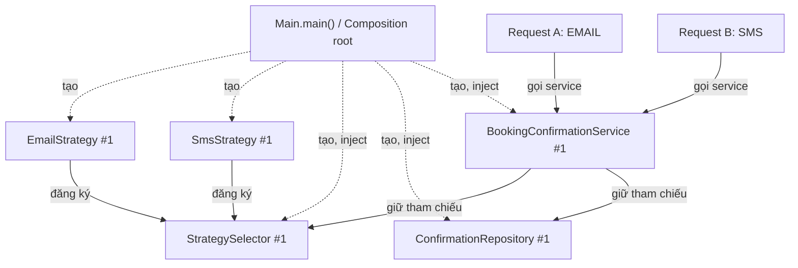
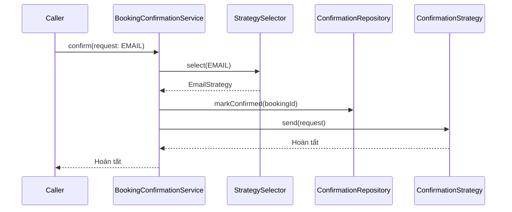

# Chọn chiến lược theo dữ liệu của từng yêu cầu

## 1. Vì sao lựa chọn thành phần không phải lúc nào cũng cố định khi khởi động?

Trong **Dependency Injection (DI)**, composition root thường tạo một triển khai cụ thể rồi truyền nó vào service:

```java
ConfirmationSender sender = new EmailConfirmationSender();
BookingService service = new BookingService(sender);
```

Cách lắp ghép này phù hợp nếu **mọi yêu cầu** đều dùng một kênh xác nhận. Nhưng ứng dụng đặt chỗ có thể cho người dùng chọn **email**, **SMS** hoặc **push notification** cho *mỗi yêu cầu*. Khi yêu cầu A chọn email và yêu cầu B chọn SMS, cách xử lý cần thay đổi theo **dữ liệu runtime của từng yêu cầu**.

Không nên buộc composition root tạo lại cả ứng dụng mỗi khi một yêu cầu đến, cũng không nên để `BookingService` tự gọi `new EmailSender()` hoặc đọc cấu hình hạ tầng trong mỗi nhánh `if`. Một cách thiết kế là:

1. Composition root tạo và cấu hình **các chiến lược có thể sử dụng**.
2. Constructor injection cấp cho service **một bộ chọn chiến lược** (*strategy selector*) hoặc một factory có hợp đồng rõ.
3. Mỗi lần xử lý, service truyền **dữ liệu của yêu cầu** cho bộ chọn.
4. Bộ chọn trả về chiến lược phù hợp; service thực hiện ca sử dụng thông qua hợp đồng chung.

Bài này thuộc nhóm **Lựa chọn thành phần** của module **DEPENDENCY_INJECTION**. Mục tiêu của module là học **Dependency Injection** và **Inversion of Control (IoC)** để tách việc *sử dụng phụ thuộc* khỏi *việc tạo và lắp ghép đối tượng*, thực hành **constructor injection**, **composition root**, quản lý **scope/vòng đời** và kiểm thử bằng **Java thuần** trước khi dùng DI container.

> **Nguyên tắc:** Những chiến lược có thể lựa chọn là **dependency** được cấu hình từ bên ngoài. Kênh mà người dùng chọn là **dữ liệu của một yêu cầu**, được truyền lúc gọi phương thức. Hai loại thông tin này có thời điểm xuất hiện và trách nhiệm khác nhau.

## 2. Phân biệt ba loại quyết định lựa chọn

Cùng là “chọn implementation”, nhưng cần phân biệt nguồn thông tin và thời điểm ra quyết định:

| Loại quyết định | Ví dụ | Thời điểm hợp lý | Bên quyết định |
| --- | --- | --- | --- |
| **Theo môi trường triển khai** | Dev dùng console, production dùng email API thật. | Khi khởi động/lắp ghép. | Composition root hoặc cấu hình DI container. |
| **Theo dữ liệu của yêu cầu** | Khách A chọn email, khách B chọn SMS. | Khi xử lý từng yêu cầu. | Bộ chọn chiến lược/factory được inject, dựa trên dữ liệu đầu vào. |
| **Theo quy tắc nghiệp vụ** | Đơn đặt chỗ có rủi ro cao phải xác thực thêm. | Khi đánh giá ca sử dụng. | Chính sách nghiệp vụ rõ ràng, có thể được cung cấp như dependency. |

Không nên nhầm **môi trường** với **yêu cầu**: nếu một singleton service đọc `System.getenv("CHANNEL")` ở mỗi lần gọi, mọi khách hàng có thể bị áp cùng lựa chọn bất kể dữ liệu của họ. Ngược lại, nếu service nhận một `String channel` trong constructor và sống suốt vòng đời ứng dụng, giá trị của khách hàng đầu tiên có thể bị giữ nhầm cho khách hàng tiếp theo.

Trong bài này, `Channel` là **giá trị của từng yêu cầu**. Khi ứng dụng thật áp dụng thêm chính sách về khách hàng, quyền sử dụng hoặc hạn chế theo quốc gia, bộ chọn có thể cần một hợp đồng chính sách rõ ràng. Không được xem việc nhận chuỗi đầu vào như quyền mặc nhiên truy cập mọi adapter.

## 3. Các vai trò trong thiết kế chọn chiến lược

Ta dùng ví dụ **gửi xác nhận đặt chỗ**.

| Thành phần | Trách nhiệm | Có biết gì? |
| --- | --- | --- |
| `ConfirmationRequest` | Mang `bookingId`, kênh và địa chỉ nhận của **một yêu cầu**. | Giá trị đầu vào, không tạo dependency. |
| `ConfirmationStrategy` | Hợp đồng chung để gửi một xác nhận. | Khả năng `send(request)` và loại kênh nó hỗ trợ. |
| `EmailStrategy` / `SmsStrategy` | Thực thi gửi qua adapter tương ứng. | Chi tiết của kênh riêng, không biết cách chọn toàn hệ thống. |
| `StrategySelector` | Ánh xạ kênh sang chiến lược đã đăng ký; báo lỗi nếu thiếu/không hợp lệ. | Các strategy đã được cấp lúc khởi động. |
| `BookingConfirmationService` | Điều phối ca sử dụng: kiểm tra đầu vào, chọn strategy, lưu trạng thái và yêu cầu gửi. | Hợp đồng repository và selector, không tự tạo adapter. |
| `Main.main()` | Tạo chiến lược, selector, repository và service. | Các lớp triển khai và cấu hình môi trường. |



**Đồ thị đối tượng được lắp ghép lúc khởi động.** Ở mỗi request, chỉ có **quyết định chọn cạnh sử dụng tới chiến lược nào** thay đổi. Hai request có thể sử dụng cùng một instance `StrategySelector` nhưng nhận các strategy khác nhau.

Điểm phân biệt: selector không phải một registry toàn cục mà các class lấy tùy ý. Nó là **dependency được khai báo rõ trong constructor** của consumer, có hợp đồng hẹp là chọn chiến lược xác nhận. Nhờ vậy, có thể thay selector hoặc chiến lược trong unit test.

## 4. Những cách cài đặt khiến dependency bị giấu

### 4.1. Tạo từng adapter ngay trong service

```java
void confirm(ConfirmationRequest request) {
    if (request.channel() == Channel.EMAIL) {
        new EmailStrategy().send(request);
    } else {
        new SmsStrategy().send(request);
    }
}
```

Đoạn này là **minh họa ý tưởng**, không phải phần của chương trình Java thuần ở mục 5. Service phải biết lớp cụ thể của mọi kênh, tự quyết định cách tạo adapter, và dễ lặp lại công việc tạo tài nguyên cho mỗi lời gọi. Thêm kênh mới thường yêu cầu sửa service.

### 4.2. Service locator hoặc container lookup trong nghiệp vụ

```java
// Mã giả, không phải API JDK:
ConfirmationStrategy strategy =
        GlobalContainer.get("notification." + request.channel());
```

Ở đây service phụ thuộc vào một global container, vào quy tắc ghép tên đăng ký và trạng thái toàn cục. Chữ ký constructor không nói được service thực sự cần những gì. Việc thay fake để kiểm thử cũng khó hơn.

### 4.3. Lấy chiến lược theo vị trí phần tử

```java
// Nguy hiểm: phụ thuộc thứ tự danh sách thay vì ngữ nghĩa.
ConfirmationStrategy strategy = strategies.get(request.channelOrdinal());
```

Chỉ cần thay thứ tự đăng ký, chương trình có thể gửi qua kênh sai. Nên dùng khóa có ý nghĩa như `Channel.EMAIL` và `Channel.SMS`, đồng thời phát hiện trùng/missing key.

### 4.4. Dùng nhánh mặc định ngoài ý muốn

```java
// Lỗi thiết kế khi kênh SMS/PUSH chưa được cấu hình:
return strategies.getOrDefault(channel, emailStrategy);
```

Một khách hàng chọn SMS có thể bị gửi email mà không biết. Nếu hệ thống có yêu cầu **fallback**, fallback phải là chính sách có tên, được kiểm tra và phù hợp với quyền đồng ý của người dùng; không tự ý âm thầm đổi kênh.

## 5. Ví dụ Java thuần: chọn theo Channel của từng request

Ví dụ này triển khai các hợp đồng độc lập công nghệ, một selector được inject và hai chiến lược email/SMS. Một giá trị `PUSH` được khai báo để minh họa trường hợp chưa cấu hình adapter: hệ thống sẽ **báo lỗi rõ ràng** trước khi ghi nhận xác nhận, thay vì rơi về email.

Lưu **toàn bộ** đoạn mã sau vào `Main.java`. Chạy với **JDK 11 trở lên**; không dùng framework hay DI container.

```java
import java.util.ArrayList;
import java.util.Collection;
import java.util.Collections;
import java.util.EnumMap;
import java.util.HashSet;
import java.util.List;
import java.util.Map;
import java.util.Objects;
import java.util.Set;

public class Main {
    enum Channel {
        EMAIL, SMS, PUSH
    }

    // Dữ liệu của từng yêu cầu, không phải dependency của singleton service.
    static final class ConfirmationRequest {
        final String bookingId;
        final Channel channel;
        final String destination;

        ConfirmationRequest(String bookingId, Channel channel,
                            String destination) {
            if (bookingId == null || bookingId.isBlank()) {
                throw new IllegalArgumentException("bookingId không hợp lệ");
            }
            if (destination == null || destination.isBlank()) {
                throw new IllegalArgumentException("destination không hợp lệ");
            }
            this.bookingId = bookingId;
            this.channel = Objects.requireNonNull(channel, "channel");
            this.destination = destination;
        }
    }

    // Hợp đồng cần bởi ca sử dụng, không chứa API nhà cung cấp.
    interface ConfirmationStrategy {
        Channel channel();
        void send(ConfirmationRequest request);
    }

    interface ConfirmationRepository {
        void markConfirmed(String bookingId);
    }

    static final class EmailStrategy implements ConfirmationStrategy {
        @Override
        public Channel channel() {
            return Channel.EMAIL;
        }

        @Override
        public void send(ConfirmationRequest request) {
            System.out.println(
                    "EMAIL tới " + request.destination
                    + " cho đặt chỗ " + request.bookingId);
        }
    }

    static final class SmsStrategy implements ConfirmationStrategy {
        @Override
        public Channel channel() {
            return Channel.SMS;
        }

        @Override
        public void send(ConfirmationRequest request) {
            System.out.println(
                    "SMS tới " + request.destination
                    + " cho đặt chỗ " + request.bookingId);
        }
    }

    // Map chỉ được xây lúc khởi động và không sửa sau đó.
    static final class StrategySelector {
        private final Map<Channel, ConfirmationStrategy> byChannel;

        StrategySelector(Collection<? extends ConfirmationStrategy> strategies) {
            Objects.requireNonNull(strategies, "strategies");
            EnumMap<Channel, ConfirmationStrategy> registered =
                    new EnumMap<>(Channel.class);

            for (ConfirmationStrategy strategy : strategies) {
                Objects.requireNonNull(strategy, "strategy");
                Channel channel = Objects.requireNonNull(
                        strategy.channel(), "strategy.channel()");

                if (registered.putIfAbsent(channel, strategy) != null) {
                    throw new IllegalArgumentException(
                            "Đăng ký trùng kênh: " + channel);
                }
            }

            byChannel = Collections.unmodifiableMap(registered);
        }

        ConfirmationStrategy select(Channel channel) {
            Objects.requireNonNull(channel, "channel");
            ConfirmationStrategy result = byChannel.get(channel);

            if (result == null) {
                throw new IllegalArgumentException(
                        "Chưa cấu hình chiến lược cho: " + channel);
            }
            return result;
        }
    }

    static final class InMemoryRepository implements ConfirmationRepository {
        private final Set<String> confirmed = new HashSet<>();

        @Override
        public void markConfirmed(String bookingId) {
            confirmed.add(bookingId);
            System.out.println("Đã lưu xác nhận " + bookingId);
        }

        boolean isConfirmed(String bookingId) {
            return confirmed.contains(bookingId);
        }
    }

    // Consumer: không chứa new EmailStrategy(), không đọc profile toàn cục.
    static final class BookingConfirmationService {
        private final ConfirmationRepository repository;
        private final StrategySelector selector;

        BookingConfirmationService(
                ConfirmationRepository repository,
                StrategySelector selector) {
            this.repository = Objects.requireNonNull(
                    repository, "repository");
            this.selector = Objects.requireNonNull(selector, "selector");
        }

        void confirm(ConfirmationRequest request) {
            Objects.requireNonNull(request, "request");

            // Chọn và xác thực sự tồn tại của adapter trước tác dụng phụ.
            ConfirmationStrategy strategy = selector.select(request.channel);

            repository.markConfirmed(request.bookingId);
            strategy.send(request);
        }
    }

    public static void main(String[] args) {
        // COMPOSITION ROOT: chọn những adapter sẵn có khi khởi động.
        List<ConfirmationStrategy> strategies =
                List.of(new EmailStrategy(), new SmsStrategy());
        StrategySelector selector = new StrategySelector(strategies);
        InMemoryRepository repository = new InMemoryRepository();

        BookingConfirmationService service =
                new BookingConfirmationService(repository, selector);

        // Hai request khác nhau sử dụng cùng service và cùng selector.
        service.confirm(new ConfirmationRequest(
                "B-101", Channel.EMAIL, "khach@example.com"));
        service.confirm(new ConfirmationRequest(
                "B-102", Channel.SMS, "+84901234567"));

        System.out.println("B-101 đã xác nhận? "
                + repository.isConfirmed("B-101"));
        System.out.println("B-102 đã xác nhận? "
                + repository.isConfirmed("B-102"));
    }
}
```

Biên dịch và chạy:

```bash
javac -encoding UTF-8 Main.java
java Main
```

Kết quả dự kiến:

```text
Đã lưu xác nhận B-101
EMAIL tới khach@example.com cho đặt chỗ B-101
Đã lưu xác nhận B-102
SMS tới +84901234567 cho đặt chỗ B-102
B-101 đã xác nhận? true
B-102 đã xác nhận? true
```

### Phân tích luồng xử lý từng request



Với request SMS, trình tự giữ nguyên; selector trả `SmsStrategy`. `BookingConfirmationService` không cần thay code để xử lý kênh đã được đăng ký.

### Một số điểm chủ ý trong thiết kế

- `StrategySelector` được tạo **một lần** từ danh sách các strategy. Không khởi tạo adapter mỗi khi gọi `confirm`.
- Constructor của selector kiểm tra **strategy null**, **khóa null** và **trùng khóa**. Lỗi lắp ghép này được phát hiện khi khởi động.
- `select(PUSH)` ném `IllegalArgumentException` vì chưa có implementation, thay vì chọn ngầm email. Lỗi yêu cầu được phát hiện **trước** lời gọi `repository.markConfirmed`.
- `ConfirmationRequest` giữ dữ liệu theo từng lời gọi. Service không có trường `currentChannel` hoặc `currentDestination`, tránh để yêu cầu sau nhìn thấy dữ liệu của yêu cầu trước.
- `InMemoryRepository` dùng `HashSet` đơn giản để minh họa; **không an toàn cho cập nhật đồng thời** và **không phải database production**.
- Địa chỉ nhận chỉ được kiểm tra không rỗng. Hệ thống thật cần kiểm tra định dạng, quyền liên lạc và chính sách nghiệp vụ thích hợp; đừng hiểu ví dụ là bộ xác thực email/số điện thoại hoàn chỉnh.

## 6. Xử lý trường hợp chưa có chiến lược và cấu hình sai

Chạy thử ý tưởng sau **bên trong một phương thức sử dụng `service` ở ví dụ mục 5**:

```java
service.confirm(new ConfirmationRequest(
        "B-103", Main.Channel.PUSH, "device-token"));
```

Vì `PUSH` chưa được đăng ký, selector ném exception. Trong ví dụ hoàn chỉnh ở trên, khi viết mã trong `Main.main()`, tên enum có thể viết ngắn là `Channel.PUSH`. Mẫu có tiền tố `Main.Channel.PUSH` phù hợp với mã ở ngoài class `Main`.

Hai loại lỗi cần phân biệt:

| Tình huống | Nên xử lý ở đâu? | Kỳ vọng |
| --- | --- | --- |
| Hai strategy cùng khai báo `EMAIL` | Constructor `StrategySelector` khi lắp ghép. | Báo lỗi cấu hình ngay, không chọn “cái sau cùng”. |
| Request chọn `PUSH` nhưng chưa có adapter | `select(PUSH)` khi xử lý request, hoặc kiểm tra capability từ trước. | Báo kênh không hỗ trợ hoặc bị vô hiệu hóa, không silently fallback. |
| Request thiếu booking ID hoặc đích nhận | Constructor/validation của `ConfirmationRequest`. | Từ chối input không hợp lệ trước khi gây tác dụng phụ. |
| Kênh hợp lệ nhưng khách không được dùng | Chính sách nghiệp vụ/quyền của application. | Từ chối trước khi gửi; không nhầm “đã đăng ký adapter” với “được phép dùng”. |
| Adapter gửi thất bại do mạng | Adapter và cơ chế điều phối lỗi của application. | Timeout/retry/idempotency hoặc quy trình xử lý thất bại đã được thiết kế. |

Nếu sản phẩm yêu cầu **tất cả kênh phải có adapter trước khi nhận traffic**, composition root có thể kiểm tra tập kênh mong đợi sau khi đăng ký. Nếu chỉ một số kênh được bật theo cấu hình, selector có thể được lắp ghép với tập được phép của môi trường đó. Cần phân biệt **cấu hình kênh được phép** với **dữ liệu kênh mà request chọn**.

```java
// Minh họa kiểm tra bắt buộc tại bootstrap, đặt trong Main.main():
for (Channel required : List.of(Channel.EMAIL, Channel.SMS)) {
    selector.select(required); // Báo lỗi sớm nếu thiếu.
}
```

Đoạn trên chỉ kiểm tra hai kênh mà deployment cam kết có. Nó không tự xác nhận endpoint SMS/email ngoài hệ thống đang hoạt động; cần health/readiness check riêng nếu đó là điều kiện triển khai.

## 7. Unit test: xác nhận lựa chọn đúng và lỗi không gây tác dụng phụ

Vì service nhận repository và selector qua constructor, test có thể truyền **fake strategies**, không gửi email/SMS thật. Thêm class **`SelectionTest` bên ngoài class `Main`** vào cuối cùng tệp `Main.java` ở mục 5:

```java
class SelectionTest {
    static final class RecordingRepository
            implements Main.ConfirmationRepository {
        final java.util.List<String> events;

        RecordingRepository(java.util.List<String> events) {
            this.events = events;
        }

        @Override
        public void markConfirmed(String bookingId) {
            events.add("store:" + bookingId);
        }
    }

    static final class RecordingStrategy
            implements Main.ConfirmationStrategy {
        private final Main.Channel channel;
        private final java.util.List<String> events;

        RecordingStrategy(
                Main.Channel channel, java.util.List<String> events) {
            this.channel = channel;
            this.events = events;
        }

        @Override
        public Main.Channel channel() {
            return channel;
        }

        @Override
        public void send(Main.ConfirmationRequest request) {
            events.add(channel + ":" + request.bookingId);
        }
    }

    public static void main(String[] args) {
        java.util.List<String> events = new java.util.ArrayList<>();
        RecordingStrategy email =
                new RecordingStrategy(Main.Channel.EMAIL, events);
        RecordingStrategy sms =
                new RecordingStrategy(Main.Channel.SMS, events);

        Main.StrategySelector selector =
                new Main.StrategySelector(java.util.List.of(email, sms));
        Main.BookingConfirmationService service =
                new Main.BookingConfirmationService(
                        new RecordingRepository(events), selector);

        service.confirm(new Main.ConfirmationRequest(
                "B-201", Main.Channel.EMAIL, "test@example.com"));
        service.confirm(new Main.ConfirmationRequest(
                "B-202", Main.Channel.SMS, "+84900000000"));

        java.util.List<String> expected = java.util.List.of(
                "store:B-201", "EMAIL:B-201",
                "store:B-202", "SMS:B-202");

        if (!expected.equals(events)) {
            throw new AssertionError("Sai chiến lược/thứ tự: " + events);
        }

        boolean missingRejected = false;
        try {
            service.confirm(new Main.ConfirmationRequest(
                    "B-203", Main.Channel.PUSH, "device-token"));
        } catch (IllegalArgumentException expectedException) {
            missingRejected = true;
        }
        if (!missingRejected || !expected.equals(events)) {
            throw new AssertionError(
                    "Kênh chưa hỗ trợ phải bị từ chối trước khi lưu");
        }

        boolean duplicateRejected = false;
        try {
            new Main.StrategySelector(java.util.List.of(
                    email,
                    new RecordingStrategy(Main.Channel.EMAIL, events)));
        } catch (IllegalArgumentException expectedException) {
            duplicateRejected = true;
        }
        if (!duplicateRejected) {
            throw new AssertionError(
                    "Đăng ký trùng chiến lược phải bị từ chối");
        }

        System.out.println("PASS: chọn đúng, từ chối thiếu/trùng kênh");
    }
}
```

Chạy:

```bash
javac -encoding UTF-8 Main.java
java SelectionTest
```

Kết quả mong đợi:

```text
PASS: chọn đúng, từ chối thiếu/trùng kênh
```

Bài test xác minh **đường đi chọn kênh**, thứ tự gọi lưu/gửi, xử lý kênh không hỗ trợ và trùng đăng ký. Nó chưa chứng minh SMTP, SMS API hoặc repository thật có hoạt động, cũng chưa chứng minh thao tác lưu và gửi là **nguyên tử**.

### Khi gửi thất bại sau khi lưu

Trong ví dụ, thứ tự là:

```text
select strategy -> markConfirmed -> send
```

Nếu `markConfirmed` thành công nhưng `send` ném exception, trạng thái đặt chỗ đã được lưu trong khi thông báo chưa hoàn thành. DI không tự giải quyết điều này. Với ứng dụng thật, có thể cần transactional outbox, giao dịch phù hợp, cơ chế retry/idempotency hoặc chính sách phục hồi được thiết kế riêng.

Việc **chọn strategy trước khi ghi** giúp tránh tác dụng phụ trong trường hợp *thiếu strategy*. Nó không loại trừ lỗi phát sinh sau khi lưu.

## 8. Có nên dùng Strategy, Factory, Map hay switch?

Không có một cách duy nhất cho mọi hệ thống. Lựa chọn tùy vào quy mô và tính chất của chiến lược.

| Cách tiếp cận | Phù hợp khi | Cần chú ý |
| --- | --- | --- |
| **Inject một strategy cố định** | Toàn bộ môi trường chỉ dùng một cơ chế. | Không đáp ứng lựa chọn khác nhau giữa các request nếu dữ liệu đòi hỏi. |
| **Inject hai strategy và chọn bằng nhánh nhỏ** | Có đúng hai nhánh ổn định và dễ hiểu. | Nhánh có thể đặt trong một policy/selector nếu không muốn service biết tên adapter. Không cần trừu tượng hóa quá mức. |
| **Inject selector/registry theo khóa** | Có nhiều chiến lược được đăng ký, chọn theo `Channel` runtime. | Kiểm tra trùng/thiếu khóa; tránh registry toàn cục; không để selector chứa mọi dịch vụ không liên quan. |
| **Inject factory tạo strategy theo yêu cầu** | Mỗi request thực sự cần instance hoặc tài nguyên riêng. | Quản lý ownership, scope, tạo/đóng tài nguyên, lỗi khởi tạo. |
| **Inject domain policy quyết định strategy** | Tiêu chí chọn là quy tắc nghiệp vụ phức tạp hơn một enum. | Hợp đồng và test phải thể hiện chính sách; không giấu điều kiện trong adapter hạ tầng. |

### Không phải mọi `switch` trong nghiệp vụ đều sai

Một `switch` nhỏ để chọn thuật toán theo loại giao dịch có thể là mã nghiệp vụ hợp lệ nếu **chính việc phân nhánh là chính sách của domain**. Vấn đề là khi code nghiệp vụ phải biết **cách tạo lớp hạ tầng, cấu hình API key hoặc đóng client**.

Nếu muốn chọn một trong hai lớp đã inject mà không cần factory phức tạp, có thể bắt đầu bằng selector nhỏ. Khi các chiến lược tăng lên, chuyển sang map/factory là một phép refactor có mục đích. Đừng tạo cả container mini chỉ để tránh ba dòng `switch`.

### Bộ chọn có phải Service Locator không?

`StrategySelector` ở đây là một dependency **có kiểu rõ, phạm vi hẹp, được inject** và chỉ trả những implementation cho một hợp đồng xác nhận. Nó khác registry toàn cục kiểu `Object get(String name)` mà mọi consumer tự truy cập để lấy bất kỳ dịch vụ nào. Tuy vậy, nếu selector mở rộng thành “cổng lấy mọi bean” và được truyền khắp hệ thống, nó sẽ mang lại vấn đề tương tự service locator.

Hãy giới hạn abstraction theo **nhu cầu của consumer** và làm lộ quan hệ bắt buộc trong constructor.

## 9. Khi mỗi request cần strategy có trạng thái riêng

Ví dụ `EmailStrategy` và `SmsStrategy` không lưu dữ liệu của từng request vào field. Do đó có thể tạo chúng một lần rồi dùng chung trong ứng dụng chạy tuần tự. Nếu adapter có trạng thái thay đổi, cần cân nhắc **thread safety** trước khi chia sẻ.

Không nên viết:

```java
class DangerousEmailStrategy {
    // Một singleton bị thay đổi theo từng request.
    private String currentRecipient;

    void send(ConfirmationRequest request) {
        currentRecipient = request.destination();
        // Một request khác có thể ghi đè trước khi gửi.
    }
}
```

Thay vào đó, dùng giá trị request như **biến cục bộ/tham số phương thức**. Với tài nguyên có vòng đời riêng theo request, có thể cần một factory được tiêm.

```java
// Ví dụ ý tưởng, các kiểu do ứng dụng định nghĩa:
interface ScopedStrategy extends AutoCloseable {
    void send(ConfirmationRequest request);
}

interface ScopedStrategyFactory {
    ScopedStrategy create(Channel channel);
}

final class ScopedBookingConfirmationService {
    private final ScopedStrategyFactory factory;

    ScopedBookingConfirmationService(ScopedStrategyFactory factory) {
        this.factory = java.util.Objects.requireNonNull(factory);
    }

    void notifyOne(ConfirmationRequest request) throws Exception {
        // Consumer sử dụng chiến lược mới trong một scope tường minh.
        try (ScopedStrategy strategy = factory.create(request.channel())) {
            strategy.send(request);
        }
    }
}
```

Đoạn này là **một thiết kế thay thế minh họa**, không ghép vào `Main.java` ở mục 5. Nó cố ý tạo và đóng strategy theo lời gọi; hợp đồng ownership phải quy định rõ caller được quyền đóng strategy mới. Nếu factory trả một singleton dùng chung mà consumer vẫn `close()` sau mỗi request, tài nguyên có thể bị đóng khi request khác còn sử dụng.

Những điểm cần quyết định:

1. **Shared/stateless:** strategy có thể tạo một lần trong composition root, selector trỏ tới nó và nhiều request tái sử dụng; bảo đảm implementation thực sự an toàn khi dùng đồng thời.
2. **Request-scoped:** factory tạo tài nguyên riêng cho request; request scope hoặc caller được giao trách nhiệm đóng.
3. **Transient mỗi lần dùng:** factory tạo đối tượng mới cho từng tác vụ; có thể tốn chi phí tạo, cần kiểm soát resource.
4. **Lazy shared:** factory/lazy wrapper chỉ tạo strategy khi dùng lần đầu và lưu instance; phải đồng bộ nếu nhiều thread kích hoạt cùng lúc.
5. **Failure during creation:** nếu factory mở socket/file rồi ném lỗi trước khi trả instance, factory phải tự dọn phần đã mở vì caller chưa thể nhận và đóng.

**Scope là quyết định của việc lắp ghép/lifecycle**, không được suy ra chỉ từ việc có interface hay DI. Container có thể hỗ trợ scope, nhưng vẫn cần hợp đồng ownership và chính sách đúng.

## 10. Ranh giới giữa lựa chọn chiến lược và lựa chọn quyền truy cập

Dữ liệu của request có thể không đáng tin cậy. Nếu client tự gửi `channel: "SMS"`, hệ thống không nên hiểu đó là quyền dùng SMS với mọi số nhận.

Một quy trình ứng dụng thực tế thường cần tách:

1. **Parse/validate input:** chuyển giá trị bên ngoài thành `Channel` có kiểu rõ; kiểm tra dữ liệu cần thiết.
2. **Kiểm tra chính sách:** người dùng có được phép gửi kênh này, đích nhận đã xác minh chưa, khu vực đó có hỗ trợ không?
3. **Chọn capability khả dụng:** selector xác định implementation đã cấu hình cho kênh hợp lệ.
4. **Thực hiện nghiệp vụ:** thay đổi trạng thái và yêu cầu gửi qua hợp đồng.
5. **Xử lý thất bại:** xác định phản hồi lỗi, retry/idempotency và tính nhất quán của những tác dụng phụ.

Nhiệm vụ của selector ở mục 5 là **ánh xạ khóa sang strategy**. Không nên tự cho rằng selector cũng đã hoàn thành việc kiểm tra quyền, định dạng điện thoại, giới hạn tốc độ hoặc đồng ý nhận thông báo. Nếu chính sách lựa chọn trở nên phức tạp, hãy tạo một domain/application policy rõ ràng và kiểm thử riêng.

### Các trường hợp đặc biệt cần thử

| Trường hợp | Kỳ vọng |
| --- | --- |
| Request null hoặc dữ liệu rỗng | Từ chối trước khi gọi repository/sender. |
| Channel không thuộc enum hoặc không parse được | Từ chối ở biên parse/validation, không đoán kênh. |
| Kênh hợp lệ nhưng deployment chưa đăng ký | Trả lỗi có ý nghĩa; không fallback ngầm. |
| Hai adapter đăng ký cùng một Channel | Phát hiện lỗi cấu hình ngay khi build selector. |
| Kênh bị tắt theo tenant/quyền khách hàng | Application policy từ chối trước khi thực hiện tác dụng phụ. |
| Adapter bị lỗi trong lúc gửi | Giữ nguyên thông tin lỗi phù hợp và có chính sách phục hồi; DI không tự retry. |
| Nhiều request chạy đồng thời | Registry bất biến là điều kiện tốt, nhưng chiến lược và repository cũng phải an toàn khi dùng chung. |

## 11. Từ DI thủ công đến DI container

Trong Java thuần, composition root có thể dựng `StrategySelector` từ `List.of(new EmailStrategy(), new SmsStrategy())`. Khi sử dụng DI container, container có thể tạo/tiêm danh sách hoặc map các implementation theo cơ chế của framework. Tuy nhiên, cần phân biệt hai lớp trách nhiệm:

- **Container** quản lý khởi tạo, cấu hình, scope và wiring của các strategy theo cách được khai báo.
- **Ứng dụng** xác định tiêu chí lựa chọn từ request, chính sách quyền và cách xử lý khi kênh không có adapter.

Container không tự biết rằng `ConfirmationRequest.channel` phải tương ứng với `ConfirmationStrategy.channel()`, không tự bảo đảm không có đăng ký trùng, và không tự xác định fallback nào hợp lệ trừ khi có cấu hình/logic rõ ràng.

Thiết kế tốt cho phép thay **cách lắp ghép** mà vẫn giữ **hợp đồng `ConfirmationStrategy`, `StrategySelector` và `BookingConfirmationService`**. Kiểm thử bằng fake vẫn có thể thực hiện ngoài container.

## 12. Bài thực hành và gợi ý tự đối chiếu

**Bài 1 — Bổ sung chiến lược.** Viết `PushStrategy implements ConfirmationStrategy` với `channel()` trả `PUSH`. Đăng ký vào `StrategySelector` ở `Main.main()`, rồi gọi service với một `ConfirmationRequest` có kênh PUSH. Xác minh class `BookingConfirmationService` không cần sửa.

**Bài 2 — Thiếu adapter.** Bỏ `SmsStrategy` khỏi danh sách đăng ký nhưng vẫn tạo request SMS. Dự đoán exception và kiểm tra `InMemoryRepository` có ghi xác nhận cho request đó hay không. Vì sao phải chọn strategy **trước** khi thực hiện side effect?

**Bài 3 — Trùng key.** Đăng ký hai implementation đều trả `Channel.EMAIL`. Vì sao không nên chọn “cái đăng ký sau cùng”? Viết test xác nhận constructor `StrategySelector` ném lỗi khi gặp trùng.

**Bài 4 — So sánh hai kiểu dependency.** Phân loại `StrategySelector`, `ConfirmationRepository`, `ConfirmationRequest`, `request.channel` và `request.destination` thành **cộng tác viên được inject** hoặc **dữ liệu của một lời gọi**. Tại sao không đưa `request.destination` vào field của singleton service?

**Bài 5 — Scope.** Một chiến lược gửi email có `HttpClient` dùng chung và một bộ đếm request. Nó có được đăng ký singleton không? Nếu phải tạo session riêng cho mỗi request, cách factory/lifecycle nào phù hợp? Nêu ai chịu trách nhiệm đóng tài nguyên.

**Bài 6 — Quy tắc nghiệp vụ.** Một tenant bị cấm dùng SMS, dù deployment có `SmsStrategy`. Chỗ nào nên kiểm tra quyền? Tại sao việc `selector.select(SMS)` thành công chưa đủ để gửi?

### Gợi ý tự đối chiếu

- **Bài 1:** thêm `PushStrategy` và đăng ký nó tại composition root. Consumer vẫn chỉ gọi `selector.select(request.channel)` và `strategy.send(request)`.
- **Bài 2:** `select(SMS)` ném `IllegalArgumentException` khi thiếu adapter, trước `markConfirmed`; trạng thái chưa bị thay đổi bởi yêu cầu đó.
- **Bài 3:** đăng ký trùng có thể làm kết quả phụ thuộc thứ tự cấu hình; tốt hơn từ chối ngay khi khởi động.
- **Bài 4:** selector và repository là dependency ổn định của service; request và các trường của nó là dữ liệu thay đổi theo từng lời gọi.
- **Bài 5:** dùng chung chỉ khi client/strategy và bộ đếm được thiết kế an toàn khi đồng thời; session riêng cần factory và ownership trong scope tương ứng.
- **Bài 6:** kiểm tra quyền ở application/domain policy trước side effect; selector chỉ xác nhận tồn tại implementation.

**Ghi nhớ:** khi chiến lược phụ thuộc dữ liệu của từng yêu cầu, hãy **inject khả năng lựa chọn**, rồi **chọn implementation ở thời điểm xử lý**. Composition root vẫn tạo và sở hữu các dependency; service vẫn sử dụng interface; request chỉ cung cấp dữ liệu quyết định kênh. Thiết kế này giữ rõ ranh giới giữa lựa chọn runtime, cấu hình môi trường, chính sách nghiệp vụ và vòng đời, đồng thời cho phép kiểm thử bằng Java thuần trước khi dùng DI container.
