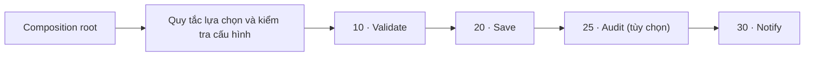
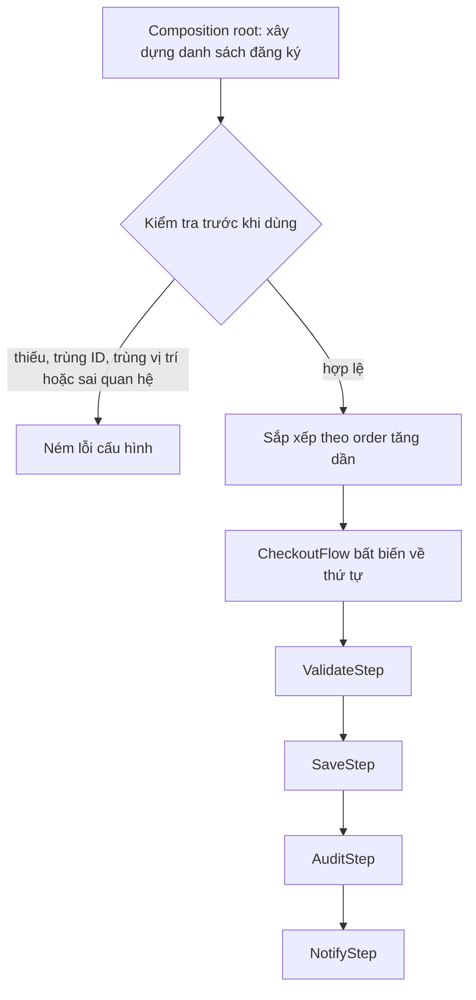

# Quy định thứ tự và hành vi khi thiếu hoặc trùng thành phần

Khi một ứng dụng Java có nhiều thành phần cùng triển khai một interface, **Dependency Injection (DI)** giúp tách đối tượng sử dụng phụ thuộc khỏi nơi tạo và lắp ghép chúng. Nhưng DI không tự trả lời các câu hỏi: *Chọn triển khai nào? Nếu không có triển khai phù hợp thì sao? Nếu có hai triển khai phù hợp thì sao? Nếu cần thực thi nhiều thành phần, thứ tự nào được bảo đảm?*

Những câu hỏi đó phải được biến thành **chính sách lựa chọn thành phần**. Nếu để chúng phụ thuộc vào thứ tự quét classpath, thứ tự trả về của một tập hợp, tên class tình cờ được sắp trước hoặc một mặc định không được công bố, hành vi có thể thay đổi khi thêm module hoặc đổi cấu hình.

Bài này thuộc chương **Lựa chọn thành phần** của module **DEPENDENCY_INJECTION**. Ta thiết kế quy tắc lựa chọn rõ ràng bằng Java thuần, thực hành **constructor injection**, **composition root**, quản lý **scope và vòng đời**, rồi kiểm thử các trường hợp thiếu, trùng và thứ tự thực thi. Các nguyên tắc vẫn hữu ích khi chuyển sang một **DI container**, nhưng ví dụ chưa cần framework.

## 1. Trước tiên xác định cần *một* hay *nhiều* thành phần

Giả sử hệ thống có nhiều cách tính phí:

```java
interface FeePolicy {
    long calculate(long baseAmount);
}
```

Nếu `CheckoutService` cần **đúng một** `FeePolicy` cho một thị trường, ứng dụng phải chọn duy nhất một triển khai cho thị trường đó. Một danh sách gồm hai chính sách cùng hợp lệ là tình trạng **mơ hồ**, không phải mặc nhiên là yêu cầu chạy cả hai.

Ngược lại, một hệ thống xử lý booking có thể cần **một chuỗi** các bước: xác thực đầu vào, lưu dữ liệu, ghi audit và gửi thông báo. Trong trường hợp này, có nhiều thành phần là điều bình thường; thách thức là chọn tập thành phần cần thiết và **quy định thứ tự**.

| Nhu cầu consumer | Chính sách lựa chọn | Nếu không tìm thấy | Nếu tìm thấy nhiều |
| --- | --- | --- | --- |
| Cần đúng một adapter bắt buộc | **Exactly one** theo qualifier/key | Lỗi cấu hình, dừng khởi tạo | Lỗi mơ hồ nếu chưa có quy tắc phân giải |
| Có một tính năng tùy chọn | **Zero or one** | Dùng `Optional.empty()` hoặc vô hiệu hóa tính năng rõ ràng | Vẫn báo lỗi trùng/không rõ |
| Có nhiều bước trong pipeline | **Multi-binding** thành danh sách | Kiểm tra có thiếu bước bắt buộc không | Chấp nhận các ID khác nhau, kiểm tra thứ tự và ID trùng |
| Chọn theo cấu hình môi trường | **Named/qualified selection** | Lỗi hoặc fallback **đã được định nghĩa** | Hai ứng viên cùng key thì lỗi hoặc theo quy tắc ưu tiên tường minh |
| Muốn chạy tất cả plugin hợp lệ | **Select all + ordered execution** | Có thể dùng tập rỗng nếu nghiệp vụ cho phép | Mọi plugin hợp lệ tham gia, không tự coi là xung đột |

Như vậy, “trùng thành phần” phải được hiểu theo **vai trò và khóa lựa chọn**. Hai class khác nhau cùng triển khai `FeePolicy` là bình thường nếu ứng dụng hỗ trợ nhiều thị trường. Chỉ khi cả hai cùng được đăng ký cho **một vị trí duy nhất** mà không có quy tắc phân giải, chúng mới tạo ra xung đột.

## 2. Thứ tự khác với mức ưu tiên chọn một ứng viên

Có ít nhất hai kiểu “thứ tự” trong cấu hình DI:

1. **Thứ tự lựa chọn (selection precedence):** khi nhiều ứng viên cùng hợp lệ cho một vai trò, thành phần nào được ưu tiên? Ví dụ: cấu hình tường minh chọn `fee.eu` trước bất kỳ mặc định nào.
2. **Thứ tự thực thi (execution order):** khi nhiều thành phần được dùng cùng nhau, chạy thành phần nào trước? Ví dụ: `validate → save → audit → notify`.

Hai khái niệm không thay thế nhau. Một thành phần được ưu tiên khi chọn adapter không có nghĩa nó sẽ chạy đầu tiên trong danh sách plugin. Với chuỗi xử lý có tác dụng phụ, thứ tự thực thi có thể là **bất biến nghiệp vụ**:



Nếu `Notify` chạy trước `Save`, hệ thống có thể thông báo thành công trước khi ghi dữ liệu xong. Nếu `Validate` bị thiếu, luồng xử lý có thể bỏ qua quy tắc đầu vào quan trọng. Nếu đăng ký hai bước `Save` cùng ID, nghiệp vụ có thể ghi lặp hoặc chính sách chọn triển khai trở nên mơ hồ.

Các con số `10, 20, 25, 30` là **vị trí do ứng dụng quy định**; không phải một quy tắc đặc biệt của Java hay mọi container. Chúng để lại khoảng trống khi cần chèn bước mới.

### 2.1. Quy tắc cho vị trí bằng nhau

Hai bước có cùng `order` có thể được xử lý theo hai chính sách:

- **Từ chối (fail fast):** phù hợp khi thứ tự ảnh hưởng kết quả và không có ý nghĩa hợp lệ cho việc hoán đổi; ứng dụng báo lỗi ngay lúc lắp ghép.
- **Cho phép với quy tắc phụ cố định:** ví dụ sắp theo `order` rồi theo `id`, nếu các bước cùng mức ưu tiên độc lập về thứ tự và điều này được ghi trong hợp đồng.

Không nên để hai bước bằng thứ tự chạy theo kết quả tình cờ của `HashMap`, thứ tự reflection hay thứ tự plugin được phát hiện. Ví dụ chính dưới đây chọn **fail fast khi hai bước có cùng vị trí**.

## 3. Ma trận quyết định khi thiếu, trùng hoặc cấu hình sai

Trước khi viết mã lựa chọn thành phần, hãy ghi rõ kết quả mong muốn:

| Tình huống | Chính sách của ví dụ | Vì sao |
| --- | --- | --- |
| Đủ `validate`, `save`, `notify` | Lắp graph và chạy theo vị trí tăng dần | Có đầy đủ các bước bắt buộc |
| Thiếu `save` | Ném lỗi **trước khi nhận request** | Tránh xử lý nửa chừng rồi phát hiện chưa có nơi lưu |
| Thiếu `audit` | Vẫn hoạt động | `audit` được công bố là tùy chọn |
| Đăng ký hai bước có cùng `id` | Ném lỗi, ghi rõ ID | Không thể biết bản đăng ký nào được xem là chính |
| Hai bước có cùng `order` | Ném lỗi, ghi rõ vị trí | Thứ tự chạy chưa được xác định theo chính sách bài học |
| `notify` có vị trí trước `save` | Ném lỗi lắp ghép | Vi phạm quan hệ nghiệp vụ bắt buộc |
| Có bước `metrics` khác ID và vị trí hợp lệ | Cho phép thêm | Mở rộng pipeline theo hợp đồng |
| Không có ứng viên cho một vai trò bắt buộc duy nhất | Ném lỗi cấu hình | Không có hiện thực đúng để cấp qua constructor |
| Có hai ứng viên cho cùng một vai trò bắt buộc duy nhất | Ném lỗi mơ hồ | Không được ngầm chọn “ứng viên đầu tiên” |

**Fail fast** ở đây là phát hiện lỗi ở **composition root**, trước khi đối tượng được sử dụng. Nó không có nghĩa mọi lỗi nghiệp vụ runtime đều được loại bỏ: adapter thật vẫn có thể mất kết nối, request có thể không hợp lệ hoặc một bước có thể ném exception trong lúc thực thi.

### 3.1. Khi nào được dùng fallback?

Fallback chỉ nên được áp dụng khi nó là **một quyết định nghiệp vụ/cấu hình tường minh**. Ví dụ ứng dụng có thể cho phép thiếu `metrics` và dùng no-op metrics recorder; ngược lại, thiếu adapter lưu dữ liệu thì không thể âm thầm dùng no-op repository vì sẽ làm mất dữ liệu.

Một chính sách hợp lý có thể là:

```text
Nếu cấu hình chọn adapter theo key:
  - Có đúng 1 adapter cho key → dùng adapter đó.
  - Không có adapter → dùng fallback CHỈ KHI đã cho phép fallback.
  - Có nhiều adapter cùng key → báo xung đột, không dùng fallback.
```

Việc diễn đạt chính sách từ đầu cũng giúp nhóm vận hành hiểu ý nghĩa lỗi cấu hình và tránh che lỗi deploy.

## 4. Ví dụ Java thuần: đăng ký và sắp thứ tự các bước booking

Ta tạo một pipeline gồm ba bước bắt buộc `validate`, `save`, `notify` và một bước `audit` tùy chọn. Mỗi bản đăng ký gồm **ID duy nhất**, **vị trí** và **instance thực thi**. `CheckoutFlow` nhận danh sách qua constructor, kiểm tra cấu hình một lần, sau đó giữ danh sách đã được sắp xếp để xử lý request.



Lưu toàn bộ đoạn sau thành **`ComponentSelectionExample.java`**. Mã chạy với JDK 11 trở lên, không cần DI container, Spring hay thư viện kiểm thử.

```java
import java.util.ArrayList;
import java.util.Arrays;
import java.util.Collections;
import java.util.Comparator;
import java.util.HashMap;
import java.util.HashSet;
import java.util.List;
import java.util.Map;
import java.util.Objects;
import java.util.Set;
import java.util.TreeSet;

public final class ComponentSelectionExample {
    private ComponentSelectionExample() {}

    public interface BookingStore {
        void save(String bookingId);
    }

    public interface NotificationSink {
        void send(String bookingId);
    }

    public interface CheckoutStep {
        void execute(Context context);
    }

    // ID và thứ tự được khai báo ngay tại nơi lắp ghép.
    public static final class Registration {
        public final String id;
        public final int order;
        public final CheckoutStep step;

        public Registration(String id, int order, CheckoutStep step) {
            if (id == null || id.trim().isEmpty()) {
                throw new IllegalArgumentException("Component id must not be blank");
            }
            this.id = id;
            this.order = order;
            this.step = Objects.requireNonNull(step, "step");
        }
    }

    public static final class Context {
        private final String bookingId;
        private final List<String> events = new ArrayList<>();
        private boolean validated;
        private boolean saved;

        private Context(String bookingId) {
            this.bookingId = bookingId;
        }

        public String bookingId() {
            return bookingId;
        }

        public List<String> events() {
            return List.copyOf(events);
        }
    }

    public static final class ValidateStep implements CheckoutStep {
        @Override
        public void execute(Context context) {
            if (context.bookingId == null
                    || !context.bookingId.startsWith("BK-")) {
                throw new IllegalArgumentException("Invalid booking id");
            }
            context.validated = true;
            context.events.add("validate");
        }
    }

    public static final class SaveStep implements CheckoutStep {
        private final BookingStore store;

        public SaveStep(BookingStore store) {
            this.store = Objects.requireNonNull(store, "store");
        }

        @Override
        public void execute(Context context) {
            if (!context.validated) {
                throw new IllegalStateException("Booking must be validated");
            }
            store.save(context.bookingId);
            context.saved = true;
            context.events.add("save");
        }
    }

    public static final class AuditStep implements CheckoutStep {
        @Override
        public void execute(Context context) {
            context.events.add("audit");
        }
    }

    public static final class NotifyStep implements CheckoutStep {
        private final NotificationSink sink;

        public NotifyStep(NotificationSink sink) {
            this.sink = Objects.requireNonNull(sink, "sink");
        }

        @Override
        public void execute(Context context) {
            if (!context.saved) {
                throw new IllegalStateException("Booking must be saved");
            }
            sink.send(context.bookingId);
            context.events.add("notify");
        }
    }

    public static final class InMemoryBookingStore implements BookingStore {
        private final Set<String> saved = new HashSet<>();

        @Override
        public void save(String bookingId) {
            saved.add(bookingId);
        }

        public boolean contains(String bookingId) {
            return saved.contains(bookingId);
        }
    }

    public static final class CheckoutFlow {
        private static final Set<String> REQUIRED =
            Set.of("validate", "save", "notify");

        private final List<Registration> orderedSteps;

        public CheckoutFlow(List<Registration> registrations) {
            Objects.requireNonNull(registrations, "registrations");

            Map<String, Registration> byId = new HashMap<>();
            Map<Integer, String> byOrder = new HashMap<>();
            List<Registration> candidates = new ArrayList<>();

            for (Registration registration : registrations) {
                Objects.requireNonNull(registration, "registration");

                Registration earlier = byId.putIfAbsent(
                    registration.id, registration);
                if (earlier != null) {
                    throw new IllegalArgumentException(
                        "Duplicate component id: " + registration.id);
                }

                String occupiedBy = byOrder.putIfAbsent(
                    registration.order, registration.id);
                if (occupiedBy != null) {
                    throw new IllegalArgumentException(
                        "Duplicate order " + registration.order
                        + " for " + occupiedBy + " and " + registration.id);
                }

                candidates.add(registration);
            }

            Set<String> missing = new TreeSet<>(REQUIRED);
            missing.removeAll(byId.keySet());
            if (!missing.isEmpty()) {
                throw new IllegalStateException(
                    "Missing required components: " + missing);
            }

            requireBefore(byId, "validate", "save");
            requireBefore(byId, "save", "notify");

            // Các order là duy nhất: kết quả không phụ thuộc thứ tự input.
            candidates.sort(Comparator.comparingInt(r -> r.order));
            this.orderedSteps = Collections.unmodifiableList(candidates);
        }

        private static void requireBefore(
                Map<String, Registration> byId, String first, String second) {
            if (byId.get(first).order >= byId.get(second).order) {
                throw new IllegalArgumentException(
                    "Invalid order: " + first + " must precede " + second);
            }
        }

        public List<String> run(String bookingId) {
            Context context = new Context(bookingId);
            for (Registration registration : orderedSteps) {
                registration.step.execute(context);
            }
            return context.events();
        }

        public List<String> componentIds() {
            List<String> result = new ArrayList<>();
            for (Registration registration : orderedSteps) {
                result.add(registration.id);
            }
            return List.copyOf(result);
        }
    }

    // Composition root xây danh sách. Thứ tự truyền vào cố ý bị đảo.
    public static List<Registration> registrations(
            BookingStore store, NotificationSink sink) {
        return Arrays.asList(
            new Registration("notify", 30, new NotifyStep(sink)),
            new Registration("audit", 25, new AuditStep()),
            new Registration("validate", 10, new ValidateStep()),
            new Registration("save", 20, new SaveStep(store))
        );
    }

    // Chính sách dùng khi consumer cần đúng một ứng viên cùng vai trò.
    public static <T> T requireExactlyOne(
            List<T> candidates, String roleName) {
        Objects.requireNonNull(candidates, "candidates");
        Objects.requireNonNull(roleName, "roleName");
        if (candidates.size() != 1) {
            throw new IllegalStateException(
                "Expected exactly one " + roleName
                + ", found " + candidates.size());
        }
        return Objects.requireNonNull(candidates.get(0), roleName);
    }

    public static void main(String[] args) {
        InMemoryBookingStore store = new InMemoryBookingStore();
        List<String> notifications = new ArrayList<>();
        NotificationSink sink = notifications::add;

        CheckoutFlow flow = new CheckoutFlow(registrations(store, sink));
        System.out.println("Components: " + flow.componentIds());
        System.out.println("Executed: " + flow.run("BK-101"));
        System.out.println("Saved: " + store.contains("BK-101"));
        System.out.println("Notified: " + notifications);
    }
}
```

Chạy:

```bash
javac ComponentSelectionExample.java
java ComponentSelectionExample
```

Kết quả dự kiến:

```text
Components: [validate, save, audit, notify]
Executed: [validate, save, audit, notify]
Saved: true
Notified: [BK-101]
```

### 4.1. Vì sao phải kiểm tra trước khi sắp xếp?

`CheckoutFlow` kiểm tra **ID trùng**, **vị trí trùng**, **thành phần bắt buộc bị thiếu** và **quan hệ thứ tự sai** ngay trong constructor. Chỉ khi hợp lệ nó mới tạo danh sách bất biến về cấu trúc với `Collections.unmodifiableList(...)`. Việc gọi `run(...)` không phải liên tục dò lại component hoặc chọn một ứng viên theo tình cờ.

Ở đây:

- `id` định danh *vai trò đăng ký*, ví dụ `save`. Hai đăng ký cùng `save` bị xem là xung đột ngay cả khi dùng hai instance cùng kiểu.
- `order` quyết định **thứ tự chạy**. Hai ID khác nhau cùng vị trí cũng bị từ chối theo chính sách ví dụ.
- `REQUIRED` xác định tập thành phần bắt buộc; `audit` có thể vắng mặt mà pipeline vẫn hợp lệ.
- `requireBefore(...)` bảo vệ **quan hệ nghiệp vụ** `validate < save < notify`. Việc một danh sách có thứ tự tăng dần về số **chưa đủ** bảo đảm thứ tự *đúng*.
- `registrations(...)` ở composition root chọn implementation cụ thể và truyền store/sink vào các bước. `CheckoutFlow` chỉ cần hợp đồng `CheckoutStep` và metadata đăng ký.

Ví dụ cố ý dùng `HashMap` để phát hiện trùng và tra cứu nhanh, nhưng **không duyệt Map để quyết định thứ tự chạy**. Danh sách được sort rõ ràng theo `order` sau khi xác minh mỗi vị trí là duy nhất.

### 4.2. Bước tùy chọn không đồng nghĩa với bỏ qua lỗi tùy tiện

`audit` là thành phần tùy chọn **theo chính sách này**. Nếu không đăng ký, luồng còn `validate → save → notify`. Nếu đăng ký hai `audit` cùng ID, cấu hình vẫn sai. Nếu `AuditStep` có lỗi khi đang chạy, ví dụ này sẽ để exception lan ra; tùy chọn về **sự hiện diện** không tự động có nghĩa lỗi runtime của thành phần phải được bỏ qua.

Trong hệ thống thật, các bước phụ có thể được đặt vào hàng đợi, có retry hoặc chính sách không chặn giao dịch chính. Đó là **quyết định xử lý lỗi riêng**, phải được diễn đạt và kiểm thử rõ ràng.

## 5. Kiểm tra thiếu, trùng và thứ tự bằng Java thuần

Ta viết các kiểm tra trực tiếp với constructor và fake đơn giản. Không cần khởi động Spring, tạo ApplicationContext, dùng reflection hoặc kết nối cơ sở dữ liệu.

Lưu tệp `ComponentSelectionCheck.java` cạnh tệp ví dụ:

```java
import java.util.ArrayList;
import java.util.Arrays;
import java.util.List;

public final class ComponentSelectionCheck {
    private static List<ComponentSelectionExample.Registration> defaults(
            ComponentSelectionExample.BookingStore store,
            ComponentSelectionExample.NotificationSink sink) {
        return new ArrayList<>(
            ComponentSelectionExample.registrations(store, sink));
    }

    private static void expectFailure(
            Runnable action, Class<? extends Throwable> type, String fragment) {
        try {
            action.run();
        } catch (Throwable failure) {
            if (type.isInstance(failure)
                    && failure.getMessage() != null
                    && failure.getMessage().contains(fragment)) {
                return;
            }
            throw new AssertionError(
                "Unexpected failure type/message: " + failure, failure);
        }
        throw new AssertionError("Expected failure containing: " + fragment);
    }

    private static void check(boolean value, String message) {
        if (!value) {
            throw new AssertionError(message);
        }
    }

    private static void orderedRegardlessOfInput() {
        ComponentSelectionExample.InMemoryBookingStore store =
            new ComponentSelectionExample.InMemoryBookingStore();
        List<String> sent = new ArrayList<>();
        ComponentSelectionExample.CheckoutFlow flow =
            new ComponentSelectionExample.CheckoutFlow(defaults(store, sent::add));

        check(flow.componentIds().equals(
            Arrays.asList("validate", "save", "audit", "notify")),
            "Incorrect component order");
        check(flow.run("BK-200").equals(
            Arrays.asList("validate", "save", "audit", "notify")),
            "Incorrect execution order");
        check(store.contains("BK-200")
            && sent.equals(Arrays.asList("BK-200")),
            "Wiring must reach correct adapters");
    }

    private static void missingMandatoryComponentFails() {
        List<ComponentSelectionExample.Registration> list =
            defaults(id -> {}, id -> {});
        list.removeIf(registration -> registration.id.equals("save"));
        expectFailure(
            () -> new ComponentSelectionExample.CheckoutFlow(list),
            IllegalStateException.class, "Missing required components: [save]");
    }

    private static void duplicateKeyFails() {
        List<ComponentSelectionExample.Registration> list =
            defaults(id -> {}, id -> {});
        list.add(new ComponentSelectionExample.Registration(
            "save", 40, new ComponentSelectionExample.AuditStep()));
        expectFailure(
            () -> new ComponentSelectionExample.CheckoutFlow(list),
            IllegalArgumentException.class, "Duplicate component id: save");
    }

    private static void duplicatePositionFails() {
        List<ComponentSelectionExample.Registration> list =
            defaults(id -> {}, id -> {});
        list.add(new ComponentSelectionExample.Registration(
            "metrics", 20, new ComponentSelectionExample.AuditStep()));
        expectFailure(
            () -> new ComponentSelectionExample.CheckoutFlow(list),
            IllegalArgumentException.class, "Duplicate order 20");
    }

    private static void invalidBusinessOrderFails() {
        List<ComponentSelectionExample.Registration> list =
            defaults(id -> {}, id -> {});
        list.removeIf(registration -> registration.id.equals("save"));
        list.add(new ComponentSelectionExample.Registration(
            "save", 40, new ComponentSelectionExample.SaveStep(id -> {})));
        expectFailure(
            () -> new ComponentSelectionExample.CheckoutFlow(list),
            IllegalArgumentException.class,
            "Invalid order: save must precede notify");
    }

    private static void exactlyOnePolicyRejectsZeroAndMany() {
        ComponentSelectionExample.BookingStore one = id -> {};
        check(ComponentSelectionExample.requireExactlyOne(
                List.of(one), "BookingStore") == one,
              "Single candidate must be selected");

        expectFailure(
            () -> ComponentSelectionExample.requireExactlyOne(
                List.<ComponentSelectionExample.BookingStore>of(),
                "BookingStore"),
            IllegalStateException.class, "found 0");
        expectFailure(
            () -> ComponentSelectionExample.requireExactlyOne(
                Arrays.asList(one, id -> {}), "BookingStore"),
            IllegalStateException.class, "found 2");
    }

    private static void storeFailureStopsNotification() {
        List<String> sent = new ArrayList<>();
        ComponentSelectionExample.BookingStore failingStore =
            id -> { throw new IllegalStateException("Store unavailable"); };
        ComponentSelectionExample.CheckoutFlow flow =
            new ComponentSelectionExample.CheckoutFlow(
                defaults(failingStore, sent::add));
        expectFailure(
            () -> flow.run("BK-FAIL"),
            IllegalStateException.class, "Store unavailable");
        check(sent.isEmpty(),
              "Notify must not run after SaveStep fails");
    }

    private static void separateGraphsHaveSeparateState() {
        ComponentSelectionExample.InMemoryBookingStore firstStore =
            new ComponentSelectionExample.InMemoryBookingStore();
        ComponentSelectionExample.InMemoryBookingStore secondStore =
            new ComponentSelectionExample.InMemoryBookingStore();

        ComponentSelectionExample.CheckoutFlow first =
            new ComponentSelectionExample.CheckoutFlow(
                defaults(firstStore, id -> {}));
        ComponentSelectionExample.CheckoutFlow second =
            new ComponentSelectionExample.CheckoutFlow(
                defaults(secondStore, id -> {}));

        first.run("BK-ONLY-FIRST");
        check(firstStore.contains("BK-ONLY-FIRST"),
              "First graph must save booking");
        check(!secondStore.contains("BK-ONLY-FIRST"),
              "Second graph must not share the first store state");
        check(second.componentIds().size() == 4,
              "Second graph must still be configured");
    }

    public static void main(String[] args) {
        orderedRegardlessOfInput();
        missingMandatoryComponentFails();
        duplicateKeyFails();
        duplicatePositionFails();
        invalidBusinessOrderFails();
        exactlyOnePolicyRejectsZeroAndMany();
        storeFailureStopsNotification();
        separateGraphsHaveSeparateState();
        System.out.println("PASS: 8 component selection checks");
    }
}
```

Biên dịch và chạy:

```bash
javac ComponentSelectionExample.java ComponentSelectionCheck.java
java ComponentSelectionCheck
```

Kết quả mong đợi:

```text
PASS: 8 component selection checks
```

| Phép kiểm | Điều được xác nhận |
| --- | --- |
| `orderedRegardlessOfInput` | Danh sách đầu vào bị đảo vẫn chạy theo thứ tự đã quy định, đi qua đúng adapter |
| `missingMandatoryComponentFails` | Thiếu `save` bị phát hiện khi xây graph |
| `duplicateKeyFails` | Hai bản đăng ký `save` không được tự chọn ngẫu nhiên |
| `duplicatePositionFails` | Hai ID khác nhau cùng `order=20` bị từ chối |
| `invalidBusinessOrderFails` | `save` sau `notify` bị phát hiện dù không trùng vị trí |
| `exactlyOnePolicyRejectsZeroAndMany` | Vai trò đơn trị chỉ chấp nhận một ứng viên |
| `storeFailureStopsNotification` | Lỗi lưu chặn bước gửi trong luồng đồng bộ của ví dụ |
| `separateGraphsHaveSeparateState` | Hai composition graph dùng store riêng không rò trạng thái in-memory |

Các phép kiểm dùng `AssertionError` nên không cần cờ `-ea`. Chúng xác minh quy tắc lựa chọn và wiring của ví dụ bằng **Java thuần**. Chúng không kiểm tra độ bền dữ liệu, delivery guarantee của thông báo hoặc tính an toàn luồng trong adapter thực tế.

## 6. Một vai trò, nhiều triển khai: cách chọn cho minh bạch

Ví dụ pipeline cần **nhiều** `CheckoutStep`, nhưng có những vai trò chỉ cho phép **một** implementation sau khi áp dụng tiêu chí lựa chọn. Giả sử có hai cách gửi thông báo, `EmailNotificationSink` và `SmsNotificationSink`, cùng triển khai `NotificationSink`.

Việc cả hai cùng tồn tại không tự động có nghĩa phải báo lỗi. Khi composition root dùng cấu hình `channel=email`, quy trình hợp lý là:

1. Lọc ứng viên theo **qualifier/key** `email`.
2. Xác minh có **đúng một** implementation khớp key.
3. Cấp instance đó qua constructor `NotifyStep(NotificationSink sink)`.
4. Nếu thiếu, xử lý theo chính sách: thông thường lỗi cấu hình nếu bắt buộc, hoặc dùng fallback đã công bố.
5. Nếu có hai ứng viên cùng key, **báo xung đột**, trừ khi hệ thống có quy tắc chọn có thể giải thích được.

Ví dụ một registry thủ công có thể nhận danh sách các bản đăng ký có `key`, sau đó lọc và gọi `requireExactlyOne(...)`. Không nên lập `Map<String, NotificationSink>` bằng cách ghi đè im lặng, vì thao tác `put(...)` có thể xóa dấu vết ứng viên trước đó. Nếu dùng Map, hãy kiểm tra giá trị cũ của `putIfAbsent(...)` để báo trùng.

### 6.1. Phân cấp ưu tiên nên đơn nghĩa

Khi ứng dụng thật sự cần thứ tự ưu tiên giữa các candidate cùng vai trò, hãy công bố một thứ bậc rõ, ví dụ:

```text
1. Cấu hình/qualifier người triển khai chọn tường minh.
2. Nếu không có lựa chọn tường minh: dùng đúng một default hợp lệ.
3. Nếu không có default: báo thiếu thành phần bắt buộc.
4. Nếu có nhiều default: báo cấu hình mơ hồ.
```

Không nên mặc nhiên coi “class được tìm thấy đầu tiên” là default. Nếu sử dụng số priority, quyết định trước việc **hai ứng viên cùng mức cao nhất** sẽ bị từ chối hay được phân giải bằng tie-breaker cố định. Nếu hai triển khai khác nhau nhưng cùng mức ưu tiên có thể ảnh hưởng nghiệp vụ, **báo lỗi** giúp người cấu hình xử lý chủ động hơn.

### 6.2. Lựa chọn theo cấu hình là lựa chọn lúc nào?

- **Lúc khởi động:** composition root đọc cấu hình, chọn đúng một instance và truyền cho service. Dễ kiểm tra và thường nên ưu tiên nếu nhu cầu ổn định.
- **Theo từng request:** consumer cần chọn theo dữ liệu request như tenant hoặc loại giao dịch. Khi đó có thể truyền một router/factory có hợp đồng cụ thể, ví dụ `NotificationRouter.send(channel, message)`, thay vì giữ một singleton `NotificationSink` duy nhất.
- **Khi cấu hình thay đổi động:** cần cơ chế đồng bộ/cập nhật snapshot và vòng đời instance. Không nên để consumer tự đọc biến môi trường hoặc registry toàn cục ở mỗi lời gọi mà không có chính sách nhất quán.

**IoC** trong thiết kế này nằm ở việc quyết định thành phần nào hợp lệ và cách lắp graph được chuyển ra khỏi service nghiệp vụ. Service vẫn thực hiện quy tắc xử lý của nó; composition root chịu trách nhiệm chọn implementation và quản lý vòng đời.

## 7. Thứ tự đăng ký, thứ tự tạo và thứ tự chạy là ba chuyện khác nhau

Một số ứng dụng dùng một danh sách plugin rồi mặc định thứ tự trong danh sách chính là thứ tự chạy. Cách này chỉ đáng tin khi **thứ tự đầu vào cũng là một phần rõ ràng của hợp đồng**.

| Khái niệm | Ví dụ | Có cần cố định? |
| --- | --- | --- |
| Thứ tự phát hiện | Classpath scanner tìm `NotifyStep` trước `ValidateStep` | Không nên dùng làm thứ tự nghiệp vụ |
| Thứ tự đăng ký | Composition root thêm các đối tượng vào `List` | Có thể có ý nghĩa nếu chính sách quy định |
| Thứ tự tạo instance | Tạo `Store` trước `SaveStep` vì constructor cần store | Phục vụ lắp ghép, chưa hẳn là thứ tự thực thi |
| Thứ tự xử lý | `Validate → Save → Audit → Notify` | Phải phản ánh quan hệ nghiệp vụ |
| Thứ tự đóng tài nguyên | Đóng resource phụ thuộc trước resource nó sử dụng | Phải theo hợp đồng ownership/lifecycle |

Trong ví dụ, các step được tạo khi composition root gọi `registrations(...)`, còn thứ tự **chạy** do `CheckoutFlow` xác thực và sắp xếp. Danh sách truyền vào có thể đảo chiều mà kết quả vẫn giống nhau.

Nếu nhiều bước chạy **song song**, thứ tự tuyến tính không còn mô tả đầy đủ quan hệ. Khi đó hãy xác định phụ thuộc dạng đồ thị có hướng, bảo đảm các tác vụ tiền nhiệm hoàn tất trước các tác vụ phụ thuộc. Trong bài này, ta cố ý chọn một pipeline **tuần tự** để quan hệ thứ tự minh bạch.

## 8. Scope và vòng đời khi chọn thành phần

Lựa chọn đúng class chưa đủ nếu instance được sử dụng ở sai phạm vi.

| Thành phần | Quyết định scope thường gặp | Nguy cơ cần xem xét |
| --- | --- | --- |
| `CheckoutFlow` | Có thể dùng lại nếu các bước không giữ state request | Một step mutable bị chia sẻ ngoài ý muốn |
| `ValidateStep`, `AuditStep` trong ví dụ | Không giữ trạng thái riêng nên có thể tái sử dụng | Thêm state về sau phải xem xét thread safety |
| `SaveStep` | Giữ tham chiếu tới `BookingStore` được tiêm vào | Store có state/connection với vòng đời phù hợp không? |
| `NotifyStep` | Giữ `NotificationSink` được tiêm vào | Adapter gửi thông báo có khả năng dùng đồng thời không? |
| `Context` | Tạo mới cho mỗi `run(...)` | Không được chia sẻ state của request qua các lần chạy |
| Adapter DB/HTTP thật | Do composition root hoặc container quyết định | Cần quản lý pool, transaction và cleanup đúng phạm vi |

`CheckoutFlow` giữ một `List` bất biến **về cấu trúc**, không làm các đối tượng `CheckoutStep` bên trong trở thành bất biến. Ví dụ hiện dùng `HashSet` trong `InMemoryBookingStore` nên không an toàn cho nhiều luồng ghi đồng thời. Nếu đưa graph vào một ứng dụng xử lý request song song, phải kiểm tra thread safety hoặc sử dụng adapter phù hợp.

Nếu thiếu plugin tùy chọn mà vẫn tiếp tục, ứng dụng chỉ nên tiếp tục khi **tính năng đó được phép vắng mặt**. Nếu phát hiện adapter sai nhưng vẫn tạo graph, lỗi có thể xuất hiện muộn khi request đang chạy. Với adapter giữ tài nguyên, composition root cũng phải bảo đảm đóng đúng owner khi khởi tạo thất bại giữa chừng.

## 9. Khi dùng DI container, chính sách vẫn phải rõ

Các DI container phổ biến có cơ chế cho phép khai báo qualifier/name, thành phần được ưu tiên, điều kiện đăng ký và tập hợp nhiều implementation. Chẳng hạn trong Spring, `@Qualifier` dùng để thu hẹp ứng viên và `@Primary` có thể xác định ứng viên ưu tiên cho một phụ thuộc đơn trị; `@Order` thường liên quan tới thứ tự trong tập hợp thành phần. Nhưng **ngữ nghĩa chính xác phụ thuộc framework, phiên bản, điểm tiêm và cấu hình**.

Không nên suy ra từ annotation rằng:

- hai component có cùng tên đã được xử lý theo chính sách mong muốn;
- thiếu bean luôn làm ứng dụng dừng (một dependency tùy chọn hoặc conditional registration có thể thay đổi kết quả);
- thứ tự thành phần trong list luôn trùng thứ tự tạo instance;
- một provider được gọi nhiều lần sẽ luôn tạo instance mới;
- component được chọn có scope phù hợp với service nhận nó.

Hãy viết rõ **hợp đồng mà ứng dụng cần**, rồi cấu hình container thực thi và kiểm tra hợp đồng ấy. Các unit test Java thuần ở trên vẫn có ích vì chúng mô tả hành vi lựa chọn, thứ tự và lỗi cấu hình mà một framework không nên làm thay đổi.

## 10. Các sai lầm thường gặp

**Chọn ứng viên đầu tiên trong danh sách.** `candidates.get(0)` chỉ có ý nghĩa nếu thứ tự danh sách được cam kết và đã kiểm tra. Với vai trò đơn trị, nên xác nhận số ứng viên đúng bằng một hoặc áp dụng chính sách ưu tiên tường minh.

**Âm thầm ghi đè khi đưa vào map.** `registry.put(key, component)` có thể làm một registration biến mất. Nếu trùng key là lỗi, dùng `putIfAbsent(...)` rồi ném exception có ngữ cảnh.

**Dùng fallback cho phụ thuộc bắt buộc.** Một no-op repository khiến hệ thống có thể thông báo thành công nhưng không lưu gì. Chỉ cho fallback nếu domain cho phép và có cách nhận biết rõ nó đang được dùng.

**Đánh đồng priority và order.** Ưu tiên chọn một adapter và thứ tự chạy nhiều bước là hai chính sách khác nhau; cần thiết kế và đặt tên riêng.

**Cho phép tie mà không có tie-breaker.** Nếu hai plugin bằng thứ tự, việc chạy ngẫu nhiên có thể tạo lỗi hiếm gặp. Hãy từ chối hoặc sắp xếp bằng khóa phụ ổn định được công bố.

**Nhầm vắng mặt với lỗi runtime.** Không đăng ký audit plugin là một lựa chọn cấu hình; audit plugin đã được đăng ký nhưng ném exception khi chạy là sự cố khác. Mỗi tình huống phải có chính sách cụ thể.

**Quá tin vào annotation.** Container hỗ trợ wiring, nhưng vẫn phải kiểm tra duplicate, missing, conditional behavior, scope và resource ownership theo thiết kế ứng dụng.

## 11. Quy trình xây chính sách lựa chọn thành phần

1. **Phân loại điểm tiêm.** Consumer cần đúng một thành phần, zero-or-one hay một danh sách?
2. **Xác định khóa lựa chọn.** Kiểu, qualifier, tên nghiệp vụ, tenant, môi trường hoặc capability là gì?
3. **Xác định vai trò bắt buộc và tùy chọn.** Thiếu từng vai trò sẽ báo lỗi, vô hiệu hóa tính năng hay dùng fallback?
4. **Định nghĩa xung đột.** Trùng ID, trùng qualifier, nhiều default hoặc bằng priority sẽ xử lý ra sao?
5. **Tách thứ tự chọn và thứ tự chạy.** Nếu có pipeline, nêu quan hệ bắt buộc và chính sách tie-break.
6. **Xác thực ở composition root.** Lỗi thiếu/trùng/sai thứ tự nên được phát hiện trước khi ứng dụng phục vụ request.
7. **Chọn instance và scope.** Xác định object nào được chia sẻ, object nào theo request, ai tạo và đóng.
8. **Viết kiểm tra Java thuần.** Bao phủ cấu hình hợp lệ, thiếu, trùng, đảo thứ tự đầu vào, lỗi runtime và cô lập graph.
9. **Kiểm tra tích hợp khi thêm container.** Bảo đảm cấu hình framework phản ánh đúng chính sách đã kiểm tra bằng Java thuần.

### Tình huống tự luyện

Ứng dụng có ba `PaymentProcessor`: `CardProcessor` cho `card`, `BankTransferProcessor` cho `bank` và một `FallbackProcessor`. Đồng thời hệ thống có ba `PaymentHook`: `FraudCheck`, `AuditLog`, `ReceiptNotifier`.

Hãy tự trả lời:

1. Với `method=card`, dùng khóa nào để chọn **đúng một** processor? Nếu hai plugin đều tự nhận key `card` thì phải làm gì?
2. Nếu không có processor cho `bank`, có được dùng fallback không? Điều kiện nghiệp vụ nào phải xác nhận trước?
3. Thứ tự của ba hook phải là gì nếu không được gửi receipt trước khi fraud check và ghi nhận thanh toán thành công?
4. Nếu hai hook cùng `order=20`, bạn sẽ báo lỗi hay dùng khóa phụ để sắp xếp? Điều gì làm lựa chọn đó an toàn?
5. Nếu processor giữ transaction theo request nhưng service dùng chung cho toàn ứng dụng, cần điều chỉnh scope hoặc factory ra sao?

Một hướng giải: chọn processor bằng key duy nhất; thiếu hoặc trùng key bắt buộc phải báo cấu hình rõ ràng, trừ khi có fallback được domain cho phép. Hook chạy theo quan hệ có ý nghĩa, chẳng hạn kiểm tra gian lận trước khi ghi nhận kết quả và chỉ phát receipt sau khi thao tác thanh toán được xác nhận. Các transaction mang trạng thái riêng phải được tạo/quản lý theo phạm vi phù hợp; không dùng một transaction mutable cho mọi request.

**Ghi nhớ:** Khi có nhiều implementation, **DI không thay thế chính sách lựa chọn**. Ứng dụng cần định nghĩa rõ số lượng ứng viên được phép, thứ tự ưu tiên, thứ tự thực thi, cách phát hiện thiếu/trùng và quyền sở hữu instance được cấp. Constructor injection giữ consumer tập trung vào nghiệp vụ; composition root kiểm tra, lựa chọn và lắp ghép theo chính sách. Việc kiểm tra bằng Java thuần giúp chính sách ấy ổn định trước khi chuyển sang DI container.
