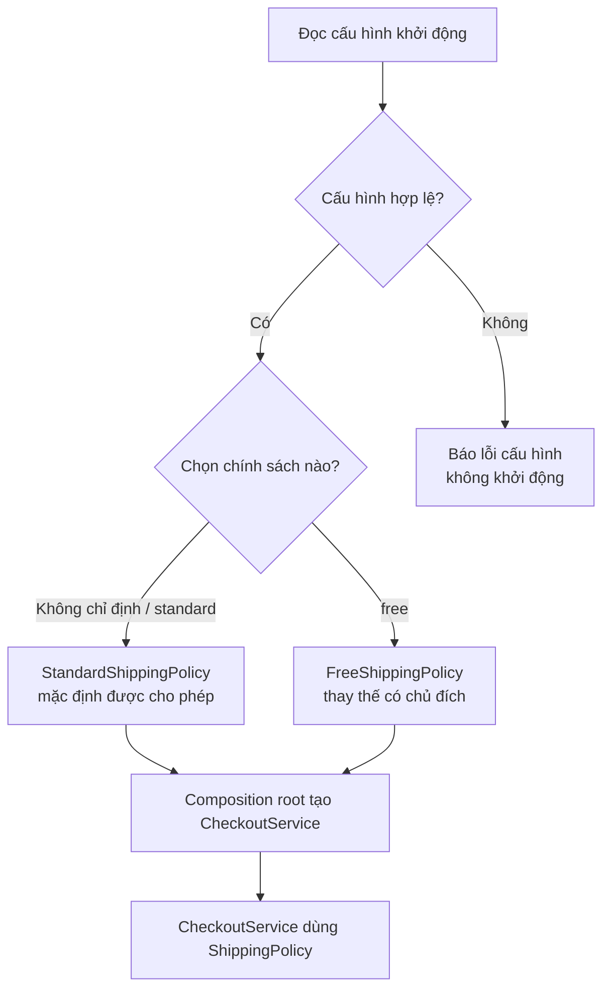

# Triển khai mặc định và điều kiện thay thế

Một ứng dụng sử dụng **Dependency Injection (DI)** có thể định nghĩa một hợp đồng như `ShippingPolicy`, `ReceiptSender` hoặc `InvoiceRepository` nhưng cung cấp nhiều triển khai khác nhau. Khi khởi động, ứng dụng phải quyết định **triển khai nào được dùng**. Ví dụ, một ứng dụng học tập có thể mặc định tính phí vận chuyển tiêu chuẩn, còn một cấu hình thử nghiệm chương trình ưu đãi sẽ chọn cách tính phí khác mà không sửa mã `CheckoutService`.

Điểm quan trọng là tách **nơi sử dụng phụ thuộc** khỏi **nơi chọn và tạo phụ thuộc**. Một triển khai *mặc định* phải có ý nghĩa rõ ràng; một triển khai *thay thế* chỉ nên được chọn khi thỏa điều kiện đã xác định. Không nên tự động “rơi về mặc định” khi cấu hình sai hoặc khi một hệ thống thiết yếu bị lỗi, vì cách đó có thể che giấu hành vi không mong muốn.

Bài học thuộc chương **Lựa chọn thành phần** của module **DEPENDENCY_INJECTION**. Ta sẽ thực hành lựa chọn bằng **Java thuần**, **constructor injection** và **composition root**, rồi xem xét cách các DI container xử lý nhiều implementation, điều kiện cấu hình, scope và vòng đời.

## 1. Kết quả cần đạt

Sau bài học, bạn có thể:

- Giải thích sự khác nhau giữa **hợp đồng**, **triển khai mặc định**, **triển khai thay thế** và **điều kiện chọn**.
- Phân biệt việc chọn implementation **khi khởi động ứng dụng** với việc chọn một chiến lược **cho từng yêu cầu nghiệp vụ**.
- Thiết kế composition root chỉ chọn một dependency phù hợp theo cấu hình đã kiểm tra, thay vì để service tự đọc biến môi trường hoặc `new` adapter.
- Xác định khi nào được dùng default và khi nào phải **fail fast** nếu thiếu/sai cấu hình.
- Kiểm tra một triển khai thay thế tuân thủ cùng hợp đồng, có scope và vòng đời tương thích.
- Viết chương trình Java thuần dùng default, thay thế có điều kiện và test double mà không cần DI container.

## 2. “Mặc định” nghĩa là gì?

Giả sử ứng dụng khai báo:

```java
interface ShippingPolicy {
    long feeCents(String destination);
}
```

Hai lớp `StandardShippingPolicy` và `FreeShippingPolicy` đều có thể hiện thực hợp đồng này. **Interface không tự quy định lớp nào được chọn**. Cần có một quyết định tại nơi lắp ghép hoặc trong cơ chế cấu hình container.

Ở đây:

- **Contract/hợp đồng**: `ShippingPolicy` mô tả khả năng mà bên sử dụng cần, bao gồm ý nghĩa đầu vào/đầu ra và hành vi lỗi.
- **Default implementation**: lựa chọn được chỉ định cho **trường hợp không yêu cầu một biến thể khác**, chẳng hạn `StandardShippingPolicy`.
- **Replacement/override**: một triển khai được chủ động chọn để thay default theo điều kiện hợp lệ, chẳng hạn `FreeShippingPolicy` trong chế độ ưu đãi.
- **Selection condition**: một quyết định có thể quan sát và kiểm tra, ví dụ `shipping=free` trong cấu hình khởi động.
- **Composition root**: nơi giải nghĩa cấu hình thành instance cụ thể, sau đó tiêm `ShippingPolicy` vào consumer.

Không có luật rằng *default luôn phải là triển khai đơn giản nhất*, *triển khai có tên “Default” luôn được chọn*, hoặc *mọi interface đều cần một default*. Đôi khi **không được có default**: ứng dụng production cần credentials thật hoặc backend được chỉ định rõ; chọn một no-op khi thiếu cấu hình có thể làm mất dữ liệu mà không báo lỗi.

### 2.1. Phân biệt default, fallback và failover

Ba khái niệm này dễ bị gộp làm một:

| Khái niệm | Thời điểm quyết định | Ví dụ | Lưu ý |
| --- | --- | --- | --- |
| **Default** | Khi không có lựa chọn thay thế hợp lệ được yêu cầu | Nếu không truyền chế độ, chọn tính phí tiêu chuẩn | Phải là hành vi mặc định *được phép* |
| **Override/replacement** | Khi cấu hình/điều kiện lựa chọn có chủ đích thỏa mãn | Chế độ `free` chọn chính sách miễn phí | Không được sửa hợp đồng của consumer |
| **Fallback khi lỗi** | Khi implementation đang dùng gặp lỗi trong lúc chạy | Backend A lỗi, thử backend B | Cần quy tắc lỗi, idempotency, consistency và quyền sử dụng dữ liệu |
| **Fail fast** | Khi cấu hình không hợp lệ hoặc bắt buộc nhưng bị thiếu | `shipping=unknown` hoặc thiếu DSN production | Báo lỗi rõ thay vì im lặng đổi chính sách |

Một lỗi mạng của triển khai được chọn **không phải tín hiệu để đổi về default** trừ khi ứng dụng được thiết kế có chính sách dự phòng như vậy. Ví dụ một dịch vụ thanh toán đang gặp lỗi không nên tự chuyển sang một adapter “giả lập thanh toán thành công”.

### 2.2. Default tốt cần có hợp đồng rõ

Một default hữu ích cần trả lời:

1. Khi nào default được chọn: thiếu option, cấu hình rõ ràng hay cả hai?
2. Default có bảo đảm gì về dữ liệu và hành vi?
3. Ở môi trường nào default **được phép** sử dụng?
4. Làm sao kiểm chứng một replacement vẫn giữ nghĩa của hợp đồng?
5. Ai ghi nhận lựa chọn thực tế để dễ chẩn đoán?

Nếu default là repository trong bộ nhớ, ứng dụng cần nói rõ rằng **dữ liệu không bền vững**; không nên ngầm dùng nó trong production chỉ vì kết nối database bị thiếu. Nếu default là no-op sender, phải bảo đảm bỏ qua thông báo **là hành vi chủ đích và được phép**.

## 3. Đặt điều kiện chọn ở đúng ranh giới

Lớp sử dụng nên nhận hợp đồng:

```java
final class CheckoutService {
    private final ShippingPolicy shipping;

    CheckoutService(ShippingPolicy shipping) {
        this.shipping = java.util.Objects.requireNonNull(shipping);
    }

    long totalCents(long goodsCents, String destination) {
        long feeCents = shipping.feeCents(destination);
        return Math.addExact(goodsCents, feeCents);
    }
}
```

Đây là đoạn rút gọn để minh họa **hướng phụ thuộc**; phiên bản đầy đủ có kiểm tra dữ liệu ở mục 6. `CheckoutService` không cần biết biến môi trường, annotation cấu hình, class name của adapter hay vì sao implementation này được chọn.

Sơ đồ quyết định tại composition root:



Quá trình này gồm hai quyết định tách biệt:

- **Cấu hình chọn triển khai**: xử lý khi lắp graph. Chỉ có composition root/configuration module biết lớp cụ thể.
- **Nghiệp vụ sử dụng triển khai**: `CheckoutService` gọi `shipping.feeCents(...)` qua interface đã tiêm.

Nhờ đó, chuyển từ default sang replacement **không cần viết thêm `if` trong service**. Cùng một service có thể dùng test double trong unit test, hoặc adapter thật trong ứng dụng.

## 4. Những điều kiện thay thế hợp lý và không hợp lý

Điều kiện chọn cần diễn đạt bằng một nguồn thông tin có chủ sở hữu rõ và được kiểm tra tại đúng thời điểm.

| Loại điều kiện | Ví dụ | Nơi nên đánh giá | Điều cần chú ý |
| --- | --- | --- | --- |
| **Môi trường triển khai** | Local dùng in-memory repository, production dùng database | Composition root lúc khởi động | Production không được im lặng rơi về in-memory khi thiếu cấu hình |
| **Cấu hình vận hành** | `shipping=standard` hay `shipping=free` cho một bản chạy thử | Composition root | Giá trị không biết phải báo lỗi; lựa chọn phải được ghi nhận |
| **Feature rollout ở mức ứng dụng** | Triển khai mới cho một nhóm máy chủ trong đợt canary | Bootstrap/configuration tùy kiến trúc | Bản chạy nào có thể rollback, phạm vi hiệu lực của cờ |
| **Khả năng của nền tảng** | Dùng adapter hỗ trợ một API khi thư viện/chức năng có sẵn | Điểm khởi tạo hoặc adapter factory | Kiểm tra capability thật, không suy đoán từ tên class |
| **Chế độ kiểm thử** | Test tiêm fake hoặc in-memory adapter | Test composition root hoặc constructor test | Không để fake trở thành default production |
| **Dữ liệu của từng yêu cầu** | Phí vận chuyển tùy loại đơn, quyền khách hàng hoặc khu vực | Thường là chính sách nghiệp vụ/strategy selector | Không nhầm lựa chọn theo request với cấu hình startup |

**Cần phân biệt:** nếu mỗi đơn hàng có phương thức vận chuyển khác nhau, việc chọn chính sách theo đơn hàng có thể là một **quy tắc nghiệp vụ**, không phải điều kiện cấu hình ứng dụng. Khi đó một `ShippingPolicySelector` hoặc `ShippingQuoteService` có hợp đồng riêng có thể lựa chọn theo dữ liệu đơn hàng. Composition root chỉ tiêm các strategy/selector, chứ không phải trực tiếp quyết định đơn hàng nào được miễn phí.

Một cờ feature có thể được cập nhật **động trong thời gian chạy**. Khi đó, chọn một bean tại bootstrap không tự động làm service đổi triển khai theo mỗi lần cập nhật. Cần quyết định rõ liệu cờ là *startup configuration*, *dynamic routing* hay *business rule*, cùng ngữ nghĩa consistency và kiểm thử tương ứng.

## 5. Phản ví dụ: service tự chọn triển khai

```java
// Mã minh họa vấn đề, không phải chương trình độc lập.
final class CheckoutService {
    long totalCents(long goodsCents, String destination) {
        String mode = System.getenv("SHIPPING_MODE");
        ShippingPolicy policy;
        if ("free".equals(mode)) {
            policy = new FreeShippingPolicy();
        } else {
            policy = new StandardShippingPolicy(1_500);
        }
        return Math.addExact(goodsCents, policy.feeCents(destination));
    }
}
```

Các vấn đề:

1. **Phụ thuộc ngược chiều**: lớp nghiệp vụ import cả hai lớp cụ thể và quyết định cách tạo chúng.
2. **Cấu hình bị đọc trong đường xử lý**: test cần kiểm soát biến môi trường, còn thay cấu hình có thể làm hành vi không nhất quán giữa các lượt gọi nếu nguồn cấu hình thay đổi.
3. **Default sai khi cấu hình sai**: `SHIPPING_MODE=fre` bị coi là standard thay vì báo typo. Với nghiệp vụ quan trọng, đây có thể là lỗi nguy hiểm.
4. **Vòng đời bị che giấu**: nếu policy thực tế là adapter có connection hoặc resource tốn kém, tạo mới mỗi lời gọi có thể tốn chi phí và không rõ ai đóng.

Sửa bằng cách định nghĩa `ShippingPolicy` làm dependency constructor và đưa việc đọc cấu hình/chọn lớp cụ thể về composition root. Việc service có thể gọi `new` để tạo **value object của nghiệp vụ** không phải vấn đề tương tự; điều cần tách là lựa chọn **phụ thuộc hạ tầng/chính sách bên ngoài** mà service không nên tự quyết định.

## 6. Ví dụ Java thuần: mặc định và thay thế có điều kiện

Ví dụ dùng hai chính sách tính phí:

- **Default:** `StandardShippingPolicy` tính phí cố định 1.500 cent cho một điểm đến hợp lệ.
- **Replacement:** `FreeShippingPolicy` tính 0 cent trong cấu hình thử nghiệm miễn phí vận chuyển.

`CheckoutService` chỉ biết `ShippingPolicy`. Một hàm `compose(...)` quyết định implementation theo option khởi động. Không có DI container, mạng, database hoặc gửi thông báo. Số tiền và chính sách chỉ là **giả định để luyện lựa chọn dependency**, không đại diện bảng giá thực tế.

### 6.1. Hợp đồng hành vi của `ShippingPolicy`

Cả hai implementation phải tuân các quy ước chung:

- Input `destination` phải khác `null` và không chỉ gồm khoảng trắng.
- Kết quả tính theo **cent** và **không âm**.
- Một địa chỉ/điểm đến không hợp lệ bị từ chối, không âm thầm trả một mã phí âm.
- Consumer có thể cộng phí với giá hàng bằng `Math.addExact(...)` để phát hiện tràn số.

Việc có cùng chữ ký `feeCents(String)` chưa đủ: **cả hai triển khai phải giữ cùng hợp đồng**. Nếu một implementation trả `-1` khi lỗi, nó có thể làm tổng tiền giảm một cent hoặc khiến consumer phải biết chi tiết riêng của adapter.

### 6.2. Chương trình hoàn chỉnh

Lưu nguyên khối thành **`Main.java`** để chạy bằng JDK 11 trở lên:

```java
import java.util.ArrayList;
import java.util.List;
import java.util.Objects;

public class Main {
    enum ShippingMode {
        STANDARD, FREE
    }

    // Cấu hình được giải nghĩa một lần trước khi lắp graph.
    static final class Settings {
        final ShippingMode shippingMode;

        Settings(ShippingMode shippingMode) {
            this.shippingMode = Objects.requireNonNull(
                    shippingMode, "shippingMode");
        }

        static Settings fromArgs(String[] args) {
            Objects.requireNonNull(args, "args");

            // Chỉ dùng default nếu KHÔNG chỉ định tham số.
            if (args.length == 0) {
                return new Settings(ShippingMode.STANDARD);
            }

            if (args.length != 1 || args[0] == null
                    || !args[0].startsWith("--shipping=")) {
                throw new IllegalArgumentException(
                        "Usage: java Main [--shipping=standard|free]");
            }

            String chosen = args[0].substring("--shipping=".length());
            switch (chosen) {
                case "standard":
                    return new Settings(ShippingMode.STANDARD);
                case "free":
                    return new Settings(ShippingMode.FREE);
                default:
                    throw new IllegalArgumentException(
                            "Unknown shipping mode: " + chosen);
            }
        }
    }

    // Abstraction được bên sử dụng yêu cầu.
    interface ShippingPolicy {
        long feeCents(String destination);
    }

    static void requireDestination(String destination) {
        Objects.requireNonNull(destination, "destination");
        if (destination.isBlank()) {
            throw new IllegalArgumentException("destination is blank");
        }
    }

    // Mặc định cho ví dụ: phí cố định, không có resource cần đóng.
    static final class StandardShippingPolicy implements ShippingPolicy {
        private final long fixedFeeCents;

        StandardShippingPolicy(long fixedFeeCents) {
            if (fixedFeeCents < 0) {
                throw new IllegalArgumentException(
                        "shipping fee must be non-negative");
            }
            this.fixedFeeCents = fixedFeeCents;
        }

        @Override
        public long feeCents(String destination) {
            requireDestination(destination);
            return fixedFeeCents;
        }
    }

    // Thay thế theo cấu hình: vẫn giữ cùng hợp đồng hành vi.
    static final class FreeShippingPolicy implements ShippingPolicy {
        @Override
        public long feeCents(String destination) {
            requireDestination(destination);
            return 0;
        }
    }

    // Business service không chọn implementation và không đọc args.
    static final class CheckoutService {
        private final ShippingPolicy shipping;

        CheckoutService(ShippingPolicy shipping) {
            this.shipping = Objects.requireNonNull(shipping, "shipping");
        }

        long totalCents(long goodsCents, String destination) {
            if (goodsCents < 0) {
                throw new IllegalArgumentException(
                        "goods price must be non-negative");
            }
            requireDestination(destination);
            long fee = shipping.feeCents(destination);
            if (fee < 0) {
                throw new IllegalStateException(
                        "shipping policy violated its contract");
            }
            return Math.addExact(goodsCents, fee);
        }
    }

    // Root trả về những entry point cần cho ứng dụng.
    static final class Application {
        final CheckoutService checkout;
        final ShippingMode selectedMode;

        Application(CheckoutService checkout, ShippingMode selectedMode) {
            this.checkout = Objects.requireNonNull(checkout, "checkout");
            this.selectedMode =
                    Objects.requireNonNull(selectedMode, "selectedMode");
        }
    }

    // COMPOSITION ROOT: chỉ nơi này biết lớp triển khai cụ thể.
    static Application compose(Settings settings) {
        Objects.requireNonNull(settings, "settings");

        ShippingPolicy policy;
        switch (settings.shippingMode) {
            case STANDARD:
                policy = new StandardShippingPolicy(1_500);
                break;
            case FREE:
                policy = new FreeShippingPolicy();
                break;
            default:
                // Bảo vệ nếu enum được mở rộng nhưng wiring chưa cập nhật.
                throw new IllegalArgumentException(
                        "Shipping mode is not wired");
        }

        CheckoutService checkout = new CheckoutService(policy);
        return new Application(checkout, settings.shippingMode);
    }

    // Test double: quan sát service gọi hợp đồng như thế nào.
    static final class RecordingShippingPolicy implements ShippingPolicy {
        final List<String> destinations = new ArrayList<>();
        private final long fee;

        RecordingShippingPolicy(long fee) {
            if (fee < 0) {
                throw new IllegalArgumentException("fee is negative");
            }
            this.fee = fee;
        }

        @Override
        public long feeCents(String destination) {
            requireDestination(destination);
            destinations.add(destination);
            return fee;
        }
    }

    public static void main(String[] args) {
        Settings settings = Settings.fromArgs(args);
        Application app = compose(settings);

        long total = app.checkout.totalCents(10_000, "HCM");
        long expected = settings.shippingMode == ShippingMode.STANDARD
                ? 11_500 : 10_000;
        if (total != expected) {
            throw new AssertionError("unexpected configured policy");
        }

        // Đổi dependency ở test mà không sửa CheckoutService.
        RecordingShippingPolicy fake = new RecordingShippingPolicy(250);
        CheckoutService underTest = new CheckoutService(fake);
        long testedTotal = underTest.totalCents(8_000, "DN");
        if (testedTotal != 8_250
                || !fake.destinations.equals(List.of("DN"))) {
            throw new AssertionError("incorrect service interaction");
        }

        String chosen = app.selectedMode == ShippingMode.STANDARD
                ? "standard" : "free";
        System.out.println("Selected shipping: " + chosen);
        System.out.println("Total: " + total + " cents");
        System.out.println("Plain Java verification: PASS");
    }
}
```

Biên dịch và chạy với cấu hình không chỉ định:

```bash
javac -encoding UTF-8 Main.java
java Main
```

Kết quả dự kiến:

```text
Selected shipping: standard
Total: 11500 cents
Plain Java verification: PASS
```

Chọn rõ triển khai thay thế:

```bash
java Main --shipping=free
```

Kết quả:

```text
Selected shipping: free
Total: 10000 cents
Plain Java verification: PASS
```

Cấu hình không hợp lệ bị từ chối:

```bash
java Main --shipping=fre
```

Chương trình sẽ ném `IllegalArgumentException` với thông báo `Unknown shipping mode: fre` và **không tiếp tục** tạo `CheckoutService` bằng một default không được yêu cầu. Trong bài thực hành console, lỗi được hiển thị thành exception; ứng dụng thực tế có thể chuyển thành thông báo cấu hình rõ ràng tại bước bootstrap.

### 6.3. Những gì ví dụ chứng minh

1. **Default có điều kiện rõ:** chỉ khi không có tham số, `Settings.fromArgs` chọn `STANDARD`. Một giá trị sai không được hiểu là “không có giá trị”.
2. **Override có chủ đích:** `--shipping=free` chọn `FreeShippingPolicy` trong composition root. Consumer không thay đổi.
3. **Không có locator toàn cục:** `CheckoutService` nhận `ShippingPolicy` qua constructor, có thể được tạo độc lập trong unit test.
4. **Cùng một hợp đồng:** cả hai chính sách đều kiểm tra điểm đến hợp lệ và trả phí không âm.
5. **Cấu hình và sử dụng tách biệt:** `Settings` chỉ được phân tích khi khởi động; `CheckoutService` không đọc CLI arguments ở mỗi lần tính tiền.
6. **Không đánh đồng chọn và chạy:** chương trình đang minh họa tính toán thuần, không cần mở/đóng resource. Nếu adapter thật có connection/thread, composition root phải còn giải quyết vòng đời của nó.

**Giới hạn:** chính sách miễn phí trong ví dụ được chọn cho **toàn bộ tiến trình**. Nếu chương trình ưu đãi chỉ áp dụng cho từng đơn hàng đủ điều kiện, không thể chỉ thay policy lúc khởi động mà đạt đúng nghiệp vụ. Khi đó cần một bộ chọn chính sách theo dữ liệu đơn hàng, có quy tắc riêng và được tiêm như một collaborator.

## 7. Khi điều kiện thay thế phụ thuộc từng yêu cầu

Xét trường hợp không phải mọi người mua đều được hưởng cùng chính sách:

```java
// Phác họa thiết kế domain; không phải đoạn Java chạy độc lập.
interface ShippingQuoteService {
    long feeCents(Order order);
}

final class RuleBasedShippingQuoteService implements ShippingQuoteService {
    private final ShippingPolicy standard;
    private final ShippingPolicy promotion;
    private final PromotionEligibility eligibility;

    RuleBasedShippingQuoteService(
            ShippingPolicy standard,
            ShippingPolicy promotion,
            PromotionEligibility eligibility) {
        this.standard = standard;
        this.promotion = promotion;
        this.eligibility = eligibility;
    }

    public long feeCents(Order order) {
        ShippingPolicy chosen = eligibility.isEligible(order)
                ? promotion : standard;
        return chosen.feeCents(order.destination());
    }
}
```

Ở đây composition root có thể lắp **cả hai implementation** và tiêm vào `RuleBasedShippingQuoteService`. Quyết định đơn hàng nào được ưu đãi nằm ở `PromotionEligibility`, một hợp đồng/chính sách nghiệp vụ. Không nên kéo dữ liệu request vào mã bootstrap chỉ để giữ số lượng class thấp.

Điều này khác với chọn implementation theo môi trường triển khai: **startup selection** thường ổn định trong lifetime của graph, còn **business routing** diễn ra với từng lệnh hoặc sự kiện. Cả hai có thể dùng DI nhưng có **trách nhiệm và thời điểm đánh giá điều kiện khác nhau**.

## 8. Nhiều implementation: xử lý mơ hồ và thứ tự ưu tiên

Khi có nhiều implementation của cùng hợp đồng, cần một quy tắc chọn **không mơ hồ**.

| Tình huống | Thiết kế nên xem xét |
| --- | --- |
| Không có implementation nào nhưng dependency bắt buộc | Lỗi lắp ghép; không tạo consumer thiếu dependency |
| Có đúng một implementation được chọn | Tiêm trực tiếp implementation đó qua hợp đồng |
| Có nhiều implementation đều phù hợp | Cần điều kiện chọn, qualifier, key hoặc tập các strategy có thứ tự rõ |
| Có default và một override hợp lệ | Override được ưu tiên theo chính sách cấu hình đã công bố |
| Có hai override cùng yêu cầu ưu tiên | Báo lỗi cấu hình hoặc áp dụng quy tắc ưu tiên có chủ đích và được kiểm thử |
| Override bị thiếu dependency hoặc cấu hình sai | Lỗi khởi tạo; chỉ fallback khi **đã có chính sách fallback an toàn** |

Một cách biểu diễn quy tắc đơn giản:

```text
Nếu cấu hình hợp lệ và có override:
    dùng override đã chọn
Nếu cấu hình không chỉ định và default được phép:
    dùng default
Nếu cấu hình sai, thiếu thành phần bắt buộc hoặc mơ hồ:
    dừng lắp ghép, báo lỗi
```

Đừng dựa vào **thứ tự lớp được quét**, tên file, thứ tự đăng ký không có bảo đảm hoặc “bean được tìm thấy đầu tiên” để quyết định một phụ thuộc quan trọng. Khi quyết định có ý nghĩa nghiệp vụ hoặc ảnh hưởng dữ liệu, nó cần được thể hiện và kiểm thử rõ ràng.

### 8.1. Khi default không được phép

Ví dụ cấu hình thanh toán thật:

```text
mode=production
paymentProvider=<bắt buộc xác định>
```

Nếu `paymentProvider` thiếu, việc âm thầm lắp một `FakePaymentGateway` hoặc một no-op adapter có thể khiến ứng dụng giả vờ thu tiền thành công. Trong trường hợp này, **fail fast an toàn hơn việc có default**. Ngược lại, với một công cụ console dùng để dạy tính phí, default “standard” có thể là lựa chọn hợp lý và được ghi rõ.

### 8.2. Không thể thay cả contract bằng một implementation bất tương thích

Một adapter mới có thể cùng implements interface nhưng khác ý nghĩa: phí âm dùng như mã lỗi, trả một đơn vị tiền khác hoặc ném lỗi không được hợp đồng mô tả. Khi đó việc wiring vẫn thành công về kiểu nhưng service có thể cho ra kết quả sai.

Kiểm tra không chỉ **lắp được** mà còn **thay thế được về hành vi**. Đây là khía cạnh quan trọng của **Liskov Substitution Principle (LSP)** trong hệ thống DI.

## 9. So sánh lựa chọn thủ công và DI container

Trong Java thuần, composition root dùng các câu lệnh `if`, `switch` hoặc factory để chọn instance. Với DI container, quyết định tương tự có thể được biểu diễn bằng:

- Đăng ký một binding mặc định cho interface.
- Gắn qualifier hoặc tên để phân biệt các implementation.
- Chọn implementation theo môi trường, profile hoặc cấu hình được xác thực.
- Đăng ký có điều kiện khi chưa có binding cụ thể, nếu framework hỗ trợ.
- Cung cấp factory/provider để tạo implementation theo nhu cầu và vòng đời.

**Tùy framework** mà hành vi cụ thể khác nhau. Chẳng hạn, ở những phần của hệ sinh thái Spring, `@Primary` được sử dụng để **ưu tiên một ứng viên khi có nhiều bean phù hợp**, còn các annotation/configuration có điều kiện có thể quyết định bean được đăng ký hay không. Hai việc **không hoàn toàn giống nhau**: một cơ chế ưu tiên khi resolve không đồng nghĩa một cơ chế chỉ đăng ký default nếu chưa có implementation khác. Các quy tắc về profile, auto-configuration, bean name và thứ tự áp dụng cần đọc theo phiên bản/framework thực tế.

Để tránh hiểu lầm, đoạn sau chỉ là **mã giả khái niệm**, không phải API Java/Spring chính xác:

```text
registerDefault(ShippingPolicy, StandardShippingPolicy)
when(config.shipping == "free"):
    replace(ShippingPolicy, FreeShippingPolicy)
if(config.shipping is unknown):
    failStartup()
```

Không có container nào tự hiểu các dòng trên nếu chưa được chuyển thành cấu hình theo API thực. Nội dung cần giữ là **ý định chọn một implementation theo điều kiện và từ chối trường hợp mơ hồ/sai**, giống như với `compose(Settings)` trong Java thuần.

### 9.1. Thay bean không tự làm sạch resource cũ

Nếu default giữ client, thread, connection pool hoặc listener, lựa chọn replacement có thể kéo theo khác biệt về:

- **Scope:** một singleton hay một instance theo request/task?
- **Ownership:** ai tạo, ai đóng, ai chịu trách nhiệm cleanup nếu khởi động thất bại?
- **Readiness:** việc tạo object thành công có đồng nghĩa backend sẵn sàng không?
- **State:** đang chuyển triển khai khi đang xử lý request thì dữ liệu và các công việc đang chạy được giữ thế nào?

Trong ví dụ Java thuần, hai policy chỉ thực hiện phép tính nên không cần đóng tài nguyên. Với một `NotificationSender` thật, chọn adapter phù hợp chỉ là **một phần** của bootstrap: root còn cần điều phối activation, shutdown và lỗi.

### 9.2. Test override khác với production override

Trong unit test, việc thay `ShippingPolicy` bằng `RecordingShippingPolicy` là bình thường để quan sát lời gọi. Nhưng production không nên tự bật test double vì một thiếu sót cấu hình. Tốt hơn là tách **wiring test**, **wiring local** và **wiring production** rõ ràng; kiểm thử rằng mỗi cấu hình triển khai chọn đúng adapter và từ chối lựa chọn không được phép.

## 10. Kiểm thử điều kiện chọn và hợp đồng

Có hai vấn đề khác nhau cần kiểm thử:

1. **Selection/wiring:** cấu hình nào dẫn tới instance nào?
2. **Behavior/contract:** mỗi instance có đáp ứng quy tắc mà consumer dựa vào không?

Một ma trận kiểm thử tối thiểu cho ví dụ:

| Đầu vào / hoàn cảnh | Kết quả mong đợi | Loại kiểm thử |
| --- | --- | --- |
| Không truyền option | Chọn `STANDARD`, tổng = 11.500 cent | Wiring/composition |
| `--shipping=standard` | Chọn `STANDARD` | Wiring |
| `--shipping=free` | Chọn `FREE`, tổng = 10.000 cent | Wiring/composition |
| `--shipping=fre` | Báo `IllegalArgumentException`, không tự fallback | Validation |
| Nhiều option không được hỗ trợ | Báo lỗi cú pháp | Validation |
| Destination rỗng | Cả hai policy đều từ chối | Contract |
| Destination hợp lệ | Cả hai policy trả kết quả không âm | Contract |
| Test double fee = 250 | `CheckoutService` dùng đúng fee và destination | Unit test |
| Fee policy vi phạm hợp đồng (trả âm) | Consumer phát hiện thay vì cộng phí âm | Defensive unit test |
| Tổng vượt giới hạn `long` | `Math.addExact` báo lỗi | Boundary test |

**Không cần chạy cả hệ thống thật cho mọi unit test**. `CheckoutService` được tạo trực tiếp với fake; test lựa chọn có thể gọi riêng `Settings.fromArgs` và `compose`. Khi dùng container thực, bổ sung kiểm thử tích hợp startup/cấu hình vì annotation và quy tắc đăng ký có thể khác với wiring dự kiến.

### 10.1. Contract test cho nhiều implementation

Ví dụ kiểm tra rằng mọi chính sách đều từ chối destination rỗng:

```java
// Dùng các lớp lồng bên trong Main.java ở mục 6.
for (Main.ShippingPolicy policy : java.util.List.of(
        new Main.StandardShippingPolicy(1_500),
        new Main.FreeShippingPolicy())) {
    try {
        policy.feeCents("  ");
        throw new AssertionError("policy accepted blank destination");
    } catch (IllegalArgumentException expected) {
        // Đây là hành vi hợp đồng mong đợi.
    }
}
```

Đoạn mã minh họa trên có một giới hạn quan trọng của cách viết kiểm tra exception thủ công: `AssertionError` **không** bị `catch (IllegalArgumentException)` bắt, nên nếu policy trả về bình thường thì phép thử thất bại. Trong dự án thật, nên dùng test framework phù hợp để thông báo lỗi rõ hơn.

Nếu các adapter dùng network, database hoặc thời gian hệ thống, cần bổ sung kiểm thử tích hợp và kịch bản lỗi thực; việc một fake giữ hợp đồng không chứng minh các adapter thật hoạt động đúng.

## 11. Những anti-pattern thường gặp

| Cách làm | Rủi ro | Hướng khắc phục |
| --- | --- | --- |
| Service đọc biến môi trường rồi tự `new` adapter | Coupling trực tiếp vào cấu hình và hạ tầng | Root đọc cấu hình, tạo instance, tiêm qua contract |
| Unknown option tự rơi về default | Che lỗi cấu hình, chạy sai chính sách | Chỉ dùng default khi điều kiện hợp lệ; còn lại fail fast |
| Default là no-op cho thao tác bắt buộc | Có thể âm thầm mất dữ liệu hoặc giao dịch | Không có default production nếu nghiệp vụ yêu cầu kết nối thực |
| Có nhiều implementation nhưng chọn “cái đầu tiên” | Không xác định và khó tái lập | Điều kiện, qualifier hoặc khóa chọn tường minh |
| Chọn theo request ngay ở bootstrap | Không có dữ liệu request hoặc phải giữ trạng thái dùng chung | Đưa quy tắc vào selector/strategy nghiệp vụ |
| Mỗi lần dùng lại tạo client mới | Chi phí I/O cao, resource ownership không rõ | Tạo adapter theo scope phù hợp, quản lý lifecycle ở root/factory |
| Replacement có kiểu đúng nhưng trả dữ liệu khác đơn vị | Vi phạm hợp đồng hành vi | Contract test và kiểm tra invariant |
| Feature flag đổi mà object graph không đổi | Tin rằng runtime tự thay implementation | Xác định rõ startup selection hay dynamic routing |
| Scoped dependency bị singleton giữ sau request | Captive dependency, state request rò rỉ | Factory/provider/param đúng thời điểm, scope hợp lệ |
| Chỉ test từng implementation mà không test cấu hình | Sai wiring vẫn lọt production | Test các trường hợp default, override, invalid, ambiguous |

## 12. Quy trình lựa chọn thành phần có kiểm soát

Khi cần thêm một implementation mới vào hệ thống:

1. **Định nghĩa nhu cầu của consumer.** Nó thực sự cần khả năng gì? Có nên giữ hợp đồng hiện tại hay tạo abstraction nhỏ hơn?
2. **Ghi rõ contract.** Input/output, đơn vị dữ liệu, side effect, lỗi và phạm vi hợp lệ phải nhất quán giữa các implementation.
3. **Quyết định có default hay không.** Default dùng cho môi trường nào, khi nào được phép áp dụng, và khi nào phải bắt buộc cấu hình?
4. **Định nghĩa điều kiện thay thế.** Option, profile, rollout, capability hay dữ liệu nghiệp vụ? Điều kiện được đánh giá lúc startup hay trên mỗi request?
5. **Tập trung selection vào nơi chịu trách nhiệm.** Root/configuration chọn cho toàn graph; chính sách nghiệp vụ chọn theo đơn hàng/yêu cầu.
6. **Định nghĩa thứ tự ưu tiên.** Nếu nhiều implementation cùng đủ điều kiện, chỉ rõ cách phân giải hoặc phát hiện lỗi mơ hồ.
7. **Kiểm tra vòng đời.** Ai tạo, chia sẻ, start và close implementation? Có state theo request hoặc tài nguyên có thể bị giữ quá lâu không?
8. **Kiểm thử wiring và contract.** Kiểm tra default, override, typo, thiếu cấu hình, vi phạm hợp đồng và kịch bản lỗi.
9. **Bảo đảm vận hành quan sát được.** Ghi nhận mode/implementation đã chọn theo cách không rò secret; không âm thầm đổi chính sách khi lỗi.
10. **Dự kiến thay đổi về sau.** Một implementation mới có cần sửa consumer hay chỉ thêm binding/cấu hình? Nếu phải sửa consumer ở nhiều nơi, xem lại ranh giới abstraction.

## 13. Tự kiểm tra

**Tình huống A.** Một ứng dụng production cần `PaymentGateway` thật. Cấu hình thiếu provider nên root dùng `FakePaymentGateway` mặc định và trả về giao dịch “thành công”. Có nên giữ default này không?

**Gợi ý:** Không. Default fake không phù hợp với thao tác thanh toán thật. Cần từ chối khởi động khi thiếu cấu hình bắt buộc và có kiểm thử tránh triển khai test adapter sang production.

**Tình huống B.** `CheckoutService` chỉ nhận `ShippingPolicy`. Root chọn `StandardShippingPolicy` khi không có option và `FreeShippingPolicy` khi có `--shipping=free`. Service không biết tên hai lớp. Đây có phải DI không?

**Gợi ý:** Có. Root chọn dependency cụ thể rồi tiêm vào service qua constructor; đây là DI thủ công. Khác biệt chính sách được xử lý ở ranh giới selection.

**Tình huống C.** Cấu hình `shipping=fre` bị nhập sai, ứng dụng tự quay về standard. Tại sao hành vi này nguy hiểm hơn báo lỗi?

**Gợi ý:** Vì typo có thể làm phần mềm chạy một chính sách không được yêu cầu mà người vận hành không nhận ra. Cần phân biệt **không chỉ định** với **chỉ định không hợp lệ**.

**Tình huống D.** Hai triển khai `RateProvider` cùng implement một interface, nhưng một lớp trả số cent, lớp kia trả số đồng với cùng kiểu `long`. Có thể dùng chúng thay nhau không?

**Gợi ý:** Không. Chúng không giữ cùng ngữ nghĩa hợp đồng, dù biên dịch được. Cần thống nhất đơn vị hoặc chuyển đổi trong adapter rồi kiểm thử contract.

**Tình huống E.** Mỗi request cần chọn chính sách giảm phí dựa trên trạng thái khách hàng. Nhóm định dùng `System.getenv("CUSTOMER_TIER")` trong root để chọn một instance cho toàn bộ ứng dụng. Điều gì chưa đúng?

**Gợi ý:** Đây là quyết định dựa vào **dữ liệu của từng request**, không phải một cấu hình duy nhất khi startup. Nên dùng selector/chính sách nghiệp vụ được tiêm các strategy cần thiết.

**Tình huống F.** Một container có hai bean cùng hiện thực `ReceiptSender`. Nhóm cho rằng “bean nào được scan trước sẽ được tiêm”. Cần làm gì?

**Gợi ý:** Phải làm rõ quy tắc lựa chọn theo framework: qualifier, tên, ưu tiên hoặc điều kiện đăng ký phù hợp. Khi cấu hình mơ hồ, nên báo lỗi thay vì dựa vào thứ tự không được bảo đảm.

**Tình huống G.** Default dùng shared client sống cùng ứng dụng, replacement dùng session chỉ hợp lệ trong một request. Có thể thay bằng cách giữ session mới trong singleton `NotificationService` không?

**Gợi ý:** Không chỉ đổi implementation rồi giữ nguyên giả định lifetime. Cần thay đổi cách cung cấp dependency theo scope, dùng factory/provider hoặc tổ chức phần graph ngắn hạn cho mỗi request và bảo đảm cleanup.

## 14. Ghi nhớ

- **Triển khai mặc định** là một lựa chọn được cho phép khi điều kiện không yêu cầu thay thế; nó không phải cơ chế tự xử lý mọi lỗi.
- **Triển khai thay thế** phải giữ cùng hợp đồng và được chọn theo điều kiện tường minh, có thể kiểm tra.
- **Composition root** chịu trách nhiệm lựa chọn dependency cho object graph; **consumer chỉ sử dụng hợp đồng**, không tự đọc cấu hình hoặc khởi tạo adapter.
- **Thiếu cấu hình bắt buộc hoặc cấu hình không hợp lệ phải được phát hiện sớm.** Một default không phù hợp có thể nguy hiểm hơn startup thất bại.
- **Lựa chọn lúc khởi động và lựa chọn theo từng request là hai bài toán khác nhau**; phần thứ hai thường thuộc chính sách nghiệp vụ.
- **DI container chỉ tự động hóa việc chọn và lắp ghép** theo cấu hình; phải hiểu thứ tự ưu tiên, điều kiện, scope, lifecycle và hành vi hợp đồng.

Khi định nghĩa một default, hãy hỏi: **“Tại sao nó là lựa chọn an toàn khi không có override, điều kiện nào thực sự cho phép thay thế, và điều gì phải xảy ra nếu cấu hình không hợp lệ?”** Trả lời rõ ba câu hỏi ấy giúp hệ thống linh hoạt mà không đánh đổi tính đúng đắn để lấy sự tiện lợi.
