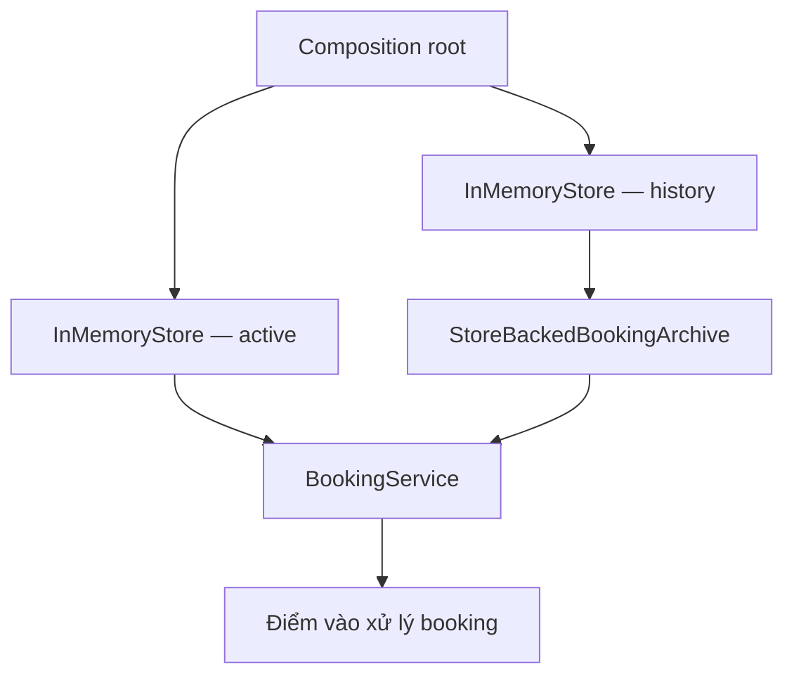

# Kiểu generic và khó khăn phân biệt các phụ thuộc tương tự

Khi một ứng dụng Java áp dụng **Dependency Injection (DI)**, việc truyền cộng tác viên qua constructor giúp lớp nghiệp vụ thể hiện rõ nó cần gì. Nhưng khi có nhiều phụ thuộc cùng một interface, nhất là interface **generic** như `Store<T>`, ta phải giải quyết thêm câu hỏi: **làm sao chọn đúng instance cho đúng vai trò?**

Ví dụ, `BookingService` cần một `Store<Booking>` để lưu booking đang hoạt động; `CustomerService` cần `Store<Customer>` để lưu khách hàng. Hai phụ thuộc cùng tên interface `Store`, nhưng tham số kiểu khác nhau. Phức tạp hơn, nếu ứng dụng còn cần **hai `Store<Booking>`** cho dữ liệu chính và kho lưu lịch sử, cả hai có *cùng một kiểu generic* nhưng **mục đích khác nhau**. Kết nối nhầm có thể vẫn biên dịch và chỉ được phát hiện khi dữ liệu nằm sai nơi.

Bài thuộc chương **Lựa chọn thành phần** của nội dung **Dependency Injection và Inversion of Control (IoC)**. Ta sẽ phân biệt khả năng bảo vệ kiểu của Java generics với khả năng chọn phụ thuộc của composition root hoặc DI container; thực hành constructor injection, đặt tên theo vai trò, quản lý scope và kiểm thử bằng Java thuần trước khi mở rộng sang container.

## 1. Hai kiểu “giống nhau” cần phân biệt

Đặt hợp đồng lưu dữ liệu tổng quát:

```java
interface Store<T> {
    void save(T value);
    T findById(String id);
}
```

Ta có thể sử dụng:

```java
Store<Booking> bookingStore;
Store<Customer> customerStore;

Store<Booking> activeBookingStore;
Store<Booking> archivedBookingStore;
```

Hai nhóm khác nhau về bản chất:

| Trường hợp | Kiểu khai báo | Thông tin đủ để phân biệt? | Vấn đề chính |
| --- | --- | --- | --- |
| Lưu booking và lưu khách hàng | `Store<Booking>`, `Store<Customer>` | **Có** ở mức kiểm tra kiểu của mã nguồn Java | Container phải hiểu generic signature nếu muốn tự chọn binding |
| Lưu booking hiện hành và booking lưu trữ | `Store<Booking>`, `Store<Booking>` | **Không**: cùng kiểu và cùng tham số generic | Cần thể hiện **vai trò**, bằng hợp đồng riêng, qualifier hoặc cấu hình lắp ghép rõ ràng |
| Hai `PaymentGateway` cho sandbox và production | `PaymentGateway`, `PaymentGateway` | **Không**: cùng interface không có generic | Chọn theo môi trường tại điểm cấu hình, tránh mơ hồ |

Java generics giúp ngăn truyền nhầm một `Store<Customer>` cho chỗ cần `Store<Booking>`:

```java
// Các dòng minh họa lỗi biên dịch, không chạy độc lập.
Store<Booking> bookings = new InMemoryStore<>(Booking::id);
Store<Customer> customers = new InMemoryStore<>(Customer::id);

bookings = customers; // Lỗi biên dịch: không tương thích kiểu.
```

Tuy nhiên, Java **không thể** phân biệt ý nghĩa nghiệp vụ của hai biến cùng kiểu `Store<Booking>`. Nếu constructor là `BookingService(Store<Booking> active, Store<Booking> archive)`, đổi chỗ hai đối số có thể vẫn biên dịch. Việc chọn phụ thuộc vì thế vừa là vấn đề **kiểu**, vừa là vấn đề **vai trò**.

## 2. Type erasure: Java giữ và xóa những gì?

Java generics phần lớn dùng **type erasure** (*xóa kiểu*): tham số kiểu giúp trình biên dịch kiểm tra hợp lệ, còn object bình thường lúc chạy không mang một `Class` riêng cho mỗi cách tham số hóa generic.

```java
Store<Booking> bookings = new InMemoryStore<>(Booking::id);
Store<Customer> customers = new InMemoryStore<>(Customer::id);

boolean sameRuntimeClass = bookings.getClass() == customers.getClass();
// true: cả hai đều là instance của InMemoryStore ở runtime.
```

Các cú pháp sau không hợp lệ:

```java
// Ví dụ KHÔNG biên dịch được:
Store<Booking>.class;                  // Không có class literal này.
Object item = bookings;
boolean ok = item instanceof Store<Booking>; // Không thể kiểm tra T như vậy.
```

Thay vào đó, có thể kiểm tra raw type hoặc một kiểu có wildcard phù hợp:

```java
boolean someStore = bookings instanceof Store<?>;
// true, nhưng KHÔNG chứng minh đây là Store<Booking> hay Store<Customer>.
```

Một nhận định cần chính xác: **type erasure không có nghĩa mọi thông tin generic đều biến mất khỏi bytecode**. Chẳng hạn, nếu khai báo trường `Store<Booking>` hoặc tham số constructor `Store<Customer>`, Java Reflection thường có thể đọc **generic signature của chỗ khai báo** qua `Field.getGenericType()` hoặc `Method.getGenericParameterTypes()`. Điều này khác với việc phân biệt hai instance `new InMemoryStore<Booking>(...)` và `new InMemoryStore<Customer>(...)` chỉ bằng `getClass()`.

```java
// Ví dụ minh họa với BookingService được định nghĩa ở phần 5:
java.lang.reflect.Field field =
    BookingService.class.getDeclaredField("activeStore");
java.lang.reflect.Type declaredType = field.getGenericType();
System.out.println(declaredType.getTypeName());
// Thông thường: Store<Booking>
```

Một số DI container có thể sử dụng generic signature ở điểm inject và metadata của thành phần để lọc ứng viên. **Khả năng và quy tắc chọn khác nhau theo container và cách đăng ký binding**. Nếu tham số kiểu chỉ là type variable chưa được giải quyết, có raw type, proxy hoặc factory phức tạp, không nên mặc định rằng container sẽ suy ra đúng.

Đặc biệt, **hai phụ thuộc đều là `Store<Booking>` thì generic metadata cũng không thể nói cái nào là “active”, cái nào là “archive”**. Cần thêm dấu hiệu về vai trò.

## 3. Constructor injection thể hiện phụ thuộc, nhưng chưa thể hiện hết vai trò

Xét constructor này:

```java
final class AmbiguousBookingService {
    private final Store<Booking> activeStore;
    private final Store<Booking> archiveStore;

    AmbiguousBookingService(
            Store<Booking> activeStore,
            Store<Booking> archiveStore) {
        this.activeStore = java.util.Objects.requireNonNull(activeStore);
        this.archiveStore = java.util.Objects.requireNonNull(archiveStore);
    }
}
```

Đối với lập trình viên viết composition root, hai tham số có tên khác nhau. Nhưng compiler chỉ thấy **cùng một kiểu**; hai lệnh sau đều hợp lệ:

```java
// Đã giả sử active và archive đều có kiểu Store<Booking>.
new AmbiguousBookingService(active, archive); // Đúng theo ý định.
new AmbiguousBookingService(archive, active); // Vẫn biên dịch, nhưng đảo vai trò!
```

Nếu cả hai cùng sử dụng implementation `InMemoryStore<Booking>`, kiểm tra `getClass()` cũng không phát hiện được việc đảo. Một DI container khi chỉ dựa vào kiểu sẽ thấy hai ứng viên cùng phù hợp với `Store<Booking>`; quy tắc xử lý mơ hồ là đặc thù framework. Dựa vào vị trí tham số hoặc tên biến như cơ chế duy nhất để ngăn lỗi không đủ mạnh.

Một cách thiết kế rõ hơn là **đưa vai trò nghiệp vụ vào hợp đồng**:

```java
interface BookingArchive {
    void record(Booking booking);
    Booking find(String bookingId);
}

final class BookingService {
    private final Store<Booking> activeStore;
    private final BookingArchive archive;

    BookingService(Store<Booking> activeStore, BookingArchive archive) {
        this.activeStore =
            java.util.Objects.requireNonNull(activeStore, "activeStore");
        this.archive = java.util.Objects.requireNonNull(archive, "archive");
    }
}
```

Lúc này, không thể đảo `activeStore` và `archive` mà vẫn biên dịch: `BookingArchive` là một kiểu khác `Store<Booking>`. Composition root vẫn có thể dùng một `Store<Booking>` làm lớp lưu trữ bên dưới adapter `BookingArchive`. Cách này vừa tăng an toàn kiểu ở API service, vừa thể hiện ngôn ngữ nghiệp vụ rõ ràng.

Không cần tạo interface chuyên biệt cho mọi object. Nếu hai instance cùng kiểu thực sự chỉ là hai cấu hình cùng một hợp đồng và không cần thể hiện hai vai trò trong domain, **qualifier hoặc cấu hình binding có tên** có thể phù hợp hơn.

## 4. Ba cách chọn đúng phụ thuộc

### 4.1. Dùng tham số generic khi kiểu đã đủ phân biệt

Ví dụ, `Store<Booking>` và `Store<Customer>` có hợp đồng khác nhau về kiểu dữ liệu. Trong **manual DI**, composition root truyền đúng biến đã được compiler kiểm tra:

```java
Store<Booking> bookingStore = new InMemoryStore<>(Booking::id);
Store<Customer> customerStore = new InMemoryStore<>(Customer::id);

BookingService bookings = new BookingService(bookingStore, archive);
CustomerService customers = new CustomerService(customerStore);
```

Nếu dùng container, cần xem container có phân biệt generic binding theo `T` không và phải đăng ký từng binding ra sao. Không nên tự suy đoán rằng vì Java cho phép khai báo `Store<Booking>`, container nào cũng tự chọn đúng.

### 4.2. Dùng hợp đồng riêng khi vai trò là khái niệm nghiệp vụ

Nếu lưu trữ booking chính và lưu lịch sử có hành vi, quy tắc hoặc quyền sở hữu khác nhau, thiết kế `BookingArchive`, `BookingRepository`, `BookingSnapshotWriter` hoặc các hợp đồng đúng trách nhiệm có thể làm ranh giới thiết kế rõ hơn.



Đồ thị cho thấy **cùng một implementation generic** có thể nằm dưới hai vai trò khác nhau. Chữ ký `BookingService(Store<Booking>, BookingArchive)` công khai sự khác biệt đó, còn composition root xác định chính xác mỗi object được tạo và nối ở đâu.

### 4.3. Dùng qualifier khi cùng hợp đồng nhưng có nhiều implementation

Một container có thể hỗ trợ **qualifier**, tên binding hoặc annotation tùy framework để phân biệt hai dependency cùng kiểu. Ví dụ ý tưởng:

```java
// Pseudocode minh họa ý tưởng DI container, không phải mã Java độc lập:
// @Qualifier("active")  Store<Booking> activeStore;
// @Qualifier("archive") Store<Booking> archiveStore;
```

Qualifier mang thông tin **vai trò hoặc chính sách chọn**, không làm thay đổi bản chất type erasure. Không nên tự tạo annotation rồi giả định container sẽ hiểu: phải dùng cơ chế được framework hỗ trợ và kiểm tra quy tắc đăng ký/resolve của nó.

Nếu cùng contract nhưng implementation phải được chọn **một lần theo môi trường** (ví dụ sandbox/production), composition root nên đọc cấu hình và chọn một implementation hợp lệ. Nếu lựa chọn **thay đổi theo từng request**, có thể cần một router hoặc factory có kiểu rõ ràng được inject; tránh để service tùy tiện đọc cấu hình và dùng service locator toàn cục ở mỗi lời gọi.

| Tình huống | Cách thường phù hợp | Kiểm tra |
| --- | --- | --- |
| `Store<Booking>` và `Store<Customer>` | Generic type + binding rõ | Container có hiểu generic signature không? |
| Hai `Store<Booking>` khác vai trò nghiệp vụ | Hợp đồng riêng hoặc qualifier | Có nguy cơ đảo instance hay ghi sai nơi không? |
| Một `Gateway` với hai lựa chọn môi trường | Chọn implementation tại composition root | Cấu hình sai có thất bại sớm không? |
| Nhiều `Handler<Booking>` cùng tham gia một pipeline | Tập hợp/multibinding theo container hoặc wiring thủ công | Thứ tự và tập handler có được quy định rõ không? |

## 5. Ví dụ Java thuần: cùng generic type, nhiều vai trò

Ví dụ sau chạy không cần framework. Ta dùng `Store<T>` cho `Booking` và `Customer`, nhưng phân biệt **kho booking hiện hành** và **kho lịch sử booking** bằng hợp đồng `BookingArchive`. Hai kho booking đều có class runtime `InMemoryStore`; chính **vị trí và hợp đồng lắp ghép** quyết định vai trò.

Tạo file `GenericSelectionDemo.java`:

```java
import java.util.HashMap;
import java.util.Map;
import java.util.Objects;
import java.util.function.Function;

final class Booking {
    private final String id;
    private final int nights;

    Booking(String id, int nights) {
        if (id == null || !id.matches("[A-Za-z0-9-]+")) {
            throw new IllegalArgumentException("bookingId khong hop le");
        }
        if (nights <= 0) {
            throw new IllegalArgumentException("nights phai > 0");
        }
        this.id = id;
        this.nights = nights;
    }

    String id() {
        return id;
    }

    int nights() {
        return nights;
    }
}

final class Customer {
    private final String id;
    private final String name;

    Customer(String id, String name) {
        if (id == null || !id.matches("[A-Za-z0-9-]+")) {
            throw new IllegalArgumentException("customerId khong hop le");
        }
        if (name == null || name.trim().isEmpty()) {
            throw new IllegalArgumentException("name khong duoc rong");
        }
        this.id = id;
        this.name = name.trim();
    }

    String id() {
        return id;
    }

    String name() {
        return name;
    }
}

interface Store<T> {
    void save(T value);
    T findById(String id);
}

final class InMemoryStore<T> implements Store<T> {
    private final Map<String, T> values = new HashMap<>();
    private final Function<T, String> idOf;

    InMemoryStore(Function<T, String> idOf) {
        this.idOf = Objects.requireNonNull(idOf, "idOf");
    }

    @Override
    public void save(T value) {
        Objects.requireNonNull(value, "value");
        values.put(idOf.apply(value), value);
    }

    @Override
    public T findById(String id) {
        return values.get(id);
    }
}

interface BookingArchive {
    void record(Booking booking);
    Booking find(String bookingId);
}

final class StoreBackedBookingArchive implements BookingArchive {
    private final Store<Booking> archiveStore;

    StoreBackedBookingArchive(Store<Booking> archiveStore) {
        this.archiveStore = Objects.requireNonNull(
            archiveStore, "archiveStore");
    }

    @Override
    public void record(Booking booking) {
        archiveStore.save(booking);
    }

    @Override
    public Booking find(String bookingId) {
        return archiveStore.findById(bookingId);
    }
}

final class BookingService {
    private final Store<Booking> activeStore;
    private final BookingArchive archive;

    BookingService(Store<Booking> activeStore, BookingArchive archive) {
        this.activeStore = Objects.requireNonNull(activeStore, "activeStore");
        this.archive = Objects.requireNonNull(archive, "archive");
    }

    Booking create(Booking booking) {
        Objects.requireNonNull(booking, "booking");
        activeStore.save(booking);
        archive.record(booking);
        return booking;
    }

    Booking findActive(String id) {
        return activeStore.findById(id);
    }
}

final class CustomerService {
    private final Store<Customer> customerStore;

    CustomerService(Store<Customer> customerStore) {
        this.customerStore = Objects.requireNonNull(
            customerStore, "customerStore");
    }

    Customer register(Customer customer) {
        customerStore.save(Objects.requireNonNull(customer, "customer"));
        return customer;
    }

    Customer find(String id) {
        return customerStore.findById(id);
    }
}

final class ApplicationGraph {
    private final BookingService bookings;
    private final CustomerService customers;
    private final BookingArchive bookingArchive;

    ApplicationGraph(BookingService bookings,
                     CustomerService customers,
                     BookingArchive bookingArchive) {
        this.bookings = Objects.requireNonNull(bookings, "bookings");
        this.customers = Objects.requireNonNull(customers, "customers");
        this.bookingArchive = Objects.requireNonNull(
            bookingArchive, "bookingArchive");
    }

    BookingService bookings() {
        return bookings;
    }

    CustomerService customers() {
        return customers;
    }

    BookingArchive bookingArchive() {
        return bookingArchive;
    }
}

final class CompositionRoot {
    private CompositionRoot() {
    }

    static ApplicationGraph build() {
        // Ba instance cua cung generic class, mang ba vai tro ro rang.
        Store<Booking> activeBookings = new InMemoryStore<>(Booking::id);
        Store<Booking> historicalBookings = new InMemoryStore<>(Booking::id);
        Store<Customer> customers = new InMemoryStore<>(Customer::id);

        BookingArchive archive =
            new StoreBackedBookingArchive(historicalBookings);
        BookingService bookingService =
            new BookingService(activeBookings, archive);
        CustomerService customerService = new CustomerService(customers);

        return new ApplicationGraph(bookingService, customerService, archive);
    }
}

public class GenericSelectionDemo {
    public static void main(String[] args) {
        ApplicationGraph app = CompositionRoot.build();

        Booking booking = app.bookings().create(new Booking("BK-001", 3));
        Customer customer =
            app.customers().register(new Customer("CU-001", "An"));

        Booking active = app.bookings().findActive(booking.id());
        Booking archived = app.bookingArchive().find(booking.id());
        Customer savedCustomer = app.customers().find(customer.id());

        System.out.println("ACTIVE " + active.id()
            + " nights=" + active.nights());
        System.out.println("ARCHIVED " + archived.id());
        System.out.println("CUSTOMER " + savedCustomer.id()
            + " " + savedCustomer.name());
    }
}
```

Biên dịch và chạy với JDK 8 trở lên:

```bash
javac GenericSelectionDemo.java
java GenericSelectionDemo
```

Kết quả mong đợi:

```text
ACTIVE BK-001 nights=3
ARCHIVED BK-001
CUSTOMER CU-001 An
```

Trong `CompositionRoot.build()` có ba lệnh tạo `new InMemoryStore<>(...)`, nhưng mỗi lệnh có **vai trò được đặt tên**. Hai `Store<Booking>` độc lập được nối tới nơi lưu hiện hành và `StoreBackedBookingArchive`; `Store<Customer>` được nối vào `CustomerService`. `BookingService` và `CustomerService` không cần biết implementation cụ thể.

Ở mức kiểu Java, `Store<Customer>` không thể được truyền vào constructor `BookingService` nơi đòi `Store<Booking>`. Còn với hai `Store<Booking>`, chính hợp đồng `BookingArchive` giúp service thể hiện một vai trò chuyên biệt và tránh sự mơ hồ trong chữ ký constructor.

**Giới hạn của ví dụ:** `InMemoryStore` dùng `HashMap` nên chỉ phù hợp trình diễn tuần tự. Khi chia sẻ instance qua nhiều request/luồng, phải chọn cấu trúc dữ liệu, giao thức đồng bộ và quy tắc nhất quán phù hợp. Hai kho booking giữ tham chiếu đến cùng đối tượng `Booking` ở ví dụ; `Booking` là bất biến nên điều đó không gây lỗi dữ liệu do sửa field. Nếu muốn snapshot độc lập hoặc lịch sử không được phép thay đổi, adapter archive phải tự thực hiện chính sách sao chép/lưu trữ phù hợp.

## 6. Kiểm thử cả an toàn kiểu lẫn vai trò lắp ghép

Một unit test tốt cần kiểm tra **service gọi đúng cộng tác viên**; một test composition root cần kiểm tra **các vai trò được cấp đúng instance và không vô tình dùng chung trạng thái**.

Tạo file `GenericSelectionDemoTest.java` trong cùng thư mục:

```java
import java.lang.reflect.ParameterizedType;
import java.lang.reflect.Type;

public class GenericSelectionDemoTest {
    static final class RecordingArchive implements BookingArchive {
        private Booking recorded;
        private int calls;

        @Override
        public void record(Booking booking) {
            recorded = booking;
            calls++;
        }

        @Override
        public Booking find(String bookingId) {
            return recorded != null && recorded.id().equals(bookingId)
                ? recorded : null;
        }
    }

    public static void main(String[] args) throws Exception {
        // Unit test: constructor cho phep inject dung cong tac vien.
        Store<Booking> active = new InMemoryStore<>(Booking::id);
        RecordingArchive archive = new RecordingArchive();
        BookingService service = new BookingService(active, archive);
        Booking booking = service.create(new Booking("BK-TEST", 2));

        check(active.findById("BK-TEST") == booking,
            "Sai instance trong kho active");
        check(archive.find("BK-TEST") == booking,
            "Sai instance trong kho archive");
        check(archive.calls == 1, "Archive phai duoc goi mot lan");

        // Test wiring: hai kho booking co trang thai doc lap.
        ApplicationGraph app = CompositionRoot.build();
        Booking archivedOnly = new Booking("BK-HISTORY", 4);
        app.bookingArchive().record(archivedOnly);
        check(app.bookingArchive().find("BK-HISTORY") == archivedOnly,
            "Archive phai giu booking");
        check(app.bookings().findActive("BK-HISTORY") == null,
            "Kho active khong duoc dung chung Map voi archive");

        // Generic parameter khac nhau, nhung class object giong nhau.
        Store<Booking> bookingStore = new InMemoryStore<>(Booking::id);
        Store<Customer> customerStore = new InMemoryStore<>(Customer::id);
        check(bookingStore.getClass() == customerStore.getClass(),
            "Type erasure: phai co cung runtime class");

        // Chu ky generic cua field khai bao van co the doc bang Reflection.
        Type genericType =
            BookingService.class.getDeclaredField("activeStore")
                .getGenericType();
        check(genericType instanceof ParameterizedType,
            "Can nhin thay generic signature cua field");
        ParameterizedType parameterized = (ParameterizedType) genericType;
        check(parameterized.getRawType() == Store.class,
            "Raw type phai la Store");
        check(parameterized.getActualTypeArguments()[0] == Booking.class,
            "Tham so generic khai bao phai la Booking");

        System.out.println("GenericSelectionDemoTest PASSED");
    }

    private static void check(boolean condition, String message) {
        if (!condition) {
            throw new AssertionError(message);
        }
    }
}
```

Chạy:

```bash
javac GenericSelectionDemo.java GenericSelectionDemoTest.java
java GenericSelectionDemoTest
```

Kết quả mong đợi:

```text
GenericSelectionDemoTest PASSED
```

Test Reflection chỉ minh họa việc đọc **generic signature của field khai báo**. Nó không chứng minh rằng `bookingStore.getClass()` có thể truy lại tham số `Booking` của instance; trường hợp đó thông tin đã bị xóa trong lớp runtime thông thường. Test wiring cũng chỉ xác nhận hai `InMemoryStore` có bản đồ dữ liệu độc lập trong cùng tiến trình; chưa đánh giá repository khi chạy đồng thời, bền vững dữ liệu hoặc nhiều tiến trình.

## 7. Đăng ký generic component trong DI container

Khi chuyển từ DI thủ công sang container, hãy tách ba việc:

1. **Mô tả điểm cần inject:** constructor yêu cầu `Store<Booking>` hay `Store<Customer>`, hoặc một vai trò riêng như `BookingArchive`.
2. **Đăng ký candidate/binding:** container được cấu hình tạo implementation nào cho mỗi yêu cầu; xem nó có giữ generic metadata của binding hay không.
3. **Giải quyết nhiều candidate:** nếu có hơn một ứng viên phù hợp, dùng qualifier, binding name, điều kiện cấu hình hoặc hợp đồng vai trò riêng theo quy tắc của container.

Một bảng kiểm giúp tránh suy đoán:

| Câu hỏi | Cách xác minh |
| --- | --- |
| Container có coi `Store<Booking>` khác `Store<Customer>` khi inject không? | Đọc tài liệu matching generic của chính container; viết test khởi động |
| Hai bean đều thỏa `Store<Booking>` thì chọn cái nào? | Khai báo qualifier/role rõ; test rằng cấu hình sai bị từ chối |
| Container có dùng tên tham số constructor để chọn không? | Kiểm tra quy ước và yêu cầu metadata; đừng phụ thuộc ngầm vào tên |
| Constructor có nhiều overload được chọn như thế nào? | Chỉ định đường injection theo quy tắc framework |
| Phạm vi của hai instance cùng implementation có giống nhau không? | Kiểm tra scope, lifecycle và identity khi inject |

Một số container có thể báo **ambiguous dependency** khi có nhiều ứng viên; một số có mặc định hoặc cơ chế ưu tiên. Không có một quy tắc áp dụng chung cho tất cả thư viện DI Java. Thiết kế constructor và binding rõ sẽ giúp lỗi xuất hiện ở khởi động thay vì tạo ra hành vi ngầm khó truy vết.

Đối với collection injection như `List<Handler<Booking>>`, câu hỏi không chỉ là kiểu phần tử: **những handler nào được đưa vào, thứ tự có ý nghĩa không và có được phép trùng không?** Nếu quy trình yêu cầu thứ tự, nên xác lập thứ tự bằng cấu hình hoặc hợp đồng rõ, thay vì giả định thứ tự đăng ký luôn cố định.

## 8. Dùng type token có giải quyết được mọi vấn đề?

Đôi khi một generic factory hoặc store cần kiểm tra kiểu tại runtime. Có thể truyền một `Class<T>` làm **type token**:

```java
final class TypedValueReader<T> {
    private final Class<T> type;

    TypedValueReader(Class<T> type) {
        this.type = java.util.Objects.requireNonNull(type);
    }

    T read(Object value) {
        return type.cast(value); // Co the nem ClassCastException neu sai kieu.
    }
}

TypedValueReader<Booking> reader =
    new TypedValueReader<>(Booking.class);
```

`Class<Booking>` giúp kiểm tra object là `Booking` ở runtime và làm dữ liệu kiểu tường minh hơn. Nhưng có hai giới hạn:

- Type token `Class<T>` thông thường không biểu diễn đầy đủ mọi nested generic như `List<Booking>`; muốn lưu toàn bộ kiểu tham số hóa cần cơ chế biểu diễn kiểu phong phú hơn, tùy thư viện và thiết kế.
- **Hai `Store<Booking>` có vai trò active và archive vẫn có cùng token `Booking.class`.** Type token không thay thế qualifier hoặc hợp đồng vai trò.

Không nên tạo một generic registry nhận `Class<?>` và trả `Object` rồi ép kiểu khắp mã nghiệp vụ để “giải quyết” selection. Khi service tự tìm dependency trong registry, các phụ thuộc lại bị che khỏi constructor, đi ngược mục tiêu **DI/IoC dễ đọc và dễ kiểm thử**.

## 9. Scope và quyền sở hữu: cùng kiểu không có nghĩa cùng instance

Ví dụ có ba `InMemoryStore` cùng class, nhưng chúng có **ba state map độc lập**. Ngược lại, nếu composition root truyền **cùng** instance `Store<Booking>` cho kho active và archive, hai vai trò sẽ chia sẻ dữ liệu:

```java
Store<Booking> shared = new InMemoryStore<>(Booking::id);
BookingArchive archive = new StoreBackedBookingArchive(shared);
BookingService service = new BookingService(shared, archive);
// Active và archive cùng thao tác lên một map: nguy cơ sai ý nghĩa nghiệp vụ.
```

Đoạn trên hoàn toàn hợp lệ về kiểu; lỗi là **quyết định chia sẻ trạng thái**. Tại composition root, cần kiểm tra:

- **Identity:** hai vai trò đang nhận cùng object hay hai object riêng?
- **State:** dữ liệu nào được chia sẻ, dữ liệu nào phải cách ly?
- **Concurrency:** implementation có an toàn khi nhiều luồng dùng chung không?
- **Scope:** một instance dùng cho cả ứng dụng, một tenant, một request hay một lần thao tác?
- **Ownership:** nếu adapter sử dụng kết nối/file/stream, ai đóng tài nguyên và lúc nào?

Một singleton `Store<Booking>` có thể phù hợp khi nó đại diện một kho dữ liệu chung và được thiết kế thread-safe. Một instance request-scoped có thể phù hợp với state của request. **Generic type không quyết định scope**, và khác generic type cũng không bắt buộc phải có vòng đời khác nhau.

Nếu repository dùng chung một connection pool, composition root hoặc thành phần quản lý vòng đời thường sở hữu việc đóng pool khi ứng dụng dừng; service không nên đóng pool sau mỗi lần gọi. Nếu một request mượn connection/transaction riêng, tài nguyên đó cần được trả hoặc đóng khi request kết thúc. Phân biệt vai trò, instance và ownership giúp tránh tình trạng một nhánh đóng tài nguyên mà nhánh khác còn sử dụng.

## 10. Những lỗi thường gặp khi chọn generic dependency

| Lỗi | Vì sao nguy hiểm | Cách xử lý |
| --- | --- | --- |
| Cho rằng `Store<Booking>` và `Store<Customer>` là hai runtime class | Type erasure làm cả hai có thể là `InMemoryStore.class` | Dựa vào khai báo typed binding và kiểm chứng container |
| Hai `Store<Booking>` khác mục đích nhưng không ghi rõ vai trò | Có thể đảo active/archive mà compiler không bắt | Hợp đồng nghiệp vụ riêng hoặc qualifier tường minh |
| Dùng raw type `Store` | Mất kiểm tra tham số kiểu khi biên dịch, dễ xuất hiện unchecked operation | Giữ `Store<T>` xuyên các API |
| Dùng `Map<String, Object>`/service locator để lấy tất cả dependency | Phụ thuộc bị giấu, xuất hiện ép kiểu và key chuỗi | Constructor injection và factory chuyên biệt khi cần |
| Cho rằng qualifier tự tạo được hiểu bởi mọi container | Mỗi container có cơ chế nhận diện annotation/binding riêng | Cấu hình theo tài liệu và test wiring thực tế |
| Tạo hai object riêng trong khi cần một kho chung | Hai vùng state độc lập, dữ liệu nhìn thấy không nhất quán | Chọn identity/scope chủ ý tại composition root |
| Tái sử dụng một object cho hai vai trò cần tách biệt | Dữ liệu active/archived lẫn nhau | Tách instance hoặc mô hình hóa đúng kho dữ liệu |
| Không kiểm tra nhiều candidate khi khởi động | Chọn ngầm sai implementation hoặc lỗi muộn | Kiểm tra ambiguity, qualifier, binding và trạng thái khởi tạo |

## 11. Quy trình lựa chọn thành phần khi có generic

1. **Liệt kê các injection point** và kiểu đầy đủ, ví dụ `Store<Booking>`, `Store<Customer>`, `Store<Booking>` cho lịch sử.
2. **Phân biệt kiểu và vai trò:** tham số `T` có phân biệt đủ không? Nếu cùng `T` mà ý nghĩa khác, hãy đặt tên vai trò và cân nhắc interface riêng/qualifier.
3. **Quyết định implementation tại composition root:** tạo instance nào, đặt tên biến theo vai trò, truyền vào constructor đúng chỗ.
4. **Kiểm tra generic metadata nếu dùng container:** đăng ký binding đầy đủ, xác nhận cơ chế resolve hỗ trợ `T` và phát hiện candidate mơ hồ.
5. **Xác định scope, state và ownership:** hai thành phần có dùng chung instance không, có giữ state request không, ai đóng tài nguyên?
6. **Test theo ranh giới:** unit test service với fake/recording; test wiring xác nhận đúng role và identity; integration test cho adapter thật khi cần.
7. **Giữ cấu hình dễ truy vết:** khi thêm implementation mới, người đọc phải chỉ được từ injection point tới binding và instance được chọn.

## 12. Bài tập tự luyện

**Bài 1 — Phân biệt generic type.** Có `Cache<Booking>` và `Cache<Customer>` cùng implement bằng `InMemoryCache<T>`. Hãy viết constructor cho hai service, tạo cache tương ứng trong composition root và giải thích vì sao `cache.getClass()` không nói được cache đang chứa kiểu dữ liệu nào.

**Bài 2 — Hai dependency cùng kiểu.** `PaymentService` nhận `Gateway<Transaction> primaryGateway` và `Gateway<Transaction> fallbackGateway`. Đổi chỗ hai tham số vẫn biên dịch. Hãy đề xuất interface theo vai trò hoặc qualifier; nêu trường hợp nào nên dùng từng cách và kiểm thử lựa chọn.

**Bài 3 — Generic metadata.** Dùng Reflection đọc `BookingService.activeStore` và `CustomerService.customerStore` qua `getDeclaredField(...).getGenericType()`. So sánh generic parameter khai báo với `getClass()` của hai `InMemoryStore`.

**Bài 4 — Kiểm thử identity.** Sửa `CompositionRoot.build()` để vô tình dùng một `Store<Booking>` chung cho active và archive. Dùng test “booking chỉ có trong archive thì không được xuất hiện ở active” để chứng minh lỗi wiring, rồi trả lại hai instance riêng.

**Bài 5 — Khi nào không cần generic?** Nếu repository chỉ phục vụ `Booking` và không có nhu cầu tái sử dụng generic contract, hãy đánh giá việc dùng `BookingRepository` có rõ nghĩa hơn `Store<Booking>` không. Đừng dùng generic chỉ vì nó làm code ngắn hơn.

**Bài 6 — Chọn container binding.** Giả sử một container tìm thấy hai bean kiểu `Store<Booking>`. Hãy mô tả cấu hình qualifier hoặc binding cần khai báo và cách viết một test khởi động để chắc chắn `BookingService` nhận đúng instance. Không giả định container tự chọn theo tên biến nếu chưa kiểm chứng.

**Điểm cốt lõi:** generic giúp Java phân biệt `Store<Booking>` và `Store<Customer>` trong mã nguồn, nhưng **type erasure giới hạn những gì có thể phân biệt chỉ từ class runtime**. Khi hai phụ thuộc có cùng kiểu generic mà vai trò khác nhau, cần một **hợp đồng vai trò hoặc quy tắc chọn tường minh**. Composition root và DI container chỉ lắp ghép đúng khi chúng ta mô tả được cả **kiểu**, **vai trò**, **scope** và **instance được sử dụng**; đó là nền tảng để hệ thống DI dễ kiểm thử và mở rộng.
