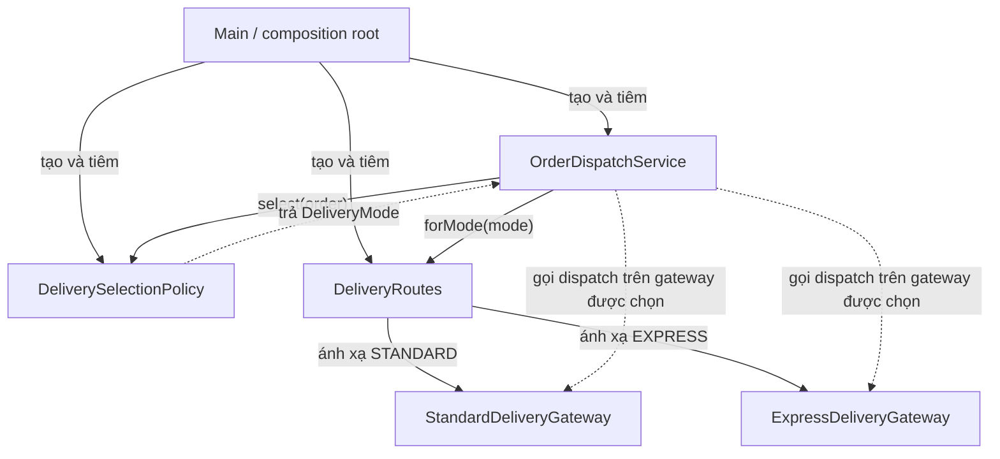
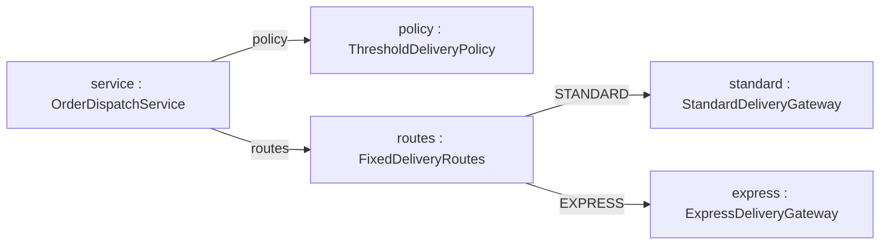

# Giữ quy tắc lựa chọn nghiệp vụ tách khỏi chi tiết đăng ký container

## Mục tiêu học tập

Sau bài này, bạn có thể:

- Phân biệt **quyết định nghiệp vụ chọn hành vi** với **quyết định kỹ thuật chọn và đăng ký implementation** trong Dependency Injection (DI).
- Đặt quy tắc lựa chọn theo từng yêu cầu ở một **policy/strategy có hợp đồng rõ**, trong khi composition root lắp ghép những implementation tương ứng.
- Thiết kế một **bộ ánh xạ có kiểu nghiệp vụ** thay vì để service gọi `container.resolve(...)`, `getBean(...)` hoặc biết tên bean.
- Dùng **constructor injection** để kiểm thử cả chính sách chọn và việc điều phối tới implementation bằng Java thuần.
- Xem xét trường hợp thêm phương án, fallback, cấu hình runtime, scope và vòng đời mà không đưa chi tiết DI container vào lớp nghiệp vụ.

Bài thuộc chương **Lựa chọn thành phần** trong module **Dependency Injection và Inversion of Control (IoC)**. DI giúp tách việc **sử dụng phụ thuộc** khỏi việc **tạo và lắp ghép đối tượng**. Khi hệ thống có nhiều implementation của cùng một interface, sự tách biệt này chỉ bền vững nếu ta xác định đúng **ai quyết định lựa chọn và lựa chọn theo tiêu chí gì**.

## 1. Có hai loại lựa chọn khác nhau

Giả sử ứng dụng hỗ trợ hai phương thức giao hàng:

- `STANDARD`: giao tiêu chuẩn.
- `EXPRESS`: giao nhanh.

Ứng dụng có thể quyết định **giao nhanh khi đơn được đánh dấu khẩn hoặc giá trị đơn đạt ngưỡng ưu tiên**. Đó là **quy tắc nghiệp vụ**; nó có thể thay đổi theo chính sách sản phẩm, không phụ thuộc vào Spring hay framework nào.

Đồng thời, tại thời điểm khởi động, ứng dụng cần biết:

- `STANDARD` được thực hiện bởi implementation/adapter nào;
- `EXPRESS` được thực hiện bởi implementation/adapter nào;
- mỗi adapter dùng cấu hình, client và scope ra sao.

Đây là **quyết định lắp ghép kỹ thuật**, do composition root hoặc cấu hình DI container phụ trách.

| Câu hỏi | Quy tắc lựa chọn nghiệp vụ | Lựa chọn/đăng ký implementation |
| --- | --- | --- |
| Quyết định điều gì? | Đơn này cần `STANDARD` hay `EXPRESS`? | Đối tượng nào thực hiện `STANDARD` và `EXPRESS`? |
| Dựa vào đâu? | Thuộc tính đơn, cờ khẩn, chính sách ưu tiên, điều kiện nghiệp vụ | Môi trường chạy, endpoint, credential, cấu hình hạ tầng, scope |
| Xảy ra khi nào? | Thường **mỗi lần xử lý một yêu cầu** | Thường khi **khởi động/lắp ghép** hoặc khi một scope được tạo |
| Ai nên biết? | Policy và thành phần điều phối nghiệp vụ | Composition root, adapter, DI container |
| Kết quả biểu diễn bằng gì? | Khái niệm nghiệp vụ như `DeliveryMode.EXPRESS` | Instance có kiểu `DeliveryGateway`, factory hoặc adapter cụ thể |
| Kiểm thử bằng gì? | Tập trường hợp đầu vào/đầu ra nghiệp vụ | Kiểm tra ánh xạ và lắp ghép; fake cho kiểm thử đơn vị |

Một con số như **ngưỡng 500.000 VND** có thể đến từ tệp cấu hình, nhưng **quy tắc sử dụng ngưỡng để chọn giao nhanh** vẫn là logic nghiệp vụ. Vị trí lưu cấu hình và vị trí thực thi quy tắc là hai vấn đề riêng.

## 2. Vì sao không dùng container làm bộ chọn nghiệp vụ?

Một cách viết dễ gặp là để service vừa kiểm tra điều kiện đơn hàng, vừa hỏi container lấy implementation:

```java
// Phản ví dụ minh họa: Container là API giả định, không phải lớp Java chuẩn.
class WrongDispatchService {
    private final Container container;

    WrongDispatchService(Container container) {
        this.container = container;
    }

    String dispatch(Order order) {
        if (order.urgent || order.totalVnd >= 500_000L) {
            return container.resolve(ExpressDeliveryGateway.class).dispatch(order);
        }
        return container.resolve(StandardDeliveryGateway.class).dispatch(order);
    }
}
```

`WrongDispatchService` đã biết **ba loại chi tiết** cùng lúc: điều kiện nghiệp vụ, tên lớp implementation và API phân giải dependency. Có thay `Container` bằng `ApplicationContext` hoặc `ServiceProvider` thì bản chất vẫn là **Service Locator** trong mã nghiệp vụ.

Thiết kế này gây nhiều hệ quả:

- Constructor chỉ nói service cần `Container`, **che giấu hai khả năng giao hàng** thực sự được sử dụng.
- Muốn đổi implementation tiêu chuẩn sang một hãng vận chuyển khác phải sửa code service hoặc làm service phụ thuộc cách đăng ký container.
- Muốn kiểm thử một nhánh nghiệp vụ phải mô phỏng container và cách đăng ký/tra cứu bean, thay vì truyền hai fake độc lập.
- Một yêu cầu có thể chỉ chạy đến lỗi thiếu bean khi nhánh tương ứng được thực thi; khó nhận ra cấu hình còn thiếu ở lúc khởi động.
- Mỗi lần `resolve(...)` trả đối tượng mới hay dùng chung có thể phụ thuộc vào scope ẩn, khiến cách quản lý trạng thái và tài nguyên khó dự đoán.

**Không phải bản thân container là vấn đề.** Container phù hợp tại điểm lắp ghép. Vấn đề là đưa **cơ chế chọn đối tượng kỹ thuật** xuống nơi phải ra **quyết định nghiệp vụ**.

Một cách sửa hời hợt khác là đặt logic `if (order.urgent)` trong mã đăng ký bean. Nếu trạng thái `urgent` chỉ xuất hiện **theo từng đơn hàng**, việc lựa chọn **một bean cố định khi khởi động** không thể thay cho quyết định của từng request. Quy tắc phải chạy ở thời điểm có dữ liệu mà nó cần.

## 3. Tách ba trách nhiệm bằng các hợp đồng hẹp

Ta chia chức năng giao hàng thành ba nhiệm vụ:

1. **`DeliverySelectionPolicy`** quyết định *phương thức* cần dùng từ dữ liệu đơn hàng, trả về `DeliveryMode` thuộc ngôn ngữ nghiệp vụ.
2. **`DeliveryRoutes`** ánh xạ một `DeliveryMode` sang **`DeliveryGateway` đã được lắp ghép**. Interface này chỉ dành cho khả năng giao hàng, không thể phân giải mọi service của ứng dụng.
3. **`OrderDispatchService`** phối hợp: gọi policy, lấy gateway tương ứng rồi sử dụng gateway. Nó không tạo, cấu hình hay tra cứu container.



**Cách đọc sơ đồ:** `OrderDispatchService` phụ thuộc vào **hai hợp đồng ổn định** (`DeliverySelectionPolicy`, `DeliveryRoutes`). Nó không phụ thuộc trực tiếp vào các lớp `StandardDeliveryGateway` và `ExpressDeliveryGateway`. Mũi tên nét đứt từ policy mô tả **giá trị trả về**, không phải một tham chiếu giữ lâu dài giữa các đối tượng. Các gateway cụ thể được chọn và lắp vào routes tại `Main`.

Trong thực tế, ta cũng có thể dùng một `Map<DeliveryMode, DeliveryGateway>` được tạo ở điểm lắp ghép. Bài này dùng interface `DeliveryRoutes` để **nêu rõ trách nhiệm ánh xạ và lỗi khi thiếu phương án**. Nó khác container tổng quát vì chỉ hỗ trợ lựa chọn gateway theo **khái niệm nghiệp vụ có kiểu**, không nhận `Class<T>` hoặc tên bean bất kỳ.

## 4. Ví dụ Java thuần hoàn chỉnh

Ví dụ dưới đây mô phỏng việc gửi đơn tới các bộ xử lý tiêu chuẩn và giao nhanh bằng cách in console. Không tạo vận đơn thật hoặc gọi hãng vận chuyển bên ngoài. Tất cả implementation và policy đều được lắp ghép bằng **constructor injection**.

Lưu toàn bộ vào **`Main.java`** (JDK 8 trở lên):

```java
import java.util.Objects;

// Đây là ngôn ngữ nghiệp vụ, không phải tên bean của framework.
enum DeliveryMode {
    STANDARD, EXPRESS
}

// Thông tin được biết khi có một đơn cụ thể.
final class Order {
    final String id;
    final long totalVnd;
    final boolean urgent;

    Order(String id, long totalVnd, boolean urgent) {
        this.id = Objects.requireNonNull(id, "id");
        if (id.trim().isEmpty() || totalVnd <= 0) {
            throw new IllegalArgumentException("id và totalVnd phải hợp lệ");
        }
        this.totalVnd = totalVnd;
        this.urgent = urgent;
    }
}

// Quy tắc nghiệp vụ chỉ quyết định PHƯƠNG THỨC.
interface DeliverySelectionPolicy {
    DeliveryMode select(Order order);
}

final class ThresholdDeliveryPolicy implements DeliverySelectionPolicy {
    private final long expressFromVnd;

    ThresholdDeliveryPolicy(long expressFromVnd) {
        if (expressFromVnd <= 0) {
            throw new IllegalArgumentException("expressFromVnd phải dương");
        }
        this.expressFromVnd = expressFromVnd;
    }

    @Override
    public DeliveryMode select(Order order) {
        Objects.requireNonNull(order, "order");
        return order.urgent || order.totalVnd >= expressFromVnd
                ? DeliveryMode.EXPRESS : DeliveryMode.STANDARD;
    }
}

// Hành vi chung mà service cần, không yêu cầu biết lớp triển khai.
interface DeliveryGateway {
    String dispatch(Order order);
}

// Các implementation mô phỏng, không truy cập dịch vụ vận chuyển thật.
final class StandardDeliveryGateway implements DeliveryGateway {
    @Override
    public String dispatch(Order order) {
        System.out.println("[DEMO] Gửi STANDARD cho " + order.id);
        return "STD-" + order.id;
    }
}

final class ExpressDeliveryGateway implements DeliveryGateway {
    @Override
    public String dispatch(Order order) {
        System.out.println("[DEMO] Gửi EXPRESS cho " + order.id);
        return "EXP-" + order.id;
    }
}

// Hợp đồng ánh xạ có kiểu, riêng cho năng lực giao hàng.
interface DeliveryRoutes {
    DeliveryGateway forMode(DeliveryMode mode);
}

final class FixedDeliveryRoutes implements DeliveryRoutes {
    private final DeliveryGateway standard;
    private final DeliveryGateway express;

    FixedDeliveryRoutes(DeliveryGateway standard, DeliveryGateway express) {
        this.standard = Objects.requireNonNull(standard, "standard");
        this.express = Objects.requireNonNull(express, "express");
    }

    @Override
    public DeliveryGateway forMode(DeliveryMode mode) {
        Objects.requireNonNull(mode, "mode");
        switch (mode) {
            case STANDARD:
                return standard;
            case EXPRESS:
                return express;
            default:
                // Phát hiện rõ khi chính sách trả một phương án chưa được hỗ trợ.
                throw new IllegalArgumentException("Chưa cấu hình mode " + mode);
        }
    }
}

final class DispatchResult {
    final DeliveryMode mode;
    final String trackingCode;

    DispatchResult(DeliveryMode mode, String trackingCode) {
        this.mode = Objects.requireNonNull(mode, "mode");
        this.trackingCode = Objects.requireNonNull(trackingCode, "trackingCode");
    }
}

// Consumer điều phối các hợp đồng, không dùng container hoặc tên bean.
final class OrderDispatchService {
    private final DeliverySelectionPolicy policy;
    private final DeliveryRoutes routes;

    OrderDispatchService(DeliverySelectionPolicy policy, DeliveryRoutes routes) {
        this.policy = Objects.requireNonNull(policy, "policy");
        this.routes = Objects.requireNonNull(routes, "routes");
    }

    DispatchResult dispatch(Order order) {
        Objects.requireNonNull(order, "order");
        DeliveryMode mode = Objects.requireNonNull(
                policy.select(order), "mode do policy trả về");
        DeliveryGateway gateway = Objects.requireNonNull(
                routes.forMode(mode), "gateway cho mode " + mode);
        String trackingCode = gateway.dispatch(order);
        return new DispatchResult(mode, trackingCode);
    }
}

// Điểm lắp ghép: chọn các implementation và cấu hình ngưỡng.
public class Main {
    public static void main(String[] args) {
        long expressFromVnd = 500_000L;
        DeliverySelectionPolicy policy =
                new ThresholdDeliveryPolicy(expressFromVnd);

        DeliveryGateway standard = new StandardDeliveryGateway();
        DeliveryGateway express = new ExpressDeliveryGateway();
        DeliveryRoutes routes = new FixedDeliveryRoutes(standard, express);

        OrderDispatchService service = new OrderDispatchService(policy, routes);
        print(service.dispatch(new Order("DH-100", 200_000L, false)));
        print(service.dispatch(new Order("DH-200", 600_000L, false)));
        print(service.dispatch(new Order("DH-300", 80_000L, true)));
    }

    private static void print(DispatchResult result) {
        System.out.println(result.mode + " | tracking=" + result.trackingCode);
    }
}
```

Biên dịch và chạy:

```bash
javac -encoding UTF-8 Main.java
java Main
```

Kết quả dự kiến:

```text
[DEMO] Gửi STANDARD cho DH-100
STANDARD | tracking=STD-DH-100
[DEMO] Gửi EXPRESS cho DH-200
EXPRESS | tracking=EXP-DH-200
[DEMO] Gửi EXPRESS cho DH-300
EXPRESS | tracking=EXP-DH-300
```

### Đọc luồng xử lý theo từng trách nhiệm

1. `Main` chọn `ThresholdDeliveryPolicy` với ngưỡng `500_000L`. **Giá trị ngưỡng** là cấu hình của policy; **biểu thức chọn mode** nằm trong `select(...)`.
2. `Main` tạo hai implementation `StandardDeliveryGateway` và `ExpressDeliveryGateway`, rồi đặt vào `FixedDeliveryRoutes`.
3. `Main` truyền `policy` và `routes` qua constructor của `OrderDispatchService`. Đây là **constructor injection bằng Java thuần**.
4. Khi một đơn đến, `policy.select(order)` tính ra `DeliveryMode` theo dữ liệu **của chính đơn đó**.
5. `routes.forMode(mode)` trả về **instance gateway đã được lắp ghép** cho mode. Service gọi `gateway.dispatch(order)` mà không biết tên lớp gateway.
6. `DispatchResult` giữ mode đã chọn và mã theo dõi được gateway trả về. Nó là dữ liệu kết quả, không phải một dependency cần đưa vào DI container.

Trong ba lời gọi, **cùng một `OrderDispatchService`** được tái sử dụng, nhưng phương thức giao hàng có thể khác theo đơn. `Main` không cần đăng ký bean mới mỗi khi có đơn khẩn. Ngược lại, service không cần gọi `new ExpressDeliveryGateway()` trong mỗi request.

### Ranh giới quan trọng trong object graph



Các cạnh trên là **tham chiếu instance ổn định** sau khi được lắp ghép. Lúc xử lý, policy chọn một giá trị `DeliveryMode`; service sử dụng gateway tương ứng **trong lần gọi**, không giữ `currentMode` hoặc `currentOrder` vào field dùng chung. Đồ thị instance không phải được xây lại sau mỗi lần chọn mode.

## 5. Chỗ nào được phép biết tên implementation hoặc bean?

**Composition root** có thể biết `StandardDeliveryGateway` hay `ExpressDeliveryGateway`, vì nó là nơi chịu trách nhiệm tạo và nối instance. Khi mở rộng sang DI container, phần đó có thể trở thành cấu hình đăng ký component và qualifier.

Ví dụ ý tưởng đăng ký sau chỉ là **pseudocode**, không đại diện cho API của một framework cụ thể:

```text
bootstrap:
    standardGateway = container.resolve("standard-delivery")
    expressGateway  = container.resolve("express-delivery")
    routes = FixedDeliveryRoutes(standardGateway, expressGateway)
    policy = ThresholdDeliveryPolicy(config.expressThreshold)
    service = OrderDispatchService(policy, routes)
```

Ở đây container được dùng **tại ranh giới khởi động**. Phần nghiệp vụ vẫn chỉ nhận `DeliverySelectionPolicy` và `DeliveryRoutes`. Nếu tên bean đổi từ `"express-delivery"` thành `"priority-shipping"`, ta sửa cấu hình/adapter, không sửa `OrderDispatchService` và không sửa quy tắc ngưỡng ưu tiên.

Các annotation như `@Qualifier`, `@Named` hoặc cơ chế chọn component theo profile có thể giúp **phân biệt nhiều bean cùng interface** tại thời điểm lắp ghép. Chúng không tự biểu diễn một quy tắc lựa chọn nghiệp vụ phụ thuộc vào dữ liệu **của từng đơn hàng**. Một `@Qualifier("express")` gắn cố định trên constructor thường có nghĩa **consumer này luôn nhận bean express**, không có nghĩa framework sẽ tự chuyển bean khi `order.urgent` thay đổi.

Một số framework có factory, provider hoặc scope động để cấp implementation theo ngữ cảnh. Dù có các tính năng đó, policy vẫn nên định nghĩa *vì sao chọn phương án*, còn adapter/container thực hiện *tạo và cấp đối tượng đáp ứng phương án*.

## 6. Khi thay đổi quy tắc nghiệp vụ thì thay phần nào?

Giả sử sản phẩm đổi chính sách: chỉ đơn **được đánh dấu khẩn** mới giao nhanh, không còn ưu tiên theo giá trị đơn. Ta có thể viết một policy khác:

```java
// Có thể đặt cạnh các class của Main.java nếu muốn thử nghiệm.
final class UrgentOnlyDeliveryPolicy implements DeliverySelectionPolicy {
    @Override
    public DeliveryMode select(Order order) {
        Objects.requireNonNull(order, "order");
        return order.urgent ? DeliveryMode.EXPRESS : DeliveryMode.STANDARD;
    }
}
```

Khi đó chỉ cần chọn policy mới ở composition root:

```java
DeliverySelectionPolicy policy = new UrgentOnlyDeliveryPolicy();
OrderDispatchService service = new OrderDispatchService(policy, routes);
```

`routes` và hai gateway vẫn giữ nguyên. Với đơn `600_000 VND` **không khẩn**, policy mới trả `STANDARD` thay vì `EXPRESS`. Đây là thay đổi **quy tắc nghiệp vụ**, không phải thay đổi danh tính bean hay đăng ký container.

Nếu cần thay **nhà cung cấp giao nhanh** nhưng vẫn giữ quy tắc khẩn/ngưỡng, ta thực hiện hướng ngược lại: thay implementation được `FixedDeliveryRoutes` dùng cho `EXPRESS`, không sửa policy.

| Loại thay đổi | Thành phần cần xem lại | Thành phần thường giữ nguyên |
| --- | --- | --- |
| Đổi ngưỡng ưu tiên từ 500.000 xuống 300.000 VND | Giá trị cấu hình truyền cho policy; xác nhận lại test các mốc | `DeliveryRoutes`, interface gateway |
| Chỉ đơn khẩn mới được giao nhanh | `DeliverySelectionPolicy` và test quy tắc | Mapping mode sang gateway |
| Đổi đối tác giao nhanh | Adapter/gateway được lắp dưới mode `EXPRESS` | Policy lựa chọn `DeliveryMode` |
| Thay console demo bằng client API thật | Implementation gateway, cấu hình client, quyền đóng | `OrderDispatchService`, policy |
| Thêm mode giao hàng mới | Ngôn ngữ nghiệp vụ, policy, catalog/routes, adapter và các test phù hợp | Ranh giới giữa selection và wiring |

Trong một hệ thống có quy tắc đổi theo ngày, vùng hoặc tenant, policy có thể nhận **dữ liệu của request** và một nguồn cấu hình rõ ràng. Điều đó không có nghĩa nên gọi `container.getBean(...)` trong policy. Hãy giữ quyết định nghiệp vụ diễn đạt bằng các điều kiện **có thể kiểm thử và giải thích được**.

## 7. Kiểm thử lựa chọn và việc chuyển tiếp bằng Java thuần

Để biết service đã gửi tới **đúng implementation** mà không thực hiện giao hàng thật, ta thay hai gateway bằng các đối tượng ghi nhận lời gọi. Kiểm thử dùng policy thật để xác nhận ngưỡng và cờ khẩn, đồng thời dùng fake để xác nhận routes chuyển đến đúng đối tượng.

Lưu đoạn sau trong **`SelectionCheck.java`** cạnh `Main.java`:

```java
public class SelectionCheck {
    static final class RecordingGateway implements DeliveryGateway {
        final String prefix;
        int calls;
        String lastOrderId;

        RecordingGateway(String prefix) {
            this.prefix = prefix;
        }

        @Override
        public String dispatch(Order order) {
            calls++;
            lastOrderId = order.id;
            return prefix + "-" + order.id;
        }
    }

    public static void main(String[] args) {
        RecordingGateway standard = new RecordingGateway("STD");
        RecordingGateway express = new RecordingGateway("EXP");

        DeliverySelectionPolicy policy = new ThresholdDeliveryPolicy(500_000L);
        DeliveryRoutes routes = new FixedDeliveryRoutes(standard, express);
        OrderDispatchService service = new OrderDispatchService(policy, routes);

        // Trước ngưỡng: chỉ STANDARD được gọi.
        DispatchResult low = service.dispatch(new Order("LOW", 499_999L, false));
        if (low.mode != DeliveryMode.STANDARD
                || !"STD-LOW".equals(low.trackingCode)
                || standard.calls != 1 || express.calls != 0) {
            throw new AssertionError("Đơn dưới ngưỡng phải chọn STANDARD");
        }

        // Đúng ngưỡng: phải chọn EXPRESS.
        DispatchResult atThreshold =
                service.dispatch(new Order("LIMIT", 500_000L, false));
        if (atThreshold.mode != DeliveryMode.EXPRESS
                || !"EXP-LIMIT".equals(atThreshold.trackingCode)
                || standard.calls != 1 || express.calls != 1) {
            throw new AssertionError("Đơn tại ngưỡng phải chọn EXPRESS");
        }

        // Đơn giá trị thấp nhưng khẩn: vẫn chọn EXPRESS.
        DispatchResult urgent = service.dispatch(new Order("URGENT", 1L, true));
        if (urgent.mode != DeliveryMode.EXPRESS
                || !"EXP-URGENT".equals(urgent.trackingCode)
                || express.calls != 2 || !"URGENT".equals(express.lastOrderId)) {
            throw new AssertionError("Đơn khẩn phải chọn EXPRESS");
        }

        // Đổi chính sách mà không sửa mapping hoặc mã nghiệp vụ.
        DeliverySelectionPolicy alwaysStandard = order -> DeliveryMode.STANDARD;
        OrderDispatchService alternative =
                new OrderDispatchService(alwaysStandard, routes);
        DispatchResult alternateResult =
                alternative.dispatch(new Order("ALTERNATE", 999_999L, true));
        if (alternateResult.mode != DeliveryMode.STANDARD
                || standard.calls != 2 || express.calls != 2) {
            throw new AssertionError("Policy thay thế chưa được sử dụng đúng");
        }

        System.out.println("PASS: chọn mode theo nghiệp vụ và route đúng gateway");
    }
}
```

Chạy:

```bash
javac -encoding UTF-8 Main.java SelectionCheck.java
java SelectionCheck
```

Bốn phép kiểm tra tập trung vào **hành vi của chính sách**: trước ngưỡng, đúng ngưỡng, đơn khẩn, và đổi toàn bộ policy. Không cần khởi động DI container, đăng ký bean hay gọi hệ thống vận chuyển thật. Test cũng chứng minh `OrderDispatchService` chỉ dựa vào **các hợp đồng đã tiêm**, không tự quyết định tên class implementation.

### Kiểm thử đơn vị và kiểm thử lắp ghép khác nhau

Kiểm thử trên xác nhận **luật chọn và gọi đúng cổng qua fake**. Khi đưa ứng dụng vào môi trường thật, còn cần một phép kiểm tra lắp ghép riêng: cấu hình production có đủ mọi `DeliveryMode`, mỗi mode trỏ tới adapter đúng và adapter dùng endpoint đúng. Đừng dùng kết quả test nghiệp vụ để suy ra cấu hình container đã chính xác.

Một thiết kế tốt cho phép thực hiện **hai kiểu kiểm tra độc lập**: chính sách nghiệp vụ có thể kiểm thử mà không có hạ tầng; còn cấu hình hạ tầng có thể được kiểm tra mà không phải giả lập toàn bộ tổ hợp dữ liệu đơn hàng.

## 8. Trường hợp fallback, lỗi và phương án không được hỗ trợ

Giả sử gateway `EXPRESS` không khả dụng. Có thể đặt câu hỏi “thử `STANDARD` thay thế được không?”. Câu trả lời là **phụ thuộc quy tắc nghiệp vụ**. Nếu khách trả thêm phí và yêu cầu giao nhanh, tự động chuyển xuống `STANDARD` có thể vi phạm thỏa thuận.

Vì vậy, `OrderDispatchService` trong ví dụ **không tự fallback** từ `EXPRESS` sang `STANDARD` khi `gateway.dispatch(...)` ném lỗi. Lỗi được truyền cho caller xử lý. Nếu sản phẩm cho phép fallback, hãy đưa quyết định này vào **hợp đồng và chính sách rõ ràng** (ví dụ hỏi lại khách, trả trạng thái cần xác nhận, hoặc chọn phương án thay thế theo vùng và mức SLA).

Tương tự, `FixedDeliveryRoutes` ném lỗi khi gặp mode không hỗ trợ. Điều này có lợi hơn việc âm thầm trả một gateway mặc định: nếu quy tắc mới bắt đầu trả mode `SAME_DAY` nhưng cấu hình chưa đăng ký adapter tương ứng, hệ thống cần **phát hiện thiếu ánh xạ** thay vì làm như giao nhanh đã được cung cấp.

Nếu mọi mode là tập xác định được khi khởi động, có thể **xác thực tính đầy đủ của routes ở composition root** và báo lỗi sớm. Nếu mode chỉ khả dụng theo vùng hoặc tenant, routes có thể trả về thông tin “không hỗ trợ” theo hợp đồng có kiểu, còn policy/luồng nghiệp vụ phải quyết định cách xử lý. Đừng nhầm một **lỗi hạ tầng thiếu bean** với một **quyết định nghiệp vụ từ chối lựa chọn**.

## 9. Scope và vòng đời vẫn thuộc về nơi lắp ghép

Ví dụ dùng hai gateway không có trạng thái và tái sử dụng chúng qua nhiều yêu cầu. Nhưng `DeliveryRoutes` **không mặc nhiên áp đặt singleton**: nếu composition root tạo routes mới hoặc gateway mới cho mỗi scope, các consumer có thể nhận những instance khác nhau. Scope được quyết định bởi cách **tạo và cấp đối tượng**, không bởi tên interface hay kỹ thuật constructor injection.

| Thành phần | Vòng đời phù hợp trong ví dụ | Lưu ý |
| --- | --- | --- |
| `ThresholdDeliveryPolicy` | Một instance dùng lại cho nhiều request | Chỉ có ngưỡng cố định; không lưu `currentOrder` vào field. |
| `FixedDeliveryRoutes` | Một instance chứa hai tham chiếu gateway | Ánh xạ tĩnh; không phải container tổng quát. |
| `StandardDeliveryGateway`, `ExpressDeliveryGateway` | Một instance mỗi loại trong demo | Adapter thực phải quy định thread safety và quyền sở hữu client. |
| `OrderDispatchService` | Có thể dùng chung nếu các collaborator an toàn | Không lưu mode hoặc order theo request vào field mutable. |
| `Order`, `DispatchResult` | Tạo cho từng thao tác | Là dữ liệu, không cần resolve từ container. |

Nếu gateway thực tế cần một **session mới cho từng yêu cầu**, có thể giữ policy như cũ nhưng thay adapter bằng một **factory hẹp**, ví dụ `DeliverySessionFactory.open(mode, orderId)` có hợp đồng về phiên và `close()`. Adapter có thể dùng client dùng chung ở phía dưới, còn consumer đóng phiên ngắn hạn theo quy tắc sở hữu. Không cần đưa container vào `OrderDispatchService` để lấy session.

Điều này cũng liên quan đến **Inversion of Control**: phần tạo, cấu hình và quản lý vòng đời ở ranh giới lắp ghép; service quyết định luồng nghiệp vụ qua các interface. Khi mở rộng sang DI container, container giúp tự động dựng object graph, nhưng **không tự thay chính sách chọn đúng dịch vụ cho từng đơn**.

## 10. Những nhầm lẫn thường gặp

| Nhận định | Cách hiểu đúng |
| --- | --- |
| “Có hai implementation thì service nên inject cả container.” | Service có thể nhận policy và routes/factory có kiểu cụ thể; container chỉ xuất hiện ở composition root. |
| “`@Qualifier("express")` tự chọn theo `order.urgent`.” | Qualifier thường xác định bean tại thời điểm injection; luật theo request phải được đánh giá lúc có dữ liệu. |
| “Thay tên bean là thay quy tắc nghiệp vụ.” | Tên bean là chi tiết wiring; policy dùng `DeliveryMode` và điều kiện nghiệp vụ. |
| “Nếu policy nằm trong file cấu hình thì không còn là logic nghiệp vụ.” | Dữ liệu cấu hình có thể là đầu vào, nhưng ý nghĩa điều kiện chọn vẫn là chính sách nghiệp vụ. |
| “Cứ đặt các service vào `Map<String, Object>` là tách rời.” | Map mọi loại service có thể biến thành locator tổng quát. Dùng API có kiểu và phạm vi chức năng rõ. |
| “Factory/routes lúc nào cũng tạo instance mới.” | Trong ví dụ routes trả các instance đã được lắp ghép. Việc tạo mới hay tái sử dụng phải có hợp đồng riêng. |
| “Gateway express lỗi thì luôn được fallback xuống standard.” | Fallback là quyết định nghiệp vụ có điều kiện, không phải mặc định kỹ thuật. |
| “Viết DI thì không cần kiểm thử cấu hình container.” | Test policy và test wiring trả lời hai câu hỏi khác nhau, đều cần khi đưa vào môi trường thực tế. |

## 11. Checklist khi thêm một kiểu lựa chọn thành phần

1. **Tiêu chí chọn thuộc về nghiệp vụ hay môi trường chạy?** Ví dụ `order.urgent` là dữ liệu nghiệp vụ; endpoint sản xuất là chi tiết hạ tầng.
2. **Lựa chọn được thực hiện lúc nào?** Nếu thay đổi theo từng đơn, không thể chỉ dựa vào một đăng ký bean cố định ở khởi động.
3. **Policy trả gì?** Ưu tiên giá trị có nghĩa trong domain như `DeliveryMode`; tránh trả tên class, bean ID hoặc `ApplicationContext`.
4. **Ai ánh xạ giá trị đó tới implementation?** Dùng routes/registry/factory hẹp, được khởi tạo từ composition root.
5. **Consumer có cần biết tên implementation không?** Nếu có, cân nhắc chuyển thông tin về ranh giới lắp ghép.
6. **Mỗi mode có được hỗ trợ không?** Kiểm tra đầy đủ mapping và hành vi khi một mode không còn khả dụng.
7. **Lỗi hoặc fallback được xử lý thế nào?** Ghi rõ những thay đổi được chấp nhận theo nghiệp vụ, không âm thầm đổi cam kết cho khách.
8. **Các gateway được chia sẻ hay tạo mới?** Xác định scope, thread safety, tài nguyên được đóng ở đâu và thời điểm nào.
9. **Thay policy có phải sửa adapter không?** Nếu chỉ đổi ngưỡng/điều kiện, kỳ vọng không phải đổi cách đăng ký gateway.
10. **Thay adapter có phải sửa policy không?** Nếu chỉ đổi nhà cung cấp hạ tầng, kỳ vọng không phải đổi điều kiện nghiệp vụ.
11. **Có thể kiểm thử chính sách và ánh xạ bằng fake?** Chạy test bằng Java thuần trước khi kiểm thử cấu hình container/framework.

### Bài tập vận dụng

Một ứng dụng thanh toán có hai phương thức `BANK_TRANSFER` và `CARD`. Policy chọn phương thức theo **tùy chọn hợp lệ của khách và quy tắc giới hạn giao dịch**. Hệ thống production chọn `RealCardGateway`, còn môi trường demo dùng `FakeCardGateway`.

Hãy xác định:

1. **Quy tắc chọn thanh toán chuyển khoản hay thẻ** nên nằm ở đâu?
2. **Quy tắc chọn `RealCardGateway` hay `FakeCardGateway`** nên nằm ở đâu?
3. Nếu client chọn `CARD` nhưng không đủ điều kiện, có nên tự đổi sang `BANK_TRANSFER` không?
4. Nếu sau này bổ sung ví điện tử, những phần nào cần cập nhật và cần kiểm thử gì?

**Gợi ý:** (1) Trong payment selection policy hoặc một thành phần nghiệp vụ có trách nhiệm tương đương, sử dụng dữ liệu giao dịch. (2) Trong composition root/cấu hình DI container theo môi trường. (3) Tùy chính sách và sự đồng ý của khách; nên trả quyết định không hợp lệ hoặc yêu cầu chọn lại nếu chưa có quyền tự đổi. (4) Bổ sung lựa chọn trong domain, chính sách/validation, ánh xạ tới gateway ví điện tử và adapter; kiểm thử đường chọn mới cùng kiểm tra đầy đủ cấu hình.

Khi đi từ Java thuần sang DI container, hãy giữ một ranh giới nhất quán: **policy giải thích vì sao chọn một phương án nghiệp vụ; composition root hoặc adapter xác định đối tượng nào thực hiện phương án đó**. Nhờ vậy, thay đổi quy tắc nghiệp vụ, thay đổi nhà cung cấp kỹ thuật và thay đổi scope/vòng đời có thể được xem xét, kiểm thử và triển khai với trách nhiệm rõ ràng.
