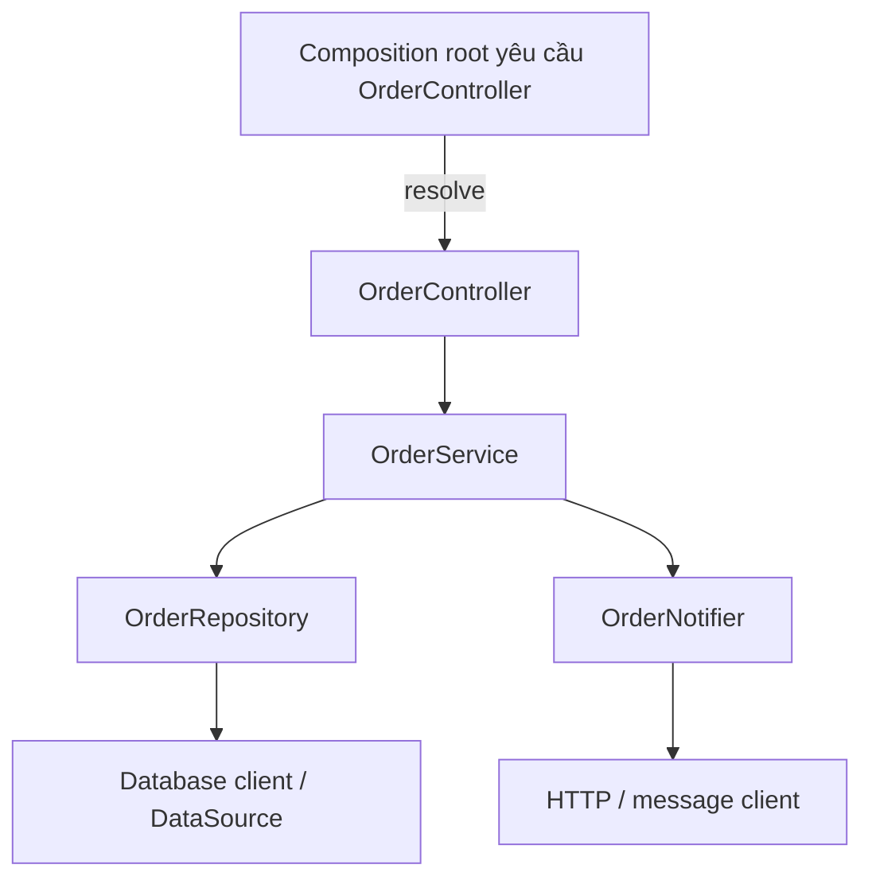
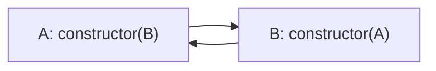

# Đăng ký thành phần, mô tả phụ thuộc và phân giải đối tượng

Trong chương **Bộ chứa DI** của module **Dependency Injection**, ta chuyển từ việc tự gọi constructor ở *composition root* sang mô hình có một **DI container** hỗ trợ tạo và nối nhiều đối tượng. Bản chất của thiết kế vẫn không đổi: lớp nghiệp vụ **sử dụng** phụ thuộc được cấp từ bên ngoài; phần lắp ghép quyết định **tạo đối tượng nào, cấp cho ai và trong phạm vi nào**.

Một DI container thường phải giải quyết ba việc có quan hệ chặt chẽ:

1. **Đăng ký thành phần** (*registration/binding*): ánh xạ một hợp đồng hoặc khóa tới cách cung cấp thành phần.
2. **Mô tả phụ thuộc** (*dependency declaration*): cho biết một đối tượng cần những thành phần nào để được tạo và hoạt động.
3. **Phân giải đối tượng** (*resolution*): từ một thành phần được yêu cầu, tìm quy tắc đăng ký, tạo hoặc lấy các dependency của nó, rồi lắp toàn bộ đồ thị.

Ba bước trên giúp tự động hóa một phần **Dependency Injection (DI)** và **Inversion of Control (IoC)**; chúng không thay thế việc thiết kế interface, constructor, scope, vòng đời hay kiểm thử. Bài viết bắt đầu với Java thuần, tự xây một container giáo dục rất nhỏ để thấy rõ cơ chế, rồi liên hệ với container của framework.

Sau bài này, bạn có thể:

- Phân biệt việc **đăng ký** cách tạo đối tượng với việc **yêu cầu container phân giải** một đối tượng.
- Giải thích ý nghĩa của *service key*, *binding*, *factory/provider*, *constructor dependency* và *object graph*.
- Mô tả trình tự container phân giải dependency nhiều cấp, lựa chọn singleton hoặc transient và phát hiện lỗi thiếu, trùng hoặc vòng phụ thuộc.
- Tự lắp ghép bằng Java thuần, sau đó thực hiện cùng ví dụ qua một registry đơn giản để hiểu vai trò của container.
- Giữ mã nghiệp vụ độc lập với API của container, bảo toàn khả năng kiểm thử bằng constructor injection.

## 1. Trước khi có container: lắp ghép thủ công

Xét một luồng xác nhận đơn hàng:

```java
interface OrderRepository {
    void save(String orderId);
}

interface OrderNotifier {
    void confirmed(String orderId);
}

final class OrderService {
    private final OrderRepository repository;
    private final OrderNotifier notifier;

    OrderService(OrderRepository repository, OrderNotifier notifier) {
        this.repository =
                java.util.Objects.requireNonNull(repository, "repository");
        this.notifier =
                java.util.Objects.requireNonNull(notifier, "notifier");
    }

    void place(String orderId) {
        repository.save(orderId);
        notifier.confirmed(orderId);
    }
}
```

Nếu không dùng container, `main` hoặc một lớp cấu hình gọi constructor trực tiếp:

```java
OrderRepository repository = new InMemoryOrderRepository();
OrderNotifier notifier = new ConsoleOrderNotifier();
OrderService service = new OrderService(repository, notifier);
service.place("O-01");
```

*Ví dụ cấu trúc*: `InMemoryOrderRepository` và `ConsoleOrderNotifier` đại diện cho các lớp triển khai giả định; chương trình Java chạy được hoàn chỉnh xuất hiện ở phần 5.

Ở đây có hai quan hệ cần phân biệt:

- **Phụ thuộc trong mã nguồn:** `OrderService` khai báo cần `OrderRepository` và `OrderNotifier` qua constructor.
- **Liên kết tại runtime:** composition root tạo những implementation cụ thể rồi truyền tham chiếu của chúng vào `OrderService`.

Đây **đã là DI**: consumer không tự tạo các adapter. Khi ứng dụng có hàng chục thành phần và nhiều cách lựa chọn implementation, viết toàn bộ logic khởi tạo thủ công có thể trở nên dài và khó quản lý. Container giúp tập trung và thực thi các quy tắc lắp ghép; **nó không phải điều kiện bắt buộc để có DI**.

## 2. Đăng ký thành phần nghĩa là đăng ký một quy tắc cung cấp

Một **registration** thường nối một **khóa yêu cầu** (*service key*) với một **cách cung cấp** (*binding*). Khóa thường bao gồm kiểu dữ liệu, và có thể thêm tên/qualifier nếu có nhiều implementation cùng một hợp đồng.

Ví dụ ý tưởng:

```text
OrderRepository  -> factory tạo InMemoryOrderRepository
OrderNotifier    -> factory tạo ConsoleOrderNotifier
OrderService     -> constructor OrderService(OrderRepository, OrderNotifier)
```

Khi mã bên ngoài yêu cầu `OrderService`, container biết nó phải tạo/lấy repository và notifier trước khi gọi constructor.

| Thành phần của registration | Vai trò | Ví dụ |
| --- | --- | --- |
| **Service key** | Xác định đang yêu cầu dependency nào | `OrderRepository.class` |
| **Implementation hoặc factory** | Quy tắc tạo/lấy object thực tế | `new InMemoryOrderRepository()` |
| **Scope/lifetime** | Quyết định lấy lại instance hay tạo instance mới | Singleton trong một container, transient mỗi lần phân giải |
| **Qualifier/điều kiện chọn** | Phân biệt các implementation cùng hợp đồng | `primary`, `audit` hoặc cấu hình môi trường |
| **Quy tắc lifecycle** | Xác định khởi tạo thêm, dừng và đóng tài nguyên nếu có | Callback init/destroy theo framework, ownership của pool/client |

**Đăng ký không nhất thiết tạo instance ngay.** Một container có thể tạo singleton lúc bootstrap (*eager*) hoặc đợi tới lần đầu có yêu cầu (*lazy*), tùy framework và cấu hình. Vì vậy không nên suy ra thời điểm thực sự gọi constructor chỉ từ việc đã có một binding.

### Ba cách cung cấp dependency thường gặp

1. **Đăng ký implementation:** ánh xạ interface tới concrete class; container kiểm tra constructor của implementation và tiếp tục phân giải tham số.
2. **Đăng ký factory:** cung cấp một callback/hàm cấu hình biết cách tạo object và yêu cầu dependency cần thiết từ container.
3. **Đăng ký instance sẵn có:** cung cấp trực tiếp một object đã được tạo từ trước. Cần xác định rõ container có sở hữu việc đóng object ấy hay chỉ mượn để cấp lại.

Mỗi cách phù hợp với hoàn cảnh khác nhau. Ví dụ, đăng ký một HTTP client đã được cấu hình chi tiết có thể dùng factory; đăng ký một policy không có cấu hình đặc biệt có thể chỉ cần kiểu implementation.

## 3. Mô tả dependency: consumer nói rõ mình cần gì

Đăng ký mới chỉ cho container biết **có thể cung cấp thành phần nào**. Để dựng một consumer, container còn phải biết consumer cần những thành phần nào.

Trong ví dụ, constructor chính là hợp đồng:

```java
OrderService(OrderRepository repository, OrderNotifier notifier)
```

Một số container đọc metadata từ constructor qua reflection hoặc annotation; số khác nhận mô tả trực tiếp bằng factory:

```java
// Cú pháp minh họa; 'registry' là API cấu hình giả định:
registry.bind(
    OrderService.class,
    resolver -> new OrderService(
        resolver.get(OrderRepository.class),
        resolver.get(OrderNotifier.class)));
```

Trong cách thứ hai, dependency được mô tả rõ bằng lời gọi `resolver.get(...)` ở **vùng lắp ghép**. `OrderService` vẫn không biết API container. Ở cách dùng reflection, container đọc thông tin kiểu constructor và ánh xạ từng tham số tới registration phù hợp.

**Constructor injection thường là lựa chọn dễ hiểu và dễ kiểm thử** đối với phụ thuộc bắt buộc: đối tượng chỉ được trả về sau khi các tham số cần thiết đã được cấp. Nếu constructor cần thêm cấu hình, chẳng hạn timeout hoặc endpoint, root/container cũng phải biết cách parse, kiểm tra và cấp dữ liệu tương ứng.

Hãy phân biệt **dependency** với **dữ liệu của từng lời gọi**: `OrderRepository` thường là một collaborator ổn định, còn `orderId` chỉ xuất hiện khi người dùng gửi yêu cầu. Không nên đăng ký mọi `orderId` hoặc payload request thành một singleton chỉ để container có thể truyền chúng vào constructor.

## 4. Container phân giải object graph theo thứ tự nào?

Giả sử một ứng dụng có các phụ thuộc:



Một container đơn giản có thể phân giải theo kiểu đệ quy:

1. **Nhận yêu cầu:** composition root yêu cầu `OrderController`.
2. **Tra registration:** tìm binding theo khóa `OrderController`.
3. **Xem các phụ thuộc:** controller cần `OrderService`; service lại cần repository và notifier.
4. **Phân giải từ lá lên:** tạo/lấy client, repository, notifier, sau đó tạo service, cuối cùng tạo controller.
5. **Áp dụng scope:** một số instance được tái sử dụng theo scope; những instance khác được tạo mới.
6. **Trả kết quả:** composition root nhận controller đã có đầy đủ các dependency cần thiết.

Không phải mọi container thực thi chính xác cùng thứ tự tạo hoặc validation; đây là mô hình khái niệm cho đồ thị **không có vòng phụ thuộc**. Container có thể validate trước khi tạo object, thực hiện khởi tạo lazy, chạy callback lifecycle hoặc áp dụng proxy. Những bước đó cần hiểu theo tài liệu của container cụ thể.

**Một object graph** là tập các instance và mối liên kết của chúng tại runtime. Đừng nhầm graph này với sơ đồ phụ thuộc **mã nguồn**: `OrderService` phụ thuộc vào interface `OrderRepository`, còn runtime có thể nối nó với một `JdbcOrderRepository` cụ thể.

## 5. Ví dụ Java thuần: tự viết mini-container để quan sát cơ chế

Đoạn mã dưới đây là **container giáo dục tối giản**, không phải thư viện DI dùng cho production. Nó hỗ trợ đăng ký factory theo `Class<T>`, phân giải đệ quy, scope **singleton** và **transient**, cùng phát hiện registration thiếu/trùng và vòng phụ thuộc trực tiếp trong quá trình phân giải.

Không dùng annotation, reflection vào constructor, framework hoặc thư viện bên ngoài. Mã dùng **Java 17 trở lên**. Lưu toàn bộ vào `DiContainerDemo.java`:

```java
import java.util.ArrayDeque;
import java.util.ArrayList;
import java.util.Deque;
import java.util.HashMap;
import java.util.List;
import java.util.Map;
import java.util.Objects;

public class DiContainerDemo {
    // Consumer chỉ biết các hợp đồng, không biết container.
    interface OrderRepository {
        void save(String id);
    }

    interface OrderNotifier {
        void confirmed(String id);
    }

    static final class InMemoryOrderRepository
            implements OrderRepository {
        private final List<String> saved = new ArrayList<>();

        @Override
        public void save(String id) {
            saved.add(id);
        }

        List<String> snapshot() {
            return List.copyOf(saved);
        }
    }

    static final class RecordingOrderNotifier
            implements OrderNotifier {
        private final List<String> messages = new ArrayList<>();

        @Override
        public void confirmed(String id) {
            messages.add("confirmed:" + id);
        }

        List<String> snapshot() {
            return List.copyOf(messages);
        }
    }

    static final class OrderService {
        private final OrderRepository repository;
        private final OrderNotifier notifier;

        OrderService(OrderRepository repository, OrderNotifier notifier) {
            this.repository =
                    Objects.requireNonNull(repository, "repository");
            this.notifier =
                    Objects.requireNonNull(notifier, "notifier");
        }

        void place(String id) {
            if (id == null || id.isBlank()) {
                throw new IllegalArgumentException("Invalid order id");
            }
            repository.save(id);
            notifier.confirmed(id);
        }
    }

    // API chỉ dùng tại vùng cấu hình, không inject Resolver vào nghiệp vụ.
    interface Resolver {
        <T> T resolve(Class<T> type);
    }

    @FunctionalInterface
    interface Factory<T> {
        T create(Resolver resolver);
    }

    static final class Binding<T> {
        private final Factory<? extends T> factory;
        private final boolean singleton;
        private T cached;
        private boolean initialized;

        Binding(Factory<? extends T> factory, boolean singleton) {
            this.factory = Objects.requireNonNull(factory);
            this.singleton = singleton;
        }

        T get(Resolver resolver) {
            if (!singleton) {
                return Objects.requireNonNull(
                        factory.create(resolver), "Factory returned null");
            }
            if (!initialized) {
                T created = Objects.requireNonNull(
                        factory.create(resolver), "Factory returned null");
                cached = created;
                initialized = true;
            }
            return cached;
        }
    }

    static final class MiniContainer implements Resolver {
        private final Map<Class<?>, Binding<?>> registrations =
                new HashMap<>();
        private final Deque<Class<?>> resolving = new ArrayDeque<>();

        <T> void singleton(
                Class<T> type, Factory<? extends T> factory) {
            register(type, factory, true);
        }

        <T> void transientType(
                Class<T> type, Factory<? extends T> factory) {
            register(type, factory, false);
        }

        private <T> void register(
                Class<T> type, Factory<? extends T> factory,
                boolean singleton) {
            Objects.requireNonNull(type, "type");
            Objects.requireNonNull(factory, "factory");
            if (registrations.containsKey(type)) {
                throw new IllegalStateException(
                        "Duplicate registration: " + type.getName());
            }
            registrations.put(type, new Binding<>(factory, singleton));
        }

        @Override
        public <T> T resolve(Class<T> type) {
            Objects.requireNonNull(type, "type");
            Binding<?> binding = registrations.get(type);
            if (binding == null) {
                throw new IllegalStateException(
                        "Missing registration: " + type.getName());
            }
            if (resolving.contains(type)) {
                throw new IllegalStateException(
                        "Circular dependency at: " + type.getName());
            }
            resolving.addLast(type);
            try {
                return type.cast(binding.get(this));
            } finally {
                resolving.removeLast();
            }
        }
    }

    public static void main(String[] args) {
        // Composition root: khai báo quy tắc cấp từng thành phần.
        MiniContainer container = new MiniContainer();
        container.singleton(
                OrderRepository.class,
                r -> new InMemoryOrderRepository());
        container.singleton(
                OrderNotifier.class,
                r -> new RecordingOrderNotifier());
        container.transientType(
                OrderService.class,
                r -> new OrderService(
                        r.resolve(OrderRepository.class),
                        r.resolve(OrderNotifier.class)));

        // Resolve: container theo các binding để dựng graph.
        OrderService first = container.resolve(OrderService.class);
        OrderService second = container.resolve(OrderService.class);
        if (first == second) {
            throw new AssertionError("OrderService must be transient");
        }

        first.place("O-01");
        second.place("O-02");

        InMemoryOrderRepository repository =
                (InMemoryOrderRepository) container.resolve(
                        OrderRepository.class);
        RecordingOrderNotifier notifier =
                (RecordingOrderNotifier) container.resolve(
                        OrderNotifier.class);

        if (!repository.snapshot().equals(List.of("O-01", "O-02"))
                || !notifier.snapshot().equals(
                        List.of("confirmed:O-01", "confirmed:O-02"))) {
            throw new AssertionError("Wrong object graph");
        }

        // Kiểm thử consumer không cần container.
        List<String> stored = new ArrayList<>();
        List<String> notified = new ArrayList<>();
        OrderService isolated = new OrderService(
                stored::add, id -> notified.add("confirmed:" + id));
        isolated.place("TEST");
        if (!stored.equals(List.of("TEST"))
                || !notified.equals(List.of("confirmed:TEST"))) {
            throw new AssertionError("Pure Java test failed");
        }
        System.out.println("PASS: registration and resolution");
        System.out.println("PASS: pure Java constructor injection");
    }
}
```

Chạy:

```bash
javac DiContainerDemo.java
java DiContainerDemo
```

Kết quả dự kiến:

```text
PASS: registration and resolution
PASS: pure Java constructor injection
```

### Đọc chương trình theo ba công đoạn

**Đăng ký:** Ba lời gọi `singleton(...)` và `transientType(...)` tạo các binding. Chúng **chưa** tạo `OrderService`.

**Mô tả phụ thuộc:** Factory đăng ký cho `OrderService` nói rõ service cần `OrderRepository` và `OrderNotifier`. Container được gọi ở đây vì đây là **mã lắp ghép**, không phải logic bên trong `OrderService`.

**Phân giải:** `resolve(OrderService.class)` gọi factory của service. Factory tiếp tục yêu cầu repository và notifier; hai binding singleton cung cấp cùng một instance trong container. Hai lần phân giải `OrderService` tạo **hai instance khác nhau** do binding transient.

Ở cuối ví dụ, việc ép kiểu repository/notifier về adapter cụ thể chỉ nằm trong **mã minh họa để kiểm tra kết quả**. `OrderService` vẫn phụ thuộc hoàn toàn vào interface, và phần kiểm thử của nó không cần container.

### Hạn chế có chủ đích của mini-container

Mini-container chỉ phù hợp để **giải thích thuật toán**, không nên đưa vào production:

- Việc đăng ký/phân giải và cache singleton **chưa có đồng bộ**, không an toàn nếu nhiều thread cùng resolve; container thực tế có quy tắc khởi tạo và công bố instance riêng.
- Không tự quét class, không đọc annotation, không lựa chọn constructor bằng reflection.
- Chưa hỗ trợ qualifier/named binding, scoped proxy, request scope hoặc validation đồ thị trước khi resolve.
- Không quản lý callback init/destroy hay ownership của `AutoCloseable`; người dùng phải tự quản lý tài nguyên nếu factory tạo resource.
- Không giải quyết vòng phụ thuộc bằng proxy/lazy injection. Phát hiện một chu trình khi phân giải và báo lỗi là hành vi an toàn hơn cho ví dụ.

Chương trình cho thấy **registration và resolution** thực chất là thao tác trên quy tắc tạo object và các tham chiếu, không phải phép màu riêng của framework.

## 6. Scope ảnh hưởng tới kết quả phân giải thế nào?

Trong ví dụ trên, mỗi registration có một quy tắc đơn giản:

| Binding | Quy tắc | Hai lần resolve trực tiếp |
| --- | --- | --- |
| `OrderRepository` | Singleton | Trả **cùng một** `InMemoryOrderRepository` |
| `OrderNotifier` | Singleton | Trả **cùng một** `RecordingOrderNotifier` |
| `OrderService` | Transient | Tạo **hai** `OrderService`, cùng tham chiếu tới repository/notifier singleton |

Điểm dễ hiểu sai: nếu một **singleton** được tạo và nhận một dependency **transient** qua constructor, singleton vẫn giữ tham chiếu đến **instance transient đã được cấp vào lúc khởi tạo singleton**:

```text
Tạo SingletonConsumer #1
  -> container cấp TransientWorker #1
  -> constructor SingletonConsumer(TransientWorker #1)

Lần gọi tiếp theo trên SingletonConsumer #1
  -> vẫn dùng TransientWorker #1
```

Muốn **lấy một worker mới cho mỗi tác vụ**, consumer có thể nhận `WorkerFactory` hoặc `Provider<Worker>` qua constructor rồi yêu cầu tạo khi cần. Tuy nhiên, provider cũng phải có hợp đồng rõ: nó trả đối tượng mới hay tái sử dụng, ai đóng tài nguyên, đối tượng có dùng được qua nhiều thread không.

**Singleton không tự động thread-safe.** Trong mini-container, hai `OrderService` dùng chung `InMemoryOrderRepository` chứa `ArrayList`; ví dụ chạy tuần tự nên hợp lệ. Nếu nhiều request cùng gọi repository, cần sử dụng cấu trúc dữ liệu, đồng bộ hoặc adapter hạ tầng phù hợp. `final` ở consumer chỉ bảo vệ tham chiếu khỏi bị gán lại, không làm trạng thái bên trong repository bất biến.

## 7. Nếu có hai implementation cho cùng một interface?

Giả sử ta có `EmailNotifier` và `SmsNotifier` cùng triển khai `OrderNotifier`. Khi constructor chỉ yêu cầu `OrderNotifier`, container cần quy tắc rõ ràng để chọn implementation. Có vài hướng:

- **Chọn một mặc định ở composition root:** mapping `OrderNotifier` tới implementation được dùng trong môi trường hiện tại.
- **Dùng tên/qualifier:** chẳng hạn khóa logic `("OrderNotifier", "email")` và `("OrderNotifier", "sms")`. Cách biểu diễn qualifier phụ thuộc framework.
- **Inject một tập implementation:** khi consumer thực sự cần gửi qua nhiều kênh hoặc lựa chọn từ nhiều strategy, cần thiết kế thứ tự, chính sách lỗi và điều kiện chọn.
- **Dùng factory/strategy resolver thuộc ứng dụng:** khi quyết định chọn kênh phụ thuộc dữ liệu nghiệp vụ xuất hiện lúc chạy, tránh đưa quyết định đó vào annotation cấu hình tĩnh không phù hợp.

Mini-container chỉ hỗ trợ **một binding cho mỗi `Class<?>`** và báo lỗi khi đăng ký trùng. Đây là lựa chọn có chủ đích để tránh “chọn ngẫu nhiên” một implementation. Trong framework thật, thiếu qualifier có thể gây lỗi ambiguity, hoặc framework có các quy tắc ưu tiên/primary riêng. Không nên dựa vào thứ tự quét class hoặc một hành vi ngầm nếu kết quả phải xác định.

## 8. Các lỗi phân giải và cách chẩn đoán

Một graph có thể trông đúng ở từng constructor nhưng không thể được tạo khi ghép lại:

| Lỗi | Tình huống | Cách xử lý |
| --- | --- | --- |
| **Missing registration** | `OrderService` cần `OrderNotifier` nhưng không có binding nào cung cấp | Đăng ký adapter hoặc kiểm tra cấu hình môi trường |
| **Ambiguous registration** | Nhiều implementation cùng đủ điều kiện cho một khóa | Chọn rõ bằng qualifier, policy hoặc cấu hình có chủ đích |
| **Circular dependency** | `A` cần `B`, `B` lại cần `A` ngay khi xây dựng | Xem lại trách nhiệm, tách luồng điều phối hoặc thiết kế lại hướng phụ thuộc |
| **Factory failure** | Constructor/nhà cung cấp ném lỗi, cấu hình sai, mạng không sẵn sàng | Giữ thông tin nguyên nhân, fail fast hoặc chính sách retry đúng lúc |
| **Scope mismatch** | Singleton giữ request-scoped resource hoặc session đã đóng | Truyền dữ liệu theo lời gọi, thiết kế factory/provider hoặc chọn scope phù hợp |
| **Use-after-close** | Container/owner đã đóng tài nguyên nhưng consumer vẫn dùng | Xác định owner và thứ tự shutdown, dừng tác vụ trước khi đóng |
| **Sai key/qualifier** | Yêu cầu implementation khác với đăng ký | Soát lại loại, tên, generic type và điều kiện chọn |

Với vòng phụ thuộc:



Nếu cả hai dependency đều bắt buộc để constructor hoàn tất, container không thể tạo `A` trước `B` hay `B` trước `A` theo cách tạo thông thường. Một số framework có cách trì hoãn hoặc proxy để phá vòng tại thời điểm tạo, nhưng **không có nghĩa thiết kế nghiệp vụ đã đúng**. Trước tiên nên xem xét việc phân tách trách nhiệm hoặc đưa hành vi chung sang một service thứ ba.

Container có thể báo lỗi **khi khởi động** nếu thực hiện validation/eager creation, hoặc **tại lần đầu resolve** nếu dependency được tạo lazy. Vì vậy log lỗi cần chứa đường đi phụ thuộc, chẳng hạn `OrderController -> OrderService -> OrderNotifier`, để xác định binding gây ra lỗi.

## 9. Container vẫn phải nằm ở ranh giới ứng dụng

Một phản mẫu là **Service Locator**:

```java
// Không nên để logic nghiệp vụ tự đi tìm phụ thuộc:
final class BadOrderService {
    void place(String id) {
        OrderRepository repository =
                GlobalContainer.get(OrderRepository.class);
        repository.save(id);
    }
}
```

Trong cách này, dependency thật không xuất hiện ở constructor, service biết cấu trúc container và test phải dựng môi trường/container toàn cục. Chúng ta có thể đang dùng một DI container nhưng lại làm mất lợi ích quan trọng của **dependency injection**.

Cách rõ ràng hơn:

```java
final class GoodOrderService {
    private final OrderRepository repository;

    GoodOrderService(OrderRepository repository) {
        this.repository = java.util.Objects.requireNonNull(repository);
    }

    void place(String id) {
        repository.save(id);
    }
}
```

Composition root hoặc cấu hình container được phép gọi `resolve(...)` để lấy **đối tượng gốc** như handler/controller, scheduler hoặc application entry point. Sau khi graph đã được dựng, các consumer dùng dependency đã inject. Những factory/provider được inject để tạo tài nguyên lúc chạy nên là **hợp đồng cụ thể** về tác vụ, không phải cổng truy cập toàn bộ container.

## 10. Quản lý vòng đời và quyền sở hữu sau khi phân giải

Phân giải thành công **chưa đồng nghĩa** object graph có thể vận hành an toàn hoặc tự đóng đúng thời điểm.

Nếu một binding tạo pool, HTTP client hoặc scheduler, phải xác định ai **sở hữu** và ai **đóng**:

| Thành phần | Scope thường phù hợp | Ownership thường gặp |
| --- | --- | --- |
| Config bất biến | Application | Composition root/container tạo, không cần close |
| Application service không giữ trạng thái request | Dùng chung khi dependency thread-safe | Chỉ dùng các port; không tự đóng adapter dùng chung |
| Connection pool/HTTP client dùng chung | Application | Root/container đóng khi host dừng |
| JDBC connection/transaction | Theo thao tác/request | Adapter/transaction manager trả hoặc đóng tại ranh giới giao dịch |
| Job session | Theo mỗi job | Job runner hoặc factory contract quy định ai đóng |
| Request context | Theo request | Không giữ trong field của singleton |

Nếu service dùng chung nhận một tài nguyên ngắn hạn và giữ nó mãi, container có thể vẫn tạo object thành công nhưng lỗi sẽ xuất hiện **khi request tiếp theo dùng tài nguyên đã đóng**. Constructor injection và container chỉ làm quan hệ rõ ràng hơn; người thiết kế vẫn phải kiểm tra scope mismatch.

DI container thường hỗ trợ callback lifecycle cho những object **nó quản lý**; tuy nhiên phạm vi quản lý, thời điểm callback và cleanup của prototype/transient khác nhau theo framework. Một instance được factory tạo thủ công ngoài quyền quản lý của container không mặc nhiên được container đóng. Với tài nguyên do caller sở hữu, dùng `try-with-resources` và hợp đồng `AutoCloseable` ở đúng ranh giới công việc.

Khi dừng ứng dụng, trình tự phù hợp thường là: **ngừng nhận yêu cầu mới**, xử lý công việc đang chạy, dừng scheduler/consumer rồi mới đóng các dependency được dùng chung. Tránh đóng pool khi các task còn cần sử dụng nó.

## 11. Từ container Java thuần sang container framework

Một container hoàn chỉnh có thể cung cấp thêm:

| Khả năng | Mini-container trong bài | Container/framework thực tế |
| --- | --- | --- |
| Binding một interface với implementation | Có, qua factory đăng ký bằng code | Có thể bằng cấu hình code, annotation, module hoặc file |
| Đọc constructor tự động | Chưa có | Có thể dùng reflection/metadata, tùy framework |
| Phân giải dependency nhiều cấp | Có | Có |
| Singleton và transient | Bản minh họa đơn giản | Có các scope theo runtime, với quy tắc cụ thể |
| Qualifier, generic key, conditional binding | Chưa có | Có thể có, tùy framework |
| Phát hiện missing/cycle/ambiguity | Thiếu và cycle đơn giản, trùng khóa | Có hệ thống lỗi/validation phong phú hơn |
| Lifecycle và cleanup | Chưa có | Có thể quản lý callback và shutdown của những object đã đăng ký |
| Proxy, lazy, interceptor, AOP | Chưa có | Có thể hỗ trợ các cơ chế bổ sung |

Không nên tự viết DI container production chỉ vì thấy vài chục dòng Java có thể phân giải object graph cơ bản. Với ứng dụng đơn giản, composition root thủ công thường đủ và dễ kiểm soát. Khi quy tắc đăng ký, chọn implementation, scope, lifecycle và tích hợp framework trở nên phức tạp, một container đã được kiểm chứng giúp giảm mã lắp ghép.

**Lộ trình học phù hợp:** nắm vững tham chiếu Java và constructor injection; tự vẽ và lắp object graph; kiểm thử với fake bằng Java thuần; thực hành chọn scope và ownership; cuối cùng quan sát cách framework đăng ký, resolve, validate và đóng các component đó.

## 12. Bài tập thực hành và câu hỏi tự kiểm tra

### Bài tập 1 — Đếm instance

Trong `DiContainerDemo.java`, giải thích vì sao `first != second` nhưng cả hai service vẫn ghi vào cùng `InMemoryOrderRepository`. Thay binding của `OrderRepository` từ singleton sang transient rồi thử phân giải hai service: kết quả lưu trữ khác thế nào, và vì sao?

### Bài tập 2 — Phát hiện thiếu đăng ký

Xóa binding `OrderNotifier` nhưng giữ binding `OrderService`. Dự đoán tại thời điểm nào `resolve(OrderService.class)` thất bại; giải thích đường đi từ service đến khóa thiếu.

### Bài tập 3 — Trùng khóa và lựa chọn implementation

Thử đăng ký hai factory khác nhau cho cùng `OrderNotifier.class`. Quan sát quy tắc báo lỗi của mini-container. Sau đó đề xuất cách mở rộng service key thành cặp **type + qualifier** nếu ứng dụng cần hai kênh thông báo khác nhau.

### Bài tập 4 — Thiết kế vòng phụ thuộc

Giả sử `ServiceA` có constructor nhận `ServiceB` và `ServiceB` cũng nhận `ServiceA`. Hãy vẽ graph, giải thích vì sao không thể dựng bằng hai constructor bắt buộc thông thường, rồi đề xuất cách tách trách nhiệm để bỏ cạnh gây vòng.

### Bài tập 5 — Tránh service locator

Cho một service tự gọi `container.resolve(OrderRepository.class)` bên trong phương thức nghiệp vụ. Hãy refactor thành constructor injection, rồi kiểm thử bằng một `List<String>` và method reference mà không tạo container.

### Bài tập 6 — Scope và tài nguyên

Đổi repository in-memory thành adapter dùng một connection pool. Xác định binding nào dùng chung theo ứng dụng, nơi mượn/trả connection theo transaction, và ai đóng pool khi host dừng. Giải thích vì sao không nên inject một `Connection` đã mượn vào singleton service.

### Câu hỏi tự kiểm tra

- Registration khác resolution ở điểm nào?
- Constructor khai báo dependency còn binding khai báo điều gì?
- Vì sao đã đăng ký singleton không bảo đảm instance được tạo ngay lúc khởi động?
- Khi có nhiều implementation của cùng interface, container cần quy tắc chọn nào?
- Một dependency transient inject một lần vào constructor singleton có tự thay mới khi singleton được gọi lần nữa không?
- Vì sao gọi container trực tiếp bên trong logic nghiệp vụ làm mờ các phụ thuộc thực sự?
- Sau khi resolve thành công, ai quyết định scope và đóng tài nguyên?

Một **DI container** là cơ chế lưu và thực thi các quy tắc **đăng ký, mô tả phụ thuộc và phân giải object graph**. Giá trị của nó nằm ở việc giảm công sức lắp ghép và quản lý cấu hình khi hệ thống lớn lên; tính rõ ràng của dependency vẫn đến từ **hợp đồng tốt, constructor injection, composition root, scope và ownership được thiết kế đúng**. Nắm cơ chế bằng Java thuần giúp bạn đọc được lỗi của container, kiểm thử các service độc lập và dùng framework mà không phụ thuộc mù quáng vào quá trình khởi tạo tự động.
