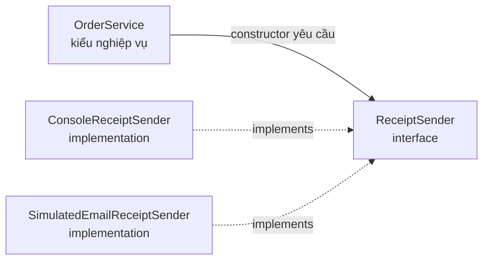
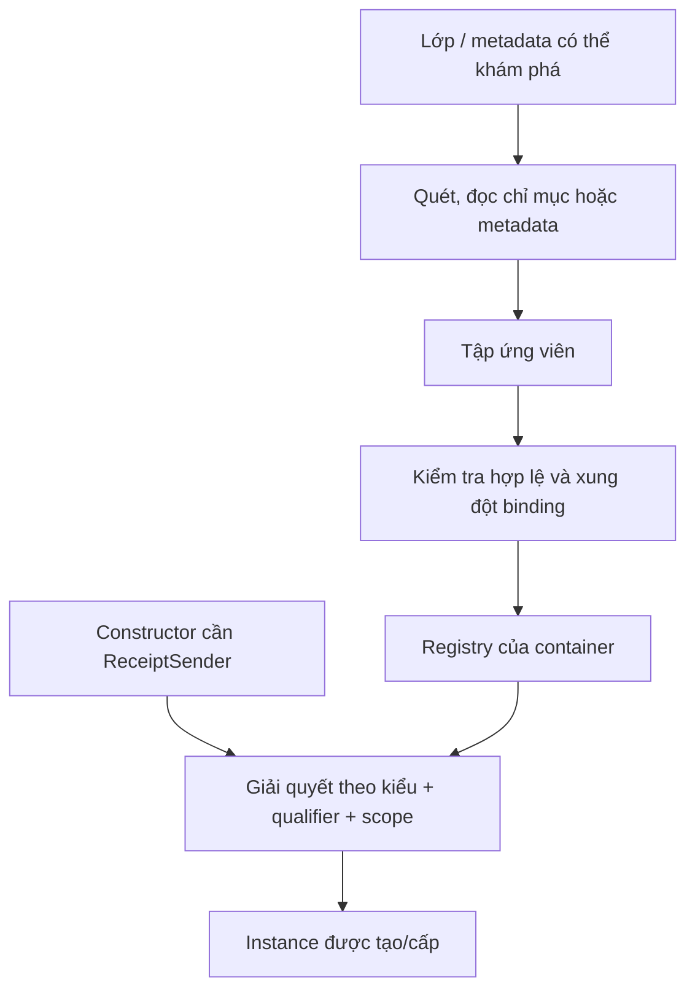

# Đăng ký tường minh so với khám phá tự động

Trong Java, **Dependency Injection (DI)** giúp một đối tượng nhận các cộng tác viên cần dùng từ bên ngoài, thay vì tự tạo hoặc tìm kiếm chúng. Khi ứng dụng mở rộng, việc viết tất cả các lệnh `new` và truyền tham số tại **composition root** trở nên dài hơn. **DI container** giúp dựng và quản lý một phần đồ thị đối tượng dựa trên cấu hình. Hai cách thường gặp để đưa thành phần vào container là **đăng ký tường minh** (*explicit registration*) và **khám phá tự động** (*automatic discovery*).

Điểm khác biệt quan trọng là: **container biết những implementation nào có thể dùng và phải chọn implementation nào bằng cách nào?** Cùng một `OrderService` nhận `ReceiptSender` qua constructor, nhưng cấu hình container có thể tạo ra những đồ thị khác nhau, hoặc thất bại khi khởi động nếu có nhiều implementation phù hợp.

Bài học thuộc chương **Bộ chứa DI** của module **DEPENDENCY_INJECTION**. Ta sẽ đi từ Java thuần, mô phỏng cách đăng ký và khám phá component, sau đó liên hệ với DI container thực tế. Trọng tâm vẫn là **constructor injection**, **composition root**, hợp đồng dependency, scope, vòng đời và kiểm thử trước khi phụ thuộc vào framework.

## 1. Container hỗ trợ việc gì?

Một DI container thường thực hiện một số công việc sau, tùy framework và cấu hình:

1. **Biết các thành phần có thể cung cấp**: một interface hoặc lớp được nối với một implementation, factory hay instance.
2. **Giải quyết dependency**: tìm thành phần phù hợp với yêu cầu của constructor hoặc factory method.
3. **Dựng đồ thị đối tượng**: tạo dependency trước rồi truyền vào consumer, kể cả khi có nhiều cấp.
4. **Quản lý scope**: xác định một instance dùng chung trong phạm vi nào, hoặc tạo mới mỗi khi được yêu cầu.
5. **Quản lý vòng đời**: thực hiện khởi tạo và dọn tài nguyên theo cơ chế/hợp đồng của container.
6. **Phát hiện lỗi cấu hình**: thiếu binding, nhiều ứng viên mơ hồ, vòng phụ thuộc hoặc lỗi khởi tạo; thời điểm phát hiện phụ thuộc container và chính sách tạo eager/lazy.

Không phải container nào cũng hỗ trợ đầy đủ sáu việc này hoặc thực hiện chúng giống nhau. **DI không đòi container**: đoạn Java thuần dưới đây đã là constructor injection:

```java
ReceiptSender sender = new ConsoleReceiptSender();
OrderService service = new OrderService(sender);
```

Khi sử dụng container, hai quyết định vẫn tồn tại: **chọn `ConsoleReceiptSender`** và **cấp nó vào `OrderService`**. Container chỉ thực hiện các quyết định đó từ khai báo, metadata hoặc quy tắc đã được cấu hình.

### 1.1. Hai đồ thị cần phân biệt



Sơ đồ trên chỉ cho biết những **quan hệ giữa kiểu**. Nó chưa trả lời:

- Ứng dụng chọn `ConsoleReceiptSender` hay `SimulatedEmailReceiptSender`?
- Có tạo một instance dùng chung hay tạo mới theo mỗi lần yêu cầu?
- Nếu cả hai được khám phá, constructor nhận implementation nào?
- Instance nào sở hữu tài nguyên và ai sẽ đóng nó?

Đó là việc của **cấu hình và quá trình lắp ghép đồ thị đối tượng**.

## 2. Đăng ký tường minh là gì?

**Đăng ký tường minh** là khi mã bootstrap hoặc cấu hình container khai báo trực tiếp một binding, chẳng hạn:

```java
// Mô tả ý tưởng một registry đơn giản:
container.register(
    ReceiptSender.class,
    "primary",
    ConsoleReceiptSender::new
);
```

Ý nghĩa: khi bên lắp ghép yêu cầu `ReceiptSender` với tên `primary`, hãy dùng nhà cung cấp `ConsoleReceiptSender::new`. Cấu hình chỉ rõ cả **hợp đồng**, **tên định danh** và **cách tạo implementation**.

Các hình thức đăng ký tường minh thường gặp gồm:

- Viết `new` và constructor injection trực tiếp tại composition root, nếu chưa dùng container.
- Gọi API đăng ký của container, ví dụ `register` hoặc `bind`.
- Khai báo factory method tạo object bằng mã cấu hình.
- Đưa mapping interface → implementation vào file cấu hình của container.

Không phải “tường minh” đồng nghĩa bắt buộc có một tập tin duy nhất. Ý chính là **quyết định binding được người thiết kế khai báo một cách rõ ràng và có chủ đích**.

### Điểm mạnh

- Có thể tìm trực tiếp nơi hệ thống quyết định chọn implementation.
- Dễ review các thay đổi quan trọng như đổi cổng thanh toán, cơ sở dữ liệu hoặc client hạ tầng.
- Có thể dựng các object cần tham số đặc biệt, factory phức tạp, secret/config hoặc resource cần đóng.
- Những thành phần có side effect lúc khởi tạo được kiểm soát tại bootstrap.
- Không phụ thuộc vào việc package có nằm trong phạm vi scan hay annotation có được giữ lại lúc chạy.

### Điểm cần cân nhắc

- Nhiều dependency và binding có thể làm bootstrap dài.
- Khi thêm thành phần mới, phải nhớ đăng ký nó.
- Nếu logic cấu hình bị rải rác hoặc bị che bởi nhiều helper, độ tường minh suy giảm.

## 3. Khám phá tự động là gì?

**Khám phá tự động** là khi framework tìm các ứng viên dựa trên một quy ước hoặc metadata, rồi đưa chúng vào registry. Chẳng hạn, một framework có thể quét package để tìm lớp được đánh dấu bằng annotation:

```java
// Ký hiệu mô phỏng một annotation của framework:
@Component
class ConsoleReceiptSender implements ReceiptSender {
    // ...
}
```

*`@Component` trong đoạn minh họa là khái niệm thường gặp ở framework có component scanning. Đây không phải annotation chuẩn của Java SE và đoạn mã này không chạy độc lập.*

Một hệ thống có thể khám phá thông qua:

- **Classpath/package scanning** kết hợp annotation.
- **Chỉ mục metadata** được tạo tại build time.
- **Code generation** hoặc xử lý annotation lúc biên dịch.
- **Cơ chế provider discovery** dựa trên tệp cấu hình dịch vụ, chẳng hạn `ServiceLoader` trong Java.
- Một **danh sách ứng viên** do bên khác chuẩn bị rồi container xét metadata.

Các cách này không giống nhau về chi phí, thời điểm thực hiện, khả năng phản ánh bằng reflection hay cách xử lý module Java. Không nên mặc định mọi framework “tự quét toàn bộ classpath lúc runtime”.

**Khám phá được ứng viên không đồng nghĩa đã chọn được duy nhất một dependency.** Nếu có hai bean cùng triển khai `ReceiptSender`, container còn cần chính sách chọn: qualifier, tên, ưu tiên, cấu hình điều kiện, hoặc báo lỗi mơ hồ.

### Quy trình khái quát



Nếu một lớp không được quét, annotation bị bỏ qua hoặc chỉ mục không chứa nó, lớp ấy có thể **không được đăng ký**, dù chương trình có mã triển khai interface hợp lệ.

## 4. So sánh trực tiếp hai cách đăng ký

| Tiêu chí | Đăng ký tường minh | Khám phá tự động |
| --- | --- | --- |
| **Nguồn quyết định** | Mã/cấu hình binding được khai báo rõ | Quy ước, annotation, chỉ mục hoặc metadata của ứng viên |
| **Thêm component** | Thường cần thêm dòng đăng ký | Có thể chỉ cần đặt component đúng vị trí và metadata |
| **Chọn implementation** | Dễ thấy ở nơi binding | Có thể phải kiểm tra qualifier, ưu tiên và các điều kiện |
| **Nguy cơ thiếu component** | Quên đăng ký | Nằm ngoài vùng scan, thiếu annotation/chỉ mục, bị loại bởi điều kiện |
| **Nguy cơ xung đột** | Trùng đăng ký key | Nhiều ứng viên cho cùng yêu cầu |
| **Khả năng review** | Dễ lần theo từ composition root | Cần hiểu quy tắc tìm và chọn bean |
| **Dựng đối tượng đặc biệt** | Thuận tiện khi cần factory hoặc cấu hình cụ thể | Có thể cần khai báo bổ sung/factory |
| **Tác động khi thêm thư viện** | Chỉ được đăng ký nếu khai báo | Một số hệ thống có thể tự phát hiện thêm component |
| **Kiểm soát scope và lifecycle** | Do binding/owner được khai báo | Do metadata và quy tắc container |
| **Thời điểm phát hiện lỗi** | Có thể kiểm tra ở bootstrap | Có thể ở scan, bootstrap hoặc lần dùng đầu tiên, tùy container |

Hai cách **không loại trừ nhau**. Một ứng dụng có thể quét các service đơn giản và vẫn đăng ký tường minh các adapter hạ tầng cần cấu hình, instance bên ngoài container hoặc bean có nhiều implementation.

## 5. Ví dụ Java thuần: một registry nhỏ và cơ chế khám phá theo metadata

Ví dụ sau mô phỏng hai bước của DI container: **đăng ký binding** và **tìm ứng viên qua annotation**. Nó chỉ có một port là `ReceiptSender`; cố ý không xây dựng một framework hoàn chỉnh.

Ta sẽ chạy hai cấu hình:

1. **EXPLICIT:** composition root đăng ký `ReceiptSender → ConsoleReceiptSender` với qualifier `main`.
2. **DISCOVERED:** danh sách lớp được đưa cho bộ khám phá; annotation chỉ ra `console` và `email` là hai binding riêng, sau đó composition root yêu cầu `email`.

Ví dụ dùng JDK 11 trở lên, không cần thư viện ngoài. Tạo file `DiContainerRegistrationDemo.java`:

```java
import java.lang.annotation.ElementType;
import java.lang.annotation.Retention;
import java.lang.annotation.RetentionPolicy;
import java.lang.annotation.Target;
import java.util.HashMap;
import java.util.Map;
import java.util.Objects;
import java.util.function.Supplier;

public class DiContainerRegistrationDemo {

    // Hợp đồng mà nghiệp vụ cần.
    interface ReceiptSender {
        String send(String orderId);
    }

    // Metadata giả lập dành riêng cho bài học.
    @Retention(RetentionPolicy.RUNTIME)
    @Target(ElementType.TYPE)
    @interface ComponentBinding {
        Class<?> port();
        String qualifier();
    }

    @ComponentBinding(
            port = ReceiptSender.class,
            qualifier = "console")
    public static final class ConsoleReceiptSender
            implements ReceiptSender {

        public ConsoleReceiptSender() {
        }

        @Override
        public String send(String orderId) {
            return "CONSOLE:" + orderId;
        }
    }

    // Adapter mô phỏng; không kết nối email thật.
    @ComponentBinding(
            port = ReceiptSender.class,
            qualifier = "email")
    public static final class SimulatedEmailReceiptSender
            implements ReceiptSender {

        public SimulatedEmailReceiptSender() {
        }

        @Override
        public String send(String orderId) {
            return "SIMULATED_EMAIL:" + orderId;
        }
    }

    static final class OrderService {
        private final ReceiptSender sender;

        OrderService(ReceiptSender sender) {
            this.sender = Objects.requireNonNull(sender, "sender");
        }

        String confirm(String orderId) {
            if (orderId == null || orderId.isBlank()) {
                throw new IllegalArgumentException("Invalid orderId");
            }
            return sender.send(orderId);
        }
    }

    // Định danh binding gồm cả kiểu và qualifier.
    static final class Key {
        final Class<?> port;
        final String qualifier;

        Key(Class<?> port, String qualifier) {
            this.port = Objects.requireNonNull(port, "port");
            this.qualifier =
                    Objects.requireNonNull(qualifier, "qualifier");
        }

        @Override
        public boolean equals(Object other) {
            if (!(other instanceof Key)) {
                return false;
            }
            Key that = (Key) other;
            return port.equals(that.port)
                    && qualifier.equals(that.qualifier);
        }

        @Override
        public int hashCode() {
            return Objects.hash(port, qualifier);
        }
    }

    // Registry tối giản: mỗi resolve() gọi supplier một lần.
    static final class MiniContainer {
        private final Map<Key, Supplier<?>> bindings = new HashMap<>();

        <T> void register(
                Class<T> port,
                String qualifier,
                Supplier<? extends T> supplier) {

            Objects.requireNonNull(supplier, "supplier");
            Key key = new Key(port, qualifier);

            if (bindings.putIfAbsent(key, supplier) != null) {
                throw new IllegalStateException(
                        "Duplicate binding: "
                                + port.getSimpleName() + "/" + qualifier);
            }
        }

        <T> T resolve(Class<T> port, String qualifier) {
            Supplier<?> supplier = bindings.get(new Key(port, qualifier));

            if (supplier == null) {
                throw new IllegalStateException(
                        "Missing binding: "
                                + port.getSimpleName() + "/" + qualifier);
            }

            Object value = Objects.requireNonNull(
                    supplier.get(), "Supplier returned null");
            return port.cast(value);
        }
    }

    // Giới hạn của ví dụ: xét đúng các lớp được truyền vào,
    // chưa thực hiện classpath scanning.
    static void discover(
            MiniContainer container, Class<?>... candidates) {

        for (Class<?> candidate : candidates) {
            ComponentBinding binding =
                    candidate.getAnnotation(ComponentBinding.class);

            if (binding == null) {
                continue;
            }

            if (binding.port() != ReceiptSender.class
                    || !ReceiptSender.class.isAssignableFrom(candidate)) {
                throw new IllegalArgumentException(
                        "Invalid port binding: " + candidate.getName());
            }

            // Chương trình mẫu chỉ hỗ trợ constructor public không tham số.
            try {
                candidate.getConstructor();
            } catch (NoSuchMethodException error) {
                throw new IllegalArgumentException(
                        "No public no-arg constructor: "
                                + candidate.getName(),
                        error);
            }

            container.register(
                    ReceiptSender.class,
                    binding.qualifier(),
                    () -> instantiate(candidate));
        }
    }

    private static ReceiptSender instantiate(Class<?> candidate) {
        try {
            Object result = candidate.getConstructor().newInstance();
            return ReceiptSender.class.cast(result);
        } catch (ReflectiveOperationException error) {
            throw new IllegalStateException(
                    "Cannot create: " + candidate.getName(), error);
        }
    }

    public static void main(String[] args) {
        // A. Đăng ký tường minh tại composition root.
        MiniContainer explicit = new MiniContainer();
        explicit.register(
                ReceiptSender.class,
                "main",
                ConsoleReceiptSender::new);

        OrderService first = new OrderService(
                explicit.resolve(ReceiptSender.class, "main"));
        System.out.println("EXPLICIT: " + first.confirm("O-101"));

        // B. Khám phá bằng annotation từ danh sách ứng viên được cấp.
        MiniContainer discovered = new MiniContainer();
        discover(
                discovered,
                ConsoleReceiptSender.class,
                SimulatedEmailReceiptSender.class);

        OrderService second = new OrderService(
                discovered.resolve(ReceiptSender.class, "email"));
        System.out.println("DISCOVERED: " + second.confirm("O-102"));
    }
}
```

Chạy:

```bash
javac DiContainerRegistrationDemo.java
java DiContainerRegistrationDemo
```

Kết quả dự kiến:

```text
EXPLICIT: CONSOLE:O-101
DISCOVERED: SIMULATED_EMAIL:O-102
```

### 5.1. Container tự động hóa phần nào?

Trong **EXPLICIT**, người viết root chủ động khai báo:

```java
explicit.register(
        ReceiptSender.class,
        "main",
        ConsoleReceiptSender::new);
```

Trong **DISCOVERED**, root chỉ cung cấp danh sách lớp ứng viên:

```java
discover(
        discovered,
        ConsoleReceiptSender.class,
        SimulatedEmailReceiptSender.class);
```

Bộ khám phá đọc `@ComponentBinding` và đăng ký hai binding theo qualifier. Vì có `qualifier = "email"`, yêu cầu `resolve(ReceiptSender.class, "email")` chọn được implementation email mô phỏng.

**Đây là mô hình discovery có giới hạn**, chưa phải classpath scanning. Các lớp ứng viên được cung cấp tường minh nên chính ví dụ này không tự tìm tất cả lớp trong package. Framework thực có thể tự xây dựng danh sách ứng viên từ vùng scan, chỉ mục, module hoặc mã sinh ra lúc build.

### 5.2. Constructor injection vẫn giống nhau

Hai lần dựng service đều dùng:

```java
new OrderService(sender)
```

`OrderService` không đọc annotation, không gọi registry, không kiểm tra qualifier và không biết `ConsoleReceiptSender` hoặc `SimulatedEmailReceiptSender`. **Quyết định chọn implementation vẫn nằm ngoài service**. Sự thay đổi nằm ở cách thành phần lắp ghép tìm ra instance `sender`.

Chú ý: `MiniContainer` ở ví dụ chỉ lưu **supplier** và thực thi `resolve`; nó **không tự tìm constructor của `OrderService`**, không dựng toàn bộ graph, không quản lý scope hay dọn tài nguyên. Đây là phạm vi cố ý để minh họa sự khác biệt trong đăng ký.

### 5.3. Mỗi `resolve()` có tạo cùng một instance không?

Trong `MiniContainer`, mỗi `resolve` gọi `supplier.get()`. Với binding:

```java
explicit.register(
        ReceiptSender.class,
        "main",
        ConsoleReceiptSender::new);
```

mỗi `resolve` thành công tạo một `ConsoleReceiptSender` mới. Nhưng có thể đăng ký một instance sẵn có:

```java
ReceiptSender shared = new ConsoleReceiptSender();

explicit.register(
        ReceiptSender.class,
        "shared",
        () -> shared);
```

Bây giờ nhiều lần `resolve(..., "shared")` trả **cùng một đối tượng**. **Cách đăng ký** (tường minh hay khám phá) không tự quyết định **scope**. Scope thuộc về hợp đồng provider/binding và chính sách container.

## 6. Kiểm thử binding bằng Java thuần

Nếu chỉ chạy ứng dụng ở nhánh thành công, ta có thể bỏ sót những lỗi như khai báo thiếu, trùng key, annotation sai kiểu hay binding tạo object không đúng. Tạo file `DiContainerRegistrationTest.java` cùng thư mục với ví dụ chính:

```java
import java.util.concurrent.atomic.AtomicInteger;

public class DiContainerRegistrationTest {

    private static void check(boolean condition, String message) {
        if (!condition) {
            throw new AssertionError(message);
        }
    }

    private static void expectConfigurationError(Runnable operation) {
        try {
            operation.run();
            throw new AssertionError("Expected configuration error");
        } catch (IllegalStateException expected) {
            // Registry đã phát hiện binding thiếu hoặc trùng.
        }
    }

    public static void main(String[] args) {
        // 1. Binding tường minh: lazy, số lần tạo và danh tính.
        var counter = new AtomicInteger();
        var explicit = new DiContainerRegistrationDemo.MiniContainer();

        explicit.register(
                DiContainerRegistrationDemo.ReceiptSender.class,
                "counted",
                () -> {
                    counter.incrementAndGet();
                    return new DiContainerRegistrationDemo.ConsoleReceiptSender();
                });

        check(counter.get() == 0, "Not lazy");

        var first = explicit.resolve(
                DiContainerRegistrationDemo.ReceiptSender.class,
                "counted");
        var second = explicit.resolve(
                DiContainerRegistrationDemo.ReceiptSender.class,
                "counted");

        check(counter.get() == 2, "Expected two creations");
        check(first != second, "Supplier should create new instances");

        // 2. Hai lần resolve có thể trả cùng một instance nếu đăng ký như vậy.
        var shared = new DiContainerRegistrationDemo.ConsoleReceiptSender();
        explicit.register(
                DiContainerRegistrationDemo.ReceiptSender.class,
                "shared",
                () -> shared);

        check(explicit.resolve(
                        DiContainerRegistrationDemo.ReceiptSender.class,
                        "shared")
                == explicit.resolve(
                        DiContainerRegistrationDemo.ReceiptSender.class,
                        "shared"),
                "Expected same shared instance");

        // 3. Discovery từ hai lớp có metadata và qualifier khác nhau.
        var discovered = new DiContainerRegistrationDemo.MiniContainer();
        DiContainerRegistrationDemo.discover(
                discovered,
                DiContainerRegistrationDemo.ConsoleReceiptSender.class,
                DiContainerRegistrationDemo.SimulatedEmailReceiptSender.class);

        var service = new DiContainerRegistrationDemo.OrderService(
                discovered.resolve(
                        DiContainerRegistrationDemo.ReceiptSender.class,
                        "email"));
        check("SIMULATED_EMAIL:O-777".equals(service.confirm("O-777")),
                "Wrong implementation selected");

        // 4. Thiếu binding phải thất bại rõ ràng.
        expectConfigurationError(() -> discovered.resolve(
                DiContainerRegistrationDemo.ReceiptSender.class,
                "unknown"));

        // 5. Trùng một binding key phải thất bại, thay vì âm thầm ghi đè.
        var duplicate = new DiContainerRegistrationDemo.MiniContainer();
        expectConfigurationError(() ->
                DiContainerRegistrationDemo.discover(
                        duplicate,
                        DiContainerRegistrationDemo.ConsoleReceiptSender.class,
                        DiContainerRegistrationDemo.ConsoleReceiptSender.class));

        System.out.println("PASS");
    }
}
```

Chạy:

```bash
javac DiContainerRegistrationDemo.java DiContainerRegistrationTest.java
java DiContainerRegistrationTest
```

Kết quả dự kiến: `PASS`.

Test này tách rõ bốn điều: **binding được đăng ký**, **implementation được chọn**, **instance có được tái sử dụng**, và **lỗi cấu hình có được phát hiện**. Trong hệ thống thật, nên bổ sung test khởi động với cấu hình ứng dụng thực và test hợp đồng cho những adapter quan trọng.

## 7. Các lỗi thường gặp khi khám phá tự động

### 7.1. Không có ứng viên

Ví dụ `OrderService` cần `ReceiptSender` nhưng lớp implementation nằm ngoài package quét, thiếu annotation hoặc bị loại bởi cấu hình điều kiện.

Kết quả tùy container: có thể báo lỗi khi dựng graph, lúc bootstrap, hoặc chỉ khi lần đầu giải quyết dependency do tạo lazy. **Không có bean** không có nghĩa là **không có lớp triển khai trong mã nguồn**; nó có nghĩa container hiện tại không có binding phù hợp trong cấu hình và scope đang xét.

Cách xử lý là kiểm tra danh sách ứng viên đã đăng ký, phạm vi scanning, điều kiện cấu hình và qualifier yêu cầu, sau đó xác minh bootstrap.

### 7.2. Có nhiều ứng viên cùng phù hợp

Nếu hai adapter đều được đăng ký cùng kiểu `ReceiptSender` mà một constructor chỉ yêu cầu `ReceiptSender`, container cần quy tắc chọn. Một số container báo mơ hồ; một số hỗ trợ default/primary, tên hoặc qualifier.

Trong ví dụ, qualifier tách hai binding:

```text
ReceiptSender / console -> ConsoleReceiptSender
ReceiptSender / email   -> SimulatedEmailReceiptSender
```

Nếu một container tự chọn một “ứng viên đầu tiên” không theo hợp đồng rõ ràng, hành vi có thể thay đổi khi thứ tự quét hoặc classpath đổi. Hãy khai báo cơ chế chọn tường minh với những dependency mà sai implementation gây hậu quả đáng kể.

### 7.3. Trùng binding

Nếu hai ứng viên đăng ký cùng key, một container có thể từ chối, cho phép override hoặc áp dụng quy tắc ưu tiên tùy cấu hình. `MiniContainer` của bài này **chủ động từ chối trùng**, để phát hiện sai sót sớm. Đây là lựa chọn của ví dụ, không phải quy tắc chung của mọi framework.

### 7.4. Metadata đúng nhưng không thể tạo instance

Một component có thể được phát hiện nhưng thiếu constructor phù hợp, có dependency chưa đăng ký hoặc khởi tạo ném ngoại lệ. Khám phá type mới chỉ là bước đầu; container vẫn phải **dựng instance** và cung cấp đầy đủ cộng tác viên.

Trong ví dụ, bộ khám phá chỉ hỗ trợ constructor `public` không tham số; vì vậy nó từ chối component không đáp ứng điều kiện này. Container thực thường hỗ trợ **constructor injection nhiều tham số**, factory method hoặc provider. Khả năng hỗ trợ chính xác tùy framework.

### 7.5. Thay đổi classpath gây thay đổi kết quả scan

Khi thêm thư viện, đổi package hoặc cập nhật chỉ mục, tập ứng viên được khám phá có thể thay đổi mà không có chỉnh sửa trực tiếp trong composition root. Hãy kiểm tra cấu hình bootstrap trong pipeline kiểm thử, đặc biệt khi có nhiều profile hoặc môi trường.

## 8. Cấu hình và điều kiện chọn implementation

Một ứng dụng thực thường có các môi trường như local, test và production. Chẳng hạn, local dùng adapter mô phỏng gửi thông báo, production dùng adapter tích hợp với hệ thống thật.

Với **đăng ký tường minh**, root có thể lựa chọn từ cấu hình:

```java
// Mã minh họa: AppConfig và RealEmailSender chưa được định nghĩa.
ReceiptSender sender;

if (config.isLocal()) {
    sender = new ConsoleReceiptSender();
} else {
    sender = new RealEmailSender(config.emailSettings());
}

OrderService service = new OrderService(sender);
```

Với **khám phá tự động**, framework có thể hỗ trợ đăng ký có điều kiện theo profile, cấu hình hoặc môi trường. Tuy nhiên, phải hiểu rõ điều kiện nào kích hoạt từng component và cách giải quyết nếu nhiều điều kiện cùng đúng.

Không nên để `OrderService` tự đọc profile và gọi `new RealEmailSender(...)`. Khi ấy phần nghiệp vụ lại chứa quyết định chọn hạ tầng, làm mất lợi ích tách việc **sử dụng** khỏi **tạo/lắp ghép**.

### 8.1. Kết hợp cả hai cách

Một chiến lược phù hợp là:

- Khám phá các service ứng dụng và adapter đơn giản, dễ khởi tạo theo quy ước.
- Đăng ký tường minh các binding quan trọng có nhiều implementation, cấu hình phức tạp, tài nguyên cần ownership rõ hoặc không thuộc quyền container tạo.
- Giữ một nơi quy định lựa chọn theo môi trường và kiểm chứng cấu hình trước khi phục vụ request.

Khi dùng framework, cụ thể cách phối hợp quét và đăng ký phải theo tài liệu của framework đó. Có những framework thiên về khai báo tường minh, có framework thiên về metadata hoặc cơ chế sinh mã khi build.

## 9. Scope và vòng đời độc lập với cách khám phá

Đăng ký tường minh hay khám phá tự động trả lời **component được biết đến bằng cách nào**. Scope và lifecycle trả lời **mỗi khi yêu cầu dependency, container cung cấp object nào và đóng lúc nào**.

| Vấn đề | Câu hỏi cần xác minh |
| --- | --- |
| **Singleton/application scope** | Những consumer trong cùng scope có nhận cùng instance không? Instance có thread-safe khi được dùng chung không? |
| **Request scope** | Hai dependency trong cùng request có chia sẻ đúng instance; request khác có object tách biệt không? |
| **Transient/prototype** | Mỗi lần yêu cầu mới có tạo instance riêng? Với resource có `close()`, ai sở hữu? |
| **Lazy/eager** | Bean được tạo khi khởi động hay ở lần dùng đầu tiên? Lỗi cấu hình xuất hiện ở thời điểm nào? |
| **Shutdown** | Resource nào do container quản lý; resource nào được tạo ngoài container; thứ tự đóng ra sao? |

Tên scope và chính sách dọn tài nguyên khác nhau giữa các container. Không nên suy rằng “được component scanning tìm thấy” thì **tự động thành singleton**, hoặc “đăng ký bằng factory” thì **luôn transient**.

### 9.1. Ví dụ về ownership trong Java thuần

Giả sử một adapter dùng chung có `close()`. Composition root tự tạo và truyền nó cho hai service:

```java
// Giả sử AuditClient triển khai AutoCloseable và được mở bởi openAudit().
try (AuditClient client = openAudit()) {
    OrderService orders = createOrderService(client);
    ReportService reports = createReportService(client);

    orders.run();
    reports.run();
} // Root đóng client sau khi cả hai service ngừng dùng.
```

*Đoạn trên mô tả mô hình ownership; các lớp/hàm `AuditClient`, `openAudit`, `createOrderService`, `createReportService` là ký hiệu minh họa, không thuộc chương trình chạy ở mục 5.*

Nếu root đưa một instance có sẵn vào container, container **không nhất thiết tự nhận quyền sở hữu để đóng**; điều đó phải theo API đăng ký và hợp đồng lifecycle của framework. Tương tự, nếu container tạo resource cho một scope sống ngắn, không được inject trực tiếp resource đó vào singleton sống dài mà không hiểu proxy/provider và cơ chế scope.

### 9.2. Đừng để discovery che giấu dependency có vòng đời ngắn

Ví dụ một request-scoped context được tìm và cấp tự động cho service singleton. Nếu framework dùng proxy, tham chiếu của singleton có thể là proxy ổn định nhưng target thật thay đổi theo request. Nếu framework không hỗ trợ cơ chế scope phù hợp, lỗi có thể xuất hiện lúc dựng graph hoặc lúc dùng.

Vì vậy, ngoài việc xác nhận **đăng ký đúng bean**, còn phải xác nhận **vòng đời đúng**: đối tượng được tạo và đóng ở phạm vi nào, có dùng lại sau khi đóng không, và có rò rỉ state giữa request hay không.

## 10. Khả năng quan sát và xác minh cấu hình container

Để biết ứng dụng thật sự chạy với binding nào, cần kiểm chứng từ **cấu hình hiệu lực**, không chỉ đọc annotation hoặc lệnh đăng ký rời rạc.

Một quy trình hữu ích:

1. **Liệt kê các dependency bắt buộc** của entry point và service quan trọng.
2. **Xác định nguồn binding**: mã đăng ký, annotation, index hay module provider.
3. **Xem tập ứng viên hiệu lực** dưới đúng profile/cấu hình đang chạy.
4. **Kiểm tra lựa chọn cuối**: interface, qualifier, implementation, scope và factory cụ thể.
5. **Khởi tạo graph trong test hoặc bootstrap** để phát hiện sớm thiếu/trùng binding, vòng phụ thuộc và lỗi constructor.
6. **Kiểm tra identity và hành vi** bằng fake/spy hoặc integration test, nhất là khi có nhiều implementation.
7. **Kiểm tra shutdown và vòng đời** với adapter `AutoCloseable` hoặc resource được container quản lý.

Một container có thể có API diagnostic để liệt kê binding, nhưng không có chuẩn chung của Java SE bắt mọi container phải hỗ trợ cách xem giống nhau. Khi log cấu hình, tránh để lộ secret, token hoặc thông tin kết nối nhạy cảm; thường chỉ cần tên implementation và định danh cấu hình không nhạy cảm.

## 11. Khi nào nên chọn cách nào?

Không có quy tắc một chiều “càng tự động càng tốt” hoặc “mọi thứ đều phải đăng ký tường minh”. Quyết định nên dựa trên độ quan trọng của việc chọn implementation, số lượng component và khả năng kiểm chứng.

**Đăng ký tường minh thường phù hợp** khi:

- Ứng dụng nhỏ hoặc vừa, graph đơn giản và số binding có thể quản lý được.
- Một interface có nhiều implementation quan trọng, cần chọn rõ theo cấu hình.
- Adapter cần credential, đường dẫn, connection pool, factory hoặc ownership phức tạp.
- Hệ thống cần bootstrap dễ review, dễ tái hiện trong test.

**Khám phá tự động thường phù hợp** khi:

- Có nhiều component đồng nhất theo quy ước, ít cần cấu hình tạo riêng.
- Framework đã hỗ trợ tốt scanning/indexing và validation.
- Nhóm có quy ước rõ về annotation, qualifier, package và điều kiện đăng ký.
- Có test kiểm tra graph thực tế để tránh phụ thuộc vào giả định về scan.

Hai kiểu đăng ký đều có thể cho ra **cùng một đồ thị đối tượng** nếu cùng lựa chọn implementation, scope và cách lắp ghép. Ngược lại, cùng một cách đăng ký có thể cho graph khác nhau nếu profile, qualifier hoặc scope thay đổi.

## 12. Chuyển từ DI thủ công sang container theo từng bước

Không cần chuyển một ứng dụng Java thuần sang auto discovery ngay lập tức. Một lộ trình thực hành:

1. **Giữ nguyên constructor injection** của `OrderService` và các port. Bảo đảm service hoạt động khi được tạo bằng `new`.
2. **Xác định composition root hiện tại**: tìm các lệnh tạo adapter, decorator, service và entry point.
3. **Chuyển các lựa chọn rõ ràng thành binding tường minh** trong container. Xác minh cùng các instance cần dùng chung và cùng hành vi nghiệp vụ.
4. **Chỉ đưa một phần component sang discovery** khi có lợi ích thật. Kiểm tra vùng scan, qualifier và điều kiện cấu hình.
5. **Giữ các ràng buộc quan trọng ở test**: chọn adapter đúng, không có binding thiếu/trùng, scope hợp lệ, resource được đóng đúng lúc.
6. **Không sửa business service để phụ thuộc vào API container** nếu service chỉ cần interface được inject. Nếu consumer liên tục gọi `container.get(...)`, dependency có nguy cơ bị ẩn theo kiểu service locator.

Ý nghĩa của **Inversion of Control** vẫn giữ: service không quyết định cách tạo và chọn adapter; quyền đó chuyển tới composition root/container. **Constructor injection** vẫn là nơi công bố nhu cầu thật của service.

## 13. Bài tập thực hành

**Bài 1 — Phát hiện thiếu binding.** Xóa dòng `explicit.register(...)` trong `main`. Chạy lại chương trình và xác định lý do `resolve` thất bại. Có phải do không tồn tại class `ConsoleReceiptSender` không? Giải thích sự khác nhau giữa *có class* và *đã đăng ký binding*.

**Bài 2 — Hai implementation.** Trong cấu hình DISCOVERED, thử yêu cầu `"console"` thay cho `"email"`. Kết quả khác như thế nào? Sau đó tạo một annotation mới cùng qualifier `"console"` cho một adapter khác và quan sát xử lý trùng key.

**Bài 3 — Scope.** Đăng ký `ReceiptSender` bằng constructor reference và so sánh danh tính của hai lần `resolve`. Sau đó đăng ký một instance dùng chung và kiểm tra `==`. Kết luận vì sao source của binding không quyết định scope.

**Bài 4 — Ranh giới khám phá.** Bỏ `SimulatedEmailReceiptSender.class` khỏi danh sách `discover(...)` nhưng vẫn giữ `@ComponentBinding` trên lớp. Vì sao `resolve(..., "email")` không tìm thấy? Liên hệ với trường hợp class nằm ngoài package scan trong framework thật.

**Bài 5 — Chọn cách lắp ghép.** Một adapter thanh toán thật cần nhiều tham số cấu hình, timeout, credential và client có `close()`. Hãy quyết định phần nào nên đăng ký tường minh, phần nào có thể khám phá theo quy ước, và ai sở hữu tài nguyên.

**Bài 6 — Kiểm chứng trước production.** Viết bảng về `OrderService` gồm port yêu cầu, qualifier, implementation ở từng môi trường, scope và điểm đóng. Đề xuất một test khởi động để phát hiện sự khác biệt bất ngờ giữa local và production.

## 14. Ghi nhớ

**Đăng ký tường minh** cho biết trực tiếp *interface nào được nối với implementation/factory nào*. **Khám phá tự động** tìm các ứng viên theo metadata hoặc quy ước rồi để container áp dụng quy tắc chọn binding. Hai cách có thể kết hợp, nhưng đều cần kiểm chứng **thiếu/trùng binding, qualifier, scope, vòng đời và hành vi thật**.

DI container giúp tự động hóa việc tạo và lắp ghép; nó không thay thế thiết kế hợp đồng phụ thuộc. Với **Java thuần**, constructor injection và một composition root rõ ràng đã đủ để thực hành IoC và kiểm thử dependency. Khi mở rộng sang container, hãy giữ các quyết định chọn implementation ở ranh giới lắp ghép và giữ service nghiệp vụ chỉ phụ thuộc vào các interface mà nó cần.
