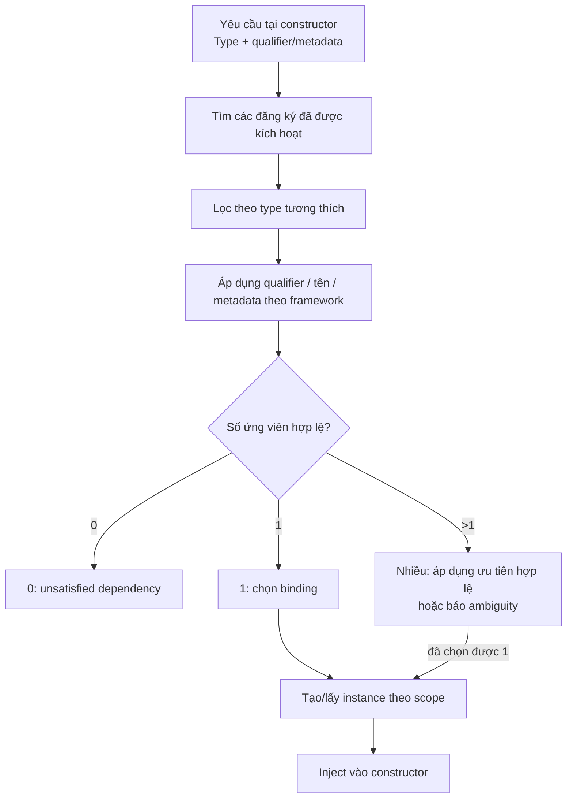

# Phân giải theo kiểu, tên, qualifier và thông tin bổ sung

## 1. Vì sao DI container phải phân giải dependency?

Trong **Dependency Injection (DI)**, một đối tượng nhận những cộng tác viên mà nó cần từ bên ngoài, thường thông qua constructor. Khi tự lắp ghép bằng Java thuần, **composition root** quyết định chính xác instance nào được truyền vào từng constructor:

```java
MessageSender sender = new EmailSender();
NotificationService service = new NotificationService(sender);
```

Khi hệ thống có nhiều service và nhiều hiện thực của cùng một interface, một **DI container** có thể thay chúng ta lưu đăng ký (*registration/binding*), tìm dependency (*resolution*), tạo và nối **object graph**. Nhưng container không thể luôn suy ra đúng lựa chọn chỉ từ kiểu Java. Nếu cả `EmailSender` lẫn `SmsSender` đều triển khai `MessageSender`, yêu cầu “cấp một `MessageSender`” có thể chưa đủ thông tin.

Bài thuộc chương **Bộ chứa DI** của module **Dependency Injection**. Mục tiêu là hiểu cơ chế phân giải theo **kiểu, tên, qualifier và metadata bổ sung** để tiếp nối nền tảng **Inversion of Control (IoC)**, constructor injection và composition root. Các ví dụ cốt lõi dùng Java thuần trước khi đối chiếu với một số API container phổ biến. Cách chọn bean/instance còn tác động đến scope, vòng đời tài nguyên và cách kiểm thử.

Sau bài này, bạn sẽ giải thích được:

1. Container tìm một dependency từ các đăng ký như thế nào.
2. Khi nào chỉ dựa vào kiểu là đủ, khi nào cần tên hoặc qualifier.
3. Metadata khác như profile, primary, generic type và scope ảnh hưởng điều gì.
4. Vì sao không nên giải quyết sự mơ hồ bằng tên trường, thứ tự đăng ký hay mặc định ngầm.
5. Cách mô phỏng việc phân giải, kiểm thử lựa chọn và kiểm soát vòng đời bằng Java thuần.

## 2. Phân biệt đăng ký, phân giải và injection

Ba bước thường đi cùng nhau nhưng không đồng nhất:

| Bước | Câu hỏi cần trả lời | Ví dụ |
| --- | --- | --- |
| **Đăng ký (registration/binding)** | Những hiện thực hoặc factory nào đang có sẵn? | Gắn `MessageSender` với `EmailSender`, đánh dấu `email` |
| **Phân giải (resolution)** | Yêu cầu dependency này khớp đăng ký nào? | Tìm `MessageSender` với qualifier `email` |
| **Injection** | Dependency được cấp vào consumer thế nào? | Gọi `new NotificationService(resolvedSender)` |

Một container thực tế thường có thêm bước **tạo instance** và quản lý scope. Nó có thể tạo instance ngay khi khởi động hoặc tạo khi có nhu cầu. Vì thế đừng đánh đồng “đã phân giải đúng định nghĩa” với “mỗi lần phân giải đều tạo một object mới”.

Ví dụ một hệ thống có các đăng ký:

```text
MessageSender + email --> EmailSender
MessageSender + sms   --> SmsSender
Clock + default       --> Clock.systemUTC()
```

Constructor `NotificationService(MessageSender, Clock)` cho biết **nó cần gì**, nhưng yêu cầu `MessageSender` cần thêm thông tin để container biết phải chọn email hay SMS.

**Composition root** hoặc cấu hình container có trách nhiệm xác định binding. Business service chỉ nên nhận dependency đã được chọn qua constructor và gọi các thao tác của nó. Dùng `container.get(...)` hoặc `context.getBean(...)` rải rác trong nghiệp vụ thường trở thành **service locator**, làm dependency bị che khỏi chữ ký constructor.

## 3. Phân giải theo kiểu (type-based resolution)

### 3.1. Một ứng viên: kiểu thường đã đủ

Giả sử container chỉ có một hiện thực phù hợp:

```java
interface ClockSource {
    java.time.Instant now();
}

final class SystemClockSource implements ClockSource {
    @Override
    public java.time.Instant now() {
        return java.time.Instant.now();
    }
}

final class ExpirationService {
    private final ClockSource clock;

    ExpirationService(ClockSource clock) {
        this.clock = java.util.Objects.requireNonNull(clock);
    }
}
```

Nếu chỉ `SystemClockSource` được đăng ký cho `ClockSource`, container có thể chọn theo kiểu constructor cần. Việc lookup dựa vào hợp đồng type: một lớp cụ thể có thể được yêu cầu bằng một interface, superclass hoặc kiểu được framework coi là tương thích.

Trong các container phổ biến, quá trình này còn xét phạm vi các bean được đăng ký, khả năng gán kiểu (*assignability*) và các quy tắc riêng về generic/proxy. Đừng giả định mọi container dùng chính xác một thuật toán.

### 3.2. Không có ứng viên: dependency chưa được đáp ứng

Ví dụ constructor cần `ClockSource` nhưng không có đăng ký nào phù hợp. Với dependency bắt buộc, container thường báo lỗi khi xây graph hoặc lúc phân giải. Đây là **missing binding / unsatisfied dependency**.

Nguyên nhân có thể là không khai báo bean, loại bean không được scan, profile không bật, sai type, sai qualifier hoặc cấu hình có điều kiện không khớp. Cách xử lý là tìm ranh giới đăng ký đang thiếu hoặc sai; tránh tạo một `new SystemClockSource()` âm thầm bên trong consumer để che lỗi.

### 3.3. Nhiều ứng viên: cần chính sách chọn tường minh

```java
interface MessageSender {
    void send(String recipient, String text);
}

final class EmailSender implements MessageSender {
    @Override
    public void send(String recipient, String text) {
        System.out.println("EMAIL to " + recipient + ": " + text);
    }
}

final class SmsSender implements MessageSender {
    @Override
    public void send(String recipient, String text) {
        System.out.println("SMS to " + recipient + ": " + text);
    }
}
```

Nếu cả hai implementation đều đăng ký, constructor chỉ nhận `MessageSender` có thể tạo ra một **ambiguous dependency**. Một số container từ chối và báo nhiều ứng viên; một số dùng quy tắc `primary`, `priority`, tên bean hoặc qualifier tùy framework và điểm injection.

**Lựa chọn ngẫu nhiên theo thứ tự scan/đăng ký là một thiết kế mong manh.** Nếu có hai hành vi khác nhau về ý nghĩa nghiệp vụ, hãy đưa sự khác nhau vào cấu hình hoặc qualifier có chủ đích.

## 4. Phân giải theo tên (name-based resolution)

Tên là một định danh cho **đăng ký**, chẳng hạn `emailSender` hoặc `smsSender`. Một số container cho phép lấy bean bằng tên từ composition root hoặc dùng tên như một phần quy tắc injection.

Ví dụ khái niệm:

```text
"emailSender" --> instance EmailSender
"smsSender"   --> instance SmsSender
```

Tên hữu ích khi cấu hình hoặc công cụ vận hành cần trỏ đến một đăng ký cụ thể. Tuy nhiên:

- **Tên đăng ký không nhất thiết trùng tên class.** Một object cùng class có thể được đăng ký nhiều lần với các tên khác nhau.
- **Tên trường constructor không phải hợp đồng chọn bean có tính di động.** Một số framework có cơ chế fallback theo tên tham số/trường, nhưng việc này phụ thuộc phiên bản, metadata biên dịch và quy tắc framework.
- **Đổi tên bean có thể làm hỏng binding** nếu điểm tiêu thụ phụ thuộc vào chuỗi đó. Một qualifier mang ý nghĩa ổn định thường dễ bảo trì hơn tên ngẫu nhiên.
- **Tên không thay kiểm tra type.** Container tốt cần kiểm tra object được trả có đáp ứng type mà consumer yêu cầu hay không.

Với Spring, `ApplicationContext.getBean("emailSender")` là ví dụ truy xuất theo tên. Thao tác này phù hợp hơn ở ranh giới lắp ghép/quản trị. Đưa nó vào `NotificationService` sẽ làm service biết container và khó unit test độc lập.

## 5. Qualifier: mô tả đúng biến thể cần inject

**Qualifier** là thông tin gắn với một đăng ký hoặc một điểm injection để thu hẹp nhóm ứng viên. Thay vì “một `MessageSender` bất kỳ”, một consumer có thể yêu cầu “`MessageSender` dành cho thông báo giao dịch” hoặc “`MessageSender` theo kênh `sms`”.

```text
Yêu cầu: type = MessageSender, qualifier = "transactional"
Ứng viên:
  MessageSender, qualifier = "transactional" --> TransactionalEmailSender
  MessageSender, qualifier = "marketing"     --> MarketingEmailSender
Kết quả: TransactionalEmailSender
```

Qualifier có thể là chuỗi, enum, annotation hoặc một annotation với thuộc tính tùy container. Trong **Spring**, `@Qualifier("transactional")` thường dùng giá trị chuỗi để thu hẹp bean. Trong **CDI/Jakarta**, người ta có thể định nghĩa annotation qualifier có ngữ nghĩa và thuộc tính riêng. `@Named` cũng liên quan đến việc đặt tên/qualifier trong một số hệ sinh thái, nhưng **không nên coi `name`, `@Named` và mọi loại `@Qualifier` luôn tương đương giữa các container**.

### 5.1. Ví dụ Spring để hình dung cú pháp

Đoạn dưới đây **chỉ minh họa API Spring**, không thuộc ví dụ Java thuần ở phần tiếp theo:

```java
// Giả sử có hai bean MessageSender:
@Component("emailSender")
class EmailSender implements MessageSender {
    // ...
}

@Component("smsSender")
class SmsSender implements MessageSender {
    // ...
}

@Service
class NotificationService {
    private final MessageSender sender;

    NotificationService(@Qualifier("smsSender") MessageSender sender) {
        this.sender = sender;
    }
}
```

Ở đây qualifier của điểm injection giúp Spring phân biệt hai ứng viên cùng triển khai `MessageSender`. Với ví dụ thực tế, còn cần import annotation, triển khai phương thức interface và cấu hình component scanning.

Không nhất thiết đặt qualifier lên mọi constructor. Nếu chỉ có một đăng ký hợp lệ, type-based injection có thể đã đủ; dùng qualifier khi thật sự tồn tại nhiều vai trò hoặc cần ràng buộc một biến thể.

### 5.2. Dùng qualifier theo ý nghĩa thay vì tên hạ tầng

So sánh:

```text
@Qualifier("smtpSenderV2")       --> bị ràng buộc với công nghệ/phiên bản
@Qualifier("transactional")      --> mô tả mục đích nghiệp vụ
```

Nếu `transactional` có thể chuyển từ SMTP sang một adapter khác mà vẫn giữ hợp đồng, consumer không phải đổi. Tuy nhiên, qualifier phải thống nhất trong đội ngũ; một chuỗi trùng tên nhưng khác ý nghĩa vẫn gây lỗi cấu hình.

## 6. Phân giải còn phụ thuộc những metadata nào?

Trong container thực tế, “type + qualifier” là mô hình dễ hiểu nhất, nhưng quyết định cuối cùng có thể phụ thuộc nhiều dữ kiện. **Mỗi framework hỗ trợ một tập quy tắc và thứ tự ưu tiên riêng**.

| Thông tin | Có thể ảnh hưởng đến điều gì? | Cần tránh hiểu nhầm |
| --- | --- | --- |
| **Tên bean** | Truy xuất định danh; fallback theo tên ở một số framework | Không phải container nào cũng dùng tên biến để chọn |
| **Qualifier/annotation** | Thu hẹp ứng viên theo vai trò | Không phải là tên class hoặc scope |
| **Primary/priority** | Chọn ứng viên ưu tiên khi nhiều bean phù hợp | Không nên dựa vào một cơ chế ưu tiên chung cho mọi container |
| **Profile/condition** | Quyết định đăng ký nào được kích hoạt theo môi trường | Đây là bước lọc hoặc đăng ký, không phải luôn là lookup runtime |
| **Kiểu generic** | Phân biệt, ví dụ `Repository<Order>` với `Repository<User>` nếu container lưu được thông tin kiểu | Java type erasure khiến `Class<?>` đơn thuần không đủ phân biệt |
| **Scope** | Dùng lại cùng instance hay tạo mới trong một phạm vi | Scope chủ yếu quyết định vòng đời instance, không tự chọn vai trò nghiệp vụ |
| **Optional/lazy/provider** | Cho phép thiếu, trì hoãn hoặc tạo tại thời điểm dùng | Tùy API; không tự giải quyết ambiguity |
| **Collection/multibinding** | Nhận tập các ứng viên thay vì một ứng viên | Cần biết tập bean nào hợp lệ và thứ tự có được bảo đảm không |
| **Injection point** | Type, qualifier, annotation và ngữ cảnh nơi yêu cầu dependency | Metadata tại điểm dùng có thể khác với thông tin đăng ký |

### 6.1. Priority và primary không phải phép thay thế cho qualifier có nghĩa

Trong Spring, `@Primary` có thể chỉ ra bean được ưu tiên khi có nhiều ứng viên cho một dependency đơn trị. Nhưng nếu hai sender có hai mục đích rõ ràng, một primary mặc định có thể che việc consumer quên yêu cầu đúng vai trò. Hãy dùng qualifier khi sự khác nhau là **ngữ nghĩa của điểm tiêu thụ**; chỉ dùng primary khi thực sự có một mặc định áp dụng rộng rãi.

Trong những container khác, `@Priority` có thể phục vụ thứ tự interceptor, lựa chọn alternate hoặc quy tắc riêng. Không có bảo đảm “priority số lớn nhất/nhỏ nhất thắng” cho mọi DI framework.

### 6.2. Profile, condition và lựa chọn tại startup

Một cấu hình có thể đăng ký `FileMessageSender` trong môi trường production, nhưng đăng ký `InMemoryMessageSender` khi chạy local hoặc test. Khi cấu hình chỉ kích hoạt **một** binding phù hợp, phân giải theo type lại không mơ hồ.

Điều này khác với việc tồn tại đồng thời nhiều bean rồi dùng qualifier để chọn. Hai kỹ thuật có thể kết hợp, nhưng cần phân biệt:

1. **Điều kiện đăng ký** quyết định *những ứng viên nào hiện diện* trong container.
2. **Phân giải tại injection point** quyết định *ứng viên nào trong số đó đáp ứng yêu cầu*.
3. **Scope** quyết định *instance nào được cấp và tồn tại trong bao lâu*.

### 6.3. Generic type và type erasure

Nếu cần đồng thời `Handler<Order>` và `Handler<User>`, hai kiểu tham số hóa có cùng raw type là `Handler.class` ở runtime. Một registry đơn giản chỉ dùng `Class<?>` làm khóa không phân biệt được chúng. Một số framework giữ thêm generic type metadata qua `Type`, type token hoặc cơ chế tương tự để hỗ trợ phân giải. Đừng coi một bản đồ `Map<Class<?>, Object>` là bản sao đầy đủ của thuật toán container.

### 6.4. Collection và provider

Nếu nghiệp vụ phải gọi **tất cả** plugin cùng một loại, một container hỗ trợ multibinding hoặc injection danh sách có thể phù hợp hơn chọn duy nhất một bean. Nếu dependency cần tạo theo request/operation, inject **factory/provider** có thể hợp lý hơn giữ một instance sống dài. Cả hai trường hợp đều cần quy định rõ số lượng ứng viên, thứ tự, scope và ownership.

## 7. Mô hình thuật toán phân giải

Một trình phân giải đơn trị có thể được hiểu theo các bước khái niệm:



Đây là **mô hình tư duy**, không phải thuật toán chuẩn bắt buộc. Framework có thể lọc qualifier trước hoặc sau type, xét primary/priority theo quy tắc cụ thể, hoặc báo lỗi sớm khi khởi động.

Phân giải thành công cũng chưa chắc graph có thể tạo được. Ví dụ:

```text
ServiceA cần ServiceB
ServiceB cần ServiceA
```

Với constructor injection thuần và không có cơ chế đặc biệt, đây là **circular dependency**: không thể tạo `ServiceA` trước `ServiceB` hoặc ngược lại. Một số container phát hiện và báo vòng lặp; một số có cơ chế trì hoãn/proxy cho các trường hợp nhất định. Thiết kế nên xem lại ranh giới trách nhiệm thay vì coi mọi vòng phụ thuộc là vấn đề mà container phải tự chữa.

## 8. Ví dụ Java thuần: registry phân giải bằng type + qualifier

Trước khi dùng DI container, ta có thể viết một registry rất nhỏ để thấy bản chất của **binding key**. Ví dụ này không scan annotation, không tự phân tích constructor, không có scope tự động. Nó chỉ lưu các **factory** gắn với cặp `(Class, qualifier)` và cung cấp instance khi root yêu cầu.

Tạo file **`App.java`** (Java 8 trở lên):

```java
import java.util.HashMap;
import java.util.Map;
import java.util.Objects;
import java.util.function.Supplier;

interface MessageSender {
    void send(String recipient, String text);
}

final class EmailSender implements MessageSender {
    @Override
    public void send(String recipient, String text) {
        System.out.println("EMAIL to " + recipient + ": " + text);
    }
}

final class SmsSender implements MessageSender {
    @Override
    public void send(String recipient, String text) {
        System.out.println("SMS to " + recipient + ": " + text);
    }
}

// Khóa phân giải gồm cả type lẫn qualifier.
final class BindingKey {
    private final Class<?> type;
    private final String qualifier;

    BindingKey(Class<?> type, String qualifier) {
        this.type = Objects.requireNonNull(type, "type");
        this.qualifier = Objects.requireNonNull(qualifier, "qualifier");
    }

    @Override
    public boolean equals(Object other) {
        if (this == other) {
            return true;
        }
        if (!(other instanceof BindingKey)) {
            return false;
        }
        BindingKey that = (BindingKey) other;
        return type.equals(that.type) &&
               qualifier.equals(that.qualifier);
    }

    @Override
    public int hashCode() {
        return Objects.hash(type, qualifier);
    }
}

// Minh họa resolution; không phải DI container production.
final class MiniRegistry {
    private final Map<BindingKey, Supplier<?>> providers = new HashMap<>();

    <T> void bind(
            Class<T> type,
            String qualifier,
            Supplier<? extends T> provider) {
        Objects.requireNonNull(provider, "provider");
        BindingKey key = new BindingKey(type, qualifier);
        if (providers.putIfAbsent(key, provider) != null) {
            throw new IllegalStateException(
                "Duplicate binding: " + type.getName() + "/" + qualifier);
        }
    }

    <T> T resolve(Class<T> type, String qualifier) {
        Supplier<?> provider = providers.get(new BindingKey(type, qualifier));
        if (provider == null) {
            throw new IllegalStateException(
                "No binding: " + type.getName() + "/" + qualifier);
        }
        Object instance = Objects.requireNonNull(
            provider.get(), "provider returned null");
        return type.cast(instance);
    }
}

final class NotificationService {
    private final MessageSender sender;

    NotificationService(MessageSender sender) {
        this.sender = Objects.requireNonNull(sender, "sender");
    }

    void notifyUser(String userId, String text) {
        sender.send(userId, text);
    }
}

public final class App {
    public static void main(String[] args) {
        // Composition root: đăng ký các lựa chọn khi khởi động.
        MiniRegistry registry = new MiniRegistry();
        registry.bind(MessageSender.class, "email", EmailSender::new);
        registry.bind(MessageSender.class, "sms", SmsSender::new);

        // Có thể lấy lựa chọn từ cấu hình đã validate.
        String channel = args.length == 0 ? "email" : args[0];
        MessageSender selected =
            registry.resolve(MessageSender.class, channel);

        // Consumer chỉ biết MessageSender, không biết registry.
        NotificationService notifications = new NotificationService(selected);
        notifications.notifyUser("user-7", "Your order is confirmed");
    }
}
```

Biên dịch và chạy:

```bash
javac App.java
java App
java App sms
```

Kết quả tương ứng:

```text
EMAIL to user-7: Your order is confirmed
SMS to user-7: Your order is confirmed
```

Ở đây **type** của cả hai binding là `MessageSender.class`. Chuỗi `email` hay `sms` đóng vai trò **qualifier do ứng dụng định nghĩa**, giúp phân biệt hai lựa chọn. Lời gọi `resolve(MessageSender.class, "push")` ném lỗi vì không có binding `push`. Gọi `bind` hai lần với cùng một cặp khóa cũng bị từ chối thay vì âm thầm ghi đè.

### 8.1. Registry này có gì và còn thiếu gì?

| Điều làm được | Giới hạn cố ý |
| --- | --- |
| Đăng ký và tìm theo cặp type/qualifier | Không tự suy diễn theo superclass/interface khác của implementation |
| Báo thiếu hoặc trùng binding | Không có thuật toán phát hiện ambiguity của lookup chỉ theo type |
| Kiểm tra kết quả provider bằng `Class.cast` | Không phân biệt `Handler<Order>` với `Handler<User>` |
| Cho phép root tạo và inject object | Không tự phân tích và gọi constructor |
| Provider được gọi mỗi lần resolve | Không có singleton/request scope, cache, lifecycle hoặc `close()` tự động |

Vì sử dụng `Supplier<?>`, **mỗi lần `resolve` đều gọi lại supplier**. Với `EmailSender::new` sẽ tạo instance mới; với `() -> existingSender` thì nhiều lần gọi lại nhận cùng một instance. Đây là **hành vi do provider quyết định**, chưa phải hệ thống scope.

Không đưa `MiniRegistry` vào constructor của `NotificationService`. Nếu service gọi `registry.resolve` trong từng nghiệp vụ, dependency thật của nó không còn được biểu diễn rõ qua constructor, dẫn đến service locator.

### 8.2. Type, name và qualifier: cùng một khóa hay nhiều khóa?

Trong ví dụ nhỏ, ta dùng cặp `(type, qualifier)`; chưa lưu **tên bean** như một định danh độc lập. Container thực tế có thể có cả ID/tên đăng ký và một tập qualifier riêng, cho phép nhiều tên/alias, hoặc qualifier có nhiều thuộc tính.

Điều này nhấn mạnh sự khác nhau:

- `type`: consumer cần khả năng gì;
- `name`: định danh một đăng ký;
- `qualifier`: ràng buộc lựa chọn theo vai trò;
- `scope/lifecycle metadata`: cách cấp và quản lý instance được chọn.

Không nên ép mọi loại metadata thành một chuỗi khóa duy nhất khi thiết kế cấu hình lớn. Ví dụ Java thuần chỉ cố ý mô phỏng phần **phân giải**, chưa thay thế container thật.

## 9. Kiểm thử phân giải và constructor injection

Hai phần cần được kiểm tra với mục đích khác nhau:

1. **Đăng ký/phân giải:** đúng qualifier lấy đúng hiện thực; trường hợp thiếu hoặc trùng binding bị từ chối.
2. **Nghiệp vụ:** `NotificationService` gọi đúng dependency được cấp; có thể thay fake mà không cần dựng container đầy đủ.

Tạo file **`AppTest.java`** cùng thư mục `App.java`:

```java
import java.util.ArrayList;
import java.util.List;

final class RecordingSender implements MessageSender {
    final List<String> messages = new ArrayList<>();

    @Override
    public void send(String recipient, String text) {
        messages.add(recipient + ": " + text);
    }
}

public final class AppTest {
    public static void main(String[] args) {
        RecordingSender email = new RecordingSender();
        RecordingSender sms = new RecordingSender();
        MiniRegistry registry = new MiniRegistry();
        registry.bind(MessageSender.class, "email", () -> email);
        registry.bind(MessageSender.class, "sms", () -> sms);

        MessageSender selected = registry.resolve(MessageSender.class, "sms");
        check(selected == sms, "wrong qualifier resolution");

        NotificationService notifications = new NotificationService(selected);
        notifications.notifyUser("u-1", "Hello");
        check(sms.messages.equals(List.of("u-1: Hello")), "SMS not invoked");
        check(email.messages.isEmpty(), "email should be untouched");

        boolean missingRejected = false;
        try {
            registry.resolve(MessageSender.class, "push");
        } catch (IllegalStateException expected) {
            missingRejected = true;
        }
        check(missingRejected, "missing binding must be rejected");

        boolean duplicateRejected = false;
        try {
            registry.bind(MessageSender.class, "email", RecordingSender::new);
        } catch (IllegalStateException expected) {
            duplicateRejected = true;
        }
        check(duplicateRejected, "duplicate binding must be rejected");

        // Unit test có thể inject fake trực tiếp, không dùng registry.
        RecordingSender directFake = new RecordingSender();
        new NotificationService(directFake).notifyUser("u-2", "Ready");
        check(directFake.messages.equals(List.of("u-2: Ready")),
              "constructor injection failed");

        System.out.println("PASS");
    }

    private static void check(boolean condition, String message) {
        if (!condition) {
            throw new AssertionError(message);
        }
    }
}
```

Chạy bằng JDK 11 trở lên vì test dùng `List.of`:

```bash
javac App.java AppTest.java
java AppTest
```

Kết quả mong đợi:

```text
PASS
```

Test này kiểm tra **binding key và hành vi của consumer**, không khẳng định registry ví dụ có toàn bộ tính năng của một framework. Với container thật, nên có thêm một **composition/configuration test** khởi tạo context và xác nhận các binding quan trọng, đặc biệt khi dùng profile, conditional registration hoặc custom qualifier.

### 9.1. Cần test trường hợp ambiguity thế nào?

Registry ở mục 8 yêu cầu **qualifier tường minh**, nên không có lời gọi “chỉ theo type” để tạo ambiguity. Nếu mở rộng API `resolve(MessageSender.class)`, phải định nghĩa rõ quy tắc:

- Không tìm thấy binding phù hợp → báo thiếu dependency.
- Có đúng một binding phù hợp → trả instance đó.
- Có nhiều binding phù hợp và không có quy tắc chọn hợp lệ → báo ambiguity, liệt kê ứng viên.

Không nên tự chọn entry đầu tiên từ `HashMap`. Nếu muốn một mặc định, cần cấu hình nó công khai (ví dụ một khóa `default` rõ nghĩa hoặc cơ chế primary tương ứng với framework).

## 10. Scope, ownership và vòng đời sau khi chọn được binding

**Phân giải đúng implementation chưa có nghĩa dùng đúng instance ở đúng thời điểm.** Một DI container còn có thể quản lý lifetime:

| Scope minh họa | Khi phân giải cùng binding | Điều cần cân nhắc |
| --- | --- | --- |
| **Singleton/application** | Thường dùng lại một instance trong container tương ứng | Instance có thể được nhiều consumer chia sẻ; phải xét thread safety và shutdown |
| **Prototype/transient** | Thường tạo instance mới cho mỗi yêu cầu tạo | Nếu resource `AutoCloseable`, ai nhận trách nhiệm đóng? |
| **Request** | Dùng chung trong một request, khác giữa các request | Không inject trực tiếp request-scoped instance vào singleton sống lâu nếu không có cơ chế scope/proxy hợp lệ |
| **Session/operation** | Theo phiên hoặc một đơn vị công việc | Phải gắn rõ điểm bắt đầu và kết thúc scope |

Tên scope và cách container quản lý rất khác nhau. Chẳng hạn một provider có thể trì hoãn việc lấy instance theo request, còn một singleton không nên giữ reference trực tiếp tới tài nguyên đã hết request. Container có thể sử dụng proxy hoặc provider để giải quyết một số trường hợp, nhưng không biến mọi thiết kế vòng đời sai thành hợp lệ.

### 10.1. Owner phải rõ ràng ngay cả khi có container

Giả sử một `FileSender` triển khai `AutoCloseable` và được inject cho nhiều service. Nếu container tạo và sở hữu singleton này, nó thường là nơi đóng vào lúc shutdown theo cấu hình vòng đời của framework. Các service **mượn** instance và không tự `close()`. Nếu một factory tự tạo resource bên ngoài phạm vi container, container có thể không biết phải đóng nó; cần tài liệu ownership cụ thể.

Ví dụ Java thuần cho resource ngắn hạn:

```java
interface InputFactory {
    // Mỗi lần mở trả về stream mới; bên gọi có trách nhiệm đóng.
    java.io.InputStream open() throws java.io.IOException;
}

final class ImportService {
    private final InputFactory inputFactory;

    ImportService(InputFactory inputFactory) {
        this.inputFactory = java.util.Objects.requireNonNull(inputFactory);
    }

    long countBytes() throws java.io.IOException {
        try (java.io.InputStream stream = inputFactory.open()) {
            long count = 0;
            while (stream.read() != -1) {
                count++;
            }
            return count;
        }
    }
}
```

Ở đây DI cấp **factory**, còn mỗi thao tác sở hữu stream nó mở. Đừng inject một stream dùng chung vào singleton chỉ vì container có thể phân giải `InputStream.class`.

### 10.2. Lookup bằng tên/qualifier không phải runtime routing miễn phí

Một số nghiệp vụ cần đổi sender theo từng tenant, user hoặc request. Cố đọc container rồi `getBean(name)` trong mỗi phương thức gây phụ thuộc vào framework và có thể làm mơ hồ scope. Thường nên thiết kế **router/factory interface** và inject nó; bên trong adapter chọn theo dữ liệu runtime và chịu trách nhiệm lifecycle.

Tương tự, đổi profile hoặc file cấu hình sau khi container đã tạo graph **không bảo đảm** các instance được thay tự động. Runtime reload/hot swap cần cơ chế riêng để tạo mới, chuyển tiếp consumer và đóng các instance cũ an toàn.

## 11. Lỗi thiết kế thường gặp

| Dấu hiệu | Nguyên nhân/ảnh hưởng | Cách xử lý |
| --- | --- | --- |
| “Có hai implementation cùng interface, container sẽ tự đoán.” | Có thể báo ambiguity hoặc chọn mặc định ngoài ý muốn | Dùng qualifier/binding có nghĩa hoặc chỉ kích hoạt một triển khai |
| Dựa vào tên trường `sender` để chọn bean | Phụ thuộc metadata và quy tắc framework | Khai báo qualifier rõ hoặc định nghĩa binding ở root |
| Dùng tên class làm qualifier nghiệp vụ | Đổi adapter kéo theo sửa consumer | Dùng tên vai trò ổn định như `transactional` |
| Luôn dùng `@Primary` để chữa ambiguity | Che thiếu sót trong lựa chọn semantic | Chỉ dùng primary cho mặc định thực sự; qualifier cho vai trò |
| Không xét generic type khi đăng ký | `Handler<Order>` và `Handler<User>` bị trộn | Dùng cơ chế generic key/type token phù hợp |
| Đăng ký cùng khóa hai lần và ghi đè im lặng | Lỗi cấu hình bị che khuất | Từ chối duplicate hoặc định nghĩa override có chủ đích |
| Đưa container vào service nghiệp vụ | Dependency bị ẩn, khó test Java thuần | Constructor injection với abstraction cụ thể |
| Giữ resource request-scoped trong singleton | Dùng tài nguyên sau khi scope kết thúc | Inject provider/factory phù hợp hoặc thay đổi lifetime |
| Consumer tự đóng singleton do container sở hữu | Service khác dùng tài nguyên đã đóng | Để owner/container thực hiện shutdown |
| Giả định mọi framework phân giải cùng cách | Khác biệt annotation, profile, priority, collection | Đọc hợp đồng container cụ thể và test cấu hình |
| Cấu hình thiếu nhưng tạo fallback ngầm | Chọn sai kênh gửi hoặc sai chính sách | Fail fast với thông báo missing/ambiguous rõ |

## 12. Bài tập thực hành

**Bài 1 — Phân giải theo type.** Một container có đúng một `ClockSource` nhưng có hai `MessageSender`. Constructor `ReportService(ClockSource, MessageSender)` có thể gặp vấn đề nào?

*Gợi ý:* `ClockSource` có thể được chọn theo type, còn `MessageSender` bị ambiguous nếu không có qualifier, primary hoặc quy tắc chọn khác của container.

**Bài 2 — Thiết kế qualifier có ý nghĩa.** Hệ thống có hai adapter `TransactionalEmailSender` và `CampaignEmailSender`. Nên dùng qualifier `smtp1`/`smtp2` hay `transactional`/`marketing`? Vì sao?

*Gợi ý:* vai trò nghiệp vụ ổn định hơn tên hạ tầng; adapter có thể đổi trong tương lai mà điểm injection không đổi.

**Bài 3 — Mở rộng registry.** Viết `resolveUnique(Class<T> type)` cho `MiniRegistry`, trả một binding khi type có đúng một ứng viên và ném lỗi khi không có hoặc có nhiều ứng viên.

*Gợi ý:* duyệt các khóa có type phù hợp, đếm ứng viên **trước khi gọi provider**; tránh tạo các instance không cần thiết chỉ để xác định lựa chọn.

**Bài 4 — Scope.** `AuditClient` application-scoped được inject cho nhiều service. Một service tự `close()` sau mỗi request. Điều gì sai và ai nên đóng client?

*Gợi ý:* service đang đóng tài nguyên được chia sẻ; owner/root/container cần đóng sau khi tất cả consumer kết thúc. Xem thêm hợp đồng `AutoCloseable`.

**Bài 5 — Generic.** Một ứng dụng cần `Formatter<Order>` và `Formatter<User>`. Vì sao khóa chỉ có `Formatter.class` là chưa đủ?

*Gợi ý:* type erasure; phải giữ metadata kiểu tham số hóa hoặc bổ sung qualifier/binding key phân biệt hai trường hợp.

**Bài 6 — Kiểm thử cấu hình.** Một profile test chỉ muốn đăng ký fake sender, nhưng cả fake và real sender đều hoạt động. Hãy liệt kê những khả năng cần kiểm tra.

*Gợi ý:* điều kiện đăng ký, component scanning, profile được bật, primary/qualifier và định nghĩa nào còn dư. Test khởi tạo context để phát hiện ambiguity sớm, rồi unit test consumer bằng constructor injection riêng.

## 13. Checklist khi phân giải dependency trong một container

1. **Yêu cầu có type gì?** Là interface, concrete class hay generic type cần metadata bổ sung?
2. **Có bao nhiêu đăng ký phù hợp?** Không có, đúng một hay nhiều hơn một?
3. **Có qualifier/bean name rõ nghĩa?** Điểm injection có phụ thuộc vào tên trường hoặc quy tắc fallback không?
4. **Condition/profile nào đang bật?** Một triển khai có được đăng ký ngoài ý muốn không?
5. **Có dùng primary/priority không?** Quy tắc ấy có đúng với ý nghĩa nghiệp vụ và framework đang dùng?
6. **Dependency cần một hay nhiều instance?** Có yêu cầu collection, provider, lazy hoặc factory không?
7. **Scope và ownership là gì?** Consumer có giữ dependency sống ngắn quá lâu hoặc tự đóng tài nguyên mượn không?
8. **Lỗi cấu hình có hiển thị rõ không?** Missing/duplicate/ambiguous binding có được phát hiện trước khi nhận công việc không?
9. **Có thể unit test consumer bằng Java thuần không?** Constructor có nhận abstraction để inject fake trực tiếp không?

## 14. Ghi nhớ

**Type** cho biết khả năng mà consumer cần. **Tên** định danh một đăng ký. **Qualifier** thu hẹp các ứng viên theo vai trò. **Metadata bổ sung** như điều kiện đăng ký, generic type, primary/priority, collection và scope ảnh hưởng cách container tìm binding hoặc tạo instance.

Một hệ thống DI dễ hiểu giữ những quyết định ấy tại **composition root/cấu hình container**, còn service nghiệp vụ công khai dependency bằng constructor injection. Việc phân giải đúng mới là bước đầu: instance được chọn còn phải đúng **scope, ownership và vòng đời**, và các trường hợp thiếu hoặc mơ hồ cần được kiểm tra tường minh. Hiểu quy trình đó bằng Java thuần giúp bạn sử dụng DI container hiệu quả mà không đánh mất mục tiêu IoC: tách việc sử dụng dependency khỏi việc tạo và lắp ghép đối tượng.
