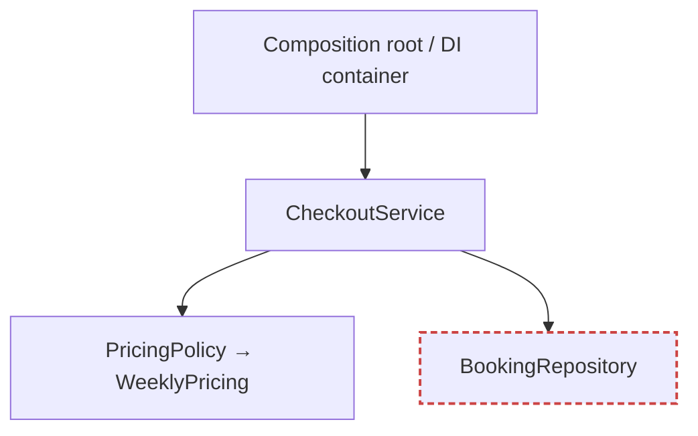
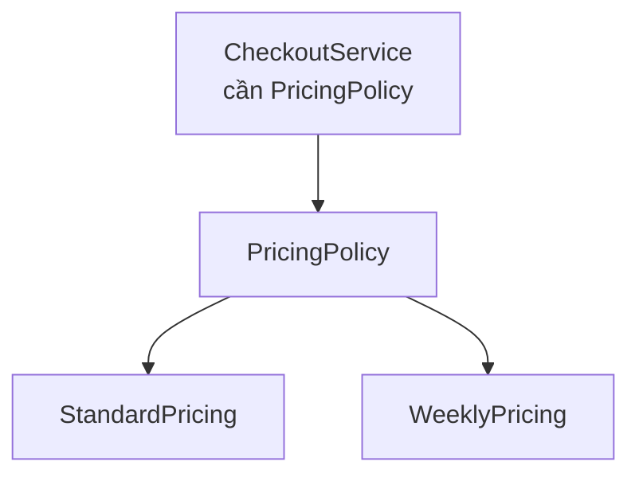
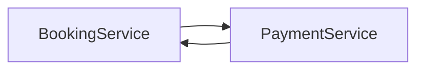

# Kiểm tra đồ thị, thành phần thiếu và đăng ký không rõ ràng

Trong chương **Bộ chứa DI** của module **Dependency Injection**, việc chuyển từ **constructor injection bằng Java thuần** sang một **DI container** làm thay đổi cách ứng dụng lắp ghép đối tượng. Trước đây, composition root gọi `new` và truyền từng phụ thuộc. Khi dùng container, ta khai báo hoặc đăng ký cách tạo các thành phần; container thực hiện việc **tìm, chọn, tạo và nối** các phụ thuộc theo các quy tắc của nó.

Điều này tạo ra một câu hỏi quan trọng: **Làm sao biết đồ thị đối tượng có thể được dựng một cách nhất quán?** Một service có thể yêu cầu thành phần chưa đăng ký; một interface có thể có quá nhiều implementation cùng phù hợp; hai constructor có thể phụ thuộc lẫn nhau; hoặc một singleton có thể vô tình giữ tài nguyên thuộc scope của request.

Kiểm tra đồ thị (*dependency graph validation*) là cách phát hiện những sai sót đó càng gần thời điểm khởi động hoặc kiểm thử cấu hình càng tốt. Đây vẫn là bài học về **DI và Inversion of Control (IoC)**: mã sử dụng phụ thuộc không phải tự tìm đối tượng, nhưng người cấu hình cần đảm bảo rằng mọi phụ thuộc bắt buộc có một lựa chọn hợp lệ và vòng đời phù hợp.

Sau bài này, bạn có thể:

- Vẽ và đọc đồ thị đăng ký phụ thuộc theo **hợp đồng, implementation, qualifier và scope**.
- Phân biệt **thiếu thành phần**, **đăng ký mơ hồ**, **vòng phụ thuộc** và **sai vòng đời**.
- Xác định lúc nào container có thể kiểm tra đồ thị và những lỗi chỉ xuất hiện khi chạy.
- Thiết kế cách chọn implementation rõ ràng tại **composition root** thay vì dựa vào sự tình cờ của thứ tự đăng ký.
- Viết một bộ kiểm tra mô hình đồ thị nhỏ bằng **Java 11 thuần** và kiểm thử các ca lỗi mà không phụ thuộc framework.
- Biết cách chuyển các nguyên tắc này sang cấu hình DI container thực tế, đồng thời không nhầm xác thực cấu hình với kiểm thử hành vi.

## 1. Container kiểm tra những gì?

Giả sử ứng dụng đặt thuê xe có `CheckoutService` phụ thuộc vào `PricingPolicy` và `BookingRepository`:

```java
interface PricingPolicy {
    long quote(int days);
}

interface BookingRepository {
    void save(String bookingId, long amount);
}

final class CheckoutService {
    private final PricingPolicy pricing;
    private final BookingRepository bookings;

    CheckoutService(PricingPolicy pricing, BookingRepository bookings) {
        this.pricing = java.util.Objects.requireNonNull(pricing);
        this.bookings = java.util.Objects.requireNonNull(bookings);
    }
}
```

Constructor thể hiện hai yêu cầu bắt buộc. Một composition root viết bằng Java thuần có thể cấp trực tiếp các instance. Với container, thông tin tương đương nằm ở **định nghĩa/đăng ký** (*registration, binding, bean definition*) và các quy tắc phân giải:

| Câu hỏi | Điều cần xác định |
| --- | --- |
| `CheckoutService` có được đăng ký không? | Có đường tạo instance hoặc factory phù hợp hay không |
| `PricingPolicy` được cấp bằng implementation nào? | Có ít nhất một ứng viên phù hợp với hợp đồng và qualifier yêu cầu |
| Có nhiều `PricingPolicy` cùng phù hợp không? | Có quy tắc lựa chọn rõ ràng để tránh mơ hồ |
| `BookingRepository` có thể được tạo không? | Tất cả phụ thuộc **của chính repository** cũng phải phân giải được |
| Có vòng trong chuỗi constructor không? | Có thể xác định thứ tự tạo hoặc cơ chế hợp lệ theo thiết kế không |
| Scope có tương thích không? | Đối tượng sống lâu có giữ đối tượng theo request sai cách không |
| Tài nguyên tạo ra có được đóng đúng lúc không? | Có chủ sở hữu và cơ chế shutdown cho pool, client, executor không |

**Lưu ý:** không có một quy tắc kiểm tra duy nhất áp dụng cho mọi DI container. Container có thể dựa trên annotation, file cấu hình, module registration, reflection hoặc mã sinh lúc biên dịch. Một số lỗi được phát hiện lúc compile/build, một số lúc startup, và một số chỉ khi một nhánh tạo đối tượng được dùng. Vì vậy cần đọc hành vi của framework và phiên bản cụ thể.

### 1.1. Hai đồ thị liên quan, nhưng không trùng nhau

- **Đồ thị khai báo**: mô tả mỗi definition có thể cung cấp kiểu/hợp đồng nào và nó cần những phụ thuộc nào.
- **Đồ thị instance lúc chạy**: cho biết instance cụ thể nào được tạo, chia sẻ và đang giữ tham chiếu tới instance nào.

Một definition `BookingRepository` được đăng ký theo request scope có thể sinh ra nhiều instance ở những request khác nhau. Một provider có thể chưa tạo instance cho đến khi được gọi. Vì thế kiểm tra đồ thị khai báo giúp phát hiện nhiều lỗi cấu hình, nhưng **không tự chứng minh toàn bộ hành vi runtime**.

## 2. Ba lỗi thường gặp: thiếu, mơ hồ và có vòng

### 2.1. Thiếu thành phần (*missing dependency*)

Đồ thị ban đầu:



`CheckoutService` yêu cầu `BookingRepository` nhưng không có định nghĩa nào phù hợp. Nếu repository là phụ thuộc bắt buộc, container không đủ thông tin để tạo service.

Điều cần kiểm tra:

1. **Đúng kiểu và qualifier chưa?** Đã đăng ký `BookingRepository` hay chỉ đăng ký một hợp đồng khác có tên gần giống?
2. **Có nằm trong phạm vi container hiện tại không?** Một module cấu hình có thể chưa được import/scan/enable.
3. **Có điều kiện môi trường không?** Definition bị loại do profile, feature flag hoặc cấu hình điều kiện.
4. **Các generic có đúng không?** `Repository<Booking>` và `Repository<Customer>` không thể tùy tiện coi là cùng một binding.
5. **Có đang cố dùng dependency tùy chọn cho hành vi bắt buộc không?** Nếu không có repository thì use case đặt thuê không thể lưu đơn, nên không nên âm thầm trả về thành công.

Sửa bằng cách **đăng ký adapter thích hợp** hoặc điều chỉnh hợp đồng constructor cho đúng nhu cầu. Không nên gọi `new JdbcBookingRepository(...)` bên trong `CheckoutService` chỉ để né lỗi container; cách đó làm mất ranh giới DI.

### 2.2. Đăng ký không rõ ràng (*ambiguous dependency*)

Giả sử có hai chính sách giá:

```java
final class StandardPricing implements PricingPolicy {
    @Override
    public long quote(int days) { /* ... */ return 0L; }
}

final class WeeklyPricing implements PricingPolicy {
    @Override
    public long quote(int days) { /* ... */ return 0L; }
}
```

Đoạn trên chỉ minh họa hai implementation; ví dụ Java chạy đầy đủ ở phần 5 có công thức thực. Nếu constructor chỉ yêu cầu `PricingPolicy` và container thấy **nhiều ứng viên hợp lệ ngang nhau**, nó không thể suy ra nghiệp vụ muốn dùng giá thường hay khuyến mãi.



Các cách giải quyết có chủ đích:

- **Qualifier/định danh**: nơi lắp ghép yêu cầu chính xác policy `weekly` hoặc `standard`.
- **Lựa chọn mặc định rõ**: dùng cơ chế primary/default khi phù hợp với quy tắc của container, kèm lý do nghiệp vụ.
- **Đổi hợp đồng**: nếu application cần đồng thời cả hai chính sách, tiêm một cấu trúc hoặc selector có hợp đồng lựa chọn rõ ràng, thay vì đòi một `PricingPolicy` duy nhất.
- **Loại bỏ đăng ký thừa**: nếu chỉ có một policy hợp lệ ở môi trường hiện tại, cấu hình để các definition không phù hợp không tham gia phân giải.

**Không nên dựa vào thứ tự đăng ký** nếu framework không cam kết thứ tự đó quyết định ứng viên. Cũng không nên chọn ngẫu nhiên một policy chỉ để container khởi động, vì đây là quyết định ảnh hưởng trực tiếp đến kết quả nghiệp vụ.

### 2.3. Phụ thuộc vòng (*circular dependency*)



Nếu constructor `BookingService` cần `PaymentService` và constructor `PaymentService` cần lại `BookingService`, một đồ thị constructor bắt buộc như vậy không có thứ tự tạo trực tiếp theo kiểu dựng từ các node lá lên. Một số container phát hiện và từ chối vòng, trong khi cơ chế proxy/lazy hoặc setter ở framework khác có thể xử lý một số trường hợp. **Khả năng cho chương trình khởi động không đồng nghĩa ranh giới trách nhiệm đã tốt.**

Trong một luồng đặt thuê có thanh toán, nguyên nhân có thể là hai service đang cùng điều phối một workflow. Một `CheckoutCoordinator` nhận cả hai service rồi chủ động gọi từng bước thường làm quan hệ rõ hơn:

```text
CheckoutCoordinator
    -> BookingService -> BookingRepository
    -> PaymentService -> PaymentGateway
```

Vòng trong **đồ thị đối tượng bắt buộc** khác với một đối tượng dữ liệu có tham chiếu hai chiều (ví dụ parent/child). Cần xác định đúng đồ thị trước khi kết luận.

## 3. Một phép phân giải cần xem cả hợp đồng và ngữ cảnh

Khi container tìm phụ thuộc, mô tả đơn giản `type → implementation` thường chưa đủ. Một yêu cầu có thể bao gồm:

| Thành phần phân giải | Ví dụ | Vì sao ảnh hưởng kết quả? |
| --- | --- | --- |
| **Hợp đồng / kiểu** | `PricingPolicy` | Chỉ ứng viên tương thích mới có thể cung cấp |
| **Qualifier / tên** | `weekly` | Chọn implementation được công bố cho mục đích cụ thể |
| **Điều kiện / profile** | Chỉ bật adapter JDBC trong production | Tập ứng viên khác giữa môi trường test và production |
| **Generic / tham số kiểu** | `Repository<Booking>` | Phân biệt repository của các mô hình khác nhau |
| **Scope** | Singleton, request, prototype | Ảnh hưởng thời điểm tạo và tính hợp lệ của quan hệ chia sẻ |
| **Factory / provider** | Tạo session theo request | Thời điểm tạo có thể trì hoãn, nhưng hợp đồng vẫn phải rõ |
| **Quy tắc ưu tiên** | Primary/default theo framework | Chỉ có ý nghĩa nếu được cấu hình và công bố minh bạch |

Chú ý **qualifier không có cùng ngữ nghĩa ở mọi framework**. Ví dụ, Spring có cơ chế `@Qualifier` và `@Primary`, còn CDI dùng bộ qualifier và quy tắc phân giải riêng. Mỗi framework cũng có thể xử lý bean name, aliases, generic và conditional registration khác nhau. Không áp một quy tắc chọn ứng viên đơn giản cho mọi hệ thống.

### 3.1. Phân biệt hai dạng "đăng ký trùng"

Một container có thể gặp:

- **Nhiều definition khác nhau cùng cung cấp một interface**: đây có thể là thiết kế hợp lệ, nhưng một điểm injection không chỉ rõ lựa chọn sẽ bị mơ hồ.
- **Hai definition đụng cùng tên/key**: tùy framework, cấu hình có thể bị từ chối, ghi đè hoặc xử lý theo quy tắc cụ thể; vấn đề cần quan sát là binding nào thực sự còn hiệu lực.

Vì vậy, lỗi "đăng ký không rõ ràng" không chỉ là có hai class implements một interface. Cần nhìn **điểm injection** và **tập ứng viên hiệu lực** trong đúng môi trường.

## 4. Khi nào phát hiện lỗi: biên dịch, khởi động hay lúc chạy?

Một số container hoặc công cụ kiểm tra được đồ thị tại build/compile time. Nhiều container kiểm tra trong quá trình khởi tạo context; nhưng bean được tạo lười, provider, điều kiện runtime hoặc đường gọi ít khi dùng có thể làm lỗi xuất hiện muộn.

| Thời điểm | Phát hiện tốt những gì? | Giới hạn |
| --- | --- | --- |
| **Biên dịch / build** | Sai kiểu, metadata/graph được công cụ phân tích tĩnh hỗ trợ | Không biết mọi điều kiện cấu hình và giá trị runtime |
| **Startup / tạo context** | Thiếu binding, ứng viên mơ hồ, nhiều vòng constructor, cấu hình sai được kích hoạt | Không chắc đã khởi tạo mọi bean lazy hoặc mọi scope |
| **Tạo request / gọi provider** | Lỗi trong dependency tạo muộn, request scope hoặc nhánh được chọn khi chạy | Lỗi có thể xảy ra sau khi hệ thống phục vụ traffic |
| **Integration test** | Khả năng kết nối database, API, transaction, timeout, shutdown | Chỉ bao phủ cấu hình và kịch bản thực sự được chạy |

**Fail fast** là mục tiêu tốt cho các phụ thuộc bắt buộc: phát hiện cấu hình sai trước khi nhận request. Nhưng không nên cam kết "context khởi động thành công thì không còn lỗi DI". Lỗi từ các nguồn động hoặc tài nguyên bên ngoài vẫn cần được kiểm tra và xử lý.

### 4.1. Khởi động đúng môi trường cần kiểm chứng

Một đồ thị thành công ở profile `test` không chứng minh profile `production` đã đăng ký đủ thành phần. Ví dụ test dùng `InMemoryBookingRepository`, còn production yêu cầu `JdbcBookingRepository` và `DataSource`. Cấu hình production có thể thiếu nguồn kết nối hoặc có thêm bean trùng.

Cần có kiểm tra độc lập với cấu hình tương ứng; bí mật hoặc tài nguyên mạng không nhất thiết phải dùng thật trong unit test, nhưng **đường phân giải** của các module bắt buộc phải được kiểm tra theo đúng các lựa chọn cấu hình.

## 5. Ví dụ Java 11 thuần: mô tả và kiểm tra đồ thị trước khi lắp ghép

Ví dụ sau **không triển khai DI container**. Nó tạo một bộ kiểm tra metadata nhỏ để thấy cách một điểm injection có thể **thiếu**, **mơ hồ**, **có vòng** hoặc **giữ sai scope**. Sau khi mô hình hợp lệ, `main` vẫn lắp ghép bằng constructor injection để nhấn mạnh ý nghĩa của composition root.

### 5.1. Quy ước riêng của bộ kiểm tra

Để ví dụ ngắn gọn, ta dùng các quy ước **minh họa**, không mặc định trùng với Spring/CDI:

1. Một definition gồm **ID**, kiểu được công bố, qualifier tùy chọn, scope và danh sách phụ thuộc bắt buộc.
2. Yêu cầu **không có qualifier** tìm **mọi** definition cung cấp kiểu tương ứng. Nếu có hơn một ứng viên thì báo mơ hồ.
3. Yêu cầu **có qualifier** chỉ tìm definition có đúng qualifier đó.
4. Với một quan hệ **inject trực tiếp instance**, singleton giữ request-scoped instance được coi là lỗi scope trong mô hình.
5. Chỉ duyệt những definition **có thể đi tới từ root được yêu cầu**. Một definition chưa được tham chiếu có thể chưa được kiểm tra.

Trong container thật, quy tắc qualifier, scope proxy, collection injection, generics, ưu tiên và bean condition cần theo tài liệu framework. Bộ kiểm tra dưới đây chỉ mô phỏng các nguyên lý.

Lưu vào file `DiGraphValidationDemo.java`; yêu cầu **Java 11 trở lên**:

```bash
javac DiGraphValidationDemo.java
java DiGraphValidationDemo
```

```java
import java.util.ArrayDeque;
import java.util.ArrayList;
import java.util.Arrays;
import java.util.Deque;
import java.util.HashSet;
import java.util.List;
import java.util.Objects;
import java.util.Set;
import java.util.stream.Collectors;

public final class DiGraphValidationDemo {
    enum Scope { SINGLETON, REQUEST }

    // Key của một điểm injection: kiểu và qualifier (nếu có).
    static final class Need {
        final Class<?> type;
        final String qualifier;

        private Need(Class<?> type, String qualifier) {
            this.type = Objects.requireNonNull(type);
            this.qualifier = qualifier;
        }

        static Need type(Class<?> type) {
            return new Need(type, null);
        }

        static Need named(Class<?> type, String qualifier) {
            if (qualifier == null || qualifier.isBlank()) {
                throw new IllegalArgumentException("Qualifier required");
            }
            return new Need(type, qualifier);
        }

        @Override
        public String toString() {
            return type.getSimpleName()
                    + (qualifier == null ? "" : "[" + qualifier + "]");
        }
    }

    // Metadata khai báo; chưa có factory hay instance thật.
    static final class Definition {
        final String id;
        final Class<?> provides;
        final String qualifier;
        final Scope scope;
        final List<Need> dependencies;

        Definition(String id, Class<?> provides, String qualifier,
                   Scope scope, Need... dependencies) {
            this.id = Objects.requireNonNull(id);
            this.provides = Objects.requireNonNull(provides);
            this.qualifier = qualifier;
            this.scope = Objects.requireNonNull(scope);
            this.dependencies = List.copyOf(Arrays.asList(dependencies));
        }
    }

    static final class Catalog {
        private final List<Definition> definitions = new ArrayList<>();

        Catalog add(String id, Class<?> provides, String qualifier,
                    Scope scope, Need... dependencies) {
            definitions.add(new Definition(
                    id, provides, qualifier, scope, dependencies));
            return this;
        }

        List<String> validate(Need root) {
            List<String> issues = new ArrayList<>();
            inspect(root, null, new ArrayDeque<>(), new HashSet<>(), issues);
            return issues;
        }

        private void inspect(Need need, Definition parent,
                             Deque<String> active, Set<String> completed,
                             List<String> issues) {
            List<Definition> candidates = definitions.stream()
                    .filter(def -> need.type.equals(def.provides))
                    .filter(def -> need.qualifier == null
                            || need.qualifier.equals(def.qualifier))
                    .collect(Collectors.toList());

            if (candidates.isEmpty()) {
                issues.add("MISSING: " + need);
                return;
            }
            if (candidates.size() > 1) {
                String ids = candidates.stream().map(def -> def.id)
                        .collect(Collectors.joining(", "));
                issues.add("AMBIGUOUS: " + need + " -> " + ids);
                return;
            }

            Definition selected = candidates.get(0);
            if (parent != null
                    && parent.scope == Scope.SINGLETON
                    && selected.scope == Scope.REQUEST) {
                issues.add("SCOPE: " + parent.id + " -> " + selected.id);
            }
            if (active.contains(selected.id)) {
                issues.add("CYCLE: " + String.join(" -> ", active)
                        + " -> " + selected.id);
                return;
            }
            if (completed.contains(selected.id)) {
                return;
            }

            active.addLast(selected.id);
            try {
                for (Need dependency : selected.dependencies) {
                    inspect(dependency, selected, active, completed, issues);
                }
            } finally {
                active.removeLast();
            }
            completed.add(selected.id);
        }
    }

    // Các hợp đồng và một application service.
    interface PricingPolicy {
        long quote(int days);
    }

    static final class WeeklyPricing implements PricingPolicy {
        private final long dailyRate;

        WeeklyPricing(long dailyRate) {
            if (dailyRate <= 0) {
                throw new IllegalArgumentException("Invalid daily rate");
            }
            this.dailyRate = dailyRate;
        }

        @Override
        public long quote(int days) {
            if (days < 1) {
                throw new IllegalArgumentException("Invalid days");
            }
            long gross = Math.multiplyExact(dailyRate, days);
            return days >= 7 ? gross - gross / 10 : gross;
        }
    }

    static final class StandardPricing implements PricingPolicy {
        private final long dailyRate;

        StandardPricing(long dailyRate) {
            if (dailyRate <= 0) {
                throw new IllegalArgumentException("Invalid daily rate");
            }
            this.dailyRate = dailyRate;
        }

        @Override
        public long quote(int days) {
            if (days < 1) {
                throw new IllegalArgumentException("Invalid days");
            }
            return Math.multiplyExact(dailyRate, days);
        }
    }

    interface BookingRepository {
        void save(String bookingId, long amount);
        int count();
    }

    static final class MemoryBookingRepository implements BookingRepository {
        private final List<String> ids = new ArrayList<>();

        @Override
        public void save(String bookingId, long amount) {
            if (bookingId == null || bookingId.isBlank() || amount <= 0) {
                throw new IllegalArgumentException("Invalid booking");
            }
            ids.add(bookingId);
        }

        @Override
        public int count() {
            return ids.size();
        }
    }

    static final class CheckoutService {
        private final PricingPolicy pricing;
        private final BookingRepository repository;

        CheckoutService(PricingPolicy pricing, BookingRepository repository) {
            this.pricing = Objects.requireNonNull(pricing);
            this.repository = Objects.requireNonNull(repository);
        }

        long checkout(String bookingId, int days) {
            if (bookingId == null || bookingId.isBlank()) {
                throw new IllegalArgumentException("Booking ID required");
            }
            long amount = pricing.quote(days);
            repository.save(bookingId, amount);
            return amount;
        }
    }

    // Chỉ dùng để tạo metadata cho trường hợp vòng.
    static final class NodeA {}
    static final class NodeB {}

    private static void mustHave(List<String> issues, String prefix) {
        boolean found = issues.stream()
                .anyMatch(issue -> issue.startsWith(prefix));
        if (!found) {
            throw new AssertionError("Expected " + prefix + ", got " + issues);
        }
    }

    public static void main(String[] args) {
        Need root = Need.type(CheckoutService.class);

        // A. Thiếu BookingRepository.
        Catalog missing = new Catalog()
                .add("checkout", CheckoutService.class, null, Scope.SINGLETON,
                        Need.named(PricingPolicy.class, "weekly"),
                        Need.type(BookingRepository.class))
                .add("weekly", PricingPolicy.class, "weekly", Scope.SINGLETON);
        mustHave(missing.validate(root), "MISSING:");
        System.out.println("Thieu thanh phan: detected");

        // B. Hai ứng viên PricingPolicy cho injection không qualifier.
        Catalog ambiguous = new Catalog()
                .add("checkout", CheckoutService.class, null, Scope.SINGLETON,
                        Need.type(PricingPolicy.class),
                        Need.type(BookingRepository.class))
                .add("weekly", PricingPolicy.class, "weekly", Scope.SINGLETON)
                .add("standard", PricingPolicy.class, "standard", Scope.SINGLETON)
                .add("memoryRepo", BookingRepository.class, null, Scope.SINGLETON);
        mustHave(ambiguous.validate(root), "AMBIGUOUS:");
        System.out.println("Dang ky mo ho: detected");

        // C. Constructor NodeA -> NodeB -> NodeA.
        Catalog cycle = new Catalog()
                .add("a", NodeA.class, null, Scope.SINGLETON,
                        Need.type(NodeB.class))
                .add("b", NodeB.class, null, Scope.SINGLETON,
                        Need.type(NodeA.class));
        mustHave(cycle.validate(Need.type(NodeA.class)), "CYCLE:");
        System.out.println("Vong phu thuoc: detected");

        // D. Singleton đang giữ request-scoped repository trực tiếp.
        Catalog wrongScope = new Catalog()
                .add("checkout", CheckoutService.class, null, Scope.SINGLETON,
                        Need.named(PricingPolicy.class, "weekly"),
                        Need.type(BookingRepository.class))
                .add("weekly", PricingPolicy.class, "weekly", Scope.SINGLETON)
                .add("requestRepo", BookingRepository.class, null, Scope.REQUEST);
        mustHave(wrongScope.validate(root), "SCOPE:");
        System.out.println("Scope khong phu hop: detected");

        // E. Chọn weekly rõ ràng, mọi binding bắt buộc đều có.
        Catalog valid = new Catalog()
                .add("checkout", CheckoutService.class, null, Scope.SINGLETON,
                        Need.named(PricingPolicy.class, "weekly"),
                        Need.type(BookingRepository.class))
                .add("weekly", PricingPolicy.class, "weekly", Scope.SINGLETON)
                .add("standard", PricingPolicy.class, "standard", Scope.SINGLETON)
                .add("memoryRepo", BookingRepository.class, null, Scope.SINGLETON);
        List<String> issues = valid.validate(root);
        if (!issues.isEmpty()) {
            throw new AssertionError("Invalid graph: " + issues);
        }

        // Composition root thật của demo: lắp ghép bằng Java thuần.
        PricingPolicy policy = new WeeklyPricing(100_000L);
        MemoryBookingRepository repository = new MemoryBookingRepository();
        CheckoutService checkout = new CheckoutService(policy, repository);
        long total = checkout.checkout("BK-001", 7);
        if (total != 630_000L || repository.count() != 1) {
            throw new AssertionError("Incorrect checkout result");
        }
        System.out.println("Do thi hop le: " + total + " VND");
        System.out.println("Kiem thu Java thuan: PASS");
    }
}
```

Kết quả dự kiến:

```text
Thieu thanh phan: detected
Dang ky mo ho: detected
Vong phu thuoc: detected
Scope khong phu hop: detected
Do thi hop le: 630000 VND
Kiem thu Java thuan: PASS
```

Với giá `100_000` VND/ngày, 7 ngày có giá gốc `700_000` VND; chính sách giảm 10% còn **630_000 VND**. Các ca lỗi được kiểm tra **trước khi dựng service thực tế**. Trong chương trình thật, container có thể xây dựng và xác thực các định nghĩa này thay cho bộ kiểm tra tự viết.

### 5.2. Đọc đúng kết quả

| Trường hợp | Đồ thị khai báo | Kết luận |
| --- | --- | --- |
| A | `CheckoutService → BookingRepository` không có ứng viên | Thiếu binding bắt buộc |
| B | `CheckoutService → PricingPolicy` có hai ứng viên ngang nhau | Lựa chọn không rõ ràng |
| C | `NodeA → NodeB → NodeA` | Chu trình constructor |
| D | Singleton checkout giữ trực tiếp repository scope request | Sai quan hệ vòng đời theo quy ước của ví dụ |
| E | Checkout chọn `PricingPolicy[weekly]` và có repository | Đồ thị khai báo phù hợp theo các quy tắc mô phỏng |

Ví dụ **không xác thực mã Java bằng reflection**, không khởi tạo theo definition và không thay thế một container thật. Những definition trong `Catalog` là **metadata do người viết khai báo**; một lỗi quên thêm cạnh vào metadata sẽ không được phát hiện. `Catalog.validate(...)` chỉ duyệt từ root được chỉ định, và tên qualifier chỉ là một chuỗi theo quy tắc đơn giản của bài tập. Hành vi thực của Spring/CDI phải được kiểm tra trong chính container đó.

## 6. Phân giải mơ hồ bằng cách giữ quyết định ở nơi lắp ghép

Điểm cần giữ là **consumer không tự đi tìm thành phần**:

```java
// Ví dụ hướng phụ thuộc tốt:
final class QuoteService {
    private final PricingPolicy pricing;

    QuoteService(PricingPolicy pricing) {
        this.pricing = java.util.Objects.requireNonNull(pricing);
    }
}
```

Trong ứng dụng Java thuần, composition root chọn:

```java
// Minh họa: WeeklyPricing được định nghĩa ở phần 5.
PricingPolicy pricing = new DiGraphValidationDemo.WeeklyPricing(100_000L);
// QuoteService service = new QuoteService(pricing);
```

Khi chuyển sang container, có thể định nghĩa tường minh một binding tên `weekly` và chỉ định nó cho điểm injection tương ứng. Nếu chính sách cần được chọn theo **loại khách hàng ở thời điểm request**, thay vì gắn cứng một bean, có thể dùng **PricingPolicySelector** hoặc factory nghiệp vụ có hợp đồng cụ thể. Trong cả hai trường hợp, quyết định chọn chính sách là có chủ đích, không phải "lấy bean đầu tiên".

### 6.1. Ví dụ cấu hình Spring ở mức khái niệm

Đoạn dưới đây **chỉ minh họa ý nghĩa của cấu hình framework**, cần các dependency và import Spring tương ứng, không nằm trong file Java 11 tự chạy ở phần 5:

```java
@Configuration
class PricingConfiguration {
    @Bean("weeklyPricing")
    PricingPolicy weeklyPricing() {
        return new WeeklyPricing(100_000L);
    }

    @Bean("standardPricing")
    PricingPolicy standardPricing() {
        return new StandardPricing(100_000L);
    }

    @Bean
    CheckoutService checkoutService(
            @Qualifier("weeklyPricing") PricingPolicy pricing,
            BookingRepository repository) {
        return new CheckoutService(pricing, repository);
    }
}
```

Ở đây, `@Qualifier("weeklyPricing")` thể hiện ý định của điểm injection. Nhưng ứng dụng vẫn phải có một bean `BookingRepository` hợp lệ. Nếu thiếu, câu chuyện **missing dependency** không thay đổi chỉ vì đã giải quyết được mơ hồ của `PricingPolicy`. Trong code production, constructor injection và phạm vi quét/import cấu hình cũng cần được thiết lập đúng.

Với CDI, cú pháp qualifier và quy tắc chọn bean khác Spring. Không sao chép nguyên cấu hình Spring sang CDI và kỳ vọng ngữ nghĩa tương tự. Hãy dùng tài liệu của container cụ thể để xác định các điểm: bean discovery, qualifier, alternative/priority, scope và lifecycle.

### 6.2. Khi nào cần một collection thay vì một bean?

Nếu `PromotionEngine` có nhiệm vụ **áp dụng nhiều chính sách**, yêu cầu một `PricingPolicy` duy nhất là mô hình sai ngay từ đầu. Có thể dùng một hợp đồng cho tập policy, chẳng hạn `List<DiscountRule>` được sắp xếp theo thứ tự có ý nghĩa. Khi đó việc có nhiều implementation không còn là lỗi mơ hồ: **consumer thật sự cần nhiều ứng viên**. Nhưng thứ tự áp dụng, xung đột quy tắc, cách tổng hợp và điều kiện lỗi phải được định nghĩa rõ.

## 7. Sai scope và vòng đời cũng là lỗi đồ thị

Không phải mọi lỗi đều đến từ việc thiếu hoặc trùng đăng ký. Một graph có đủ binding vẫn có thể sai do vòng đời:

```text
SingletonCheckoutService
    -> RequestScopedBookingContext
```

Nếu singleton giữ **một instance cụ thể** thuộc request scope, nó có thể tái sử dụng dữ liệu request cũ hoặc giữ object sau khi scope đã kết thúc. Một số DI container cung cấp **scoped proxy** hay provider để tra cứu instance hiện hành theo request; cơ chế đó có thể hợp lệ khi được thiết kế đúng. Nhưng tự thêm proxy chỉ để bỏ qua cảnh báo mà không hiểu ngữ nghĩa cũng gây lỗi.

| Thành phần | Scope thường phù hợp | Điểm cần kiểm tra |
| --- | --- | --- |
| `PricingPolicy` bất biến hoặc không giữ state request | Có thể singleton | Các phụ thuộc bên trong có an toàn khi dùng chung không |
| `BookingSettings` bất biến | Một snapshot lúc khởi động nếu cấu hình cố định | Khi cần cập nhật động, xác định provider/snapshot |
| `CheckoutService` không giữ trạng thái request | Có thể tái sử dụng | Không giữ trực tiếp transaction/request context ngắn hạn |
| `BookingSession` hoặc transaction | Theo một thao tác/transaction | Caller phải commit/rollback và đóng theo hợp đồng |
| Connection pool, HTTP client, executor | Thường sống cùng ứng dụng | Có chủ sở hữu và shutdown rõ ràng |
| Request context | Theo request | Không bị đưa vào field chia sẻ sai scope |

**`final` và interface không bảo đảm thread-safety.** Một singleton giữ `ArrayList` hoặc connection có mutable state vẫn có thể gây race condition. Cần kiểm tra cả hợp đồng đồng thời và quyền sở hữu tài nguyên.

### 7.1. Đăng ký hợp lệ chưa đủ để vận hành đúng

Ví dụ, một `JdbcBookingRepository` có thể được container tạo thành công vì `DataSource` đã đăng ký, nhưng database thật từ chối kết nối. Một `NetworkClient` có thể tồn tại nhưng gửi request bị timeout. Đây là lỗi **tích hợp/vận hành**, không phải thiếu bean. Cần thêm integration test, health check và xử lý lỗi phù hợp; không nên xem kiểm tra dependency graph như phép kiểm chứng toàn bộ hệ thống.

## 8. Cách kiểm tra cấu hình DI trong dự án

Một quy trình thực tế kết hợp **kiểm tra tĩnh, khởi động, unit test và integration test**:

1. **Chọn root quan trọng:** entry point web/application, background worker, scheduler và những module có lifecycle riêng.
2. **Liệt kê các hợp đồng bắt buộc:** đọc constructor của service và definition; ghi rõ type, qualifier, generic, điều kiện cấu hình và scope.
3. **Kiểm tra tập ứng viên:** với mỗi điểm injection, xác định có đúng một lựa chọn theo ngữ nghĩa của container, hoặc một tập/selector nếu consumer cần nhiều implementation.
4. **Tìm vòng constructor và quan hệ scope nguy hiểm:** không coi provider/lazy là giải pháp mặc định cho vòng thiết kế.
5. **Khởi tạo context trong test cho các cấu hình chính:** tối thiểu test, staging và đường production quan trọng; kiểm tra cả bean được tạo lười hoặc scope cần thiết nếu chúng là thành phần bắt buộc.
6. **Kiểm tra hành vi ngoài đồ thị:** test use case bằng fake/in-memory adapter, rồi test adapter thật với database/API, transaction và shutdown.
7. **Giữ thông báo lỗi có ngữ cảnh:** nêu root, điểm injection, type/qualifier thiếu hoặc danh sách ứng viên trùng để sửa nhanh.

### 8.1. Ma trận kiểm thử gợi ý

| Kịch bản | Kỳ vọng ở bước kiểm tra | Kỳ vọng trong runtime/test |
| --- | --- | --- |
| Thiếu `BookingRepository` | Báo thiếu bean/binding bắt buộc | Không tạo một `CheckoutService` thiếu repository |
| Hai policy cùng hợp lệ nhưng chưa chọn | Báo mơ hồ theo quy tắc container | Không chọn ngẫu nhiên một policy |
| Chỉ định `weekly` rõ ràng | Phân giải được đúng policy | Tính tiền đúng quy tắc giảm giá |
| Vòng constructor A–B–A | Báo vòng hoặc không dựng được graph trực tiếp | Cần xem lại coordinator/ranh giới |
| Singleton giữ request instance trực tiếp | Báo lỗi/cảnh báo theo công cụ hoặc review | Không rò dữ liệu qua request |
| Bean lazy thiếu dependency | Có thể chỉ lộ khi được tạo | Test ép tạo nhánh bắt buộc |
| Root đúng nhưng database không kết nối | Graph validation có thể vẫn pass | Integration test phải phát hiện lỗi I/O |

Trong **Java thuần**, có thể kiểm thử luồng cuối cùng bằng cách tạo instance thực và fake tại composition root. Trong **DI container**, thêm test "context starts" có ích, nhưng phải kiểm tra kết quả nghiệp vụ và các nhánh lỗi tương ứng. Không nên viết hàng trăm test chỉ xác nhận mỗi bean có thể được gọi `getBean()` nếu chúng không bổ sung điều kiện quan trọng.

## 9. Những cách sửa nhanh dễ che lỗi

| Cách làm | Vì sao nguy hiểm | Hướng giải quyết |
| --- | --- | --- |
| Dùng `new` adapter bên trong consumer khi container báo thiếu | Consumer bị trói vào hạ tầng, khó kiểm thử | Đăng ký adapter ở composition root/configuration |
| Gắn `@Primary` tùy tiện vào một implementation bất kỳ | Che quyết định nghiệp vụ, khó nhận ra khi thêm policy | Chọn policy có chủ đích và ghi rõ lý do |
| Đổi phụ thuộc bắt buộc sang nullable/optional để context khởi động | Lỗi chuyển đến runtime, use case có thể chạy thiếu chức năng | Giữ required dependency nếu chức năng bắt buộc |
| Dùng tên bean/string magic ở nhiều nơi | Dễ lỗi chính tả, khó refactor | Đặt tên/qualifier nhất quán tại ranh giới cấu hình |
| Bật cơ chế cho phép circular reference mà chưa phân tích | Vòng trách nhiệm bị che, invariant khởi tạo khó hiểu | Tách coordinator hoặc trích xuất phần chung |
| Inject container/service locator vào mọi service | Không nhìn constructor là biết đủ phụ thuộc | Constructor injection qua hợp đồng rõ |
| Tin rằng context startup pass nghĩa là graph production pass | Có profile khác, bean lazy, condition runtime | Kiểm tra môi trường và đường tạo quan trọng |
| Mặc định bean singleton đều thread-safe | Race condition khi dependency có state | Xét scope, đồng bộ và ownership |
| Quét toàn bộ package/module không kiểm soát | Đăng ký thừa, trùng ứng viên, khó giải thích wiring | Tổ chức module config và tập bean được công bố rõ |

## 10. Bài tập tự đánh giá

**Bài 1 — Thiếu thành phần.** `CheckoutService` nhận `PricingPolicy` và `BookingRepository`. Container có `WeeklyPricing` nhưng module chứa `JdbcBookingRepository` chưa được import. Đây là lỗi gì và nên sửa ở đâu?

*Gợi ý:* Thiếu binding `BookingRepository` ở cấu hình hiệu lực. Kiểm tra module discovery/import và đăng ký adapter. Không thêm `new` JDBC repository vào service.

**Bài 2 — Mơ hồ.** `WeeklyPricing` và `StandardPricing` đều có thể cung cấp `PricingPolicy`, còn constructor chỉ khai báo `PricingPolicy`. Làm sao tránh sự lựa chọn tình cờ?

*Gợi ý:* Chỉ định policy qua qualifier hoặc một cơ chế selection phù hợp, hoặc thiết kế selector nếu chọn theo request. Cần bảo đảm mọi implementation cùng tôn trọng hợp đồng.

**Bài 3 — Hai definition trùng key.** Một module đăng ký bean tên `bookingRepo`, module khác đăng ký cùng tên. Có thể khẳng định bean nào sẽ được dùng không?

*Gợi ý:* Không nếu chưa biết quy tắc container. Một số hệ từ chối trùng, một số có cơ chế override hoặc precedence. Cần kiểm tra cấu hình hiệu lực và loại bỏ sự mơ hồ ngoài chủ đích.

**Bài 4 — Vòng.** `BookingService` có constructor nhận `PaymentService`, còn `PaymentService` nhận `BookingService`. Đổi một tham số thành `Supplier<BookingService>` có chắc sửa được vấn đề không?

*Gợi ý:* Chỉ trì hoãn việc tạo/truy cập. Trách nhiệm có thể vẫn vòng và lỗi có thể chuyển đến runtime. Xem xét một `CheckoutCoordinator` hoặc phân tách policy/port theo đúng use case.

**Bài 5 — Scope.** Một bean singleton nhận thẳng instance `RequestContext`. Test startup chạy được do framework dùng proxy. Có thể kết luận mọi request đều an toàn chưa?

*Gợi ý:* Chưa. Xác minh proxy/provider lấy context đúng scope, không truy cập ngoài request và không giữ mutable state sai chỗ. Không suy ra hành vi từ việc container khởi động.

**Bài 6 — Lazy.** Một provider chỉ được gọi khi người dùng yêu cầu tải báo cáo. Container khởi động thành công nhưng provider chưa có dependency cần thiết. Cần kiểm tra gì?

*Gợi ý:* Test ép tạo dependency trong đường báo cáo và kiểm tra cấu hình tương ứng. Một số container sẽ không thấy lỗi này lúc startup.

**Bài 7 — Đồ thị hợp lệ nhưng lỗi I/O.** `CheckoutService`, `BookingRepository` và `DataSource` đều được inject thành công, nhưng database từ chối kết nối. Graph validator có sai không?

*Gợi ý:* Không nhất thiết. Nó xác nhận cấu hình phụ thuộc chứ không bảo đảm kết nối và giao dịch thực. Cần integration test và quan sát vận hành.

## 11. Checklist trước khi chấp nhận cấu hình container

- Mỗi **constructor dependency bắt buộc** có ứng viên phù hợp trong **đúng môi trường** chưa?
- Có nhiều implementation cùng phù hợp không? Nếu có, **quy tắc chọn** đã rõ ràng và có ý nghĩa nghiệp vụ chưa?
- Qualifier/tên, generic, conditional registration và profile có được kiểm tra theo **container thực tế** chưa?
- Có vòng trong các phụ thuộc constructor hoặc vòng trách nhiệm đang bị lazy/provider che khuất không?
- Singleton, request scope, transaction và tài nguyên dài hạn có được lắp ghép với vòng đời tương thích không?
- Composition root/configuration có giữ quyền chọn adapter, thay vì service tự tìm bằng container lookup không?
- Có test khởi tạo graph cho những cấu hình chính, kể cả bean lazy/phụ thuộc tạo muộn quan trọng không?
- Có test hành vi với Java thuần hoặc fake/in-memory adapter và integration test với hệ thống ngoài không?
- Lỗi thiếu/mơ hồ/vòng có đủ thông tin về **type, qualifier, root và đường phụ thuộc** để chẩn đoán không?

**Kiểm tra đồ thị phụ thuộc** giúp biến lỗi lắp ghép thành lỗi được nhìn thấy sớm và có thể sửa có chủ đích. **Thành phần thiếu** yêu cầu bổ sung binding đúng nơi; **đăng ký không rõ ràng** yêu cầu quyết định implementation minh bạch; **vòng và sai scope** yêu cầu xem lại ranh giới trách nhiệm và vòng đời. Từ constructor injection và composition root trong Java thuần đến DI container, mục tiêu nhất quán là để mã nghiệp vụ khai báo đúng những gì nó cần, còn nơi lắp ghép bảo đảm các phụ thuộc đó được tạo, lựa chọn và quản lý một cách rõ ràng.
