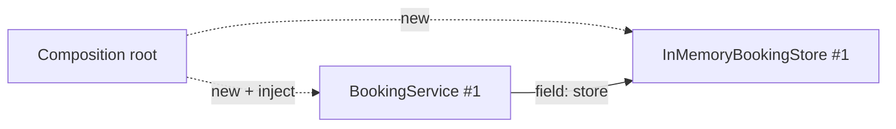
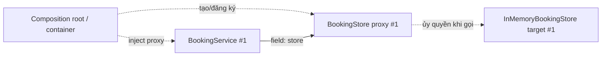
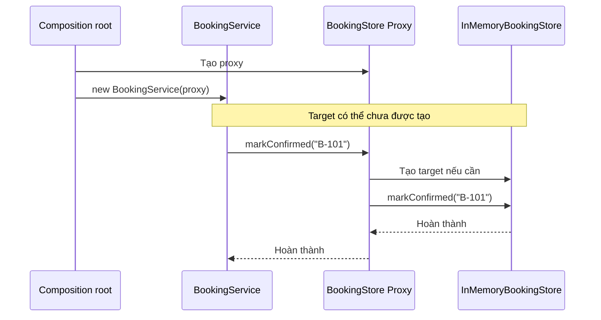
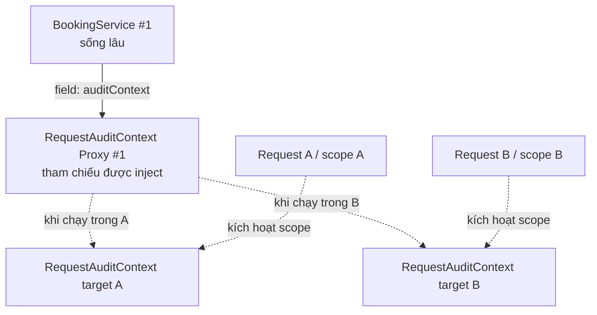
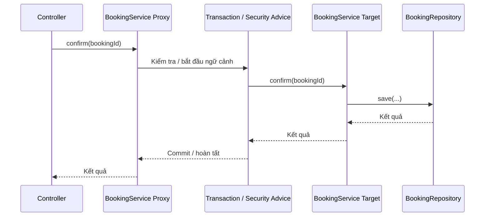

# Proxy và khác biệt giữa tham chiếu được nhận với đối tượng đích

## 1. Constructor được tiêm một tham chiếu, nhưng tham chiếu đó có thể không phải target

Khi học **Dependency Injection (DI)** bằng Java thuần, ta thường hình dung một dependency như sau:

```java
BookingStore store = new InMemoryBookingStore();
BookingService service = new BookingService(store);
```

Ở đây `BookingService` nhận chính tham chiếu đến `InMemoryBookingStore`. Tuy nhiên, **DI container** có thể cấp cho service **một proxy** thay vì trực tiếp cấp đối tượng thực hiện nghiệp vụ (*target object*). Proxy là một đối tượng đứng ở giữa, nhận lời gọi từ consumer và thực hiện một thao tác trung gian trước khi chuyển lời gọi đến target phù hợp.

```text
BookingService
    |
    | field BookingStore
    v
BookingStore Proxy
    |
    | chuyển tiếp lời gọi khi cần
    v
BookingStore Target
```

Điểm cốt lõi:

> **Tham chiếu mà consumer giữ là tham chiếu đến đối tượng được inject. Khi có proxy, đối tượng được inject và target có thể là hai instance khác nhau.**

Điều này không phá vỡ **constructor injection**. Constructor vẫn nhận một dependency có hợp đồng phù hợp và không cần biết ai tạo nó. Sự khác biệt nằm ở **hành vi khi gọi phương thức, danh tính object, thời điểm khởi tạo và scope của target**.

Bài học thuộc chương **Bộ chứa DI** của module **DEPENDENCY_INJECTION**. Module giúp hiểu **Dependency Injection** và **Inversion of Control (IoC)** để tách việc *sử dụng phụ thuộc* khỏi quá trình *tạo và lắp ghép đối tượng*; thực hành **constructor injection, composition root, quản lý scope/vòng đời và kiểm thử bằng Java thuần** trước khi mở rộng sang DI container. Dù proxy thường do container hoặc thư viện AOP tạo, ta sẽ dựng một **JDK dynamic proxy** bằng Java thuần để quan sát chính xác chuyện gì xảy ra.

## 2. Phân biệt proxy, target, hợp đồng và consumer

Một thiết kế có proxy thường có bốn vai trò:

| Vai trò | Trong ví dụ đặt chỗ | Trách nhiệm |
| --- | --- | --- |
| **Consumer** | `BookingService` | Sử dụng hành vi lưu trạng thái, không trực tiếp quản lý proxy/target. |
| **Hợp đồng** (*contract*) | `BookingStore` | Mô tả những thao tác consumer cần. |
| **Proxy** | Một object triển khai `BookingStore`, được tạo bằng `java.lang.reflect.Proxy` | Nhận lời gọi, có thể log/kiểm soát/lựa chọn target rồi chuyển tiếp. |
| **Target** | `InMemoryBookingStore` | Thực hiện thao tác lưu trạng thái thật của ví dụ. |

Một proxy có thể đứng trước target vì nhiều lý do:

- **Lazy initialization:** trì hoãn tạo target cho tới lần sử dụng đầu tiên.
- **Scope:** cho phép một tham chiếu proxy sống lâu, trong khi target được lấy theo request/session hoặc phạm vi khác.
- **AOP / interceptor:** áp dụng hành vi bao quanh lời gọi như quản lý giao dịch, kiểm tra quyền hoặc ghi số liệu.
- **Remote proxy / client abstraction:** che một phần cơ chế gọi từ xa phía sau hợp đồng. Cần nhớ lời gọi từ xa có đặc tính lỗi, độ trễ và dữ liệu khác lời gọi local.
- **Decorator-like behavior:** thêm logging, caching hoặc kiểm soát truy cập theo một hợp đồng được định nghĩa rõ.

**Không phải mọi dependency do container inject đều là proxy.** Có container cấp thẳng instance thật, có thể cấp proxy ở một số trường hợp được cấu hình; cách tạo, giới hạn và thời điểm liên kết target phụ thuộc framework và cấu hình.

**Không phải mọi proxy đều lazy.** Một proxy có thể có target sẵn ngay khi được tạo và chỉ dùng để chặn lời gọi AOP. Ngược lại, một proxy theo request có thể lấy **target khác nhau** ở các request khác nhau, chứ không nhất thiết cache một target duy nhất.

## 3. Object graph: hai nút thay vì một nút

Nếu inject trực tiếp, object graph được đơn giản hóa như sau:



Khi có proxy:



Điểm khác nhau:

1. `BookingService.store` trỏ vào **proxy**, không nhất thiết trỏ vào `InMemoryBookingStore`.
2. Proxy có **danh tính instance riêng**. Hai object có thể cùng thực hiện `BookingStore` nhưng không phải cùng tham chiếu.
3. Target có thể **chưa tồn tại** khi consumer được tạo, hoặc được **tra cứu lại tùy scope** ở thời điểm gọi.
4. Đường chấm “ủy quyền” trong sơ đồ có thể là **quan hệ được giải quyết động**; proxy không nhất thiết luôn giữ một trường cố định trỏ tới một target.

### Phân biệt chiều tham chiếu và đường lời gọi

Object graph mô tả ai đang giữ tham chiếu đến ai. **Call flow** mô tả phương thức chạy qua các bước nào. Với lazy proxy, `BookingService` có cạnh tham chiếu đến proxy ngay sau constructor, nhưng lời gọi đầu tiên mới dẫn đến việc tạo target.



Không nên vẽ sơ đồ với mũi tên “`BookingService -> Target`” rồi kết luận service nhận target trực tiếp, nếu thực tế constructor đã được cấp proxy.

## 4. Danh tính và kiểu: `==`, `equals`, `getClass`, `instanceof`

Cần phân biệt **kiểu hợp đồng** và **danh tính instance**.

```java
BookingStore proxy = /* object triển khai BookingStore */;
BookingStore target = /* object thật */;
```

Nếu thực sự là hai instance riêng:

- `proxy == target` trả về `false`.
- Cả hai có thể dùng được qua kiểu `BookingStore`.
- `proxy.getClass()` có thể là lớp proxy sinh ra động, không phải `InMemoryBookingStore.class`.
- `proxy.equals(target)` **không có kết quả cố định cho mọi framework**; tùy hợp đồng `equals` của proxy/target.
- `hashCode()` và `toString()` cũng có thể được proxy xử lý khác nhau; không nên xem đó là phép “mở proxy” để lấy target.

| Phép kiểm tra | Nó trả lời điều gì? | Điều cần tránh |
| --- | --- | --- |
| `proxy == target` | Có đúng cùng một object theo danh tính tham chiếu không? | Không dùng `equals` thay cho `==` khi cần kiểm tra identity. |
| `proxy instanceof BookingStore` | Proxy có thỏa hợp đồng kiểu `BookingStore` không? | Không suy ra rằng proxy là một `InMemoryBookingStore`. |
| `proxy.getClass()` | Class runtime của **proxy**. | Không mặc định nó bằng class của target. |
| `Proxy.isProxyClass(proxy.getClass())` | Đây có phải **JDK dynamic proxy class** không? | Không dùng để phát hiện *mọi* loại proxy; subclass-based proxy sẽ không nhất thiết được nhận diện. |
| `proxy.equals(other)` | Bình đẳng theo chính sách do implementation định nghĩa. | Không suy ra target identity hay scope từ kết quả. |

Một quy tắc thiết kế quan trọng: **consumer nên phụ thuộc vào hợp đồng**, không cast dependency về lớp triển khai để gọi các phương thức riêng:

```java
// Dễ lỗi nếu store được inject là JDK proxy:
InMemoryBookingStore concrete = (InMemoryBookingStore) store;
```

Một JDK dynamic proxy tạo từ interface `BookingStore` **không phải** instance của `InMemoryBookingStore`, nên phép ép kiểu trên có thể ném `ClassCastException`. Nếu consumer cần một hành vi cụ thể, hãy xem lại hợp đồng nó thật sự cần thay vì dựa vào class triển khai.

## 5. Hai cơ chế phổ biến: interface proxy và subclass proxy

### 5.1. JDK dynamic proxy

`java.lang.reflect.Proxy` của JDK có thể sinh ra một object **triển khai một hoặc nhiều interface**. `InvocationHandler` nhận các lời gọi phương thức và quyết định cách xử lý hoặc chuyển tiếp:

```java
BookingStore proxy = (BookingStore) java.lang.reflect.Proxy.newProxyInstance(
        BookingStore.class.getClassLoader(),
        new Class<?>[] { BookingStore.class },
        handler);
```

Đây là kỹ thuật dùng ở ví dụ chạy được ở mục 6. Với JDK dynamic proxy được tạo theo interface như trên:

- Object proxy triển khai `BookingStore`.
- Object proxy **không cần kế thừa** `InMemoryBookingStore`.
- Các lời gọi qua phương thức của interface đi vào `InvocationHandler`.
- Phép cast về một class triển khai cụ thể **không phù hợp** nếu class đó không thuộc kiểu của proxy.

### 5.2. Subclass-based proxy

Một số thư viện/container có thể tạo proxy là **lớp con** của target class. Trường hợp đó `instanceof TargetClass` có thể đúng, nhưng điều này **không làm proxy và target thành một instance duy nhất**. Kỹ thuật proxy kiểu kế thừa thường chịu ràng buộc từ Java, chẳng hạn lớp `final` không thể bị kế thừa và một số phương thức `final`/`private` không thể bị override để chặn lời gọi theo cách thông thường.

**Chi tiết phụ thuộc công cụ:** cách khởi tạo, khả năng chặn phương thức, xử lý constructor/field và đối tượng đích của subclass proxy phụ thuộc vào framework. Không nên suy từ ví dụ JDK dynamic proxy rằng mọi container đều tạo proxy như vậy.

### 5.3. Khi chọn kiểu để inject

Constructor có chữ ký:

```java
BookingService(BookingStore store)
```

thường linh hoạt hơn constructor yêu cầu lớp cụ thể:

```java
BookingService(InMemoryBookingStore store)
```

khi hệ thống sử dụng **proxy dựa trên interface**. Tuy nhiên, tạo interface chỉ để “có proxy” mà không diễn đạt một nhu cầu thật sự cũng không phải lúc nào là thiết kế tốt. Từ góc độ **Dependency Inversion Principle (DIP)**, hợp đồng nên phản ánh hành vi consumer cần; từ góc độ container, kiểu inject phải tương thích với cơ chế proxy được sử dụng.

## 6. Java thuần hoàn chỉnh: consumer nhận proxy, target chỉ tạo ở lần dùng đầu

Ta sẽ minh họa **lazy proxy có cache một target**. Ví dụ có những đặc điểm có thể quan sát rõ:

1. Composition root tạo proxy rồi inject vào `BookingService`.
2. Sau lắp ghép, số target thực sự được tạo vẫn là **0**.
3. Lời gọi `confirm(...)` đi qua proxy, khiến factory tạo target **một lần**.
4. Lời gọi `isConfirmed(...)` tiếp tục dùng **cùng target**.
5. `proxy == target` là **false** dù các phương thức nghiệp vụ hoạt động bình thường.

Lưu toàn bộ mã sau vào **`Main.java`**, dùng **JDK 11 trở lên**, không cần DI container hay framework.

```java
import java.lang.reflect.InvocationHandler;
import java.lang.reflect.InvocationTargetException;
import java.lang.reflect.Method;
import java.lang.reflect.Proxy;
import java.util.HashSet;
import java.util.Objects;
import java.util.Set;
import java.util.concurrent.atomic.AtomicInteger;
import java.util.concurrent.atomic.AtomicReference;
import java.util.function.Supplier;

public class Main {
    // Hợp đồng consumer thực sự cần.
    public interface BookingStore {
        void markConfirmed(String bookingId);
        boolean isConfirmed(String bookingId);
    }

    // Target thực hiện hành vi lưu trữ.
    static final class InMemoryBookingStore implements BookingStore {
        private final Set<String> confirmed = new HashSet<>();

        @Override
        public void markConfirmed(String bookingId) {
            confirmed.add(bookingId);
        }

        @Override
        public boolean isConfirmed(String bookingId) {
            return confirmed.contains(bookingId);
        }
    }

    // Consumer không phân biệt proxy hay target trực tiếp.
    static final class BookingService {
        private final BookingStore store;

        BookingService(BookingStore store) {
            this.store = Objects.requireNonNull(store, "store");
        }

        void confirm(String bookingId) {
            if (bookingId == null || bookingId.isBlank()) {
                throw new IllegalArgumentException("bookingId không hợp lệ");
            }
            store.markConfirmed(bookingId);
        }

        boolean isConfirmed(String bookingId) {
            return store.isConfirmed(bookingId);
        }
    }

    // Handler này cache một target sau khi tạo thành công.
    static final class LazyStoreHandler implements InvocationHandler {
        private final Supplier<? extends BookingStore> factory;
        private final boolean trace;
        private volatile BookingStore target;

        LazyStoreHandler(Supplier<? extends BookingStore> factory,
                         boolean trace) {
            this.factory = Objects.requireNonNull(factory, "factory");
            this.trace = trace;
        }

        private BookingStore target() {
            BookingStore current = target;

            if (current == null) {
                synchronized (this) {
                    current = target;
                    if (current == null) {
                        current = Objects.requireNonNull(
                                factory.get(), "factory trả về null");
                        target = current;
                    }
                }
            }

            return current;
        }

        @Override
        public Object invoke(Object proxy, Method method, Object[] args)
                throws Throwable {
            // Trong ví dụ này: Object methods dùng identity của proxy,
            // không cần tạo target chỉ để gọi equals/hashCode/toString.
            if (method.getDeclaringClass() == Object.class) {
                switch (method.getName()) {
                    case "equals":
                        return proxy == args[0];
                    case "hashCode":
                        return System.identityHashCode(proxy);
                    case "toString":
                        return "LazyBookingStoreProxy";
                    default:
                        throw new IllegalStateException("Object method lạ");
                }
            }

            if (trace) {
                System.out.println("Proxy chuyển tiếp: " + method.getName());
            }

            try {
                return method.invoke(target(), args);
            } catch (InvocationTargetException failure) {
                // Không bắt consumer phải nhìn thấy lớp wrapper reflection.
                throw failure.getCause();
            }
        }
    }

    // Factory tạo một reference proxy, không tạo target ngay.
    static BookingStore newLazyProxy(
            Supplier<? extends BookingStore> factory, boolean trace) {
        InvocationHandler handler = new LazyStoreHandler(factory, trace);

        return (BookingStore) Proxy.newProxyInstance(
                BookingStore.class.getClassLoader(),
                new Class<?>[] { BookingStore.class },
                handler);
    }

    public static void main(String[] args) {
        // COMPOSITION ROOT: chọn cơ chế cung cấp dependency.
        AtomicInteger creations = new AtomicInteger();
        AtomicReference<InMemoryBookingStore> actualTarget =
                new AtomicReference<>();

        BookingStore received = newLazyProxy(() -> {
            creations.incrementAndGet();
            System.out.println("Tạo target thật");
            InMemoryBookingStore created = new InMemoryBookingStore();
            actualTarget.set(created);
            return created;
        }, true);

        BookingService service = new BookingService(received);

        System.out.println("Số target sau wiring: " + creations.get());
        System.out.println("Tham chiếu là JDK proxy? "
                + Proxy.isProxyClass(received.getClass()));

        service.confirm("B-101");
        System.out.println("Đã xác nhận? " + service.isConfirmed("B-101"));

        System.out.println("Số target sau sử dụng: " + creations.get());
        System.out.println("Proxy == target? "
                + (received == actualTarget.get()));
    }
}
```

Biên dịch và chạy:

```bash
javac -encoding UTF-8 Main.java
java Main
```

Kết quả dự kiến:

```text
Số target sau wiring: 0
Tham chiếu là JDK proxy? true
Proxy chuyển tiếp: markConfirmed
Tạo target thật
Proxy chuyển tiếp: isConfirmed
Đã xác nhận? true
Số target sau sử dụng: 1
Proxy == target? false
```

### Đọc các dòng log theo thứ tự

- `newLazyProxy(...)` tạo **proxy** nhưng không thực thi lambda factory.
- `new BookingService(received)` cấp cho consumer một **tham chiếu hợp lệ** của `BookingStore`.
- `Proxy.isProxyClass(...)` xác nhận tham chiếu nhận được là **JDK dynamic proxy**, không đòi hỏi truy cập target.
- `service.confirm(...)` gọi `store.markConfirmed(...)`. Handler log lời gọi, tạo target và chuyển tiếp method.
- `service.isConfirmed(...)` chuyển tiếp qua proxy nhưng không tạo thêm target vì handler đã cache instance.
- `received == actualTarget.get()` trả về `false`: tham chiếu được inject và đối tượng đích là hai object khác nhau.

**Lưu ý học thuật:** `creations` đếm số lần factory được gọi, không phải số lượng tất cả object trong JVM. Ví dụ dùng `AtomicReference` chỉ để quan sát target từ mã demo; trong ứng dụng thực, consumer không nên phụ thuộc vào việc “mở proxy” để lấy implementation.

### Vì sao `volatile` và `synchronized` cùng xuất hiện?

Handler sử dụng cơ chế **double-checked locking** để tránh khởi tạo **nhiều target thành công** khi nhiều luồng gọi proxy lần đầu:

- `volatile` bảo đảm việc công bố và quan sát tham chiếu `target` đúng theo Java Memory Model.
- `synchronized` chỉ cho một luồng vào vùng thực hiện factory tại một thời điểm.
- Lần kiểm tra `target == null` bên trong lock tránh tạo lại khi luồng khác vừa khởi tạo xong.

Nhưng **khởi tạo an toàn không làm chính target an toàn luồng**. `InMemoryBookingStore` dùng `HashSet`, chỉ minh họa cho chương trình chạy tuần tự. Nếu dùng chung trong web server nhiều request đồng thời, cần thiết kế kho dữ liệu và chính sách đồng thời riêng.

### Nếu factory ném lỗi?

Trong ví dụ, handler chỉ gán `target` sau khi factory trả về object khác null. Nếu factory thất bại, `target` vẫn null và một lời gọi sau có thể **thử tạo lại**. Đây là chính sách của **đoạn mã minh họa**, không phải quy tắc chung của DI container. Một container có thể cache lỗi, tạo lại, báo lỗi scope hoặc áp dụng hành vi khác.

Factory nào đã mở tài nguyên rồi thất bại **trước khi trả object** vẫn phải tự dọn phần tài nguyên chưa bàn giao; proxy không thể đóng một object mà nó chưa nhận được.

## 7. Kiểm thử proxy bằng Java thuần: reference, target và thời điểm tạo

Thêm class sau **bên ngoài class `Main`** nhưng trong cùng file `Main.java` ở mục 6. Test kiểm tra rằng việc inject không tạo target, lời gọi đầu tạo target, các lời gọi tiếp theo dùng lại target, và `equals` trong **proxy minh họa này** dùng quy tắc identity đã định nghĩa ở handler.

```java
class ProxySemanticsTest {
    public static void main(String[] args) {
        java.util.concurrent.atomic.AtomicInteger creations =
                new java.util.concurrent.atomic.AtomicInteger();
        java.util.concurrent.atomic.AtomicReference<Main.InMemoryBookingStore>
                target = new java.util.concurrent.atomic.AtomicReference<>();

        Main.BookingStore proxy = Main.newLazyProxy(() -> {
            creations.incrementAndGet();
            Main.InMemoryBookingStore store =
                    new Main.InMemoryBookingStore();
            target.set(store);
            return store;
        }, false);

        Main.BookingService service = new Main.BookingService(proxy);

        if (creations.get() != 0) {
            throw new AssertionError("Target bị tạo trước khi dùng");
        }
        if (!java.lang.reflect.Proxy.isProxyClass(proxy.getClass())) {
            throw new AssertionError("Không nhận được JDK proxy");
        }
        if (!proxy.equals(proxy)
                || proxy.hashCode() != System.identityHashCode(proxy)
                || !"LazyBookingStoreProxy".equals(proxy.toString())) {
            throw new AssertionError("Object methods của proxy không đúng");
        }
        if (creations.get() != 0) {
            throw new AssertionError(
                    "Object methods không nên ép tạo target trong ví dụ");
        }

        service.confirm("B-TEST");

        if (creations.get() != 1 || target.get() == null) {
            throw new AssertionError("Target chưa được tạo đúng một lần");
        }
        if (!service.isConfirmed("B-TEST") || creations.get() != 1) {
            throw new AssertionError(
                    "Proxy không chuyển tiếp hoặc không cache target");
        }
        if (proxy == target.get() || proxy.equals(target.get())) {
            throw new AssertionError("Proxy và target bị nhầm danh tính");
        }

        boolean invalidInputRejected = false;
        try {
            service.confirm("  ");
        } catch (IllegalArgumentException expected) {
            invalidInputRejected = true;
        }
        if (!invalidInputRejected) {
            throw new AssertionError("Service bỏ qua kiểm tra đầu vào");
        }

        System.out.println("PASS: proxy, target, identity và lazy cache");
    }
}
```

Chạy:

```bash
javac -encoding UTF-8 Main.java
java ProxySemanticsTest
```

Kết quả dự kiến:

```text
PASS: proxy, target, identity và lazy cache
```

Test trên kiểm tra **implementation proxy do chính bài viết tạo**. Nó **không** chứng minh proxy của mọi framework có cùng quy tắc `equals`, cùng cách cache target hay cùng cơ chế xử lý lỗi. Khi dùng container thật, hãy kiểm tra hành vi được đặc tả của container và viết test ở ranh giới cần bảo đảm.

## 8. Scoped proxy: một tham chiếu ổn định, nhiều target theo ngữ cảnh

Lazy proxy ở mục 6 cache **một target** sau lần khởi tạo đầu. Nhưng không phải mọi proxy đều như vậy. Một trường hợp phổ biến khác là **scoped proxy**.

Giả sử `BookingService` tồn tại trong suốt ứng dụng, còn `RequestAuditContext` chứa thông tin của **mỗi HTTP request**. Nếu inject thẳng một instance `RequestAuditContext` vào singleton service, ta có nguy cơ giữ dữ liệu request sai vòng đời. Một scoped proxy có thể cho phép service giữ một tham chiếu ổn định nhưng **tra cứu target đúng request đang xử lý** mỗi khi cần.



Bảng so sánh:

| Thời điểm | Tham chiếu consumer giữ | Target được giải quyết |
| --- | --- | --- |
| Lắp ghép singleton service | `RequestAuditContext proxy #1` | Có thể chưa có target cho request nào. |
| Đang xử lý request A | **Cùng** proxy #1 | `target A` thuộc request A. |
| Đang xử lý request B | **Cùng** proxy #1 | `target B` thuộc request B. |
| Ngoài request scope hợp lệ | Vẫn là proxy #1 | Có thể báo lỗi “không có active scope” tùy framework. |

**Tính chất quan trọng:** `proxy == proxy` vẫn đúng giữa các lần gọi vì đó là cùng tham chiếu. Nhưng `target A != target B` có thể đúng. Đừng ghi nhớ câu “proxy luôn có một target duy nhất”; điều đó **không đúng với mọi scoped proxy**.

### Lazy proxy khác scoped proxy như thế nào?

- **Lazy + cache một lần:** trì hoãn tạo một target; sau đó thường chuyển tiếp đến cùng instance.
- **Scoped proxy:** chọn target theo **ngữ cảnh scope hiện tại**; có thể nhiều target qua nhiều request.
- **AOP proxy:** thực thi interceptor quanh method; có thể gắn với một target ổn định hoặc kết hợp scope/lazy.
- **Các cơ chế có thể kết hợp** trong một container, nhưng phải đọc cấu hình cụ thể để biết thời điểm tạo, cách tra cứu và dọn dẹp target.

Khi có xử lý bất đồng bộ, callback hoặc chuyển thread, ngữ cảnh request không luôn tự động đi theo luồng xử lý. Một scoped proxy không tự bảo đảm context propagation. Nếu không có request scope phù hợp, lời gọi có thể thất bại hoặc dùng sai ngữ cảnh nếu code quản lý context không đúng.

## 9. Proxy AOP: cùng hợp đồng nhưng hành vi khi gọi khác nhau

Một lý do thường gặp để container cấp proxy là **cross-cutting concerns**: transaction, authorization, metrics, caching, logging hoặc retry.

Một luồng có thể là:



Đây là **mô hình khái niệm** của proxy-based interception; không hàm ý rằng mọi container triển khai chính xác chuỗi call stack này. Hành vi thực tế tùy interceptor, thứ tự advice, transaction manager và việc có ngoại lệ.

### Khác biệt quan trọng: gọi qua proxy và tự gọi bên trong target

Giả sử một target có hai phương thức:

```java
class BookingOperations {
    void confirm() {
        finalizeBooking(); // Gọi qua this, không qua proxy bên ngoài.
    }

    void finalizeBooking() {
        // Ví dụ: interceptor của phương thức này chỉ được cấu hình trên proxy.
    }
}
```

Với **AOP dựa trên proxy bên ngoài**, một lời gọi từ chính target tới `this.finalizeBooking()` có thể **bỏ qua interceptor** áp cho lời gọi đi qua proxy. Đây là vấn đề *self-invocation*. Không được kết luận từ việc một method có annotation rằng mọi đường gọi tới nó đều đã đi qua proxy.

Cách xử lý phụ thuộc mục tiêu thiết kế:

- Xác định transaction hoặc chính sách cần bao quanh **đường gọi công khai nào**.
- Đưa thao tác cần intercept vào một cộng tác viên có hợp đồng riêng rồi gọi qua dependency đã inject nếu điều đó có ý nghĩa.
- Hoặc dùng cách thức interception không dựa hoàn toàn trên proxy (nếu framework hỗ trợ và thật sự cần).

Không nên tự tiêm proxy của chính mình hoặc gọi global container từ domain/service chỉ để làm annotation có hiệu lực mà chưa xem lại ranh giới trách nhiệm. **Cơ chế interception là đặc điểm của framework, không phải bảo đảm mặc định của DI.**

## 10. “Target thật” có thể thay đổi điều gì trong lỗi và vòng đời?

Khi container cấp proxy, **constructor của consumer có thể thành công trong khi target chưa được tạo hoặc chưa sẵn sàng**.

| Trạng thái | Điều thực sự có thể bảo đảm | Điều không nên suy ra |
| --- | --- | --- |
| Consumer constructor nhận proxy khác null | Có một dependency có kiểu phù hợp đã được cấp. | Target đã được tạo hoặc API ngoài đã kết nối thành công. |
| Proxy đã được tạo | Phần hạ tầng proxy có thể xử lý lời gọi theo contract của nó. | Mọi target trong mọi scope đều đã tồn tại. |
| Lời gọi đầu tiên được chuyển tiếp thành công | Target áp dụng cho lời gọi đó đã xử lý thành công. | Các lần gọi sau hoặc các request khác luôn thành công. |
| Scope kết thúc | Scope manager có thể đóng target/resource theo hợp đồng. | Consumer được quyền tự đóng resource dùng chung. |

### Fail-fast và lỗi bị trì hoãn

Nếu target được tạo lazy, lỗi constructor/factory của target có thể chuyển từ lúc startup sang lần gọi đầu tiên. Với scoped proxy, lỗi “không có request scope đang hoạt động” có thể xảy ra **dù proxy đã inject thành công**. Với AOP proxy, lỗi do security/transaction interceptor có thể xảy ra **trước khi target nhận lời gọi**.

Do đó việc ứng dụng khởi động thành công **không đủ chứng minh mọi dependency đằng sau proxy đều sẵn sàng**. Với chức năng thiết yếu, có thể cần validation cấu hình sớm, readiness check hoặc warm-up có chủ đích.

### Ai sở hữu target và ai đóng tài nguyên?

Service chỉ nhận proxy không có nghĩa nó sở hữu quyền đóng target. Một container hoặc scope manager có thể chịu trách nhiệm quản lý vòng đời của target. Nếu target bao bọc connection pool dùng chung, đóng nó tại một consumer có thể làm hỏng các consumer khác. Nếu factory mở file/socket rồi thất bại **trước khi trả instance**, factory phải tự dọn phần resource chưa bàn giao; không thể dựa vào proxy để đóng một object chưa bao giờ được tạo thành công.

**Proxy không giải quyết tự động transaction, retry, thread safety hoặc ownership.** Nó là công cụ điều phối lời gọi; chính sách đảm bảo tính đúng đắn phải được thiết kế và cấu hình rõ.

## 11. Kiểm thử nghiệp vụ khác kiểm thử hành vi proxy

Có hai mức kiểm thử cần phân biệt:

### 11.1. Unit test consumer bằng fake trực tiếp

Nếu chỉ muốn kiểm tra `BookingService.confirm(...)` gọi repository đúng, truyền một fake `BookingStore` trực tiếp qua constructor:

```java
// Ví dụ ý tưởng; có thể đặt trong một test Java riêng.
final class RecordingStore implements Main.BookingStore {
    String lastBookingId;

    @Override
    public void markConfirmed(String bookingId) {
        lastBookingId = bookingId;
    }

    @Override
    public boolean isConfirmed(String bookingId) {
        return bookingId.equals(lastBookingId);
    }
}

RecordingStore fake = new RecordingStore();
Main.BookingService service = new Main.BookingService(fake);
service.confirm("B-303");

if (!"B-303".equals(fake.lastBookingId)) {
    throw new AssertionError("Service không gọi store đúng");
}
```

Đây là bài kiểm tra **hợp đồng consumer**, không cần proxy hoặc DI container. Có thể dùng lại service thật với fake vì constructor injection đã tách việc dùng dependency khỏi việc tạo dependency.

### 11.2. Test proxy/container ở ranh giới integration

Nếu điều muốn chứng minh là giao dịch được áp dụng, request scope chọn đúng target hoặc security advice chặn lời gọi, hãy kiểm tra **đường gọi đi qua proxy thật của framework**. Một unit test chỉ dùng `new BookingService(fake)` không thể chứng minh advice của container đã chạy.

Những câu hỏi cần có test riêng:

- Consumer nhận **proxy hay target** theo cấu hình hiện tại?
- Lời gọi từ controller qua proxy có kích hoạt transaction/security/cache như mong đợi không?
- Self-invocation có đi qua interceptor theo cơ chế được chọn không?
- Hai request có nhận target đúng scope và cách ly trạng thái không?
- Lỗi thiếu scope hoặc lỗi tạo target được xử lý ra sao?
- Resource của target được đóng khi scope/container kết thúc như thế nào?

Không nên biến mọi unit test thành test container nặng. **Test logic nghiệp vụ qua hợp đồng bằng Java thuần** và **test wiring/proxy/lifecycle tại ranh giới thích hợp**.

## 12. Những sai lầm thường gặp khi đọc proxy trong DI container

| Sai lầm | Hệ quả | Cách hiểu/cải thiện |
| --- | --- | --- |
| “Constructor đã nhận dependency thì đó là target thật.” | Debug nhầm đối tượng và thời điểm khởi tạo. | Kiểm tra contract, proxy mechanism và scope của container. |
| “Proxy và target có cùng `==`.” | So sánh identity sai, cache nhầm khóa. | `==` chỉ đúng khi là **cùng instance**; proxy thường là object riêng. |
| “`getClass()` phải bằng implementation class.” | Code từ chối dependency hợp lệ hoặc ép kiểu thất bại. | Dùng hợp đồng interface; đừng yêu cầu runtime class bằng target class. |
| “`Proxy.isProxyClass` kiểm tra được mọi proxy.” | Bỏ sót subclass proxy hoặc kỹ thuật khác. | Phương thức đó chỉ nhận diện JDK dynamic proxy class. |
| “JDK dynamic proxy có thể cast về mọi implementation.” | `ClassCastException` khi ép interface proxy về target class. | Inject kiểu interface phù hợp; nếu cần class proxy phải hiểu giới hạn framework. |
| “Proxy luôn cache một target.” | Rò rỉ hoặc dùng nhầm trạng thái khi target theo request. | Phân biệt lazy shared proxy với scoped proxy. |
| “Proxy singleton đồng nghĩa target singleton.” | Dữ liệu request có thể bị hiểu sai phạm vi. | Xem cả **scope của proxy** lẫn **scope của target**. |
| “Lời gọi từ target tới `this.method()` luôn có advice.” | Bỏ qua transaction/security trong proxy-based AOP. | Phân tích đường gọi có đi qua proxy hay không. |
| “Inject proxy thành công chứng minh hạ tầng đã khỏe.” | Lỗi chỉ xuất hiện ở request đầu. | Validate cấu hình/readiness và kiểm thử runtime. |
| “`equals` hoặc `toString` luôn được chuyển cho target.” | Phụ thuộc behavior không ổn định giữa proxy frameworks. | Tuân theo contract của proxy; không suy luận identity từ đó. |
| “Proxy tự đóng target khi consumer xong việc.” | Đóng sai resource hoặc rò rỉ tài nguyên. | Xác định lifecycle owner và scope rõ. |
| “Đã có proxy thì không cần quan tâm đồng thời.” | Target có trạng thái có thể race dù proxy tạo an toàn. | Đánh giá thread safety của cả proxy, selector và target. |
| “Có annotation thì mọi đường gọi đều được intercept.” | Hành vi không nhất quán giữa lời gọi trực tiếp và qua proxy. | Test đường gọi thật và hiểu giới hạn interception. |

## 13. Quy trình đọc một lỗi liên quan đến proxy

Khi gặp hiện tượng “tiêm thành công nhưng gọi phương thức thất bại” hoặc “annotation không có tác dụng”, có thể kiểm tra theo thứ tự:

1. **Xác định consumer thật sự nhận gì.** Constructor yêu cầu interface hay class? Runtime object là proxy JDK, subclass proxy hay target trực tiếp?
2. **Xác định nơi proxy được tạo.** Composition root/container có đăng ký proxy? Có nhiều application context hoặc container khác nhau không?
3. **Phân biệt scope proxy với scope target.** Proxy có được chia sẻ giữa nhiều consumer không? Target được tạo một lần, theo request, hay mỗi lần truy cập?
4. **Theo dõi đường gọi.** Lời gọi đến từ controller qua proxy, hay là self-invocation trong target?
5. **Xem thời điểm tạo target.** Lỗi xuất hiện ở startup, lần dùng đầu hay lúc một request scope mới bắt đầu?
6. **Kiểm tra contract phương thức.** Có gọi qua interface được proxy hỗ trợ không? Class/method có các giới hạn `final`/`private` của loại proxy đang dùng không?
7. **Kiểm tra cấu hình interceptor.** Advice/transaction/security thực sự áp dụng ở điểm gọi nào, theo điều kiện nào?
8. **Xem identity và equality.** Code có dùng `==`, cast hoặc `getClass() == ...` để phân biệt implementation theo cách dễ sai không?
9. **Xem lifecycle/ownership.** Có ai đóng target đang chia sẻ, giữ target quá scope hoặc sử dụng proxy ngoài active scope không?
10. **Tách test đúng mức.** Unit test consumer với fake; integration test đường proxy/scope/container khi cần chứng minh interception.

Một cách mô tả lỗi tốt là: “`BookingService` nhận `BookingStore` proxy singleton, nhưng khi xử lý ngoài request scope, proxy không tra được target” thay vì “DI không inject được `BookingStore`”. Câu thứ nhất chỉ ra **tham chiếu đã tồn tại nhưng bước resolve target thất bại**.

## 14. Bài thực hành

### Bài 1 — Đếm instance và dự đoán log

Với mã `Main.java` ở mục 6, hãy dự đoán:

- Số target sau `new BookingService(received)`.
- Lệnh đầu tiên nào khiến target được tạo?
- Số lần factory chạy sau hai lời gọi nghiệp vụ.
- Kết quả `received == actualTarget.get()`.

Giải thích vì sao constructor injection vẫn hợp lệ dù target chưa tồn tại tại thời điểm lắp ghép.

### Bài 2 — Truy cập qua interface và ép kiểu

Trong `Main.main()`, thử đánh giá:

```java
boolean viaContract = received instanceof BookingStore;
boolean isConcrete = received instanceof InMemoryBookingStore;
```

Kết quả mong đợi là gì với **JDK dynamic proxy** trong bài? Điều gì có thể thay đổi nếu framework dùng **subclass proxy**? Vì sao vẫn nên viết consumer theo hợp đồng phù hợp?

### Bài 3 — Lỗi bị trì hoãn

Đổi factory trong `newLazyProxy(...)` thành một lambda ném `IllegalStateException("Không tạo được store")`. Khi tạo proxy và service, exception đã xuất hiện chưa? Lệnh nào khiến nó xuất hiện? Nếu gọi lại, wrapper minh họa có thử tạo lại không?

### Bài 4 — So sánh lazy và scoped

Vẽ sơ đồ cho một singleton service nhận `RequestContext` proxy. Request A và B dùng cùng tham chiếu proxy nhưng phải có hai target theo scope. Chỉ ra trường hợp nào `proxy == proxy` đúng, `targetA == targetB` sai, và trường hợp nào không thể resolve target.

### Bài 5 — Đường gọi AOP

Một target có phương thức `confirm()` gọi `this.audit()`. Interceptor audit chỉ hoạt động trên lời gọi đi qua proxy ngoài. Hãy so sánh lời gọi `controller -> proxy.audit()` và `controller -> proxy.confirm() -> target.this.audit()`. Điều gì làm khác nhau và nên kiểm thử tại ranh giới nào?

### Bài 6 — Kiểm thử đúng tầng

Chia các mục tiêu sau thành **unit test Java thuần** hoặc **integration test với proxy/container thật**:

- `BookingService` từ chối `bookingId` rỗng.
- `BookingService` gọi `BookingStore.markConfirmed` đúng ID.
- Lời gọi được bọc trong transaction theo cấu hình AOP.
- Hai request nhận target đúng scope.
- Lỗi tạo target lazy chỉ xuất hiện khi sử dụng lần đầu.
- Container đóng target khi scope kết thúc.

### Gợi ý tự đối chiếu

- **Bài 1:** sau wiring chưa có target; lần gọi `markConfirmed` đầu tiên tạo target; hai lời gọi dùng một target được cache; `proxy == target` là `false`.
- **Bài 2:** `received instanceof BookingStore` là `true`, còn `received instanceof InMemoryBookingStore` là `false` trong ví dụ JDK proxy. Subclass proxy có thể là instance của lớp target, nhưng không đồng nhất về identity với target riêng phía sau.
- **Bài 3:** lỗi chưa xuất hiện trong constructor consumer; xuất hiện ở lời gọi nghiệp vụ đầu tiên cần target. Vì handler không cache thất bại, lời gọi tiếp theo có thể thử factory lại.
- **Bài 4:** proxy giữ ổn định nhưng target phụ thuộc scope; ngoài scope hợp lệ có thể ném lỗi khi resolve target theo cơ chế container.
- **Bài 5:** lời gọi trực tiếp qua proxy có cơ hội kích hoạt interceptor; self-invocation qua `this` thường bỏ qua proxy-based advice ở phương thức nội bộ.
- **Bài 6:** hai mục đầu thuộc unit test; các yêu cầu về transaction, request scope và dọn lifecycle cần test với cơ chế thực; lazy timing có thể kiểm tra bằng Java thuần như mục 7 và nên kiểm tra thêm với container nếu dựa vào cấu hình container.

**Ghi nhớ:** trong hệ thống có DI container, **tham chiếu được inject** có thể là một **proxy**, còn **target** có danh tính, thời điểm khởi tạo và vòng đời khác. Với lazy proxy, target có thể xuất hiện ở lần dùng đầu; với scoped proxy, target có thể thay đổi theo request; với AOP proxy, đường gọi qua proxy quyết định việc interceptor có chạy hay không. Hãy giữ consumer phụ thuộc hợp đồng rõ ràng, phân tích đúng object graph, kiểm thử riêng nghiệp vụ và cơ chế container, và quản lý scope/tài nguyên theo ownership phù hợp.
