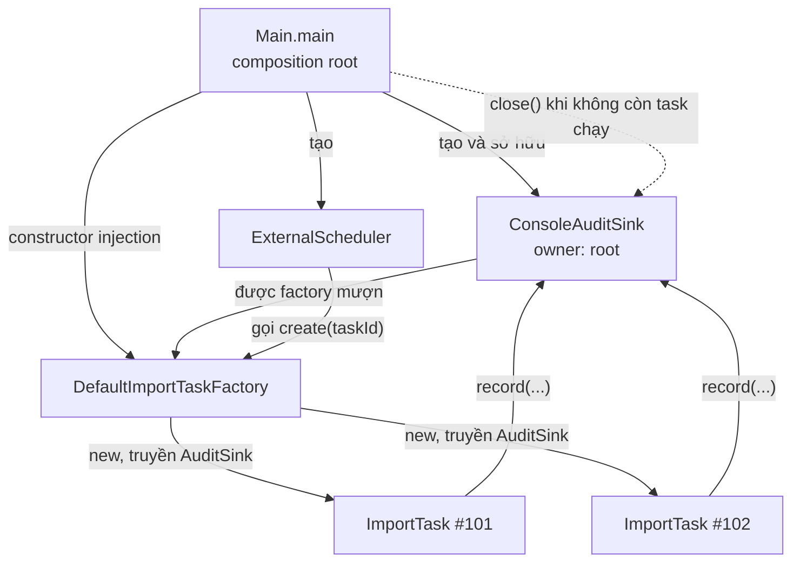

# Giới hạn của container đối với đối tượng tự tạo ngoài phạm vi quản lý

> **Chương:** Bộ chứa DI  
> **Phạm vi:** Dependency Injection (DI), Inversion of Control (IoC), constructor injection, composition root, scope và vòng đời đối tượng trong Java thuần; từ đó hiểu đúng vai trò của DI container.

## 1. Mục tiêu học tập

Sau bài này, bạn có thể:

1. Phân biệt đối tượng **được DI container quản lý** và đối tượng **được tạo bên ngoài container**, kể cả khi chúng có cùng kiểu Java.
2. Giải thích vì sao dùng `new` trực tiếp ở bên ngoài cơ chế tạo/đăng ký của container thường không kích hoạt tự động inject, callback vòng đời hay proxy của framework.
3. Nhận biết rằng **được truyền dependency** không đồng nghĩa với **được container quản lý toàn bộ vòng đời**.
4. Chọn cách tích hợp đối tượng do scheduler, parser, ORM, thư viện callback hoặc mã nghiệp vụ tạo ra với dependency đã được chuẩn bị từ bootstrap.
5. Viết **factory có hợp đồng rõ**, dùng constructor injection và kiểm thử bằng **Java thuần**, không phụ thuộc vào framework.
6. Xác định ai sở hữu dependency dùng chung, ai đóng tài nguyên và scope nào phù hợp khi đối tượng do thành phần ngoài tạo.

## 2. Container quản lý những gì?

**Dependency Injection (DI)** là kỹ thuật cung cấp những cộng tác viên mà một đối tượng cần từ bên ngoài, thay vì để nó tự tìm hoặc tự tạo mọi dependency. **Inversion of Control (IoC)** là ý tưởng rộng hơn về việc chuyển trách nhiệm điều khiển, trong đó có trách nhiệm lắp ghép, ra khỏi đối tượng sử dụng.

Một **DI container** hỗ trợ tự động hóa phần lắp ghép: tìm cấu hình/binding, tạo instance, giải quyết các dependency được khai báo và quản lý những chính sách scope, vòng đời mà framework hỗ trợ. Tuy nhiên, container chỉ có thể thực hiện những việc đó cho **đối tượng nằm trong cơ chế quản lý của nó**, theo cách thức cụ thể của framework.

Để hiểu ranh giới, hãy phân biệt:

| Vai trò | Câu hỏi | Ví dụ |
| --- | --- | --- |
| **Container quản lý** | Instance này được container tạo/đăng ký và xử lý theo lifecycle nào? | Một bean do Spring tạo từ cấu hình component hoặc phương thức `@Bean`. |
| **Đối tượng tự tạo** | Ai dùng `new` hoặc API thư viện để tạo instance này? | Một `ImportTask` do scheduler, test hoặc một factory ứng dụng tự tạo. |
| **Dependency được inject** | Instance này nhận cộng tác viên qua cách nào? | Constructor `ImportTask(AuditSink sink)`. |
| **Owner tài nguyên** | Ai có trách nhiệm gọi `close()`/`shutdown()`? | Composition root sở hữu HTTP client dùng chung; task chỉ sử dụng. |

Các câu hỏi này **liên quan nhưng không tương đương**. Một đối tượng được tạo ngoài container vẫn có thể sử dụng **constructor injection hợp lệ**. Ngược lại, một đối tượng được tạo bằng `new` trong một phương thức cấu hình rồi **trả về và đăng ký** thành bean có thể trở thành đối tượng do container quản lý.

> **Điểm cốt lõi:** Từ khóa `new` không tự quyết định trạng thái quản lý. Điều quyết định là instance đó **có được đưa vào cơ chế tạo/đăng ký và lifecycle của container hay không**.

## 3. Tình huống phổ biến: dùng `new` rồi mong framework tự inject

Giả sử ứng dụng có một lớp nhận phụ thuộc bằng field injection. Đoạn sau dùng **cú pháp minh họa theo Spring**, cần thư viện tương ứng mới biên dịch được:

```java
// Ví dụ minh họa Spring, không phải ví dụ Java thuần độc lập.
@Component
class ReportJob {
    @Autowired
    private ReportRepository repository;

    void run() {
        repository.saveReport();
    }
}

// Code bên ngoài container:
ReportJob job = new ReportJob();
job.run(); // repository thường vẫn null -> NullPointerException.
```

Việc khai báo `@Component` trên **kiểu `ReportJob`** không biến mọi đối tượng `new ReportJob()` thành bean của Spring. Các annotation injection thường được xử lý đối với những instance mà container **thực sự tạo hoặc tiếp nhận thông qua cơ chế đã cấu hình**.

Trong ví dụ trên, lệnh `new` do caller thực hiện trực tiếp; instance ấy **không được đăng ký** và không đi qua quy trình inject thông thường. Vì thế `repository` không được gán chỉ bởi việc trường có `@Autowired`.

Một ngộ nhận tương tự:

```java
// Minh họa một lớp công việc bị tạo trực tiếp.
ReportJob job = new ReportJob();
// Giả định container đang chạy ở cùng JVM.
// Sự tồn tại của container không tự động nhận diện và quản lý job này.
```

**Không có một cơ chế phổ quát trong Java tự động áp DI cho mọi object vừa được tạo trên heap.** Framework có thể cung cấp API bổ sung để inject vào instance có sẵn, hỗ trợ bytecode weaving hoặc factory tích hợp, nhưng phải **chủ động sử dụng và cấu hình** những khả năng đó. Không nên suy luận chúng mặc nhiên hoạt động cho mọi lệnh `new`.

## 4. Những ranh giới quản lý thường gặp

| Nguồn tạo instance | Có thuộc DI container không? | Điều cần hiểu |
| --- | --- | --- |
| Bean được container phát hiện và tạo theo cấu hình hợp lệ | **Thường có** | Constructor/member injection và lifecycle phụ thuộc framework, cấu hình, scope. |
| Đối tượng `new` rồi **trả về từ phương thức `@Bean`** trong cấu hình Spring | **Có, với instance được đăng ký làm bean đó** | Dùng `new` không ngăn Spring quản lý giá trị trả về theo hợp đồng bean. |
| Đối tượng `new` bên trong method nghiệp vụ, không đăng ký | **Thông thường không** | Không tự nhận member injection, interceptor hoặc callback hủy từ container. |
| Một factory là bean, nhưng phương thức `create()` của nó tự `new Task(...)` | **Factory: có; Task trả về: thường không** | Quản lý factory không tự đồng nghĩa quản lý từng sản phẩm của factory. |
| Một scheduler hoặc thư viện ngoài tạo callback/task của riêng nó | **Không mặc nhiên** | Framework ngoài có thể quản lý vòng đời của task, nhưng DI container không tự sở hữu instance đó. |
| Instance có sẵn được đăng ký/đưa qua API tích hợp của container | **Tùy API và cấu hình** | Cần xác minh cả injection, post-processing, proxy và destruction; không mặc định được hỗ trợ đầy đủ. |
| Container cấp một bean có scope ngắn hoặc prototype | **Có thể do container tạo** | Không đồng nghĩa mọi instance được tự động dọn dẹp khi không còn dùng; quy tắc destruction tùy scope và framework. |

Ví dụ, trong Spring, bean scope `prototype` có thể được container tạo và khởi tạo dependency mỗi lần yêu cầu, nhưng container **không tự động quản lý đầy đủ quá trình hủy từng instance prototype sau khi cấp cho caller**. Vì thế không nên đánh đồng “đã được container tạo” với “mọi tài nguyên luôn được container tự đóng”.

## 5. Những khả năng nào mất đi ở đối tượng ngoài container?

Khi một instance được tạo ngoài cơ chế quản lý, các chức năng sau **không tự phát sinh**:

### 5.1. Tự động wiring

Một field/ setter cần injector gán giá trị sẽ không được tự động xử lý nếu đối tượng chưa từng đi qua cơ chế injection. **Constructor injection** giúp tránh trạng thái thiếu dependency bằng cách yêu cầu dependency ngay lúc tạo:

```java
final class ReportJob {
    private final ReportRepository repository;

    ReportJob(ReportRepository repository) {
        this.repository = java.util.Objects.requireNonNull(repository);
    }
}
```

`ReportRepository` ở đây là hợp đồng giả định của ứng dụng. Dù ai tạo `ReportJob`, constructor vẫn buộc họ cung cấp dependency hợp lệ, không phụ thuộc annotation injection.

### 5.2. Callback khởi tạo và hủy

Annotation như `@PostConstruct` hoặc `@PreDestroy`, hay hook khởi tạo/hủy do framework cung cấp, cần đối tượng đi qua **lifecycle phù hợp**. Một instance tạo độc lập thường không được container tự gọi các hook ấy.

Đặc biệt, nếu task được tạo ngoài container nhận một client do container quản lý, **task không nên tự đóng client** chỉ vì nó không được container quản lý. Hai bên có quyền sở hữu riêng:

- Container hoặc composition root có thể sở hữu client.
- Task mượn client để hoàn thành công việc.
- Thành phần tạo task quản lý thời gian sống của task, kể cả việc hủy task nếu cần.

### 5.3. Proxy và interceptor

Một số tính năng framework như transaction, caching, security hoặc method interception được áp dụng thông qua **proxy hoặc cơ chế xử lý đặc biệt**. Đối tượng tự tạo ngoài container không mặc nhiên được bọc bằng proxy đúng cấu hình, ngay cả khi trên lớp hoặc method có annotation.

Ví dụ, việc đặt `@Transactional` trên một method **không bảo đảm** mọi lời gọi vào một instance tạo bằng `new` đều đi qua interceptor quản lý transaction. Hành vi cụ thể phụ thuộc framework, cách tạo proxy và đường gọi thực tế.

### 5.4. Scope

Container có thể cấp object theo application, request hoặc scope tùy biến. Một task chạy sau khi request kết thúc có thể giữ tham chiếu đến dependency chỉ hợp lệ trong request cũ, hoặc truy cập provider khi scope không còn hoạt động.

Tạo task bên ngoài container không xóa những ràng buộc scope của dependency được cấp từ container. Cần kiểm tra **thời gian sống của mỗi bên** và thời điểm resolve chúng.

## 6. Ví dụ Java thuần: công việc do hệ thống ngoài tạo

Ta mô phỏng một scheduler do thư viện khác quản lý. Scheduler chỉ biết giao diện `Runnable` và được cấu hình bằng một callback/factory tạo task. Dependency `AuditSink` được chuẩn bị tại composition root và truyền vào task qua constructor.

Các lớp `ImportTask` do factory tạo **không phải bean của DI container**; ví dụ thuần Java này cho thấy object vẫn được nhận dependency đúng cách.

Tạo file `Main.java`:

```java
import java.util.Objects;

// Consumer chỉ cần khả năng ghi audit, không có quyền đóng sink.
interface AuditSink {
    void record(String taskId, String event);
}

// Adapter tài nguyên do composition root sở hữu.
final class ConsoleAuditSink implements AuditSink, AutoCloseable {
    private boolean closed;

    @Override
    public void record(String taskId, String event) {
        if (closed) {
            throw new IllegalStateException("AuditSink is closed");
        }
        System.out.println(taskId + " | " + event);
    }

    @Override
    public void close() {
        if (!closed) {
            closed = true;
            System.out.println("CLOSE audit sink");
        }
    }
}

// Một task không biết container; dependency bắt buộc được inject.
final class ImportTask implements Runnable {
    private final String taskId;
    private final AuditSink auditSink;

    ImportTask(String taskId, AuditSink auditSink) {
        if (taskId == null || taskId.trim().isEmpty()) {
            throw new IllegalArgumentException("taskId is required");
        }
        this.taskId = taskId;
        this.auditSink = Objects.requireNonNull(auditSink, "auditSink");
    }

    @Override
    public void run() {
        auditSink.record(taskId, "import started");
        auditSink.record(taskId, "import completed");
    }
}

// Hợp đồng hẹp: scheduler chỉ xin tạo một Runnable theo taskId.
interface ImportTaskFactory {
    Runnable create(String taskId);
}

final class DefaultImportTaskFactory implements ImportTaskFactory {
    private final AuditSink auditSink;

    DefaultImportTaskFactory(AuditSink auditSink) {
        this.auditSink = Objects.requireNonNull(auditSink, "auditSink");
    }

    @Override
    public Runnable create(String taskId) {
        return new ImportTask(taskId, auditSink);
    }
}

// Mô phỏng hệ thống ngoài: biết callback tạo task, không biết DI.
final class ExternalScheduler {
    void execute(String taskId, ImportTaskFactory taskFactory) {
        Runnable task = taskFactory.create(taskId);
        task.run();
    }
}

public class Main {
    public static void main(String[] args) {
        // Composition root tạo, lắp ghép và sở hữu AuditSink.
        try (ConsoleAuditSink auditSink = new ConsoleAuditSink()) {
            ImportTaskFactory taskFactory =
                    new DefaultImportTaskFactory(auditSink);
            ExternalScheduler scheduler = new ExternalScheduler();

            scheduler.execute("TASK-101", taskFactory);
            scheduler.execute("TASK-102", taskFactory);
        }
    }
}
```

Biên dịch, chạy bằng JDK (không cần thư viện DI):

```bash
javac -encoding UTF-8 Main.java
java Main
```

Kết quả mong đợi:

```text
TASK-101 | import started
TASK-101 | import completed
TASK-102 | import started
TASK-102 | import completed
CLOSE audit sink
```

### 6.1. Vì sao ví dụ này giải quyết đúng ranh giới?



Mỗi task do factory tạo bằng `new ImportTask(taskId, auditSink)`. **Không cần container “nhận biết” instance task** để task sử dụng đúng dependency. Constructor mô tả rõ yêu cầu; factory cung cấp đúng đối tượng mà composition root đã lắp ghép.

Task không gọi `close()` vì `AuditSink` thuộc về root và có thể được dùng chung. Trong ví dụ, scheduler chạy **đồng bộ**, nên tất cả công việc hoàn tất trước khi `try-with-resources` đóng sink. Nếu dùng scheduler bất đồng bộ, root phải đợi hoặc dừng những task đang dùng sink **trước khi đóng**.

### 6.2. Một factory là bean có tự khiến mọi sản phẩm thành bean?

**Không mặc nhiên.** Giả sử `DefaultImportTaskFactory` được đăng ký làm bean của Spring. Trong method `create(...)`, nó vẫn gọi `new ImportTask(...)` như Java bình thường. Instance task trả về không tự động có đầy đủ bean lifecycle hoặc proxy của Spring chỉ vì factory là bean.

Một số framework hỗ trợ **assisted injection**, factory được container tạo, scoped proxy hoặc đăng ký thủ công các sản phẩm. Đó là những cơ chế riêng cần học hợp đồng của framework. Chúng không làm mất nguyên tắc: **phải biết instance nào do bên nào quản lý**.

## 7. Nếu thư viện ngoài không nhận factory thì làm gì?

Một thư viện có thể tự gọi constructor rỗng để tạo callback, entity hoặc listener. Khi ta **không kiểm soát nơi tạo object**, vẫn có các lựa chọn thiết kế:

1. **Ưu tiên điểm mở rộng chính thức:** xem thư viện có hỗ trợ factory, callback khởi tạo, service injection hook hoặc adapter được cung cấp từ ngoài không.
2. **Đưa logic thực vào một service được inject:** object do thư viện tạo chỉ làm nhiệm vụ chuyển dữ liệu vào một service đã được chuẩn bị, khi API tích hợp cho phép truyền service vào adapter.
3. **Truyền dependency tường minh qua method hoặc context:** hợp lý nếu dependency chỉ cần tại thời điểm xử lý và API cung cấp context thích hợp.
4. **Dùng cơ chế member injection vào instance có sẵn nếu framework thực sự hỗ trợ:** đây là phương án có điều kiện, cần kiểm chứng phạm vi callback, proxy và destruction, không nên giả định tương đương managed bean.
5. **Thiết kế ranh giới tích hợp riêng:** khi không thể thay cách tạo instance, giữ việc truy cập container (nếu thật sự cần) trong adapter tích hợp, không rải trong nghiệp vụ.

Ví dụ, một parser có thể gọi callback `onRecord(String line)` trên object do nó tạo. Nếu parser hỗ trợ đăng ký một listener **được caller đưa vào**, composition root có thể tự xây listener bằng constructor injection rồi đăng ký nó. Nếu parser buộc tự tạo listener, cần tìm cơ chế tích hợp thích hợp thay vì trông chờ annotation field injection tự hoạt động.

**Không nên** đưa `ApplicationContext` hoặc một `ServiceLocator` tổng quát vào từng entity/task để chúng tự `getBean(...)` lúc chạy. Cách đó làm dependency bị che khuất và gắn logic nghiệp vụ vào container.

## 8. Kiểm thử bằng Java thuần

Giữ `Main.java` của mục 6; tạo thêm file `ImportTaskTest.java`:

```java
final class RecordingAuditSink implements AuditSink, AutoCloseable {
    int recordCount;
    int closeCount;
    String lastTaskId;
    boolean closed;

    @Override
    public void record(String taskId, String event) {
        if (closed) {
            throw new IllegalStateException("Sink already closed");
        }
        recordCount++;
        lastTaskId = taskId;
    }

    @Override
    public void close() {
        closeCount++;
        closed = true;
    }
}

public class ImportTaskTest {
    public static void main(String[] args) {
        RecordingAuditSink sink = new RecordingAuditSink();

        try (sink) {
            ImportTaskFactory factory = new DefaultImportTaskFactory(sink);
            ExternalScheduler scheduler = new ExternalScheduler();

            scheduler.execute("TASK-A", factory);
            scheduler.execute("TASK-B", factory);

            check(sink.recordCount == 4, "Each task records twice");
            check("TASK-B".equals(sink.lastTaskId), "Wrong last task");
            check(sink.closeCount == 0, "Task must not close shared sink");

            boolean invalidRejected = false;
            try {
                factory.create(" ");
            } catch (IllegalArgumentException expected) {
                invalidRejected = true;
            }
            check(invalidRejected, "Invalid task ID must be rejected");
            check(sink.recordCount == 4, "Invalid task must not run");
        }

        check(sink.closeCount == 1, "Owner must close once");
        check(sink.closed, "Sink must be closed after scope");

        boolean afterCloseRejected = false;
        try {
            new ImportTask("TASK-LATE", sink).run();
        } catch (IllegalStateException expected) {
            afterCloseRejected = true;
        }
        check(afterCloseRejected, "Use after close must fail");

        System.out.println("PASS");
    }

    private static void check(boolean condition, String message) {
        if (!condition) {
            throw new AssertionError(message);
        }
    }
}
```

```bash
javac -encoding UTF-8 Main.java ImportTaskTest.java
java ImportTaskTest
```

Kết quả mong đợi: `PASS`. Đoạn test dùng `try (sink)`, hợp lệ từ **Java 9** khi biến `sink` là final hoặc effectively final. Với Java 8, khai báo resource ngay trong `try` và sử dụng biến resource ở bên trong.

Test chứng minh task nhận dependency do factory truyền, có thể chạy độc lập với container, **không tự đóng** dependency dùng chung và root đóng sau khi xử lý xong. Nó không chứng minh hook lifecycle của Spring hay một scheduler production sẽ hoạt động; những phần đó cần integration test đúng framework.

## 9. Scope: điều gì xảy ra khi thời gian sống không khớp?

Ranh giới managed/unmanaged làm vấn đề scope dễ bị bỏ sót:

| Tình huống | Rủi ro | Cách thiết kế |
| --- | --- | --- |
| Task tạo ngoài container giữ một bean **singleton** dùng chung | Có thể an toàn hoặc không, tùy contract thread safety và shutdown. | Kiểm tra khả năng chia sẻ; dừng task trước khi đóng bean. |
| Task chạy lâu hơn request nhưng giữ bean **request-scoped** | Sau request, dependency có thể không còn hợp lệ hoặc scope không còn hoạt động. | Truyền dữ liệu cần thiết, tạo scope đúng hoặc dùng factory với lifecycle phù hợp. |
| Factory bean trả **object mới** có tài nguyên mỗi lần | Container có thể không biết để đóng từng sản phẩm. | Công bố caller hay factory là owner; dùng `try-with-resources`/lifecycle manager. |
| Task được xử lý đồng thời và giữ một mutable collaborator | Race condition, dữ liệu bị ghi đè. | Dùng dependency thread-safe, tạo instance riêng hoặc đồng bộ hóa. |
| Application shutdown nhưng scheduler vẫn còn task | Task dùng bean đã đóng. | Ngừng nhận việc, đợi/cancel việc còn chạy, rồi mới đóng dependency nền. |

**Inject được một dependency chưa đủ để dùng nó đúng scope.** Ví dụ provider trả về bean request-scoped có thể chỉ hoạt động khi có request scope đang kích hoạt. Worker bất đồng bộ không tự thừa hưởng đầy đủ ngữ cảnh request chỉ vì nó được tạo trong request đó.

### 9.1. Khác biệt giữa “được cấp” và “được sở hữu”

Nếu factory tạo một `ReportSession` ngắn hạn và contract nói caller phải đóng, code có thể là:

```java
// ReportSessionFactory và ReportSession là các hợp đồng minh họa.
try (ReportSession session = sessionFactory.open()) {
    session.export(reportId);
}
```

Caller sở hữu **session được trả về**, nhưng chỉ mượn `sessionFactory` đã inject. Một container quản lý factory không nhất thiết quản lý mỗi session. Tương tự, bên nhận `Connection` từ pool thường phải `close()` để trả lease về pool; owner của pool có trách nhiệm shutdown pool theo API của nó.

### 9.2. Callback hủy không thay thế trách nhiệm dọn dẹp

Một bean có hook hủy không đảm bảo mọi object nó từng tạo cũng được dọn dẹp. Nếu factory sinh task, socket hoặc phiên có vòng đời riêng, factory hoặc caller phải có chiến lược đóng. Trách nhiệm dọn dẹp cần nêu rõ khi thiết kế API, kể cả đối với instance do container tạo nhưng scope có chính sách hủy đặc biệt.

## 10. Constructor injection giúp giảm phụ thuộc vào cơ chế tạo

Với dependency bắt buộc, constructor injection có hai lợi ích quan trọng:

- **Đối tượng hợp lệ ngay khi tạo thành công:** không có khoảng thời gian chờ framework gán field. `Objects.requireNonNull` giúp phát hiện cấu hình thiếu sớm.
- **Dễ kiểm thử và dùng ở nhiều môi trường:** task có thể được tạo bởi composition root, factory ngoài thư viện, test hoặc container, miễn caller truyền đúng dependency.

Điều này **không có nghĩa mọi đối tượng phải được container quản lý**. Những value object, DTO hoặc object ngắn hạn có thể dùng `new` bình thường. Với các collaborator quan trọng, việc dùng constructor rõ ràng giúp cấu trúc DI của ứng dụng không phụ thuộc hoàn toàn vào annotation.

Ngược lại, **constructor injection không tự thêm proxy hoặc callback của container**. Nếu một object cần transaction interceptor hay resource scope đặc biệt, cần bảo đảm nó được tạo/sử dụng qua cơ chế framework phù hợp hoặc giao việc đó cho một managed service được gọi từ object ngoài.

## 11. Cách kiểm tra một đối tượng có thực sự được quản lý

Đừng suy từ annotation hoặc tên class. Khi rà soát lỗi injection/lifecycle, hãy lần theo:

1. **Ai gọi constructor hoặc factory?** Container, composition root, scheduler, ORM, parser hay test?
2. **Instance nào được đăng ký?** Một bean do `@Bean` trả về khác với object phụ được `new` bên trong method đó.
3. **Ai inject các dependency?** Constructor do code gọi, container xử lý member injection hay API inject vào instance có sẵn?
4. **Caller nhận bean gốc hay proxy?** Tính năng interception có đi qua đường gọi thực tế không?
5. **Scope có còn hiệu lực không?** Task chạy trong request hiện tại hay sau khi request kết thúc?
6. **Ai đóng tài nguyên?** Container, task factory, scheduler hay caller theo contract?
7. **Có kiểm thử đường lỗi không?** Khởi tạo thiếu binding, task chạy sau shutdown, đóng trùng và thất bại giữa quá trình tạo.

Nếu một instance tạo ngoài container vẫn chạy đúng nhờ được truyền dependency trong constructor, đó là một thiết kế hợp lệ. Nếu code kỳ vọng `@Autowired` tự tác động lên mọi instance hoặc `@PreDestroy` được gọi dù object chưa từng được quản lý, cần sửa giả định về ranh giới.

## 12. Những ngộ nhận thường gặp

**“Lớp có `@Component` thì bất kỳ `new` nào cũng được inject.”** Sai theo cơ chế bean thông thường. Annotation cho phép framework phát hiện/đăng ký kiểu phù hợp; nó không tự đăng ký mọi instance được tạo thủ công.

**“Có chữ `new` nghĩa là đối tượng chắc chắn ngoài container.”** Không chính xác. Một phương thức `@Bean` có thể trả về đối tượng được tạo với `new` và đăng ký nó làm bean; hoặc một API container có thể tiếp nhận instance tùy theo contract.

**“Factory được container quản lý thì sản phẩm của nó cũng luôn được quản lý.”** Không. Trả `new SomeTask(...)` từ một bean factory không mặc nhiên đăng ký task vào container.

**“Chỉ cần gán dependency thủ công là mọi annotation khác sẽ hoạt động.”** Không. Injection thủ công có thể đủ cho nghiệp vụ, nhưng transaction, proxy, callback vòng đời hoặc các interceptor cần cơ chế riêng của framework.

**“Container sẽ đóng tất cả object mà nó từng cung cấp.”** Không thể kết luận như vậy cho mọi scope, API và đối tượng được tạo ngoài. Phải xác định ownership và destruction semantics cụ thể.

**“Mọi object nên được biến thành bean.”** Không cần. Dữ liệu, DTO, value object và task ngắn hạn thường có vòng đời tự nhiên ngoài container; nhiệm vụ của DI là tạo ranh giới phụ thuộc rõ ràng.

**“Nếu cần dependency, cứ đưa toàn bộ `ApplicationContext` vào task.”** Cách này dễ biến task thành Service Locator client và làm mờ dependency thực. Ưu tiên constructor injection hoặc factory có hợp đồng hẹp.

## 13. Bài tập tự luyện

**Tình huống A — Hai instance cùng lớp.** Spring quản lý một bean `EmailService`. Ở nơi khác, code gọi `new EmailService()` để tạo instance thứ hai. Instance thứ hai có tự nhận field injection và callback hủy như bean không? Điều gì có thể khiến câu trả lời khác đi?

**Tình huống B — Bean factory tạo task.** Một bean `ImportTaskFactory` có phương thức `create(id)` trả `new ImportTask(id, auditSink)`. Task dùng `auditSink` bình thường. Điều đó chứng minh task đã được container quản lý không? Ai có trách nhiệm đóng `auditSink`?

**Tình huống C — Request scope.** Một task được tạo trong HTTP request rồi đưa vào executor chạy sau khi response đã gửi. Task giữ một dependency chỉ hợp lệ trong request. Nêu hai rủi ro và một cách thiết kế lại.

**Tình huống D — Transaction.** Một lớp có annotation `@Transactional` trên method nhưng được tạo thủ công, không đi qua proxy framework. Vì sao việc gán đủ các field dependency chưa chắc khiến method có transaction?

**Tình huống E — Refactor.** Một thư viện cho phép truyền `Supplier<Runnable>` để tạo công việc. Hãy dùng ý tưởng ở mục 6 viết một factory nhận `AuditSink` qua constructor, sau đó cung cấp task mà không phải gọi `container.getBean(...)` ở từng task.

**Gợi ý đối chiếu:**

1. A: Không tự động theo cơ chế bean thông thường; chỉ khác nếu instance được đưa qua API tích hợp/injection/lifecycle riêng đã cấu hình.
2. B: Không. Task được inject tường minh qua constructor nhưng không mặc nhiên thành bean; owner của `auditSink` (thường root/container quản lý adapter) đóng khi hết scope.
3. C: Dependency hết hiệu lực và worker có thể thiếu request context; chuyển dữ liệu cần thiết vào task hoặc tạo resource đúng scope trong worker, quản lý đóng rõ ràng.
4. D: Interceptor/proxy cần đường gọi được framework quản lý; gán field không tự thay đổi cơ chế gọi method.
5. E: Composition root tạo `AuditSink`, inject vào factory; supplier/factory trả `new ImportTask(id, sink)`, còn task chỉ sử dụng sink.

## 14. Ghi nhớ

**Container chỉ tự động tiêm phụ thuộc và xử lý vòng đời cho những đối tượng đi qua cơ chế quản lý tương ứng.** Một object do `new` ở code ngoài tạo vẫn có thể áp dụng Dependency Injection đúng cách bằng constructor, nhưng không mặc nhiên nhận field injection, lifecycle callback, proxy hay scope của framework. Khi tích hợp với scheduler, ORM, parser hoặc một thư viện ngoài, hãy dùng factory/adapter rõ ràng tại composition root và xác định quyền sở hữu tài nguyên.

Nắm ranh giới này từ **Java thuần** giúp bạn dùng DI container chính xác hơn: biết **ai tạo, ai lắp ghép, ai sử dụng, ai đóng**, và biết lúc nào một đối tượng cần được đăng ký thành bean, lúc nào chỉ cần được truyền các dependency cần thiết.
