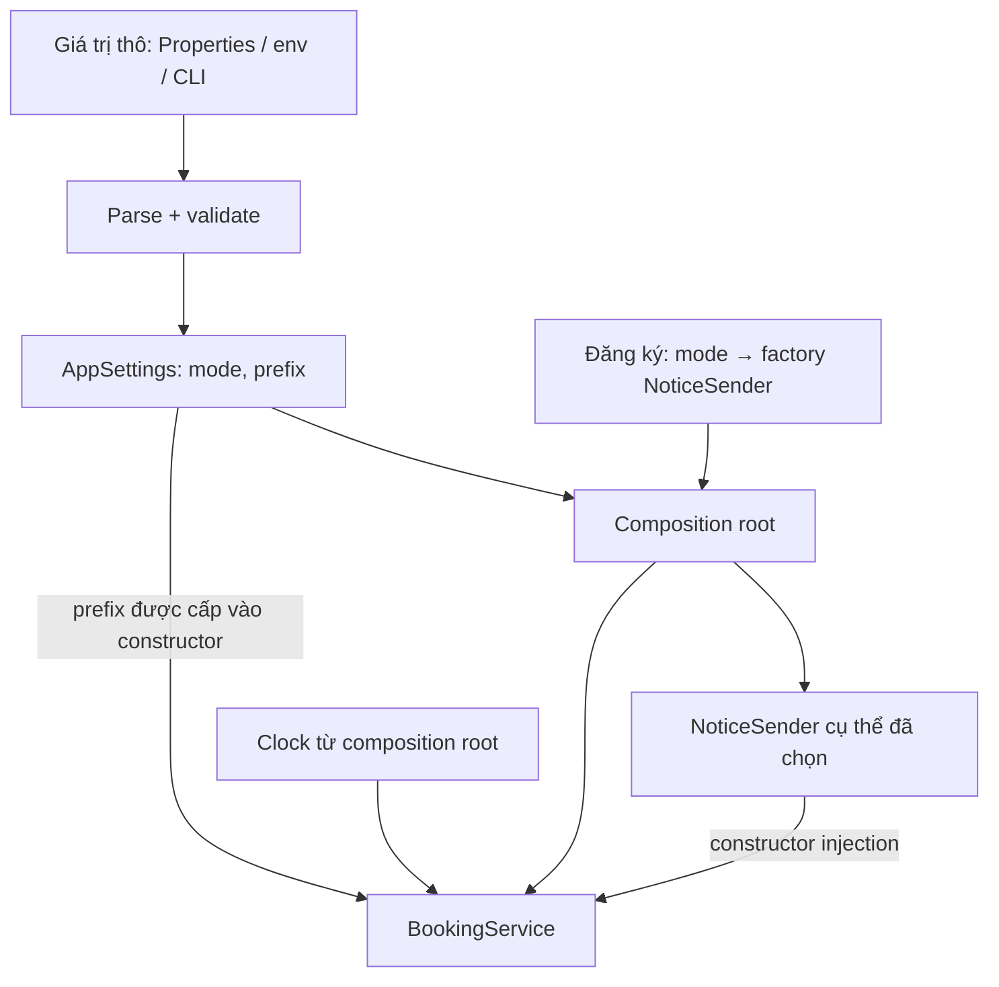

# Phân biệt cấu hình giá trị với đăng ký đối tượng phụ thuộc

Khi khởi động một ứng dụng Java, ta thường đọc các giá trị như `notice.mode=memory`, `notice.prefix=BOOKING`, thời gian chờ kết nối hoặc tên môi trường chạy. Cũng tại thời điểm đó, ứng dụng phải quyết định sẽ sử dụng những đối tượng nào: một adapter lưu trữ, một sender gửi thông báo, một nguồn thời gian hoặc các service nghiệp vụ. Hai nhóm quyết định này có liên quan nhưng **không phải cùng một loại cấu hình**.

- **Cấu hình giá trị** mô tả những dữ liệu, tham số và lựa chọn có thể thay đổi theo môi trường chạy.
- **Đăng ký đối tượng phụ thuộc** mô tả những triển khai có thể được tạo, cách tạo, và đối tượng nào được cấp cho consumer qua **Dependency Injection (DI)**.

Ví dụ, chuỗi `notice.mode=memory` là một **giá trị**. Việc đăng ký `MEMORY → RecordingNoticeSender::new` là một **quy tắc tạo thành phần**. Giá trị có thể dùng để chọn quy tắc đăng ký, nhưng bản thân chuỗi `memory` không phải một đối tượng sender đã được tạo.

Bài này thuộc chương **Cấu hình lắp ghép** của module **DEPENDENCY_INJECTION**. Ta xây dựng một **composition root** bằng Java thuần, phân biệt rõ cấu hình giá trị với quy tắc đăng ký và chọn dependency, thực hành **constructor injection** và **Inversion of Control (IoC)**, xác định scope/vòng đời, rồi kiểm thử mà không khởi động DI container.

## 1. Hai loại thông tin khác nhau ở điểm khởi động ứng dụng

Xét chức năng xác nhận một booking. `BookingService` cần gửi thông báo qua hợp đồng `NoticeSender`. Khi deploy, ứng dụng nhận hai giá trị:

```properties
notice.mode=memory
notice.prefix=BOOKING
```

Ý nghĩa của chúng:

- `notice.mode` cho biết **lựa chọn cấu hình**: dùng chế độ `memory` thay vì `console`. Cần ánh xạ giá trị này sang một lựa chọn hợp lệ.
- `notice.prefix` là **dữ liệu được dùng để tạo nội dung thông báo**; thay đổi tiền tố không nhất thiết đòi viết class mới.

Trong mã khởi động, ứng dụng có thể định nghĩa hai đăng ký:

```java
registry.register(NoticeMode.CONSOLE, ConsoleNoticeSender::new);
registry.register(NoticeMode.MEMORY, RecordingNoticeSender::new);
```

Những dòng trên không phải khai báo hai giá trị cấu hình. Chúng cung cấp **hai khả năng tạo dependency** tương ứng với hai chế độ, để composition root chọn một. Các tên kiểu và biến trong đoạn này sẽ được định nghĩa trong ví dụ Java hoàn chỉnh ở phần 4.

| Câu hỏi | Cấu hình giá trị | Đăng ký đối tượng phụ thuộc |
| --- | --- | --- |
| Mô tả cái gì? | Tham số và lựa chọn của môi trường | Thành phần có thể được tạo/cấp vào đồ thị |
| Ví dụ | `notice.mode=memory`, `notice.prefix=BOOKING` | `MEMORY → RecordingNoticeSender::new` |
| Kiểu dữ liệu thường gặp | `String`, `int`, `Duration`, enum, đối tượng settings bất biến | Constructor, factory, `Supplier<T>`, binding interface → implementation |
| Cần kiểm tra gì? | Đúng định dạng, miền giá trị, bắt buộc/mặc định, quan hệ giữa các giá trị | Có đăng ký hợp lệ, không trùng khóa, có đủ dependency, scope phù hợp |
| Ảnh hưởng thời điểm nào? | Khi đọc và chuyển đổi giá trị; có thể là snapshot lúc khởi động | Khi khởi tạo hoặc khi provider tạo/lấy instance |
| Ai dùng trực tiếp? | Composition root, adapter hoặc consumer cần giá trị đó | Composition root/container để lắp ghép đối tượng |
| Lỗi phổ biến | `timeout=abc`, chế độ không hỗ trợ, thiếu giá trị bắt buộc | Không có sender cho mode đã chọn, đăng ký trùng hoặc instance được chia sẻ sai scope |

**Không phải mọi giá trị cấu hình đều cần một đối tượng DI riêng.** Một tiền tố chuỗi có thể là constructor parameter hợp lệ. Ngược lại, một `NoticeSender` không thể được thay thế bằng chuỗi tên class rồi để service nghiệp vụ tự phản chiếu (reflection) để tạo đối tượng.

## 2. Luồng biến đổi: giá trị thô → cấu hình có kiểu → lựa chọn đăng ký → đồ thị đối tượng

Ta nên phân tách các bước tại điểm lắp ghép:



Quy trình này có các ranh giới rõ ràng:

1. **Đọc cấu hình:** nhận giá trị từ tệp, biến môi trường, tham số dòng lệnh hoặc hệ thống cấu hình. Những nguồn đó thường trả về chuỗi.
2. **Chuyển đổi và kiểm tra:** chuyển chuỗi thành enum, số, `Duration` hoặc một đối tượng settings có kiểu. Từ chối giá trị sai ngay ở ranh giới này.
3. **Đăng ký thành phần:** xác định những implementation và factory *được phép* sử dụng; kiểm tra trùng khóa nếu ứng dụng yêu cầu duy nhất.
4. **Lựa chọn và tạo instance:** dùng settings để chọn registration, gọi factory theo chính sách tạo, rồi lắp graph.
5. **Tiêm dependency:** constructor của consumer nhận đối tượng cùng những giá trị thực sự cần; consumer không đọc `System.getenv(...)` hoặc tìm adapter trong registry toàn cục.

Việc đặt các quyết định ở composition root thể hiện **IoC**: đối tượng nghiệp vụ không tự quyết định dùng implementation nào hoặc tạo nó bằng cách nào. **DI** là cách đưa instance đã được chọn vào consumer.

### 2.1. Cấu hình có kiểu là ranh giới hữu ích

Chuỗi `notice.mode=memory` có thể chuyển thành enum `NoticeMode.MEMORY`. Chuỗi `notice.prefix=BOOKING` được kiểm tra không rỗng rồi giữ thành giá trị bất biến. Từ đó, các thành phần phía trong ứng dụng sử dụng một `AppSettings` hợp lệ thay vì lặp lại việc parse ở nhiều nơi.

**Fail fast** khác nhau theo nguồn lỗi:

- Sai giá trị, ví dụ `notice.mode=unknown` → lỗi **cấu hình giá trị**.
- Giá trị hợp lệ `MEMORY` nhưng registry không có factory tương ứng → lỗi **đăng ký/wiring**.
- Registry có hai factory cùng key `MEMORY` → lỗi **trùng đăng ký**.
- Factory trả `null` hoặc thiếu constructor dependency → lỗi **tạo đối tượng**.
- Adapter có cấu hình đúng nhưng kết nối ngoài thất bại khi sử dụng → lỗi **runtime hoặc tích hợp**, cần xử lý riêng.

Đưa lỗi ra đúng tầng giúp người vận hành hiểu nên sửa tệp cấu hình, sửa đăng ký thành phần hay kiểm tra tài nguyên ngoài.

## 3. Cấu hình giá trị: xác định nguồn, thứ tự ưu tiên và giá trị mặc định

Ứng dụng thường có nhiều nguồn cấu hình: giá trị mặc định trong code, tệp theo môi trường, biến môi trường và tham số chạy. **Thứ tự ưu tiên phải được quy định**, không nên để phần nghiệp vụ tự chọn nguồn. Một chính sách minh họa có thể là:

```text
mặc định < tệp cấu hình < biến môi trường < tham số dòng lệnh
```

Dấu `<` trong sơ đồ biểu thị nguồn bên phải được phép ghi đè giá trị cùng khóa của nguồn bên trái. Đây **chỉ là quy tắc minh họa**, không phải quy tắc mặc định của `java.util.Properties` hoặc mọi framework.

Khi gộp nguồn cấu hình, nên xác định rõ:

| Chính sách | Câu hỏi cần trả lời |
| --- | --- |
| Giá trị bắt buộc | Thiếu khóa có dừng khởi động không? |
| Giá trị mặc định | Có mặc định an toàn và được công bố không? |
| Ghi đè | Nguồn nào thắng khi cùng khóa có nhiều giá trị? |
| Định dạng | Chuỗi có cần thành enum, số nguyên, `Duration`, URL hoặc danh sách không? |
| Giới hạn | Timeout âm hoặc quá lớn có được phép không? |
| Giá trị nhạy cảm | Secret được lấy ở đâu, ai có quyền đọc, có vô tình bị log không? |
| Thời điểm áp dụng | Đọc một lần lúc khởi động hay hỗ trợ thay đổi động? |

Ví dụ, cấu hình thời gian chờ nên được parse thành `Duration` với đơn vị rõ ràng; nếu chỉ dùng số `5000`, người đọc khó biết đó là mili giây hay giây. Với đường dẫn hoặc endpoint, kiểm tra cú pháp chưa đủ chứng minh tài nguyên ngoài đang hoạt động. Cần kiểm thử kết nối riêng.

**Không dùng cấu hình để che lỗi thiếu thành phần bắt buộc.** Nếu hệ thống bắt buộc ghi dữ liệu, việc thiếu repository không thể được “giải quyết” bằng cách mặc định sang một no-op repository, trừ khi nghiệp vụ chủ động định nghĩa chế độ chạy như vậy.

## 4. Ví dụ Java hoàn chỉnh: tách `AppSettings` khỏi `SenderRegistry`

Ví dụ này cố ý chỉ có hai chế độ gửi thông báo:

- `CONSOLE`: thông báo được in ra standard output.
- `MEMORY`: thông báo được ghi vào danh sách trong bộ nhớ để quan sát và kiểm thử.

`AppSettings` chịu trách nhiệm **parse và validate giá trị**. `SenderRegistry` chịu trách nhiệm **đăng ký factory theo mode**. `compose(...)` nhận cả hai nguồn thông tin, chọn một sender, rồi tiêm sender cùng prefix và `Clock` vào `BookingService`.

Lưu toàn bộ mã vào **`CompositionConfigExample.java`**, dùng JDK 11 trở lên:

```java
import java.time.Clock;
import java.time.Instant;
import java.time.ZoneOffset;
import java.util.ArrayList;
import java.util.EnumMap;
import java.util.List;
import java.util.Locale;
import java.util.Map;
import java.util.Objects;
import java.util.Properties;
import java.util.function.Supplier;

public final class CompositionConfigExample {
    private CompositionConfigExample() {}

    public enum NoticeMode {
        CONSOLE, MEMORY
    }

    // Chỉ chứa GIÁ TRỊ đã parse và validate.
    public static final class AppSettings {
        private final NoticeMode mode;
        private final String prefix;

        private AppSettings(NoticeMode mode, String prefix) {
            this.mode = mode;
            this.prefix = prefix;
        }

        public static AppSettings from(Properties raw) {
            Objects.requireNonNull(raw, "raw");

            String modeValue = raw.getProperty(
                "notice.mode", "console").trim();
            NoticeMode mode;
            try {
                mode = NoticeMode.valueOf(
                    modeValue.toUpperCase(Locale.ROOT));
            } catch (IllegalArgumentException error) {
                throw new IllegalArgumentException(
                    "Unsupported notice.mode: " + modeValue, error);
            }

            String prefix = raw.getProperty(
                "notice.prefix", "booking").trim();
            if (prefix.isEmpty()) {
                throw new IllegalArgumentException(
                    "notice.prefix must not be blank");
            }
            return new AppSettings(mode, prefix);
        }

        public NoticeMode mode() {
            return mode;
        }

        public String prefix() {
            return prefix;
        }
    }

    public interface NoticeSender {
        void send(String message);
    }

    public static final class ConsoleNoticeSender
            implements NoticeSender {
        @Override
        public void send(String message) {
            System.out.println("Notice: " + message);
        }
    }

    public static final class RecordingNoticeSender
            implements NoticeSender {
        private final List<String> messages = new ArrayList<>();

        @Override
        public void send(String message) {
            messages.add(Objects.requireNonNull(message, "message"));
        }

        public List<String> messages() {
            return List.copyOf(messages);
        }
    }

    // Chứa ĐĂNG KÝ factory; không phải nơi lưu giá trị mode/prefix.
    public static final class SenderRegistry {
        private final Map<NoticeMode, Supplier<? extends NoticeSender>>
            factories = new EnumMap<>(NoticeMode.class);

        public void register(
                NoticeMode mode, Supplier<? extends NoticeSender> factory) {
            Objects.requireNonNull(mode, "mode");
            Objects.requireNonNull(factory, "factory");
            if (factories.putIfAbsent(mode, factory) != null) {
                throw new IllegalArgumentException(
                    "Duplicate NoticeSender registration for " + mode);
            }
        }

        public NoticeSender create(NoticeMode mode) {
            Objects.requireNonNull(mode, "mode");
            Supplier<? extends NoticeSender> factory = factories.get(mode);
            if (factory == null) {
                throw new IllegalStateException(
                    "Missing NoticeSender registration for " + mode);
            }
            return Objects.requireNonNull(
                factory.get(), "NoticeSender factory returned null for " + mode);
        }
    }

    public static final class BookingService {
        private final NoticeSender sender;
        private final String prefix;
        private final Clock clock;

        public BookingService(
                NoticeSender sender, String prefix, Clock clock) {
            this.sender = Objects.requireNonNull(sender, "sender");
            Objects.requireNonNull(prefix, "prefix");
            if (prefix.trim().isEmpty()) {
                throw new IllegalArgumentException("prefix must not be blank");
            }
            this.prefix = prefix;
            this.clock = Objects.requireNonNull(clock, "clock");
        }

        public void confirm(String bookingId) {
            if (bookingId == null || bookingId.trim().isEmpty()) {
                throw new IllegalArgumentException(
                    "bookingId must not be blank");
            }
            sender.send(prefix + ":" + bookingId + "@" + clock.instant());
        }
    }

    // Trong bài thực hành, graph cho phép quan sát wiring.
    public static final class AppGraph {
        public final AppSettings settings;
        public final NoticeSender sender;
        public final BookingService bookingService;

        private AppGraph(
                AppSettings settings, NoticeSender sender,
                BookingService bookingService) {
            this.settings = settings;
            this.sender = sender;
            this.bookingService = bookingService;
        }
    }

    // Composition root: parse trước rồi mới lựa chọn/tạo dependency.
    public static AppGraph compose(
            Properties raw, SenderRegistry registry, Clock clock) {
        Objects.requireNonNull(registry, "registry");
        Objects.requireNonNull(clock, "clock");
        AppSettings settings = AppSettings.from(raw);
        NoticeSender sender = registry.create(settings.mode());
        BookingService service =
            new BookingService(sender, settings.prefix(), clock);
        return new AppGraph(settings, sender, service);
    }

    public static void main(String[] args) {
        Properties raw = new Properties();
        raw.setProperty("notice.mode", "memory");
        raw.setProperty("notice.prefix", "BOOKING");

        SenderRegistry registry = new SenderRegistry();
        registry.register(NoticeMode.CONSOLE, ConsoleNoticeSender::new);
        registry.register(NoticeMode.MEMORY, RecordingNoticeSender::new);

        Clock clock = Clock.fixed(
            Instant.parse("2026-01-10T10:15:30Z"), ZoneOffset.UTC);
        AppGraph graph = compose(raw, registry, clock);
        graph.bookingService.confirm("BK-101");

        System.out.println("Selected mode: " + graph.settings.mode());
        System.out.println("Selected adapter: "
            + graph.sender.getClass().getSimpleName());
        System.out.println("Messages: "
            + ((RecordingNoticeSender) graph.sender).messages());
    }
}
```

Biên dịch và chạy:

```bash
javac CompositionConfigExample.java
java CompositionConfigExample
```

Kết quả dự kiến:

```text
Selected mode: MEMORY
Selected adapter: RecordingNoticeSender
Messages: [BOOKING:BK-101@2026-01-10T10:15:30Z]
```

Ở đây, ép kiểu trong `main()` chỉ dùng để **quan sát adapter MEMORY của bản demo** mà composition root đã chọn một cách tường minh. `BookingService` không ép kiểu hoặc biết class `RecordingNoticeSender`; nó chỉ gọi hợp đồng `NoticeSender`. Trong ứng dụng thật, phần quan sát này nên thuộc adapter/kiểm thử hoặc telemetry, không buộc nghiệp vụ phụ thuộc vào implementation.

### 4.1. Điều gì thuộc cấu hình giá trị?

`AppSettings.from(raw)` xử lý chuỗi `memory` và `BOOKING`. Khi tạo ra `AppSettings`, cả hai đã có kiểu và được kiểm tra:

- `NoticeMode` là một enum có hai giá trị được hỗ trợ.
- `prefix` là chuỗi không rỗng sau khi loại khoảng trắng đầu/cuối.
- Mặc định được công bố trong code: `console` và `booking`.

`AppSettings` là đối tượng **bất biến về giá trị** sau khi tạo. Nếu caller sửa `Properties` về sau, settings của graph cũ vẫn giữ lựa chọn đã parse. Đó là quy ước **snapshot lúc composition**, không có nghĩa `Properties` tự đồng bộ với graph đã tạo.

### 4.2. Điều gì thuộc đăng ký đối tượng?

`SenderRegistry.register(...)` lưu các factory cho từng `NoticeMode`. Registry từ chối đăng ký trùng mode. `SenderRegistry.create(...)` kiểm tra mode đã được đăng ký và factory không trả `null`.

Trong ví dụ, đăng ký dùng method reference `ConsoleNoticeSender::new` và `RecordingNoticeSender::new`. Mỗi lần gọi factory này sẽ tạo một adapter mới, nhưng `compose(...)` chỉ gọi factory **một lần trên mỗi graph**. Vì vậy, nhiều lời gọi `bookingService.confirm(...)` trong cùng graph dùng chung một sender.

Không nên hiểu rằng “có `Supplier` thì mỗi lần nghiệp vụ gọi service sẽ có instance mới”. Đối tượng mới được tạo **khi composition root gọi `registry.create(...)`**, không phải khi mỗi lệnh `confirm(...)` chạy. Nếu đăng ký `() -> sharedSender`, hai lần compose còn có thể nhận **cùng instance**. Quy tắc vòng đời phụ thuộc factory và điểm gọi nó.

### 4.3. Vì sao registry không được truyền vào service?

Nếu `BookingService` nhận `SenderRegistry` rồi tự gọi `create(settings.mode())` ở mỗi lần xác nhận, nó phải chịu trách nhiệm chọn implementation, thời điểm tạo và xử lý lỗi đăng ký. Những trách nhiệm đó thuộc **composition root** trong ví dụ này.

Thay vì để service đọc `notice.mode` và biết có những adapter nào, composition root đưa **một `NoticeSender` đã được chọn** vào constructor. Nhờ vậy service không phụ thuộc tên môi trường, logic lựa chọn hoặc thư viện cấu hình. Đây là ranh giới DI/IoC quan trọng.

## 5. Kiểm thử bằng Java thuần: tách lỗi giá trị khỏi lỗi wiring

Một bộ kiểm tra hữu ích cần xác minh cả **cấu hình giá trị** và **chính sách đăng ký/lựa chọn**. Các test sau chạy trực tiếp bằng `main()`, không cần Spring, JUnit, truy cập tệp hay biến môi trường.

Lưu đoạn mã thành **`CompositionConfigCheck.java`** cùng thư mục với ví dụ trên:

```java
import java.time.Clock;
import java.time.Instant;
import java.time.ZoneOffset;
import java.util.List;
import java.util.Properties;
import java.util.concurrent.atomic.AtomicInteger;

public final class CompositionConfigCheck {
    private static final Clock FIXED_CLOCK = Clock.fixed(
        Instant.parse("2026-01-10T10:15:30Z"), ZoneOffset.UTC);

    private static Properties config(String mode, String prefix) {
        Properties properties = new Properties();
        properties.setProperty("notice.mode", mode);
        properties.setProperty("notice.prefix", prefix);
        return properties;
    }

    private static void check(boolean ok, String message) {
        if (!ok) {
            throw new AssertionError(message);
        }
    }

    private static void expectFailure(
            Runnable action, Class<? extends Throwable> type,
            String messageFragment) {
        try {
            action.run();
        } catch (Throwable failure) {
            if (type.isInstance(failure)
                    && failure.getMessage() != null
                    && failure.getMessage().contains(messageFragment)) {
                return;
            }
            throw new AssertionError(
                "Unexpected failure: " + failure, failure);
        }
        throw new AssertionError(
            "Expected failure containing: " + messageFragment);
    }

    private static void selectsRegisteredAdapter() {
        Properties raw = config("memory", "APP");
        AtomicInteger memoryCreates = new AtomicInteger();
        AtomicInteger consoleCreates = new AtomicInteger();
        CompositionConfigExample.RecordingNoticeSender memory =
            new CompositionConfigExample.RecordingNoticeSender();

        CompositionConfigExample.SenderRegistry registry =
            new CompositionConfigExample.SenderRegistry();
        registry.register(CompositionConfigExample.NoticeMode.MEMORY, () -> {
            memoryCreates.incrementAndGet();
            return memory;
        });
        registry.register(CompositionConfigExample.NoticeMode.CONSOLE, () -> {
            consoleCreates.incrementAndGet();
            return message -> {};
        });

        CompositionConfigExample.AppGraph graph =
            CompositionConfigExample.compose(raw, registry, FIXED_CLOCK);
        check(memoryCreates.get() == 1 && consoleCreates.get() == 0,
              "Must instantiate only the selected registration");
        graph.bookingService.confirm("BK-A");
        check(memory.messages().equals(
                List.of("APP:BK-A@2026-01-10T10:15:30Z")),
              "Sender and prefix must match settings");
    }

    private static void defaultsAreTypedAndApplied() {
        Properties raw = new Properties();
        CompositionConfigExample.AppSettings settings =
            CompositionConfigExample.AppSettings.from(raw);
        check(settings.mode() == CompositionConfigExample.NoticeMode.CONSOLE,
              "Expected declared default mode");
        check("booking".equals(settings.prefix()),
              "Expected declared default prefix");
    }

    private static void invalidValueFailsBeforeFactoryCall() {
        AtomicInteger creates = new AtomicInteger();
        CompositionConfigExample.SenderRegistry registry =
            new CompositionConfigExample.SenderRegistry();
        registry.register(CompositionConfigExample.NoticeMode.MEMORY, () -> {
            creates.incrementAndGet();
            return message -> {};
        });

        expectFailure(
            () -> CompositionConfigExample.compose(
                config("unknown", "APP"), registry, FIXED_CLOCK),
            IllegalArgumentException.class, "Unsupported notice.mode");
        expectFailure(
            () -> CompositionConfigExample.compose(
                config("memory", " "), registry, FIXED_CLOCK),
            IllegalArgumentException.class,
            "notice.prefix must not be blank");
        check(creates.get() == 0,
              "Bad values must fail before creating dependencies");
    }

    private static void missingRegistrationFailsClearly() {
        CompositionConfigExample.SenderRegistry registry =
            new CompositionConfigExample.SenderRegistry();
        registry.register(
            CompositionConfigExample.NoticeMode.CONSOLE,
            CompositionConfigExample.ConsoleNoticeSender::new);
        expectFailure(
            () -> CompositionConfigExample.compose(
                config("memory", "APP"), registry, FIXED_CLOCK),
            IllegalStateException.class,
            "Missing NoticeSender registration for MEMORY");
    }

    private static void duplicateRegistrationFailsClearly() {
        CompositionConfigExample.SenderRegistry registry =
            new CompositionConfigExample.SenderRegistry();
        registry.register(
            CompositionConfigExample.NoticeMode.MEMORY,
            CompositionConfigExample.RecordingNoticeSender::new);
        expectFailure(
            () -> registry.register(
                CompositionConfigExample.NoticeMode.MEMORY,
                CompositionConfigExample.RecordingNoticeSender::new),
            IllegalArgumentException.class,
            "Duplicate NoticeSender registration for MEMORY");
    }

    private static void inputChangeDoesNotRewireExistingGraph() {
        Properties raw = config("memory", "OLD");
        CompositionConfigExample.RecordingNoticeSender memory =
            new CompositionConfigExample.RecordingNoticeSender();
        CompositionConfigExample.RecordingNoticeSender console =
            new CompositionConfigExample.RecordingNoticeSender();
        CompositionConfigExample.SenderRegistry registry =
            new CompositionConfigExample.SenderRegistry();
        registry.register(
            CompositionConfigExample.NoticeMode.MEMORY, () -> memory);
        registry.register(
            CompositionConfigExample.NoticeMode.CONSOLE, () -> console);

        CompositionConfigExample.AppGraph existing =
            CompositionConfigExample.compose(raw, registry, FIXED_CLOCK);
        raw.setProperty("notice.mode", "console");
        raw.setProperty("notice.prefix", "NEW");

        existing.bookingService.confirm("BK-OLD");
        check(memory.messages().equals(
                List.of("OLD:BK-OLD@2026-01-10T10:15:30Z")),
              "Existing graph must keep parsed snapshot and sender");
        check(console.messages().isEmpty(),
              "Changing raw values must not silently rewire old graph");

        CompositionConfigExample.AppGraph next =
            CompositionConfigExample.compose(raw, registry, FIXED_CLOCK);
        next.bookingService.confirm("BK-NEW");
        check(console.messages().equals(
                List.of("NEW:BK-NEW@2026-01-10T10:15:30Z")),
              "Recomposition should use updated values");
    }

    private static void registrationCanControlInstanceScope() {
        Properties raw = config("memory", "APP");
        CompositionConfigExample.SenderRegistry fresh =
            new CompositionConfigExample.SenderRegistry();
        fresh.register(
            CompositionConfigExample.NoticeMode.MEMORY,
            CompositionConfigExample.RecordingNoticeSender::new);
        CompositionConfigExample.AppGraph first =
            CompositionConfigExample.compose(raw, fresh, FIXED_CLOCK);
        CompositionConfigExample.AppGraph second =
            CompositionConfigExample.compose(raw, fresh, FIXED_CLOCK);
        check(first.sender != second.sender,
              "Constructor factory should create one sender per graph");

        CompositionConfigExample.RecordingNoticeSender shared =
            new CompositionConfigExample.RecordingNoticeSender();
        CompositionConfigExample.SenderRegistry reused =
            new CompositionConfigExample.SenderRegistry();
        reused.register(
            CompositionConfigExample.NoticeMode.MEMORY, () -> shared);
        check(CompositionConfigExample.compose(
                raw, reused, FIXED_CLOCK).sender == shared,
              "Factory may return a pre-existing instance");
        check(CompositionConfigExample.compose(
                raw, reused, FIXED_CLOCK).sender == shared,
              "Supplier itself does not promise a fresh object");
    }

    private static void invalidFactoryResultFailsClearly() {
        CompositionConfigExample.SenderRegistry registry =
            new CompositionConfigExample.SenderRegistry();
        registry.register(
            CompositionConfigExample.NoticeMode.MEMORY, () -> null);
        expectFailure(
            () -> CompositionConfigExample.compose(
                config("memory", "APP"), registry, FIXED_CLOCK),
            NullPointerException.class,
            "NoticeSender factory returned null for MEMORY");
    }

    public static void main(String[] args) {
        selectsRegisteredAdapter();
        defaultsAreTypedAndApplied();
        invalidValueFailsBeforeFactoryCall();
        missingRegistrationFailsClearly();
        duplicateRegistrationFailsClearly();
        inputChangeDoesNotRewireExistingGraph();
        registrationCanControlInstanceScope();
        invalidFactoryResultFailsClearly();
        System.out.println("PASS: 8 composition configuration checks");
    }
}
```

Chạy:

```bash
javac CompositionConfigExample.java CompositionConfigCheck.java
java CompositionConfigCheck
```

Kết quả khi tất cả điều kiện đạt:

```text
PASS: 8 composition configuration checks
```

Các kiểm tra dùng `AssertionError` thông qua `check(...)`, vì vậy không cần bật tùy chọn `-ea`. Đây là test bằng **Java thuần**, tập trung vào quy tắc cấu hình, lựa chọn instance và phạm vi của đồ thị.

| Phép kiểm | Vấn đề được xác minh |
| --- | --- |
| `selectsRegisteredAdapter` | Mode là giá trị, factory là đăng ký, chỉ factory được chọn mới được gọi |
| `defaultsAreTypedAndApplied` | Giá trị mặc định được chuyển sang settings có kiểu |
| `invalidValueFailsBeforeFactoryCall` | Sai mode/prefix bị từ chối trước khi tạo adapter |
| `missingRegistrationFailsClearly` | Mode hợp lệ nhưng thiếu binding gây lỗi wiring |
| `duplicateRegistrationFailsClearly` | Hai đăng ký cùng mode không âm thầm ghi đè |
| `inputChangeDoesNotRewireExistingGraph` | Đồ thị đang chạy sử dụng settings snapshot; cần lắp lại nếu muốn áp dụng thay đổi |
| `registrationCanControlInstanceScope` | Factory có thể tạo mới hoặc trả instance có sẵn theo quy tắc |
| `invalidFactoryResultFailsClearly` | Kết quả factory không hợp lệ bị phát hiện tại composition root |

Các bài test này chưa chứng minh adapter mạng/cơ sở dữ liệu thực tế kết nối được hay có thể xử lý nhiều luồng. Những bảo đảm đó cần **integration test** riêng với tài nguyên thử nghiệm và cấu hình triển khai tương ứng.

## 6. Thay đổi cấu hình lúc chạy không tự động thay đổi graph đã lắp

Khi composition root đã tạo:

```java
AppSettings settings = AppSettings.from(raw);
NoticeSender sender = registry.create(settings.mode());
BookingService service =
    new BookingService(sender, settings.prefix(), clock);
```

thì `BookingService` giữ một tham chiếu sender và chuỗi prefix đã được cấp. Sửa `raw.setProperty("notice.mode", "console")` sau đó **không tự thay sender** trong service. Đây là hành vi hợp lý cho ứng dụng đọc cấu hình một lần khi khởi động.

Nếu sản phẩm cần **cấu hình động**, phải thiết kế riêng cơ chế áp dụng:

- Tạo và kiểm tra một snapshot cấu hình mới; nếu hợp lệ, có thể xây dựng graph mới rồi thay điểm đầu vào một cách có kiểm soát.
- Hoặc tiêm một đối tượng cung cấp cấu hình hiện hành với ngữ nghĩa rõ ràng, trong đó việc đọc/ghi và thay đổi adapter phải bảo đảm nhất quán.
- Với adapter có tài nguyên, chỉ đóng graph cũ sau khi các thao tác đang dùng nó kết thúc hoặc có cơ chế chuyển giao an toàn.

Không nên để nhiều service tự gọi `System.getenv(...)` hoặc đọc `Properties` mutable để “tự cập nhật”, vì có thể gây tình trạng service này thấy cấu hình cũ còn service khác thấy cấu hình mới trong cùng một giao dịch.

### 6.1. Đừng trộn giá trị và đăng ký thành một chuỗi tên class

Một cách cấu hình dễ gây rủi ro thiết kế là:

```properties
notice.implementation=com.example.mail.CustomNoticeSender
```

rồi để `BookingService` dùng reflection tải class và tự tạo instance. Cách này khiến service phụ thuộc vào cách dựng object, khó kiểm tra constructor, scope và quyền đóng; cấu hình còn phải biết tên class cụ thể. Chỉ nên dùng cơ chế plugin/reflection khi đó là một yêu cầu có chủ đích, với quy trình xác thực, giới hạn lớp được phép tải và owner quản lý vòng đời rõ ràng.

Đối với ví dụ hiện tại, **mode là khóa nghiệp vụ/cấu hình được xác thực** và registry chỉ cho phép các factory đã được chương trình đăng ký. Composition root chịu trách nhiệm kết nối hai bên, còn service chỉ nhận hợp đồng `NoticeSender`.

## 7. Scope, vòng đời và quyền sở hữu không nằm trong chuỗi cấu hình

Thử đặt `notice.mode=memory` hai lần trong hai file cấu hình: điều đó **không cho biết** ứng dụng tạo một hay hai `RecordingNoticeSender`. Số instance được tạo còn phụ thuộc vào registration, thời điểm gọi factory và phạm vi của composition root.

| Thành phần | Bản chất | Quyết định vòng đời trong ví dụ |
| --- | --- | --- |
| `AppSettings` | Giá trị bất biến | Một snapshot cho mỗi lần `compose(...)` |
| `SenderRegistry` | Các factory được đăng ký | Được caller tạo và có thể dùng để compose nhiều graph |
| `NoticeSender` | Phụ thuộc được chọn | `registry.create(...)` gọi **một lần mỗi graph** |
| `BookingService` | Consumer được tiêm | Một service mới mỗi graph, giữ nguyên sender đã chọn |
| `Clock` | Abstraction cho thời gian | Caller quyết định chia sẻ; test dùng `Clock.fixed(...)` |
| `RecordingNoticeSender` | Adapter có trạng thái trong bộ nhớ | Mỗi instance có danh sách riêng; không thread-safe trong demo |

Factory `RecordingNoticeSender::new` tạo sender mới mỗi lần compose, trong khi `() -> sharedSender` trả cùng instance cho nhiều graph. Nếu factory trả một adapter **`AutoCloseable`**, composition root còn phải quản lý quyền sở hữu và điểm đóng. Một graph dùng chung tài nguyên không được để một service tự đóng resource khi service khác vẫn cần.

Trong ứng dụng thực tế, một `DataSource` hay HTTP client có thể được chia sẻ nếu implementation cho phép; connection hoặc transaction thường có scope ngắn hơn. **DI container** giúp tự động hóa việc tạo, chia sẻ và cleanup theo cấu hình, nhưng không thể tự quyết định chính sách nghiệp vụ về scope và quyền sở hữu nếu ta không thiết kế chúng.

### 7.1. Khi khởi tạo một phần bị lỗi

Nếu composition root đã tạo một client giữ socket rồi mới phát hiện thiếu registration khác, tài nguyên đã tạo cần được dọn dẹp. Vì vậy, nên **validate giá trị và kiểm tra đăng ký bắt buộc trước khi mở những resource đắt tiền**, trong phạm vi có thể.

Khi nhiều resource thực sự được mở trong lúc lắp graph, phải tổ chức rollback/cleanup nếu một bước sau ném lỗi. Có thể dùng `try-with-resources` trong giai đoạn khởi tạo, rồi chuyển quyền sở hữu sang graph đã dựng thành công theo hợp đồng rõ ràng. Ví dụ `CompositionConfigExample` chỉ dùng adapter không cần đóng tài nguyên ngoài nên chưa triển khai khối cleanup này.

## 8. Đưa cấu hình vào lớp nào?

Không phải mọi cấu hình đều cần được đưa vào `BookingService`. Hãy phân loại theo **bên thực sự cần giá trị**:

| Giá trị | Thành phần nên nhận | Lý do |
| --- | --- | --- |
| `notice.mode` | Composition root | Chỉ dùng để chọn adapter |
| `notice.prefix` | `BookingService` hoặc formatter | Ảnh hưởng cách xây thông điệp nghiệp vụ |
| `http.timeout` | HTTP adapter/client factory | Chi tiết kết nối thuộc hạ tầng |
| `db.poolSize` | DataSource/pool factory | Không phải quyết định của service nghiệp vụ |
| `Clock` | Service cần thời gian | Là khả năng có thể tiêm để test có thể tái lập |
| Đường dẫn secret, token nhạy cảm | Adapter hoặc factory được phép dùng | Không đưa rộng rãi vào đối tượng settings mà mọi lớp đều thấy |

Trong dự án lớn, nên dùng các đối tượng settings nhỏ theo mục đích, chẳng hạn `HttpClientSettings`, `RetrySettings` hoặc `BillingRules`, thay vì tiêm một `GlobalConfig` chứa toàn bộ biến môi trường cho mọi service. Một service chỉ nên nhận những phụ thuộc hoặc giá trị nó thực sự cần.

### 8.1. Dữ liệu cấu hình và secret

`Properties`, biến môi trường hay secret manager là **nguồn giá trị**, không phải bằng chứng rằng giá trị đó an toàn để đưa vào mọi logger. Tránh in toàn bộ settings khi chúng chứa mật khẩu, khóa API hoặc token. Việc đọc secret nên được giới hạn ở thành phần cần dùng, và quyền truy cập/hủy bỏ được quản lý theo môi trường triển khai.

`AppSettings` trong ví dụ chỉ giữ mode và prefix công khai, nên có thể dùng đơn giản. Nếu mở rộng sang endpoint/token thực, phải tránh nhầm lẫn giữa **kiểm tra định dạng giá trị** với **kiểm tra quyền truy cập dịch vụ thật**.

## 9. Liên hệ với DI container và framework

Trong Spring hoặc một DI container khác, các khái niệm này thường xuất hiện dưới hai nhóm cấu hình:

- **Binding giá trị/cấu hình:** đưa các property vào đối tượng settings có kiểu, khai báo mặc định hoặc validation.
- **Bean/service registration:** khai báo implementation, factory, qualifier, scope và lifecycle, sau đó container tiêm instance cho consumer.

Ví dụ, một property `notice.mode` có thể quyết định bean nào được đăng ký hoặc được chọn tại thời điểm khởi động. Tuy nhiên, phải phân biệt **đọc property**, **điều kiện đăng ký**, **giải quyết một dependency** và **tạo instance theo scope**. Cơ chế và lỗi phát sinh cụ thể phụ thuộc container và cấu hình; không nên suy ra rằng chỉ có một property hợp lệ là container chắc chắn có đúng một bean phù hợp.

Việc học Java thuần trước giúp giữ nguyên các câu hỏi cốt lõi khi chuyển sang framework: giá trị đến từ đâu, ai parse/validate, đăng ký nào hợp lệ, ai chọn implementation, dùng chung instance trong phạm vi nào, và ai đóng resource?

## 10. Các sai lầm thường gặp

**Đọc cấu hình ở mọi lớp nghiệp vụ.** Khi `BookingService` tự gọi `System.getenv("NOTICE_MODE")`, nó vừa chứa logic nghiệp vụ vừa biết cách lấy cấu hình và chọn hạ tầng. Dễ khó kiểm thử và tạo ra hành vi khác nhau theo môi trường. Tập trung quyết định chọn ở composition root.

**Dùng chuỗi thô khắp đồ thị.** Phương thức nhận `String mode` ở nhiều nơi phải tự giải thích `"memory"` nghĩa là gì. Parse một lần thành enum hoặc settings có kiểu giúp lỗi hiện sớm.

**Coi cấu hình hợp lệ là wiring hợp lệ.** `notice.mode=memory` có thể parse thành enum hợp lệ nhưng registry không có factory. Kiểm tra cả giá trị lẫn đăng ký.

**Đăng ký trùng và ghi đè âm thầm.** Nếu registry dùng `put(key, factory)` mà không kiểm tra, bản đăng ký sau có thể thay bản trước. Khi key yêu cầu duy nhất, phát hiện trùng trước khi chạy nghiệp vụ.

**Nhầm số lần tạo với số lần sử dụng.** Factory được đăng ký không nhất thiết được gọi; một factory có thể trả instance mới hoặc sẵn có. Scope phụ thuộc việc gọi và chính sách của factory, không chỉ kiểu `Supplier`.

**Dùng mặc định nguy hiểm.** Một hệ thống yêu cầu gửi thông báo thật nhưng tự chuyển sang `memory` khi thiếu cấu hình có thể mất sự kiện quan trọng. Mặc định chỉ phù hợp khi yêu cầu nghiệp vụ cho phép và được công bố.

**Thay đổi giá trị thô rồi kỳ vọng graph tự cập nhật.** Với settings snapshot, phải khởi tạo lại graph hoặc có cơ chế thay đổi động rõ ràng. Không tự suy từ `Properties` mutable.

**Không tính vòng đời khi đổi adapter.** Đổi từ in-memory sang client mạng có thể kéo theo pool, kết nối, khả năng thread-safe và `close()`. Cấu hình mode không tự bảo đảm cleanup an toàn.

## 11. Quy trình thực hành tại composition root

1. **Liệt kê các giá trị cấu hình** và nguồn lấy chúng. Ghi rõ giá trị bắt buộc, mặc định, định dạng và chính sách ghi đè.
2. **Parse vào settings có kiểu và validate sớm.** Thông báo lỗi chứa tên khóa liên quan, tránh in secret.
3. **Liệt kê những phụ thuộc cần lắp ghép.** Xác định hợp đồng consumer cần, các implementation hợp lệ và qualifier/key chọn.
4. **Đăng ký factory/instance rõ ràng.** Kiểm tra thiếu hoặc trùng đăng ký và điều kiện lựa chọn.
5. **Dùng settings chọn thành phần.** Đưa lựa chọn vào composition root thay vì nằm trong service nghiệp vụ.
6. **Quyết định scope và ownership.** Xác định tạo một lần hay mỗi lần gọi, được chia sẻ với ai và khi nào đóng.
7. **Tiêm dependency qua constructor.** Consumer nhận interface cùng những giá trị phù hợp với trách nhiệm của nó.
8. **Kiểm thử bằng Java thuần.** Phân biệt lỗi giá trị, lỗi đăng ký, wiring đúng, thay đổi snapshot, chia sẻ instance và đường lỗi.
9. **Kiểm thử tích hợp.** Xác minh adapter thật, cấu hình môi trường, pool, timeout và lifecycle khi ứng dụng chạy thực tế.

### Bài tập tự kiểm tra

Một ứng dụng xử lý thanh toán nhận các giá trị:

```properties
payment.mode=card
payment.currency=VND
payment.timeoutSeconds=3
```

Ứng dụng có `CardPaymentGateway` và `BankTransferGateway`, cả hai triển khai `PaymentGateway`. Hãy tự trả lời:

1. Giá trị nào quyết định **chọn implementation**, giá trị nào là dữ liệu nghiệp vụ hoặc hạ tầng?
2. Nếu `payment.mode=card` hợp lệ nhưng composition root không đăng ký card gateway, lỗi thuộc nhóm nào?
3. Nếu card gateway có hai factory cùng key `card`, nên xử lý ra sao để không lựa chọn ngẫu nhiên?
4. Có nên truyền cả `Properties` vào `PaymentService` để service tự đọc timeout và mode hay chỉ truyền những khả năng/giá trị nó cần?
5. Khi đổi mode từ card sang bank trong lúc ứng dụng chạy, làm sao bảo đảm giao dịch đang thực hiện vẫn có adapter và vòng đời nhất quán?

Một hướng giải là parse các chuỗi vào `PaymentSettings` có kiểu; dùng mode đã được validate để chọn đúng một gateway registration tại composition root; cấp `PaymentGateway` qua constructor cho `PaymentService`. Timeout cấu hình ở client/gateway adapter phù hợp; currency được truyền như giá trị nghiệp vụ nếu service cần xử lý. Khi thay đổi mode lúc chạy, xây graph mới có kiểm tra và chỉ chuyển luồng công việc khi bảo đảm các giao dịch đang chạy sử dụng tài nguyên còn hợp lệ.

**Ghi nhớ:** **Cấu hình giá trị** trả lời *môi trường yêu cầu những tham số/lựa chọn nào*; **đăng ký đối tượng phụ thuộc** trả lời *những thành phần nào có thể được tạo và cấp cho consumer*. Composition root kết nối hai thế giới: parse và kiểm tra giá trị, chọn registration, tạo instance theo scope, rồi tiêm vào lớp nghiệp vụ. Phân biệt rõ hai việc này giúp Dependency Injection dễ kiểm thử, dễ đổi môi trường và an toàn hơn khi mở rộng sang DI container.
