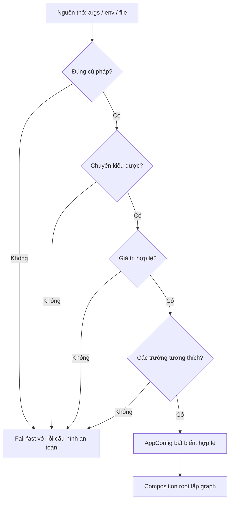
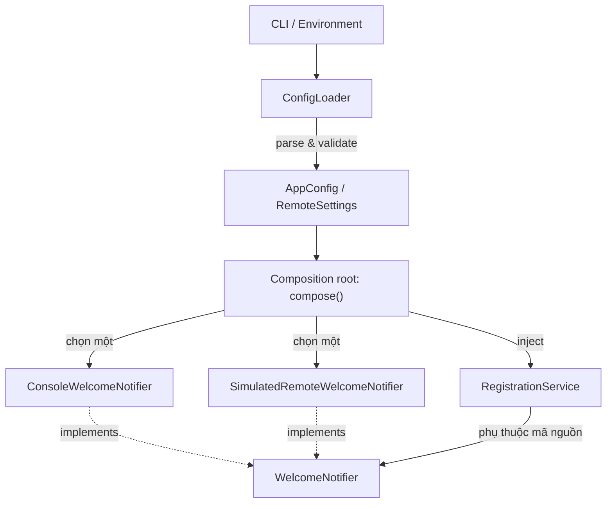

# Đối tượng cấu hình có kiểu và kiểm tra tính hợp lệ

Khi học **Dependency Injection (DI)**, ta thường bắt đầu bằng constructor injection: lớp nghiệp vụ nhận dependency qua constructor, còn **composition root** tạo và nối các đối tượng. Tuy nhiên, ở ứng dụng thực tế, composition root còn phải quyết định **nên tạo triển khai nào, với thông số gì**. Những thông số ấy có thể đến từ biến môi trường, tham số dòng lệnh, tệp cấu hình hoặc một hệ thống quản lý cấu hình. Nếu truyền trực tiếp các chuỗi thô này đi khắp ứng dụng, việc kiểm tra sai sót và hiểu ý nghĩa của từng giá trị sẽ trở nên khó khăn.

**Đối tượng cấu hình có kiểu** (*typed configuration object*) giúp chuyển dữ liệu đầu vào chưa đáng tin cậy thành một mô hình Java có ý nghĩa: thời gian chờ là `Duration`, endpoint là `URI`, chế độ hoạt động là `enum`, số lần thử là `int` đã được giới hạn. Sau khi kiểm tra hợp lệ, mã lắp ghép có thể sử dụng các giá trị ấy để tạo adapter mà không cần diễn giải lại chuỗi cấu hình ở nhiều nơi.

Bài thuộc chương **Cấu hình lắp ghép** trong module **DEPENDENCY_INJECTION**. Ta tập trung vào việc **đọc → chuyển kiểu → kiểm tra → lắp ghép** bằng Java thuần, tách cấu hình vận hành khỏi logic nghiệp vụ, rồi liên hệ với scope, vòng đời và các cơ chế cấu hình do DI container cung cấp.

## 1. Kết quả cần đạt

Sau bài học, bạn có thể:

- Giải thích vì sao không nên đưa `Map<String, String>`, `System.getenv()` hoặc các chuỗi cấu hình rải rác vào lớp nghiệp vụ.
- Thiết kế đối tượng cấu hình **có kiểu, bất biến và có bất biến hợp lệ** (*invariants*) để biểu diễn nhu cầu khởi động.
- Phân biệt **kiểm tra cú pháp**, **chuyển kiểu**, **kiểm tra miền giá trị** và **kiểm tra điều kiện liên trường**.
- Xác định giá trị nào được phép có **mặc định rõ ràng**, giá trị nào bắt buộc và khi nào phải **fail fast**.
- Dùng cấu hình đã xác thực tại composition root để lựa chọn và tạo dependency qua constructor injection.
- Không làm lộ thông tin bí mật khi thông báo lỗi, ghi log hoặc hiển thị cấu hình.
- Kiểm thử parser, validator và wiring độc lập với DI container, sau đó biết những gì vẫn cần kiểm thử tích hợp.

## 2. Vì sao cấu hình thô là một dependency khó kiểm soát?

Xem một lớp nghiệp vụ trực tiếp đọc môi trường:

```java
// Minh họa anti-pattern; RemoteNotifier là adapter giả định.
final class RegistrationService {
    void register(String email) {
        String mode = System.getenv("NOTIFY_MODE");
        String endpoint = System.getenv("NOTIFY_ENDPOINT");
        int timeout = Integer.parseInt(System.getenv("NOTIFY_TIMEOUT_MS"));

        if ("remote".equals(mode)) {
            new RemoteNotifier(endpoint, timeout).send(email);
        }
        // Các quy tắc đăng ký khác...
    }
}
```

Ở đây có nhiều vấn đề độc lập:

1. **Trộn trách nhiệm:** `RegistrationService` vừa làm nghiệp vụ, vừa biết tên biến môi trường, chọn adapter và chuyển chuỗi thời gian chờ thành số.
2. **Lỗi xuất hiện muộn:** một giá trị timeout không hợp lệ có thể chỉ bị phát hiện khi người dùng đầu tiên đăng ký, thay vì lúc khởi động ứng dụng.
3. **Không rõ đơn vị:** giá trị `"2500"` là 2.500 mili giây, giây hay một đơn vị khác? Kiểu `int` không nói lên điều đó.
4. **Khó phân biệt thiếu và sai:** `null` có thể gây lỗi parse; một chế độ gõ sai có thể khiến service âm thầm không gửi gì.
5. **Khó kiểm thử:** test nghiệp vụ phải điều khiển môi trường hoặc thay mã khởi tạo, thay vì truyền test double đơn giản.
6. **Quyền sở hữu bị phân tán:** nếu adapter có socket hoặc thread, tạo nó mỗi lần đăng ký khiến vòng đời và cleanup khó quản lý.

Thay vì vậy, hãy tách trách nhiệm:

```text
Nguồn cấu hình thô
    -> bộ đọc / parser / validator
    -> đối tượng cấu hình có kiểu, hợp lệ
    -> composition root lựa chọn và tạo adapter
    -> constructor injection vào service nghiệp vụ
    -> service chỉ sử dụng hợp đồng
```

**Lưu ý:** việc một lớp đọc `System.getenv()` không tự động sai. Nó hợp lý ở **ranh giới bootstrap/configuration**. Vấn đề là để các quyết định về môi trường **lan vào lớp sử dụng dependency** và phải được thực hiện lặp lại mỗi khi xử lý nghiệp vụ.

## 3. Cấu hình có kiểu giải quyết được điều gì?

Một cấu hình thô thường trông như sau:

```text
mode=remote
endpoint=https://notify.example.test/api
timeout-ms=2500
max-attempts=2
```

Sau bước parse/validate, ta mong có một đối tượng mang ý nghĩa rõ:

```java
// Phác họa API; các lớp hoàn chỉnh nằm trong ví dụ ở mục 7.
enum NotifyMode { CONSOLE, REMOTE }

final class RemoteSettings {
    final java.net.URI endpoint;
    final java.time.Duration timeout;
    final int maxAttempts;
    // Credential được lưu kín và không in ra log.
}
```

So sánh:

| Cấu hình thô | Cấu hình có kiểu | Lợi ích |
| --- | --- | --- |
| `"remote"` | `NotifyMode.REMOTE` | Chỉ có những mode được khai báo; dễ phát hiện giá trị không biết |
| `"https://..."` | `URI endpoint` | Parse một lần, kiểm tra scheme/host và quy tắc bảo mật |
| `"2500"` | `Duration.ofMillis(2500)` | Đơn vị được thể hiện tường minh |
| `"2"` | `int maxAttempts` đã giới hạn | Không tiếp tục mang theo chuỗi không hợp lệ |
| Thiếu token | Lỗi khởi động có thông báo an toàn | Không tạo adapter remote chưa đủ thông tin |

Một kiểu dữ liệu chỉ có giá trị nếu **constructor/factory kiểm tra các bất biến cần thiết**. Đặt tên lớp `ValidatedConfig` nhưng cho phép tạo nó với endpoint HTTP không an toàn, timeout âm hoặc tổ hợp trường vô nghĩa thì chưa giải quyết được bài toán.

### 3.1. Bất biến (*immutable*) và hợp lệ (*valid*) là hai thuộc tính khác nhau

- **Bất biến:** trạng thái cấu hình không bị thay đổi sau khi tạo. Các trường `private final` và không có setter là một cách thực hiện đối với những giá trị bất biến.
- **Hợp lệ:** trạng thái thỏa mọi điều kiện mà ứng dụng yêu cầu. Một object `final` vẫn có thể chứa `timeout = -1` nếu không kiểm tra.

Hai thuộc tính nên đi cùng nhau để composition root có thể tin rằng một object đã xác thực **không đổi ý nghĩa giữa lúc kiểm tra và lúc lắp ghép**.

Nhưng `final` chỉ khóa **tham chiếu**, không biến một `Map` hay `List` mutable thành immutable. Nếu cấu hình chứa collection, hãy cân nhắc tạo bản sao phòng vệ bằng `List.copyOf(...)`/`Map.copyOf(...)` và không trả ra collection mutable bên trong.

### 3.2. Không biến mọi chuỗi thành một kiểu riêng

Không nhất thiết tạo class mới cho từng tham số. `Duration`, `URI`, `enum` và kiểu số chuẩn đã cung cấp nhiều ý nghĩa. Một value object chuyên biệt chỉ nên thêm khi nó bảo vệ một khái niệm hoặc bất biến quan trọng, chẳng hạn `PositivePort`, `RetryPolicySettings` hoặc `RemoteEndpoint`.

Đích đến là **giảm số trạng thái cấu hình vô nghĩa**, không phải tăng lớp/annotation bằng mọi giá.

## 4. Bốn tầng kiểm tra cấu hình

Hãy tách các bước kiểm tra để thông báo lỗi đúng nguyên nhân:

| Tầng | Ví dụ | Nếu sai thì nên làm gì? |
| --- | --- | --- |
| **Cú pháp/định dạng** | Flag phải là `--key=value`, không lặp key, không có key lạ | Báo cấu hình không hợp lệ; không âm thầm bỏ qua |
| **Chuyển kiểu** | `"2500"` → `int` → `Duration`; chuỗi URL → `URI` | Báo lỗi parse với tên trường; không sử dụng giá trị hỏng |
| **Miền giá trị** | Timeout phải lớn hơn 0 và không vượt ngưỡng; số lần thử trong khoảng cho phép | Báo lỗi điều kiện, không dựa vào thư viện ngoài xử lý ngẫu nhiên |
| **Điều kiện liên trường** | Mode remote cần endpoint HTTPS và token; mode console không chấp nhận cấu hình remote | Từ chối tổ hợp vô nghĩa hoặc nguy hiểm |

Ta có thể hình dung:



Đây là **chuỗi trách nhiệm logic**. Trong code, các điều kiện có thể nằm trong một parser và constructor/factory của value object, miễn là dễ theo dõi và mọi đường tạo object đều được bảo vệ.

### 4.1. Tránh kiểm tra trùng lặp và bỏ sót

Một cách phân công phổ biến:

- **Parser/loader** chịu trách nhiệm hiểu định dạng đầu vào, key được hỗ trợ, báo lỗi parse và chuyển sang kiểu Java.
- **Typed config/value object** chịu trách nhiệm giữ **bất biến nội tại** của nó: timeout dương, URL đúng chính sách, số lần thử trong khoảng.
- **Config tổng hợp** chịu trách nhiệm về **điều kiện liên trường**: mode remote phải có remote settings; mode console không được mang tùy chọn remote.
- **Composition root** dùng giá trị đã hợp lệ để chọn adapter và lắp ghép object graph. Nó không cần parse lại chuỗi hay sửa “ngầm” dữ liệu cấu hình.

Một số quy tắc cần được kiểm tra thêm khi adapter bắt đầu hoạt động, ví dụ endpoint có thật sự truy cập được, credential có được chấp nhận hay chứng chỉ TLS có hợp lệ không. Đó là **kiểm thử kết nối/readiness** ở ranh giới vận hành, không phải tính hợp lệ cú pháp của `URI`. Đừng đánh đồng “configuration valid” với “remote service healthy”.

## 5. Giá trị mặc định phải có phạm vi rõ ràng

Cho phép default phù hợp khi thiếu tham số **là một quyết định thiết kế**, không phải phép chữa mọi lỗi.

| Trường hợp | Cách xử lý có chủ đích |
| --- | --- |
| Không chỉ định mode trong công cụ học tập | Dùng `CONSOLE` nếu đã công bố đó là default |
| Chỉ định `--mode=remtoe` (gõ sai) | Báo lỗi; không chuyển sang console |
| Mode remote nhưng thiếu endpoint | Báo lỗi; không đoán một URL |
| Mode remote nhưng thiếu credential bắt buộc | Báo lỗi; không tạo adapter “giả gửi thành công” |
| Mode console nhưng kèm `--endpoint` | Báo lỗi cấu hình mâu thuẫn hoặc bị bỏ quên |
| Có timeout hợp lệ nhưng lớn hơn giới hạn cho phép | Báo lỗi miền giá trị |
| Không chỉ định timeout trong remote mode | Có thể dùng default đã công bố, ví dụ 2 giây |

Đừng dùng các mẫu như `catch (Exception) { return defaultConfig(); }`. Chúng biến lỗi cấu hình thành một cách chạy khác mà người vận hành không hề yêu cầu.

Một số tùy chọn **không có default an toàn**: tên database production, credential thanh toán, tenant ID hoặc nơi ghi dữ liệu bền vững. Thiếu chúng cần được phát hiện sớm. Một default dùng cho local/dev chưa chắc được phép trong production.

## 6. Bảo vệ bí mật ngay từ ranh giới cấu hình

Credential, token và secret thường được cấp qua biến môi trường hoặc secret manager. Dù nguồn là gì, chúng vẫn là **dữ liệu nhạy cảm**. Typed config không tự tạo bảo mật; cách sử dụng mới quyết định rủi ro:

- Không ghi `System.getenv()` toàn bộ vào log, không log đối tượng config bằng `toString()` tự động nếu nó chứa secret.
- Không đưa token vào thông báo exception, query string URL hoặc ví dụ lệnh CLI thật: command line có thể xuất hiện trong lịch sử shell và thông tin tiến trình.
- Tách **tên cấu hình** được phép hiển thị khỏi **giá trị bí mật**; ví dụ lỗi “APP_NOTIFY_TOKEN is required” không tiết lộ token.
- Chỉ truyền secret đến adapter **thực sự cần** nó, không tiêm `AppConfig` chứa mọi secret vào mọi service.
- Với triển khai thực, cần tính đến thời hạn token, rotation, quyền truy cập, TLS và chính sách quản lý secret của môi trường.

Trong Java, `String` là bất biến nhưng nội dung secret có thể còn trong bộ nhớ cho tới khi JVM thu hồi. Đổi sang `char[]` không tự động giải quyết bài toán nếu các thư viện downstream vẫn cần `String`. Hãy dựa vào mô hình đe dọa và API secret manager phù hợp thay vì coi một kiểu dữ liệu là đủ bảo vệ.

## 7. Ví dụ Java thuần: parse, kiểm tra và lắp ghép

Ta xây dựng ứng dụng minh họa gửi thông báo chào mừng khi đăng ký. Có hai cách cung cấp `WelcomeNotifier`:

- **CONSOLE:** in một thông báo ra console. Đây là **mặc định được phép của bài học**, không phải mặc định production.
- **REMOTE:** cần endpoint HTTPS, timeout, số lần thử và token. Trong bản demo, adapter remote **chỉ mô phỏng lệnh gửi**, không mở network và không dùng token để xác thực thực tế.

`RegistrationService` chỉ biết hợp đồng `WelcomeNotifier`. Toàn bộ công việc đọc và xác thực cấu hình nằm ở `ConfigLoader` và đối tượng có kiểu; việc chọn implementation nằm trong `compose(...)`.

### 7.1. Chương trình `Main.java` đầy đủ

Ví dụ sử dụng JDK 11 trở lên và có thể lưu thành **một tệp `Main.java`**:

```java
import java.net.URI;
import java.time.Duration;
import java.util.LinkedHashMap;
import java.util.Map;
import java.util.Objects;
import java.util.Set;

public class Main {
    enum NotifyMode {
        CONSOLE, REMOTE
    }

    // Value object cho cấu hình của adapter remote.
    static final class RemoteSettings {
        final URI endpoint;
        final Duration timeout;
        final int maxAttempts;
        private final String apiToken;

        RemoteSettings(
                URI endpoint,
                Duration timeout,
                int maxAttempts,
                String apiToken) {
            Objects.requireNonNull(endpoint, "endpoint");
            Objects.requireNonNull(timeout, "timeout");

            // Chỉ nhận URL HTTPS có host, không kèm credential/query.
            if (!"https".equalsIgnoreCase(endpoint.getScheme())
                    || endpoint.getHost() == null
                    || endpoint.getUserInfo() != null
                    || endpoint.getRawQuery() != null
                    || endpoint.getFragment() != null) {
                throw new IllegalArgumentException(
                        "endpoint must be a valid HTTPS URL without "
                        + "credentials, query or fragment");
            }
            if (timeout.isNegative()
                    || timeout.isZero()
                    || timeout.compareTo(Duration.ofSeconds(30)) > 0) {
                throw new IllegalArgumentException(
                        "timeout-ms must be between 1 and 30000");
            }
            if (maxAttempts < 1 || maxAttempts > 5) {
                throw new IllegalArgumentException(
                        "max-attempts must be between 1 and 5");
            }
            if (apiToken == null || apiToken.isBlank()) {
                throw new IllegalArgumentException(
                        "APP_NOTIFY_TOKEN is required for remote mode");
            }

            this.endpoint = endpoint;
            this.timeout = timeout;
            this.maxAttempts = maxAttempts;
            this.apiToken = apiToken;
        }

        // Không tạo toString() in các trường chứa secret.
    }

    // Cấu hình tổng hợp: remote settings chỉ có ở mode REMOTE.
    static final class AppConfig {
        final NotifyMode mode;
        final RemoteSettings remote;

        private AppConfig(NotifyMode mode, RemoteSettings remote) {
            this.mode = Objects.requireNonNull(mode, "mode");
            if ((mode == NotifyMode.REMOTE) != (remote != null)) {
                throw new IllegalArgumentException(
                        "mode and remote settings are inconsistent");
            }
            this.remote = remote;
        }

        static AppConfig console() {
            return new AppConfig(NotifyMode.CONSOLE, null);
        }

        static AppConfig remote(RemoteSettings settings) {
            return new AppConfig(
                    NotifyMode.REMOTE,
                    Objects.requireNonNull(settings, "settings"));
        }
    }

    // Ranh giới chuyển cấu hình thô sang đối tượng có kiểu.
    static final class ConfigLoader {
        private static final Set<String> ALLOWED_KEYS = Set.of(
                "mode", "endpoint", "timeout-ms", "max-attempts");

        static AppConfig load(
                String[] args, Map<String, String> environment) {
            Objects.requireNonNull(args, "args");
            Objects.requireNonNull(environment, "environment");

            Map<String, String> options = new LinkedHashMap<>();
            for (String arg : args) {
                if (arg == null || !arg.startsWith("--")) {
                    throw new IllegalArgumentException(
                            "Expected --key=value argument");
                }
                int separator = arg.indexOf('=');
                if (separator <= 2 || separator == arg.length() - 1) {
                    throw new IllegalArgumentException(
                            "Expected non-empty --key=value argument");
                }
                String key = arg.substring(2, separator);
                String value = arg.substring(separator + 1);
                if (!ALLOWED_KEYS.contains(key)) {
                    throw new IllegalArgumentException(
                            "Unknown configuration key: " + key);
                }
                if (options.putIfAbsent(key, value) != null) {
                    throw new IllegalArgumentException(
                            "Duplicate configuration key: " + key);
                }
            }

            String mode = options.getOrDefault("mode", "console");
            if ("console".equals(mode)) {
                // Không lặng lẽ bỏ qua lựa chọn remote.
                if (options.containsKey("endpoint")
                        || options.containsKey("timeout-ms")
                        || options.containsKey("max-attempts")) {
                    throw new IllegalArgumentException(
                            "remote options are not allowed in console mode");
                }
                return AppConfig.console();
            }
            if (!"remote".equals(mode)) {
                throw new IllegalArgumentException(
                        "Unknown notify mode: " + mode);
            }

            String rawEndpoint = options.get("endpoint");
            if (rawEndpoint == null) {
                throw new IllegalArgumentException(
                        "endpoint is required in remote mode");
            }

            URI endpoint;
            try {
                endpoint = URI.create(rawEndpoint);
            } catch (IllegalArgumentException invalidUri) {
                // Không đưa URL nguyên văn vào thông báo.
                throw new IllegalArgumentException(
                        "endpoint must be a valid HTTPS URL");
            }

            int timeoutMillis = parseInteger(
                    "timeout-ms", options.getOrDefault("timeout-ms", "2000"));
            int maxAttempts = parseInteger(
                    "max-attempts", options.getOrDefault("max-attempts", "1"));
            String token = environment.get("APP_NOTIFY_TOKEN");

            RemoteSettings remote = new RemoteSettings(
                    endpoint,
                    Duration.ofMillis(timeoutMillis),
                    maxAttempts,
                    token);
            return AppConfig.remote(remote);
        }

        private static int parseInteger(String key, String value) {
            try {
                return Integer.parseInt(value);
            } catch (NumberFormatException invalidNumber) {
                throw new IllegalArgumentException(
                        key + " must be an integer");
            }
        }
    }

    // Hợp đồng được lớp nghiệp vụ sử dụng.
    interface WelcomeNotifier {
        void sendWelcome(String email);
    }

    static final class ConsoleWelcomeNotifier implements WelcomeNotifier {
        @Override
        public void sendWelcome(String email) {
            System.out.println("Console welcome for " + email);
        }
    }

    // Adapter giả lập; KHÔNG kết nối mạng hoặc gửi thông báo thật.
    static final class SimulatedRemoteWelcomeNotifier
            implements WelcomeNotifier {
        private final RemoteSettings settings;

        SimulatedRemoteWelcomeNotifier(RemoteSettings settings) {
            this.settings = Objects.requireNonNull(settings, "settings");
        }

        @Override
        public void sendWelcome(String email) {
            // Chỉ mô phỏng cách sử dụng config, không in token.
            System.out.println(
                    "Simulated remote welcome via "
                    + settings.endpoint.getHost());
        }
    }

    // Business service: không đọc args/env, không chọn implementation.
    static final class RegistrationService {
        private final WelcomeNotifier notifier;

        RegistrationService(WelcomeNotifier notifier) {
            this.notifier = Objects.requireNonNull(notifier, "notifier");
        }

        void register(String email) {
            Objects.requireNonNull(email, "email");
            if (email.isBlank()) {
                throw new IllegalArgumentException("email is blank");
            }
            notifier.sendWelcome(email);
        }
    }

    static final class Application {
        final RegistrationService registrations;

        Application(RegistrationService registrations) {
            this.registrations =
                    Objects.requireNonNull(registrations, "registrations");
        }
    }

    // Composition root: chọn và tiêm adapter từ config đã hợp lệ.
    static Application compose(AppConfig config) {
        Objects.requireNonNull(config, "config");
        WelcomeNotifier notifier;

        switch (config.mode) {
            case CONSOLE:
                notifier = new ConsoleWelcomeNotifier();
                break;
            case REMOTE:
                notifier = new SimulatedRemoteWelcomeNotifier(config.remote);
                break;
            default:
                throw new IllegalArgumentException(
                        "notify mode has no registered adapter");
        }
        return new Application(new RegistrationService(notifier));
    }

    // Các phép kiểm tra thuần Java, không cần mở network.
    static void runChecks() {
        AppConfig defaultConfig =
                ConfigLoader.load(new String[0], Map.of());
        if (defaultConfig.mode != NotifyMode.CONSOLE
                || defaultConfig.remote != null) {
            throw new AssertionError("wrong default configuration");
        }

        String[] validRemote = {
                "--mode=remote",
                "--endpoint=https://notify.example.test/api",
                "--timeout-ms=2500",
                "--max-attempts=2"
        };
        AppConfig remote = ConfigLoader.load(
                validRemote, Map.of("APP_NOTIFY_TOKEN", "test-only-token"));
        if (remote.mode != NotifyMode.REMOTE
                || remote.remote.timeout.toMillis() != 2500
                || remote.remote.maxAttempts != 2) {
            throw new AssertionError("incorrect typed remote config");
        }

        assertRejected(new String[]{"--mode=remtoe"}, Map.of());
        assertRejected(new String[]{"--mode=console",
                "--endpoint=https://example.test"}, Map.of());
        assertRejected(new String[]{"--mode=console",
                "--mode=remote"}, Map.of());
        assertRejected(new String[]{"--mode=remote",
                "--endpoint=http://notify.example.test"},
                Map.of("APP_NOTIFY_TOKEN", "test-only-token"));
        assertRejected(new String[]{"--mode=remote",
                "--endpoint=https://notify.example.test/api"}, Map.of());

        final int[] calls = {0};
        WelcomeNotifier fake = email -> calls[0]++;
        new RegistrationService(fake).register("test@example.test");
        if (calls[0] != 1) {
            throw new AssertionError("business service did not use notifier");
        }
    }

    static void assertRejected(
            String[] args, Map<String, String> environment) {
        boolean rejected = false;
        try {
            ConfigLoader.load(args, environment);
        } catch (IllegalArgumentException expected) {
            rejected = true;
        }
        if (!rejected) {
            throw new AssertionError("invalid configuration was accepted");
        }
    }

    public static void main(String[] args) {
        AppConfig config = ConfigLoader.load(args, System.getenv());
        Application app = compose(config);
        System.out.println("Selected mode: " + config.mode);
        app.registrations.register("learner@example.test");

        runChecks();
        System.out.println("Plain Java checks: PASS");
    }
}
```

Chạy với **JDK 11 trở lên**:

```bash
javac -encoding UTF-8 Main.java
java Main
```

Kết quả dự kiến khi không truyền option:

```text
Selected mode: CONSOLE
Console welcome for learner@example.test
Plain Java checks: PASS
```

Trong chế độ remote, cần cung cấp biến môi trường `APP_NOTIFY_TOKEN` bằng cách quản lý secret phù hợp với hệ điều hành/môi trường, rồi chạy:

```bash
java Main --mode=remote --endpoint=https://notify.example.test/api --timeout-ms=2500 --max-attempts=2
```

Kết quả của adapter **mô phỏng**, khi token đã được cấp:

```text
Selected mode: REMOTE
Simulated remote welcome via notify.example.test
Plain Java checks: PASS
```

Không cần và **không nên** đặt token thật trực tiếp trên command line. Nếu chưa có `APP_NOTIFY_TOKEN`, chương trình sẽ báo lỗi cấu hình; nó **không** giả lập thành công bằng cách tự chuyển sang console. Ví dụ remote chỉ chứng minh **cấu hình và wiring**, không gửi request HTTPS hoặc xác thực token thật.

### 7.2. Quan sát các ranh giới đã tách

1. **Nguồn thô:** `main` cung cấp `args` và `System.getenv()` cho `ConfigLoader`. Bộ loader có thể nhận `Map.of(...)` từ test nên không cần sửa biến môi trường của máy.
2. **Chuyển kiểu:** mode được phân nhánh thành giá trị enum, endpoint thành `URI`, timeout thành `Duration`, số lần thử thành `int`.
3. **Kiểm tra bất biến:** `RemoteSettings` giới hạn timeout 1–30.000 ms, max attempts 1–5, endpoint HTTPS hợp lệ và token khác rỗng.
4. **Kiểm tra liên trường:** `AppConfig` chỉ cho phép mode `REMOTE` có remote settings; loader từ chối remote-only options khi ở mode `CONSOLE`.
5. **Wiring:** `compose(...)` chỉ chọn `WelcomeNotifier`; `RegistrationService` nhận interface qua constructor, không biết chi tiết cấu hình.
6. **Kiểm thử:** `runChecks()` thử một trường hợp hợp lệ, nhiều lỗi cấu hình, và dùng notifier giả để chứng minh service không phụ thuộc container hay adapter.

Sơ đồ phụ thuộc:



Trong ví dụ này, `AppConfig` và `RemoteSettings` là các lớp lồng nhau để mã tự chứa. Ở dự án thực, có thể tách thành package cấu hình và bootstrap. **Không nên tiêm toàn bộ `AppConfig` vào `RegistrationService`** chỉ để nó tự chọn adapter; điều đó sẽ kéo thông tin môi trường trở lại lớp nghiệp vụ.

## 8. Kiểm tra đúng thời điểm, tránh side effect lúc parse

Một ranh giới cấu hình tốt có thể được **parse và kiểm tra mà chưa mở tài nguyên bên ngoài**:

```text
1. Đọc cấu hình từ nguồn
2. Parse và xác thực object cấu hình
3. Chọn và tạo các dependency
4. Lắp ghép object graph
5. Nếu cần, start kết nối/listener và kiểm tra readiness
6. Chạy nghiệp vụ
7. Shutdown và đóng tài nguyên theo ownership
```

Nếu loader tự kết nối database, đăng ký message consumer hoặc gửi yêu cầu mạng chỉ để kiểm tra một URL có đúng định dạng hay không, ta đã trộn **kiểm tra cấu hình** với **kích hoạt hiệu ứng vận hành**. Khi một bước phía sau thất bại, tài nguyên mở sớm cần được thu dọn và lỗi khó phân loại hơn.

**Phân biệt ba mức “đúng”:**

- **Cấu hình hợp lệ về cấu trúc:** URL parse được, mode tồn tại, timeout và số lần thử trong khoảng.
- **Có thể lắp graph:** adapter được chọn có đầy đủ dependency bắt buộc, không thiếu cấu hình hay binding.
- **Dịch vụ thật sẵn sàng:** kết nối, xác thực, quyền truy cập, DNS/TLS, cơ sở dữ liệu và tài nguyên vận hành đang hoạt động.

Mức thứ ba có thể chỉ kiểm tra khi startup hoặc theo health/readiness policy. Một URI HTTPS hợp lệ **không bảo đảm** host đó truy cập được. DI container cũng không tự cung cấp bảo đảm như vậy.

## 9. Kiểm tra liên trường và các cấu hình mâu thuẫn

Nhiều lỗi nguy hiểm không phải là lỗi parse từng trường mà là **tổ hợp không hợp lệ**:

| Tổ hợp | Vì sao sai | Cách phát hiện |
| --- | --- | --- |
| `mode=remote` nhưng không có endpoint | Adapter không biết nơi kết nối | Bắt buộc endpoint trong remote mode |
| `mode=remote` với URL HTTP | Không đạt chính sách yêu cầu HTTPS | Kiểm tra scheme/host ngay ở typed config |
| `mode=remote` nhưng token rỗng | Thiếu thông tin xác thực bắt buộc | Từ chối tạo `RemoteSettings` |
| `mode=console` nhưng có endpoint | Dấu hiệu cấu hình cũ/typo hoặc nhầm mode | Từ chối option không có ý nghĩa ở mode đó |
| Timeout bằng 0 hoặc âm | Dễ gây hành vi timeout bất ngờ | Giới hạn `Duration` |
| Số lần thử quá lớn | Có thể tạo tải hoặc vòng retry không kiểm soát | Chặn vượt ngưỡng cho phép |
| Cấu hình lặp cùng key | Không rõ giá trị nào thắng | Từ chối lặp, không phụ thuộc thứ tự |
| Key không biết | Dễ là typo trong pipeline triển khai | Báo lỗi thay vì bỏ qua âm thầm |

Một số hệ thống cần **tùy chọn chưa đặt** khác với **giá trị rỗng được đặt cố ý**. Hãy phân biệt chúng trong parser; đừng dùng default cho cả hai một cách tự động. Nếu cấu hình có nhiều nguồn như file + env + command line, cần định nghĩa **thứ tự ưu tiên** tường minh và kiểm thử; ở ví dụ này, command line cung cấp mode/endpoint/timeout, còn token chỉ được đọc từ env, nên không có chuyện cùng một key cạnh tranh giữa ba nguồn.

### 9.1. Kiểm tra thứ tự ưu tiên khi có nhiều nguồn

Một ứng dụng có thể chọn thứ tự như:

```text
CLI (cao nhất) > environment > config file > default (thấp nhất)
```

Đây **chỉ là ví dụ về chính sách precedence**, không phải quy tắc Java hay DI container bắt buộc. Nếu nhiều nguồn được hỗ trợ, hãy ghi rõ:

- Key nào được phép override từ nguồn nào?
- Secret có được phép truyền qua CLI hoặc lưu ở file trong repository không?
- Khi một nguồn cao hơn có giá trị rỗng, đó là “xóa” giá trị cũ hay là lỗi?
- Có cần kiểm tra **cấu hình tổng hợp cuối cùng** sau khi merge hay không?

Chỉ sau khi quyết định precedence mới nên parse và tạo typed config. Nếu từng lớp tự đọc môi trường theo cách riêng, cùng một ứng dụng có thể tồn tại nhiều chính sách override mâu thuẫn.

## 10. Đối tượng cấu hình có kiểu không thay thế các hợp đồng nghiệp vụ

Phân biệt:

```java
// Cấu hình vận hành được root dùng để tạo adapter.
RemoteSettings remoteSettings = ...;
WelcomeNotifier notifier =
        new SimulatedRemoteWelcomeNotifier(remoteSettings);

// Service chỉ nhận khả năng nó cần.
RegistrationService service = new RegistrationService(notifier);
```

Nếu `RegistrationService` nhận `RemoteSettings` rồi tự chọn console/remote, nó bắt đầu phụ thuộc cấu hình và implementation. Việc cấu hình có kiểu **không tự động bảo đảm Dependency Inversion Principle (DIP)**. Cần cả **hướng dependency** và **nơi đưa ra quyết định** hợp lý.

Một rule như “khách hàng VIP nhận email ưu tiên” là **chính sách nghiệp vụ theo dữ liệu khách hàng**, không phải chỉ là flag chọn adapter khi khởi động. Composition root có thể tạo một `NotificationPolicy` và tiêm vào service; đối tượng policy mới quyết định hành vi cho từng người dùng. Đừng chuyển mọi điều kiện `if` trong nghiệp vụ sang parser cấu hình chỉ vì đã học DI.

Tương tự, validation của `RemoteSettings` (HTTPS, timeout, max attempts) **khác** validation của người dùng (địa chỉ email hợp lệ, quyền gửi, trạng thái đăng ký) hoặc validation dữ liệu miền. Mỗi loại cần đặt gần thành phần sở hữu quy tắc ấy.

## 11. Cấu hình, scope và vòng đời của component

Typed config thường là dữ liệu bất biến có thể chia sẻ trong phạm vi ứng dụng. Nhưng **adapter được tạo từ config** có thể có vòng đời khác:

- `Duration`, `URI`, `enum` và các value object bất biến thường có thể dùng chung mà không cần `close()`.
- Một HTTP client được thiết kế để tái sử dụng có thể được tạo ở composition root và chia sẻ nếu API cho phép.
- Một session, request context hay transaction không nên trở thành singleton chỉ vì nó được cấu hình từ một object dùng chung.
- Một resource `AutoCloseable` cần owner rõ ràng; root hoặc factory phải xác định ai đóng và đóng khi nào.
- Nếu adapter mở socket, bind cổng hoặc đăng ký listener, nên xem xét ranh giới **construction vs activation/start** thay vì tự kích hoạt ẩn trong constructor.

Khi dùng DI container, các annotation cấu hình có thể hỗ trợ binding, conversion, validation và lifecycle. Nhưng kết quả vẫn phụ thuộc vào **quy tắc của framework và cấu hình thực tế**: không có bảo đảm rằng mọi bean được tạo đúng scope, mọi secret không lộ log hoặc mọi component đã ready chỉ vì nó được inject thành công.

### 11.1. Nếu cấu hình thay đổi khi ứng dụng đang chạy

Đối tượng cấu hình bất biến không có nghĩa hệ thống **không thể** cập nhật cấu hình. Nó có nghĩa mỗi instance biểu diễn **một snapshot nhất quán**.

Một chiến lược cập nhật an toàn hơn việc sửa từng trường mutable:

1. Đọc cấu hình mới từ nguồn tin cậy.
2. Parse, kiểm tra và tạo snapshot typed config mới.
3. Nếu cần, tạo và kiểm tra adapter/graph mới trước khi chuyển.
4. Chuyển sang phiên bản mới theo một cơ chế có kiểm soát.
5. Chờ/hủy công việc cũ đúng chính sách rồi đóng tài nguyên cũ.

Tùy ứng dụng, thay đổi có thể yêu cầu restart thay vì hot reload. Không được giả định chỉ vì `AppConfig` mới đã hợp lệ thì những request đang chạy có thể đổi dependency an toàn ngay tức thì. Đây là bài toán **lifecycle và consistency**, không chỉ bài toán parse.

## 12. Ma trận kiểm thử cho cấu hình

Kiểm thử typed config nên bao phủ cả **đường hợp lệ và bất hợp lệ**, không chỉ xem chương trình khởi động với mặc định:

| Kiểm tra | Đầu vào | Kết quả mong đợi |
| --- | --- | --- |
| Default tường minh | Không có args | `AppConfig.console()` |
| Remote hợp lệ | Mode remote, HTTPS endpoint, token, timeout 2500 ms, attempts 2 | `AppConfig.remote(...)` |
| Mode gõ sai | `--mode=remtoe` | Báo lỗi, không dùng console default |
| Key không biết | `--timout-ms=1000` | Báo lỗi unknown key |
| Key lặp | `--mode=console --mode=remote` | Báo lỗi duplicate key |
| Giá trị rỗng | `--mode=` | Báo lỗi cú pháp |
| Số không hợp lệ | `--timeout-ms=abc` trong remote mode | Báo lỗi parse integer |
| Timeout ngoài miền | `--timeout-ms=0` hoặc `31000` | Báo lỗi giới hạn |
| Attempts ngoài miền | `--max-attempts=6` | Báo lỗi giới hạn |
| Endpoint HTTP | `http://...` | Báo lỗi yêu cầu HTTPS |
| Endpoint có user info/query | URL chứa thông tin không được cho phép | Từ chối, không đưa raw URL vào lỗi |
| Remote thiếu token | Không có `APP_NOTIFY_TOKEN` | Báo tên key thiếu, không log giá trị |
| Console có remote option | `--mode=console --endpoint=...` | Từ chối cấu hình mâu thuẫn |
| Test service | Fake notifier qua constructor | Không cần parse config hay khởi động container |

**Hai lớp kiểm thử cần tách:** kiểm thử parser/value object xác minh **hợp lệ và chuyển kiểu**; kiểm thử composition root xác minh **adapter nào được chọn và dependency nào được tiêm**. Khi dùng adapter thật, cần thêm kiểm thử tích hợp cho endpoint, quyền truy cập, timeout, retry và resource cleanup. Ví dụ demo không thực thi network nên không thể xác nhận các điều kiện đó.

### 12.1. Kiểm thử mà không phụ thuộc trạng thái môi trường của máy

Trong ví dụ, `ConfigLoader.load(args, environment)` nhận một `Map<String, String>`, cho phép viết:

```java
// Sử dụng các lớp lồng của Main.java ở mục 7.
Main.AppConfig config = Main.ConfigLoader.load(
        new String[] {
                "--mode=remote",
                "--endpoint=https://notify.example.test/api"
        },
        java.util.Map.of("APP_NOTIFY_TOKEN", "test-only-token"));

if (config.mode != Main.NotifyMode.REMOTE) {
    throw new AssertionError("expected remote config");
}
```

Đây là **dependency injection ở ranh giới cấu hình** theo nghĩa rộng: loader nhận nguồn dữ liệu cần thiết thay vì tự đọc process environment ở mọi chỗ. Một unit test có thể kiểm soát input, kiểm tra lỗi và không phụ thuộc vào biến môi trường được đặt trên máy developer.

Không nên nhầm đây với việc mọi lớp nghiệp vụ phải nhận một map cấu hình: chỉ **loader và bootstrap** cần hiểu các tên biến môi trường. Sau khi chuyển kiểu, các component sử dụng dữ liệu đúng phạm vi trách nhiệm của chúng.

## 13. Các anti-pattern thường gặp

| Dấu hiệu | Vì sao rủi ro | Cách cải thiện |
| --- | --- | --- |
| Mỗi service tự gọi `System.getenv()` | Phụ thuộc cấu hình phân tán, test khó | Đọc ở bootstrap, chuyển thành typed config |
| Đưa `Map<String,String>` vào mọi constructor | Mọi component phải biết tên key, parse lặp lại | Tiêm đúng contract hoặc value object cần thiết |
| Dùng `int timeout` mà không chỉ rõ đơn vị | Nhầm ms/giây | Dùng `Duration` hoặc tên tham số có đơn vị rõ |
| Dùng `String mode` sau khi parse | Có thể có giá trị không biết, điều kiện rải rác | Chuyển thành `enum` và từ chối mode lạ |
| Catch mọi lỗi rồi lấy default | Che lỗi cấu hình, dễ chạy sai chế độ | Default chỉ khi thiếu tùy chọn được phép; sai thì fail fast |
| Đặt secret trong `toString()` của config | Rò token qua log/debug/error | Không xuất giá trị nhạy cảm; giới hạn nơi nhận secret |
| Chỉ kiểm tra từng field | Bỏ sót mode remote thiếu endpoint/token | Kiểm tra điều kiện liên trường |
| Dùng file cấu hình để chứa quy tắc nghiệp vụ theo từng user | Trách nhiệm domain bị dời sai chỗ | Tách policy/selector được tiêm vào service |
| Constructor cấu hình mở network ngay | Khó phân biệt parse, wiring và readiness | Parse trước, activation/connect theo vòng đời rõ |
| Hot reload bằng cách sửa từng trường mutable | Graph có thể quan sát cấu hình nửa cũ/nửa mới | Dùng snapshot có kiểu và chuyển đổi có kiểm soát |
| Tạo adapter mới mà không đóng adapter cũ | Rò connection/thread hoặc listener | Quy định ownership và shutdown của graph |

## 14. Quy trình triển khai cấu hình có kiểu

Khi đưa một hệ thống Java từ cấu hình thô sang cấu hình rõ ràng:

1. **Liệt kê các biến thực sự cần khi bootstrap.** Ghi tên, kiểu mong muốn, đơn vị, bắt buộc/tùy chọn và nơi đang sử dụng.
2. **Phân nhóm theo trách nhiệm của adapter hoặc module.** Ví dụ `RemoteSettings` chỉ chứa thông số của remote notifier; không gom mọi cấu hình vào một bag lớn.
3. **Định nghĩa default được phép.** Phân biệt thiếu thông số với thông số sai; cấm default gây mất dữ liệu hoặc thay đổi chính sách bắt buộc.
4. **Thiết kế value object có bất biến.** Dùng `Duration`, `URI`, `enum` và kiểm tra miền giá trị; tránh setter công khai làm thay đổi trạng thái sau validate.
5. **Thiết kế loader ở ranh giới.** Hỗ trợ nguồn cần thiết, kiểm tra key lạ/trùng, phân giải precedence và chuyển kiểu với lỗi dễ hiểu.
6. **Kiểm tra điều kiện liên trường.** Mode, endpoint, token, timeout, cấu hình bảo mật và khả năng chọn adapter phải tương thích.
7. **Kiểm tra rò rỉ bí mật.** Lỗi/log không chứa credential; chỉ cấp secret cho component thực sự cần.
8. **Lắp graph bằng constructor injection.** Root chọn implementation từ typed config; service nghiệp vụ chỉ nhận hợp đồng.
9. **Phân biệt tính hợp lệ với readiness.** Connection, authentication, DNS/TLS và quyền truy cập được kiểm tra ở lifecycle/adapter phù hợp.
10. **Kiểm thử cả đường lỗi và vòng đời.** Parser, validation, wiring, scope, resource shutdown và cấu hình production khi có container.

Checklist này không yêu cầu xây dựng một framework cấu hình riêng. Với ứng dụng lớn, có thể dùng thư viện/framework có hỗ trợ binding và validation; các nguyên lý về typed config, bảo mật và ranh giới trách nhiệm vẫn giữ nguyên.

## 15. Tự kiểm tra

**Tình huống A.** `EmailService` nhận một `Map<String,String>` rồi trong mỗi lần gửi tự lấy `smtp.host` và `smtp.timeout`, parse và tạo SMTP client. Có nên xem map là một typed configuration object tốt không?

**Gợi ý:** Không. Map vẫn chứa chuỗi thô, service phải biết key/đơn vị và tự tạo adapter. Nên parse ở bootstrap thành cấu hình SMTP có kiểu, tạo SMTP adapter rồi tiêm hợp đồng gửi email vào service.

**Tình huống B.** Tệp cấu hình ghi `timeout-ms=-5`. Loader parse được số `-5` và tạo `Duration.ofMillis(-5)` mà không báo lỗi. Cấu hình đã hợp lệ chưa?

**Gợi ý:** Chưa. Parse thành công không đồng nghĩa thỏa miền giá trị. Phải kiểm tra `Duration` dương và trong khoảng cho phép.

**Tình huống C.** Hệ thống cho phép mặc định `mode=console` khi không có option. Người vận hành gõ `--mode=remtoe`, loader tự chuyển về console. Vì sao nguy hiểm?

**Gợi ý:** Đây là giá trị **được chỉ định nhưng sai**, khác trường hợp không chỉ định. Fallback âm thầm có thể làm mất tác vụ gửi thông báo hoặc che lỗi triển khai. Cần fail fast.

**Tình huống D.** Một `RemoteSettings` có `private final String apiToken` nhưng `toString()` in ra mọi field khi lỗi. Có an toàn chưa?

**Gợi ý:** Không. `private` và `final` không ngăn mã trong lớp in secret. Cần tránh xuất token trong log, exception và diagnostic.

**Tình huống E.** Root đã validate `URI` HTTPS, nhưng khi `start()` adapter không kết nối được đến host. Có phải validator đã làm sai?

**Gợi ý:** Không nhất thiết. Validator kiểm tra cú pháp và chính sách cấu hình; khả năng kết nối thực là vấn đề runtime/readiness. Cần quản lý startup failure và cleanup riêng.

**Tình huống F.** `RegistrationService` chỉ nhận `WelcomeNotifier`; root đọc typed config và chọn console/remote. Đây có phải DI thủ công dù không có annotation?

**Gợi ý:** Có. Dependency được cung cấp từ ngoài qua constructor, còn việc chọn implementation nằm ở composition root. Container/annotation không phải điều kiện bắt buộc của DI.

**Tình huống G.** Một ứng dụng hot reload cấu hình bằng cách lần lượt sửa `timeout` và `endpoint` trên cùng object mutable, trong khi các request đang sử dụng nó. Rủi ro là gì?

**Gợi ý:** Các request có thể quan sát cấu hình đang cập nhật dở, trộn thông số cũ/mới. Dùng snapshot typed config bất biến và chuyển graph/adapter theo chính sách nhất quán.

## 16. Ghi nhớ

- **Cấu hình có kiểu** chuyển dữ liệu thô thành Java value object mang ý nghĩa rõ và có bất biến được kiểm tra.
- **Parse được chưa chắc hợp lệ**: cần kiểm tra cú pháp, chuyển kiểu, miền giá trị và điều kiện liên trường.
- **Default khác fallback khi lỗi**. Thiếu tùy chọn được phép mặc định khác với một giá trị được chỉ định nhưng không hợp lệ; trường hợp sau nên fail fast.
- **Composition root đọc cấu hình và chọn adapter; lớp nghiệp vụ chỉ nhận hợp đồng cần sử dụng qua constructor.**
- **Bất biến không tự bảo đảm bí mật.** Phải tránh đưa secret vào log, exception, command line và những component không cần chúng.
- **Cấu hình hợp lệ không đồng nghĩa dịch vụ ready.** Khả năng kết nối, startup, scope, quyền sở hữu và cleanup cần thiết kế riêng.
- **Java thuần là đủ để luyện thiết kế này**, trước khi dùng DI container tự động hóa binding, conversion, validation và lifecycle.

Khi thêm một tham số cấu hình mới, hãy hỏi: **“Nó thuộc trách nhiệm của adapter nào, có kiểu và đơn vị gì, giá trị nào là hợp lệ, tổ hợp nào là vô nghĩa, và ai thực sự cần biết nó?”** Trả lời rõ các câu hỏi ấy giúp composition root đáng tin cậy hơn mà không khiến lớp nghiệp vụ phụ thuộc chi tiết môi trường.
