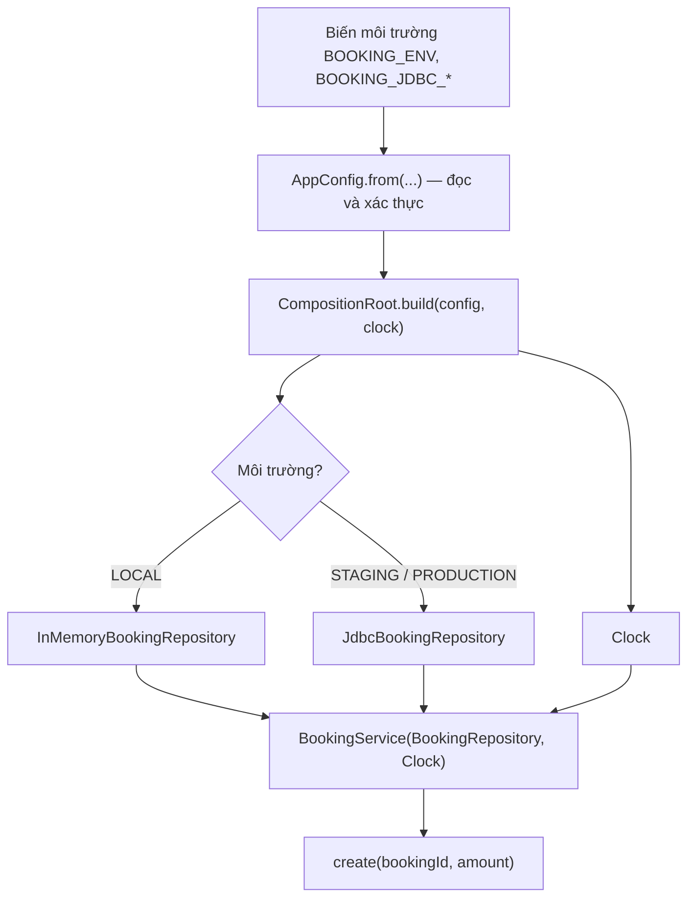
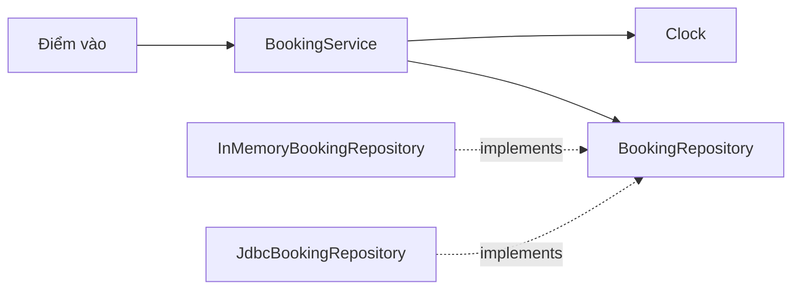
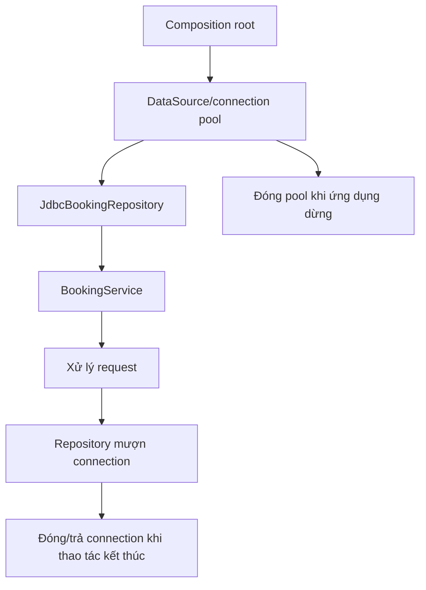

# Tách cấu hình theo môi trường mà giữ nguyên hợp đồng nghiệp vụ

Một ứng dụng Java thường chạy trong nhiều môi trường: lập trình tại máy cá nhân, kiểm thử tích hợp (*staging*) và sản xuất (*production*). Mỗi môi trường có thể cần cách lưu trữ, địa chỉ dịch vụ, thông tin xác thực, timeout và chính sách quản lý tài nguyên khác nhau. Tuy vậy, nghiệp vụ “tạo một booking hợp lệ rồi lưu lại” phải giữ cùng ý nghĩa ở mọi nơi.

Với **Dependency Injection (DI)**, ta có thể đặt lựa chọn implementation và cấu hình hạ tầng tại **composition root** — nơi tạo, kết nối và quản lý vòng đời các đối tượng. `BookingService` chỉ cần một hợp đồng `BookingRepository` qua constructor, còn composition root chọn `InMemoryBookingRepository` cho bài chạy cục bộ hoặc `JdbcBookingRepository` cho môi trường có cơ sở dữ liệu. Đó là một cách áp dụng **Inversion of Control (IoC)**: service nhận cộng tác viên đã được lắp ghép, thay vì tự đọc cấu hình rồi khởi tạo hạ tầng.

Bài này thuộc chương **Cấu hình lắp ghép**. Trọng tâm là **tách cấu hình theo môi trường mà giữ nguyên hợp đồng nghiệp vụ**, kiểm tra cấu hình khi khởi động, kiểm thử cách lắp ghép bằng Java thuần và nhận diện các vấn đề scope, vòng đời trước khi sử dụng DI container.

## 1. Phân biệt cấu hình môi trường và quy tắc nghiệp vụ

Xét chức năng tạo booking. Ở mọi môi trường, `BookingService` cần thực hiện ba bước:

1. Kiểm tra dữ liệu đầu vào.
2. Tạo một `Booking` với thời điểm xác định qua `Clock`.
3. Gọi `BookingRepository.save(booking)`.

Điều khác nhau giữa các môi trường là **cách repository thực hiện thao tác lưu**:

| Môi trường | Repository minh họa | Cấu hình cần thiết | Điều không được thay đổi |
| --- | --- | --- | --- |
| `LOCAL` | `InMemoryBookingRepository` | Chọn môi trường `LOCAL` | Dữ liệu booking, kiểm tra hợp lệ, hợp đồng `save` |
| `STAGING` | `JdbcBookingRepository` | URL DB staging, tài khoản và thông tin xác thực staging | API và hành vi nghiệp vụ của `BookingService` |
| `PRODUCTION` | `JdbcBookingRepository` | URL DB production, thông tin xác thực production, cấu hình vận hành riêng | API và hành vi nghiệp vụ của `BookingService` |

`LOCAL` trong ví dụ là chế độ dành cho học tập; dữ liệu trong bộ nhớ mất khi tiến trình dừng. `STAGING` và `PRODUCTION` dùng JDBC để minh họa cấu hình bên ngoài. Để chạy hai chế độ này thực sự cần một JDBC driver, cơ sở dữ liệu và bảng phù hợp. Mã JDBC phía dưới là ví dụ về ranh giới DI, chưa có pool, migration và quy trình vận hành của hệ thống sản xuất.

Sự phân biệt quan trọng:

- **Cấu hình lắp ghép** trả lời “dùng adapter nào, adapter đó cần URL/credential gì, ai quản lý instance?”.
- **Quy tắc nghiệp vụ** trả lời “booking hợp lệ khi nào, lưu booking trong quy trình nào, trả kết quả gì?”.
- **Dữ liệu từng yêu cầu** là `bookingId` và số tiền của một lần gọi; những giá trị này không phải cấu hình ứng dụng.

Nếu một môi trường thay đổi quy tắc nghiệp vụ có chủ ý, đó cần là quyết định về sản phẩm hoặc chính sách nghiệp vụ rõ ràng. Không nên biến tên môi trường thành điều kiện ngầm để service tự bỏ qua các bước bắt buộc.

## 2. Vị trí đúng của quyết định chọn implementation

Sơ đồ lắp ghép:



Composition root biết **tên môi trường, implementation và cấu hình hạ tầng**; `BookingService` chỉ thấy hợp đồng. Đường phụ thuộc trong nghiệp vụ luôn là:



Khi chuyển môi trường, cạnh `BookingService → BookingRepository` không thay đổi. **Instance ở đầu bên kia của cạnh** mới thay đổi tại composition root. Đây là mục tiêu của việc tách cấu hình: thay lựa chọn hạ tầng mà không phải sửa mã nghiệp vụ.

Một composition root có thể gồm nhiều hàm nhỏ để đọc cấu hình, tạo client, tạo repository rồi lắp service. Điều cần giữ là **một luồng lắp ghép có thể truy vết** từ điểm vào đến mỗi phụ thuộc; không để các service rải rác đọc biến môi trường và tự `new` adapter.

## 3. Thiết kế hợp đồng thống nhất trước khi viết cấu hình

Hợp đồng repository có thể rất nhỏ:

```java
interface BookingRepository {
    // Luu booking moi; neu khong the luu, bao loi cho caller.
    void save(Booking booking);
}
```

`BookingService` khai báo phụ thuộc trực tiếp và không nhận tên môi trường:

```java
final class BookingService {
    private final BookingRepository repository;
    private final java.time.Clock clock;

    BookingService(BookingRepository repository, java.time.Clock clock) {
        this.repository =
            java.util.Objects.requireNonNull(repository, "repository");
        this.clock = java.util.Objects.requireNonNull(clock, "clock");
    }

    Booking create(String id, int amount) {
        Booking booking = new Booking(id, amount, clock.instant());
        repository.save(booking);
        return booking;
    }
}
```

Trong ví dụ này, `Booking` chịu trách nhiệm kiểm tra định dạng ID và số tiền, còn service điều phối việc tạo/lưu. Service không cần biết dữ liệu nằm trong `Map` hay bảng SQL. Để hai adapter thực sự thay thế được cho nhau, cần thống nhất không chỉ chữ ký phương thức mà cả **ngữ nghĩa**: ví dụ lưu một booking mới, xử lý ID trùng và báo lỗi khi không lưu thành công. Một adapter âm thầm bỏ qua lỗi hoặc tự thay đổi dữ liệu sẽ phá vỡ khả năng thay thế dù vẫn implement đúng interface.

Không cần tạo một interface cho từng lớp chỉ để có thể thay đổi cấu hình. Interface có giá trị rõ nhất ở nơi có vai trò ổn định và nhiều implementation, hoặc cần fake cho kiểm thử.

## 4. Mô hình hóa cấu hình trước khi tạo đối tượng

Để tách trách nhiệm, mã khởi động đọc `System.getenv()` **một lần**, truyền vào một hàm parse và chỉ chuyển tiếp **cấu hình đã kiểm tra hợp lệ** cho composition root. Nhờ đó:

- Có thể kiểm thử parser bằng `Map<String, String>` mà không sửa biến môi trường thật của máy chạy test.
- Tên môi trường sai như `PRODUTION` sẽ bị từ chối rõ ràng.
- Nếu `STAGING` hoặc `PRODUCTION` thiếu JDBC URL hoặc thông tin xác thực, ứng dụng không tự chuyển sang lưu trong bộ nhớ.
- Service không phải giữ toàn bộ cấu hình, đặc biệt là thông tin xác thực mà nó không cần biết.

Lưu ý rằng **hợp lệ về mặt cấu hình** chưa đồng nghĩa database đang kết nối được. Parser chỉ xác nhận các giá trị bắt buộc có mặt; việc kiểm tra kết nối, schema và quyền ghi cần được thực hiện ở kiểm thử tích hợp hoặc bước readiness phù hợp.

Một bảng quyết định ngắn:

| Giá trị `BOOKING_ENV` | Việc cần làm | Kết quả |
| --- | --- | --- |
| `LOCAL` | Tạo repository trong bộ nhớ | Không yêu cầu JDBC config |
| `STAGING` | Kiểm tra ba biến `BOOKING_JDBC_*` | Tạo JDBC repository dùng cấu hình staging |
| `PRODUCTION` | Kiểm tra ba biến `BOOKING_JDBC_*` | Tạo JDBC repository dùng cấu hình production |
| Rỗng hoặc giá trị khác | Báo lỗi cấu hình | Không dựng đồ thị |

Chính sách này **cố ý không có mặc định `LOCAL`**. Khi một môi trường kỳ vọng lưu bền vững nhưng cấu hình bị thiếu, tự động chuyển sang bộ nhớ có thể dẫn tới mất dữ liệu mà người vận hành không nhận ra.

## 5. Ví dụ Java thuần hoàn chỉnh

Ta xây dựng ứng dụng console có thể biên dịch với **JDK 8 trở lên**. Chế độ `LOCAL` chạy ngay, còn `STAGING` và `PRODUCTION` cần JDBC driver, URL kết nối hợp lệ và bảng `bookings`. Hai chế độ dùng chung một `BookingService` và cùng cách gọi từ chương trình.

Tạo file `EnvironmentCompositionDemo.java`:

```java
import java.sql.Connection;
import java.sql.DriverManager;
import java.sql.PreparedStatement;
import java.sql.SQLException;
import java.sql.Timestamp;
import java.time.Clock;
import java.time.Instant;
import java.util.Locale;
import java.util.Map;
import java.util.Objects;
import java.util.concurrent.ConcurrentHashMap;

final class Booking {
    private final String id;
    private final int amount;
    private final Instant createdAt;

    Booking(String id, int amount, Instant createdAt) {
        if (id == null || !id.matches("[A-Za-z0-9-]+")) {
            throw new IllegalArgumentException("id khong hop le");
        }
        if (amount < 0) {
            throw new IllegalArgumentException("amount phai >= 0");
        }
        this.id = id;
        this.amount = amount;
        this.createdAt = Objects.requireNonNull(createdAt, "createdAt");
    }

    String id() {
        return id;
    }

    int amount() {
        return amount;
    }

    Instant createdAt() {
        return createdAt;
    }
}

interface BookingRepository {
    void save(Booking booking);
}

final class InMemoryBookingRepository implements BookingRepository {
    private final ConcurrentHashMap<String, Booking> bookings =
        new ConcurrentHashMap<>();

    @Override
    public void save(Booking booking) {
        Objects.requireNonNull(booking, "booking");
        Booking previous = bookings.putIfAbsent(booking.id(), booking);
        if (previous != null) {
            throw new IllegalStateException("Booking ID da ton tai");
        }
    }

    Booking find(String id) {
        return bookings.get(id);
    }
}

final class JdbcBookingRepository implements BookingRepository {
    private final String url;
    private final String user;
    private final String password;

    JdbcBookingRepository(String url, String user, String password) {
        this.url = Objects.requireNonNull(url, "url");
        this.user = Objects.requireNonNull(user, "user");
        this.password = Objects.requireNonNull(password, "password");
    }

    @Override
    public void save(Booking booking) {
        Objects.requireNonNull(booking, "booking");
        String sql =
            "INSERT INTO bookings (id, amount, created_at) VALUES (?, ?, ?)";

        try (Connection connection =
                 DriverManager.getConnection(url, user, password);
             PreparedStatement statement =
                 connection.prepareStatement(sql)) {

            statement.setString(1, booking.id());
            statement.setInt(2, booking.amount());
            statement.setTimestamp(3,
                Timestamp.from(booking.createdAt()));
            statement.executeUpdate();

        } catch (SQLException exception) {
            throw new IllegalStateException("Khong luu duoc booking",
                exception);
        }
    }
}

final class BookingService {
    private final BookingRepository repository;
    private final Clock clock;

    BookingService(BookingRepository repository, Clock clock) {
        this.repository = Objects.requireNonNull(repository, "repository");
        this.clock = Objects.requireNonNull(clock, "clock");
    }

    Booking create(String id, int amount) {
        Booking booking = new Booking(id, amount, clock.instant());
        repository.save(booking);
        return booking;
    }
}

enum RuntimeEnvironment {
    LOCAL, STAGING, PRODUCTION
}

final class AppConfig {
    private final RuntimeEnvironment environment;
    private final String jdbcUrl;
    private final String jdbcUser;
    private final String jdbcPassword;

    private AppConfig(RuntimeEnvironment environment,
                      String jdbcUrl, String jdbcUser, String jdbcPassword) {
        this.environment = Objects.requireNonNull(environment, "environment");
        this.jdbcUrl = jdbcUrl;
        this.jdbcUser = jdbcUser;
        this.jdbcPassword = jdbcPassword;
    }

    static AppConfig from(Map<String, String> values) {
        Objects.requireNonNull(values, "values");
        String raw = required(values, "BOOKING_ENV");

        RuntimeEnvironment environment;
        try {
            environment = RuntimeEnvironment.valueOf(
                raw.trim().toUpperCase(Locale.ROOT));
        } catch (IllegalArgumentException exception) {
            throw new IllegalArgumentException(
                "BOOKING_ENV chi nhan LOCAL, STAGING, PRODUCTION", exception);
        }

        if (environment == RuntimeEnvironment.LOCAL) {
            // JDBC khong can thiet khi dung repository bo nho.
            return new AppConfig(environment, null, null, null);
        }

        return new AppConfig(
            environment,
            required(values, "BOOKING_JDBC_URL"),
            required(values, "BOOKING_JDBC_USER"),
            required(values, "BOOKING_JDBC_PASSWORD")
        );
    }

    private static String required(Map<String, String> values, String key) {
        String value = values.get(key);
        if (value == null || value.trim().isEmpty()) {
            throw new IllegalArgumentException(
                "Thieu gia tri cau hinh: " + key);
        }
        return value;
    }

    RuntimeEnvironment environment() {
        return environment;
    }

    String jdbcUrl() {
        return jdbcUrl;
    }

    String jdbcUser() {
        return jdbcUser;
    }

    String jdbcPassword() {
        return jdbcPassword;
    }
}

final class CompositionRoot {
    private CompositionRoot() {
    }

    static BookingRepository repositoryFor(AppConfig config) {
        Objects.requireNonNull(config, "config");

        switch (config.environment()) {
            case LOCAL:
                return new InMemoryBookingRepository();
            case STAGING:
            case PRODUCTION:
                return new JdbcBookingRepository(
                    config.jdbcUrl(),
                    config.jdbcUser(),
                    config.jdbcPassword()
                );
            default:
                throw new IllegalStateException("Moi truong chua ho tro");
        }
    }

    static BookingService build(AppConfig config, Clock clock) {
        BookingRepository repository = repositoryFor(config);
        return new BookingService(repository, clock);
    }
}

public class EnvironmentCompositionDemo {
    public static void main(String[] args) {
        if (args.length != 2) {
            throw new IllegalArgumentException(
                "Su dung: java EnvironmentCompositionDemo <id> <amount>");
        }

        // Chi doc bien moi truong tai diem khoi dong.
        AppConfig config = AppConfig.from(System.getenv());
        BookingService service =
            CompositionRoot.build(config, Clock.systemUTC());

        Booking booking =
            service.create(args[0], Integer.parseInt(args[1]));
        System.out.println("CREATED " + booking.id()
            + " amount=" + booking.amount()
            + " at=" + booking.createdAt());
    }
}
```

Với PowerShell:

```powershell
$env:BOOKING_ENV = "LOCAL"
javac EnvironmentCompositionDemo.java
java EnvironmentCompositionDemo BK-001 250
```

Với shell Unix:

```bash
javac EnvironmentCompositionDemo.java
BOOKING_ENV=LOCAL java EnvironmentCompositionDemo BK-001 250
```

Đầu ra có dạng (thời gian thay đổi khi chạy):

```text
CREATED BK-001 amount=250 at=2026-11-18T02:00:00Z
```

Trong chế độ `LOCAL`, `CompositionRoot.repositoryFor(...)` trả về `InMemoryBookingRepository`. Dữ liệu chỉ nằm trong tiến trình và mỗi lần chạy chương trình sẽ tạo kho mới. Không có kết nối database hay JDBC driver nào được yêu cầu cho chế độ này.

Để chạy `STAGING` hoặc `PRODUCTION`, người triển khai phải cung cấp `BOOKING_ENV` và các giá trị `BOOKING_JDBC_URL`, `BOOKING_JDBC_USER`, `BOOKING_JDBC_PASSWORD` từ hệ thống cấu hình/secret manager phù hợp. JDBC driver phải có trong classpath và database cần bảng tương thích, ví dụ một bảng có các cột `id`, `amount`, `created_at` với khóa chính trên `id`. Cú pháp migration và ánh xạ timestamp phụ thuộc hệ quản trị cơ sở dữ liệu thực tế.

**Chú ý về ví dụ JDBC:** `DriverManager.getConnection(...)` mở kết nối cho từng lần `save` và `try-with-resources` đóng kết nối/statement sau thao tác. Đây là cách minh họa việc tách adapter; ứng dụng sản xuất thường dùng `DataSource`/connection pool, cấu hình transaction, timeout và quản lý lỗi nhất quán. Không nên coi việc dựng được `JdbcBookingRepository` là bằng chứng rằng DB đã sẵn sàng.

## 6. Bài kiểm thử Java thuần: nghiệp vụ và lựa chọn môi trường

Ta kiểm tra **hai nhóm hành vi riêng**:

1. `BookingService` thực hiện đúng nghiệp vụ với fake repository, không phụ thuộc tên môi trường.
2. `AppConfig` và `CompositionRoot` chọn đúng implementation, phát hiện môi trường không hợp lệ hoặc thiếu biến bắt buộc.

Tạo file `EnvironmentCompositionDemoTest.java` cùng thư mục với file chính:

```java
import java.time.Clock;
import java.time.Instant;
import java.time.ZoneOffset;
import java.util.HashMap;
import java.util.Map;

public class EnvironmentCompositionDemoTest {
    static final class RecordingRepository implements BookingRepository {
        Booking saved;
        int saveCount;

        @Override
        public void save(Booking booking) {
            saved = booking;
            saveCount++;
        }
    }

    public static void main(String[] args) {
        // Unit test nghiep vu: service khong biet moi truong.
        RecordingRepository fake = new RecordingRepository();
        Instant instant = Instant.parse("2026-01-01T00:00:00Z");
        Clock fixedClock = Clock.fixed(instant, ZoneOffset.UTC);
        BookingService service = new BookingService(fake, fixedClock);
        Booking booking = service.create("BK-TEST", 180);

        check(fake.saved == booking, "Phai truyen booking cho repository");
        check(fake.saveCount == 1, "Phai luu dung mot lan");
        check(booking.createdAt().equals(instant), "Sai thoi diem");
        check(booking.amount() == 180, "Sai so tien");

        // Wiring LOCAL: khong can JDBC credentials.
        AppConfig local = AppConfig.from(env("LOCAL"));
        check(CompositionRoot.repositoryFor(local)
                instanceof InMemoryBookingRepository,
            "LOCAL phai dung repository bo nho");

        // Wiring STAGING/PRODUCTION: tao adapter, chua ket noi DB.
        AppConfig staging = AppConfig.from(jdbcEnv("STAGING"));
        AppConfig production = AppConfig.from(jdbcEnv("PRODUCTION"));
        check(CompositionRoot.repositoryFor(staging)
                instanceof JdbcBookingRepository,
            "STAGING phai dung JDBC repository");
        check(CompositionRoot.repositoryFor(production)
                instanceof JdbcBookingRepository,
            "PRODUCTION phai dung JDBC repository");

        // Cau hinh sai/bi thieu phai that bai som.
        expectInvalid(new HashMap<String, String>());
        expectInvalid(env("PRODUTION"));
        expectInvalid(env("PRODUCTION")); // Thieu JDBC credentials.

        Map<String, String> missingUser = jdbcEnv("STAGING");
        missingUser.remove("BOOKING_JDBC_USER");
        expectInvalid(missingUser);

        System.out.println("EnvironmentCompositionDemoTest PASSED");
    }

    static Map<String, String> env(String name) {
        Map<String, String> result = new HashMap<>();
        result.put("BOOKING_ENV", name);
        return result;
    }

    static Map<String, String> jdbcEnv(String name) {
        Map<String, String> result = env(name);
        // Gia tri gia lap: test chi tao repository, khong mo ket noi.
        result.put("BOOKING_JDBC_URL", "jdbc:example:test");
        result.put("BOOKING_JDBC_USER", "test-user");
        result.put("BOOKING_JDBC_PASSWORD", "test-password");
        return result;
    }

    static void expectInvalid(Map<String, String> values) {
        boolean rejected = false;
        try {
            AppConfig.from(values);
        } catch (IllegalArgumentException expected) {
            rejected = true;
        }
        check(rejected, "Phai tu choi cau hinh khong hop le");
    }

    static void check(boolean condition, String message) {
        if (!condition) {
            throw new AssertionError(message);
        }
    }
}
```

Biên dịch và chạy:

```bash
javac EnvironmentCompositionDemo.java EnvironmentCompositionDemoTest.java
java EnvironmentCompositionDemoTest
```

Kết quả mong đợi:

```text
EnvironmentCompositionDemoTest PASSED
```

`jdbcEnv(...)` dùng dữ liệu **giả lập** và test chỉ gọi constructor của repository. Điều này kiểm chứng **selection/wiring**, không kiểm chứng database. Muốn xác nhận `JdbcBookingRepository.save(...)` hoạt động, cần một **integration test** dùng JDBC driver, cơ sở dữ liệu thử nghiệm, migration tương ứng, dữ liệu cô lập và cơ chế dọn dẹp.

Test nghiệp vụ dùng fake đã được truyền trực tiếp qua constructor nên không cần bật môi trường `TEST` trong mã production. `TEST` ở đây là **ngữ cảnh chạy bài kiểm thử**, không nhất thiết là một lựa chọn hạ tầng mới trong `RuntimeEnvironment`.

## 7. Cấu hình riêng cho môi trường nhưng hợp đồng vẫn nhất quán

Tách cấu hình không dừng ở việc phân nhánh `if` hay `switch`. Mỗi implementation phải giữ cùng **ngữ nghĩa** mà service dựa vào:

| Khía cạnh hợp đồng | Điều cần nhất quán | Rủi ro khi khác nhau |
| --- | --- | --- |
| Dữ liệu đầu vào | `Booking` hợp lệ được tiếp nhận như nhau | Môi trường này chấp nhận ID mà môi trường kia từ chối |
| Lưu booking mới | `save` lưu booking hoặc báo lỗi | Adapter silently bỏ dữ liệu nhưng service vẫn báo thành công |
| ID trùng | Quy tắc lỗi được thống nhất | Local từ chối trùng, production âm thầm ghi đè |
| Thất bại hạ tầng | Service nhận lỗi để xử lý theo hợp đồng | Một adapter nuốt exception gây mất dữ liệu âm thầm |
| Giao dịch và tính nhất quán | Được xác định đúng theo yêu cầu nghiệp vụ | Test trong bộ nhớ qua, nhưng production lưu một nửa quy trình |

Ví dụ `InMemoryBookingRepository` dùng `putIfAbsent` để từ chối ID trùng. Với JDBC, nên áp dụng **khóa chính/unique constraint** trên cột ID và chuyển lỗi ghi tương ứng thành lỗi có ngữ nghĩa nhất quán cho caller. Trong mã mẫu, mọi `SQLException` được bọc trong `IllegalStateException` để dễ hiểu về ranh giới lỗi; hệ thống thật cần phân biệt vi phạm dữ liệu, lỗi tạm thời và lỗi không thể phục hồi một cách phù hợp.

Một repository trong bộ nhớ không có giao dịch nhiều bước, còn DB có thể cần transaction. Vì vậy, unit test với fake hoặc in-memory chỉ kiểm tra logic nghiệp vụ trong phạm vi đó; **integration test cho adapter** là cần thiết để xác minh SQL, transaction, mapping, schema và khả năng cạnh tranh truy cập.

## 8. Scope, vòng đời và quyền sở hữu phụ thuộc cấu hình

Composition root không chỉ chọn class. Nó phải quyết định **instance nào được tạo, có dùng chung hay không và ai đóng tài nguyên**.

Trong ví dụ:

- `BookingService` có hai trường `final` và không giữ trạng thái mutable của request, nên có thể được tái sử dụng trong ứng dụng nếu repository và clock phù hợp.
- `InMemoryBookingRepository` giữ dữ liệu cấp tiến trình. Khi tạo một instance mới, dữ liệu bắt đầu rỗng; hai instance tách biệt không tự chia sẻ booking. `ConcurrentHashMap` hỗ trợ thao tác đơn lẻ an toàn hơn trong môi trường nhiều luồng, nhưng không tự bảo đảm mọi quy tắc nghiệp vụ nhiều bước là nguyên tử.
- `JdbcBookingRepository` giữ cấu hình kết nối, nhưng trong ví dụ mở và đóng một connection trong mỗi lần `save`. Một hệ thống thật thường inject `DataSource` có pool; **composition root hoặc hạ tầng vòng đời sở hữu pool**, còn repository chỉ sử dụng connection theo từng thao tác.
- Dữ liệu request như `bookingId` và `amount` được truyền qua `create(...)`, không lưu ở service singleton.

Một thiết kế production thường có đường như sau:



Sơ đồ diễn tả phân chia ownership thường gặp. Các API đóng/hoàn trả thực tế phụ thuộc thư viện pool và container. Không nên để một `BookingService` tự gọi `dataSource.close()` sau mỗi request vì nhiều service khác có thể còn dùng pool đó.

**Đổi cấu hình môi trường không tự giải quyết bài toán scope.** Chẳng hạn, thay repository bộ nhớ bằng DB không làm một `RequestContext` được giữ trong service dùng chung trở nên an toàn. Tách cấu hình và quản lý vòng đời là hai việc liên quan nhưng phải kiểm tra riêng.

## 9. Tránh để cấu hình môi trường làm rò rỉ vào nghiệp vụ

Một thiết kế có vấn đề:

```java
// Phac thao anti-pattern: service tu biet moi truong va tu chon adapter.
final class BadBookingService {
    private final BookingRepository repository;

    BadBookingService() {
        String mode = System.getenv("BOOKING_ENV");
        if ("LOCAL".equals(mode)) {
            repository = new InMemoryBookingRepository();
        } else {
            repository = new JdbcBookingRepository(
                System.getenv("BOOKING_JDBC_URL"),
                System.getenv("BOOKING_JDBC_USER"),
                System.getenv("BOOKING_JDBC_PASSWORD"));
        }
    }
}
```

Class `BadBookingService` phụ thuộc mã nguồn vào `System.getenv` và hai implementation, tự quyết định sử dụng adapter nào. Khi kiểm thử, việc cấp fake repository khó hơn; khi thêm môi trường mới, service phải sửa; khi cấu hình sai, nhánh `else` có thể tự chọn JDBC ngoài ý định.

Thay bằng constructor `BookingService(BookingRepository, Clock)` khiến class chỉ thể hiện cộng tác viên cần dùng. Mọi điều kiện về môi trường thuộc `AppConfig` và `CompositionRoot`. Nếu có nhiều module, có thể tách composition root thành các hàm dựng client, repository, service, nhưng tất cả cần được điều phối từ điểm khởi động rõ ràng.

Đừng nhầm **cấu hình lựa chọn implementation** với **feature flag nghiệp vụ**. Một feature flag có thể điều khiển hành vi đã được định nghĩa của sản phẩm; nếu service phải dùng flag, hãy làm rõ hợp đồng và phạm vi của nó. Không nên lấy `environment == PRODUCTION` làm điều kiện thay cho một quy tắc nghiệp vụ được mô tả tường minh.

## 10. Quy tắc cấu hình để triển khai an toàn

### 10.1. Kiểm tra giá trị bắt buộc và thất bại sớm

Thiếu `BOOKING_ENV` hoặc một biến JDBC cần thiết khiến parser từ chối khởi động. Điều này tốt hơn việc tự chuyển sang `LOCAL`. Tuy vậy, việc parser thành công chưa đảm bảo DB sẵn sàng; nếu yêu cầu của ứng dụng là kiểm tra kết nối ngay khi khởi động, thêm bước kiểm tra health/readiness riêng với timeout phù hợp.

### 10.2. Tách bí mật khỏi mã nguồn

Username và password không nên hard-code trong repository hoặc ghi trong log. Cấu hình có thể lấy từ biến môi trường, secret manager hoặc hạ tầng triển khai. Khi báo lỗi khởi động, chỉ nên nêu **tên biến thiếu** hoặc **loại cấu hình sai**; tránh đưa toàn bộ connection string chứa credential và các token vào thông báo lỗi.

Ở ví dụ, `AppConfig` giữ mật khẩu dưới dạng `String` cho ngắn gọn; ứng dụng thực tế cần cân nhắc cách quản lý secret theo cơ chế của hạ tầng và thư viện kết nối. Không ghi giá trị secret vào `toString()`, trace hoặc log.

### 10.3. Không xây một binary riêng cho mỗi môi trường chỉ để thay URL

Với mục tiêu tách cấu hình, cùng một bản build ứng dụng có thể dùng `BOOKING_ENV` và cấu hình ngoài để chọn đúng adapter. Nếu có khác biệt về plugin, schema hay tính năng thật sự lớn, có thể cần thiết kế thêm, nhưng lựa chọn JDBC URL đơn thuần không yêu cầu sao chép code service thành `StagingBookingService` và `ProductionBookingService`.

### 10.4. Đặt chính sách precedence rõ ràng nếu có nhiều nguồn

Ví dụ bài chỉ đọc `System.getenv()`. Hệ thống thật có thể kết hợp file cấu hình, biến môi trường, tham số dòng lệnh và secret manager. Khi đó nên ghi rõ **nguồn nào ưu tiên**, cách phát hiện xung đột và cách kiểm tra cấu hình cuối cùng trước khi dựng đồ thị. Không nên để mỗi adapter tự áp dụng một thứ tự ưu tiên khác nhau mà không có quy ước.

### 10.5. Ghi log cấu hình không nhạy cảm

Log như `environment=STAGING repository=JdbcBookingRepository` giúp điều tra cách ứng dụng được lắp ghép. Không log mật khẩu, token, nội dung kết nối có thông tin xác thực hoặc dữ liệu của người dùng. Tên môi trường là dấu hiệu phục vụ quan sát, không phải bằng chứng duy nhất về DB đang được kết nối.

## 11. DI container có thay đổi nguyên tắc này không?

DI container có thể tự chọn bean/binding theo profile, qualifier, tên binding hoặc điều kiện cấu hình của framework. Nhưng mục tiêu vẫn là:

```text
Cấu hình môi trường
  -> chọn implementation BookingRepository
  -> inject vào BookingService qua constructor
  -> chạy cùng logic nghiệp vụ
```

Khi dùng container, cần xác minh rõ:

- Một `BookingRepository` cụ thể được chọn cho từng môi trường; cấu hình mơ hồ hoặc thiếu binding phải được báo lỗi.
- Bean được chọn nhận **đúng cấu hình của môi trường**, không vô tình dùng database production từ staging.
- Scope và lifecycle của repository, `DataSource`, client và service được quản lý đúng; tài nguyên dùng chung không bị đóng trước khi các consumer hoàn tất.
- Test khởi động kiểm tra binding/profile, test đơn vị kiểm tra service qua fake, và integration test kiểm tra adapter với tài nguyên thật.

Tên profile, cơ chế chọn nhiều implementation và quy tắc cleanup khác nhau giữa các container. Hãy kiểm tra tài liệu của container đang dùng; không có một quy tắc annotation áp dụng cho mọi thư viện DI Java.

Điểm học được từ **DI thủ công** là mọi quyết định container tự động hóa đều có tương đương trực quan: đọc cấu hình, chọn implementation, tạo instance, gọi constructor và quản lý vòng đời.

## 12. Lỗi thường gặp và cách phát hiện

| Lỗi | Hệ quả | Cách phát hiện hoặc sửa |
| --- | --- | --- |
| Service tự `System.getenv` và `new` adapter | Nghiệp vụ bị dính cấu hình triển khai | Inject interface, chuyển lựa chọn vào composition root |
| Môi trường không khai báo thì mặc định memory | Có thể mất dữ liệu khi triển khai thiếu cấu hình | Yêu cầu chọn môi trường rõ và fail-fast |
| Staging dùng nhầm DB production | Ghi dữ liệu vào hệ thống sai | Kiểm tra biến cấu hình, quyền DB và danh tính endpoint |
| Unit test chỉ dùng in-memory | Không phát hiện SQL/migration/transaction sai | Integration test với DB thử nghiệm |
| Hai adapter khác nhau về ngữ nghĩa `save` | Môi trường khác cho hành vi nghiệp vụ khác | Xác định hợp đồng đầy đủ và contract test cho từng adapter |
| Log đầy đủ JDBC URL và password | Lộ thông tin xác thực | Ẩn secret, chỉ log thông tin cấu hình an toàn |
| Tạo pool mới trên từng request | Tốn tài nguyên, rò rỉ kết nối | Pool thường thuộc scope ứng dụng, close đúng owner |
| Dùng service singleton giữ request context | Lẫn dữ liệu giữa yêu cầu | Truyền dữ liệu request theo phương thức hoặc dùng scope phù hợp |
| Bắt mọi lỗi DB rồi trả thành công | Mất dữ liệu âm thầm | Giữ thông tin lỗi phù hợp và xử lý tại tầng có trách nhiệm |

## 13. Quy trình thực hành khi có môi trường mới

1. **Xác nhận hợp đồng nghiệp vụ** cần giữ, ví dụ `BookingRepository.save` phải lưu booking mới hoặc báo lỗi.
2. **Xác định khác biệt hạ tầng thật sự**: nơi lưu dữ liệu, URL, credential, timeout, pool, chính sách retry.
3. **Bổ sung cấu hình có kiểu và validation** tại điểm khởi động; định nghĩa giá trị bắt buộc và xử lý môi trường không được hỗ trợ.
4. **Tạo hoặc cấu hình adapter tại composition root**; truyền nó vào service qua constructor, giữ các class nghiệp vụ độc lập với tên môi trường.
5. **Chọn scope và quyền sở hữu** của repository, client và tài nguyên; làm rõ khởi động, kết nối, dừng và cleanup.
6. **Kiểm thử ba ranh giới**: unit test nghiệp vụ với fake, test chọn cấu hình/wiring, integration test adapter thật với tài nguyên môi trường kiểm thử.
7. **Quan sát và đối chiếu khi triển khai**: ghi log an toàn về môi trường và implementation, xác nhận kết nối đúng đích và quyền truy cập phù hợp.

## 14. Bài tập tự luyện

**Bài 1 — Tách điều kiện khỏi service.** Một `NotificationService` kiểm tra `APP_ENV` để tự tạo `ConsoleSender` ở local và `SmtpSender` ở production. Hãy đổi constructor thành `NotificationService(MessageSender sender)` và đưa toàn bộ lựa chọn vào composition root. Giải thích cách kiểm thử service với fake sender.

**Bài 2 — Fail-fast.** Điều gì xảy ra nếu `BOOKING_ENV=PRODUCTION` nhưng `BOOKING_JDBC_URL` không tồn tại? Hãy chỉ ra nơi phát sinh lỗi trong `AppConfig.from(...)` và lý do không nên tự chuyển sang repository trong bộ nhớ.

**Bài 3 — Hợp đồng không chỉ là interface.** Local repository từ chối trùng ID, còn JDBC repository ghi đè bản ghi cũ. Hai implementation đều viết `void save(Booking)`. Điều gì sai? Hãy đề xuất unique constraint, mapping lỗi và một contract test dùng chung cho hai adapter.

**Bài 4 — Phân biệt unit và integration test.** `EnvironmentCompositionDemoTest` xác nhận production chọn `JdbcBookingRepository`. Có đủ kết luận bảng `bookings` tồn tại và lệnh `INSERT` thành công không? *Đáp án:* không; cần integration test có DB/schema thử nghiệm.

**Bài 5 — Scope và ownership.** Giả sử thay `DriverManager` bằng một `DataSource` chứa connection pool. Bạn sẽ tạo pool ở đâu, inject vào lớp nào, mượn/trả connection lúc nào và ai đóng pool khi ứng dụng dừng?

**Bài 6 — Môi trường thứ tư.** Hệ thống cần môi trường `PERFORMANCE` dùng database riêng nhưng giữ nguyên nghiệp vụ. Hãy bổ sung giá trị cấu hình, điều kiện chọn JDBC adapter và bài kiểm thử wiring tương ứng. Không tạo `PerformanceBookingService` nếu logic nghiệp vụ vẫn như cũ.

Tách cấu hình theo môi trường thành công khi **cùng một hợp đồng nghiệp vụ** nhận những implementation phù hợp từ **composition root**, còn khác biệt về URL, credential, scope và tài nguyên được kiểm soát ở rìa ứng dụng. Constructor injection giúp phụ thuộc hiện rõ; kiểm thử Java thuần giúp xác nhận wiring và logic độc lập; integration test kiểm chứng adapter thật. Những nguyên tắc đó tiếp tục có giá trị khi chuyển sang DI container.
