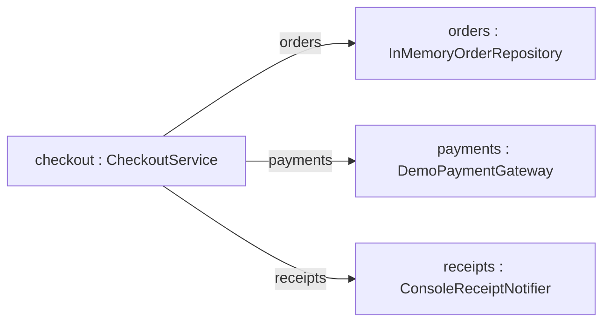
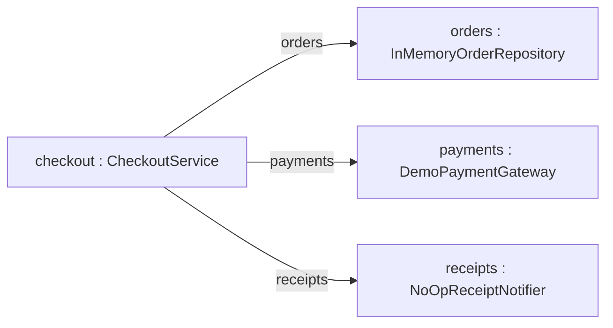
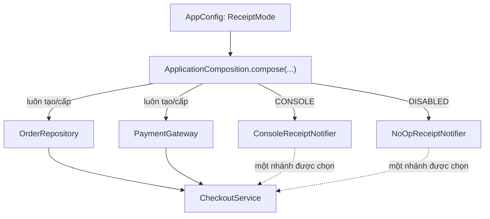

# Cấu hình điều kiện, tính năng tùy chọn và tính rõ ràng của đồ thị

## Mục tiêu học tập

Sau bài này, bạn có thể:

- Giải thích **conditional composition**: tạo và lắp ghép những implementation khác nhau dựa trên cấu hình, nhưng vẫn giữ dependency của consumer minh bạch.
- Phân biệt **tính năng tùy chọn** với **phụ thuộc tùy chọn**; lựa chọn giữa no-op implementation, `Optional`, factory hoặc policy khi có nhu cầu thực tế.
- Kiểm tra cấu hình **ngay ở composition root**, tránh tạo một đồ thị thiếu dependency hoặc chứa một đối tượng chưa sẵn sàng.
- Vẽ hai **đồ thị instance thực tế** tương ứng với hai nhánh cấu hình, thay vì chỉ nhìn vào các điều kiện `if` trong mã.
- Phân biệt lựa chọn tại **thời điểm khởi động** với quyết định dựa trên dữ liệu **mỗi request** hoặc cờ được thay đổi trong lúc chạy.
- Thực hành constructor injection, composition root, quản lý scope/vòng đời và kiểm thử từng nhánh bằng Java thuần trước khi sử dụng DI container.

Bài thuộc chương **Cấu hình lắp ghép** trong mô-đun **Dependency Injection (DI)** và **Inversion of Control (IoC)**. Tư tưởng xuyên suốt của DI là tách **việc sử dụng phụ thuộc** khỏi **việc tạo và lắp ghép**. Khi có tùy chọn bật/tắt một thành phần, việc tách này cần được giữ nhất quán: **consumer dùng hợp đồng, còn composition root quyết định implementation nào tồn tại trong đồ thị lúc khởi động**.

## 1. Cấu hình điều kiện làm thay đổi điều gì?

Giả sử ứng dụng có chức năng checkout đơn hàng. Hai khả năng là **bắt buộc**:

1. `PaymentGateway`: thực hiện thanh toán.
2. `OrderRepository`: lưu trạng thái đơn đã thanh toán.

Hệ thống còn có một tính năng **tùy chọn**: gửi biên nhận sau khi thanh toán thành công. Ở môi trường thử nghiệm, có thể bật chế độ in biên nhận ra console; ở một cấu hình khác, tính năng này bị tắt hoàn toàn.

Đặt tên cấu hình `ReceiptMode`:

| Chế độ cấu hình | Kết quả lắp ghép | Hành vi quan sát được |
| --- | --- | --- |
| `CONSOLE` | Tiêm `ConsoleReceiptNotifier` vào checkout | Thanh toán xong, chương trình in biên nhận giả lập. |
| `DISABLED` | Tiêm `NoOpReceiptNotifier` vào checkout | Thanh toán và cập nhật trạng thái như thường lệ; bỏ qua bước gửi biên nhận. |

Điểm quan trọng là **`CheckoutService` không cần chứa `if (config.receiptMode == ...)`**, cũng không biết lớp `ConsoleReceiptNotifier` hay `NoOpReceiptNotifier` được khởi tạo thế nào.

Trong cả hai cấu hình, constructor của `CheckoutService` vẫn có cùng hợp đồng:

```java
CheckoutService(OrderRepository orders,
                PaymentGateway payments,
                ReceiptNotifier receipts)
```

`ReceiptNotifier` vẫn là **dependency bắt buộc của object theo thiết kế này**; *hành vi gửi biên nhận* mới là tính năng có thể bật/tắt. Khi tắt, một implementation hợp lệ thực hiện **không có tác dụng phụ**. Cách diễn đạt này khác với việc tiêm `null` hoặc khởi tạo service khi thiếu một tham số constructor.

### Phân biệt ba tầng quyết định

| Tầng | Trách nhiệm | Ví dụ |
| --- | --- | --- |
| **Cấu hình khởi động** | Mô tả môi trường muốn bật tính năng nào | `--receipt=console` hoặc `--receipt=off`. |
| **Composition root** | Kiểm tra cấu hình, tạo đúng implementation, nối object graph | Chọn `ConsoleReceiptNotifier` hay `NoOpReceiptNotifier`. |
| **Consumer nghiệp vụ** | Gọi hợp đồng đã tiêm và xử lý luồng nghiệp vụ | `receipts.notifyPaid(order)`. |

Việc lắp ghép phụ thuộc có điều kiện không phải là lời mời đưa mọi cờ cấu hình vào từng service. Nếu nghiệp vụ không cần biết *vì sao* một implementation được chọn, nó cũng không cần biết cờ dùng để chọn.

## 2. Hai đồ thị đối tượng phải được đọc rõ ràng

Quy ước cạnh `A → B`: **A sử dụng B**. Trong cấu hình bật biên nhận:



Khi cấu hình tắt biên nhận:



Hai đồ thị có **cùng cấu trúc cạnh** và cùng kiểu phụ thuộc ở constructor. Chúng khác ở **đỉnh implementation** tương ứng với `ReceiptNotifier`. Trong ví dụ này, `CheckoutService` không phải thực hiện tra cứu dependency, không cần tự gọi `new` và không phải xử lý `null`.

Composition root có thể được hình dung là vùng tạo và lắp ghép ở bên ngoài đồ thị sử dụng:



Hình tổng hợp trên cho thấy **các nhánh lắp ghép có thể xảy ra**, không có nghĩa cả `ConsoleReceiptNotifier` và `NoOpReceiptNotifier` đều được tiêm vào service cùng lúc. Khi chạy, chỉ **một** implementation được chọn trong ví dụ này.

## 3. Ví dụ Java thuần: cấu hình được chọn ở composition root

Chương trình dưới đây chỉ mô phỏng thanh toán, lưu trạng thái trong bộ nhớ và xuất biên nhận ra console. Nó **không thu tiền hoặc gửi email thật**. Ứng dụng yêu cầu một tham số dòng lệnh rõ ràng, tránh âm thầm bật/tắt tính năng do thiếu cấu hình.

Lưu toàn bộ mã sau vào tệp **`Main.java`** (JDK 8 trở lên):

```java
import java.util.HashMap;
import java.util.Map;
import java.util.Objects;
import java.util.function.Supplier;

enum ReceiptMode {
    CONSOLE, DISABLED
}

// Cấu hình bất biến cho một lần khởi động ứng dụng.
final class AppConfig {
    final ReceiptMode receiptMode;

    AppConfig(ReceiptMode receiptMode) {
        this.receiptMode = Objects.requireNonNull(receiptMode, "receiptMode");
    }

    static AppConfig fromArgs(String[] args) {
        Objects.requireNonNull(args, "args");
        if (args.length != 1) {
            throw new IllegalArgumentException(
                    "Cần một tham số: --receipt=console hoặc --receipt=off");
        }
        if ("--receipt=console".equals(args[0])) {
            return new AppConfig(ReceiptMode.CONSOLE);
        }
        if ("--receipt=off".equals(args[0])) {
            return new AppConfig(ReceiptMode.DISABLED);
        }
        throw new IllegalArgumentException(
                "Chế độ không được hỗ trợ: " + args[0]);
    }
}

// Dữ liệu của một đơn; không phải dependency của container.
final class Order {
    final String id;
    final String email;
    final long amountVnd;

    Order(String id, String email, long amountVnd) {
        this.id = Objects.requireNonNull(id, "id");
        this.email = Objects.requireNonNull(email, "email");
        if (id.trim().isEmpty() || email.trim().isEmpty()
                || amountVnd <= 0) {
            throw new IllegalArgumentException("Thông tin đơn không hợp lệ");
        }
        this.amountVnd = amountVnd;
    }
}

// Các hợp đồng mà checkout cần.
interface PaymentGateway {
    boolean charge(Order order);
}

interface OrderRepository {
    void markPaid(Order order);
}

interface ReceiptNotifier {
    void notifyPaid(Order order);
}

// Provider giả lập, không thực hiện thanh toán thật.
final class DemoPaymentGateway implements PaymentGateway {
    @Override
    public boolean charge(Order order) {
        System.out.println("[DEMO] Thanh toán " + order.amountVnd
                + " VND cho " + order.id);
        return true;
    }
}

// Provider giả lập, không truy cập cơ sở dữ liệu.
final class InMemoryOrderRepository implements OrderRepository {
    private final Map<String, Boolean> paid = new HashMap<>();

    @Override
    public void markPaid(Order order) {
        paid.put(order.id, true);
        System.out.println("[DEMO] PAID " + order.id);
    }

    boolean isPaid(String orderId) {
        return Boolean.TRUE.equals(paid.get(orderId));
    }
}

// Implementation khi chức năng biên nhận được bật.
final class ConsoleReceiptNotifier implements ReceiptNotifier {
    @Override
    public void notifyPaid(Order order) {
        System.out.println("[DEMO] Biên nhận gửi tới " + order.email
                + " cho " + order.id);
    }
}

// Implementation có hợp đồng hợp lệ nhưng cố ý không có tác dụng phụ.
final class NoOpReceiptNotifier implements ReceiptNotifier {
    @Override
    public void notifyPaid(Order order) {
        Objects.requireNonNull(order, "order");
        // Tính năng đã tắt: không thực hiện gửi.
    }
}

// Consumer chỉ dùng hợp đồng; không giữ AppConfig/Container.
final class CheckoutService {
    private final OrderRepository orders;
    private final PaymentGateway payments;
    private final ReceiptNotifier receipts;

    CheckoutService(OrderRepository orders, PaymentGateway payments,
                    ReceiptNotifier receipts) {
        this.orders = Objects.requireNonNull(orders, "orders");
        this.payments = Objects.requireNonNull(payments, "payments");
        this.receipts = Objects.requireNonNull(receipts, "receipts");
    }

    boolean checkout(Order order) {
        Objects.requireNonNull(order, "order");
        if (!payments.charge(order)) {
            return false;
        }
        orders.markPaid(order);
        receipts.notifyPaid(order);
        return true;
    }
}

// Composition root: điều kiện nằm ở đây, không nằm trong CheckoutService.
final class ApplicationComposition {
    private ApplicationComposition() {}

    static CheckoutService compose(
            AppConfig config,
            OrderRepository orders,
            PaymentGateway payments,
            Supplier<? extends ReceiptNotifier> enabledNotifierProvider) {
        Objects.requireNonNull(config, "config");
        Objects.requireNonNull(orders, "orders");
        Objects.requireNonNull(payments, "payments");

        ReceiptNotifier notifier;
        switch (config.receiptMode) {
            case CONSOLE:
                // Chỉ tạo implementation bật tính năng khi nhánh này được chọn.
                notifier = Objects.requireNonNull(
                        Objects.requireNonNull(enabledNotifierProvider,
                                "enabledNotifierProvider").get(),
                        "enabledNotifierProvider returned null");
                break;
            case DISABLED:
                notifier = new NoOpReceiptNotifier();
                break;
            default:
                throw new IllegalArgumentException(
                        "Chưa hỗ trợ mode: " + config.receiptMode);
        }

        return new CheckoutService(orders, payments, notifier);
    }
}

public class Main {
    public static void main(String[] args) {
        // Sai/thừa/thiếu tham số sẽ bị từ chối ngay khi khởi động.
        AppConfig config = AppConfig.fromArgs(args);

        InMemoryOrderRepository orders = new InMemoryOrderRepository();
        PaymentGateway payments = new DemoPaymentGateway();
        CheckoutService checkout = ApplicationComposition.compose(
                config, orders, payments, ConsoleReceiptNotifier::new);

        Order sample = new Order("DH-401", "khach@example.com", 120_000L);
        boolean success = checkout.checkout(sample);
        System.out.println("Checkout paid: " + success);
        System.out.println("Repository paid: " + orders.isPaid(sample.id));
    }
}
```

### Chạy cả hai cấu hình

```bash
javac -encoding UTF-8 Main.java
java Main --receipt=console
java Main --receipt=off
```

Với **`--receipt=console`**, kết quả dự kiến:

```text
[DEMO] Thanh toán 120000 VND cho DH-401
[DEMO] PAID DH-401
[DEMO] Biên nhận gửi tới khach@example.com cho DH-401
Checkout paid: true
Repository paid: true
```

Với **`--receipt=off`**, kết quả dự kiến:

```text
[DEMO] Thanh toán 120000 VND cho DH-401
[DEMO] PAID DH-401
Checkout paid: true
Repository paid: true
```

Hai kết quả chỉ khác **tác dụng của bước biên nhận**. Mã nghiệp vụ `CheckoutService.checkout(...)` không đổi. Khi truyền tham số sai, chẳng hạn `--receipt=maybe`, `AppConfig.fromArgs` báo `IllegalArgumentException` thay vì âm thầm chọn một nhánh.

### Điểm đáng chú ý trong mã

| Vị trí | Quyết định | Ý nghĩa với DI |
| --- | --- | --- |
| `AppConfig.fromArgs` | Chấp nhận đúng các mode đã hỗ trợ | Phát hiện cấu hình sai trước khi chạy nghiệp vụ. |
| `ApplicationComposition.compose` | Chọn implementation của `ReceiptNotifier` | **Conditional wiring** nằm ở ranh giới lắp ghép. |
| `ConsoleReceiptNotifier::new` | Cung cấp khả năng tạo implementation bật tính năng | Không phải tạo trước tài nguyên của nhánh bị tắt. |
| `new NoOpReceiptNotifier()` | Cung cấp hành vi vô tác dụng có chủ đích | Constructor của service vẫn nhận dependency không-null. |
| `new CheckoutService(...)` | Nhận đúng ba dependency bắt buộc | Consumer hợp lệ ngay khi khởi tạo. |
| `checkout.checkout(sample)` | Sử dụng hợp đồng của các dependency đã chọn | Service không biết cấu hình và API container. |

`Supplier<? extends ReceiptNotifier>` chỉ là **factory có kiểu hẹp** để cung cấp `ReceiptNotifier` khi cần. Nó không phải API giải quyết mọi service như `container.resolve(Class<T>)`. Trong mã demo, supplier tạo `ConsoleReceiptNotifier` không có tài nguyên bên ngoài. Với implementation thực, factory có thể nhận các client/connection đã được cấu hình tại bootstrap và cần hợp đồng ownership rõ ràng.

## 4. No-op hay `Optional`: chọn theo ý nghĩa hợp đồng

Không phải mọi chức năng tùy chọn đều nên dùng no-op, và không phải mọi dependency có thể thiếu đều nên biểu diễn bằng `null`.

### 4.1. Khi no-op là lựa chọn hợp lý

No-op thích hợp nếu:

- Thành phần cung cấp **tác dụng phụ bổ trợ**, chẳng hạn xuất thông tin demo, đo một metrics tùy chọn hoặc phát thông báo có thể được tắt theo yêu cầu.
- Consumer **không cần giá trị trả về** từ hành động đó để quyết định kết quả chính.
- Việc bỏ qua hành động được **cho phép rõ ràng** bởi hợp đồng nghiệp vụ và người sử dụng hệ thống.
- API có thể diễn đạt hành vi không làm gì mà vẫn giữ các điều kiện đầu vào cần thiết.

Ví dụ `ReceiptNotifier.notifyPaid(order)` trả `void`. `NoOpReceiptNotifier` vẫn giữ chữ ký và có thể thay thế trong **đúng cấu hình đã cho phép tắt**.

Tuy nhiên, **không dùng no-op để che lỗi** trong các chức năng bắt buộc: thanh toán, xác thực quyền truy cập, ghi log kiểm toán bắt buộc hoặc đảm bảo dữ liệu. Một `NoOpPaymentGateway` âm thầm bỏ qua thanh toán rồi trả thành công sẽ **vi phạm ngữ nghĩa nghiệp vụ**. Nếu chức năng bắt buộc không thể khởi tạo, ứng dụng nên từ chối khởi động hoặc từ chối nghiệp vụ theo hợp đồng.

### 4.2. Khi `Optional<Dependency>` rõ nghĩa hơn

Có những trường hợp consumer **cần biết tính năng có hay không** để quyết định luồng xử lý, ví dụ chỉ hiển thị nút “xuất PDF” nếu thực sự có bộ xuất PDF. Khi đó một dependency tùy chọn được biểu diễn bằng một API rõ ràng có thể hợp lý:

```java
import java.util.Objects;
import java.util.Optional;

interface PdfExporter {
    byte[] export(String content);
}

final class DocumentFacade {
    private final Optional<PdfExporter> exporter;

    DocumentFacade(Optional<PdfExporter> exporter) {
        this.exporter = Objects.requireNonNull(exporter, "exporter");
    }

    boolean canExportPdf() {
        return exporter.isPresent();
    }
}
```

Đây là một ví dụ **độc lập** với `Main.java` ở trên. `Optional` diễn đạt sự **vắng mặt có ý nghĩa**; `DocumentFacade` cần quan sát điều đó để hiển thị năng lực. Không nên gói **mọi dependency bắt buộc** trong `Optional` chỉ để tránh lỗi lắp ghép ở khởi động. Cũng không nên dùng `Optional` để thay `ReceiptNotifier` nếu việc chỉ thêm `ifPresent` ở mọi nơi làm nhiễu luồng nghiệp vụ mà không mang ý nghĩa thực.

### 4.3. So sánh cách biểu diễn

| Phương án | Khi phù hợp | Mặt trái cần lưu ý |
| --- | --- | --- |
| **No-op implementation** | Hành vi có thể bỏ qua một cách hợp lệ; consumer không cần biết feature bật hay tắt | Có thể che sai cấu hình hoặc một nghĩa vụ nghiệp vụ nếu dùng không đúng. |
| **`Optional<T>`** | Sự có/vắng mặt là một thông tin mà consumer thực sự cần quan sát | Nhiều nhánh rẽ có thể lan khắp mã nghiệp vụ. |
| **Factory/provider có kiểu** | Cần tạo tài nguyên khác nhau theo lần gọi/scope; chỉ cấp khi feature hoạt động | Phải quy định khi nào tạo mới, ai sở hữu và đóng instance. |
| **Không cho ứng dụng khởi động** | Dependency bắt buộc bị thiếu hoặc cấu hình tự mâu thuẫn | Là hành vi đúng với lỗi cấu hình; không nên che bằng giá trị mặc định tùy tiện. |

**Quy tắc:** chọn cách biểu diễn dựa trên *hợp đồng nghiệp vụ*, không chỉ để giảm số dòng `if` hoặc làm DI container hết báo thiếu bean.

## 5. Kiểm tra cấu hình từ sớm: một đồ thị hợp lệ phải tạo được

Conditional composition tạo ra **nhiều đồ thị có thể xảy ra**. Nếu không kiểm tra từng nhánh, ứng dụng có thể chạy ổn ở mode này nhưng thất bại ở mode khác.

Ví dụ, nếu mode `CONSOLE` yêu cầu một transport mà `DISABLED` không cần, composition root phải bảo đảm:

1. Mode được nhận diện, không có giá trị lạ.
2. Những dependency **bắt buộc của nhánh đã chọn** có đầy đủ và hợp lệ.
3. Factory của nhánh được chọn không trả `null`.
4. Những cấu hình **mâu thuẫn** được từ chối sớm.
5. Các tài nguyên chỉ dùng ở nhánh khác không bị khởi tạo vô ích nếu có chi phí hoặc tác dụng phụ.

`ApplicationComposition.compose(...)` kiểm tra `AppConfig`, `OrderRepository`, `PaymentGateway` và kết quả của supplier khi `CONSOLE` được chọn. Khi mode `DISABLED`, nó không gọi supplier: đây là sự khác biệt giữa **cấp một tham chiếu có thể tạo sau** và **lập tức tạo implementation không cần thiết**.

Nếu sản phẩm có thêm `ReceiptMode.EXTERNAL_API`, cần quy định những dữ liệu đi kèm như `endpoint`, `credential`, timeout, và cách quản lý client. Không nên biến giá trị không hợp lệ thành `DISABLED` rồi bỏ qua gửi biên nhận: lỗi cấu hình sẽ bị che giấu. Ngược lại, khi chính sách cho phép tắt, `DISABLED` là một mode hợp lệ được chọn **có chủ đích**, không phải “lỗi nhưng cứ chạy”.

### Cấu hình dạng tổ hợp cần kiểm tra

Giả sử ứng dụng có `receiptMode` và `auditMode` độc lập, mỗi cái có hai giá trị. Số tổ hợp lý thuyết là **bốn**; khi thêm `exportMode` hai giá trị nữa, số tổ hợp tăng thành **tám**. Không phải mọi tổ hợp đều hợp lệ theo nghiệp vụ.

| Receipt | Audit | Có thể cho phép? | Lý do |
| --- | --- | --- | --- |
| Bật | Bật | Có, nếu đáp ứng các điều kiện khác | Hai tính năng cùng hoạt động. |
| Tắt | Bật | Có, nếu biên nhận tùy chọn | Vẫn giữ audit bắt buộc. |
| Bật | Tắt | **Không** nếu audit là nghĩa vụ bắt buộc | Phải báo sai cấu hình, không tạo `NoOpAudit`. |
| Tắt | Tắt | **Không** nếu audit là nghĩa vụ bắt buộc | Vắng tính năng tùy chọn không cho phép tắt nghĩa vụ bắt buộc. |

Bảng trên chỉ minh họa quy tắc giả định: trong sản phẩm thực tế phải xác nhận chính sách nào là bắt buộc. Giá trị của việc kiểm tra tổ hợp là chuyển lỗi từ **một nhánh runtime hiếm gặp** về **thời điểm kiểm tra cấu hình/lắp ghép**, nơi có thể chẩn đoán rõ.

## 6. Cấu hình khi khởi động khác cờ đổi theo từng request

Chương trình `Main.java` chọn `ReceiptMode` **một lần**. Nếu `AppConfig` hoặc cờ ở một nguồn bên ngoài thay đổi sau khi `CheckoutService` đã được tạo, đối tượng `CheckoutService` **không tự đổi dependency**: field `receipts` vẫn trỏ đến implementation ban đầu.

Điều này đúng ngay cả khi:

- Cấu hình được đọc từ môi trường thay vì tham số dòng lệnh.
- `AppConfig` được thay bằng một object mới ở nơi khác.
- Có ai đó sửa một biến cờ `receiptEnabled` sau khi đồ thị đã được tạo.

Muốn thay implementation, phải **tạo và lắp ghép lại consumer/đồ thị** tại ranh giới thích hợp, hoặc thiết kế một cơ chế định tuyến runtime có hợp đồng cụ thể. Chỉ thay giá trị cờ không biến `NoOpReceiptNotifier` thành `ConsoleReceiptNotifier`.

### Khi cờ thực sự phải được đánh giá theo request

Ví dụ, sản phẩm cho phép người dùng chọn có nhận biên nhận hay không. Đó có thể là **quyết định của từng đơn**, không chỉ là môi trường chạy. Một thiết kế khác có thể đưa chính sách này vào một interface nghiệp vụ:

```java
interface ReceiptPolicy {
    boolean shouldNotify(Order order);
}

final class PolicyBasedReceiptNotifier implements ReceiptNotifier {
    private final ReceiptPolicy policy;
    private final ReceiptNotifier delegate;

    PolicyBasedReceiptNotifier(ReceiptPolicy policy, ReceiptNotifier delegate) {
        this.policy = java.util.Objects.requireNonNull(policy, "policy");
        this.delegate = java.util.Objects.requireNonNull(delegate, "delegate");
    }

    @Override
    public void notifyPaid(Order order) {
        if (policy.shouldNotify(order)) {
            delegate.notifyPaid(order);
        }
    }
}
```

Đây là **đoạn mở rộng độc lập**, không thay thế class trong `Main.java`. Composition root tạo và tiêm `ReceiptPolicy` cùng `delegate`; phần điều kiện theo order được tách vào một **policy có tên và hợp đồng rõ**. `CheckoutService` vẫn chỉ gọi `ReceiptNotifier`. Với một cờ tính năng đọc từ hệ thống từ xa, policy cần quy định rõ thời điểm đọc, cache, tính nhất quán, lỗi khi không đọc được và cách kiểm thử.

**Không nên lẫn lộn:** một *feature flag thay đổi mỗi request* không thể luôn được giải quyết bằng **đăng ký bean có điều kiện chỉ chạy ở startup**. Ngược lại, nếu feature cố định theo môi trường, không cần đưa logic điều kiện vào từng yêu cầu.

## 7. Đồ thị rõ ràng giúp kiểm tra scope và vòng đời

Conditional wiring không chỉ quyết định **loại implementation** mà còn có thể quyết định **instance nào được tạo, chia sẻ và đóng**.

| Thành phần | Phạm vi trong ví dụ | Vấn đề cần kiểm tra khi dùng thật |
| --- | --- | --- |
| `CheckoutService` | Một instance dùng cho lời gọi demo | Có giữ dữ liệu `currentOrder` trong field không? Nếu tái sử dụng đồng thời, các collaborator có an toàn luồng không? |
| `PaymentGateway` | Một instance trong `Main` | Client thanh toán có thể chia sẻ không, ai quản lý pool và timeout? |
| `OrderRepository` | Một instance trong bộ nhớ | Repository thực có tạo session riêng từng thao tác không? |
| `ReceiptNotifier` | Một instance do compose chọn | Nhánh bật có giữ tài nguyên nào? Nhánh tắt có thực sự không phát tác dụng phụ không? |
| `Order` | Một đối tượng dữ liệu của lần checkout | Không giữ order của request trước trong service dùng chung. |

Trong ví dụ, `ConsoleReceiptNotifier` không cần đóng. Nếu nhánh `CONSOLE` được thay bằng một notifier dùng SMTP client hoặc message-queue client, cần xác định:

- Composition root tạo và **sở hữu** client dùng chung thì thường phải quản lý lúc khởi động và đóng khi ứng dụng dừng.
- Service nghiệp vụ không được tự `close()` một client dùng chung chỉ vì nó đang giữ reference tới notifier.
- Nếu mỗi request mở một session riêng, tiêm một **factory hẹp** và đóng session theo hợp đồng; đừng đưa DI container xuống `CheckoutService`.
- Nếu tắt tính năng, tránh khởi tạo tài nguyên mạng không cần thiết, nhưng vẫn có thể cần kiểm tra cấu hình liên quan khi tiêu chuẩn vận hành đòi hỏi.

Trong DI container, các scope như singleton, request, prototype/transient có thể giúp tự động hóa phần này. Tuy nhiên, **constructor injection không tự biến một dependency thành singleton**, và việc mode được chọn một lần không tự bảo đảm implementation an toàn khi gọi đồng thời. Scope, thread safety và quyền sở hữu tài nguyên vẫn phải được quy định riêng.

### Vấn đề nhiều feature và tính đọc hiểu của đồ thị

Nếu composition root tích lũy hàng chục nhánh `if` lồng nhau, đồ thị có thể khó hiểu dù từng service vẫn được tiêm đúng. Để giữ khả năng kiểm tra:

1. **Nhóm cấu hình theo khả năng**: `ReceiptMode`, `StorageMode`, `AuditMode` thay vì các chuỗi khó kiểm soát.
2. **Tách hàm lắp ghép có tên rõ**: `createReceiptNotifier(config)`, `createPaymentGateway(config)` có thể là các hàm nội bộ của composition root.
3. **Giữ dependency bắt buộc hiện rõ** trong constructor của consumer.
4. **Kiểm tra ma trận cấu hình hợp lệ** và tạo thử mỗi đồ thị quan trọng khi kiểm thử.
5. **Tránh registry toàn năng** kiểu `Map<String, Object>` hoặc service locator chỉ để giấu độ phức tạp.

Mục đích không phải làm cho composition root chỉ còn một dòng code, mà là để người đọc trả lời được: *cấu hình nào tạo ra đồ thị nào, mỗi nhánh có dependency gì, và ai chịu trách nhiệm tài nguyên của nó?*

## 8. Kiểm thử từng nhánh bằng Java thuần

Ta sẽ kiểm tra ba điều:

1. Nhánh **tắt** không gọi factory tạo notifier thật và không gửi biên nhận.
2. Nhánh **bật** gọi factory đúng một lần khi lắp ghép; các lời gọi checkout sau đó sử dụng **cùng notifier đã được tiêm**, không tạo lại mỗi lần.
3. Khi thanh toán **bị từ chối**, không cập nhật repository và không gửi biên nhận, bất kể nhánh cấu hình.

Lưu đoạn mã sau vào **`CompositionCheck.java`** bên cạnh `Main.java`:

```java
import java.util.concurrent.atomic.AtomicInteger;
import java.util.function.Supplier;

public class CompositionCheck {
    static final class FakePayments implements PaymentGateway {
        boolean approved = true;
        int calls;

        @Override
        public boolean charge(Order order) {
            calls++;
            return approved;
        }
    }

    static final class FakeOrders implements OrderRepository {
        int marks;

        @Override
        public void markPaid(Order order) {
            marks++;
        }
    }

    static final class RecordingNotifier implements ReceiptNotifier {
        int calls;
        String lastOrderId;

        @Override
        public void notifyPaid(Order order) {
            calls++;
            lastOrderId = order.id;
        }
    }

    public static void main(String[] args) {
        Order order = new Order("DH-TEST", "test@example.com", 50_000L);
        AtomicInteger created = new AtomicInteger();
        RecordingNotifier enabled = new RecordingNotifier();
        Supplier<ReceiptNotifier> provider = () -> {
            created.incrementAndGet();
            return enabled;
        };

        // DISABLED: provider của nhánh bật không được gọi.
        FakePayments disabledPayments = new FakePayments();
        FakeOrders disabledOrders = new FakeOrders();
        CheckoutService disabled = ApplicationComposition.compose(
                new AppConfig(ReceiptMode.DISABLED),
                disabledOrders, disabledPayments, provider);

        if (!disabled.checkout(order) || created.get() != 0
                || disabledOrders.marks != 1 || enabled.calls != 0) {
            throw new AssertionError("Nhánh DISABLED lắp ghép sai");
        }

        // CONSOLE: provider được gọi khi tạo đồ thị, không phải từng checkout.
        FakePayments activePayments = new FakePayments();
        FakeOrders activeOrders = new FakeOrders();
        CheckoutService active = ApplicationComposition.compose(
                new AppConfig(ReceiptMode.CONSOLE),
                activeOrders, activePayments, provider);

        if (created.get() != 1 || !active.checkout(order)
                || !active.checkout(order)
                || enabled.calls != 2 || activeOrders.marks != 2
                || !"DH-TEST".equals(enabled.lastOrderId)
                || created.get() != 1) {
            throw new AssertionError("Nhánh CONSOLE hoặc scope không đúng");
        }

        // Một thanh toán từ chối không được cập nhật/gửi.
        activePayments.approved = false;
        if (active.checkout(order)
                || activeOrders.marks != 2 || enabled.calls != 2) {
            throw new AssertionError("Đã phát tác dụng phụ khi bị từ chối");
        }

        // Cấu hình lạ bị từ chối ngay.
        try {
            AppConfig.fromArgs(new String[] { "--receipt=unknown" });
            throw new AssertionError("Phải từ chối mode không hợp lệ");
        } catch (IllegalArgumentException expected) {
            // Cấu hình sai đã được chặn.
        }

        System.out.println("PASS: hai đồ thị hợp lệ, config và scope rõ ràng");
    }
}
```

Chạy:

```bash
javac -encoding UTF-8 Main.java CompositionCheck.java
java CompositionCheck
```

Bài kiểm tra cố tình gọi checkout **hai lần trên cùng một đơn giả** để xác nhận factory chỉ được gọi lúc lắp ghép; đây **không phải** mô hình thanh toán lặp lại an toàn. Hệ thống thật cần quy tắc trạng thái đơn, idempotency và chống thu tiền hai lần, bất kể tính năng biên nhận bật hay tắt.

Bài kiểm tra không dùng DI container, không mở kết nối và không gửi email thật. Nó không chứng minh một client production hoạt động chính xác; nó chứng minh **các quyết định lắp ghép theo cấu hình** và **các tác dụng lên consumer** có thể được kiểm tra riêng, với kết quả lặp lại ổn định.

Trong kiểm thử production, còn nên kiểm tra việc tạo các adapter thật, tài nguyên bắt buộc, định tuyến cấu hình, quyền đóng và đường lỗi khởi động. Nếu có nhiều tổ hợp cấu hình, ưu tiên một ma trận thử nghiệm bao phủ các nhánh và ràng buộc quan trọng thay vì chỉ chạy cấu hình mặc định.

## 9. Những nhầm lẫn hay gặp

| Ngộ nhận | Cách hiểu đúng |
| --- | --- |
| “Tính năng tùy chọn thì dependency luôn có thể là `null`.” | Có thể dùng no-op, `Optional` hoặc factory theo ý nghĩa hợp đồng; không nhất thiết phải truyền `null`. |
| “No-op là cách sửa mọi lỗi thiếu bean.” | No-op chỉ hợp lệ khi **hành vi có thể bỏ qua một cách có chủ đích**; dependency bắt buộc thiếu phải là lỗi cấu hình. |
| “Service phải đọc `AppConfig` để biết branch nào đang bật.” | Nếu chỉ khác implementation, composition root chọn trước rồi inject hợp đồng thống nhất. |
| “`if` trong DI container tự xử lý dữ liệu biến đổi theo request.” | Điều kiện được đánh giá lúc lắp ghép khác với policy được đánh giá lúc xử lý một request. |
| “Đổi flag sau startup thì field đã inject tự thay đổi.” | Field giữ tham chiếu cũ; cần lắp ghép lại hoặc một cơ chế runtime có hợp đồng rõ ràng. |
| “Bật feature không cần kiểm thử nhánh tắt.” | Mỗi branch tạo một đồ thị khác; nhánh hiếm cũng có thể thiếu dependency hoặc rò tài nguyên. |
| “Đã tiêm notifier thì notifier luôn phải gửi thành công.” | Hợp đồng phải quy định rõ mốc thành công/lỗi; không được đồng nhất việc gọi method với giao thành công ngoài hệ thống. |
| “Một supplier đồng nghĩa luôn tạo instance mới mỗi request.” | Trong ví dụ supplier được gọi **một lần khi compose** ở nhánh bật; scope tùy thời điểm gọi và hợp đồng. |

## 10. Quy trình thiết kế và bài tập vận dụng

Khi thêm một tính năng tùy chọn vào đồ thị DI, hãy làm tuần tự:

1. **Xác định nghĩa vụ nghiệp vụ:** chức năng có thực sự được phép tắt không? Nếu là bảo mật, thanh toán hoặc audit bắt buộc, không tạo nhánh no-op để che lỗi.
2. **Đặt tên cấu hình có kiểu:** tránh các chuỗi mơ hồ và mặc định im lặng; quy định rõ mode hỗ trợ.
3. **Chọn thời điểm quyết định:** startup, request, tenant hoặc thao tác? Đừng dùng một quyết định startup cho dữ liệu chỉ xuất hiện lúc xử lý.
4. **Định nghĩa hợp đồng mà consumer cần:** liệu consumer cần biết feature có mặt hay chỉ cần gọi một hành vi chung?
5. **Quyết định cách biểu diễn vắng mặt:** no-op, `Optional`, factory hoặc lỗi cấu hình, theo nghĩa nghiệp vụ.
6. **Tạo các nhánh trong composition root:** không đưa container hoặc bean-name xuống service nghiệp vụ.
7. **Vẽ đồ thị instance cho từng nhánh:** kiểm tra dependency nào thực sự được tạo và tham chiếu nào được giữ.
8. **Xác nhận scope và quyền đóng:** không khởi tạo resource của nhánh tắt vô cớ, không đóng nhầm resource dùng chung.
9. **Kiểm thử cả bật, tắt và cấu hình sai:** dùng fake để kiểm tra số lần tạo, gọi và thứ tự tác dụng phụ.
10. **Ghi rõ hợp đồng vận hành:** khi một tính năng không khả dụng, hệ thống dừng, trả lỗi hay hoạt động suy giảm có kiểm soát?

### Bài tập: tính năng xuất CSV tùy chọn

Một ứng dụng quản lý báo cáo luôn phải lưu báo cáo vào kho dữ liệu. Tùy theo cấu hình, ứng dụng có thể cung cấp thêm chức năng **xuất CSV**. Một số tenant có quyền xuất CSV, số khác không có.

Hãy phân tích:

1. Nếu khả năng xuất CSV cố định theo **môi trường triển khai**, nên quyết định dùng adapter nào tại đâu?
2. Nếu quyền xuất thay đổi theo **tenant/request**, tại sao chỉ chọn bean ở startup là chưa đủ?
3. Nếu UI cần biết “có nút xuất CSV không”, no-op hay một API kiểm tra khả năng sẽ phù hợp hơn?
4. Nếu CSV exporter cần mở stream cho mỗi lần xuất, nên dùng scope/factory và trách nhiệm đóng ra sao?
5. Những trường hợp bật, tắt, không có quyền và cấu hình sai cần được kiểm thử thế nào?

**Gợi ý đáp án:** (1) Composition root chọn adapter theo cấu hình triển khai. (2) Quyền của tenant là dữ liệu nghiệp vụ/runtime, cần policy hoặc kiểm tra quyền tại từng yêu cầu. (3) UI cần **biết năng lực có/không**, nên có capability API/kiểm tra quyền rõ, tránh no-op im lặng. (4) Tiêm factory hẹp cấp session/stream; người sở hữu phiên phải đóng theo hợp đồng, tránh giữ stream của request trong singleton. (5) Tách kiểm thử policy quyền xuất khỏi kiểm thử ánh xạ cấu hình, bổ sung đường lỗi thiếu dependency hoặc mode không hợp lệ.

Điểm cốt lõi của **cấu hình lắp ghép có điều kiện** là làm cho các khác biệt **hiển thị ở đúng ranh giới**: composition root chọn đối tượng, consumer sử dụng hợp đồng, còn điều kiện nghiệp vụ động được biểu diễn bằng policy riêng khi cần. Khi chuyển sang DI container, cơ chế đăng ký có điều kiện và quản lý scope có thể thay mã `new`, nhưng **đồ thị của từng cấu hình vẫn cần rõ ràng, hợp lệ và kiểm thử được**.
