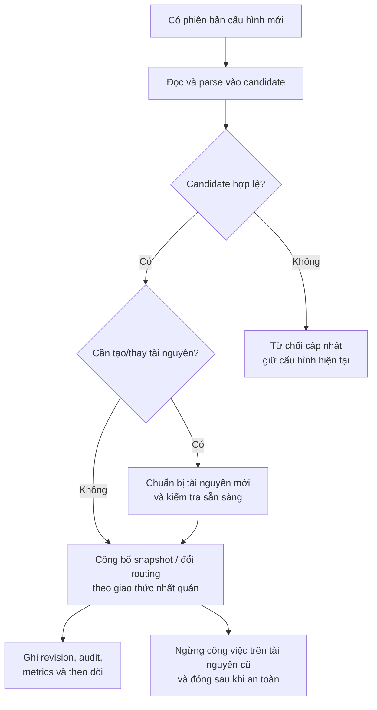

# Cấu hình bất biến so với cấu hình được cập nhật lúc chạy

Trong chương **Cấu hình lắp ghép** của module **Dependency Injection (DI)**, một quyết định quan trọng là: **sau khi ứng dụng khởi động, giá trị cấu hình có được phép thay đổi hay không?** Một số giá trị nên được đọc, kiểm tra và cố định khi composition root tạo đồ thị đối tượng. Một số giá trị khác có thể cần được cập nhật trong khi ứng dụng vẫn phục vụ request hoặc xử lý job.

**Dependency Injection** và **Inversion of Control (IoC)** giúp tách mã **sử dụng phụ thuộc** khỏi mã **tạo và lắp ghép phụ thuộc**. Với cấu hình, nguyên tắc đó mở rộng thành: *consumer không tự tìm biến môi trường, đọc file hoặc kết nối tới dịch vụ cấu hình; consumer chỉ nhận giá trị hoặc hợp đồng cung cấp giá trị phù hợp*. Khi hệ thống mở rộng sang DI container, cách đăng ký bean có thể thay đổi nhưng trách nhiệm chọn **scope**, **vòng đời**, **thời điểm cập nhật** và **mức nhất quán** vẫn còn.

Sau bài này, bạn có thể:

- Phân biệt **đối tượng cấu hình bất biến** với **chính sách cập nhật cấu hình** và **trạng thái nghiệp vụ đang thay đổi**.
- Quyết định khi nào inject một cấu hình cố định qua constructor, khi nào inject một **nguồn snapshot** có thể cập nhật.
- Giải thích vì sao thay thế **toàn bộ snapshot đã validate** an toàn hơn cập nhật rời rạc nhiều field dùng chung.
- Dùng `AtomicReference` để công bố phiên bản cấu hình mới một cách nguyên tử trong Java thuần, đồng thời giữ snapshot ổn định trong mỗi thao tác.
- Nhận diện các tình huống không thể chỉ đổi giá trị: endpoint, connection pool hoặc chiến lược nghiệp vụ có thể đòi hỏi thay resource hoặc triển khai một quy trình chuyển đổi riêng.
- Kiểm thử cả cấu hình cố định và cấu hình cập nhật lúc chạy mà không cần DI container.

## 1. Ba điều khác nhau: bất biến, nguồn cấu hình và khả năng cập nhật

Từ “cấu hình bất biến” dễ gây nhầm lẫn vì có ít nhất ba mức khác nhau:

| Khái niệm | Ý nghĩa | Ví dụ |
| --- | --- | --- |
| **Một snapshot bất biến** | Các field của **một object** không thể được gán lại sau khi tạo; mỗi snapshot là một bộ giá trị nhất quán | `BookingSettings(maxDays, dailyPrice, discountEnabled)` dạng Java `record` |
| **Cấu hình cố định theo ứng dụng** | Cả ứng dụng dùng **cùng snapshot** từ lúc bootstrap đến khi dừng | Giá trị timeout và giới hạn kết nối đọc lúc khởi động, không hỗ trợ reload |
| **Cấu hình cập nhật lúc chạy** | Nguồn cấu hình có thể chuyển từ snapshot phiên bản 1 sang snapshot phiên bản 2 mà không dừng tiến trình | Bật/tắt một feature flag hoặc điều chỉnh giới hạn xử lý tại runtime |

Do đó, **cấu hình cập nhật lúc chạy không bắt buộc có object mutable**. Ta có thể tạo **nhiều snapshot bất biến**, rồi thay tham chiếu tới snapshot hiện hành:

```text
Tại thời điểm T1: current --> Settings(revision=1, ...)
Tại thời điểm T2: current --> Settings(revision=2, ...)

Settings(revision=1) không bị sửa.
Request đã giữ snapshot revision=1 vẫn nhìn thấy bộ giá trị cũ.
Request mới có thể nhìn thấy snapshot revision=2.
```

Ngược lại, nếu nhiều thread cùng chia sẻ một `MutableSettings` với các setter `setMaxDays(...)`, `setPrice(...)` và `setDiscountEnabled(...)`, một request có thể thấy **nửa cấu hình cũ, nửa cấu hình mới**. Các field riêng lẻ được cập nhật hợp lệ vẫn chưa bảo đảm **tập giá trị** nhất quán.

**Phân biệt thêm với trạng thái nghiệp vụ:** Giá bán thay đổi theo từng khách, số xe còn trống, số dư tài khoản hoặc trạng thái đơn hàng thường là **dữ liệu nghiệp vụ cần truy vấn hay cập nhật theo giao dịch**, không phải cấu hình triển khai. Không nên đưa toàn bộ dữ liệu động vào một “global configuration object”.

## 2. Khi nào nên chọn cấu hình cố định?

Trong nhiều ứng dụng, **mặc định hợp lý là cố định cấu hình lắp ghép lúc bootstrap**. Điều này giúp object graph dễ hiểu, mỗi instance có trạng thái khởi tạo rõ ràng và tránh một lớp lỗi liên quan đến cập nhật đồng thời.

Các giá trị thường phù hợp với cách này:

- Chọn triển khai `BookingRepository` dùng in-memory hay JDBC trong một deployment.
- Chọn endpoint khởi tạo một client không hỗ trợ thay endpoint trực tiếp một cách an toàn.
- Kích thước connection pool được cấu hình lúc mở pool nếu implementation không hỗ trợ resize.
- Chính sách định dạng bất biến của một batch chạy một lần.
- Những giá trị mà thay đổi cần triển khai phiên bản ứng dụng hoặc kiểm thử tương thích trước.

Ví dụ Java thuần:

```java
record HttpSettings(String baseUrl, int timeoutMillis) {
    HttpSettings {
        if (baseUrl == null || baseUrl.isBlank() || timeoutMillis <= 0) {
            throw new IllegalArgumentException("Invalid HTTP settings");
        }
    }
}

final class ExternalBookingClient {
    private final HttpSettings settings;

    ExternalBookingClient(HttpSettings settings) {
        this.settings = java.util.Objects.requireNonNull(settings);
    }

    HttpSettings settings() {
        return settings;
    }
}

// Composition root: đọc và validate giá trị trước khi tạo client.
HttpSettings settings = new HttpSettings(
        "https://booking.example.invalid", 2_000);
ExternalBookingClient client = new ExternalBookingClient(settings);
```

Ở đây, `ExternalBookingClient` nhận một **snapshot bất biến** qua constructor, lưu vào field `final` và không tự đọc `System.getenv`. Việc thay biến môi trường của tiến trình sau này **không tự thay** `settings` trên instance hiện có. Thậm chí nếu nguồn cấu hình ngoài được cập nhật, bản thân object graph vẫn không thay trừ khi ứng dụng có cơ chế xử lý sự kiện cập nhật.

`record` cung cấp các field thành phần `final` theo giá trị được truyền; nó không tự tạo **tính bất biến sâu**. Nếu record chứa `List` có thể thay đổi hoặc đối tượng mutable, phải sao chép phòng vệ hoặc áp dụng hợp đồng bất biến cho phần tử liên quan. Với primitive và `String` trong ví dụ, sự bất biến của snapshot dễ kiểm soát hơn.

### Lợi ích và giới hạn

| Lợi ích | Giới hạn |
| --- | --- |
| Lỗi cấu hình được phát hiện **sớm** ở startup | Cần restart/redeploy khi muốn dùng giá trị mới |
| Có thể dùng field `final` và constructor injection | Không phù hợp với yêu cầu điều chỉnh tức thời mà không dừng |
| Đồ thị đối tượng ổn định, dễ suy luận và tái tạo | Nếu có nhiều tiến trình, việc rollout giá trị mới có thể diễn ra không đồng thời |
| Không có giao thức cập nhật đồng thời trong consumer | Giá trị cố định không đồng nghĩa hợp lệ mãi mãi với môi trường bên ngoài |

## 3. Khi nào nên hỗ trợ cập nhật lúc chạy?

Cập nhật nóng (*runtime reload*, *hot reload*) có giá trị khi thay đổi cần tác động nhanh nhưng **không đòi hỏi tái cấu trúc toàn bộ dependency graph**. Một số ví dụ:

- Bật/tắt một tính năng đã có sẵn trong ứng dụng thông qua feature flag.
- Thay một giới hạn nghiệp vụ được phép cấu hình, sau khi đã qua quy trình kiểm tra và phê duyệt phù hợp.
- Điều chỉnh tham số giám sát hoặc hạn mức điều tiết, khi service được thiết kế để đọc tham số tại điểm bắt đầu thao tác.
- Chọn mức độ ghi log hoặc chiến lược retry có khả năng cập nhật theo hợp đồng (cần cân nhắc tính nhất quán của từng tác vụ).

Không phải mọi thay đổi đều chỉ là “đổi field”:

| Thay đổi | Chỉ thay snapshot có đủ không? | Cần cân nhắc |
| --- | --- | --- |
| Feature flag được đọc mỗi request | **Thường đủ** nếu code hỗ trợ cả hai nhánh | Lựa chọn tại đầu request và thống nhất trong suốt request |
| Giới hạn số ngày đặt xe | Có thể, nếu use case đọc cùng một snapshot cho một quyết định | Lưu revision áp dụng cho giao dịch để audit |
| Giá theo mùa/khách hàng/thời điểm | **Không chắc**; có thể là dữ liệu nghiệp vụ | Chính sách định giá, thời điểm khóa giá và nguồn dữ liệu đáng tin cậy |
| URL của một client có connection pool | **Không tự đủ** | Tạo client mới, chuyển lưu lượng, ngừng client cũ an toàn |
| Thay tên bean/implementation hạ tầng | Thường cần cập nhật **object graph** hoặc restart | Scope, trạng thái đang xử lý, khả năng rollback |
| Thay thông tin xác thực | Không chỉ là gán `String` mới | Bảo vệ secret, rotate client/session, tránh ghi secret vào log |

**Điều kiện quan trọng:** Có một nguồn cập nhật ở ngoài như file, database, quản trị viên hoặc hệ thống feature flag **không có nghĩa** mã nghiệp vụ phải kết nối trực tiếp tới nguồn đó. Cấu hình đi vào từ adapter hạ tầng và được chuyển thành snapshot đã kiểm tra; consumer chỉ biết một **hợp đồng đọc snapshot**.

## 4. Kiến trúc: một object graph ổn định, nhiều snapshot được công bố

Một cách thiết kế dễ kiểm thử là:

1. **Composition root** đọc cấu hình lúc khởi động, validate rồi tạo snapshot ban đầu.
2. Root tạo một `SettingsSource` có thể cung cấp snapshot hiện hành.
3. Root inject **`SettingsSource`** vào consumer bằng constructor injection.
4. Một adapter reload (poller, watcher hoặc lệnh quản trị) lấy dữ liệu mới, parse và validate **trước khi công bố**.
5. Nguồn snapshot thay thế **tham chiếu hiện hành theo một thao tác nguyên tử**.
6. Mỗi request/job đọc snapshot **một lần tại ranh giới quyết định** để tránh trộn giá trị qua các phiên bản.

```mermaid
flowchart TB
    Source["Nguồn bên ngoài:<br/>file, remote config, quản trị"]
    Loader["Configuration adapter:<br/>đọc / parse / validate"]
    Root["Composition root"]
    Config["SettingsSource<br/>AtomicReference&lt;immutable snapshot&gt;"]
    Consumer["BookingPriceService<br/>constructor injection"]
    Request1["Request A"]
    Request2["Request B"]
    Source --> Loader
    Root -->|tạo và inject| Config
    Root -->|lắp ghép| Consumer
    Loader -->|công bố snapshot hợp lệ| Config
    Consumer -->|snapshot()| Config
    Request1 -->|quote()| Consumer
    Request2 -->|quote()| Consumer
```

Container DI có thể giúp root tạo, đăng ký và quản lý vòng đời của `SettingsSource` và adapter reload. Tuy nhiên, **container không tự động biến mọi bean bất biến thành bean cập nhật được**, và việc refresh cấu hình không tự động tạo lại những client hoặc singleton đã được khởi tạo. Cơ chế refresh/rebind tùy framework cần được xem xét riêng.

## 5. Ví dụ đầy đủ bằng Java 17: fixed snapshot và runtime reload

Ví dụ mô phỏng chính sách báo giá đặt thuê. Ở đây, mức giá ngày và quy tắc giảm giá chỉ để **minh họa giá trị cấu hình**; hệ thống thương mại thật cần xác định thời điểm chốt giá, quyền thay đổi và bản ghi giá đã áp dụng.

Ta có:

- `BookingSettings` là **record bất biến** chứa các giá trị đã kiểm tra và một `revision`.
- `BookingSettingsSource` là hợp đồng consumer dùng để đọc một snapshot.
- `FixedSettingsSource` giữ snapshot khởi động, **không hỗ trợ cập nhật**.
- `ReloadableSettingsSource` giữ `AtomicReference<BookingSettings>` và cho phép công bố snapshot mới, đầy đủ, hợp lệ.
- `BookingPriceService` giữ **một tham chiếu ổn định tới source**, rồi lấy snapshot **một lần cho mỗi lệnh quote**.

Lưu toàn bộ mã vào file `CompositionConfigurationDemo.java`:

```java
import java.util.Objects;
import java.util.concurrent.atomic.AtomicReference;

public class CompositionConfigurationDemo {
    // Một snapshot bất biến: bộ giá trị được kiểm tra cùng nhau.
    record BookingSettings(
            long revision,
            long dailyPriceVnd,
            int maxDays,
            boolean weeklyDiscountEnabled) {

        BookingSettings {
            if (revision <= 0) {
                throw new IllegalArgumentException(
                        "revision must be positive");
            }
            if (dailyPriceVnd <= 0) {
                throw new IllegalArgumentException(
                        "dailyPriceVnd must be positive");
            }
            if (maxDays < 1 || maxDays > 365) {
                throw new IllegalArgumentException(
                        "maxDays must be between 1 and 365");
            }
        }
    }

    // Consumer không cần biết cấu hình đến từ file hay remote service.
    interface BookingSettingsSource {
        BookingSettings snapshot();
    }

    static final class FixedSettingsSource
            implements BookingSettingsSource {
        private final BookingSettings fixed;

        FixedSettingsSource(BookingSettings fixed) {
            this.fixed = Objects.requireNonNull(fixed, "fixed");
        }

        @Override
        public BookingSettings snapshot() {
            return fixed;
        }
    }

    static final class ReloadableSettingsSource
            implements BookingSettingsSource {
        private final AtomicReference<BookingSettings> current;

        ReloadableSettingsSource(BookingSettings initial) {
            current = new AtomicReference<>(
                    Objects.requireNonNull(initial, "initial"));
        }

        @Override
        public BookingSettings snapshot() {
            return current.get();
        }

        // Chỉ mã quản trị/cấu hình ở ranh giới ứng dụng gọi publish.
        void publish(BookingSettings candidate) {
            Objects.requireNonNull(candidate, "candidate");
            while (true) {
                BookingSettings previous = current.get();
                if (candidate.revision() <= previous.revision()) {
                    throw new IllegalArgumentException(
                            "Revision must increase");
                }
                if (current.compareAndSet(previous, candidate)) {
                    return;
                }
                // Có updater khác vừa công bố; đọc lại revision
                // và thử tiếp để không ghi đè một phiên bản mới hơn.
            }
        }
    }

    record Quote(long totalVnd, long settingsRevision) { }

    static final class BookingPriceService {
        private final BookingSettingsSource settingsSource;

        BookingPriceService(BookingSettingsSource settingsSource) {
            this.settingsSource =
                    Objects.requireNonNull(settingsSource, "settingsSource");
        }

        Quote quote(int days) {
            // Chốt một snapshot cho toàn bộ phép tính của một lời gọi.
            BookingSettings settings = settingsSource.snapshot();
            if (days < 1 || days > settings.maxDays()) {
                throw new IllegalArgumentException(
                        "Days out of configured range");
            }

            long gross = Math.multiplyExact(
                    settings.dailyPriceVnd(), days);
            long total = days >= 7 && settings.weeklyDiscountEnabled()
                    ? gross - gross / 10
                    : gross;
            return new Quote(total, settings.revision());
        }
    }

    public static void main(String[] args) {
        // Composition root: thiết lập snapshot khởi động.
        BookingSettings v1 =
                new BookingSettings(1, 500_000L, 30, true);

        // Chế độ cố định: luôn giữ v1 cho cả vòng đời service.
        BookingPriceService fixedService = new BookingPriceService(
                new FixedSettingsSource(v1));

        // Chế độ reload: source ổn định, snapshot hiện hành có thể đổi.
        ReloadableSettingsSource reloadable =
                new ReloadableSettingsSource(v1);
        BookingPriceService liveService =
                new BookingPriceService(reloadable);

        Quote beforeFixed = fixedService.quote(7);
        Quote beforeLive = liveService.quote(7);
        Quote expectedV1 = new Quote(3_150_000L, 1);

        if (!beforeFixed.equals(expectedV1)
                || !beforeLive.equals(expectedV1)) {
            throw new AssertionError("Wrong initial quote");
        }

        // Adapter quản trị đã parse và validate bộ cấu hình v2.
        BookingSettings v2 =
                new BookingSettings(2, 600_000L, 30, false);
        reloadable.publish(v2);

        // Service không được tạo lại; chỉ liveService nhận v2.
        Quote afterFixed = fixedService.quote(7);
        Quote afterLive = liveService.quote(7);
        if (!afterFixed.equals(expectedV1)
                || !afterLive.equals(new Quote(4_200_000L, 2))) {
            throw new AssertionError("Reload did not work as expected");
        }

        // Validation thất bại trước khi công bố: giữ bản v2.
        boolean invalidRejected = false;
        try {
            BookingSettings invalid =
                    new BookingSettings(3, -100L, 30, false);
            reloadable.publish(invalid);
        } catch (IllegalArgumentException expected) {
            invalidRejected = true;
        }

        // Không được cập nhật ngược về revision cũ.
        boolean staleRejected = false;
        try {
            reloadable.publish(v1);
        } catch (IllegalArgumentException expected) {
            staleRejected = true;
        }

        if (!invalidRejected
                || !staleRejected
                || reloadable.snapshot().revision() != 2
                || !liveService.quote(7).equals(afterLive)) {
            throw new AssertionError("Invalid reload was accepted");
        }

        System.out.println("Fixed: " + afterFixed.totalVnd()
                + " (revision " + afterFixed.settingsRevision() + ")");
        System.out.println("Live: " + afterLive.totalVnd()
                + " (revision " + afterLive.settingsRevision() + ")");
        System.out.println("Pure Java test: PASS");
    }
}
```

Biên dịch và chạy:

```bash
javac CompositionConfigurationDemo.java
java CompositionConfigurationDemo
```

Kết quả dự kiến:

```text
Fixed: 3150000 (revision 1)
Live: 4200000 (revision 2)
Pure Java test: PASS
```

Với 7 ngày và giá `500_000` VND/ngày, tổng ban đầu là `3_500_000` VND; giảm 10% còn **3.150.000 VND**. Sau khi cập nhật lên `600_000` VND/ngày và tắt giảm giá, tổng là **4.200.000 VND**. `fixedService` vẫn dùng bản v1; `liveService` nhận v2 khi bắt đầu lượt `quote` sau cập nhật.

**Điều quan trọng:** `BookingPriceService` chỉ biết `BookingSettingsSource` và không có `if (isReloadable)`. Hai cách cấp cấu hình được lựa chọn tại **composition root**, không nằm trong nghiệp vụ. Kiểm thử có thể tạo `FixedSettingsSource` hoặc một fake trả snapshot xác định, hoàn toàn không cần DI container.

## 6. Vì sao thay toàn bộ snapshot bằng AtomicReference?

Nếu cập nhật từng giá trị độc lập:

```java
// Minh họa một cách thiết kế có rủi ro.
class MutableSettings {
    volatile long dailyPriceVnd = 500_000L;
    volatile int maxDays = 30;
    volatile boolean weeklyDiscount = true;
}

// Một thread quản trị cập nhật tuần tự:
settings.dailyPriceVnd = 600_000L;
settings.weeklyDiscount = false;
```

Một thread xử lý request có thể đọc `dailyPriceVnd` mới nhưng `weeklyDiscount` cũ. `volatile` bảo đảm các thuộc tính về visibility/order đối với từng truy cập tương ứng, **không biến hai phép gán thành một giao dịch nguyên tử**.

Ngược lại, `AtomicReference` giữ một **tham chiếu tới snapshot bất biến**:

```java
BookingSettings old = current.get();
BookingSettings updated = parseAndValidate(raw);
current.compareAndSet(old, updated);
```

Một lần `get()` trả về một tham chiếu tới **một bộ giá trị đã hoàn chỉnh**. Consumer không thể nhìn thấy snapshot “mới giá nhưng cũ giảm giá” vì chúng là các thành phần trong cùng object bất biến được tạo trước khi công bố.

Trong `ReloadableSettingsSource.publish`:

1. Candidate đã được tạo và kiểm tra hợp lệ trong constructor `BookingSettings`.
2. Phương thức kiểm tra revision phải **lớn hơn revision đã công bố**.
3. `compareAndSet` chỉ thay snapshot nếu không có updater khác đã thay thế bản mà nó đọc trước đó.
4. Nếu CAS thất bại do cập nhật cạnh tranh, phương thức đọc lại trạng thái và kiểm tra lại thứ tự revision.

Việc dùng CAS ở đây nhằm tránh một **cập nhật phiên bản cũ ghi đè phiên bản mới** ngay cả khi có nhiều updater cạnh tranh. Trong hệ thống thật, revision phải do nguồn cấu hình đáng tin cậy quản lý, và cần cơ chế điều phối nếu nhiều nguồn cùng có quyền cập nhật. **Atomic publication không đồng nghĩa transaction phân tán**, không bảo đảm mọi tiến trình nhận cấu hình cùng lúc và không thay thế kiểm tra tính hợp lệ liên trường hoặc kiểm soát quyền cập nhật.

### Không đặt tác dụng phụ bên trong vòng CAS

Nếu thêm gửi email, mở connection hoặc cập nhật database vào vòng `while` trước `compareAndSet`, một CAS thất bại có thể khiến các tác dụng phụ bị thực hiện lặp lại. Hãy xây dựng candidate đã validate bên ngoài vòng, chỉ thực hiện phép công bố atomically trong vòng, và thiết kế phần side effect hoặc chuyển đổi resource ở một bước điều phối riêng có thể xử lý lỗi.

## 7. Nhất quán trong một request hay job dài

Một câu hỏi quan trọng hơn “reload có được không?” là: **một thao tác phải quan sát cấu hình tại thời điểm nào?**

Giả sử một request phải thực hiện ba bước: kiểm tra giới hạn ngày, tính giá, xác nhận đặt thuê. Nếu mỗi bước đọc nguồn cấu hình riêng:

```text
T1: validate số ngày với revision=1
T2: cấu hình được công bố revision=2
T3: tính giá với revision=2
T4: ghi đơn hàng, không biết giá trị nào đã được áp dụng
```

Khi đó một yêu cầu có thể kết hợp chính sách của hai phiên bản. Cách đơn giản hơn là **chụp một snapshot tại đầu đơn vị công việc** rồi truyền nó đến mọi bước có liên quan:

```java
// Trong request/job boundary:
BookingSettings settingsForThisRequest = settingsSource.snapshot();

// Truyền cùng một snapshot vào các bước tính toán của request:
validateBookingDays(days, settingsForThisRequest);
long total = calculateTotal(days, settingsForThisRequest);
storeQuote(total, settingsForThisRequest.revision());
```

Các phương thức `validateBookingDays`, `calculateTotal` và `storeQuote` ở đoạn trên là **mô tả cấu trúc**, không phải đoạn chương trình độc lập. `BookingPriceService.quote` trong ví dụ hoàn chỉnh đã áp dụng nguyên tắc chụp một snapshot cho một lời gọi.

Khi request hoặc job kéo dài, có thể chọn:

- **Snapshot theo lần gọi:** thay đổi bắt đầu có hiệu lực với những lời gọi tiếp theo, không ảnh hưởng phép tính đang chạy.
- **Snapshot theo request/job:** mọi bước của cùng một công việc giữ một revision đến khi hoàn tất.
- **Đọc mới tại từng mốc:** thích hợp với tín hiệu điều khiển như lệnh dừng khẩn cấp, nếu ngữ nghĩa cho phép tác vụ đang chạy phản ứng ngay.

Không có một lựa chọn duy nhất cho mọi loại cấu hình. Với báo giá, cần cân nhắc **thời điểm chốt giá** và **lưu giá đã cam kết** trong dữ liệu giao dịch; chỉ lưu revision có thể không đủ nếu nguồn lịch sử có thể thay đổi hoặc bị xóa. Với quy định an toàn, đôi khi cấu hình mới phải được áp dụng ngay, kể cả khi job đang chạy; khi đó cần một giao thức xử lý rõ ràng hơn snapshot per-job.

## 8. Quy trình reload: parse, validate, publish, quan sát và rollback

Một pipeline reload đáng tin cậy nên có những bước sau:



Với cập nhật **chỉ gồm giá trị**, `publish` có thể là một phép thay thế `AtomicReference`. Với cập nhật **cần tạo client/pool mới**, công bố snapshot và chuyển routing giữa resource cũ/mới là bài toán khó hơn. Cần bảo đảm các request đang dùng client cũ không bị đóng tài nguyên giữa chừng, trong khi request mới chuyển sang client mới. Các cơ chế ref-counting, lease hoặc drain có thể cần thiết; **một `AtomicReference` đơn lẻ không giải quyết hết quyền sở hữu resource**.

### Chính sách khi cập nhật thất bại

- **Giữ cấu hình đã biết là hợp lệ** khi candidate parse/validate lỗi; không công bố trạng thái dở dang.
- **Báo lỗi rõ** qua log/metrics (không in secret), ghi revision, nguồn và nguyên nhân; cảnh báo nếu cấu hình cũ quá hạn sử dụng.
- **Chọn fail-open hay fail-closed theo rủi ro:** lỗi cập nhật một màu giao diện khác lỗi cập nhật một chính sách bảo mật. Không mặc định luôn dùng bản cũ nếu điều đó vi phạm yêu cầu an toàn.
- **Rollback có thứ tự:** trong mô hình revision tăng đơn điệu, “quay về giá trị cũ” nên được công bố như **revision mới hơn**, không ghi đè bằng chính snapshot cũ có revision thấp hơn.
- **Xem xét nhiều instance:** mỗi JVM có một bộ nhớ và nguồn cấu hình riêng. Việc một instance đã nhận revision mới không chứng minh các instance khác đã nhận cùng revision.

## 9. Cấu hình nào nên nằm ở composition root?

Composition root là nơi tự nhiên để tập trung xử lý cấu hình ban đầu và chọn kiến trúc cập nhật. Có thể chia thành hai nhóm:

| Nhóm cấu hình | Cách cấp cho consumer | Nơi tạo/đọc | Khi nào thay |
| --- | --- | --- | --- |
| **Cấu hình lắp ghép** | Inject object immutable và adapter đã tạo | Startup/composition root | Thường restart hoặc quy trình thay graph có kiểm soát |
| **Giá trị vận hành có hỗ trợ reload** | Inject `SettingsSource` / port trả snapshot | Root tạo source; adapter quản trị cập nhật | Theo revision hợp lệ đã được công bố |
| **Dữ liệu nghiệp vụ thay đổi theo giao dịch** | Qua repository/domain service phù hợp | Trong use case, dưới chính sách giao dịch | Theo nghiệp vụ, không xử lý như global config |
| **Secret/token** | Qua cơ chế cấp quyền bảo mật và client/adapter thích hợp | Root hoặc infrastructure adapter | Theo giao thức rotate secret, không sao chép tràn lan |

Nếu đọc biến môi trường ở mỗi lần xử lý:

```java
// Phản mẫu khi lặp trong mọi request:
int maxDays = Integer.parseInt(
        System.getenv().getOrDefault("BOOKING_MAX_DAYS", "30"));
```

thì logic nghiệp vụ phụ thuộc vào môi trường, khó dựng input trong test, và không có cam kết rằng việc sửa cấu hình bên ngoài sẽ làm giá trị trả về thay đổi theo ý muốn trên mọi nền tảng. Cách tốt hơn là parse, validate **ở boundary** rồi cung cấp snapshot cho consumer; nếu cần cập nhật, phải có **pipeline reload** rõ ràng.

Ví dụ tại bootstrap:

```java
// Ví dụ cấu trúc trong composition root:
String rawDays = System.getenv().getOrDefault(
        "BOOKING_MAX_DAYS", "30");
int maxDays = Integer.parseInt(rawDays);
BookingSettings settings = new BookingSettings(
        1, 500_000L, maxDays, true);

BookingSettingsSource source = new FixedSettingsSource(settings);
BookingPriceService service = new BookingPriceService(source);
```

Với cấu hình có nhiều nguồn (file, environment, command line, remote service), cần **quy tắc ưu tiên** và dấu vết nguồn giá trị được lựa chọn. Không truyền một bản đồ cấu hình toàn cục gồm cả thông tin nhạy cảm vào mọi service chỉ để chúng tự tìm khóa theo tên.

## 10. Scope, lifecycle và quản lý cập nhật

Cả hai mô hình đều cần quyết định scope:

| Thành phần | Scope đề xuất tùy yêu cầu | Trách nhiệm lifecycle |
| --- | --- | --- |
| Snapshot immutable | Có thể chia sẻ trong cùng tiến trình | Không cần `close()` nếu chỉ có giá trị |
| `FixedSettingsSource` | Theo application graph | Không có tài nguyên cần đóng |
| `ReloadableSettingsSource` | Thường theo application graph | Công bố snapshot, giữ phiên bản hiện hành |
| Watcher/poller cấu hình | Theo tiến trình host hoặc một phạm vi quản lý rõ | Dừng polling/listener và thread pool khi ứng dụng dừng |
| Client/pool bị thay khi reload | Có owner riêng | Chuyển request mới, đợi request cũ kết thúc, đóng resource cũ |
| Request/job đang xử lý | Theo lần thực thi | Giữ snapshot phù hợp trong toàn bộ đơn vị công việc |

Một instance `BookingPriceService` có thể dùng chung nếu nó **không lưu dữ liệu từng request vào field** và các dependency hỗ trợ truy cập đồng thời. Trong ví dụ, `AtomicReference` bảo đảm công bố snapshot nhất quán; nó **không tự bảo đảm** rằng các hành vi phụ trợ như mở client, ghi audit hoặc tính tổng tiền theo nhiều giao dịch là nguyên tử.

Nếu dùng DI container, có thể đăng ký `SettingsSource` thành bean dùng chung, inject qua constructor và quản lý watcher bằng callback lifecycle. Tuy nhiên, một bean có field `final BookingSettings settings` được tạo lúc startup **không tự đổi field** chỉ vì container reload một property file. Nếu framework hỗ trợ refresh scope/proxy, cần tìm hiểu lúc tạo lại bean, cách đồng bộ với request đang chạy và ai đóng instance cũ.

## 11. Kiểm thử không cần container

Các bài kiểm tra tối thiểu nên bao phủ:

| Tình huống | Điều cần chứng minh |
| --- | --- |
| **Cấu hình cố định** | Source luôn trả cùng snapshot sau khi các nguồn khác được cập nhật |
| **Cấu hình động** | Consumer đọc revision mới ở lần gọi sau khi publish |
| **Candidate sai** | Giá trị không hợp lệ bị từ chối trước khi công bố; revision cũ được giữ |
| **Cập nhật lỗi thời** | Revision thấp hơn/không lớn hơn bị từ chối |
| **Nhất quán từng phép tính** | Một lượt `quote` dùng một revision cho cả kiểm tra và tính giá |
| **Concurrency** | Đọc snapshot không thấy các field bị cập nhật nửa chừng; test đa luồng cần thêm khi triển khai thực tế |
| **Resource rotation** | Nếu có client/pool cần thay, client cũ chỉ đóng sau khi không còn consumer đang dùng |

Ví dụ bổ sung trong test bằng Java thuần:

```java
// Có thể đặt trong cùng class CompositionConfigurationDemo.
BookingSettings first =
        new BookingSettings(1, 100_000L, 10, true);
ReloadableSettingsSource source =
        new ReloadableSettingsSource(first);

BookingSettings heldByOldRequest = source.snapshot();
source.publish(new BookingSettings(2, 200_000L, 20, false));
BookingSettings seenByNewRequest = source.snapshot();

if (heldByOldRequest.revision() != 1
        || heldByOldRequest.dailyPriceVnd() != 100_000L
        || seenByNewRequest.revision() != 2
        || seenByNewRequest.dailyPriceVnd() != 200_000L) {
    throw new AssertionError("Snapshots must not be mutated");
}
```

Đoạn này minh họa rằng **snapshot cũ vẫn là một object hợp lệ và không bị sửa**, trong khi consumer mới có thể nhìn thấy snapshot mới. Không cần dựng HTTP server, watcher hay DI container để kiểm chứng tính chất này.

## 12. Những lỗi thường gặp

| Lỗi | Vì sao có vấn đề | Cách khắc phục |
| --- | --- | --- |
| “Đổi property là bean đã inject sẽ tự đổi.” | Bean có thể giữ giá trị đã chụp từ startup | Thiết kế source có reload hoặc quy trình tạo lại bean phù hợp |
| Cập nhật các field `volatile` riêng lẻ | Request có thể nhìn thấy bộ giá trị từ nhiều revision | Thay cả snapshot immutable qua một tham chiếu nguyên tử |
| Đọc lại source nhiều lần trong một phép tính | Một thao tác có thể trộn hai revision | Chụp snapshot một lần rồi truyền qua các bước liên quan |
| Inject request data như singleton config | Rò trạng thái giữa người dùng/request | Truyền dữ liệu theo lời gọi hoặc scope request |
| Không validate trước publish | Cấu hình sai lọt vào request đang chạy | Parse/validate candidate trước khi thay giá trị hiện hành |
| Chấp nhận revision cũ ghi đè mới | Mất cập nhật hoặc rollback không kiểm soát | Dùng quy tắc thứ tự và cơ chế công bố phù hợp |
| Đổi endpoint string nhưng client cũ không đổi | Client tiếp tục gọi endpoint cũ | Thay client/adapter theo lifecycle và chuyển tiếp an toàn |
| Đóng pool cũ ngay khi reload | Request đang dùng pool gặp lỗi | Dừng cấp lease mới, drain công việc và đóng khi an toàn |
| Đẩy mọi giá trị động vào config | Lẫn dữ liệu nghiệp vụ với thông số triển khai | Dùng repository/domain model khi thông tin thuộc giao dịch |
| Dùng reload để bỏ qua kiểm soát thay đổi | Khó audit hoặc tạo điều kiện sai lệch giữa tiến trình | Ghi revision, quyền cập nhật, giám sát và rollback có kiểm soát |

## 13. Bài tập và câu hỏi tự kiểm tra

### Bài tập 1 — Chọn loại cấu hình

Với các giá trị sau, hãy giải thích nên cố định lúc bootstrap, cập nhật snapshot trong lúc chạy hay xử lý như dữ liệu nghiệp vụ: địa chỉ DB, thời gian timeout, feature flag, số xe còn trống, giá thuê theo hợp đồng, giới hạn số ngày tối đa và thông tin xác thực. Phân tích **mức độ rủi ro, phạm vi ảnh hưởng và tài nguyên liên quan** thay vì chỉ đặt nhãn.

### Bài tập 2 — Cấu hình bất biến

Chạy `CompositionConfigurationDemo.java`, giải thích vì sao `fixedService` vẫn có `revision=1` sau khi gọi `reloadable.publish(v2)`. Thay `FixedSettingsSource` bằng cấu hình inject trực tiếp vào một service khác và so sánh độ rõ ràng của constructor.

### Bài tập 3 — Cấu hình cập nhật lúc chạy

Thêm revision 3, điều chỉnh `maxDays` và kiểm tra một yêu cầu `quote(31)` bị từ chối hay chấp nhận theo revision hiện hành. Thử publish candidate có `revision=2` lần nữa rồi xác minh source vẫn giữ revision mới nhất.

### Bài tập 4 — Tính nhất quán

Tưởng tượng một đơn hàng trải qua `validate -> quote -> save` trong khi cấu hình cập nhật giữa chừng. Viết pseudo-code chụp một `BookingSettings` tại request boundary và truyền cho cả ba bước. Thảo luận việc lưu **giá đã chốt** và **revision** trong dữ liệu đơn hàng.

### Bài tập 5 — Thay resource khi reload

Giả sử đổi URL dịch vụ ngoài cần tạo một HTTP client mới. Vẽ trình tự: chuẩn bị client, kiểm tra sẵn sàng, công bố client mới, ngừng cấp việc cho client cũ, chờ những request đang chạy và đóng client cũ. Chỉ ra tại sao `AtomicReference<String> endpoint` **không tự đủ**.

### Bài tập 6 — Kiểm thử có nhiều updater

Thiết kế test dùng hai tác vụ cố publish revision 3 và revision 4. Giải thích vì sao `compareAndSet` và kiểm tra revision giúp ngăn revision thấp hơn ghi đè cao hơn, nhưng **không chứng minh** mọi tiến trình trong hệ thống phân tán đều đã dùng revision 4.

### Câu hỏi tự kiểm tra

- Một object cấu hình `record` bất biến có thể là một phần của hệ thống cấu hình cập nhật lúc chạy không?
- Vì sao `final BookingSettings settings` khác `final BookingSettingsSource source` về khả năng quan sát cập nhật?
- `volatile` trên từng field có làm nhiều phép gán thành một cập nhật nguyên tử không?
- Nếu ứng dụng nhận candidate sai, nên thay một phần field hay giữ snapshot cũ? Có ngoại lệ về chính sách an toàn cần xem xét không?
- Cách nào giúp request không trộn quy tắc của nhiều revision?
- Tại sao reload một thuộc tính không tự xây lại các JDBC/HTTP client đã được tạo?
- Khi dùng DI container, ai vẫn phải xác định scope, quyền sở hữu resource và chính sách reload?

**Cấu hình bất biến** giúp graph khởi động có trạng thái rõ ràng, ít biến động và dễ kiểm thử. **Cấu hình được cập nhật lúc chạy** giúp thay đổi hành vi có kiểm soát, nhưng đòi hỏi snapshot hợp lệ, công bố nguyên tử, chính sách thời điểm áp dụng và quản lý vòng đời tài nguyên đi kèm. Lựa chọn này nên được quyết định tại **composition root**: inject giá trị cố định khi đủ, inject một nguồn snapshot có hợp đồng rõ khi thật sự cần reload; giữ use case độc lập với cách đọc file, biến môi trường hoặc DI container.
