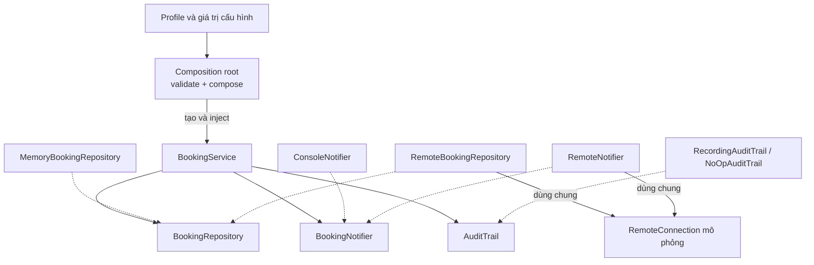
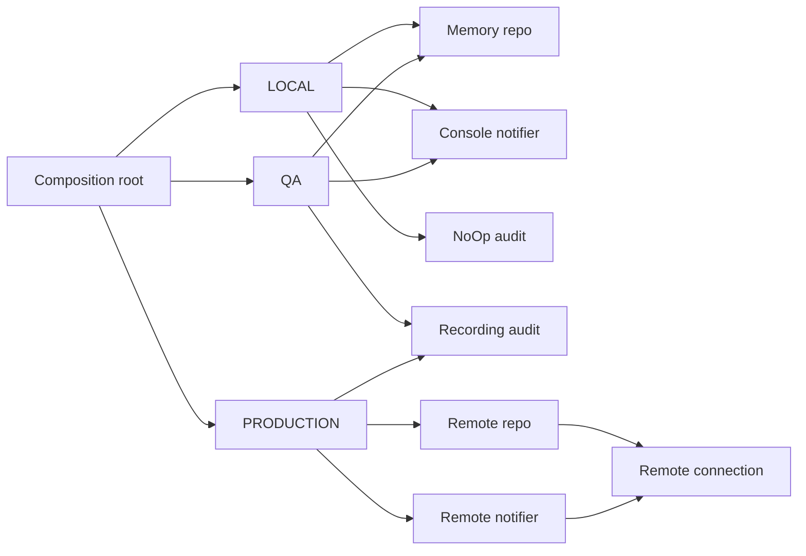

# Giảm số tổ hợp cấu hình và kiểm thử các biến thể được hỗ trợ

Trong **Dependency Injection (DI)**, composition root là nơi quyết định *implementation nào được cấp cho cổng giao tiếp nào*, *đối tượng nào được dùng chung* và *tài nguyên nào phải được đóng*. Khi ứng dụng có nhiều lựa chọn cấu hình, việc lắp ghép không còn là vài dòng `new`: một số lựa chọn hợp lệ trong môi trường này nhưng nguy hiểm hoặc vô nghĩa trong môi trường khác.

Ví dụ ứng dụng đặt chỗ có ba tham số độc lập trên lý thuyết:

- Nơi chạy: `LOCAL`, `QA`, `PRODUCTION` (3 lựa chọn).
- Kho dữ liệu: `MEMORY` hoặc `REMOTE` (2 lựa chọn).
- Kênh thông báo: `CONSOLE` hoặc `REMOTE` (2 lựa chọn).
- Ghi audit: bật hoặc tắt (2 lựa chọn).

Nếu thử tất cả tổ hợp, ta có **3 × 2 × 2 × 2 = 24 cấu hình**. Nhưng sản phẩm có thực sự cho phép `PRODUCTION` dùng repository trong RAM và tắt audit? Có cần chạy `LOCAL` với dịch vụ gửi thông báo thật? Nếu chỉ ba cấu hình là sản phẩm được hỗ trợ, việc để 24 trường hợp có thể được lắp ghép khiến **21 cấu hình ngoài phạm vi hỗ trợ** vẫn có cơ hội lọt vào hệ thống.

Chủ đề **“Giảm số tổ hợp cấu hình và kiểm thử các biến thể được hỗ trợ”**, thuộc chương **Cấu hình lắp ghép** của module **DEPENDENCY_INJECTION**, giúp bạn:

- Phân biệt **tích Descartes của các tùy chọn** với **tập biến thể được hỗ trợ**.
- Thu hẹp cấu hình bằng profile, ràng buộc, nhóm quyết định và thiết kế API khiến trạng thái sai khó biểu diễn.
- Tập trung lựa chọn implementation tại **composition root**, giữ lớp nghiệp vụ chỉ sử dụng dependency được inject.
- Kiểm thử **đúng adapter, identity, thứ tự hành vi, phạm vi và vòng đời** của từng biến thể.
- Dùng Java thuần để thực hành trước khi chuyển sang DI container.

## 1. Vì sao số tổ hợp tăng nhanh?

Nếu một hệ thống có \(n\) nhóm lựa chọn độc lập, và nhóm thứ \(i\) có \(k_i\) giá trị, số tổ hợp lý thuyết là:

\[
N_{\text{lý thuyết}} = \prod_{i=1}^{n} k_i
\]

Chỉ cần bổ sung một cờ boolean độc lập đã nhân đôi số tổ hợp. Với sáu cờ boolean, có \(2^6=64\) cấu hình; thêm ba lựa chọn lưu trữ và hai kênh thông báo thành \(64\times3\times2=384\). Con số tăng dù nhiều tổ hợp không hợp lệ hoặc không mang ý nghĩa kinh doanh.

Điều quan trọng là phân biệt ba tập:

| Khái niệm | Ý nghĩa | Ví dụ |
| --- | --- | --- |
| **Tất cả tổ hợp có thể biểu diễn** | Các giá trị mà cấu trúc cấu hình kỹ thuật cho phép tạo ra | 24 bộ giá trị từ bốn trục |
| **Tổ hợp hợp lệ theo ràng buộc** | Không vi phạm quy tắc kỹ thuật/nghiệp vụ | Production không dùng RAM làm kho dữ liệu chính |
| **Biến thể được hỗ trợ** (*supported variants*) | Những cấu hình nhóm cam kết triển khai, kiểm thử, vận hành | `LOCAL`, `QA`, `PRODUCTION` đã được quy định |

Không nên nhầm “biểu diễn được” với “được hỗ trợ”. Một cấu hình có thể đi qua mọi kiểm tra kiểu Java nhưng vẫn nối nhầm adapter, mất dữ liệu hoặc bỏ qua audit bắt buộc.

### 1.1. Ma trận cấu hình chủ đích

Để bài toán cụ thể, giả sử sản phẩm chấp nhận **đúng ba profile** sau:

| Profile | Repository | Notifier | Audit | Mục đích |
| --- | --- | --- | --- | --- |
| `LOCAL` | Trong bộ nhớ | Console | Tắt | Chạy nhanh trên máy lập trình |
| `QA` | Trong bộ nhớ | Console | Bật | Kiểm tra luồng nghiệp vụ và audit không cần dịch vụ ngoài |
| `PRODUCTION` | Adapter remote | Adapter remote | Bật | Cấu hình triển khai chính thức |

Ở đây “adapter remote” trong ví dụ Java phía dưới được **mô phỏng**, không truy cập mạng; trong dự án thật, nó phải được thay bằng adapter hạ tầng tương ứng và kiểm thử tích hợp.

Từ bảng này có thể phát biểu **bất biến cấu hình**:

1. `LOCAL` không khởi tạo kết nối remote và không ghi audit.
2. `QA` ghi audit nhưng không cần kết nối remote.
3. `PRODUCTION` dùng repository/notifier remote, bật audit và phải có endpoint hợp lệ.
4. Mọi profile đều cung cấp đầy đủ ba dependency cho service qua constructor injection.
5. Tài nguyên remote dùng chung có **một owner** và được đóng khi graph kết thúc.

### 1.2. Những tổ hợp cần bị từ chối

Ví dụ:

- `PRODUCTION + MEMORY + CONSOLE + audit=false`: có nguy cơ sai yêu cầu lưu bền vững và kiểm toán.
- `LOCAL + REMOTE notifier`: có thể tạo tác dụng phụ ra môi trường bên ngoài nếu endpoint nhầm.
- `PRODUCTION` không có địa chỉ endpoint: graph không thể cấu hình đầy đủ.
- `QA` trỏ đến endpoint production: không thuộc hợp đồng của profile QA trong ví dụ.

Thay vì viết nhiều nhánh `if` cho mọi cờ ở mọi lớp, hãy **quy định tập profile** rồi để composition root dựng duy nhất graph hợp lệ tương ứng.

## 2. Ba cách giảm bùng nổ tổ hợp

### 2.1. Dùng profile có ý nghĩa thay vì tập hợp cờ tùy ý

Thiết kế dễ tạo tổ hợp sai:

```java
// Bốn trục có thể bị phối hợp tùy ý.
Config config = new Config(
    environment, storageKind, notifierKind, auditEnabled);
```

Nếu thực tế chỉ có ba bộ lựa chọn, API trên biểu diễn 24 trạng thái khi chỉ cần 3. Một cách gọn hơn:

```java
enum Profile {
    LOCAL,
    QA,
    PRODUCTION
}
```

Composition root dùng `Profile` để chọn đồng bộ những adapter cần thiết. Đối với profile production, cấu hình vẫn cần **giá trị tham số** như endpoint. Giá trị tham số là *dữ liệu cấu hình*, không nên biến mỗi endpoint thành một biến thể nghiệp vụ khác.

Ưu điểm: giảm số nhánh quyết định rời rạc và giúp diễn đạt rõ những trường hợp được vận hành. Hạn chế: nếu các trục thực sự có thể phối hợp độc lập và được hỗ trợ, gom chúng vào một enum có thể gây lặp hoặc tạo quá nhiều profile.

### 2.2. Gom các lựa chọn phụ thuộc nhau thành một quyết định

Ví dụ database adapter cần đồng thời `DataSource`, mapper, transaction policy và cấu hình timeout. Thay vì biến mỗi thứ thành một cờ độc lập, có thể dựng một **nhóm hạ tầng nhất quán**:

```java
// Mã phác thảo, các kiểu là minh họa.
StorageBundle storage = storageFactory.create(storageSettings);

BookingService service = new BookingService(
    storage.repository(),
    notifier,
    auditTrail
);
```

`StorageBundle` nên chứa các đối tượng phải tương thích với nhau và một nơi chịu trách nhiệm đóng tài nguyên nếu cần. Cách nhóm này giảm nguy cơ repository dùng nguồn A còn transaction manager sử dụng nguồn B.

Không gom một cách máy móc mọi dependency vào một “siêu đối tượng” mà service phải tra cứu. Trong code nghiệp vụ, ưu tiên inject **các port cụ thể**; bundle là công cụ lắp ghép ở vùng bootstrap.

### 2.3. Ràng buộc và thất bại sớm tại ranh giới cấu hình

Nếu sản phẩm cần một số tổ hợp linh hoạt, vẫn có thể giữ các trục riêng và viết **validator tập trung**:

```java
// Ý tưởng: kiểm tra trước khi mở kết nối hoặc khởi tạo tài nguyên.
void validate(DeploymentConfig config) {
    if (config.isProduction() && !config.auditEnabled()) {
        throw new IllegalArgumentException(
            "Production requires audit");
    }
}
```

Validator phải chạy **trước khi tạo tài nguyên có tác dụng phụ**. Không nên để service tự phát hiện giữa lúc xử lý request rằng endpoint chưa cấu hình hoặc notifier không phù hợp môi trường. Thất bại sớm giúp lỗi rõ ràng, dễ tái hiện và tránh một graph chỉ được lắp ghép một nửa.

Ba cách trên có thể kết hợp. Với ví dụ ba profile cố định, giải pháp chính là **profile có tên rõ ràng + validation đầu vào + root dựng graph tường minh**.

## 3. Quy tắc lắp ghép: đừng để nghiệp vụ biết profile

Sơ đồ mong muốn:



Điểm thiết kế:

- `BookingService` chỉ nhận `BookingRepository`, `BookingNotifier` và `AuditTrail`.
- `BookingService` không có `if (profile == PRODUCTION)`, không tự `new RemoteConnection(...)`.
- Composition root biết profile, chọn implementation và quyết định dùng chung một kết nối.
- Khi chuyển sang DI container, các binding có thể được tự động hóa nhưng **hợp đồng port và quy tắc profile** vẫn cần được bảo vệ bằng kiểm thử.

## 4. Ví dụ Java thuần: ba profile, một service, một composition root

Tạo file `CompositionVariantsDemo.java`. Chương trình mô phỏng các adapter bằng danh sách sự kiện để người học kiểm chứng mà **không gửi email hay truy cập mạng**. Vì adapter remote chỉ là mô hình, các URL `.invalid` trong bài không phải endpoint thật.

```java
import java.util.ArrayList;
import java.util.List;
import java.util.Objects;

public class CompositionVariantsDemo {

    enum Profile {
        LOCAL, QA, PRODUCTION
    }

    // Normal path: dùng các factory có tên để tạo cấu hình được hỗ trợ.
    static final class Settings {
        final Profile profile;
        final String endpoint;

        Settings(Profile profile, String endpoint) {
            this.profile = profile;
            this.endpoint = endpoint;
        }

        static Settings local() {
            return new Settings(Profile.LOCAL, null);
        }

        static Settings qa() {
            return new Settings(Profile.QA, null);
        }

        static Settings production(String endpoint) {
            return new Settings(Profile.PRODUCTION, endpoint);
        }
    }

    // Nghiệp vụ chỉ biết ba hợp đồng, không biết adapter nào đang được dùng.
    interface BookingRepository {
        void save(String id);
    }

    interface BookingNotifier {
        void bookingCreated(String id);
    }

    interface AuditTrail {
        void record(String event);
    }

    static final class BookingService {
        private final BookingRepository repository;
        private final BookingNotifier notifier;
        private final AuditTrail audit;

        BookingService(BookingRepository repository,
                       BookingNotifier notifier,
                       AuditTrail audit) {
            this.repository =
                    Objects.requireNonNull(repository, "repository");
            this.notifier = Objects.requireNonNull(notifier, "notifier");
            this.audit = Objects.requireNonNull(audit, "audit");
        }

        void create(String id) {
            if (id == null || id.isBlank()) {
                throw new IllegalArgumentException("Invalid booking ID");
            }

            repository.save(id);
            audit.record("created:" + id);
            notifier.bookingCreated(id);
        }
    }

    static final class MemoryBookingRepository
            implements BookingRepository {
        private final List<String> trace;

        MemoryBookingRepository(List<String> trace) {
            this.trace = trace;
        }

        @Override
        public void save(String id) {
            trace.add("memory-save:" + id);
        }
    }

    static final class ConsoleNotifier implements BookingNotifier {
        private final List<String> trace;

        ConsoleNotifier(List<String> trace) {
            this.trace = trace;
        }

        @Override
        public void bookingCreated(String id) {
            trace.add("console-notify:" + id);
        }
    }

    static final class NoOpAuditTrail implements AuditTrail {
        @Override
        public void record(String event) {
            // Audit được chủ đích tắt trong LOCAL.
        }
    }

    static final class RecordingAuditTrail implements AuditTrail {
        private final List<String> trace;

        RecordingAuditTrail(List<String> trace) {
            this.trace = trace;
        }

        @Override
        public void record(String event) {
            trace.add("audit:" + event);
        }
    }

    // Tài nguyên chung mô phỏng kết nối remote.
    // send() chỉ ghi trace; không có kết nối mạng thật.
    static final class RemoteConnection implements AutoCloseable {
        final String endpoint;
        private final List<String> trace;
        boolean closed;
        int closeCalls;

        RemoteConnection(String endpoint, List<String> trace) {
            this.endpoint = endpoint;
            this.trace = trace;
        }

        void send(String operation, String id) {
            if (closed) {
                throw new IllegalStateException(
                        "Remote connection is closed");
            }
            trace.add(operation + ":" + id);
        }

        @Override
        public void close() {
            if (!closed) {
                closed = true;
                closeCalls++;
                trace.add("connection-close");
            }
        }
    }

    static final class RemoteBookingRepository
            implements BookingRepository {
        final RemoteConnection connection;

        RemoteBookingRepository(RemoteConnection connection) {
            this.connection =
                    Objects.requireNonNull(connection, "connection");
        }

        @Override
        public void save(String id) {
            connection.send("remote-save", id);
        }
    }

    static final class RemoteNotifier implements BookingNotifier {
        final RemoteConnection connection;

        RemoteNotifier(RemoteConnection connection) {
            this.connection =
                    Objects.requireNonNull(connection, "connection");
        }

        @Override
        public void bookingCreated(String id) {
            connection.send("remote-notify", id);
        }
    }

    // Handle của graph: root giữ cả service lẫn các resource cần đóng.
    static final class AppGraph implements AutoCloseable {
        final BookingService service;
        final BookingRepository repository;
        final BookingNotifier notifier;
        final AuditTrail audit;
        final RemoteConnection connection; // null ở LOCAL/QA
        final List<String> trace;

        private boolean closed;

        AppGraph(BookingService service,
                 BookingRepository repository,
                 BookingNotifier notifier,
                 AuditTrail audit,
                 RemoteConnection connection,
                 List<String> trace) {
            this.service = service;
            this.repository = repository;
            this.notifier = notifier;
            this.audit = audit;
            this.connection = connection;
            this.trace = trace;
        }

        @Override
        public void close() {
            if (closed) {
                return;
            }
            closed = true;

            if (connection != null) {
                connection.close();
            }
        }
    }

    // Validate trước khi tạo adapter có tài nguyên.
    static void validate(Settings settings) {
        Objects.requireNonNull(settings, "settings");

        if (settings.profile == null) {
            throw new IllegalArgumentException("Profile is required");
        }

        if (settings.profile == Profile.PRODUCTION) {
            if (settings.endpoint == null
                    || !settings.endpoint.startsWith("https://")
                    || settings.endpoint.length() <= "https://".length()) {
                throw new IllegalArgumentException(
                        "Production requires an HTTPS endpoint");
            }
        } else if (settings.endpoint != null) {
            throw new IllegalArgumentException(
                    "Endpoint is not allowed for LOCAL/QA");
        }
    }

    // COMPOSITION ROOT: chọn toàn bộ bộ dependency theo profile.
    static AppGraph compose(Settings settings) {
        validate(settings);

        List<String> trace = new ArrayList<>();
        BookingRepository repository;
        BookingNotifier notifier;
        AuditTrail audit;
        RemoteConnection connection = null;

        switch (settings.profile) {
            case LOCAL:
                repository = new MemoryBookingRepository(trace);
                notifier = new ConsoleNotifier(trace);
                audit = new NoOpAuditTrail();
                break;

            case QA:
                repository = new MemoryBookingRepository(trace);
                notifier = new ConsoleNotifier(trace);
                audit = new RecordingAuditTrail(trace);
                break;

            case PRODUCTION:
                connection = new RemoteConnection(settings.endpoint, trace);
                repository = new RemoteBookingRepository(connection);
                notifier = new RemoteNotifier(connection);
                audit = new RecordingAuditTrail(trace);
                break;

            default:
                throw new IllegalArgumentException(
                        "Unsupported profile: " + settings.profile);
        }

        BookingService service =
                new BookingService(repository, notifier, audit);

        return new AppGraph(
                service, repository, notifier, audit, connection, trace);
    }

    public static void main(String[] args) {
        try (AppGraph local = compose(Settings.local())) {
            local.service.create("L-1");
            System.out.println("LOCAL: " + local.trace);
        }

        try (AppGraph qa = compose(Settings.qa())) {
            qa.service.create("Q-1");
            System.out.println("QA: " + qa.trace);
        }

        AppGraph production =
                compose(Settings.production("https://service.invalid"));

        try (AppGraph scope = production) {
            scope.service.create("P-1");
        }
        System.out.println("PRODUCTION: " + production.trace);
    }
}
```

Chạy bằng **JDK 11 trở lên**:

```bash
javac CompositionVariantsDemo.java
java CompositionVariantsDemo
```

Kết quả dự kiến:

```text
LOCAL: [memory-save:L-1, console-notify:L-1]
QA: [memory-save:Q-1, audit:created:Q-1, console-notify:Q-1]
PRODUCTION: [remote-save:P-1, audit:created:P-1, remote-notify:P-1, connection-close]
```

### 4.1. Vì sao các profile không xuất hiện trong service?

`BookingService` chỉ làm ba việc:

1. Lưu đặt chỗ.
2. Ghi audit theo hợp đồng `AuditTrail`.
3. Gửi thông báo.

Không có lựa chọn `LOCAL` hoặc `PRODUCTION` trong phương thức `create`. Với profile LOCAL, container thủ công cấp `NoOpAuditTrail`; với QA và production, cấp `RecordingAuditTrail`.

Đây là một ví dụ của **Inversion of Control**: lựa chọn implementation và lắp ghép do bootstrap quyết định; nghiệp vụ chỉ sử dụng các cộng tác viên được cấp qua **constructor injection**.

### 4.2. Kiểm tra cấu hình trước khi tạo resource

`compose` gọi `validate(settings)` ngay ở đầu, **trước khi tạo `RemoteConnection`**. Vì vậy, một cấu hình production thiếu endpoint không thể tiến vào giai đoạn sử dụng service.

Ví dụ chỉ dùng kiểm tra đơn giản rằng endpoint không rỗng và bắt đầu với `https://`. Đây **không phải bộ kiểm tra URL đầy đủ**: ứng dụng thật cần kiểm tra URI, hostname, cho phép host nào, chứng chỉ, timeout và chính sách bảo mật tương ứng. Không nên hiểu rằng một chuỗi bắt đầu bằng `https://` đã đủ an toàn để kết nối production.

### 4.3. Dùng chung đúng một resource ở profile production

Trong nhánh production:

```java
connection = new RemoteConnection(settings.endpoint, trace);
repository = new RemoteBookingRepository(connection);
notifier = new RemoteNotifier(connection);
```

Repository và notifier giữ tham chiếu đến **cùng một instance `RemoteConnection`**. `AppGraph` là chủ sở hữu, đóng resource khi rời scope. Các adapter chỉ dùng kết nối; chúng **không tự đóng** kết nối dùng chung sau mỗi thao tác.

Điều này không tự chứng minh một kết nối thực tế phù hợp để dùng chung giữa repository và notifier. Mã mô phỏng không có socket hay transaction. Trong hệ thống thật, cần xem hợp đồng, khả năng đồng thời và loại client có thể dùng chung, thay vì mặc định “dùng chung là tối ưu”.

### 4.4. Đồ thị theo profile



Sơ đồ này cho biết **cấu trúc theo loại thành phần**, không có nghĩa LOCAL và QA dùng chung một `MemoryBookingRepository` thật. Mỗi lần gọi `compose` tạo graph riêng. Muốn khẳng định dùng chung object trong một graph phải kiểm tra **tham chiếu thực tế bằng `==`**, không chỉ xem hai cạnh cùng trỏ đến tên kiểu trong hình.

## 5. Kiểm thử từng biến thể được hỗ trợ bằng Java thuần

Để bảo đảm ba profile không vô tình đổi implementation hoặc mất hành vi khi refactor root, tạo file `CompositionVariantsTest.java` đặt cạnh file demo.

Bài test **không chạy mạng**: adapter remote chỉ ghi trace. Nó kiểm tra:

- Mỗi profile chọn đúng nhóm adapter.
- Thứ tự thao tác và audit có đúng không.
- Profile production cấp đúng **một kết nối chung** cho repository và notifier.
- Đóng graph thì kết nối bị đóng một lần; sử dụng lại sau khi đóng bị từ chối.
- Cấu hình không hợp lệ bị từ chối trước lúc có graph.

```java
import java.util.List;

public class CompositionVariantsTest {

    static void check(boolean ok, String message) {
        if (!ok) {
            throw new AssertionError(message);
        }
    }

    static void expectInvalid(CompositionVariantsDemo.Settings settings) {
        try {
            CompositionVariantsDemo.compose(settings);
            throw new AssertionError("Expected invalid configuration");
        } catch (IllegalArgumentException expected) {
            // Cấu hình đã bị chặn ở bootstrap.
        }
    }

    static void testLocal() {
        try (CompositionVariantsDemo.AppGraph graph =
                CompositionVariantsDemo.compose(
                        CompositionVariantsDemo.Settings.local())) {

            check(graph.repository instanceof
                    CompositionVariantsDemo.MemoryBookingRepository,
                    "LOCAL must use memory repository");
            check(graph.notifier instanceof
                    CompositionVariantsDemo.ConsoleNotifier,
                    "LOCAL must use console notifier");
            check(graph.audit instanceof
                    CompositionVariantsDemo.NoOpAuditTrail,
                    "LOCAL audit must be disabled");
            check(graph.connection == null,
                    "LOCAL must not create remote connection");

            graph.service.create("L-10");

            check(graph.trace.equals(List.of(
                    "memory-save:L-10",
                    "console-notify:L-10")),
                    "Wrong LOCAL behavior: " + graph.trace);
        }
    }

    static void testQa() {
        try (CompositionVariantsDemo.AppGraph graph =
                CompositionVariantsDemo.compose(
                        CompositionVariantsDemo.Settings.qa())) {

            check(graph.repository instanceof
                    CompositionVariantsDemo.MemoryBookingRepository,
                    "QA must use memory repository");
            check(graph.notifier instanceof
                    CompositionVariantsDemo.ConsoleNotifier,
                    "QA must use console notifier");
            check(graph.audit instanceof
                    CompositionVariantsDemo.RecordingAuditTrail,
                    "QA audit must be enabled");
            check(graph.connection == null,
                    "QA must not create remote connection");

            graph.service.create("Q-10");

            check(graph.trace.equals(List.of(
                    "memory-save:Q-10",
                    "audit:created:Q-10",
                    "console-notify:Q-10")),
                    "Wrong QA behavior: " + graph.trace);
        }
    }

    static void testProduction() {
        CompositionVariantsDemo.AppGraph graph =
                CompositionVariantsDemo.compose(
                        CompositionVariantsDemo.Settings.production(
                                "https://service.invalid"));

        try (CompositionVariantsDemo.AppGraph scope = graph) {
            check(graph.repository instanceof
                    CompositionVariantsDemo.RemoteBookingRepository,
                    "PRODUCTION must use remote repository");
            check(graph.notifier instanceof
                    CompositionVariantsDemo.RemoteNotifier,
                    "PRODUCTION must use remote notifier");
            check(graph.audit instanceof
                    CompositionVariantsDemo.RecordingAuditTrail,
                    "PRODUCTION audit must be enabled");

            var repository = (CompositionVariantsDemo.RemoteBookingRepository)
                    graph.repository;
            var notifier = (CompositionVariantsDemo.RemoteNotifier)
                    graph.notifier;

            check(graph.connection != null
                            && repository.connection == graph.connection
                            && notifier.connection == graph.connection,
                    "Production adapters must share one connection");

            graph.service.create("P-10");

            check(graph.trace.equals(List.of(
                    "remote-save:P-10",
                    "audit:created:P-10",
                    "remote-notify:P-10")),
                    "Wrong PRODUCTION behavior before close");
        }

        check(graph.connection.closed,
                "Remote connection must be closed");
        check(graph.connection.closeCalls == 1,
                "Remote connection must close exactly once");

        graph.close(); // idempotent by graph contract.
        check(graph.connection.closeCalls == 1,
                "Repeated graph close must not close resource twice");

        check(graph.trace.equals(List.of(
                "remote-save:P-10",
                "audit:created:P-10",
                "remote-notify:P-10",
                "connection-close")),
                "Wrong PRODUCTION lifecycle: " + graph.trace);

        boolean rejected = false;
        try {
            graph.service.create("P-after-close");
        } catch (IllegalStateException expected) {
            rejected = true;
        }
        check(rejected, "Closed resource must reject later use");
    }

    static void testInvalidSettings() {
        expectInvalid(new CompositionVariantsDemo.Settings(
                CompositionVariantsDemo.Profile.LOCAL,
                "https://service.invalid"));

        expectInvalid(new CompositionVariantsDemo.Settings(
                CompositionVariantsDemo.Profile.QA,
                "https://service.invalid"));

        expectInvalid(new CompositionVariantsDemo.Settings(
                CompositionVariantsDemo.Profile.PRODUCTION,
                null));

        expectInvalid(new CompositionVariantsDemo.Settings(
                CompositionVariantsDemo.Profile.PRODUCTION,
                "http://not-secure.invalid"));

        expectInvalid(new CompositionVariantsDemo.Settings(
                null, null));
    }

    public static void main(String[] args) {
        testLocal();
        testQa();
        testProduction();
        testInvalidSettings();
        System.out.println("PASS: supported profiles, invalid config, lifecycle");
    }
}
```

Biên dịch và chạy:

```bash
javac CompositionVariantsDemo.java CompositionVariantsTest.java
java CompositionVariantsTest
```

Kết quả dự kiến:

```text
PASS: supported profiles, invalid config, lifecycle
```

Trong bài test, `instanceof` kiểm tra **quyết định lắp ghép đặc thù của profile**, chứ không phải điều mà một unit test nghiệp vụ thông thường cần biết. `==` kiểm tra hai adapter có giữ **cùng instance kết nối**. Danh sách trace kiểm tra thứ tự tác dụng phụ. Đây là các lớp bằng chứng bổ sung, không thay thế nhau.

### 5.1. Bảng bao phủ của bộ test

| Nhóm | Cấu hình | Kỳ vọng chính |
| --- | --- | --- |
| Positive | `LOCAL` | Memory + console, không audit/remote |
| Positive | `QA` | Memory + console + audit, không remote |
| Positive | `PRODUCTION` | Remote + remote + audit, một connection dùng chung |
| Negative | `LOCAL` có endpoint | Bị từ chối |
| Negative | `QA` có endpoint | Bị từ chối |
| Negative | `PRODUCTION` thiếu endpoint | Bị từ chối |
| Negative | `PRODUCTION` với HTTP | Bị từ chối |
| Negative | Không có profile | Bị từ chối |
| Lifecycle | Đóng graph production | Connection đóng đúng một lần, không dùng tiếp |

Bảng bao phủ này **không kiểm thử 24 tổ hợp theo cách vét cạn**. Nó kiểm thử toàn bộ ba profile đã công bố, các quy tắc cấu hình có nguy cơ cao và vòng đời tài nguyên quan trọng. Nếu sản phẩm mở thêm profile được hỗ trợ, bảng và test cần được cập nhật tương ứng.

### 5.2. Vì sao test cả cấu trúc và hành vi?

Một test chỉ so sánh trace có thể không phát hiện nếu adapter mới tình cờ ghi cùng chuỗi. Một test chỉ kiểm tra `instanceof` cũng có thể bỏ sót việc service không gọi adapter, bỏ qua audit hoặc gọi sai thứ tự. Do đó:

- **Cấu trúc:** chọn đúng adapter, đúng identity của dependency dùng chung.
- **Hành vi:** gọi đúng port, đúng đầu vào và thứ tự.
- **Vòng đời:** resource được đóng khi graph kết thúc và không được dùng sau đó.
- **Ràng buộc:** những trường hợp ngoài phạm vi hỗ trợ không tạo ra graph hợp lệ.

Với production thật, cần thêm integration test để xác minh URL, kết nối, lưu trữ, quyền truy cập, retry và tính nhất quán; bộ giả lập trong bài không chứng minh được các thuộc tính ấy.

## 6. Khi nào có thể dùng pairwise thay vì kiểm thử mọi tổ hợp?

Không phải hệ thống nào cũng chỉ có ba profile. Có trường hợp các trục thực sự **độc lập và được hỗ trợ đồng thời**. Ví dụ: cùng một hệ thống có thể hỗ trợ hai locale, ba định dạng báo cáo và hai loại trình duyệt; mọi cách kết hợp đều hợp lệ.

Khi số lượng quá lớn, có thể dùng **kiểm thử theo cặp** (*pairwise*) hoặc chiến lược *covering array* để chọn một bộ trường hợp sao cho từng cặp giá trị giữa các trục xuất hiện trong ít nhất một test.

Pairwise có lợi khi lỗi thường phát sinh bởi **tương tác giữa hai yếu tố**, nhưng cần hiểu giới hạn:

- Pairwise **không chứng minh** các tương tác giữa ba yếu tố trở lên sẽ đúng.
- Pairwise **không thay thế** các test bắt buộc theo nghiệp vụ hoặc an toàn hệ thống.
- Ràng buộc cấu hình phải được đưa vào cách sinh bộ test; nếu không, sẽ sinh ra trường hợp bất khả thi.
- Với **tập profile nhỏ và cố định**, kiểm thử toàn bộ profile thường đơn giản và đáng tin cậy hơn pairwise.

Một chiến lược kết hợp:

1. **Kiểm thử tất cả biến thể được cam kết hỗ trợ** khi số lượng vừa phải.
2. **Kiểm thử âm tính** tại các ranh giới quy tắc: thiếu endpoint, sai credential, sai phạm vi, tổ hợp bị cấm.
3. Dùng **pairwise** cho các trục còn lại thực sự độc lập và có số lượng lớn.
4. Thêm **test tương tác nhiều chiều** cho các chức năng quan trọng như giao dịch, phân quyền, bảo mật và tính bền vững dữ liệu.
5. Chạy **contract test và integration test** với adapter hạ tầng thật cho cấu hình production.

Đừng dùng pairwise làm lý do bỏ qua một biến thể production quan trọng mà hệ thống có cam kết hỗ trợ.

## 7. Giảm số tổ hợp mà không biến profile thành “God configuration”

Nếu profile chứa quá nhiều quyết định không liên quan, nó có thể trở thành enum hàng chục giá trị. Ví dụ:

```text
LOCAL_VI_PDF
LOCAL_EN_PDF
LOCAL_VI_CSV
LOCAL_EN_CSV
QA_VI_PDF
...
```

Trường hợp này, locale và định dạng báo cáo có thể là **dữ liệu của request** hoặc những lựa chọn độc lập, không nhất thiết phải tạo **các graph DI khác nhau**.

Hãy phân biệt ba loại tùy chọn:

| Loại | Ví dụ | Nơi xử lý thường hợp lý |
| --- | --- | --- |
| **Quyết định wiring** | Adapter lưu trữ, implementation gửi email, connection pool | Composition root/DI container |
| **Chính sách nghiệp vụ có thể thay đổi theo thao tác** | Loại báo cáo, ưu đãi, định dạng xuất | Tham số hoặc strategy do nghiệp vụ quyết định |
| **Giá trị vận hành** | URL, timeout, kích thước pool, tên topic | Đối tượng cấu hình được kiểm tra khi bootstrap |

Không phải mỗi tham số mới đều cần một nhánh `if` trong composition root. Đưa chính sách thực sự thay đổi theo request vào lớp/cấu trúc phù hợp sẽ giữ **đồ thị đối tượng ổn định**, giảm số biến thể hạ tầng cần xây và kiểm thử.

Tuy nhiên, đừng dùng cách “đẩy hết vào runtime” để né những khác biệt nguy hiểm. Nếu lựa chọn liên quan credential, tài nguyên cần đóng hoặc adapter có quyền truy cập sản xuất, nên kiểm soát tại vùng bootstrap/cấu hình với ràng buộc rõ.

## 8. Trạng thái không hợp lệ: làm sao để khó tạo ra ngay từ API?

Trong ví dụ, constructor `new Settings(Profile, endpoint)` được giữ ở mức package để test có thể tạo cấu hình sai và kiểm tra validator. Trong ứng dụng thật, có thể cải thiện bằng:

- Chỉ cung cấp các factory có tên rõ: `Settings.local()`, `Settings.qa()`, `Settings.production(endpoint)`.
- Không cho khởi tạo trực tiếp cấu hình tùy ý nếu không có nhu cầu.
- Dùng các kiểu riêng cho từng loại cấu hình khi ràng buộc quá khác nhau.
- Dùng value object đã validate cho URL, credential ID hoặc timeout.
- Áp dụng sealed hierarchy/record nếu phiên bản Java phù hợp và lợi ích rõ ràng.

Ví dụ mô hình kiểu dữ liệu (Java 17+, chỉ minh họa):

```java
sealed interface Deployment permits Local, Qa, Production {}

record Local() implements Deployment {}
record Qa() implements Deployment {}
record Production(Endpoint endpoint) implements Deployment {
    Production {
        java.util.Objects.requireNonNull(endpoint);
    }
}
```

*`Endpoint` ở đây là value object minh họa, chưa được định nghĩa. Đoạn này không thuộc ví dụ JDK 11 ở mục 4.*

Mô hình trên gắn endpoint với riêng biến thể production. Nó giúp loại bỏ trường hợp `LOCAL` vô tình mang endpoint ngay từ cấu trúc kiểu dữ liệu. Tuy vậy, validation vẫn cần thiết cho **giá trị** của endpoint, và vẫn phải kiểm thử graph sau khi lắp ghép.

## 9. Vòng đời: một cấu hình hợp lệ có thể vẫn quản lý tài nguyên sai

Một graph có thể chọn đúng adapter nhưng **scope sai**:

- Repository dùng connection pool bị tạo mới cho mỗi request không cần thiết.
- Service sống suốt ứng dụng giữ một object chỉ hợp lệ trong một request.
- Hai adapter cùng giữ một client nhưng một adapter tự `close()` khi kết thúc lời gọi.
- Khi bootstrap dở dang vì lỗi, một resource đã mở không được đóng.
- Khi thay profile, graph cũ vẫn được request sử dụng nhưng bị đóng quá sớm.

Trong ví dụ, `AppGraph` giữ connection và implement `AutoCloseable` để root quản lý:

```java
try (CompositionVariantsDemo.AppGraph graph =
        CompositionVariantsDemo.compose(
                CompositionVariantsDemo.Settings.production(
                        "https://service.invalid"))) {

    graph.service.create("P-100");
}
// Kết thúc scope: graph.close() rồi connection.close().
```

Thao tác `try-with-resources` giúp gọi `close()` kể cả khi code trong khối ném ngoại lệ. Nhưng code demo **không mô phỏng lỗi xảy ra giữa lúc mở nhiều resource**. Trong hệ thống có nhiều tài nguyên, root cần bảo đảm nếu mở resource A xong mà tạo B thất bại thì A cũng được đóng; dùng nhiều tài nguyên trong `try-with-resources` hoặc khối `try/finally` phù hợp.

Lưu ý khác: `RemoteConnection` trong ví dụ dùng cờ `closed` và danh sách `ArrayList`, **không bảo đảm an toàn khi nhiều thread dùng đồng thời**. Một adapter thật phải có chính sách concurrency và lifecycle phù hợp; việc root cấp cùng một instance không tự làm resource trở nên thread-safe.

## 10. Những lỗi phổ biến khi mở rộng ma trận cấu hình

| Dấu hiệu | Hậu quả | Cách khắc phục |
| --- | --- | --- |
| Bốn cờ cấu hình độc lập nhưng chỉ ba bộ được hỗ trợ | Nhiều trạng thái sai có thể lắp ghép | Dùng profile hoặc ràng buộc tập trung |
| Root có nhiều `if` lồng nhau sao chép code | Khó review; bỏ sót nhánh | Gom quyết định phụ thuộc nhau, dùng factory tại bootstrap |
| Service nghiệp vụ kiểm tra `isProduction()` để tự chọn adapter | Vi phạm tách việc sử dụng khỏi tạo/lắp ghép | Inject port, chuyển lựa chọn về root |
| Profile mới nhưng không bổ sung test | Đường chạy mới chưa được chứng minh | Test positive cho mỗi profile được hỗ trợ |
| Test chỉ dùng fake và không thử adapter thật | Bỏ qua lỗi mạng, transaction hoặc cấu hình | Contract/integration test với hạ tầng tương ứng |
| Cấu hình sai chỉ phát hiện khi có request đầu tiên | Khởi động thành công giả, lỗi đến muộn | Validate trước khi dựng graph; cân nhắc khởi tạo/test kết nối tại bootstrap |
| Kiểm tra `repository != null` rồi coi là hoàn thành | Không phát hiện nhầm adapter/instance | Kiểm tra loại, identity và hành vi |
| Tổ hợp forbidden được mặc định chuyển về LOCAL | Có thể âm thầm thay đổi hành vi và độ an toàn | Fail fast với thông báo rõ |
| Tạo connection độc lập cho hai adapter đáng lẽ chia sẻ | Tốn tài nguyên, hành vi khác kỳ vọng | Đo identity và scope |
| Resource được đóng khi consumer khác còn dùng | Dùng tham chiếu đã hết hiệu lực | Chủ sở hữu chung đóng sau mọi consumer |

Không nên tự động “chọn giá trị mặc định an toàn” cho mọi lỗi cấu hình. Một số mặc định hữu ích với dữ liệu không nhạy cảm, nhưng **hạ cấp từ adapter production sang in-memory một cách âm thầm** có thể gây mất dữ liệu hoặc làm người vận hành hiểu sai trạng thái hệ thống.

## 11. Quy trình thực hành khi thêm biến thể mới

Giả sử ứng dụng muốn hỗ trợ profile `STAGING` với remote repository nhưng notifier console và audit bật. Quy trình nên là:

1. **Xác nhận đây là cấu hình có chủ đích hỗ trợ**, không chỉ là một tổ hợp có thể biểu diễn.
2. **Ghi bảng binding của STAGING**: repository nào, notifier nào, audit nào, scope nào và tài nguyên nào cần đóng.
3. **Xác định khác biệt quan trọng với QA/production**: staging dùng endpoint riêng, dữ liệu riêng, không gửi thông báo ngoài ý muốn.
4. **Bổ sung profile và validation** tại vùng cấu hình, không sửa logic `BookingService`.
5. **Dựng graph theo thứ tự từ tài nguyên nền đến service**, để root có quyền sở hữu rõ.
6. **Viết một test dương tính** cho STAGING: đúng adapter, đúng identity, trace và scope.
7. **Viết các test âm tính** cho điểm nguy hiểm: endpoint trống, trỏ nhầm production hoặc cấu hình thông báo không được cho phép.
8. **Chạy contract/integration test** với adapter thực của staging, trong môi trường kiểm soát.
9. **Cập nhật tài liệu hỗ trợ và ma trận triển khai**, để vận hành không tự suy thêm những tổ hợp chưa được cam kết.

Việc thêm một profile sẽ tăng số **biến thể được hỗ trợ** từ ba lên bốn, thay vì mở tung tất cả tổ hợp cờ mới. Nhưng nếu profile chỉ khác một giá trị request như ngôn ngữ hiển thị, không cần coi đó là một graph wiring riêng.

## 12. Bài tập tự kiểm tra

**Bài 1 — Đếm tổ hợp.** Có bốn trục: ba môi trường, hai nơi lưu trữ, ba loại notifier và hai chế độ audit. Tính tổng số tổ hợp lý thuyết. Nếu chỉ năm bộ giá trị được sản phẩm hỗ trợ, cần kiểm thử điều gì ở các bộ còn lại? **Gợi ý:** tổng là `3 × 2 × 3 × 2 = 36`; cần ràng buộc loại bỏ các cấu hình không được hỗ trợ và tập trung test âm tính tại những đường vào nguy hiểm, không mặc nhiên phải liệt kê 31 test âm tính giống nhau.

**Bài 2 — Tạo sai profile.** Thử gọi `compose(new Settings(Profile.LOCAL, "https://service.invalid"))` trong ví dụ. Dự đoán loại lỗi và thời điểm nó xảy ra. **Gợi ý:** validation phải từ chối trước lúc tạo remote resource.

**Bài 3 — Lỗi bỏ audit.** Thay `RecordingAuditTrail` trong nhánh QA bằng `NoOpAuditTrail`. Test nào thất bại? Nếu loại bỏ kiểm tra `instanceof`, trace còn phát hiện sai không?

**Bài 4 — Lỗi chia sẻ resource.** Sửa nhánh production để `RemoteBookingRepository` và `RemoteNotifier` mỗi adapter nhận một `RemoteConnection` khác nhau. Vì sao code có thể vẫn đúng kiểu? Cần cập nhật cấu trúc owner ra sao để không rò rỉ một kết nối? **Gợi ý:** test `==` phát hiện sai identity; nếu chủ đích dùng hai kết nối, `AppGraph` phải sở hữu và đóng **cả hai**.

**Bài 5 — Thiết kế biến thể mới.** Thêm `STAGING` theo quy trình ở mục 11. Trình bày bảng profile và các test dương tính/âm tính cần bổ sung; không cần sửa `BookingService`.

**Bài 6 — Pairwise có đủ không?** Một lỗi chỉ xảy ra khi `storage=REMOTE`, `audit=true` và `notifier=REMOTE` đồng thời. Nếu tập pairwise hiện tại không chứa đúng bộ ba này, liệu pairwise có bắt buộc phát hiện lỗi không? **Gợi ý:** không; cần test tương tác ba chiều hoặc test profile cụ thể mà sản phẩm hỗ trợ.

## 13. Ghi nhớ

**Giảm số tổ hợp cấu hình** không có nghĩa là bỏ kiểm thử. Mục tiêu là **giảm số trạng thái mà ứng dụng cho phép lắp ghép**, xác định rõ **những biến thể được hỗ trợ**, rồi kiểm tra sâu từng biến thể quan trọng: dependency đúng, hành vi đúng, cấu hình sai bị chặn và tài nguyên được quản lý đúng vòng đời.

Constructor injection giúp service không phụ thuộc vào profile; **composition root** biến profile thành đồ thị đối tượng cụ thể và quyết định scope/ownership. Với Java thuần, ta đã có thể kiểm thử ma trận profile, các ràng buộc fail-fast, identity `==` và trace hành vi trước khi chuyển việc đăng ký/binding sang DI container.
