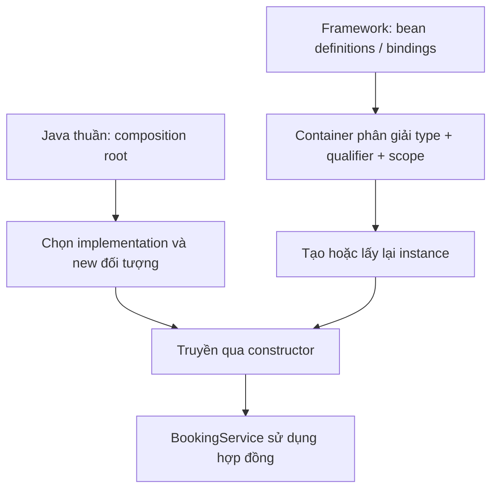
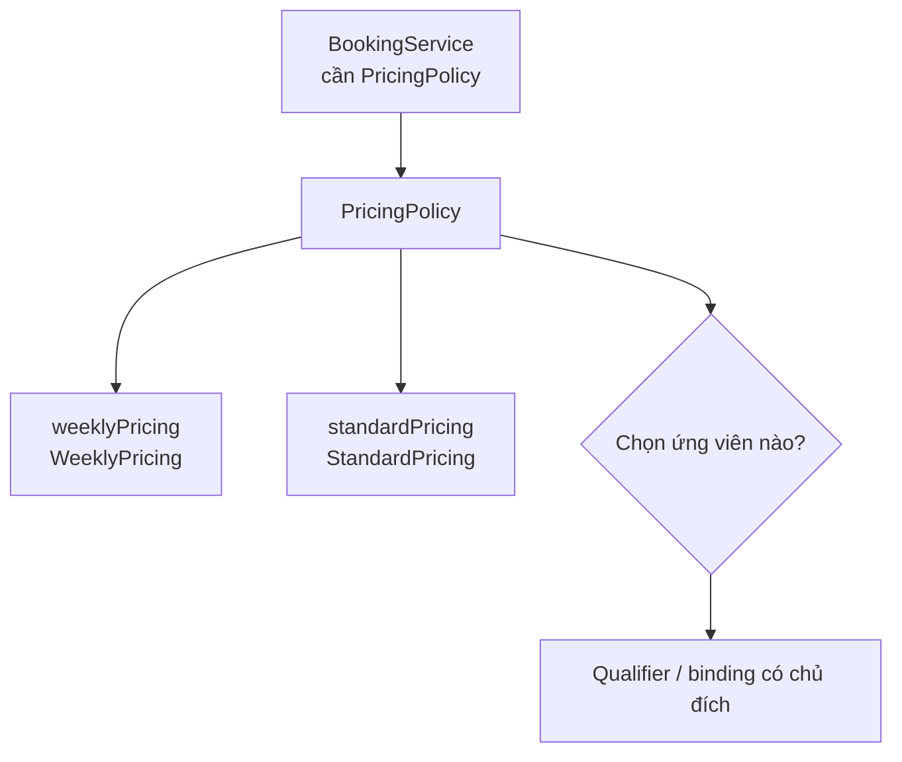

# Ánh xạ DI thủ công sang cơ chế đăng ký và phân giải của framework

Trong chương **DI trong framework** của module **Dependency Injection**, bước chuyển quan trọng không phải là thay mọi câu lệnh `new` bằng annotation. Đó là chuyển **trách nhiệm lắp ghép đối tượng** từ những câu lệnh tường minh ở **composition root** sang những **định nghĩa đăng ký và quy tắc phân giải** do một DI container quản lý.

Khi viết Java thuần, ta có thể tạo repository, chính sách giá và dịch vụ bằng constructor injection. Khi dùng framework như Spring hoặc CDI, các constructor vẫn diễn đạt cùng những phụ thuộc bắt buộc; điểm khác là container tiếp nhận khai báo, tìm implementation, tạo instance trong scope phù hợp và đưa vào constructor. **Inversion of Control (IoC)** thể hiện ở chỗ service nghiệp vụ không quyết định ai tạo và kết nối các cộng tác viên của mình.

Một chuyển đổi có chất lượng phải **bảo toàn hợp đồng phụ thuộc, ranh giới nghiệp vụ, scope và quyền sở hữu tài nguyên**, chứ không chỉ làm cho ứng dụng khởi động được.

Sau bài học, bạn có thể:

- Ánh xạ từng bước từ `new` và constructor injection thủ công sang **registration**, **resolution** và **injection** của framework.
- Phân biệt **bean definition** với **instance thực tế**, **đăng ký** với **lựa chọn implementation** và **scope** với **vòng đời tài nguyên**.
- Dùng một ví dụ Java 11 thuần làm cơ sở, rồi đối chiếu với cấu hình Spring bằng `@Configuration` và `@Bean`.
- Hiểu vai trò của `@Component`, `@Inject`, qualifier, provider, factory và các scope khi dùng Spring/CDI.
- Nhận biết các lỗi thiếu binding, trùng ứng viên, phụ thuộc vòng, scope không tương thích và service locator.
- Giữ kiểm thử Java thuần ở tầng nghiệp vụ, bổ sung kiểm tra cấu hình container và tích hợp hạ tầng ở đúng chỗ.

## 1. Điểm không đổi: service vẫn phụ thuộc vào hợp đồng

Giả sử ứng dụng thuê xe có một use case tạo booking. Nó cần:

1. `PricingPolicy` để tính tổng tiền.
2. `BookingRepository` để lưu booking.
3. `BookingNotifier` để thông báo xác nhận.
4. `RentalSettings` chứa giá và giới hạn số ngày thuê đã được kiểm tra.

Thiết kế của consumer không phụ thuộc cách lắp ghép:

```java
final class BookingService {
    private final PricingPolicy pricing;
    private final BookingRepository repository;
    private final BookingNotifier notifier;
    private final RentalSettings settings;

    BookingService(
            PricingPolicy pricing,
            BookingRepository repository,
            BookingNotifier notifier,
            RentalSettings settings) {
        this.pricing = java.util.Objects.requireNonNull(pricing);
        this.repository = java.util.Objects.requireNonNull(repository);
        this.notifier = java.util.Objects.requireNonNull(notifier);
        this.settings = java.util.Objects.requireNonNull(settings);
    }
    // Phương thức book(...) chỉ dùng các phụ thuộc đã được cấp.
}
```

Đoạn rút gọn trên minh họa chữ ký constructor; ví dụ **tự chứa, chạy được bằng Java thuần** nằm ở phần 4.

`BookingService` không tự đọc biến môi trường, không gọi `new JdbcBookingRepository(...)` và không truy vấn một registry để tìm notifier. Khi chuyển từ DI thủ công sang DI container, **constructor này không cần đổi** nếu hợp đồng và cách sử dụng không thay đổi.

Đó là tiêu chí quan trọng để đánh giá migration: **mã nghiệp vụ ít hoặc không cần biết container**.

## 2. Từ các câu lệnh `new` sang các định nghĩa đăng ký

Trong Java thuần, composition root quyết định các implementation:

```java
RentalSettings settings = new RentalSettings(200_000L, 30);
PricingPolicy pricing = new WeeklyPricing();
BookingRepository repository = new InMemoryBookingRepository();
BookingNotifier notifier = new ConsoleBookingNotifier();
BookingService service =
        new BookingService(pricing, repository, notifier, settings);
```

Đây là ví dụ lắp ghép tóm tắt; các kiểu được định nghĩa đầy đủ ở phần 4. Trong framework, các quyết định tương đương cần được biểu đạt bằng **định nghĩa bean/binding**.

| DI thủ công | Khái niệm DI framework | Câu hỏi được trả lời |
| --- | --- | --- |
| `new WeeklyPricing()` | Đăng ký một definition cung cấp `PricingPolicy` | Ai biết cách tạo implementation này? |
| `new InMemoryBookingRepository()` | Đăng ký bean/producer cho `BookingRepository` | Port này được nối với adapter nào? |
| `new BookingService(pricing, repo, notifier, settings)` | Constructor injection hoặc factory method có tham số | Khi tạo service, container lấy các phụ thuộc ở đâu? |
| Biến local giữ instance để chia sẻ | Singleton/application scope hay scope tương đương | Có tạo lại hay tái sử dụng instance? |
| Tạo instance riêng cho mỗi request | Request scope, provider hoặc factory phù hợp | Thời điểm nào tạo instance mới? |
| `try-with-resources`/`close()` ở root | Lifecycle callback hoặc bean destroy method | Ai sở hữu và thu hồi tài nguyên? |
| Chọn `WeeklyPricing` thay vì `StandardPricing` | Qualifier, bean name, điều kiện đăng ký hoặc selection rõ | Khi có nhiều ứng viên, ai quyết định dùng cái nào? |

**Đăng ký không phải là tạo ngay lập tức.** Tùy container và scope, definition có thể được dùng để tạo bean lúc khởi động hoặc khi được yêu cầu sau này. **Phân giải** (*resolution*) là quá trình container xác định definition nào đáp ứng một điểm injection, theo kiểu, qualifier và quy tắc framework. **Injection** là đưa instance đã phân giải vào constructor, method hoặc field theo cơ chế được hỗ trợ.

### 2.1. Luồng tư duy từ manual sang framework



Phía bên dưới, consumer vẫn gọi `pricing.total(...)`, `repository.save(...)` và `notifier.confirmed(...)`. **DI container không làm đổi quy tắc nghiệp vụ**, mà thay cơ chế lắp ghép và quản lý những instance đứng sau các hợp đồng đó.

## 3. Trách nhiệm trong và ngoài container

Khi chuyển sang framework, thường có ba vùng rõ ràng:

| Vùng | Biết những gì? | Không nên làm gì? |
| --- | --- | --- |
| **Domain/application service** | Các hợp đồng và giá trị cần để chạy use case | Tự lấy bean từ container, tự quyết định môi trường, tự tạo adapter |
| **Infrastructure adapter** | Cách triển khai database, API, gửi thông báo; phụ thuộc kỹ thuật của adapter | Bắt domain phải biết chi tiết JDBC, HTTP hoặc annotation framework |
| **Composition root / configuration** | Bean definitions, lựa chọn implementation, thông số cấu hình và lifecycle | Chứa thuật toán nghiệp vụ hoặc lan cơ chế registry vào consumer |

Trong Spring, configuration có thể là các class `@Configuration` với method `@Bean`, các class được quét `@Component`, hoặc sự kết hợp được kiểm soát. Trong CDI, tương đương ở mức ý tưởng là bean discovery, producer, injection point và scope. **Mỗi framework có quy tắc cụ thể**; không nên đồng nhất các annotation chỉ vì tên khái niệm giống nhau.

Không bắt buộc mỗi class đều có interface. Một `RentalSettings` bất biến có thể được đăng ký dưới kiểu cụ thể; một port `BookingRepository` có lý do tồn tại vì cần cô lập hạ tầng. DI container không tự làm mọi abstraction trở nên cần thiết.

## 4. Cơ sở đối chiếu: Java 11 thuần, không container

Lưu nội dung sau vào một file `ManualWiringDemo.java`. Ví dụ tương thích **Java 11 trở lên**, tự chứa các kiểu cần thiết, có composition root và kiểm thử bằng fake.

```bash
javac ManualWiringDemo.java
java ManualWiringDemo
```

```java
import java.util.ArrayList;
import java.util.HashMap;
import java.util.List;
import java.util.Map;
import java.util.Objects;

public final class ManualWiringDemo {
    // Cấu hình là giá trị đã được kiểm tra, không tự đọc môi trường.
    static final class RentalSettings {
        final long dailyRate;
        final int maxDays;

        RentalSettings(long dailyRate, int maxDays) {
            if (dailyRate <= 0 || maxDays < 1) {
                throw new IllegalArgumentException("Invalid rental settings");
            }
            this.dailyRate = dailyRate;
            this.maxDays = maxDays;
        }
    }

    static final class Booking {
        final String id;
        final int days;
        final long totalPrice;

        Booking(String id, int days, long totalPrice) {
            this.id = Objects.requireNonNull(id);
            this.days = days;
            this.totalPrice = totalPrice;
        }
    }

    interface PricingPolicy {
        long total(long dailyRate, int days);
    }

    static final class WeeklyPricing implements PricingPolicy {
        @Override
        public long total(long dailyRate, int days) {
            if (dailyRate <= 0 || days < 1) {
                throw new IllegalArgumentException("Invalid pricing input");
            }
            long gross = Math.multiplyExact(dailyRate, days);
            return days >= 7 ? gross - gross / 10 : gross;
        }
    }

    interface BookingRepository {
        void save(Booking booking);
        Booking find(String id);
    }

    static final class InMemoryBookingRepository
            implements BookingRepository {
        private final Map<String, Booking> data = new HashMap<>();

        @Override
        public void save(Booking booking) {
            Objects.requireNonNull(booking);
            if (data.putIfAbsent(booking.id, booking) != null) {
                throw new IllegalArgumentException("Duplicate booking ID");
            }
        }

        @Override
        public Booking find(String id) {
            return data.get(id);
        }
    }

    interface BookingNotifier {
        void confirmed(Booking booking);
    }

    static final class ConsoleBookingNotifier implements BookingNotifier {
        @Override
        public void confirmed(Booking booking) {
            System.out.println("Da xac nhan " + booking.id);
        }
    }

    static final class BookingService {
        private final PricingPolicy pricing;
        private final BookingRepository repository;
        private final BookingNotifier notifier;
        private final RentalSettings settings;

        BookingService(
                PricingPolicy pricing,
                BookingRepository repository,
                BookingNotifier notifier,
                RentalSettings settings) {
            this.pricing = Objects.requireNonNull(pricing, "pricing");
            this.repository = Objects.requireNonNull(repository, "repository");
            this.notifier = Objects.requireNonNull(notifier, "notifier");
            this.settings = Objects.requireNonNull(settings, "settings");
        }

        Booking book(String id, int days) {
            if (id == null || id.isBlank()) {
                throw new IllegalArgumentException("Booking ID required");
            }
            if (days < 1 || days > settings.maxDays) {
                throw new IllegalArgumentException("Days out of range");
            }
            Booking booking = new Booking(
                    id, days, pricing.total(settings.dailyRate, days));
            repository.save(booking);
            notifier.confirmed(booking);
            return booking;
        }
    }

    // Có thể gom đầu ra của composition root nếu cần dùng ở startup.
    static final class Graph {
        final BookingService service;
        final InMemoryBookingRepository repository;

        Graph(BookingService service,
              InMemoryBookingRepository repository) {
            this.service = Objects.requireNonNull(service);
            this.repository = Objects.requireNonNull(repository);
        }
    }

    static Graph compose() {
        RentalSettings settings = new RentalSettings(200_000L, 30);
        PricingPolicy pricing = new WeeklyPricing();
        InMemoryBookingRepository repository = new InMemoryBookingRepository();
        BookingNotifier notifier = new ConsoleBookingNotifier();
        BookingService service =
                new BookingService(pricing, repository, notifier, settings);
        return new Graph(service, repository);
    }

    static void testWithFakes() {
        RentalSettings settings = new RentalSettings(100_000L, 10);
        InMemoryBookingRepository repository = new InMemoryBookingRepository();
        List<Booking> notified = new ArrayList<>();
        BookingNotifier fakeNotifier = notified::add;

        BookingService service = new BookingService(
                new WeeklyPricing(), repository, fakeNotifier, settings);
        Booking booking = service.book("TEST-01", 2);
        if (booking.totalPrice != 200_000L
                || repository.find("TEST-01") != booking
                || notified.size() != 1 || notified.get(0) != booking) {
            throw new AssertionError("Incorrect booking flow");
        }
        System.out.println("Kiem thu Java thuan: PASS");
    }

    public static void main(String[] args) {
        Graph graph = compose();
        Booking booking = graph.service.book("BK-001", 7);
        if (booking.totalPrice != 1_260_000L
                || graph.repository.find("BK-001") != booking) {
            throw new AssertionError("Incorrect booking result");
        }
        System.out.println("Tong tien: " + booking.totalPrice + " VND");
        testWithFakes();
    }
}
```

Kết quả dự kiến:

```text
Da xac nhan BK-001
Tong tien: 1260000 VND
Kiem thu Java thuan: PASS
```

Với giá `200_000` VND/ngày, thuê 7 ngày có giá gốc `1_400_000` VND, giảm 10% còn **1_260_000 VND**. Đồ thị dependency được nối tại `compose()`:

```text
ManualWiringDemo.compose()
    -> RentalSettings
    -> WeeklyPricing implements PricingPolicy
    -> InMemoryBookingRepository implements BookingRepository
    -> ConsoleBookingNotifier implements BookingNotifier
    -> BookingService(pricing, repository, notifier, settings)
```

**Ý chính:** `BookingService` không biết `compose()` tồn tại. Vì thế khi thay cách lắp ghép bằng framework, service không cần biết về container; chỉ cấu hình ở biên ứng dụng thay đổi.

## 5. Ánh xạ sang Spring bằng `@Configuration` và `@Bean`

Với Spring Framework, một cách chuyển đổi dễ theo dõi là **giữ nguyên các class nghiệp vụ** và di chuyển những quyết định của `compose()` thành method `@Bean` trong một class `@Configuration`.

Đoạn dưới sử dụng các nested type từ `ManualWiringDemo.java` ở phần 4. Đặt cả hai file cùng package để các kiểu package-private trong ví dụ có thể được truy cập. **Ví dụ Spring cần dependency `spring-context` và phiên bản JDK tương thích với Spring đang sử dụng** (ví dụ Spring Framework 6 yêu cầu Java 17 trở lên). Phần Java thuần ở trên vẫn chạy với Java 11 và không cần Spring.

```java
import org.springframework.context.annotation.AnnotationConfigApplicationContext;
import org.springframework.context.annotation.Bean;
import org.springframework.context.annotation.Configuration;

public final class SpringWiringDemo {
    @Configuration(proxyBeanMethods = false)
    static class RentalConfiguration {
        @Bean
        ManualWiringDemo.RentalSettings rentalSettings() {
            return new ManualWiringDemo.RentalSettings(200_000L, 30);
        }

        @Bean
        ManualWiringDemo.PricingPolicy pricingPolicy() {
            return new ManualWiringDemo.WeeklyPricing();
        }

        @Bean
        ManualWiringDemo.BookingRepository bookingRepository() {
            return new ManualWiringDemo.InMemoryBookingRepository();
        }

        @Bean
        ManualWiringDemo.BookingNotifier bookingNotifier() {
            return new ManualWiringDemo.ConsoleBookingNotifier();
        }

        @Bean
        ManualWiringDemo.BookingService bookingService(
                ManualWiringDemo.PricingPolicy pricing,
                ManualWiringDemo.BookingRepository repository,
                ManualWiringDemo.BookingNotifier notifier,
                ManualWiringDemo.RentalSettings settings) {
            return new ManualWiringDemo.BookingService(
                    pricing, repository, notifier, settings);
        }
    }

    public static void main(String[] args) {
        try (AnnotationConfigApplicationContext context =
                new AnnotationConfigApplicationContext(
                        RentalConfiguration.class)) {
            ManualWiringDemo.BookingService service =
                    context.getBean(ManualWiringDemo.BookingService.class);
            ManualWiringDemo.Booking booking = service.book("BK-SPRING", 7);
            if (booking.totalPrice != 1_260_000L) {
                throw new AssertionError("Incorrect Spring wiring");
            }
            System.out.println("Spring total: " + booking.totalPrice);
        }
    }
}
```

Nếu classpath được cấu hình đúng cho Spring, kết quả nghiệp vụ tương đương phần Java thuần: tổng tiền thuê 7 ngày là **1.260.000 VND**. Ví dụ này dùng `getBean(...)` **chỉ ở entry point** để lấy service gốc, chứ không gọi container từ bên trong `BookingService`.

### 5.1. Đọc quá trình phân giải từng bước

1. `new AnnotationConfigApplicationContext(RentalConfiguration.class)` tạo Spring context và xử lý các bean definition được khai báo.
2. Method `@Bean pricingPolicy()` đăng ký cách cung cấp một `PricingPolicy`; tương tự các method khác tạo repository, notifier và settings.
3. `@Bean bookingService(...)` khai báo rằng khi tạo `BookingService`, container cần phân giải bốn tham số theo type (cùng các quy tắc qualifier và ứng viên của Spring).
4. Trong cấu hình này mỗi tham số có đúng một bean tương thích, nên container có đủ thông tin để tạo service.
5. Scope mặc định của bean kiểu này trong Spring là **singleton trong một application context**: nhiều consumer trong cùng context có thể nhận cùng một instance, không có nghĩa một singleton toàn JVM.
6. Khi `context.close()` được gọi, Spring thực hiện quy trình hủy những bean do context quản lý theo các lifecycle callback áp dụng. Ví dụ in-memory không mở tài nguyên cần đóng.

**Lưu ý về `proxyBeanMethods = false`:** Spring vẫn phân giải tham số method `@Bean` qua container. Ta **không gọi trực tiếp** `pricingPolicy()` từ `bookingService()`; vì nếu gọi như phương thức Java bình thường, kết quả có thể không đi qua cơ chế lấy bean chung. Truyền tham số vào bean factory method làm quan hệ phụ thuộc rõ và ít phụ thuộc vào proxy của configuration class.

### 5.2. Một phép ánh xạ có kiểm soát

| `ManualWiringDemo.compose()` | `SpringWiringDemo.RentalConfiguration` |
| --- | --- |
| `new RentalSettings(...)` | `@Bean rentalSettings()` |
| `new WeeklyPricing()` | `@Bean pricingPolicy()` |
| `new InMemoryBookingRepository()` | `@Bean bookingRepository()` |
| `new ConsoleBookingNotifier()` | `@Bean bookingNotifier()` |
| `new BookingService(pricing, repo, notifier, settings)` | `@Bean bookingService(pricing, repo, notifier, settings)` |
| `graph.service.book(...)` | Entry point lấy root bean rồi gọi `service.book(...)` |

Trong cả hai cách, **sơ đồ phụ thuộc của `BookingService` giữ nguyên**. Đó là kết quả mong đợi khi tách đúng code nghiệp vụ khỏi composition root ngay từ đầu.

## 6. Component scanning và constructor injection

Spring còn hỗ trợ quét các class gắn annotation như `@Component`, `@Service` hoặc `@Repository` để đăng ký bean. Với một class được Spring quản lý và chỉ có **một constructor**, cơ chế tự động tiêm constructor của Spring có thể phân giải các tham số mà không cần ghi `@Autowired` lên constructor đó.

Ví dụ **minh họa**, không đặt trùng với class `BookingService` trong file tự chạy ở phần 4:

```java
import org.springframework.stereotype.Service;

@Service
public final class BookingApplicationService {
    private final BookingRepository repository;
    private final PricingPolicy pricing;

    public BookingApplicationService(
            BookingRepository repository,
            PricingPolicy pricing) {
        this.repository = repository;
        this.pricing = pricing;
    }
}
```

Các kiểu `BookingRepository` và `PricingPolicy` ở đây được hiểu là các hợp đồng trong package ứng dụng thực tế, không phải code dùng trực tiếp với nested type ở phần 4. Để Spring nhìn thấy service và các dependency, cần cấu hình component scanning/import hoặc `@Bean` phù hợp.

**Hai cách đăng ký không loại trừ nhau**, nhưng đừng vô tình đăng ký *cùng một service* vừa bằng `@Service` qua scanning vừa bằng một `@Bean` khác, rồi tạo ra hai ứng viên không mong muốn. Có thể chọn một chiến lược rõ ràng theo module: cấu hình tường minh cho adapter/phần tích hợp và quét có kiểm soát các service phù hợp.

### 6.1. CDI cũng ánh xạ cùng một ý tưởng

Trong CDI/Jakarta Dependency Injection, constructor có thể được đánh dấu `@Inject`; producer `@Produces` đóng vai trò khai báo nguồn tạo dependency; qualifier phân biệt những bean cùng kiểu; scope như `@ApplicationScoped` và `@RequestScoped` điều khiển vòng đời theo CDI.

Ví dụ khái niệm:

```java
// Ví dụ phác thảo CDI, không nằm trong file Java 11 tự chạy.
@ApplicationScoped
class BookingService {
    private final PricingPolicy pricing;

    @Inject
    BookingService(PricingPolicy pricing) {
        this.pricing = pricing;
    }
}
```

Với CDI, dependency và annotation được cung cấp bởi API cùng runtime CDI tương ứng; cú pháp, discovery, producer và scoped proxy không hoàn toàn giống Spring. **Đừng bê nguyên quy tắc của Spring sang CDI** chỉ vì hai bên đều gọi chung là DI container.

## 7. Khi có nhiều implementation: đăng ký khác với lựa chọn

Ở phần 5 chỉ có một bean `PricingPolicy`. Giả sử thêm `StandardPricing` bên cạnh `WeeklyPricing`. Nếu điểm injection vẫn chỉ yêu cầu `PricingPolicy` nhưng có nhiều ứng viên hợp lệ, container cần một quy tắc lựa chọn:



Trong Spring, có thể chỉ định bean qua qualifier:

```java
// Đoạn cấu hình minh họa khi có hai policy cùng tồn tại.
@Bean("weeklyPricing")
PricingPolicy weeklyPricing() {
    return new WeeklyPricing();
}

@Bean("standardPricing")
PricingPolicy standardPricing() {
    return new StandardPricing();
}

@Bean
BookingService bookingService(
        @Qualifier("weeklyPricing") PricingPolicy policy,
        BookingRepository repository,
        BookingNotifier notifier,
        RentalSettings settings) {
    return new BookingService(policy, repository, notifier, settings);
}
```

Các tên class trong snippet này là dạng **top-level** được trích ra từ ví dụ để minh họa; khi dùng trong project cần tổ chức package, import và cấu hình Spring phù hợp. Nó thay thế các bean method tương ứng ở phần 5, **không thêm song song** với bean `pricingPolicy()` cũ.

Ngoài qualifier, Spring còn có `@Primary`, cơ chế conditional/configuration và các quy tắc chọn bean khác. CDI có qualifier riêng. **Không nên chọn đại một implementation chỉ để hết lỗi ambiguous**: chính sách giá là quyết định nghiệp vụ; điểm chọn phải công khai và kiểm thử được.

Nếu use case cần **tất cả** các policy (ví dụ chạy nhiều quy tắc khuyến mãi) thay vì đúng một policy, hãy mô hình hóa một tập hợp hoặc selector có hợp đồng rõ ràng, bao gồm thứ tự và cách kết hợp. Đừng nhầm nhu cầu nhiều implementation với lỗi cấu hình.

## 8. Scope: tạo một lần, tạo nhiều lần và phụ thuộc sống ngắn

DI container quản lý **scope** của bean, nhưng scope không giống việc một field trong service được khai báo `final`. Một field `private final BookingRepository repository` không cho biết repository là singleton, request-scoped, proxy hay một instance được tạo cho mỗi lời gọi.

| Scope/nhu cầu | DI thủ công thường làm gì? | Framework thường hỗ trợ gì? |
| --- | --- | --- |
| Một policy không trạng thái dùng chung | Tạo một instance ở composition root, inject cho nhiều service | Singleton/application scope |
| Một đối tượng mới cho mỗi lần yêu cầu | Factory/provider tạo theo request | Request scope hoặc provider theo API container |
| Mỗi lần cần instance mới | `Supplier<T>` hoặc factory có hợp đồng tạo mới | Prototype/dependent scope, tùy framework |
| Một transaction/session ngắn hạn | Factory mở session, `try-with-resources` để đóng | Scoped bean/factory cùng transaction manager |
| Một resource như pool/network client | Root sở hữu và đóng theo shutdown | Bean lifecycle/destroy hook do container quản lý nếu phù hợp |

### 8.1. Bẫy singleton giữ prototype hoặc request instance

Giả sử `CheckoutService` là singleton và constructor nhận một `BookingSession` được tạo theo request. Nếu session được tạo đúng **một lần** trong quá trình dựng singleton, service có thể giữ lại cùng một session xuyên suốt nhiều request. Trong Spring, việc khai báo dependency là `prototype` không tự làm cho singleton nhận **instance mới ở mỗi lần gọi phương thức**: constructor của singleton vẫn được chạy theo lifecycle của singleton. Khi cần tạo theo thao tác, nên thiết kế rõ một `BookingSessionFactory` hoặc một cơ chế như provider có scope phù hợp.

Một số framework có proxy cho request scope; nó có thể chuyển lời gọi sang instance hiện hành. Nhưng **proxy không làm cho việc sử dụng request context ngoài request trở nên hợp lệ**, cũng không tự chứng minh thread-safety.

### 8.2. Quyền sở hữu tài nguyên không tự chuyển vì đã đăng ký bean

Nếu container tạo và sở hữu connection pool, phải thiết lập cơ chế dừng phù hợp. Nếu root tạo một HTTP client ở bên ngoài rồi chỉ đăng ký instance đó, **không thể mặc định** container sẽ đóng client đúng như một bean nó tự tạo; điều này phụ thuộc cách đăng ký và lifecycle của framework.

Consumer không nên gọi `pool.close()` trong một request chỉ vì giữ tham chiếu tới pool. Với JDBC, code mượn connection thường đóng logical connection theo thao tác để trả về pool, còn pool được đóng khi application runtime/context kết thúc. Tương tự, `ExecutorService` dùng chung cần một owner dừng nhận task, chờ công việc đang chạy rồi shutdown đúng thứ tự.

## 9. Kiểm tra đồ thị khi container chịu trách nhiệm phân giải

Với Java thuần, thiếu một tham số constructor có thể lộ ngay khi biên dịch lệnh `new BookingService(...)`. Với container, lỗi thường chuyển sang bước **phân giải graph** theo các definition hiệu lực.

| Dấu hiệu | Ví dụ | Hướng xử lý |
| --- | --- | --- |
| **Thiếu bean/binding** | `BookingService` yêu cầu `BookingRepository` nhưng chưa đăng ký adapter | Bổ sung definition/import module cấu hình đúng |
| **Mơ hồ** | Hai `PricingPolicy` đều phù hợp với một injection point | Qualifier hoặc quy tắc lựa chọn có chủ đích |
| **Vòng constructor** | `BookingService → PaymentService → BookingService` | Xem lại trách nhiệm; có thể trích xuất coordinator |
| **Sai scope** | Singleton giữ session gắn với request | Factory/provider/scoped proxy nếu thực sự cần, và quản lý ownership |
| **Lỗi lúc tạo bean** | Thiếu biến cấu hình hoặc kết nối pool không thành công | Validate cấu hình, fail fast và thu hồi tài nguyên đã mở |
| **Lỗi trong bean lazy** | Dependency chưa được tạo ở startup | Kiểm thử những nhánh tạo muộn quan trọng |

**Startup thành công không bảo đảm mọi thứ chạy đúng.** Một bean tạo lazy hoặc một cấu hình profile khác có thể chỉ hỏng khi được dùng. Đồ thị hợp lệ cũng không chứng minh database đang mở, HTTP client không timeout hoặc một chính sách giá tính đúng.

Khi migration, hãy giữ các cấp độ kiểm tra tách biệt:

1. **Unit test bằng Java thuần:** xác minh thuật toán và use case, cấp fake/in-memory adapter qua constructor.
2. **Container wiring test:** khởi tạo context với cấu hình chính, chắc chắn các dependency bắt buộc được phân giải và các qualifier đúng.
3. **Integration test:** dùng adapter thật để xác minh kết nối, transaction, lỗi mạng và shutdown.

Không cần biến mọi unit test thành một bài test khởi động Spring. Một `BookingService` giữ constructor thông thường vẫn có thể được tạo bằng `new BookingService(...)` trong test nhanh, độc lập với container.

## 10. Quy trình chuyển một ứng dụng từ manual DI sang framework

Thay vì thêm annotation khắp codebase, hãy làm theo một lộ trình có thể kiểm tra:

### Bước 1 — Xác định composition root hiện tại

Tìm nơi tạo các adapter, chính sách và service gốc. Ghi lại danh sách cạnh, cấu hình, scope và tài nguyên cần đóng. Nếu logic `new` đang bị rải rác trong service, **tách quyền tạo trước** rồi mới thay cơ chế bằng framework.

### Bước 2 — Giữ constructor và hợp đồng nghiệp vụ

Consumer nhận những phụ thuộc thật sự cần qua constructor; không đưa container API hoặc service locator vào domain. Không tạo interface máy móc chỉ vì framework có chức năng autowire theo interface.

### Bước 3 — Đăng ký những thành phần có chủ sở hữu rõ

Dùng `@Bean`/producer để đăng ký adapter cần cấu hình, network client, pool hoặc giá trị đã xác thực. Có thể dùng component scanning cho service phù hợp. Xác định tên, qualifier, điều kiện môi trường và scope **trước khi** ứng dụng phụ thuộc vào chúng.

### Bước 4 — Chuyển quyền phân giải cho container

Thay các câu lệnh `new BookingService(...)` ở root bằng một bean definition hoặc một service được container tạo qua constructor. Đảm bảo từng điểm injection có đúng tập ứng viên theo nhu cầu. Chỉ dùng `getBean(...)` ở entry point hoặc phần tích hợp có lý do rõ ràng; **không lấy bean theo tên trong logic nghiệp vụ**.

### Bước 5 — Xác định scope và lifecycle

Liệt kê singleton, request/session, factory/provider và tài nguyên có `close` hoặc `shutdown`. Với service dùng chung, xác minh các phụ thuộc có trạng thái được quản lý an toàn; với request-scoped state, tránh giữ instance ngắn hạn vào singleton theo cách không hợp lệ.

### Bước 6 — Kiểm thử tính tương đương

Giữ một bộ test hành vi không phụ thuộc container để so sánh manual wiring và framework wiring. Bổ sung context test cho cấu hình môi trường, qualifier/bean khác nhau, xử lý lỗi startup, rồi kiểm thử tích hợp những adapter có I/O.

### Bước 7 — Chỉ sử dụng khả năng framework khi có nhu cầu

Provider, conditional bean, lazy, interceptor và scoped proxy hữu ích khi giải quyết một yêu cầu cụ thể. Không thêm chúng chỉ để che phụ thuộc vòng hoặc thay thế một quyết định nghiệp vụ chưa được mô hình hóa.

## 11. Những sai lầm thường gặp

| Sai lầm | Hệ quả | Cách cải thiện |
| --- | --- | --- |
| Dùng `ApplicationContext.getBean(...)` bên trong mọi service | Service locator, phụ thuộc bị che khuất | Constructor injection bằng kiểu/hợp đồng rõ |
| Vừa component-scan vừa khai báo thêm bean cùng vai trò mà không kiểm soát | Hai ứng viên hoặc bean trùng tên | Chọn một strategy đăng ký rõ và kiểm tra context |
| Gắn `@Component` lên mọi class dữ liệu | Tạo bean không cần thiết và vòng đời khó hiểu | Chỉ quản lý service/adapter phù hợp; value object được tạo theo ngữ cảnh |
| Cho container tự chọn policy khi có nhiều implementation | Có thể mơ hồ hoặc dùng nhầm quy tắc giá | Qualifier/default/selector có chủ đích |
| Cho rằng bean singleton là thread-safe | Rủi ro race condition với mutable state | Kiểm tra khả năng dùng đồng thời và scope các dependency |
| Inject session/transaction ngắn hạn trực tiếp vào singleton | Giữ object sai vòng đời | Factory/provider/scoped mechanism theo nhu cầu |
| Bật circular reference/proxy chỉ để khởi động | Che vòng trách nhiệm chưa được giải quyết | Refactor coordinator hoặc tách hợp đồng |
| Bỏ `close`/shutdown vì container "sẽ tự lo" | Leak connection, thread hoặc client | Xác định owner và cấu hình destroy callback hợp lệ |
| Chạy toàn bộ unit test bằng context framework | Chậm và khó phân biệt lỗi nghiệp vụ/lắp ghép | Giữ test Java thuần, bổ sung wiring test chọn lọc |
| Coi annotation của Spring và CDI có cùng ngữ nghĩa | Sai bean discovery, qualifier hoặc scope | Dùng tài liệu của container/phiên bản thực tế |

## 12. Tự đánh giá

**Bài 1 — Ánh xạ registration.** Java thuần có `PricingPolicy policy = new WeeklyPricing();` và `new BookingService(policy, repo, notifier, settings)`. Trong Spring với `@Bean`, hai hành động tương ứng được diễn đạt như thế nào?

*Gợi ý:* Khai báo `@Bean` cung cấp `PricingPolicy` và một `@Bean` khác cung cấp `BookingService` với các dependency là tham số. Container phân giải các tham số từ bean definitions hiệu lực.

**Bài 2 — Không đổi service.** Tại sao `BookingService` ở phần 4 không cần kế thừa class Spring hay gọi `getBean` khi chuyển sang `SpringWiringDemo`?

*Gợi ý:* Consumer đã nhận các hợp đồng qua constructor. Điều thay đổi là bên cấp phụ thuộc, không phải hành vi nghiệp vụ.

**Bài 3 — Hai bean cùng kiểu.** Một context có `WeeklyPricing` và `StandardPricing` cùng cung cấp `PricingPolicy`. Constructor chỉ yêu cầu `PricingPolicy`. Điều gì cần làm?

*Gợi ý:* Quy tắc phân giải của container phải xác định ứng viên rõ; dùng qualifier/default hợp lý hoặc selector nghiệp vụ khi cần chọn theo request. Không dựa vào thứ tự đăng ký ngẫu nhiên.

**Bài 4 — Prototype trong singleton.** Một singleton nhận trực tiếp instance từ bean prototype qua constructor. Có chắc mỗi lần gọi method của singleton nhận một instance mới không?

*Gợi ý:* Không. Constructor của singleton chỉ thực hiện khi singleton được tạo; muốn mỗi thao tác có instance mới cần factory/provider hoặc cơ chế scope phù hợp.

**Bài 5 — Component scanning.** Bạn đã đánh dấu class `BookingService` bằng `@Service` và vẫn có một `@Bean bookingService(...)` khác. Nếu hai bean cùng thỏa điểm injection, có vấn đề gì?

*Gợi ý:* Có nguy cơ mơ hồ hoặc đăng ký thừa; kiểm tra bean names và cấu hình hiệu lực, chọn cách đăng ký rõ ràng.

**Bài 6 — Bean lifecycle.** Container tạo một connection pool và một repository dùng pool. Ai nên đóng connection sau mỗi transaction và ai đóng pool khi context kết thúc?

*Gợi ý:* Thành phần mượn connection trả lại lease/connection theo transaction; container/runtime sở hữu pool đóng khi dừng theo lifecycle đã cấu hình. Repository không tự đóng pool sau một request.

**Bài 7 — Phạm vi kiểm thử.** Context khởi động thành công nhưng `BookingService.book(...)` có thể tính sai giá. Cần thêm loại test nào?

*Gợi ý:* Test thuật toán/chức năng bằng Java thuần và integration test cho adapter ngoài. Wiring test không chứng minh quy tắc nghiệp vụ đúng.

## 13. Checklist trước khi chuyển sang framework DI

- Mã nghiệp vụ đã dùng **constructor injection**, không tự tạo hoặc tìm hạ tầng chưa?
- Đã xác định **composition root** và những quyết định về implementation, cấu hình, scope tại đó chưa?
- Mỗi câu lệnh tạo object trong DI thủ công đã có **bean definition/registration tương ứng** nếu container cần sở hữu nó chưa?
- Với mọi điểm injection, type, generic, qualifier và tập ứng viên có rõ ràng trong đúng môi trường không?
- Có tránh đăng ký cùng một thành phần nhiều lần bằng scan và `@Bean` mà không có chủ đích không?
- Đã phân biệt scope singleton, request, prototype, factory/provider và ownership của tài nguyên cần đóng chưa?
- Có kiểm tra vòng constructor, dependency thiếu, bean lazy quan trọng và sự khác biệt giữa cấu hình test/production chưa?
- Việc dừng container có đóng pool/client/executor theo hợp đồng và thứ tự an toàn không?
- Có giữ unit test Java thuần cho consumer và thêm wiring/integration test ở các ranh giới cần thiết không?
- Nếu framework bị thay thế, domain/application service còn có thể được tạo và kiểm thử bằng constructor thông thường không?

**Ánh xạ DI thủ công sang framework** không làm mất vai trò của composition root; nó **chuyển cách biểu diễn và thực thi việc lắp ghép** sang registration, resolution và lifecycle do container quản lý. Constructor vẫn là nơi khai báo phụ thuộc bắt buộc, hợp đồng vẫn do thiết kế xác định, còn chính sách chọn implementation và scope phải được kiểm soát có chủ đích. Thành thạo Java thuần trước khi dùng container giúp bạn đọc cấu hình DI như một **đồ thị đối tượng có thể giải thích và kiểm thử**, thay vì coi annotation là một cơ chế tự động không cần hiểu.
