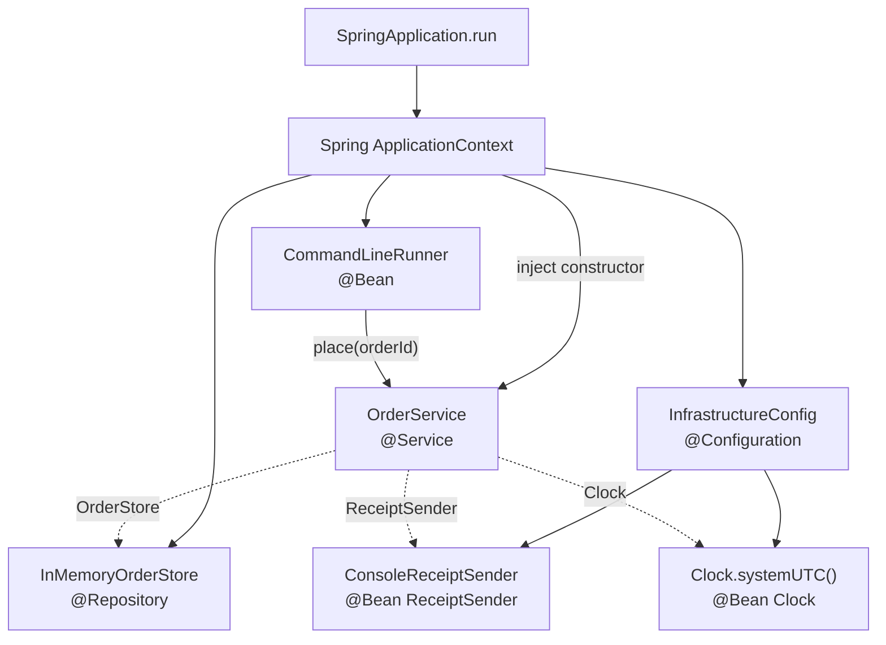

# Constructor injection và cấu hình thành phần trong Spring

## 1. Từ DI thủ công đến Spring

Với **Dependency Injection (DI)** bằng Java thuần, thành phần cấp cao nhận dependency qua constructor, còn **composition root** tạo và nối các đối tượng:

```java
OrderStore store = new InMemoryOrderStore();
ReceiptSender sender = new ConsoleReceiptSender();
Clock clock = Clock.systemUTC();

OrderService service = new OrderService(store, sender, clock);
```

Khi hệ thống có hàng chục hoặc hàng trăm thành phần, những dòng lắp ghép có thể dài và phụ thuộc lẫn nhau. **Spring** cung cấp một *IoC container* để đăng ký, tạo và phân giải đối tượng, đồng thời gọi constructor với những dependency phù hợp. Tuy vậy, nguyên tắc thiết kế không thay đổi: **service khai báo nó cần gì; điểm khởi động/cấu hình quyết định cấp gì**.

Đây là bài thuộc chương **DI trong framework** của module **Dependency Injection**. Ta tiếp nối **Inversion of Control (IoC)**, constructor injection, composition root, scope và vòng đời, đồng thời duy trì khả năng **kiểm thử bằng Java thuần**. Ví dụ sử dụng Spring Boot 3.x với Java 17 trở lên để minh họa; các ý tưởng về constructor injection, component scanning và `@Bean` cũng áp dụng trong Spring Framework không dùng Boot. Các phiên bản và module Spring khác nhau có thể có quy tắc bổ sung, vì vậy cần phân biệt nguyên lý thiết kế với chi tiết API.

Sau bài học, bạn có thể:

1. Chỉ ra khác biệt giữa constructor injection thủ công và Spring tự lắp ghép bean.
2. Sử dụng `@Service`, `@Repository`, `@Configuration` và `@Bean` đúng vai trò.
3. Nhận diện và sửa lỗi thiếu bean, nhiều bean cùng kiểu, vòng phụ thuộc và sai phạm vi scan.
4. Chọn giữa phân giải theo kiểu, `@Qualifier`, `@Primary` và cấu hình theo môi trường.
5. Xác định ownership/scope và test service độc lập với Spring context trước khi kiểm thử cấu hình thực.

## 2. Spring bean và dependency được inject

**Bean** là đối tượng được Spring IoC container quản lý trong một `ApplicationContext`. Một bean có thể được đăng ký qua:

- **Component scanning:** Spring tìm các lớp được đánh dấu `@Component` hoặc các annotation chuyên biệt như `@Service`, `@Repository` và `@Controller` trong phạm vi được quét.
- **Java configuration:** Phương thức `@Bean` tạo và trả về đối tượng cần đăng ký, thường đặt trong một lớp `@Configuration`.
- **Các cơ chế đăng ký khác:** import cấu hình, cơ chế thư viện/framework hoặc đăng ký chương trình. Bài này tập trung hai lựa chọn đầu tiên.

Bean không đồng nghĩa với singleton toàn cục. Mặc định các bean thông thường trong Spring có **singleton scope theo từng container**, nhưng có thể dùng scope khác như prototype hoặc request (trong môi trường web). Bean cũng không nhất thiết là một interface; Spring có thể quản lý các lớp cụ thể và đối tượng có sẵn từ thư viện bên thứ ba.

### 2.1. Constructor injection vẫn là Java bình thường

```java
@Service
public class OrderService {
    private final OrderStore store;
    private final ReceiptSender sender;

    public OrderService(OrderStore store, ReceiptSender sender) {
        this.store = java.util.Objects.requireNonNull(store, "store");
        this.sender = java.util.Objects.requireNonNull(sender, "sender");
    }
}
```

Điểm cốt lõi là **constructor công khai dependency bắt buộc**. Khi Spring tạo bean `OrderService`, container tìm các bean tương thích với `OrderStore` và `ReceiptSender` rồi gọi constructor.

Trong Spring hiện đại, nếu một bean chỉ có **một constructor**, thông thường **không cần `@Autowired` trên constructor đó**. Có thể ghi `@Autowired` để diễn đạt ý đồ, nhưng không bắt buộc. Khi có nhiều constructor, quy tắc chọn constructor phức tạp hơn; cần đọc hợp đồng Spring và chỉ rõ constructor cần dùng nếu cần thiết. Đừng tạo nhiều overload mơ hồ chỉ để phục vụ test.

### 2.2. Tránh field injection cho dependency bắt buộc

```java
// Không ưu tiên cho dependency bắt buộc:
@Service
class BadOrderService {
    @Autowired
    private OrderStore store;
}
```

Ở ví dụ trên, constructor rỗng cho phép tạo `new BadOrderService()` dù `store` chưa được gán. Unit test thuần Java phải khởi tạo container, dùng reflection hoặc setter để thiết lập trường. Với constructor injection, object được cấp đầy đủ dependency ngay khi tạo, có thể dùng trường `final` và kiểm thử bằng fake mà không cần Spring.

**Phân biệt:** `@Autowired` là cơ chế yêu cầu injection của Spring; **constructor injection** là cách thiết kế ranh giới dependency. Annotation không thay thế nhiệm vụ thiết kế constructor hợp lý.

## 3. Ví dụ hoàn chỉnh: `@Service`, `@Repository`, `@Configuration` và `@Bean`

Ta xây dựng một ứng dụng chạy một lần: tạo đơn hàng, lưu vào kho lưu tạm và gửi một dòng xác nhận. `OrderService` chỉ biết các hợp đồng nghiệp vụ; Spring chịu trách nhiệm lắp ghép:



Tạo một project Spring Boot có `spring-boot-starter` (và có thể thêm `spring-boot-starter-test` để viết JUnit test), chọn Java 17 trở lên. Các đoạn mã dưới đây nằm trong cùng package `example.di` tại thư mục `src/main/java/example/di/`. Nếu tổ chức theo package khác, hãy đổi thống nhất khai báo `package` và bảo đảm chúng nằm trong vùng component scanning.

### 3.1. Model và hợp đồng

**`Order.java`**

```java
package example.di;

import java.time.Instant;

public record Order(String id, Instant createdAt) {}
```

**`OrderStore.java`**

```java
package example.di;

public interface OrderStore {
    void save(Order order);
}
```

**`ReceiptSender.java`**

```java
package example.di;

public interface ReceiptSender {
    void sendReceipt(String orderId);
}
```

Hai interface này là hợp đồng mà nghiệp vụ cần. `OrderStore` chưa nói gì về database, còn `ReceiptSender` chưa yêu cầu một giao thức gửi cụ thể.

### 3.2. Adapter và bean hạ tầng

**`InMemoryOrderStore.java`**

```java
package example.di;

import java.util.Map;
import java.util.concurrent.ConcurrentHashMap;
import org.springframework.stereotype.Repository;

@Repository
public final class InMemoryOrderStore implements OrderStore {
    private final Map<String, Order> orders = new ConcurrentHashMap<>();

    @Override
    public void save(Order order) {
        orders.put(order.id(), order);
    }
}
```

`@Repository` là annotation chuyên biệt của `@Component`, thể hiện vai trò truy cập dữ liệu và cho phép component scanning nhận diện bean. Ví dụ chỉ lưu trong bộ nhớ, **không phải repository database production**. `ConcurrentHashMap` giúp map hỗ trợ truy cập đồng thời, nhưng không tự tạo tính nguyên tử cho mọi quy trình nghiệp vụ nhiều bước.

**`ConsoleReceiptSender.java`**

```java
package example.di;

public final class ConsoleReceiptSender implements ReceiptSender {
    @Override
    public void sendReceipt(String orderId) {
        System.out.println("Receipt for " + orderId);
    }
}
```

Lớp này **không** gắn `@Component`. Ta cố ý tạo nó qua phương thức `@Bean` trong cấu hình. Điều này cho thấy cách đăng ký một đối tượng bằng Java configuration, phù hợp cả với những class thư viện mà ta không thể sửa để gắn annotation.

**`InfrastructureConfig.java`**

```java
package example.di;

import java.time.Clock;
import org.springframework.context.annotation.Bean;
import org.springframework.context.annotation.Configuration;

@Configuration
public class InfrastructureConfig {
    @Bean
    public Clock clock() {
        return Clock.systemUTC();
    }

    @Bean
    public ReceiptSender receiptSender() {
        return new ConsoleReceiptSender();
    }
}
```

`@Configuration` đánh dấu lớp cấu hình có các định nghĩa bean. `@Bean` đăng ký kết quả của phương thức thành bean trong context; mặc định tên bean là tên phương thức (`clock`, `receiptSender`), trừ khi chỉ định tên khác. Spring biết cung cấp hai đối tượng này cho constructor yêu cầu `Clock` và `ReceiptSender`.

Điều quan trọng: **không đồng thời đánh dấu `ConsoleReceiptSender` là `@Component` và đăng ký thêm một bean của nó qua `@Bean` nếu không chủ ý có nhiều bean `ReceiptSender`**. Việc đó dễ tạo ra nhiều ứng viên cùng kiểu và lỗi phân giải.

### 3.3. Service dùng constructor injection

**`OrderService.java`**

```java
package example.di;

import java.time.Clock;
import java.time.Instant;
import java.util.Objects;
import org.springframework.stereotype.Service;

@Service
public final class OrderService {
    private final OrderStore store;
    private final ReceiptSender receiptSender;
    private final Clock clock;

    public OrderService(
            OrderStore store,
            ReceiptSender receiptSender,
            Clock clock) {
        this.store = Objects.requireNonNull(store, "store");
        this.receiptSender = Objects.requireNonNull(
            receiptSender, "receiptSender");
        this.clock = Objects.requireNonNull(clock, "clock");
    }

    public Order place(String orderId) {
        if (orderId == null || orderId.isBlank()) {
            throw new IllegalArgumentException("orderId must not be blank");
        }

        Order order = new Order(orderId, Instant.now(clock));
        store.save(order);
        receiptSender.sendReceipt(order.id());
        return order;
    }
}
```

`@Service` giúp Spring đăng ký `OrderService` qua component scanning, nhưng **service không import `ApplicationContext` và không gọi `getBean()`**. Code nghiệp vụ có thể hoạt động với những object được tạo bằng `new` trong test. Constructor không tự `new InMemoryOrderStore()`, không đọc cấu hình và không gửi receipt khi object mới được tạo.

### 3.4. Điểm khởi động Spring Boot

**`DiApplication.java`**

```java
package example.di;

import org.springframework.boot.CommandLineRunner;
import org.springframework.boot.SpringApplication;
import org.springframework.boot.autoconfigure.SpringBootApplication;
import org.springframework.context.annotation.Bean;

@SpringBootApplication
public class DiApplication {
    public static void main(String[] args) {
        SpringApplication.run(DiApplication.class, args);
    }

    @Bean
    public CommandLineRunner demo(OrderService orders) {
        return args -> {
            Order order = orders.place("O-101");
            System.out.println("Created: " + order.createdAt());
        };
    }
}
```

`@SpringBootApplication` kết hợp cấu hình ứng dụng, auto-configuration và component scanning. Trong ví dụ, `DiApplication` đặt cùng package với các class khác, nên chúng nằm trong phạm vi scan mặc định. `CommandLineRunner` là điểm chạy demo sau khi Spring tạo context; bản thân phương thức `demo(OrderService)` cũng nhận tham số bean do container cung cấp.

Ứng dụng hoạt động theo thứ tự khái niệm:

1. Spring khởi tạo `ApplicationContext` và thu thập định nghĩa bean từ scanning cùng `@Bean`.
2. Container xác định `OrderService` cần `OrderStore`, `ReceiptSender` và `Clock`.
3. Spring tạo hoặc lấy ba dependency thích hợp theo scope, rồi gọi constructor `OrderService`.
4. `CommandLineRunner` nhận `OrderService` đã được tạo và gọi `place("O-101")`.
5. Nghiệp vụ lưu `Order` và gọi `sendReceipt` trên dependency đã inject.

Với một project Spring Boot Maven được tạo đúng, người học có thể chạy từ thư mục dự án bằng `./mvnw spring-boot:run` trên Linux/macOS hoặc `.\mvnw.cmd spring-boot:run` trên Windows PowerShell. Kết quả gồm dòng `Receipt for O-101` và thời điểm tạo đơn. Ví dụ dùng đồng hồ thật, nên mốc thời gian thay đổi giữa các lần chạy.

**Lưu ý:** `CommandLineRunner` ở đây cố ý tạo một đơn hàng mẫu mỗi lần khởi động. Trong dịch vụ thực, điểm vào thường là controller, message consumer hoặc scheduler; không nên giữ một runner có hiệu ứng nghiệp vụ nếu chỉ phục vụ minh họa.

## 4. Component scanning và cấu hình bằng `@Bean`: chọn khi nào?

Hai cách cùng tạo **bean Spring**, nhưng khác nơi thể hiện quy tắc khởi tạo.

| Tiêu chí | Component scanning | `@Configuration` + `@Bean` |
| --- | --- | --- |
| Cách khai báo | Gắn `@Component`, `@Service`, `@Repository`… trên class | Phương thức trả về object, có `@Bean` |
| Phù hợp | Class do ứng dụng sở hữu, là thành phần ổn định cần quản lý | Third-party class, cần tham số cấu hình hoặc logic chọn/tạo đặc biệt |
| Constructor | Spring gọi constructor khi tạo bean | Phương thức `@Bean` thường tự `new` và có thể nhận bean khác làm tham số |
| Lỗi thường gặp | Package nằm ngoài vùng scan, vô tình scan thêm implementation | Đăng ký trùng, nhiều phương thức tạo cùng interface không phân biệt |
| Thể hiện quyết định cấu hình | Annotation trên class và các điều kiện nếu có | Quy tắc tạo rõ trong lớp cấu hình |

Không có quy tắc “tất cả đều phải gắn `@Component`”. `java.time.Clock` là lớp JDK nên ta tạo qua `@Bean`; `OrderService` là class nghiệp vụ do ứng dụng sở hữu nên `@Service` là lựa chọn tự nhiên.

### 4.1. `@Bean` cũng có thể nhận dependency làm tham số

Nếu không muốn đánh dấu `OrderService` bằng `@Service`, có thể **thay thế** việc đăng ký bằng:

```java
@Configuration
class ServiceConfig {
    @Bean
    OrderService orderService(
            OrderStore store,
            ReceiptSender sender,
            Clock clock) {
        return new OrderService(store, sender, clock);
    }
}
```

Spring cũng inject các tham số phương thức `@Bean`. **Đây là phương án thay cho `@Service` ở ví dụ chính**, không phải đoạn mã thêm vào đồng thời: đăng ký cả hai có thể tạo hai bean `OrderService` và gây ambiguity khi consumer yêu cầu một instance.

Với cấu hình Java này, lớp nghiệp vụ có thể không biết Spring. Lựa chọn dùng annotation hay cấu hình tách biệt phụ thuộc mức độ độc lập với framework và quy ước kiến trúc của dự án.

### 4.2. Vùng component scanning

`@SpringBootApplication` thường quét package chứa lớp ứng dụng và các package con. Ví dụ nếu `DiApplication` đặt ở `example.di.app` còn `OrderService` nằm ở `example.di.service`, chúng là hai nhánh khác nhau và service có thể không được scan. Nên đặt class khởi động ở package cha chung hoặc cấu hình phạm vi scan tường minh khi cần.

Không mở rộng scanning sang toàn bộ thư viện một cách tùy tiện: quét quá rộng có thể đăng ký thêm component ngoài ý muốn và phát sinh nhiều bean cùng kiểu.

## 5. Khi có nhiều implementation: `@Qualifier` và `@Primary`

Trong ví dụ chính chỉ có một `ReceiptSender`. Giả sử cần hai cách gửi receipt, chẳng hạn email và SMS:

```java
interface ReceiptSender {
    void sendReceipt(String orderId);
}

final class EmailReceiptSender implements ReceiptSender {
    public void sendReceipt(String orderId) {
        System.out.println("Email receipt: " + orderId);
    }
}

final class SmsReceiptSender implements ReceiptSender {
    public void sendReceipt(String orderId) {
        System.out.println("SMS receipt: " + orderId);
    }
}
```

**Đây là phương án thay thế** `ReceiptSender`/`ConsoleReceiptSender` ở mục 3. Nếu đăng ký hai bean của cùng interface:

```java
@Configuration
class ReceiptConfig {
    @Bean("emailReceipt")
    ReceiptSender emailReceipt() {
        return new EmailReceiptSender();
    }

    @Bean("smsReceipt")
    ReceiptSender smsReceipt() {
        return new SmsReceiptSender();
    }
}
```

constructor chỉ nhận `ReceiptSender` sẽ không biểu đạt được lựa chọn mong muốn. Khi có hai ứng viên phù hợp mà không có quy tắc phân giải khác, Spring báo lỗi nhiều bean (thường thấy dưới dạng `NoUniqueBeanDefinitionException` hoặc lỗi tạo bean bao bọc).

Ta có thể yêu cầu một vai trò tường minh tại **điểm injection**:

```java
import org.springframework.beans.factory.annotation.Qualifier;

public OrderService(
        OrderStore store,
        @Qualifier("emailReceipt") ReceiptSender receiptSender,
        Clock clock) {
    this.store = Objects.requireNonNull(store);
    this.receiptSender = Objects.requireNonNull(receiptSender);
    this.clock = Objects.requireNonNull(clock);
}
```

`@Qualifier("emailReceipt")` giúp Spring thu hẹp ứng viên. Một cách khác là đánh dấu một bean là `@Primary` để làm lựa chọn ưu tiên chung:

```java
@Bean
@Primary
ReceiptSender defaultReceiptSender() {
    return new EmailReceiptSender();
}
```

Đoạn `@Primary` minh họa lựa chọn **mặc định**; không nên thêm nó cùng các đăng ký mà không xét tổng số bean và mục đích. Một qualifier có ý nghĩa nghiệp vụ thường phù hợp hơn khi từng consumer cần những kênh gửi khác nhau. Spring cũng có quy tắc phân giải thêm như tên tham số và metadata đăng ký, nhưng không nên dựa vào việc tình cờ trùng tên biến để giấu lựa chọn quan trọng.

## 6. Cấu hình thành phần theo môi trường khởi động

Spring Boot cho phép đọc cấu hình từ `application.properties`/`application.yml`, biến môi trường và các nguồn cấu hình khác. **Cấu hình chọn implementation** thường nên nằm ở vùng lắp ghép, không rải `System.getenv()` trong các service.

### 6.1. Chọn theo profile

Ví dụ hai cấu hình có thể tạo hai implementation thay thế:

```java
@Configuration
class ReceiptProfiles {
    @Bean
    @Profile("local")
    ReceiptSender localReceiptSender() {
        return new ConsoleReceiptSender();
    }

    @Bean
    @Profile("production")
    ReceiptSender productionReceiptSender() {
        return new EmailReceiptSender();
    }
}
```

Ví dụ này **thay thế** bean `receiptSender()` trong `InfrastructureConfig` của mục 3; không đăng ký chồng lên một bean đã có. Nếu chỉ profile `local` được kích hoạt, Spring có một `ReceiptSender` theo cấu hình ấy. Nếu **không profile nào** phù hợp, bean có thể bị thiếu. Nếu **cả hai** được kích hoạt, có thể xuất hiện nhiều ứng viên cùng kiểu. Quy tắc kích hoạt profile cần được xác định rõ và kiểm tra khi startup.

Với Spring Boot, có thể bật profile qua `spring.profiles.active=local` trong cấu hình hoặc tùy chọn dòng lệnh `--spring.profiles.active=local`. Giá trị mặc định và cách nạp cấu hình còn phụ thuộc môi trường triển khai.

### 6.2. Chọn theo thuộc tính cấu hình

Khi yêu cầu là “chọn kênh bằng một thuộc tính”, Spring Boot có `@ConditionalOnProperty`:

```java
@Configuration
class ReceiptSelectionConfig {
    @Bean
    @ConditionalOnProperty(
        prefix = "app.receipt",
        name = "mode",
        havingValue = "console")
    ReceiptSender consoleReceiptSender() {
        return new ConsoleReceiptSender();
    }

    @Bean
    @ConditionalOnProperty(
        prefix = "app.receipt",
        name = "mode",
        havingValue = "email")
    ReceiptSender emailReceiptSender() {
        return new EmailReceiptSender();
    }
}
```

Với `application.yml`:

```yaml
app:
  receipt:
    mode: console
```

Đoạn này cũng là **một phương án cấu hình thay thế** để minh họa, không cộng dồn với các bean `ReceiptSender` khác. `@ConditionalOnProperty` thuộc Spring Boot, không phải annotation lõi của Spring Framework. Nếu giá trị mode sai hoặc thiếu mà không có phương án phù hợp, cấu hình sẽ không tạo được bean `ReceiptSender` và dependency bắt buộc của service sẽ làm việc khởi tạo context thất bại. Đó có thể là hành vi **fail fast** hợp lý hơn âm thầm chọn kênh khác.

Nhiều giá trị cấu hình có liên quan nên được ánh xạ vào một object cấu hình có kiểu rõ ràng (chẳng hạn dùng `@ConfigurationProperties`) và được xác thực tại ranh giới cấu hình. Mỗi lần business service hoạt động không nên đọc lại biến môi trường để tự quyết định chọn adapter.

## 7. Scope và vòng đời: container tạo đúng bean chưa đủ

### 7.1. Bean singleton, prototype và request

Trong Spring, **singleton** thường là scope mặc định: mỗi bean definition có một instance dùng chung trong một `ApplicationContext` tương ứng. Đừng đồng nhất nó với *một instance duy nhất trên toàn bộ JVM*.

| Scope | Ý nghĩa khái quát | Điều cần lưu ý |
| --- | --- | --- |
| Singleton | Cùng một instance được chia sẻ cho các yêu cầu trong context | Phải bảo đảm an toàn khi nhiều consumer/luồng cùng sử dụng |
| Prototype | Container tạo instance mới khi bean được yêu cầu | Container không tự theo dõi toàn bộ bước hủy của prototype sau khi cấp |
| Request (môi trường web) | Instance gắn với một HTTP request | Không giữ trực tiếp dependency đã hết request trong singleton lâu dài |
| Session (môi trường web) | Instance gắn với phiên HTTP | Cần quản lý state và tài nguyên theo phiên |

Nếu singleton `OrderService` inject một prototype `Helper` **trực tiếp trong constructor**, nó thường nhận **một instance tại thời điểm tạo singleton**, chứ không được tự động cấp một Helper mới cho mỗi lời gọi. Khi thực sự cần tạo theo thao tác, hãy cân nhắc factory hoặc `ObjectProvider<Helper>` có ranh giới rõ ràng; đừng gọi container từ mỗi nhánh nghiệp vụ để lấy bean tùy tiện.

### 7.2. Tài nguyên có `close()` thuộc về ai?

Một service chỉ dùng API nghiệp vụ của dependency thường **mượn** bean do container sở hữu. Ví dụ:

```java
interface AuditLog {
    void record(String text);
}

final class FileAuditLog implements AuditLog, AutoCloseable {
    // implementation mở/ghi/đóng file; chi tiết lược bỏ
    public void record(String text) { /* ghi file */ }
    public void close() { /* đóng file */ }
}

@Configuration
class AuditConfig {
    @Bean(destroyMethod = "close")
    FileAuditLog auditLog() {
        return new FileAuditLog();
    }
}
```

Trong ví dụ **phác thảo** này, Spring quản lý vòng đời singleton `FileAuditLog` và biết gọi `close()` lúc context shutdown bình thường. Các consumer inject `AuditLog` để gọi `record`; chúng không tự đóng bean dùng chung. `@Bean(destroyMethod = "close")` khai báo rõ lifecycle hook. Trong các trường hợp Spring có thể suy luận phương thức `close`/`shutdown`, vẫn nên hiểu và kiểm soát hợp đồng hủy thực tế.

Với prototype, Spring thường chỉ tạo, cấu hình và cấp instance; phần dọn dẹp sau khi bean được đưa cho consumer là trách nhiệm cần thiết kế riêng. Với factory tự mở tài nguyên ngoài sự quản lý của context, container cũng không đương nhiên biết phải đóng chúng.

### 7.3. Thứ tự shutdown và concurrency

Nếu `OrderService` hoặc worker đang xử lý bất đồng bộ khi context bắt đầu đóng, phải phối hợp dừng công việc trước khi đóng bean hạ tầng. Một tham chiếu Java vẫn có thể tồn tại sau `close()` nhưng không còn hợp lệ để sử dụng. Container có lifecycle callback, song ứng dụng vẫn phải xác định phạm vi hoạt động, thứ tự dừng và quy tắc sử dụng chung của từng resource.

**Singleton không có nghĩa thread-safe.** Một `HashMap` hoặc `BufferedWriter` bên trong bean singleton không tự an toàn chỉ nhờ annotation. Cần thiết kế state, đồng bộ hoặc giới hạn scope phù hợp với tải đồng thời.

## 8. Kiểm thử bằng Java thuần trước, kiểm tra wiring sau

### 8.1. Unit test không cần Spring context

Nhờ constructor injection, test có thể trực tiếp tạo `OrderService` bằng các fake. Không cần `@SpringBootTest`, component scanning, database hay annotation mock:

**`OrderServicePlainTest.java`** (đặt cùng package `example.di`):

```java
package example.di;

import java.time.Clock;
import java.time.Instant;
import java.time.ZoneOffset;
import java.util.ArrayList;
import java.util.List;

public final class OrderServicePlainTest {
    public static void main(String[] args) {
        List<Order> saved = new ArrayList<>();
        List<String> receipts = new ArrayList<>();

        OrderStore fakeStore = order -> saved.add(order);
        ReceiptSender fakeSender = orderId -> receipts.add(orderId);
        Instant fixed = Instant.parse("2025-01-01T00:00:00Z");
        Clock fixedClock = Clock.fixed(fixed, ZoneOffset.UTC);

        // Cùng constructor mà Spring sẽ gọi trong ứng dụng.
        OrderService service =
            new OrderService(fakeStore, fakeSender, fixedClock);
        Order result = service.place("O-test");

        check(saved.equals(List.of(result)), "order was not saved");
        check(result.createdAt().equals(fixed), "incorrect time");
        check(receipts.equals(List.of("O-test")), "receipt missing");

        try {
            service.place(" ");
            throw new AssertionError("expected invalid order ID");
        } catch (IllegalArgumentException expected) {
            // Dữ liệu không hợp lệ phải bị từ chối trước khi gọi dependency.
        }
        check(saved.size() == 1, "invalid order was saved");
        check(receipts.size() == 1, "invalid order sent receipt");
        System.out.println("PASS");
    }

    private static void check(boolean condition, String message) {
        if (!condition) {
            throw new AssertionError(message);
        }
    }
}
```

Đây là **unit test Java thuần về cách lắp ghép và hành vi của service**. Dù lớp `OrderService` có annotation `@Service` trên source và cần Spring trên compile classpath, test không khởi động Spring container. Có thể dùng JUnit để chạy assertion tự động trong build; nguyên tắc tạo fake bằng constructor không đổi.

### 8.2. Khi nào cần test Spring context?

Unit test ở trên **không chứng minh rằng Spring đã scan và đăng ký đúng bean**. Vì vậy, nên có một kiểm thử cấu hình/wiring riêng, đặc biệt khi dùng nhiều qualifier, profile hoặc conditional bean:

```java
package example.di;

import org.junit.jupiter.api.Test;
import org.springframework.beans.factory.annotation.Autowired;
import org.springframework.boot.test.context.SpringBootTest;
import static org.junit.jupiter.api.Assertions.assertNotNull;

@SpringBootTest
class WiringTest {
    @Autowired
    OrderService orderService;

    @Test
    void contextProvidesOrderService() {
        assertNotNull(orderService);
    }
}
```

Ví dụ này cần `spring-boot-starter-test` và runner JUnit tương ứng. `@SpringBootTest` khởi động context Spring Boot và kiểm tra việc tạo graph. Vì demo có `CommandLineRunner`, runner ấy **cũng có thể được thực thi khi khởi động test context**, gây hiệu ứng in/log hoặc xử lý ví dụ. Trong dự án thật, hãy tách hành vi demo khỏi khởi động production/test hoặc dùng cấu hình test cụ thể. Test context có chi phí cao hơn unit test thuần, nên chỉ dùng để xác nhận những điểm wiring thực sự cần thiết.

### 8.3. Chiến lược kiểm thử theo lớp

| Phần cần xác minh | Cách kiểm thử phù hợp |
| --- | --- |
| Quy tắc nghiệp vụ của service | Tạo service qua constructor với fake/`Clock.fixed` |
| Một implementation adapter đơn lẻ | Test unit/integration riêng cho adapter |
| Bean/qualifier/profile có tạo được graph không | Context test hoặc configuration test của Spring |
| Kết nối DB, API, file hoặc messaging thật | Integration test có tài nguyên và cleanup rõ |
| Scope/shutdown của bean có tài nguyên | Test lifecycle khi ownership là phần quan trọng của hợp đồng |

Giữ unit test nhanh và độc lập giúp phát hiện lỗi logic sớm. Test context bổ sung bằng chứng về cấu hình container, nhưng không thay thế kiểm thử các trường hợp nghiệp vụ.

## 9. Chẩn đoán lỗi lắp ghép Spring thường gặp

| Triệu chứng | Nguyên nhân thường gặp | Hướng kiểm tra |
| --- | --- | --- |
| Thiếu bean `OrderStore` | Không có `@Repository`/`@Bean`, ngoài vùng scan hoặc bị profile/condition loại | Kiểm tra package của class khởi động và định nghĩa bean |
| Nhiều bean `ReceiptSender` | Scan và `@Bean` cùng đăng ký, hoặc có nhiều implementation | Xác định vai trò; dùng `@Qualifier`, `@Primary` hoặc giới hạn đăng ký |
| `@Autowired` field null khi dùng `new` | Object được tạo bên ngoài Spring, container không inject vào nó | Dùng constructor injection và tạo qua root/container đúng chỗ |
| Đổi giá trị cấu hình nhưng behavior không đổi | Bean đã được tạo ở startup, chưa có cơ chế reload | Kiểm tra cấu hình có hiệu lực tại lúc tạo context; restart/rebuild có chủ đích |
| Circular dependency ở constructor | `A` cần `B`, `B` cần `A` | Xem lại ranh giới trách nhiệm; tách dependency vòng |
| Có bean nhưng sai scope | Singleton giữ bean request/prototype ngoài kỳ vọng | Xác định phạm vi, cân nhắc provider/factory/proxy phù hợp |
| Service tự `getBean()` trong mỗi phương thức | Service locator che giấu dependency | Inject abstraction hoặc router/factory |
| Bean dùng chung bị đóng khi consumer còn chạy | Trách nhiệm ownership/shutdown không rõ | Để owner/container đóng sau khi consumer ngừng |
| Test thuần khó tạo service nếu không có Spring | Field injection hoặc logic khởi tạo phụ thuộc container | Dùng constructor injection với dependency tường minh |
| Annotation có nhưng class không được đăng ký | Spring chỉ scan một phạm vi hoặc cấu hình import chưa đủ | Kiểm tra package root, component scan và điều kiện bean |

### 9.1. Lỗi missing và ambiguous nên được phát hiện sớm

Đừng “chữa” một bean thiếu bằng cách để service tự `new` adapter cụ thể. Việc này làm test có vẻ chạy nhưng phân tách DI bị phá vỡ. Tương tự, nếu có hai adapter cùng interface, tránh chọn theo tên trường vô tình khớp bean; hãy thể hiện lựa chọn ở cấu hình hoặc qualifier có ý nghĩa.

### 9.2. Không tự inject container vào mọi service

`ApplicationContext.getBean(...)` có chỗ đứng ở các công cụ quản trị, bootstrap hoặc những ranh giới động đặc thù. Nhưng dùng nó tràn lan trong nghiệp vụ tạo **service locator**: danh sách dependency thật không còn xuất hiện ở constructor, logic sẽ phụ thuộc Spring trực tiếp và khó kiểm thử Java thuần. Ưu tiên inject interface hoặc factory/router được thiết kế cho trường hợp chọn runtime.

## 10. Từ Spring về lại nguyên lý DI và IoC

Một câu hỏi hữu ích khi đọc annotation Spring là: “Nếu bỏ container, có thể lắp ghép graph bằng Java thuần không?”

Với ví dụ ở mục 3, câu trả lời là có:

```java
OrderStore store = new InMemoryOrderStore();
ReceiptSender sender = new ConsoleReceiptSender();
Clock clock = Clock.systemUTC();
OrderService service = new OrderService(store, sender, clock);
service.place("O-101");
```

Spring thực hiện tương đương quá trình đăng ký, lựa chọn, tạo và inject ở runtime, đồng thời quản lý một số vòng đời theo bean scope. **IoC không có nghĩa business object bị buộc vào API container**; ngược lại, service nên tiếp tục nhận cộng tác viên qua constructor và tập trung vào việc sử dụng chúng.

Sự khác nhau giữa ba thiết kế:

| Cách tiếp cận | Nơi quyết định dependency | Hệ quả |
| --- | --- | --- |
| Service tự `new` adapter | Bên trong service | Dính chi tiết hạ tầng, khó thay trong test |
| DI thủ công | Composition root Java thuần | Tường minh, phù hợp hệ thống nhỏ hoặc lớp học |
| Spring constructor injection | Cấu hình và `ApplicationContext` của Spring | Tự động lắp ghép graph, có nhiều cơ chế cấu hình và scope |

**DI container không làm biến mất quyết định kiến trúc.** Bạn vẫn phải trả lời: bean nào được đăng ký, ứng viên nào được chọn, có thể dùng chung instance không, ai quản lý resource có `close()`, và test nào chứng minh hợp đồng nghiệp vụ?

## 11. Bài tập áp dụng

**Bài 1 — Sửa field injection.** Một `PaymentService` có trường `@Autowired PaymentGateway gateway` và constructor rỗng. Hãy thay bằng constructor injection với trường `final`. Viết test tạo fake gateway bằng `new PaymentService(fake)` mà không khởi động Spring.

*Gợi ý:* constructor chỉ nhận dependency bắt buộc; một constructor duy nhất trong Spring hiện đại thường không cần annotation `@Autowired`.

**Bài 2 — Chọn cách đăng ký.** Hệ thống có `PricingService` do dự án sở hữu, `Clock` từ JDK và `ThirdPartyClient` cần endpoint, token. Nên đăng ký từng loại bằng `@Component` hay `@Bean`?

*Gợi ý:* `PricingService` có thể là `@Service`; `Clock` và client bên thứ ba thường được tạo ở lớp `@Configuration` với bean factory method. Đặt cấu hình và bí mật ở ranh giới hạ tầng, không trong logic giá.

**Bài 3 — Hai bean cùng interface.** `NotificationService` cần sender giao dịch, còn `CampaignService` cần sender marketing. Hai sender đều triển khai `MessageSender`. Hãy đề xuất qualifier có ý nghĩa và một test khởi tạo context để xác nhận lựa chọn.

*Gợi ý:* tránh tên hạ tầng `smtpV1`/`smtpV2` nếu vai trò nghiệp vụ là điều cần giữ ổn định. Chọn qualifier rõ, sau đó kiểm tra wiring.

**Bài 4 — Profile sai.** Cấu hình đăng ký `ReceiptSender` cho hai profile `local` và `production`, nhưng khi chạy test không kích hoạt profile nào. Điều gì xảy ra? Nếu cả hai profile được kích hoạt thì sao?

*Gợi ý:* có thể thiếu bean trong trường hợp đầu và có nhiều bean trong trường hợp sau; cấu hình cụ thể và quy tắc chọn của container quyết định lỗi cuối cùng.

**Bài 5 — Scope.** Một bean singleton inject trực tiếp `RequestContext` request-scoped. Hãy giải thích vì sao cần xem lại thiết kế, và khi nào dùng provider/proxy hoặc truyền dữ liệu theo phương thức.

*Gợi ý:* vòng đời request ngắn hơn singleton; không dùng trực tiếp tham chiếu đã hết scope trong tác vụ dài hạn.

**Bài 6 — Đọc mã khởi động.** Một dự án có `@SpringBootApplication` ở package `app.api`, còn repository ở `app.persistence`. Container báo không tìm thấy repository. Hãy đề xuất cách tổ chức package hoặc scan để bean được nhìn thấy.

*Gợi ý:* đặt lớp main ở package cha `app` để scan cả hai nhánh, hoặc cấu hình scan tường minh có kiểm soát.

## 12. Checklist cho một constructor injection trong Spring

1. **Dependency bắt buộc đã xuất hiện trong constructor chưa?** Có field injection hay service locator che giấu nhu cầu thật?
2. **Bean được đăng ký đúng cách chưa?** Class được scan hoặc tạo bởi `@Bean` và tránh đăng ký trùng?
3. **Spring có phân giải được từng tham số không?** Không thiếu bean, không có nhiều ứng viên mơ hồ?
4. **Nếu có nhiều implementation, lựa chọn có được mô tả rõ không?** Qualifier, primary, profile hay điều kiện thuộc tính có phản ánh đúng nghiệp vụ?
5. **Có giữ cấu hình ở boundary không?** Service có tự đọc env hoặc chọn adapter không?
6. **Scope có phù hợp không?** Singleton có giữ dependency sống ngắn hoặc state mutable không an toàn?
7. **Ownership của bean có tài nguyên đã rõ chưa?** Consumer có tự đóng resource container sở hữu không?
8. **Test đơn vị có thể dùng Java thuần không?** Có fake, đồng hồ cố định và cùng constructor với ứng dụng không?
9. **Có test lắp ghép quan trọng chưa?** Profile/condition/qualifier có được kiểm chứng bằng context test cần thiết?

## 13. Tổng kết

**Constructor injection trong Spring vẫn dựa trên hợp đồng Java đơn giản:** một class nhận cộng tác viên cần thiết qua constructor. `@Service`/`@Repository` giúp component scanning phát hiện class; `@Configuration` và `@Bean` khai báo những object cần tạo bằng mã cấu hình. Spring container phân giải dependency rồi gọi constructor, thực hiện việc lắp ghép mà composition root Java thuần phải làm thủ công.

Hãy để nghiệp vụ phụ thuộc vào abstraction có ý nghĩa, dùng cấu hình Spring để lựa chọn triển khai và quản lý bean scope, đồng thời giữ constructor đủ rõ để **test bằng fake mà không cần khởi động context**. Khi áp dụng đúng, Spring hỗ trợ IoC và quản lý graph lớn hơn mà không đánh mất mục tiêu của DI: **tách việc sử dụng dependency khỏi quá trình tạo, cấu hình và lắp ghép đối tượng**.
