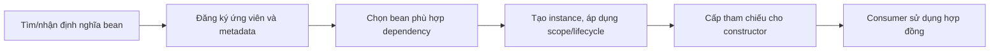

# Phân biệt annotation khám phá thành phần với thiết kế hợp đồng phụ thuộc

## 1. Hai câu hỏi khác nhau trong DI của framework

Khi mới dùng framework DI, ta thường thấy những dòng như `@Component`, `@Service` hoặc `@Repository` rồi nghĩ rằng “thêm annotation là đã thiết kế Dependency Injection đúng”. Thực tế, **khám phá thành phần** (*component discovery*) và **thiết kế hợp đồng phụ thuộc** (*dependency contract design*) giải quyết **hai bài toán khác nhau**:

- **Khám phá/đăng ký:** *Container biết lớp hoặc factory nào cần quản lý?* Ví dụ, một framework quét các package đã cấu hình, nhận diện class được đánh dấu `@Component`, rồi đăng ký định nghĩa bean.
- **Hợp đồng:** *Lớp nghiệp vụ thật sự cần khả năng gì, thuộc kiểu nào và được phép biết bao nhiêu về hạ tầng?* Ví dụ, `BookingService` cần một thao tác `BookingRepository.saveConfirmed(...)`, không cần biết JDBC, HTTP hay tên bean do framework đặt.

Từ đó mới có câu hỏi thứ ba: **lắp ghép** (*wiring*) — với các thành phần được đăng ký, container phải chọn instance nào để cấp cho tham số constructor tương ứng.

| Việc cần giải quyết | Câu hỏi | Ví dụ | Không tự bảo đảm điều gì? |
| --- | --- | --- | --- |
| **Component discovery** | Những class/factory nào được container nhìn thấy? | Phát hiện class có `@Service` hoặc `@Component`. | Không bảo đảm class chỉ có một trách nhiệm hay hợp đồng của nó tốt. |
| **Bean registration** | Container quản lý định nghĩa object nào? | Đăng ký repository qua scan hoặc phương thức `@Bean`. | Không bảo đảm consumer phụ thuộc abstraction thích hợp. |
| **Dependency resolution/wiring** | Cấp object nào cho constructor? | Cấp một bean `BookingRepository` cho `BookingService`. | Không bảo đảm lựa chọn phù hợp nghiệp vụ hay scope hợp lệ. |
| **Dependency contract design** | Consumer được phép biết và yêu cầu hành vi nào? | Port `BookingRepository` do application định nghĩa. | Không tự đăng ký implementation hoặc tạo object. |

Trong chương **DI trong framework** của module **DEPENDENCY_INJECTION**, ta tiếp nối việc học **Dependency Injection** và **Inversion of Control (IoC)**: tách *việc sử dụng phụ thuộc* khỏi *việc tạo và lắp ghép object*. Tư duy về **constructor injection, composition root, scope và vòng đời** vẫn giữ nguyên khi chuyển từ Java thuần sang DI container. Annotation chỉ là **một phương tiện cung cấp metadata/cấu hình** để framework tham gia vào quá trình đó.

> **Thông điệp chính:** Annotation giúp container *biết nên quản lý hoặc tiêm cái gì*; một hợp đồng tốt giúp nghiệp vụ *chỉ biết điều nó thực sự cần*. Đó là hai trục độc lập.

## 2. Một vài annotation thường gặp và phạm vi trách nhiệm

Các tên dưới đây minh họa theo **Spring Framework/Spring Boot**. Đây là ví dụ của **một hệ sinh thái**, không phải quy tắc chung cho mọi container Java. Một số framework dùng annotation khác, quy tắc phát hiện khác hoặc đăng ký tường minh mà không dùng component scanning.

| Annotation hoặc cơ chế | Vai trò khái quát trong Spring | Có thiết kế abstraction nghiệp vụ không? |
| --- | --- | --- |
| `@Component` | Đánh dấu class là ứng viên component khi nó nằm trong phạm vi quét phù hợp. | **Không.** Class có thể phụ thuộc lớp cụ thể hoặc interface. |
| `@Service` | Một dạng stereotype component, thường biểu thị vai trò service. | **Không.** Tên vai trò không bảo đảm Single Responsibility Principle. |
| `@Repository` | Stereotype cho lớp truy cập dữ liệu; một số cơ chế hỗ trợ xử lý ngoại lệ gắn với vai trò này. | **Không.** Không tự tạo hợp đồng repository theo nhu cầu use case. |
| `@Controller` / `@RestController` | Đánh dấu thành phần phía web/controller trong ngữ cảnh phù hợp. | **Không.** Không thay thế việc thiết kế ranh giới giữa controller và application. |
| `@ComponentScan` | Cấu hình phạm vi tìm ứng viên component. | **Không.** Quét nhiều package hơn không có nghĩa giảm coupling. |
| `@Configuration` và `@Bean` | Cho phép khai báo cấu hình và phương thức tạo bean tường minh. | **Không tự động.** Nhưng đây là nơi thích hợp để chọn implementation khi lắp ghép. |
| `@Autowired` | Diễn đạt điểm/nhu cầu injection trong Spring; một constructor duy nhất thường có thể được nhận diện không cần ghi annotation này. | **Không.** Constructor nhận sai kiểu vẫn là hợp đồng kém. |
| `@Qualifier` / `@Primary` | Giúp phân biệt ứng viên khi có nhiều bean cùng tương thích kiểu. | **Không.** Đây là cấu hình chọn bean, không phải ý nghĩa nghiệp vụ của một port. |
| `@Scope` / cấu hình lazy | Ảnh hưởng phạm vi và thời điểm khởi tạo theo cơ chế container. | **Không.** Chúng không làm một adapter có trạng thái tự an toàn luồng. |

Một chi tiết quan trọng về Java: **annotation không phải phép màu do ngôn ngữ tự thực hiện**. Java cho phép khai báo metadata; framework phải có cơ chế đọc, xử lý và xây dựng thành phần dựa trên metadata đó. Nếu chỉ dùng lệnh `javac`/`java` với một class có annotation mà không có container đang vận hành, annotation khám phá không tự tạo và inject repository.

Cũng không phải tất cả bean đều xuất phát từ component scan. Một bean có thể được đăng ký bởi `@Bean`, cấu hình của framework, module tích hợp hoặc API đăng ký tường minh. Vì vậy, không nên đồng nhất **“bean được quản lý”** với **“class có `@Component`”**.

## 3. Vì sao thêm `@Service` không giải quyết coupling?

Xét ví dụ mô tả một class nghiệp vụ:

```java
// Mã minh họa theo Spring; các kiểu hạ tầng là giả định.
@Service
public class BookingService {
    private final JdbcBookingRepository repository;

    public BookingService(JdbcBookingRepository repository) {
        this.repository = repository;
    }

    public void confirm(String bookingId) {
        repository.executeSql(
                "UPDATE bookings SET confirmed = true WHERE id = ?",
                bookingId);
    }
}
```

Nếu `JdbcBookingRepository` được Spring phát hiện, ứng dụng có thể **được inject thành công**. Nhưng service vẫn:

1. Biết **class hạ tầng cụ thể** `JdbcBookingRepository`.
2. Biết câu SQL và cấu trúc bảng nằm ngoài trách nhiệm chính của use case.
3. Có thể phải sửa khi chuyển sang adapter khác.
4. Khó kiểm tra bằng fake chỉ diễn đạt nhu cầu lưu xác nhận.

**Container hoạt động đúng không đồng nghĩa kiến trúc đã tách trách nhiệm tốt.** Framework chỉ giải quyết phần tạo/cấp object theo cấu hình; nó không tự nhận ra nghiệp vụ nên phụ thuộc vào một abstraction nhỏ thay vì chi tiết JDBC.

Một cách khác cũng chưa tốt:

```java
@Service
public class BookingService {
    private final BookingRepository repository;

    public BookingService(BookingRepository repository) {
        this.repository = repository;
    }

    // Vấn đề nếu BookingRepository vẫn phơi API kỹ thuật:
    public void confirm(String bookingId) {
        repository.executeSql(
                "UPDATE bookings SET confirmed = true WHERE id = ?",
                bookingId);
    }
}
```

Dù consumer đã phụ thuộc **interface**, interface `BookingRepository` ở đây vẫn có hành vi mang nghĩa “thực hiện SQL”. Chỉ chuyển `JdbcBookingRepository` thành interface hoặc đưa nó sang package khác **không bảo đảm** đã giảm coupling theo chiều nghiệp vụ.

Câu hỏi nên hỏi trước khi dùng annotation: “Use case muốn yêu cầu **điều gì** từ nơi lưu trữ?” Câu trả lời có thể là **`markConfirmed(bookingId)`**, không phải “chạy SQL”.

## 4. Hợp đồng nên phản ánh nhu cầu của consumer

Để thiết kế theo **Dependency Inversion Principle (DIP)**, ta có thể cho tầng application định nghĩa **outbound port**:

```java
public interface BookingRepository {
    void markConfirmed(String bookingId);
}
```

`BookingService` nhận port qua constructor:

```java
public final class BookingService {
    private final BookingRepository repository;

    public BookingService(BookingRepository repository) {
        this.repository = java.util.Objects.requireNonNull(
                repository, "repository");
    }

    public void confirm(String bookingId) {
        if (bookingId == null || bookingId.isBlank()) {
            throw new IllegalArgumentException("bookingId không hợp lệ");
        }
        repository.markConfirmed(bookingId);
    }
}
```

Adapter hạ tầng triển khai:

```java
// Minh họa ý tưởng; không phải implementation JDBC hoàn chỉnh.
public final class JdbcBookingRepository implements BookingRepository {
    // Nhận client/JDBC abstraction cần thiết từ bootstrap.
    // ... constructor và field ...

    @Override
    public void markConfirmed(String bookingId) {
        // Chuyển yêu cầu của application sang thao tác lưu trữ.
        // SQL, transaction và mapping lỗi được xử lý ở biên thích hợp.
    }
}
```

Những đoạn trên minh họa **ranh giới kiểu và trách nhiệm**, không phải một bộ tệp độc lập có thể biên dịch ngay như chương trình Java thuần ở mục 6.

### Ai sở hữu abstraction?

Nếu `BookingRepository` mô tả khả năng mà use case cần, ứng viên hợp lý là đặt nó ở **application** (hoặc domain nếu chính domain thật sự cần hợp đồng đó), không phải trong package chỉ chuyên JDBC.

```text
com.example.booking
├── domain
│   └── Booking.java
├── application
│   ├── port
│   │   └── out
│   │       └── BookingRepository.java
│   └── usecase
│       └── BookingService.java
├── infrastructure
│   └── persistence
│       └── JdbcBookingRepository.java
└── bootstrap
    └── ApplicationConfiguration.java
```

Chiều phụ thuộc mã nguồn mong muốn:

```mermaid
flowchart TD
    APP["application / BookingService"]
    PORT["application.port.out / BookingRepository"]
    INFRA["infrastructure / JdbcBookingRepository"]
    BOOT["bootstrap / cấu hình container"]
    APP -->|"sử dụng hợp đồng"| PORT
    INFRA -->|"implements"| PORT
    BOOT -. "chọn và đăng ký thành phần" .-> APP
    BOOT -. "chọn adapter"| INFRA
```

Trong runtime, `BookingService` vẫn **gọi phương thức trên adapter** thông qua interface. Nhưng phần mã của service **không cần import lớp hạ tầng**. Chính phần code cấu hình lắp ghép (composition root hoặc module cấu hình framework) được phép biết cả hai.

**Nơi đặt tệp không phải tiêu chí duy nhất.** Nếu interface ở `application.port.out` nhưng trả về `ResultSet`, nhận `EntityManager` hoặc ném `SQLException` như một phần hợp đồng buộc nghiệp vụ xử lý, chi tiết hạ tầng vẫn rò rỉ vào lõi. Cần xem cả tên method, kiểu tham số/trả về, quy ước lỗi và ngữ nghĩa hợp đồng.

### Có phải mọi class đều cần interface?

Không. Một value object thuần hoặc phép tính nội bộ đơn giản có thể được dùng trực tiếp. Interface hữu ích khi nó biểu diễn **ranh giới thay thế hoặc hợp đồng ổn định** mà consumer thật sự cần, không phải vì muốn mọi class có tiền tố `I` hay vì component scan đang dùng.

## 5. Khám phá thành phần, lựa chọn bean và constructor injection là các bước khác nhau

Một dòng thời gian đơn giản cho container:



Đây là **mô hình khái niệm**, không phải thứ tự triển khai bắt buộc của mọi framework. Một số bean được tạo lazy, một số có proxy, có bean được đăng ký tường minh không qua scan, và các bước có thể được container tổ chức theo cách khác.

Tách từng trách nhiệm giúp hiểu lỗi:

| Hiện tượng | Nhóm nguyên nhân có thể có | Bước kiểm tra |
| --- | --- | --- |
| Container không có bean `BookingRepository` | Adapter không được đăng ký hoặc ngoài vùng scan; thiếu `@Bean`/module cấu hình. | Kiểm tra phạm vi quét và cách đăng ký implementation. |
| Có nhiều bean tương thích `BookingRepository` | Không có quy tắc chọn duy nhất cho injection point. | Kiểm tra bean candidates, cấu hình chọn, qualifier/primary nếu phù hợp. |
| Đã tiêm thành công nhưng logic vẫn gắn chặt JDBC | Consumer hoặc contract biết chi tiết hạ tầng. | Refactor hợp đồng và hướng phụ thuộc; annotation không giải quyết. |
| Bean được tiêm nhưng yêu cầu đầu tiên mới lỗi | Lazy target, resource chưa kết nối, dependency ngoài bị lỗi. | Kiểm tra thời điểm tạo, readiness và xử lý lỗi runtime. |
| Một service singleton giữ dữ liệu của request trước | Chọn scope/lifetime sai; trạng thái mutable dùng chung. | Tách dữ liệu request khỏi field sống lâu hoặc dùng scope thích hợp. |

“Được container phát hiện” chỉ là **một tiền đề của việc lắp ghép**. Bước tiếp theo là chọn được implementation thỏa kiểu, scope và các điều kiện cấu hình. Sau khi wiring xong, vẫn phải kiểm tra chính sách nghiệp vụ và vận hành.

## 6. Ví dụ tự chạy bằng Java thuần: hợp đồng đúng trước framework

Để tránh phụ thuộc annotation, ta xây dựng cùng cấu trúc bằng **Java 11 trở lên** và composition root tường minh. Sau đó sẽ xem cách framework có thể thay thế **cơ chế lắp ghép** mà không thay đổi bản chất hợp đồng.

Lưu toàn bộ đoạn sau vào **`Main.java`**:

```java
import java.util.HashSet;
import java.util.Objects;
import java.util.Set;

public class Main {
    // Outbound port theo nhu cầu use case.
    interface BookingRepository {
        void markConfirmed(String bookingId);
    }

    interface BookingNotifier {
        void notifyConfirmed(String bookingId, String destination);
    }

    // Chính sách/use case không biết class triển khai.
    static final class BookingService {
        private final BookingRepository repository;
        private final BookingNotifier notifier;

        BookingService(BookingRepository repository, BookingNotifier notifier) {
            this.repository = Objects.requireNonNull(
                    repository, "repository");
            this.notifier = Objects.requireNonNull(
                    notifier, "notifier");
        }

        void confirm(String bookingId, String destination) {
            if (bookingId == null || bookingId.isBlank()) {
                throw new IllegalArgumentException(
                        "bookingId không hợp lệ");
            }
            if (destination == null || destination.isBlank()) {
                throw new IllegalArgumentException(
                        "destination không hợp lệ");
            }

            repository.markConfirmed(bookingId);
            notifier.notifyConfirmed(bookingId, destination);
        }
    }

    // Adapter chỉ biết cách lưu trong bộ nhớ ở ví dụ.
    static final class InMemoryBookingRepository
            implements BookingRepository {
        private final Set<String> confirmed = new HashSet<>();

        @Override
        public void markConfirmed(String bookingId) {
            confirmed.add(bookingId);
        }

        boolean isConfirmed(String bookingId) {
            return confirmed.contains(bookingId);
        }
    }

    // Adapter chỉ biết cách xuất thông báo ra console.
    static final class ConsoleBookingNotifier implements BookingNotifier {
        @Override
        public void notifyConfirmed(String bookingId, String destination) {
            System.out.println(
                    "Gửi xác nhận " + bookingId + " tới " + destination);
        }
    }

    // Composition root: nơi chọn và tạo các implementation.
    public static void main(String[] args) {
        InMemoryBookingRepository repository =
                new InMemoryBookingRepository();
        BookingNotifier notifier = new ConsoleBookingNotifier();

        BookingService service = new BookingService(repository, notifier);
        service.confirm("B-101", "khach@example.com");

        System.out.println("Đã lưu? " + repository.isConfirmed("B-101"));
    }
}
```

Biên dịch và chạy:

```bash
javac -encoding UTF-8 Main.java
java Main
```

Kết quả dự kiến:

```text
Gửi xác nhận B-101 tới khach@example.com
Đã lưu? true
```

Từ code này có thể tách ba câu hỏi:

1. **Hợp đồng nào ổn định?** `BookingService` chỉ cần `BookingRepository` và `BookingNotifier` với hai hành vi đặt tên theo use case.
2. **Implementation nào được cấp?** `InMemoryBookingRepository` và `ConsoleBookingNotifier`, do `Main.main()` quyết định.
3. **Container tham gia ở đâu nếu sau này cần?** Có thể thay phần tạo và kết nối đối tượng trong `main()` bằng cơ chế đăng ký/giải quyết bean của framework mà **không cần đưa SQL hoặc metadata framework vào use case**.

### Kiểm thử bằng fake, không cần component scan

Thêm class sau **ngoài class `Main`** vào cuối cùng tệp `Main.java`:

```java
class BookingServiceTest {
    static final class RecordingRepository
            implements Main.BookingRepository {
        String lastConfirmed;

        @Override
        public void markConfirmed(String bookingId) {
            lastConfirmed = bookingId;
        }
    }

    static final class RecordingNotifier implements Main.BookingNotifier {
        String lastBookingId;
        String lastDestination;
        int calls;

        @Override
        public void notifyConfirmed(String bookingId, String destination) {
            lastBookingId = bookingId;
            lastDestination = destination;
            calls++;
        }
    }

    public static void main(String[] args) {
        RecordingRepository repository = new RecordingRepository();
        RecordingNotifier notifier = new RecordingNotifier();

        Main.BookingService service =
                new Main.BookingService(repository, notifier);
        service.confirm("B-202", "test@example.com");

        if (!"B-202".equals(repository.lastConfirmed)) {
            throw new AssertionError("Repository nhận sai mã");
        }
        if (!"B-202".equals(notifier.lastBookingId)
                || !"test@example.com".equals(notifier.lastDestination)
                || notifier.calls != 1) {
            throw new AssertionError("Notifier nhận sai dữ liệu");
        }

        boolean rejected = false;
        try {
            service.confirm("", "test@example.com");
        } catch (IllegalArgumentException expected) {
            rejected = true;
        }
        if (!rejected) {
            throw new AssertionError("Phải từ chối bookingId rỗng");
        }

        System.out.println("PASS: hợp đồng và use case được kiểm thử độc lập");
    }
}
```

Chạy:

```bash
javac -encoding UTF-8 Main.java
java BookingServiceTest
```

Kết quả dự kiến:

```text
PASS: hợp đồng và use case được kiểm thử độc lập
```

Bài test không tải context, không quét annotation và không cần database. Điều này chứng minh **thiết kế hợp đồng đủ rõ để dựng fake và kiểm thử hành vi**. Nó **chưa chứng minh** container thật tìm đúng component, tiêm đúng bean, tạo đúng proxy/scope hoặc adapter production hoạt động.

> **Ghi chú phạm vi:** `HashSet` là bộ nhớ mẫu đơn luồng, không phải giải pháp lưu trữ production hoặc kho dữ liệu an toàn khi nhiều request cập nhật đồng thời. DI không tự mang lại thread safety, transaction hay độ bền dữ liệu.

## 7. Mang cùng thiết kế vào framework: hai cách đăng ký

Vẫn giữ nguyên ý nghĩa hai hợp đồng `BookingRepository` và `BookingNotifier`, ta có thể dùng framework để cấp instance. Hai ví dụ dưới đây là **mẫu minh họa Spring**: cần thư viện, cấu hình ứng dụng và các tệp/package thích hợp, **không phải** phần tiếp nối có thể dán trực tiếp vào `Main.java` của mục 6 để chạy bằng `javac` thuần.

### Cách A — Component scanning với stereotype

```java
// application.port.out.BookingRepository.java
public interface BookingRepository {
    void markConfirmed(String bookingId);
}

// application.usecase.BookingService.java
@org.springframework.stereotype.Service
public class BookingService {
    private final BookingRepository repository;

    public BookingService(BookingRepository repository) {
        this.repository = java.util.Objects.requireNonNull(repository);
    }

    public void confirm(String bookingId) {
        repository.markConfirmed(bookingId);
    }
}

// infrastructure.persistence.InMemoryBookingRepository.java
@org.springframework.stereotype.Repository
public class InMemoryBookingRepository implements BookingRepository {
    private final java.util.Set<String> confirmed =
            java.util.concurrent.ConcurrentHashMap.newKeySet();

    @Override
    public void markConfirmed(String bookingId) {
        confirmed.add(bookingId);
    }
}
```

Các khối trong chú thích là **các tệp riêng** của một dự án Spring, không phải ba kiểu `public` trong cùng một tệp Java.

Nếu container **được cấu hình quét** các package phù hợp, nó có thể phát hiện `BookingService` và `InMemoryBookingRepository`. Sau đó nó có thể giải quyết tham số `BookingRepository` trong constructor của service thành instance của adapter được đăng ký.

Tại sao **`BookingRepository` không có `@Component`**? Vì interface chỉ diễn đạt **hợp đồng**, không phải object cụ thể để framework khởi tạo bằng constructor thông thường. Container cần biết có **implementation hoặc factory tương ứng**. Việc đánh dấu một interface bằng annotation không tự làm xuất hiện một instance triển khai phù hợp.

**Lưu ý:** một constructor duy nhất thường không cần viết `@Autowired` trong cách dùng Spring thông dụng; đó là chi tiết tiện ích của framework. Dù có hay không `@Autowired`, thiết kế tốt vẫn đến từ **các tham số constructor bắt buộc và hợp đồng của chúng**.

### Cách B — Đăng ký tường minh bằng `@Bean`

Trong trường hợp muốn giữ cả service và adapter hoàn toàn không biết annotation framework, có thể để Java configuration chọn và lắp ghép:

```java
// Một mẫu cấu hình Spring minh họa, không dán vào Main.java thuần.
@org.springframework.context.annotation.Configuration
public class BookingConfiguration {

    @org.springframework.context.annotation.Bean
    BookingRepository bookingRepository() {
        return new InMemoryBookingRepository();
    }

    @org.springframework.context.annotation.Bean
    BookingNotifier bookingNotifier() {
        return new ConsoleBookingNotifier();
    }

    @org.springframework.context.annotation.Bean
    BookingService bookingService(
            BookingRepository repository,
            BookingNotifier notifier) {
        return new BookingService(repository, notifier);
    }
}
```

Trong cách B, giả định các class `BookingService`, `InMemoryBookingRepository` và `ConsoleBookingNotifier` **không đồng thời được đăng ký lại qua scanning**, trừ khi cấu hình cố ý quản lý nhiều bean. `@Bean` thể hiện trực tiếp composition root ở dạng cấu hình container: chỗ này biết lớp triển khai; consumer vẫn giữ dependency contract.

### So sánh hai cách

| Cách | Nguồn định nghĩa bean | Ưu điểm | Cần chú ý |
| --- | --- | --- | --- |
| **Scan + stereotype** | Annotation trên class và phạm vi quét | Tiện khi nhiều component, ít code registration. | Phụ thuộc phạm vi scan; có thể đăng ký quá nhiều/thiếu bean; module lõi có thể bị gắn annotation framework. |
| **`@Bean` tường minh** | Phương thức cấu hình tạo object | Wiring và lựa chọn implementation có vị trí rõ, hỗ trợ giữ core thuần Java. | Cần duy trì cấu hình; tránh đăng ký trùng với scan. |
| **DI thủ công** | `new` và constructor trong `main()` | Không cần container; cơ chế rõ ràng, dễ học và kiểm thử. | Khi graph, scope/lifecycle phức tạp sẽ tốn công quản lý. |

**Không có một cách đăng ký phù hợp tuyệt đối.** Quan trọng là đừng để cơ chế đăng ký quyết định ngược lại việc thiết kế hợp đồng nghiệp vụ.

## 8. Nhiều implementation: cấu hình chọn bean khác với chính sách nghiệp vụ

Giả sử có hai implementation:

```java
@Repository
class JdbcBookingRepository implements BookingRepository { /* ... */ }

@Repository
class InMemoryBookingRepository implements BookingRepository { /* ... */ }
```

Đoạn trên chỉ **minh họa các class ứng viên**, không phải tệp Java hoàn chỉnh. Nếu cả hai được đăng ký và có một injection point yêu cầu một `BookingRepository`, container cần biết **chọn cái nào**. Việc có interface **không tự phân xử** hai implementation.

Trong Spring, có thể dùng `@Qualifier`, `@Primary`, profile/conditional registration hoặc một cấu hình `@Bean` chọn triển khai tùy thiết kế. Nhưng đây là **quyết định lắp ghép**; nó không thay thế hợp đồng `markConfirmed`.

### Tránh để annotation lựa chọn làm rò rỉ hạ tầng vào ứng dụng

Ví dụ:

```java
@Service
class BookingService {
    BookingService(
        @Qualifier("jdbcBookingRepository") BookingRepository repository) {
        // ...
    }
}
```

Đây không nhất thiết là lỗi trong mọi hệ thống, nhưng tên bean `jdbcBookingRepository` đã đưa **quyết định chọn công nghệ** vào chữ ký consumer. Nếu mục tiêu là ứng dụng không biết triển khai, nên chuyển quyết định lựa chọn vào cấu hình/wiring ở biên.

Trong một dự án nhỏ, dùng `@Qualifier` ở vị trí phù hợp có thể đơn giản và minh bạch. Khi cân nhắc, hãy hỏi: “Nếu đổi repository từ JDBC sang adapter API, class nào cần sửa?” Nếu bắt buộc sửa service chỉ vì tên bean, coupling về cấu hình đã lan vào nghiệp vụ.

### Khi lựa chọn thay đổi theo từng request

Một trường hợp khác là mỗi request cần chiến lược khác nhau, ví dụ email hay SMS. Lúc này không nên chỉ chọn một bean cố định khi ứng dụng khởi động rồi mong container tự đổi theo `request.channel`. Có thể inject một **selector/factory có hợp đồng hẹp** nhận dữ liệu request và trả về một strategy đã đăng ký.

Đây là **chính sách lựa chọn runtime của ứng dụng**, khác với **bean discovery** và khác với `@Primary` dùng để chọn ứng viên mặc định ở injection point.

## 9. Scan không phải “ranh giới kiến trúc”

Một hệ thống có thể khai báo:

```java
@ComponentScan("com.example")
```

Container được phép tìm component trong phạm vi đã cấu hình. Điều đó **không kiểm tra được** những quy tắc như:

- Package `application` có import `infrastructure` hay không?
- `BookingService` có giữ đúng một trách nhiệm nghiệp vụ hay chứa cả SQL, HTTP và UI formatting?
- `BookingRepository` có phương thức mang ý nghĩa use case hay chỉ sao chép API của ORM?
- Có vòng phụ thuộc giữa các module không?
- Dữ liệu theo request có bị giữ trong singleton không?

Annotation khám phá thành phần và dependency graph ở **mức container** khác với dependency graph ở **mức mã nguồn**. Dù container có lắp thành công, hướng phụ thuộc mã nguồn vẫn có thể sai.

### Không để component scanning lan tùy tiện qua mọi module

Trong hệ thống lớn, quét rộng có thể vô tình đăng ký các implementation dành cho thử nghiệm, nhiều bean cùng kiểu hoặc những class không nên được khởi tạo tại môi trường hiện tại. Quét quá hẹp thì class có annotation vẫn **không được phát hiện**.

Vì vậy, thiết kế package/module và phạm vi scan là **quyết định cấu hình**, không phải thuộc tính tự có của annotation. Một component hợp lệ nhưng nằm ngoài scan path vẫn có thể không thành bean.

Khi muốn kiểm soát rõ sự lắp ghép giữa module, có thể dùng cấu hình tường minh hoặc các cơ chế registration có chủ đích, thay vì dựa vào kỳ vọng “mọi `@Component` sẽ được tìm thấy”.

## 10. Constructor, scope và lifecycle vẫn phải được thiết kế đúng

Container có thể tạo object giúp lập trình viên, nhưng không thể tự suy ra mọi bất biến ứng dụng.

### Dependency bắt buộc

Constructor nên thể hiện những collaborator bắt buộc:

```java
BookingService(
    BookingRepository repository,
    BookingNotifier notifier)
```

Việc container cung cấp instance không thay thế kiểm tra `null`, hợp đồng dữ liệu hoặc điều kiện nghiệp vụ trong trường hợp cần kiểm tra. Một setter có annotation injection vẫn có thể che trạng thái thiếu dependency nếu class được sử dụng ngoài container hoặc cấu hình không bảo đảm setter đã được gọi trước khi sử dụng.

### Scope không được suy ra từ stereotype

Không nên hiểu `@Service` là “class tự an toàn khi dùng chung” hoặc `@Repository` là “tự quản lý giao dịch”. Scope và lifecycle được quyết định bởi framework, cấu hình và cách tạo object. Nếu một instance được chia sẻ nhiều request, trạng thái mutable bên trong phải phù hợp với truy cập đồng thời.

```java
@Service
class UnsafeBookingService {
    private String currentCustomer; // Trạng thái theo request giữ ở field.

    void confirm(String customer) {
        currentCustomer = customer;
        // Hai request có thể ghi đè trước khi xử lý xong.
    }
}
```

Dù class có `@Service` và được quản lý bởi container, trạng thái `currentCustomer` như vậy vẫn có thể gây race khi nhiều request dùng chung instance. Nên truyền dữ liệu theo request qua **tham số phương thức** hoặc tổ chức scope phù hợp.

### Proxy và thời điểm khởi tạo

Container đôi khi inject **proxy** thay vì target thật, ví dụ để hỗ trợ scope, lazy hoặc AOP. Constructor consumer nhận một tham chiếu khác `null` không chứng minh target đã được tạo hoặc backend đã kết nối thành công.

Với cơ chế proxy-based interception, một lời gọi nội bộ từ target qua `this.method()` có thể không đi qua proxy, khiến hành vi như transaction/security advice không áp dụng theo cách người viết kỳ vọng. Những giới hạn này phụ thuộc công nghệ; annotation khám phá không tự định nghĩa hành vi AOP.

### Quyền sở hữu tài nguyên

Nếu adapter giữ connection pool, HTTP client hoặc thread pool, cần xác định ai tạo, ai sở hữu và ai đóng. Một số container hỗ trợ lifecycle callback, nhưng **factory/constructor mở tài nguyên rồi thất bại trước khi bàn giao** vẫn cần dọn tài nguyên nội bộ phù hợp. Đừng cho consumer nghiệp vụ đóng một dependency dùng chung chỉ vì nó được inject vào field.

## 11. Tách unit test hợp đồng khỏi test container

**Unit test Java thuần** ở mục 6 trả lời:

- Khi cấp fake `BookingRepository`, service có gọi đúng `markConfirmed` không?
- Khi input rỗng, service có từ chối trước khi ghi dữ liệu không?
- Service có thể hoạt động không cần quét annotation hoặc khởi động ứng dụng hoàn chỉnh không?

Nhưng những điều sau cần **kiểm thử tích hợp với framework/cấu hình thật** khi chúng quan trọng:

| Mục tiêu | Loại kiểm thử phù hợp | Vì sao |
| --- | --- | --- |
| `BookingService` áp dụng quy tắc xác nhận đúng | Unit test với fake Java thuần. | Không phụ thuộc cơ chế tạo bean. |
| Không có bean bị thiếu do sai scan path | Context/bootstrap test. | Cần chạy cơ chế registration thật. |
| Nhiều implementation được chọn đúng profile | Configuration/container test. | Phụ thuộc điều kiện và registration thực tế. |
| Injection theo qualifier/primary đúng | Container wiring test. | Giải quyết ứng viên là trách nhiệm container. |
| Transaction/security advice được gọi | Integration test qua proxy/interceptor thật. | Unit test trực tiếp `new` bỏ qua hành vi proxy. |
| Resource target được đóng đúng scope | Lifecycle/integration test. | Phụ thuộc scope/callback và owner thực tế. |
| Database hoặc API thật hoạt động | Adapter/integration test có hạ tầng kiểm soát. | Fake không chứng minh tính đúng đắn của adapter thật. |

Không nên bắt buộc mọi unit test khởi động toàn bộ container nếu muốn kiểm tra một hàm nghiệp vụ đơn giản. Ngược lại, không nên lấy kết quả unit test qua fake làm bằng chứng rằng scanning, profile, bean ambiguity hoặc proxy của framework đều đúng.

## 12. Quy trình chuyển từ DI thủ công sang DI framework mà không mất ranh giới

1. **Viết use case Java thuần trước.** Định nghĩa hành vi nghiệp vụ và các collaborator mà use case thật sự cần.
2. **Thiết kế abstraction theo nhu cầu consumer.** Ưu tiên method mang nghĩa nghiệp vụ, kiểu dữ liệu phù hợp và hợp đồng lỗi rõ ràng.
3. **Tạo adapter hạ tầng riêng.** Adapter biết SQL/HTTP/SDK cụ thể; consumer không biết.
4. **Lắp ghép thủ công một lần.** Tạo adapter và cấp qua constructor tại `main()`; dùng fake xác minh service độc lập.
5. **Chọn cơ chế registration khi cần framework.** Có thể dùng scan/stereotype hoặc `@Bean`, tránh đăng ký trùng ngoài ý muốn.
6. **Rà soát candidate resolution.** Mỗi injection point có implementation phù hợp chưa? Nếu nhiều bean, quyết định cấu hình ở nơi nào?
7. **Rà soát scope và vòng đời.** Instance nào được chia sẻ; resource nào cần đóng; dữ liệu request có bị giữ sai phạm vi không?
8. **Kiểm tra cơ chế framework bằng integration test.** Đúng scan path, bean wiring, profile, proxy/lazy, lifecycle và lỗi bootstrap.
9. **Giữ quyền thay implementation.** Thử đổi adapter tại cấu hình; nếu phải sửa chính sách nghiệp vụ vì đổi tên bean hoặc API SQL, xem lại ranh giới.
10. **Không thêm abstraction vì hình thức.** Nếu một class không cần interface vì không có ranh giới rõ, không ép tạo chỉ để dễ scan.

Khi codebase phát triển, tiêu chí không phải **đếm bao nhiêu class có annotation**, mà là khả năng giải thích rõ: **service cần gì, ai sở hữu hợp đồng, ai chọn implementation, ai quản lý vòng đời, và thay đổi hạ tầng ảnh hưởng đến đâu**.

## 13. Bảng lỗi thường gặp

| Nhận định hoặc cách làm | Vấn đề | Hướng xử lý |
| --- | --- | --- |
| “Thêm `@Service` là có thiết kế DI tốt.” | Stеreotype không quyết định ranh giới phụ thuộc. | Đánh giá constructor, hợp đồng và hướng coupling. |
| “Interface có `@Component` thì container tự tạo implementation.” | Interface không tự cung cấp một object triển khai có thể khởi tạo theo cách thông thường. | Đăng ký adapter/factory thực tế. |
| “`@Autowired` trên field là đủ thay constructor injection.” | Dependency bị giấu khỏi constructor, khó tạo class bằng Java thuần. | Ưu tiên constructor injection cho dependency bắt buộc. |
| “Có interface thì nghiệp vụ đã độc lập công nghệ.” | Interface vẫn có thể lộ SQL, HTTP, ORM hoặc SDK. | Thiết kế port theo ngôn ngữ use case. |
| “Quét toàn bộ package chắc chắn tốt hơn.” | Đăng ký nhầm component, trùng bean, khó kiểm soát startup. | Giới hạn phạm vi scan/registration có chủ đích. |
| “Không inject được bean nghĩa là interface cần đổi.” | Có thể chỉ thiếu registration hoặc sai scan path. | Debug cấu hình container trước khi sửa contract. |
| “Có hai implementation thì framework luôn tự chọn đúng.” | Injection point có thể mơ hồ hoặc lựa chọn sai ý định. | Chỉ rõ selection tại wiring/configuration. |
| “Đặt `@Qualifier` tên JDBC trong mọi service là vô hại.” | Quyết định công nghệ lan sang consumer. | Nếu cần tách kiến trúc, chọn bean ở composition root/config. |
| “`@Repository` tự làm mọi transaction và exception đúng.” | Chính sách giao dịch/lỗi phụ thuộc framework và cấu hình cụ thể. | Thiết kế contract lỗi, transaction boundary và test thực tế. |
| “`@Service` dùng chung thì mọi field của nó thread-safe.” | Mutable state theo request có thể race. | Tránh lưu request data trong singleton; kiểm tra scope. |
| “Bean khởi tạo xong nghĩa là backend luôn sẵn sàng.” | Client có thể kết nối lazy hoặc hỏng về sau. | Readiness/health và xử lý lỗi runtime. |
| “Unit test qua fake chứng minh component scan đúng.” | Test không chạy container. | Thêm test riêng cho wiring/configuration. |

## 14. Bài tập và gợi ý đối chiếu

### Bài 1 — Chỉ ra hai vấn đề độc lập

Xét:

```java
@Service
public class PaymentService {
    private final StripeSdkClient client;

    public PaymentService(StripeSdkClient client) {
        this.client = client;
    }

    public void charge(String orderId) {
        client.sendChargeRequest(orderId);
    }
}
```

Giả định `StripeSdkClient` là lớp của thư viện/hạ tầng bên ngoài. Hãy trả lời: vì sao container có thể inject thành công mà nghiệp vụ vẫn coupling với SDK? Hợp đồng `PaymentGateway` nên mô tả hành vi gì và đặt ở đâu?

### Bài 2 — Annotation nào làm gì?

Phân loại `@Service`, `@Repository`, `@Autowired`, `@Bean`, `@Qualifier` và một interface `BookingRepository` theo ba khía cạnh: **khám phá/đăng ký**, **lắp ghép/chọn bean**, **thiết kế hợp đồng**. Cái nào là annotation? Cái nào chỉ là kiểu Java do ứng dụng định nghĩa?

### Bài 3 — Thêm implementation thứ hai

Bạn có `InMemoryBookingRepository` và `JdbcBookingRepository` đều triển khai `BookingRepository`. Tại sao việc cả hai cùng được phát hiện có thể gây lỗi khi tiêm một `BookingRepository`? Hãy đề xuất cách chọn implementation cho profile dev và production mà không buộc `BookingService` import JDBC.

### Bài 4 — Giữ core thuần Java

Từ chương trình ở mục 6, hãy phác thảo một `@Configuration` với ba phương thức `@Bean` tạo repository, notifier và service. Kiểm tra rằng interface và constructor của `BookingService` không cần thêm annotation framework. Thảo luận mặt lợi và chi phí bảo trì của cấu hình tường minh so với scanning.

### Bài 5 — Chọn loại test

Hãy xếp các kiểm tra sau vào nhóm unit test Java thuần hay integration test với container:

- Từ chối `bookingId` rỗng.
- Gọi repository đúng mã.
- Phát hiện thiếu implementation vì package ngoài scan path.
- Chọn đúng bean khi hai repository cùng tồn tại.
- Transaction proxy có hiệu lực với lời gọi từ controller.
- Đóng connection pool khi application context kết thúc.

### Bài 6 — Phân tích scope

Một `@Service` được cấu hình dùng chung giữ field `currentBookingId` và cập nhật nó khi mỗi request vào. Vì sao annotation không giải quyết race condition? Hãy sửa thiết kế bằng cách đưa dữ liệu của request vào phương thức, hoặc nêu khi nào request scope thật sự cần thiết.

### Gợi ý đối chiếu

- **Bài 1:** SDK là chi tiết hạ tầng; `PaymentService` nên yêu cầu hợp đồng như `PaymentGateway.charge(PaymentCommand)` có ngữ nghĩa nghiệp vụ. Adapter Stripe thực thi hợp đồng; composition root/container chọn adapter.
- **Bài 2:** `@Service`/`@Repository` giúp đánh dấu ứng viên quét; `@Bean` đăng ký từ factory; `@Autowired` mô tả điểm injection; `@Qualifier` trợ giúp lựa chọn; `BookingRepository` là hợp đồng Java do ứng dụng thiết kế, không tự thành bean.
- **Bài 3:** nhiều bean tương thích kiểu có thể gây lựa chọn mơ hồ. Chọn theo profile/conditional config hoặc đăng ký tường minh ở biên lắp ghép; giữ nguyên `BookingService(BookingRepository)`.
- **Bài 4:** cấu hình `@Bean` có thể giữ lõi độc lập framework và thể hiện lựa chọn adapter ở một nơi, đổi lại cần duy trì wiring rõ ràng; không đăng ký lại cùng object một cách ngoài ý muốn.
- **Bài 5:** hai kiểm tra đầu là unit test. Scan, lựa chọn bean, transaction proxy và lifecycle cần integration test với cơ chế thật.
- **Bài 6:** service dùng chung có field thay đổi theo request dễ trộn trạng thái khi nhiều luồng; dùng tham số method hoặc thành phần scope phù hợp, đừng suy thread safety từ `@Service`.

**Ghi nhớ:** component discovery là cách container **tìm và đăng ký ứng viên**; dependency contract là cách ứng dụng **định nghĩa khả năng cần dùng, chiều phụ thuộc và ranh giới trách nhiệm**. Annotation không thể thay thế thiết kế abstraction. Hãy xây dựng constructor và hợp đồng rõ ràng bằng Java thuần, đặt quyền chọn implementation tại composition root/cấu hình, rồi tận dụng framework để tự động hóa việc lắp ghép, scope và lifecycle theo đúng nhu cầu.
