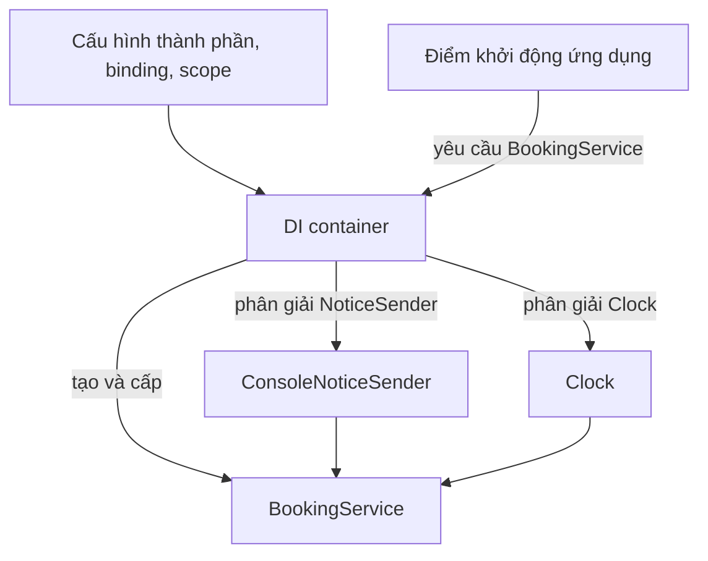

# Jakarta CDI và Guice như các ví dụ về mô hình container

Trong Java thuần, ta có thể viết một **composition root** dùng lệnh `new` để tạo repository, client, service rồi truyền chúng qua constructor. Cách này làm rõ một nguyên tắc quan trọng của **Dependency Injection (DI)**: lớp sử dụng phụ thuộc không cần quyết định phụ thuộc ấy được tạo và lắp ghép như thế nào.

Khi ứng dụng lớn hơn, số lượng thành phần, biến thể triển khai và phạm vi vòng đời tăng lên. Một **DI container** có thể thực hiện phần việc lắp ghép dựa trên quy tắc khai báo: tìm thành phần cần cấp, chọn triển khai, tạo đối tượng theo scope rồi cung cấp đối tượng cho nơi yêu cầu. **Jakarta Contexts and Dependency Injection (CDI)** và **Google Guice** là hai ví dụ hữu ích để hiểu mô hình này.

Bài học thuộc chương **DI trong framework** của module **DEPENDENCY_INJECTION**. Ta sẽ đi từ **constructor injection và composition root trong Java thuần**, sau đó đối chiếu cách Jakarta CDI và Guice tổ chức đăng ký, phân giải phụ thuộc, scope, vòng đời, cấu hình và kiểm thử. Mục tiêu là nắm mô hình chung trước khi phụ thuộc vào một API container cụ thể.

> Các ví dụ CDI và Guice cần thư viện API cùng runtime tương ứng trên classpath; chỉ ví dụ **Java thuần** chạy với JDK mà không cần thư viện ngoài. Cú pháp bootstrap và cách đưa thư viện vào dự án phụ thuộc phiên bản/runtime, vì vậy bài tập trung vào những khái niệm ổn định và không ấn định phiên bản thư viện.

## 1. Container tiếp quản phần việc nào?

Giả sử `BookingService` cần `NoticeSender` và `Clock`. Ở cách lắp ghép thủ công:

```java
NoticeSender sender = new ConsoleNoticeSender();
Clock clock = Clock.systemUTC();
BookingService service = new BookingService(sender, clock);
```

`BookingService` vẫn chỉ nhận phụ thuộc qua constructor. Nếu sử dụng container, ta khai báo các thành phần và quy tắc chọn, rồi yêu cầu container cấp `BookingService`. Container sẽ tạo hoặc lấy `NoticeSender` và `Clock` phù hợp trước khi hoàn thành việc tạo service.



Container giúp tự động hóa những việc trước đây có thể nằm trong composition root:

1. **Phát hiện/đăng ký thành phần:** biết có những bean hoặc binding nào.
2. **Phân giải:** xác định một điểm tiêm cần thành phần nào, có thiếu hoặc mơ hồ không.
3. **Khởi tạo/lắp ghép:** tạo instance hoặc lấy instance đang được quản lý, rồi tiêm qua constructor, field hoặc method theo khả năng của framework.
4. **Quản lý scope:** quyết định instance được dùng lại trong phạm vi nào.
5. **Quản lý vòng đời:** với những loại tài nguyên và scope được hỗ trợ, gọi callback khởi tạo/hủy hoặc nhờ ứng dụng phối hợp cleanup.

Container **không thay thế thiết kế hợp đồng phụ thuộc**. Nếu một service tự gọi `new JdbcRepository()`, tự đọc biến môi trường hoặc lấy singleton từ registry toàn cục, những phụ thuộc đó vẫn bị ràng buộc vào service dù ứng dụng có container.

### 1.1. Phân biệt DI với IoC

**Dependency Injection** là cách cung cấp phụ thuộc từ bên ngoài cho đối tượng sử dụng. **Inversion of Control (IoC)** là nguyên tắc rộng hơn: phần kiểm soát việc tạo và lắp ghép được đưa ra khỏi nghiệp vụ. Trong ví dụ container, container phối hợp tạo đồ thị theo cấu hình của ứng dụng; `BookingService` vẫn chịu trách nhiệm xác nhận booking và gửi yêu cầu thông báo.

Vì vậy **DI không yêu cầu container**. Container là một cơ chế tự động hóa DI, không phải điều kiện để constructor injection, tính dễ kiểm thử hoặc phân tách trách nhiệm xuất hiện.

## 2. Nền tảng Java thuần trước khi dùng container

Để nhìn rõ phần nào được container thay thế, hãy bắt đầu từ một chương trình hoàn chỉnh với cùng hợp đồng phụ thuộc. Tạo tệp `ManualBookingExample.java` (JDK 11 trở lên):

```java
import java.time.Clock;
import java.time.Instant;
import java.time.ZoneOffset;
import java.util.ArrayList;
import java.util.List;
import java.util.Objects;

public final class ManualBookingExample {
    public interface NoticeSender {
        void send(String message);
    }

    public static final class BookingService {
        private final NoticeSender sender;
        private final Clock clock;

        public BookingService(NoticeSender sender, Clock clock) {
            this.sender = Objects.requireNonNull(sender, "sender");
            this.clock = Objects.requireNonNull(clock, "clock");
        }

        public void confirm(String bookingId) {
            if (bookingId == null || bookingId.trim().isEmpty()) {
                throw new IllegalArgumentException("bookingId is required");
            }
            sender.send("confirmed:" + bookingId + "@" + clock.instant());
        }
    }

    public static final class RecordingSender implements NoticeSender {
        private final List<String> messages = new ArrayList<>();

        @Override
        public void send(String message) {
            messages.add(message);
        }

        public List<String> messages() {
            return List.copyOf(messages);
        }
    }

    public static void main(String[] args) {
        // Composition root: ứng dụng quyết định triển khai và scope.
        RecordingSender sender = new RecordingSender();
        Clock clock = Clock.fixed(
            Instant.parse("2026-01-10T10:15:30Z"), ZoneOffset.UTC);

        BookingService service = new BookingService(sender, clock);
        service.confirm("BK-001");
        System.out.println(sender.messages());
    }
}
```

Chạy:

```bash
javac ManualBookingExample.java
java ManualBookingExample
```

Kết quả:

```text
[confirmed:BK-001@2026-01-10T10:15:30Z]
```

Trong cách này, `main()` là composition root. Nó chọn `RecordingSender`, cấp đồng hồ cố định và tạo một `BookingService`. Không có container nhưng **đã có DI**: các cộng tác viên được truyền từ bên ngoài. Hai trường `final` giữ tham chiếu ổn định sau khi tạo service, còn `Objects.requireNonNull` làm lỗi thiếu phụ thuộc lộ ngay tại chỗ lắp ghép.

Việc chuyển sang CDI hoặc Guice nên chủ yếu thay đổi **cách tạo và cấp những cộng tác viên**. Hợp đồng `NoticeSender` và trách nhiệm của `BookingService` vẫn có thể giữ nguyên.

## 3. Jakarta CDI: bean, injection point và context

**Jakarta CDI** là một *đặc tả* cho mô hình bean, injection, qualifier, context và vòng đời. Các runtime tương thích triển khai đặc tả đó; CDI có thể dùng trong môi trường Jakarta EE hoặc một môi trường Java SE được trang bị triển khai CDI phù hợp. Điểm nhấn của CDI là **các bean được quản lý theo context** và việc phân giải bean dựa trên kiểu cùng qualifier.

Những khái niệm quan trọng:

| Khái niệm CDI | Mục đích |
| --- | --- |
| **Bean** | Thành phần do CDI nhận biết và có thể quản lý/cấp cho điểm tiêm |
| **Injection point** | Nơi khai báo cần bean, ví dụ tham số constructor có `@Inject` |
| **Bean type** | Các kiểu có thể dùng để phân giải bean |
| **Qualifier** | Nhãn phân biệt các bean cùng kiểu khi cần chọn cụ thể |
| **Scope/context** | Quy định phạm vi sở hữu instance và cách instance được dùng theo ngữ cảnh |
| **Producer** | Phương thức/field cung cấp đối tượng cần tạo theo quy tắc riêng |
| **Lifecycle callback** | Các hook được hỗ trợ để khởi tạo/hủy bean đúng giai đoạn |

Một điểm tiêm `@Inject NoticeSender sender` chưa đủ khi có nhiều bean `NoticeSender` cùng đủ điều kiện; CDI phải phân giải bean dựa trên **kiểu và qualifier**. Khi không có bean phù hợp là **unsatisfied dependency**; khi có nhiều bean phù hợp mà chưa phân giải được là **ambiguous dependency**. Những tình huống này cần được sửa bằng cấu hình/qualifier rõ ràng, không chọn “bean xuất hiện đầu tiên”.

### 3.1. Ví dụ CDI SE với constructor injection

Đoạn minh họa dưới đây có một bean gửi thông báo, một bean nghiệp vụ và một producer tạo `Clock`. API nằm trong namespace **`jakarta.*`**. Muốn chạy, dự án phải cung cấp Jakarta CDI API và **một CDI runtime hỗ trợ Java SE**.

```java
import java.time.Clock;
import java.util.Objects;
import jakarta.enterprise.context.ApplicationScoped;
import jakarta.enterprise.context.Dependent;
import jakarta.enterprise.inject.Produces;
import jakarta.enterprise.inject.se.SeContainer;
import jakarta.enterprise.inject.se.SeContainerInitializer;
import jakarta.inject.Inject;

public class CdiBookingDemo {
    public interface NoticeSender {
        void send(String message);
    }

    @ApplicationScoped
    public static class ConsoleNoticeSender implements NoticeSender {
        @Override
        public void send(String message) {
            System.out.println(message);
        }
    }

    @Dependent
    public static class BookingService {
        private final NoticeSender sender;
        private final Clock clock;

        @Inject
        public BookingService(NoticeSender sender, Clock clock) {
            this.sender = Objects.requireNonNull(sender);
            this.clock = Objects.requireNonNull(clock);
        }

        public void confirm(String bookingId) {
            sender.send("confirmed:" + bookingId + "@" + clock.instant());
        }
    }

    @Dependent
    public static class ClockProducer {
        @Produces
        public Clock clock() {
            return Clock.systemUTC();
        }
    }

    public static void main(String[] args) {
        try (SeContainer container = SeContainerInitializer.newInstance()
                .addBeanClasses(
                    ConsoleNoticeSender.class,
                    BookingService.class,
                    ClockProducer.class)
                .initialize()) {
            BookingService service =
                container.select(BookingService.class).get();
            service.confirm("BK-CDI");
        }
    }
}
```

`SeContainerInitializer` khởi động một container CDI cho môi trường Java SE và trong ví dụ chỉ rõ những lớp cần đưa vào. Sau khi runtime phân giải `BookingService`, nó cấp bean phù hợp cho `NoticeSender` và `Clock`. `ClockProducer` minh họa cách tạo một dependency không có constructor mặc định thích hợp để container tự dựng theo cách thông thường.

Lệnh `try-with-resources` đóng **container**, cho phép runtime kết thúc các context và bean thuộc phạm vi mà nó quản lý. **Không suy ra** rằng mọi object do ứng dụng tự tạo rồi truyền vào container sẽ tự động được runtime đóng. Quy tắc sở hữu phụ thuộc vào cách đối tượng được khai báo/cấp cho CDI.

Đối với dự án thực tế, cần cấu hình cơ chế khám phá bean và dependency triển khai CDI phù hợp. Ví dụ dùng `addBeanClasses(...)` để chủ động chỉ rõ các lớp tham gia, giúp minh họa mối quan hệ giữa **đăng ký**, **phân giải** và **lắp ghép**.

### 3.2. Scope: `@Dependent` và `@ApplicationScoped`

Trong ví dụ:

- `ConsoleNoticeSender` có `@ApplicationScoped`: instance ngữ cảnh được dùng trong phạm vi application context đang hoạt động. CDI có thể cấp **client proxy** tại injection point đối với normal-scoped bean; tham chiếu được tiêm không nhất thiết chính là object nghiệp vụ bên dưới.
- `BookingService` có `@Dependent`: bean thuộc phạm vi dependent và vòng đời gắn với đối tượng/context sở hữu theo quy tắc CDI. Nó không phải application singleton.
- `Clock` do producer trả về không có scope riêng được khai báo, nên có quy tắc scope mặc định tương ứng với producer bean theo đặc tả.

Không nên hiểu `@ApplicationScoped` là “duy nhất một object cho mọi JVM” hay `@Dependent` là “luôn `new` ở từng lời gọi phương thức”. Scope quy định **khi container tạo và tái sử dụng contextual instance**, và đối tượng có thể được biểu diễn qua proxy.

Khi cần tài nguyên sống đúng một request, session hoặc transaction, phải chọn scope phù hợp với runtime và ngữ cảnh đang hoạt động; một application-scoped service giữ trực tiếp dữ liệu mutable của request có thể gây rò trạng thái.

### 3.3. Nhiều bean cùng interface: dùng qualifier

Nếu ta thêm `EmailNoticeSender` bên cạnh `ConsoleNoticeSender` và cả hai đều đủ điều kiện cho `NoticeSender`, điểm tiêm mặc định có thể trở nên mơ hồ. CDI hỗ trợ **qualifier annotation**:

```java
import jakarta.inject.Qualifier;
import java.lang.annotation.Retention;
import java.lang.annotation.Target;
import static java.lang.annotation.ElementType.*;
import static java.lang.annotation.RetentionPolicy.RUNTIME;

@Qualifier
@Retention(RUNTIME)
@Target({TYPE, FIELD, METHOD, PARAMETER})
@interface ExternalNotice {}

// Trên implementation được chọn:
// @ExternalNotice
// @ApplicationScoped
// class EmailNoticeSender implements NoticeSender { ... }

// Tại điểm tiêm cần đúng implementation có qualifier:
// @Inject
// BookingService(@ExternalNotice NoticeSender sender, Clock clock) { ... }
```

Đoạn này chỉ minh họa cách gắn qualifier, chưa phải một tệp độc lập có thể biên dịch. **Qualifier xác định ý nghĩa lựa chọn**, không phải công cụ bảo đảm bean được tạo mới hay có scope nào. Nếu một injection point có qualifier mà không có bean phù hợp, CDI vẫn báo thiếu bean.

## 4. Guice: Injector, module và binding

**Google Guice** là một thư viện DI cụ thể cho Java. Guice dùng **`Injector`** để phân giải yêu cầu, kết hợp các **binding** từ `Module`, và hỗ trợ constructor injection, provider, qualifier/binding annotation cùng scope. Khác CDI là đặc tả có nhiều runtime triển khai, Guice chính là framework/container cụ thể.

Các khái niệm chính:

| Khái niệm Guice | Mục đích |
| --- | --- |
| **`Injector`** | Điểm truy xuất và điều phối tạo đối tượng theo cấu hình binding |
| **`Module`** | Tập hợp các quy tắc binding do ứng dụng cung cấp |
| **`bind(A).to(B)`** | Khi cần `A`, sử dụng triển khai `B` theo quy tắc đã cấu hình |
| **`toInstance(...)`** | Cấp một instance đã tạo sẵn |
| **Provider/`@Provides`** | Cấp đối tượng thông qua hàm tạo phức tạp hoặc tham số runtime |
| **Scope** | Quy định cách tái sử dụng instance do Guice quản lý |
| **Binding annotation** | Phân biệt các dependency cùng kiểu |

### 4.1. Ví dụ Guice với module đăng ký

Ví dụ sau dùng các lớp nested, `@Inject` của Guice và một module khai báo binding cho `NoticeSender` và `Clock`. Dự án cần thư viện **Google Guice** trên classpath để biên dịch/chạy.

```java
import java.time.Clock;
import java.util.Objects;
import com.google.inject.AbstractModule;
import com.google.inject.Guice;
import com.google.inject.Inject;
import com.google.inject.Injector;
import com.google.inject.Scopes;

public class GuiceBookingDemo {
    public interface NoticeSender {
        void send(String message);
    }

    public static class ConsoleNoticeSender implements NoticeSender {
        @Override
        public void send(String message) {
            System.out.println(message);
        }
    }

    public static class BookingService {
        private final NoticeSender sender;
        private final Clock clock;

        @Inject
        public BookingService(NoticeSender sender, Clock clock) {
            this.sender = Objects.requireNonNull(sender);
            this.clock = Objects.requireNonNull(clock);
        }

        public void confirm(String bookingId) {
            sender.send("confirmed:" + bookingId + "@" + clock.instant());
        }
    }

    public static class BookingModule extends AbstractModule {
        @Override
        protected void configure() {
            bind(NoticeSender.class)
                .to(ConsoleNoticeSender.class)
                .in(Scopes.SINGLETON);

            bind(Clock.class).toInstance(Clock.systemUTC());
        }
    }

    public static void main(String[] args) {
        Injector injector = Guice.createInjector(new BookingModule());
        BookingService service = injector.getInstance(BookingService.class);
        service.confirm("BK-GUICE");
    }
}
```

`Guice.createInjector(...)` là điểm khởi động container trong ví dụ. `BookingModule` khai báo rằng `NoticeSender` được thực hiện bởi `ConsoleNoticeSender` với scope singleton **trong injector tương ứng**, và `Clock` dùng instance được tạo ở composition root. `BookingService` chỉ cần constructor có `@Inject`; Guice có thể dựng service bằng cách phân giải những phụ thuộc đó.

`Scopes.SINGLETON` liên quan đến việc tái sử dụng instance cho binding trong injector. Tạo hai `Injector` khác nhau không mặc định có nghĩa chúng phải chia sẻ một singleton. Tương tự, `toInstance(...)` cấp **một instance đã tồn tại**, không có nghĩa Guice sẽ tự sở hữu tài nguyên và đóng nó khi ứng dụng kết thúc.

### 4.2. Provider và `@Provides` cho trường hợp tạo phức tạp

Đối với client cần tham số cấu hình, có thể định nghĩa producer tương đương bằng phương thức `@Provides` trong module:

```java
import java.time.Clock;
import com.google.inject.AbstractModule;
import com.google.inject.Provides;

public class TimeModule extends AbstractModule {
    @Provides
    Clock clock() {
        return Clock.systemUTC();
    }
}
```

Đây là một minh họa độc lập. Trong ứng dụng thật, provider còn có thể nhận dependency được tiêm hoặc dữ liệu cấu hình đã kiểm tra. Phương thức `@Provides` thể hiện cách **tạo/lấy object**, nhưng số lần gọi và mức tái sử dụng còn phụ thuộc scope được cấu hình.

Guice cũng hỗ trợ truy xuất bằng provider khi có nhu cầu **lấy dependency tại thời điểm sử dụng**, chẳng hạn một đơn vị công việc mới cho mỗi tác vụ. Tuy nhiên **Provider không tự bảo đảm tạo mới**: một provider cho binding singleton có thể trả lại cùng instance ở nhiều lần gọi.

### 4.3. Phân biệt implementation bằng binding annotation

Khi có nhiều `NoticeSender`, Guice có thể dùng annotation như `@Named` hoặc một custom binding annotation. Ví dụ cấu hình theo tên:

```java
// Trong một module Guice:
// bind(NoticeSender.class)
//     .annotatedWith(Names.named("console"))
//     .to(ConsoleNoticeSender.class);

// Tại constructor:
// @Inject
// BookingService(@Named("console") NoticeSender sender, Clock clock) { ... }
```

Đoạn này là phác thảo: cần import `com.google.inject.name.Names` và `com.google.inject.name.Named` cho cách dùng annotation tương ứng, và bảo đảm binding khớp hoàn toàn với điểm tiêm. Qualifier/annotation lựa chọn implementation không tự xử lý vòng đời.

## 5. Đối chiếu hai mô hình container

Jakarta CDI và Guice đều có thể giải quyết cùng bài toán: **cấp một `BookingService` đã có các dependency phù hợp**. Điểm khác biệt nằm ở mô hình thành phần, quy tắc đăng ký, scope và vòng đời.

| Tiêu chí | Jakarta CDI | Google Guice |
| --- | --- | --- |
| Bản chất | Đặc tả DI/context với các runtime triển khai | Thư viện DI cụ thể |
| Cách khai báo phổ biến | Bean, `@Inject`, qualifier, producer, scope | `@Inject`, module, binding DSL, provider, scope |
| Đăng ký/khám phá | Bean discovery hoặc đăng ký rõ qua runtime SE | Module/binding, có hỗ trợ tạo đối tượng từ concrete class theo quy tắc Guice |
| Khởi động trong Java SE | CDI runtime và `SeContainerInitializer` | `Guice.createInjector(...)` |
| Phân giải phụ thuộc | Theo bean type, qualifier, điều kiện bean đủ hợp lệ | Theo binding key, kiểu/annotation và module |
| Scope ví dụ | `@Dependent`, `@ApplicationScoped`; các context khác tùy môi trường | Unscoped, singleton và các scope được cấu hình/hỗ trợ |
| Instance cùng scope | Có ngữ nghĩa context/proxy đối với normal scope | Theo ngữ nghĩa scope của binding/injector |
| Tạo đối tượng đặc biệt | `@Produces`, producer/disposer | `@Provides`, Provider, factory/binding |
| Quản lý lifecycle | Có ngữ nghĩa context và lifecycle callback theo CDI | Cần thiết kế rõ cleanup tài nguyên; không mặc định có hệ thống hủy bean tương đương mọi context CDI |
| Điểm cần kiểm tra | Bean discovery, qualifier, context đang hoạt động, tính proxyable | Binding có hợp lệ, scope, instance reuse, cleanup do ứng dụng điều phối |

**Không nên ánh xạ máy móc** `@Dependent` của CDI thành “Guice unscoped” trong mọi trường hợp. Cả hai có thể dẫn tới việc tạo nhiều instance, nhưng CDI có các quy tắc **contextual instance, dependent object và destruction** riêng; Guice có ngữ nghĩa tạo/tái sử dụng theo binding và scope của thư viện.

Tương tự, `@ApplicationScoped` và `Scopes.SINGLETON` cùng thể hiện ý tưởng tái sử dụng một thành phần trong phạm vi rộng, nhưng **phạm vi quản lý, proxy, thời điểm tạo và vòng đời** không hoàn toàn đồng nhất.

## 6. Những quy tắc không được giao phó một cách mơ hồ cho container

### 6.1. Chọn đúng một triển khai

Một constructor yêu cầu `NoticeSender` thường cần **một** đối tượng thỏa hợp đồng. Nếu có nhiều implementation, hãy công bố rõ:

- Thành phần nào được dùng ở môi trường hiện tại?
- Có qualifier/key cụ thể không?
- Khi thiếu bean/binding phải dừng khởi động hay có fallback được phép?
- Khi trùng hoặc mơ hồ thì báo lỗi hay có ưu tiên tường minh?

Ví dụ, cấu hình sản phẩm có thể chọn `sender.mode=console` hoặc `sender.mode=email`. Composition root hoặc cơ chế cấu hình container phải chuyển giá trị đó thành một binding rõ ràng. `BookingService` nên nhận **sender đã được chọn**, thay vì tự đọc biến môi trường và tạo adapter.

### 6.2. Scope và chia sẻ instance

Hãy xác định ai phải thấy cùng trạng thái:

| Thành phần | Hướng lựa chọn | Rủi ro nếu chọn sai |
| --- | --- | --- |
| `Clock` bất biến/phù hợp để chia sẻ | Có thể cấp một instance cho nhiều service | Kiểm thử thời gian sẽ khó tái lập nếu không tiêm được clock khác |
| HTTP client/pool được thiết kế thread-safe | Có thể dùng chung trong application scope | Consumer tự đóng có thể làm hỏng các consumer khác |
| Connection/transaction gắn với request | Giới hạn theo đơn vị công việc phù hợp | Giữ transaction đã đóng trong service sống lâu |
| Dữ liệu giỏ hàng hoặc request context mutable | Theo request/luồng công việc hoặc truyền như dữ liệu đầu vào | Dữ liệu người dùng bị trộn giữa các request |
| Fake mutable trong unit test | Tạo riêng theo test nếu không kiểm tra chia sẻ | Test ảnh hưởng lẫn nhau qua trạng thái |

Một annotation như `@Singleton` không biến một đối tượng mutable thành thread-safe. Muốn dùng chung phải kiểm tra implementation và các thao tác đồng thời, đặc biệt với các đối tượng giữ trạng thái per-request.

### 6.3. Resource ownership

Container có thể quản lý một số bean và callback hủy. Nhưng **đối tượng nhận dependency qua constructor không tự trở thành owner của resource**. Nếu hai service cùng nhận một client, một service không nên tự ý gọi `close()` sau mỗi tác vụ. Tài nguyên do ứng dụng tự tạo, mở trong method hoặc cấp vào container từ bên ngoài cần hợp đồng ownership riêng.

Với CDI, context và vòng đời của managed bean ảnh hưởng đến thời điểm cleanup; các hook như `@PreDestroy` có thể hữu ích khi runtime quản lý bean. Với Guice, cần tổ chức cleanup ở điểm sở hữu resource hoặc thông qua cơ chế quản lý vòng đời bổ sung. Trong cả hai trường hợp, phải biết **ai đóng, khi nào và có tác vụ nào còn dùng resource không**.

### 6.4. Lỗi lắp ghép và lỗi khi chạy

Phân biệt các nhóm lỗi:

| Lỗi | Ví dụ | Nơi ưu tiên phát hiện |
| --- | --- | --- |
| Không có dependency phù hợp | `BookingService` cần `Clock` nhưng chưa có binding/producer | Lúc phân giải/tạo graph |
| Nhiều dependency mơ hồ | Hai sender khớp cùng điểm tiêm | Khi kiểm tra binding/bean |
| Cấu hình giá trị sai | Timeout âm hoặc mode không hỗ trợ | Khi parse và validate cấu hình |
| Sai scope hoặc vòng phụ thuộc | Singleton giữ request object; constructor cycle | Khi thiết kế và kiểm tra graph/scope |
| Adapter thật không kết nối được | Database mất kết nối hoặc HTTP lỗi | Integration test, health check hoặc runtime |
| Tài nguyên bị đóng sớm | Shared client bị một consumer `close()` | Kiểm thử lifecycle, integration/concurrency test |

Container có thể phát hiện nhiều lỗi binding khi khởi động hoặc khi phân giải dependency, nhưng **không phải mọi lỗi đều xuất hiện lúc khởi động**: lazy creation, provider, context chưa hoạt động và tài nguyên ngoài có thể khiến lỗi xuất hiện muộn.

## 7. Kiểm thử nghiệp vụ vẫn nên chạy với Java thuần

Khi thay composition root bằng container, một unit test của `BookingService` vẫn nên chứng minh quy tắc nghiệp vụ qua **các collaborator được tiêm**, không cần khởi động container. Điều này giúp test nhanh và tập trung vào hành vi.

Tạo tệp `ManualBookingCheck.java` trong cùng thư mục với `ManualBookingExample.java`:

```java
import java.time.Clock;
import java.time.Instant;
import java.time.ZoneOffset;
import java.util.ArrayList;
import java.util.List;

public final class ManualBookingCheck {
    private static final Instant FIXED_TIME =
        Instant.parse("2026-01-10T10:15:30Z");
    private static final Clock FIXED_CLOCK =
        Clock.fixed(FIXED_TIME, ZoneOffset.UTC);

    public static void main(String[] args) {
        fakeReceivesExpectedMessage();
        invalidInputDoesNotSend();
        missingDependencyFailsAtConstruction();
        failurePropagatesFromCollaborator();
        differentInstancesStayIndependent();
        System.out.println("PASS: 5 plain-Java DI checks");
    }

    private static void fakeReceivesExpectedMessage() {
        List<String> messages = new ArrayList<>();
        ManualBookingExample.BookingService service =
            new ManualBookingExample.BookingService(
                messages::add, FIXED_CLOCK);

        service.confirm("BK-T1");
        check(messages.equals(List.of(
            "confirmed:BK-T1@2026-01-10T10:15:30Z")),
            "Expected message with injected clock");
    }

    private static void invalidInputDoesNotSend() {
        List<String> messages = new ArrayList<>();
        ManualBookingExample.BookingService service =
            new ManualBookingExample.BookingService(
                messages::add, FIXED_CLOCK);

        boolean rejected = false;
        try {
            service.confirm(" ");
        } catch (IllegalArgumentException expected) {
            rejected = true;
        }
        check(rejected && messages.isEmpty(),
            "Invalid booking must not trigger a send");
    }

    private static void missingDependencyFailsAtConstruction() {
        boolean rejected = false;
        try {
            new ManualBookingExample.BookingService(null, FIXED_CLOCK);
        } catch (NullPointerException expected) {
            rejected = "sender".equals(expected.getMessage());
        }
        check(rejected, "Missing sender must fail immediately");
    }

    private static void failurePropagatesFromCollaborator() {
        ManualBookingExample.NoticeSender failing = message -> {
            throw new IllegalStateException("Send failed");
        };
        ManualBookingExample.BookingService service =
            new ManualBookingExample.BookingService(failing, FIXED_CLOCK);

        boolean propagated = false;
        try {
            service.confirm("BK-T2");
        } catch (IllegalStateException expected) {
            propagated = "Send failed".equals(expected.getMessage());
        }
        check(propagated, "Sender failure must not be swallowed");
    }

    private static void differentInstancesStayIndependent() {
        ManualBookingExample.RecordingSender first =
            new ManualBookingExample.RecordingSender();
        ManualBookingExample.RecordingSender second =
            new ManualBookingExample.RecordingSender();

        ManualBookingExample.BookingService a =
            new ManualBookingExample.BookingService(first, FIXED_CLOCK);
        ManualBookingExample.BookingService b =
            new ManualBookingExample.BookingService(second, FIXED_CLOCK);

        a.confirm("BK-FIRST");
        check(first.messages().size() == 1,
            "First instance must receive message");
        check(second.messages().isEmpty(),
            "Second instance must keep independent in-memory state");
    }

    private static void check(boolean condition, String message) {
        if (!condition) {
            throw new AssertionError(message);
        }
    }
}
```

Chạy bằng JDK 11 trở lên:

```bash
javac ManualBookingExample.java ManualBookingCheck.java
java ManualBookingCheck
```

Kết quả mong đợi:

```text
PASS: 5 plain-Java DI checks
```

Các phép `check(...)` chủ động ném `AssertionError` nên có hiệu lực mà không cần cờ `-ea`. Chúng kiểm tra **consumer và các dependency được cấp**: đúng message, đúng thời gian, không gửi với đầu vào sai, phát hiện thiếu dependency và cô lập fake theo từng test.

Một unit test như vậy **không xác nhận** CDI hoặc Guice đã được cấu hình đúng. Các container cần một lớp kiểm thử tích hợp riêng để kiểm tra bean/binding, qualifier, scope và lifecycle.

### 7.1. Phân chia mục tiêu kiểm thử

| Cấp kiểm thử | Thực hiện | Chứng minh điều gì? |
| --- | --- | --- |
| **Unit test Java thuần** | `new BookingService(fake, fixedClock)` | Logic consumer và hợp đồng cộng tác viên |
| **Container smoke test** | Khởi động CDI SE hoặc Guice Injector và yêu cầu `BookingService` | Binding, producer, qualifier và tạo graph cơ bản |
| **Scope/lifecycle test** | Lấy nhiều lần, so sánh trạng thái/tham chiếu phù hợp và đóng context | Quy tắc tái sử dụng, context và cleanup quan sát được |
| **Integration test adapter** | Dùng DB/HTTP/mail thử nghiệm | Cấu hình tài nguyên thật, lỗi kết nối, transaction/delivery |

Đừng thay thế unit test bằng một bài kiểm thử khởi động container nặng nề cho từng nhánh nghiệp vụ. Ngược lại, không thể dùng toàn fake rồi kết luận ứng dụng production sẽ khởi động được với container thực tế.

## 8. Lưu ý khi chuyển từ Java thuần sang CDI hoặc Guice

Một quy trình thực tế:

1. **Giữ hợp đồng tại consumer.** Constructor của service vẫn diễn tả các dependency bắt buộc; hạn chế service locator và `new` trực tiếp trong nghiệp vụ.
2. **Tập trung nơi lắp ghép.** Với CDI, xác định bean discovery/producer/qualifier; với Guice, xác định module và binding cần thiết.
3. **Chỉ chọn một triển khai khi điểm tiêm đơn trị.** Nếu có nhiều ứng viên, đặt qualifier/key hoặc quyết định lựa chọn tường minh.
4. **Cấu hình giá trị có kiểu trước khi tạo adapter.** Timeout, endpoint, profile, token và các tham số phải được parse, validate đúng chỗ; đừng để service nghiệp vụ phải hiểu nguồn cấu hình.
5. **Quyết định scope theo trạng thái và vòng đời.** Xác định instance nào được chia sẻ, cái nào theo request/transaction và ai quản lý cleanup.
6. **Tách kiểm thử consumer khỏi kiểm thử container.** Phần logic có thể kiểm tra bằng Java thuần; phần registration/context cần smoke test trong runtime.
7. **Thử đường lỗi.** Thiếu bean/binding, hai ứng viên mơ hồ, factory ném exception, resource bị đóng và container shutdown.
8. **Kiểm tra khả năng triển khai.** Bean discovery/classpath, dependency phiên bản, khả năng proxy, môi trường context và quy tắc lifecycle phải phù hợp runtime thực tế.

### Những lỗi dễ mắc

**Cho rằng `@Inject` tự tạo mọi thứ.** Annotation cho runtime biết injection point, nhưng vẫn cần bean hoặc binding hợp lệ để phân giải. Một `Clock` cần producer hoặc binding thích hợp trong các ví dụ trên.

**Nhầm tên annotation ở các hệ sinh thái.** Các phiên bản framework có thể hỗ trợ những namespace injection khác nhau như `jakarta.inject`, `javax.inject` hoặc API riêng. Đừng tự thay import rồi giả định tương thích; phải theo API/runtime cụ thể đang dùng.

**Lấy dependency bằng container ở mọi nơi.** Gọi `injector.getInstance(...)` hoặc `container.select(...).get()` sâu trong nghiệp vụ có thể biến container thành service locator, che các phụ thuộc trực tiếp. Thường nên giới hạn việc tra cứu container ở bootstrap hoặc lớp tích hợp có trách nhiệm rõ.

**Giữ bean request-scoped trong singleton mà không hiểu proxy/context.** Với CDI, client proxy có thể giải quyết contextual instance tại thời điểm gọi, nhưng cần context đang hoạt động; với Guice, cần đúng cơ chế scope/provider mà hệ thống cấu hình. Không suy từ tên annotation rằng mọi instance luôn dùng được ở mọi luồng.

**Nhầm singleton với tài nguyên an toàn đồng thời.** Container tái sử dụng instance không đồng nghĩa tự đồng bộ trạng thái; cần biết adapter có thread-safe hay không.

**Cho rằng container luôn tự đóng tài nguyên.** Lifecycle phụ thuộc vào runtime, scope, nguồn gốc resource và các hook đã đăng ký; client tự tạo trong một method vẫn cần cleanup đúng hợp đồng.

**Bỏ qua vòng phụ thuộc.** Hai constructor yêu cầu lẫn nhau thường là dấu hiệu trách nhiệm cần xem lại. Provider hoặc proxy có thể trì hoãn một số đường tạo, nhưng không tự sửa logic phụ thuộc vòng.

## 9. Bài tập tình huống

Một ứng dụng thanh toán có `PaymentService` cần `PaymentGateway` và `Clock`. Có hai triển khai `CardGateway`, `BankTransferGateway`. Ứng dụng muốn chọn gateway theo cấu hình khởi động; `PaymentService` chạy trong nhiều request; mỗi thanh toán còn cần một transaction riêng.

Hãy trả lời các câu hỏi:

1. Trong **Java thuần**, composition root phải tạo/nhận những gì để đưa đúng `PaymentGateway` vào `PaymentService`?
2. Trong **CDI**, cần thiết kế bean, qualifier/producer hoặc cách chọn nào để không gặp điểm tiêm mơ hồ?
3. Trong **Guice**, binding key và module có thể mô tả lựa chọn gateway ra sao?
4. Vì sao không nên giữ một transaction mutable trong singleton `PaymentService`? Có thể dùng factory/provider cho phần nào?
5. Unit test nào có thể chạy chỉ bằng `new PaymentService(fakeGateway, fixedClock)`? Container smoke test cần kiểm tra bổ sung điều gì?
6. Ai chịu trách nhiệm đóng `PaymentGateway` nếu nó bao một client mạng dùng chung và ai chịu trách nhiệm kết thúc transaction riêng của từng payment?

Một hướng giải: parse cấu hình gateway thành giá trị có kiểu tại bootstrap; chọn một implementation rõ ràng ở composition root/CDI registration/Guice module; tiêm `PaymentGateway` qua constructor. Transaction phải được tạo và kết thúc theo đơn vị công việc, không được giữ trạng thái của payment trước trong singleton. Kiểm thử Java thuần dùng fake gateway và clock cố định; kiểm thử container kiểm tra binding/qualifier/scope; integration test kiểm tra kết nối và transaction thật.

**Ghi nhớ:** Jakarta CDI và Guice là hai cách hiện thực **mô hình DI container**: nhận quy tắc về thành phần, phân giải điểm tiêm, tạo hoặc lấy đối tượng và cấp chúng theo scope. Chúng giúp tự động hóa phần lắp ghép nhưng không thay thế việc thiết kế hợp đồng, thứ tự xử lý, an toàn luồng hay quyền sở hữu tài nguyên. Nắm chắc **constructor injection, composition root và kiểm thử Java thuần** là nền tảng để dùng cả hai công cụ một cách chủ động.
