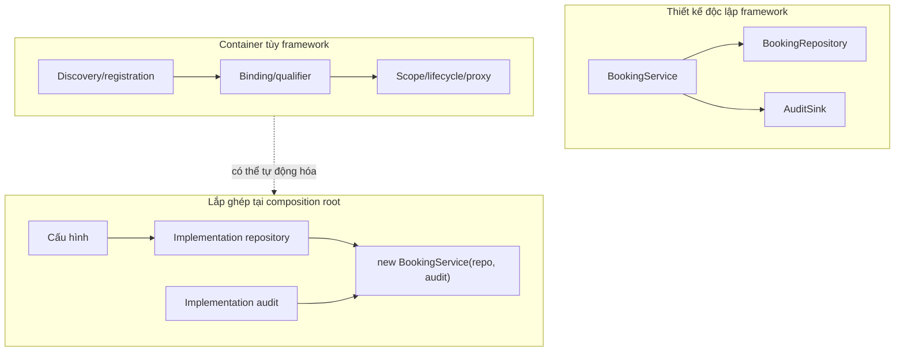
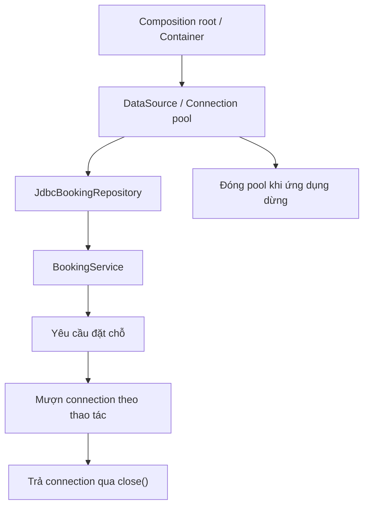

# Phân biệt quy tắc chung của DI với hành vi riêng của từng framework

Khi bắt đầu học **Dependency Injection (DI)** bằng Java thuần, chúng ta tự tạo repository, service và controller rồi truyền chúng vào constructor. Khi chuyển sang Spring, Jakarta CDI hoặc Guice, phần mã khởi tạo có thể được chuyển cho một **DI container**. Từ đó xuất hiện nhiều cú pháp và khái niệm như bean, binding, component scanning, qualifier, scope, proxy hay lifecycle callback. Nếu đồng nhất những cơ chế này với bản thân DI, người học dễ nghĩ rằng muốn làm DI thì bắt buộc phải có annotation hoặc framework.

**Nguyên lý cốt lõi của DI không phụ thuộc framework:** thành phần sử dụng một cộng tác viên cần nhận cộng tác viên đó từ bên ngoài, thay vì tự quyết định tạo nó. Constructor injection là một cách thể hiện nhu cầu ấy rõ ràng. **Inversion of Control (IoC)** mô tả việc chuyển quyền điều phối tạo và lắp ghép ra khỏi đối tượng nghiệp vụ. Composition root là nơi ứng dụng lựa chọn implementation và xây dựng đồ thị phụ thuộc, dù việc này được viết tay hay được container hỗ trợ.

Bài thuộc chương **DI trong framework**, tập trung phân biệt **quy tắc thiết kế có thể áp dụng ở Java thuần** với **hành vi mà mỗi framework tự định nghĩa**. Ta sẽ dùng một ví dụ chạy được không cần framework, xem cách container thay phần lắp ghép, rồi phân tích các điểm rất dễ nhầm: phát hiện thành phần, chọn implementation, generic/qualifier, scope, vòng đời, proxy, lazy initialization, vòng phụ thuộc và chiến lược kiểm thử.

## 1. Ba tầng cần nhìn riêng

Trong một ứng dụng có DI, hãy phân biệt:

1. **Thiết kế phụ thuộc:** `BookingService` cần một `BookingRepository` và một `AuditSink` để hoàn thành công việc. Đây là quan hệ giữa các vai trò của ứng dụng.
2. **Lắp ghép:** nơi khởi động quyết định dùng `InMemoryBookingRepository` hay `JdbcBookingRepository`, tạo các đối tượng và truyền đúng instance vào service.
3. **Cơ chế framework:** container tìm ra các thành phần bằng cách nào, chọn binding/bean nào, quản lý scope và gọi callback ở thời điểm nào.



Sơ đồ không có nghĩa ba tầng hoạt động độc lập hoàn toàn. Container phải dựa trên khai báo và cấu hình để tạo đúng đồ thị. Điều cần ghi nhớ là **thiết kế service không nên bị phụ thuộc vào cách một container cụ thể tìm và khởi tạo service**, trừ khi ứng dụng có yêu cầu chính đáng cần API chuyên dụng.

| Câu hỏi | Quy tắc chung của DI | Phần phụ thuộc framework |
| --- | --- | --- |
| Service cần gì? | Khai báo cộng tác viên trực tiếp, ưu tiên constructor cho phụ thuộc bắt buộc | Có bắt buộc gắn `@Inject`/`@Autowired` hay container nhận biết constructor theo quy ước? |
| Dùng implementation nào? | Composition root cấu hình lựa chọn phù hợp với hợp đồng | Binding, tên bean, qualifier, profile, thứ tự ưu tiên ứng viên |
| Một object sống bao lâu? | Lựa chọn theo trạng thái, khả năng chia sẻ và quyền sở hữu | Tên scope, cơ chế tạo theo request, proxy, cách dọn dẹp |
| Khi nào tạo object? | Cần tạo trước khi sử dụng và giữ bất biến hợp lệ | Eager/lazy initialization, provider, proxy và cơ chế truy xuất |
| Khi nào phát hiện lỗi cấu hình? | Cố gắng kiểm tra sớm ở nơi dựng đồ thị | Khởi động hay lúc truy xuất, thông báo lỗi và công cụ chẩn đoán |
| Kiểm thử thế nào? | Có thể tạo service bằng Java thuần và fake các cộng tác viên | Cách chạy test container, thay binding, profile/test context |

## 2. Điều gì luôn đúng với constructor injection?

Hợp đồng nghiệp vụ có thể giữ nguyên giữa Java thuần và mọi DI container:

```java
interface BookingRepository {
    void save(Booking booking);
}

interface AuditSink {
    void created(String bookingId);
}

final class BookingService {
    private final BookingRepository repository;
    private final AuditSink auditSink;

    BookingService(BookingRepository repository, AuditSink auditSink) {
        this.repository =
            java.util.Objects.requireNonNull(repository, "repository");
        this.auditSink =
            java.util.Objects.requireNonNull(auditSink, "auditSink");
    }

    Booking create(String bookingId) {
        Booking booking = new Booking(bookingId);
        repository.save(booking);
        auditSink.created(booking.id());
        return booking;
    }
}
```

Từ riêng chữ ký constructor, người đọc biết `BookingService` cần **hai phụ thuộc bắt buộc**. Nếu gọi `new BookingService(null, auditSink)`, phép kiểm tra ném lỗi ngay ở thời điểm tạo. Không có annotation, thư viện hay container nào bắt buộc để thể hiện hoặc kiểm thử quan hệ này.

Các thuộc tính thiết kế có thể giữ lại khi chuyển framework:

- **Phụ thuộc trực tiếp rõ ràng:** service cần `BookingRepository` và `AuditSink`, không tự tìm chúng trong global registry.
- **Bất biến khởi tạo:** constructor yêu cầu đủ cộng tác viên và xác thực đầu vào.
- **Định hướng theo hợp đồng:** service phụ thuộc vai trò `BookingRepository`, không phải cấu hình JDBC, tên môi trường hay chi tiết tạo client.
- **Khả năng thay thế:** composition root hoặc test có thể truyền implementation khác mà không sửa logic `create(...)`.
- **Khả năng kiểm thử Java thuần:** tạo service trực tiếp bằng `new` với fake, không cần khởi động framework.

`private final` khiến tham chiếu không bị gán lại sau constructor; nó **không** làm repository trở thành immutable hay thread-safe. DI và kiểm tra `null` cũng không tự bảo đảm repository thật đã kết nối được hoặc dữ liệu được lưu nhất quán.

## 3. Ví dụ hoàn chỉnh bằng Java thuần: tự lắp ghép đồ thị

Trước khi xem ví dụ framework, hãy chạy một ứng dụng không sử dụng container. Mọi quyết định chọn implementation đều xuất hiện ở `ManualDiDemo.main(...)`.

Tạo file `ManualDiDemo.java`:

```java
import java.util.Map;
import java.util.Objects;
import java.util.concurrent.ConcurrentHashMap;

final class Booking {
    private final String id;

    Booking(String id) {
        if (id == null || !id.matches("[A-Za-z0-9-]+")) {
            throw new IllegalArgumentException("bookingId khong hop le");
        }
        this.id = id;
    }

    String id() {
        return id;
    }
}

interface BookingRepository {
    void save(Booking booking);
    Booking find(String id);
}

final class InMemoryBookingRepository implements BookingRepository {
    private final Map<String, Booking> data = new ConcurrentHashMap<>();

    @Override
    public void save(Booking booking) {
        Objects.requireNonNull(booking, "booking");
        if (data.putIfAbsent(booking.id(), booking) != null) {
            throw new IllegalStateException("Booking da ton tai");
        }
    }

    @Override
    public Booking find(String id) {
        return data.get(id);
    }
}

interface AuditSink {
    void created(String bookingId);
}

final class ConsoleAuditSink implements AuditSink {
    @Override
    public void created(String bookingId) {
        System.out.println("AUDIT created=" + bookingId);
    }
}

final class BookingService {
    private final BookingRepository repository;
    private final AuditSink audit;

    BookingService(BookingRepository repository, AuditSink audit) {
        this.repository = Objects.requireNonNull(repository, "repository");
        this.audit = Objects.requireNonNull(audit, "audit");
    }

    Booking create(String bookingId) {
        Booking booking = new Booking(bookingId);
        repository.save(booking);
        audit.created(booking.id());
        return booking;
    }
}

final class BookingEndpoint {
    private final BookingService service;

    BookingEndpoint(BookingService service) {
        this.service = Objects.requireNonNull(service, "service");
    }

    Booking handleCreate(String bookingId) {
        return service.create(bookingId);
    }
}

public class ManualDiDemo {
    public static void main(String[] args) {
        // Composition root: chon implementation va lap cac doi tuong.
        InMemoryBookingRepository repository =
            new InMemoryBookingRepository();
        AuditSink audit = new ConsoleAuditSink();
        BookingService service = new BookingService(repository, audit);
        BookingEndpoint endpoint = new BookingEndpoint(service);

        Booking result = endpoint.handleCreate("BK-001");
        System.out.println("CREATED " + result.id());
        System.out.println("SAVED " + (repository.find("BK-001") == result));
    }
}
```

Biên dịch và chạy với JDK 8 trở lên:

```bash
javac ManualDiDemo.java
java ManualDiDemo
```

Kết quả:

```text
AUDIT created=BK-001
CREATED BK-001
SAVED true
```

Mã này đã sử dụng DI dù không có framework. `BookingEndpoint` nhận service, service nhận repository và audit, còn `main` tạo toàn bộ đồ thị. Khi cần thay repository, ta thay **lệnh tạo và lắp ghép tại composition root**, không sửa `BookingService.create(...)`. Nếu có client cần đóng, composition root hoặc một thành phần quản lý vòng đời được chỉ định sẽ chịu trách nhiệm dọn dẹp.

## 4. Khi dùng container, phần nào được chuyển giao?

Trong DI thủ công, mã khởi động trực tiếp gọi constructor:

```java
BookingRepository repository = new InMemoryBookingRepository();
AuditSink audit = new ConsoleAuditSink();
BookingService service = new BookingService(repository, audit);
BookingEndpoint endpoint = new BookingEndpoint(service);
```

Trong một container, ta thường **đăng ký các component hoặc binding**, sau đó container dựa trên cấu hình để lấy hoặc tạo object và truyền vào constructor. Tùy framework, các đăng ký có thể đến từ mã Java, annotation, XML, module cấu hình hoặc nguồn khác.

```text
Đọc cấu hình/đăng ký
    -> xác định BookingRepository cần instance nào
    -> xác định AuditSink cần instance nào
    -> tạo hoặc lấy repository và audit theo scope
    -> gọi BookingService(repository, audit)
    -> tạo hoặc lấy BookingEndpoint(service)
    -> bàn giao endpoint cho phần xử lý yêu cầu
```

**Ví dụ cụ thể với Spring Framework** dùng phương thức `@Bean`:

```java
// Minh họa riêng cho Spring Framework.
// Cần dependency Spring và các class nghiệp vụ ở ví dụ phía trên.
import org.springframework.context.annotation.Bean;
import org.springframework.context.annotation.Configuration;

@Configuration
public class BookingConfiguration {
    @Bean
    BookingRepository bookingRepository() {
        return new InMemoryBookingRepository();
    }

    @Bean
    AuditSink auditSink() {
        return new ConsoleAuditSink();
    }

    @Bean
    BookingService bookingService(
            BookingRepository repository, AuditSink audit) {
        return new BookingService(repository, audit);
    }

    @Bean
    BookingEndpoint bookingEndpoint(BookingService service) {
        return new BookingEndpoint(service);
    }
}
```

Trong ví dụ Spring, phương thức `@Bean` khai báo các đối tượng được quản lý; container giải quyết tham số của các phương thức cấu hình và dùng chúng để lắp ghép. Các class `BookingService` và `BookingEndpoint` vẫn dùng constructor Java thông thường. Ở đây **không cần gắn `@Component` hoặc `@Autowired` vào service** vì các `@Bean` đã khai báo cách tạo cụ thể. Đoạn này chỉ chạy khi có Spring Framework và lớp cấu hình được nạp vào application context; đây không phải mã Java thuần có thể chạy bằng `javac` một mình.

Một cách khác trong Spring là đăng ký thành phần bằng stereotype annotation và component scanning, rồi container tự chọn constructor theo quy tắc Spring. Jakarta CDI thường nói về *beans*, *qualifiers*, *scopes* và `@Inject`; Guice thường dùng *modules*, *bindings* và `@Inject`. **Tên annotation và cách container xử lý chúng là quy tắc riêng của từng framework và phiên bản**, không phải định nghĩa chung của DI.

## 5. Bảng đối chiếu: nguyên lý chung và cơ chế cụ thể

| Chủ đề | Điều độc lập framework | Điều cần tìm hiểu ở framework đang dùng |
| --- | --- | --- |
| **Phát hiện thành phần** | Phải có một nơi khai báo hoặc tạo được các cộng tác viên | Quét package, cấu hình bean, module/binding, auto-configuration và điều kiện đăng ký |
| **Constructor injection** | Caller cung cấp đủ phụ thuộc để tạo instance hợp lệ | Container chọn constructor nào, annotation có cần thiết không, overload được xử lý ra sao |
| **Chọn implementation** | Mỗi injection point phải nhận đúng vai trò | Qualifier, named binding, profile, priority, primary/default candidate |
| **Scope** | Instance có thể dùng chung hoặc tạo riêng theo vòng đời | Singleton, application, request, session, prototype/transient; phạm vi thực sự của từng scope |
| **Tạo trễ** | Phụ thuộc có thể chỉ được tạo khi thật sự cần | Lazy bean, provider, proxy, thời điểm lỗi thiếu binding xuất hiện |
| **Vòng đời** | Tài nguyên cần có bên sở hữu và quy tắc dọn dẹp | Callback khởi tạo/hủy, đóng object do container quản lý, shutdown |
| **Vòng phụ thuộc** | Chu trình constructor khó hoặc không thể lắp ghép thông thường | Container phát hiện, từ chối hoặc dùng cơ chế proxy/tạo trễ nào |
| **Kiểm thử** | Unit test có thể inject fake trực tiếp | Khởi động test context, override binding/bean, profile kiểm thử |

Khi đọc tài liệu một framework, hãy hỏi: **đó là một cách framework thực thi DI hay là yêu cầu của chính thiết kế phụ thuộc?** Ví dụ, `@Autowired` là API của Spring, còn “service nhận repository qua constructor” là một cách thiết kế độc lập Spring.

## 6. Phát hiện và đăng ký thành phần là cơ chế riêng

DI không quy định container phải tự tìm mọi class trong project. Framework có thể yêu cầu:

- **Đăng ký tường minh:** khai báo binding hoặc phương thức tạo object.
- **Quét class:** tìm các class có annotation trong một số package được cấu hình.
- **Tự động cấu hình có điều kiện:** đăng ký thành phần khi có thư viện hoặc thuộc tính phù hợp.
- **Factory/producer:** gọi phương thức tạo object khi container cần một instance.

Mỗi cách đặt ra câu hỏi vận hành riêng: package nào được quét, class nào thực sự được đăng ký, khi có hai ứng viên thì container chọn ai, và ứng viên không có ở cấu hình hiện tại có gây lỗi hay không?

Một class được đánh dấu annotation **không có nghĩa mọi lần `new ClassName()` đều đi qua container**. Nếu bạn tự `new` một object, hành vi quản lý dependency/lifecycle của container có thể không áp dụng cho object đó. Ngược lại, object do container tạo từ factory method vẫn có thể là thành phần được quản lý dù class của nó không mang annotation.

Không nên dùng quy tắc “framework luôn tự quét toàn bộ classpath” làm mặc định. Phạm vi scanning, auto-configuration và cách bootstrap khác nhau giữa Spring, Jakarta CDI, Guice và từng cấu hình.

## 7. Chọn implementation: cùng hợp đồng có thể có nhiều ứng viên

Giả sử hệ thống có hai repository:

```java
final class InMemoryBookingRepository implements BookingRepository { /* ... */ }
final class JdbcBookingRepository implements BookingRepository { /* ... */ }
```

`BookingService(BookingRepository repository, AuditSink audit)` chỉ yêu cầu **vai trò** repository, chưa cho biết nên chọn implementation nào. Trong Java thuần, composition root ra quyết định bằng cách truyền biến cụ thể:

```java
BookingRepository repository = new InMemoryBookingRepository();
BookingService service = new BookingService(repository, audit);
```

Với container, cần đăng ký **quy tắc lựa chọn**. Tùy framework, ta có thể dùng qualifier, tên bean/binding, profile môi trường, binding tường minh hoặc một quy tắc ưu tiên đã được tài liệu hóa. Không có cú pháp qualifier chung chạy trong mọi container; việc một bean có tên giống tên tham số constructor **không phải cam kết phổ quát**.

Phân biệt hai tình huống:

| Tình huống | Ví dụ | Cách tư duy |
| --- | --- | --- |
| Chọn **một implementation cho một vai trò** theo môi trường | LOCAL dùng memory, PRODUCTION dùng JDBC | Lựa chọn ở composition root/container configuration; service giữ cùng hợp đồng |
| Cần **hai instance cùng kiểu nhưng vai trò khác nhau** | Primary repository và archive repository | Dùng hợp đồng theo vai trò hoặc qualifier rõ; xác nhận thứ tự/identity khi inject |

Một cách lựa chọn sai có thể vẫn biên dịch nếu cả hai ứng viên implement cùng interface. Vì thế, cần test **wiring** để xác minh việc chọn đúng component, bên cạnh unit test nghiệp vụ.

### Generic không giải quyết mọi trường hợp mơ hồ

Với `Store<Booking>` và `Store<Customer>`, Java kiểm tra khác biệt ở mức generic source type. Container có thể đọc generic signature tại injection point và hỗ trợ binding theo generic type, nhưng mức hỗ trợ khác nhau. Khi có **hai `Store<Booking>`** với hai vai trò khác nhau, generic cũng không đủ để phân biệt.

Type erasure khiến `new InMemoryStore<Booking>()` và `new InMemoryStore<Customer>()` không trở thành hai runtime class riêng biệt. Vì vậy, không nên coi `getClass()` của object là cơ chế xác định đầy đủ kiểu generic. Tại nơi chọn implementation, hãy dựa trên **hợp đồng vai trò và cấu hình binding phù hợp**, không dựa vào giả định về type erasure.

## 8. Scope và proxy: cùng tên gọi có thể khác hành vi

Lựa chọn scope phải xuất phát từ **trạng thái, khả năng chia sẻ và quyền sở hữu tài nguyên**:

- Service không giữ dữ liệu riêng của request có thể được chia sẻ nếu các phụ thuộc của nó và quy tắc đồng thời phù hợp.
- Request context chỉ hợp lệ trong một request không nên bị giữ trực tiếp bởi service có vòng đời dài.
- Connection pool có thể dùng chung ở cấp ứng dụng; connection mượn từ pool thường được trả sau từng thao tác.
- Factory có thể tồn tại lâu, trong khi object nó tạo ra chỉ được giữ trong một tác vụ.

Trong container, nhãn như `singleton`, `application`, `request`, `session`, `prototype` hay `transient` không nhất thiết có cùng nghĩa, cùng thời điểm tạo hoặc cùng cách dọn dẹp ở mọi thư viện.

**Phạm vi của một singleton thường gắn với một container hoặc một application context**, không có nghĩa chỉ tồn tại một instance trong toàn bộ cụm máy. `final` cũng không khiến singleton tự an toàn với nhiều luồng.

### Phụ thuộc có scope ngắn bị giữ trong object sống lâu

```text
Application-scoped BookingService
  -> RequestScoped RequestContext
```

Nếu khi dựng service, container đưa hẳn **một instance request context cụ thể** vào constructor và service giữ mãi, instance đó có thể hết hạn hoặc thuộc request khác. Đây là **captive dependency**. Một số container cung cấp scoped proxy hoặc provider để truy xuất instance của request đang hoạt động; số khác từ chối việc inject không phù hợp hoặc yêu cầu cấu hình khác.

Không nên mặc định “inject request-scoped vào singleton luôn sai” hoặc “framework tự sửa hoàn toàn”. Cần xác minh **đối tượng được inject là instance thật hay proxy/provider**, proxy lấy dữ liệu theo ngữ cảnh nào, và điều gì xảy ra khi gọi nó ngoài scope hợp lệ.

### Lazy và provider không đồng nghĩa scope mới

Một lazy reference có thể **trì hoãn thời điểm tạo**, trong khi scope vẫn là singleton. Một provider có thể trả cùng instance hoặc instance khác theo binding. Nếu singleton lấy một prototype từ provider **một lần rồi giữ trong field**, việc truy xuất trễ không tự biến nó thành object mới cho mỗi request.

Hãy tách câu hỏi:

1. Khi nào dependency được **resolve hoặc tạo**?
2. Trong điều kiện nào **cùng instance** được tái sử dụng?
3. Ai có trách nhiệm **đóng hoặc trả** tài nguyên sau khi dùng?

## 9. Vòng đời và quyền sở hữu không biến mất khi có container

Khi một repository cần `DataSource`, có thể chọn một pool dùng chung và inject vào repository. Composition root/container cần bảo đảm pool được tạo trước khi sử dụng và được đóng sau khi các consumer đã dừng.



Nhiều framework hỗ trợ callback khởi tạo/hủy hoặc tự phát hiện các loại object cần đóng theo quy tắc riêng. Nhưng không thể kết luận “container sẽ đóng tất cả object có `AutoCloseable`”: hành vi còn phụ thuộc **object có được container quản lý hay không, scope nào đang dùng và cơ chế lifecycle nào được kích hoạt**. Object transient/prototype được trả về cho caller có thể đòi hỏi caller tự đóng.

Trong Java thuần, có thể diễn đạt ownership bằng `try-with-resources` khi resource thuộc một phạm vi xác định:

```java
// Mẫu minh họa: DatabaseClient implement AutoCloseable.
try (DatabaseClient client = new DatabaseClient(config)) {
    BookingRepository repo = new JdbcBookingRepository(client);
    BookingService service = new BookingService(repo, audit);
    runApplication(service);
} // client.close() khi ket thuc pham vi so huu.
```

Mẫu này chỉ minh họa ownership; `DatabaseClient` và `runApplication` không nằm trong chương trình `ManualDiDemo.java`. Trong server chạy dài hạn, shutdown cần dừng nhận request và xử lý các tác vụ còn chạy trước khi đóng client dùng chung.

## 10. Vòng phụ thuộc và nhiều constructor: đừng phụ thuộc vào phép màu

```text
ServiceA -> ServiceB -> ServiceC -> ServiceA
```

Nếu constructor của mỗi service bắt buộc nhận một instance hoàn chỉnh của service tiếp theo, **manual DI không thể tạo chu trình theo trình tự thông thường**. Container cũng không làm chu trình trở nên hợp lý về mặt thiết kế. Một framework có thể phát hiện và báo lỗi; một số cơ chế setter, proxy hoặc tạo trễ có thể cho phép lắp ghép trong trường hợp cụ thể.

Giải pháp ưu tiên là xem lại **trách nhiệm và hướng phụ thuộc**. Có thể tách một vai trò chung, dùng sự kiện nếu luồng nghiệp vụ phù hợp hoặc thiết kế một abstraction giảm kết dính. Thêm service locator hoặc lazy provider chỉ để lách lỗi đôi khi khiến chu trình khó phát hiện hơn.

Với **nhiều constructor**, câu hỏi chung là “đường khởi tạo nào bảo đảm đủ bất biến?”. Câu hỏi riêng của container là “constructor nào được chọn và vì sao?”. Chẳng hạn, không được suy từ việc một framework tự nhận diện single constructor rằng mọi framework đều xử lý tương tự. Nên giữ một constructor injection rõ ràng cho các phụ thuộc bắt buộc hoặc cấu hình lựa chọn constructor một cách tường minh theo quy tắc đang dùng.

## 11. Kiểm thử: phần nào không cần framework, phần nào cần container?

Một unit test của `BookingService` có thể được viết bằng Java thuần, không cần tạo application context hoặc injector:

Tạo file `ManualDiDemoTest.java` **cùng thư mục** với `ManualDiDemo.java`:

```java
public class ManualDiDemoTest {
    static final class RecordingRepository implements BookingRepository {
        Booking saved;
        int saveCount;

        @Override
        public void save(Booking booking) {
            saved = booking;
            saveCount++;
        }

        @Override
        public Booking find(String id) {
            return saved != null && saved.id().equals(id) ? saved : null;
        }
    }

    static final class RecordingAuditSink implements AuditSink {
        String bookingId;
        int calls;

        @Override
        public void created(String bookingId) {
            this.bookingId = bookingId;
            calls++;
        }
    }

    public static void main(String[] args) {
        RecordingRepository repository = new RecordingRepository();
        RecordingAuditSink audit = new RecordingAuditSink();
        BookingService service = new BookingService(repository, audit);
        BookingEndpoint endpoint = new BookingEndpoint(service);

        Booking booking = endpoint.handleCreate("BK-TEST");

        check(repository.saved == booking, "Chua luu dung booking");
        check(repository.saveCount == 1, "Phai luu dung mot lan");
        check("BK-TEST".equals(audit.bookingId), "Sai booking audit");
        check(audit.calls == 1, "Phai ghi audit dung mot lan");

        boolean rejected = false;
        try {
            new BookingService(null, audit);
        } catch (NullPointerException expected) {
            rejected = true;
        }
        check(rejected, "Constructor phai tu choi repository null");

        System.out.println("ManualDiDemoTest PASSED");
    }

    static void check(boolean condition, String message) {
        if (!condition) {
            throw new AssertionError(message);
        }
    }
}
```

Chạy:

```bash
javac ManualDiDemo.java ManualDiDemoTest.java
java ManualDiDemoTest
```

Kết quả mong đợi:

```text
ManualDiDemoTest PASSED
```

Test này xác nhận service nhận và sử dụng đúng hai cộng tác viên; nó không nói Spring, CDI hay Guice sẽ chọn bean/binding nào. Để kiểm tra framework thật, cần thêm một lớp kiểm thử riêng:

| Cấp kiểm thử | Mục tiêu | Có cần container? |
| --- | --- | --- |
| **Unit test service** | Quy tắc nghiệp vụ và lời gọi qua hợp đồng | Không; truyền fake qua constructor |
| **Wiring test** | Container resolve đúng repository, audit, constructor và qualifier | Có, nếu đang kiểm tra chính cơ chế container |
| **Scope/lifecycle test** | Instance được chia sẻ hay tạo theo request, callback/cleanup hoạt động đúng | Thường cần ngữ cảnh framework tương ứng |
| **Integration test adapter** | Repository JDBC thực hiện SQL/schema/transaction đúng | Cần tài nguyên thử nghiệm; có thể dùng hoặc không dùng container |

Không nên bật toàn bộ framework chỉ để chứng minh một phép kiểm tra dữ liệu thuần Java. Ngược lại, test unit service với fake **không thể chứng minh** binding/profile và lifecycle của application context đúng.

## 12. Những hiểu nhầm phổ biến

| Hiểu nhầm | Vì sao không đúng | Cách nhìn chính xác |
| --- | --- | --- |
| “DI chính là `@Autowired` hoặc `@Inject`” | Annotation chỉ là một cách để framework nhận biết điểm inject | DI tồn tại cả khi lắp ghép thủ công |
| “Có annotation thì mọi object đều được container quản lý” | Object tự `new` có thể nằm ngoài lifecycle container | Kiểm tra object được tạo/đăng ký ở đâu |
| “Framework luôn tìm được implementation duy nhất” | Có thể thiếu hoặc có nhiều ứng viên phù hợp | Cấu hình binding/qualifier rõ và test khởi động |
| “Generic type luôn đủ để chọn bean” | Type erasure, raw type, nhiều ứng viên cùng `T` vẫn có thể mơ hồ | Xác minh generic metadata và cơ chế resolve cụ thể |
| “Singleton đồng nghĩa thread-safe” | Singleton có thể giữ state mutable và bị gọi đồng thời | Kiểm tra trạng thái, khả năng chia sẻ, ranh giới scope |
| “Request-scoped inject vào singleton luôn an toàn” | Có thể có captive dependency nếu giữ instance ngắn hạn | Hiểu proxy/provider và thời điểm resolve |
| “Lazy nghĩa là mỗi lần dùng sẽ có object mới” | Lazy điều khiển thời điểm tạo, còn identity phụ thuộc scope | Kiểm tra cả lazy và scope |
| “Container luôn dọn mọi object khi dừng” | Managed/unmanaged object và scope có quy tắc cleanup khác nhau | Xác định ownership và lifecycle callback |
| “Container giải quyết được vòng phụ thuộc nên thiết kế ổn” | Proxy/tạo trễ có thể che chu trình trách nhiệm | Rà soát và tách trách nhiệm khi cần |
| “Unit test service qua mock đã test được wiring” | Unit test không kiểm tra cách container chọn bean | Viết wiring test riêng cho cấu hình/container |

## 13. Quy trình đọc một hệ thống DI chưa quen

1. **Bắt đầu từ constructor nghiệp vụ:** `BookingService` nhận những hợp đồng nào và chúng có bắt buộc không?
2. **Tìm composition root hoặc bootstrap:** ứng dụng khởi động context/injector từ đâu; file/module/cấu hình nào được nạp?
3. **Tìm cách đăng ký:** thành phần được tạo bằng phương thức cấu hình, binding, component scanning hay producer?
4. **Xác định implementation thật:** nếu có nhiều ứng viên, qualifier, profile hoặc điều kiện nào quyết định? Cấu hình sai có fail-fast không?
5. **Kiểm tra scope và identity:** cùng instance được dùng cho những ai, trạng thái nào được giữ, có proxy hoặc provider không?
6. **Kiểm tra vòng đời:** ai sở hữu connection pool và resource; shutdown/callback nào thực sự được áp dụng?
7. **Tách test:** unit test thiết kế nghiệp vụ không cần container; wiring và scope test dùng đúng framework; adapter cần integration test.
8. **Đối chiếu tài liệu phiên bản đang dùng:** các quy tắc chọn constructor, bean, scope, proxy, lazy và lifecycle là điểm dễ khác nhau nhất giữa framework.

Thực hiện các bước này giúp lần từ điểm vào tới từng dependency có thể kiểm chứng bằng mã nguồn và cấu hình, thay vì dựa vào giả định “framework tự biết phải làm gì”.

## 14. Bài tập tự luyện

**Bài 1 — Nhận diện quy tắc chung.** Một `OrderService` có constructor nhận `PaymentGateway`. Trong Spring, gateway được cung cấp bởi một `@Bean`; trong Java thuần, gateway được truyền bằng `new OrderService(gateway)`. Hãy chỉ ra phần nào là nguyên lý constructor injection và phần nào là cơ chế đăng ký của Spring.

**Bài 2 — Thiếu hoặc trùng binding.** Ứng dụng có hai implementation của `BookingRepository`. Hãy mô tả cách một composition root thủ công chọn đúng implementation và thông tin cần khai báo thêm trong container để không mơ hồ. *Gợi ý:* xem qualifier/binding/profile của framework đang dùng và viết một test startup.

**Bài 3 — Scope.** `BookingService` được cấu hình singleton nhưng constructor nhận một `RequestContext`. Nếu container đưa trực tiếp instance request hiện tại vào service, điều gì có thể xảy ra khi request kết thúc? Hãy nêu hai hướng sửa bằng cách truyền context theo method hoặc dùng cơ chế resolve đúng scope (nếu framework hỗ trợ).

**Bài 4 — Lazy không phải transient.** Một provider được inject vào singleton và trả về một object mới khi gọi `get()`. Nếu singleton gọi `get()` đúng một lần trong constructor rồi lưu kết quả vào field, object có mới theo mỗi request không? *Đáp án:* không, nó vẫn là object đã được giữ từ lần tạo singleton. Cần xác định lại lúc nào provider được gọi.

**Bài 5 — Lifecycle.** Một `DataSource` dùng chung được container tạo. Service gọi `dataSource.close()` sau mỗi request. Ai đang vi phạm ownership? Hãy giải thích cách trả connection mượn theo thao tác và đóng pool khi hết vòng đời phù hợp.

**Bài 6 — Kiểm thử hai ranh giới.** Viết một unit test `BookingService` bằng fake repository như phần 11. Sau đó thiết kế wiring test riêng của framework bạn đang dùng, chứng minh application context/injector chọn đúng repository cho môi trường test. Nêu bằng chứng mà mỗi test cung cấp.

**Bài 7 — Lỗi annotation.** Một lập trình viên thêm annotation của một DI framework lên `BookingService` rồi tạo service bằng `new BookingService(...)` ở nơi khác. Hãy giải thích phần nào vẫn là Java thuần và vì sao không thể mặc định container sẽ quản lý instance được tạo bên ngoài nó.

**Điểm cần ghi nhớ:** thiết kế DI/IoC nằm ở **hợp đồng phụ thuộc, constructor injection, composition root, lựa chọn scope và quyền sở hữu vòng đời**. Framework có thể tự động hóa việc phát hiện, lựa chọn, tạo và dọn dẹp các đối tượng, nhưng **cách nó làm những việc đó là hành vi riêng cần đọc đúng tài liệu và kiểm thử thực tế**. Nắm rõ phần chung bằng Java thuần giúp bạn dùng DI container có chủ đích, giải thích được lỗi wiring và giữ mã nghiệp vụ ít phụ thuộc framework.
