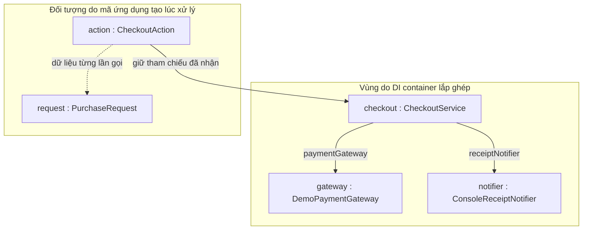
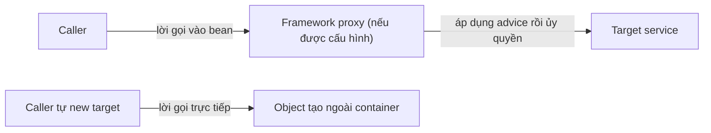

# Đối tượng do framework quản lý và đối tượng do mã ứng dụng tự tạo

## Mục tiêu học tập

Sau bài học này, bạn có thể:

- Phân biệt **đối tượng được DI container quản lý** với **đối tượng do mã ứng dụng tự tạo**, dù cả hai đều là instance Java thông thường.
- Giải thích vì sao viết `new` trong một phương thức `@Bean` **không** đồng nghĩa đối tượng trả về nằm ngoài container; ngược lại, đặt annotation lên class **không** khiến mọi instance của class đó tự động được quản lý.
- Biết khi nào nên dùng **constructor injection**, khi nào tạo DTO, entity hoặc object ngắn hạn bằng `new` là phù hợp.
- Xác định ranh giới trách nhiệm về **tạo, tiêm phụ thuộc, scope, đóng tài nguyên** và các cơ chế của framework như lifecycle callback hoặc proxy.
- Kiểm thử bằng Java thuần với dependency giả trước khi kiểm tra hành vi đăng ký, scope và proxy của DI container.

Đây là bài thuộc chương **DI trong framework** của mô-đun **Dependency Injection (DI) và Inversion of Control (IoC)**. Những kỹ thuật đã học bằng Java thuần — constructor injection, composition root, quản lý scope và vòng đời — vẫn có hiệu lực khi đưa một framework vào. Framework giúp **tự động hóa việc tạo và lắp ghép**, chứ không biến mọi đối tượng trong chương trình thành thành phần do framework quản lý.

## 1. Hai cách tạo đối tượng, cùng chạy trên JVM

Hãy xét một ứng dụng xử lý thanh toán, có các thành phần:

- `CheckoutService`: điều phối thanh toán và phát biên nhận.
- `PaymentGateway`: hợp đồng thanh toán.
- `ReceiptNotifier`: hợp đồng gửi xác nhận.
- `PurchaseRequest`: dữ liệu của một lần yêu cầu.

Một chương trình Java thuần có thể tự lắp ghép:

```java
PaymentGateway gateway = new DemoPaymentGateway();
ReceiptNotifier notifier = new ConsoleReceiptNotifier();
CheckoutService checkout = new CheckoutService(gateway, notifier);

PurchaseRequest request =
        new PurchaseRequest("DH-01", "a@example.com", 125_000L);
checkout.checkout(request);
```

Đây vẫn là **constructor injection**: `CheckoutService` không tự `new` gateway hay notifier, mà nhận chúng từ mã bên ngoài. Tuy nhiên, **không đối tượng nào trong đoạn này tự động trở thành bean của framework**; người viết mã chịu trách nhiệm tạo, giữ tham chiếu và dọn dẹp tài nguyên.

Khi dùng DI container, ứng dụng có thể cấu hình để container tạo `CheckoutService`, `PaymentGateway` và `ReceiptNotifier`. Container sẽ dựng các tham chiếu phù hợp, nhưng `PurchaseRequest` thường vẫn do code nhận yêu cầu tạo ra vì nó là **dữ liệu riêng của lần xử lý**.

### So sánh nhanh

| Khía cạnh | Đối tượng container quản lý | Đối tượng mã ứng dụng tự tạo |
| --- | --- | --- |
| **Ai chịu trách nhiệm tạo/cấp?** | Container theo định nghĩa và scope đã đăng ký | Lệnh `new`, factory hoặc code tại ranh giới ứng dụng |
| **Ai nối dependency?** | Container có thể giải quyết tham số constructor, bean/factory method... | Code phải truyền tham số hoặc thiết lập quan hệ rõ ràng |
| **Scope** | Tuân theo scope container đã cấu hình, ví dụ singleton/prototype/request khi được hỗ trợ | Theo cách code tạo, giữ và chia sẻ instance |
| **Lifecycle hook** | Có thể được container gọi theo cơ chế của framework | Không được container tự động gọi chỉ vì class có annotation |
| **Proxy/interceptor** | Có thể nhận proxy do framework tạo nếu tính năng và cấu hình phù hợp | Tự `new` thường bỏ qua đường tạo proxy của container |
| **Ai đóng tài nguyên?** | Theo hợp đồng/lifecycle container nếu có đăng ký quản lý | Bên sở hữu trong mã ứng dụng phải đóng đúng lúc |
| **Có cần cho mọi object?** | Không; phù hợp cho các collaborator/service cần cấu hình và quản lý | Rất phù hợp với DTO, entity, value object và nhiều object tạm thời |

**Điểm mấu chốt:** trạng thái “managed” thuộc về **instance cụ thể trong một cơ chế container cụ thể**, không chỉ thuộc về **kiểu/lớp**. Hai instance của cùng `CheckoutService` có thể khác nhau: một được container cấp, một do mã tự tạo.

## 2. Đọc đồ thị để biết bên nào quản lý đối tượng

Ví dụ ở ứng dụng dùng container, đồ thị đối tượng có thể trông như sau:



Trong sơ đồ:

- `checkout`, `gateway`, `notifier` **có thể** được container quản lý nếu đã đăng ký đúng. Cạnh đi từ consumer tới dependency vẫn có nghĩa **sử dụng**, không phải thứ tự tạo.
- `request` và `action` là các đối tượng được mã ứng dụng tự tạo. Chúng không tự nhận injection, callback hay scope của container.
- Một object tự tạo **vẫn được phép giữ tham chiếu đến bean** lấy từ container, nếu code truyền vào tường minh và vòng đời tương thích.
- Việc object không phải bean **không đồng nghĩa nó phải tự tạo mọi dependency**. `new CheckoutAction(checkout, request)` vẫn là hình thức truyền phụ thuộc vào constructor.

Ngược lại, nếu một bean do container quản lý tự gọi `new SomeHelper(...)`, helper đó **không mặc nhiên là bean** chỉ vì nó được tạo từ bên trong một bean. Cần phân biệt ranh giới tạo object với ranh giới **đăng ký và quản lý**.

## 3. Ví dụ Java thuần: lắp ghép bằng tay và tự quản lý vòng đời

Trước khi bàn về annotation, hãy xây dựng một chương trình **không dùng framework** để thấy rõ trách nhiệm. Ví dụ chỉ giả lập thanh toán và xuất biên nhận bằng console; không thực hiện giao dịch hay gửi email thật.

Lưu toàn bộ vào **`Main.java`**:

```java
import java.util.Objects;

// Dữ liệu riêng của một lần checkout.
final class PurchaseRequest {
    final String orderId;
    final String email;
    final long amountVnd;

    PurchaseRequest(String orderId, String email, long amountVnd) {
        this.orderId = Objects.requireNonNull(orderId, "orderId");
        this.email = Objects.requireNonNull(email, "email");
        if (orderId.trim().isEmpty() || email.trim().isEmpty()
                || amountVnd <= 0) {
            throw new IllegalArgumentException("Thông tin đơn không hợp lệ");
        }
        this.amountVnd = amountVnd;
    }
}

interface PaymentGateway {
    boolean charge(PurchaseRequest request);
}

interface ReceiptNotifier {
    void notifyPaid(PurchaseRequest request);
}

// Demo dependency giữ tài nguyên/vòng đời giả lập.
final class DemoPaymentGateway implements PaymentGateway, AutoCloseable {
    private boolean closed;

    @Override
    public boolean charge(PurchaseRequest request) {
        if (closed) {
            throw new IllegalStateException("Gateway đã đóng");
        }
        System.out.println("[DEMO] Thanh toán " + request.orderId
                + ": " + request.amountVnd + " VND");
        return true;
    }

    @Override
    public void close() {
        if (!closed) {
            closed = true;
            System.out.println("[DEMO] Đóng gateway");
        }
    }
}

final class ConsoleReceiptNotifier implements ReceiptNotifier {
    @Override
    public void notifyPaid(PurchaseRequest request) {
        System.out.println("[DEMO] Biên nhận " + request.orderId
                + " -> " + request.email);
    }
}

// Consumer: không phụ thuộc container, annotation hay cách tạo provider.
final class CheckoutService {
    private final PaymentGateway payments;
    private final ReceiptNotifier receipts;

    CheckoutService(PaymentGateway payments, ReceiptNotifier receipts) {
        this.payments = Objects.requireNonNull(payments, "payments");
        this.receipts = Objects.requireNonNull(receipts, "receipts");
    }

    boolean checkout(PurchaseRequest request) {
        Objects.requireNonNull(request, "request");
        if (!payments.charge(request)) {
            return false;
        }
        receipts.notifyPaid(request);
        return true;
    }
}

// Một object ngắn hạn do caller tạo theo từng lần thao tác.
final class CheckoutAction {
    private final CheckoutService checkout;
    private final PurchaseRequest request;

    CheckoutAction(CheckoutService checkout, PurchaseRequest request) {
        this.checkout = Objects.requireNonNull(checkout, "checkout");
        this.request = Objects.requireNonNull(request, "request");
    }

    boolean run() {
        return checkout.checkout(request);
    }
}

// Composition root bằng Java thuần: tạo, inject và đóng tài nguyên.
public class Main {
    public static void main(String[] args) {
        DemoPaymentGateway gateway = new DemoPaymentGateway();
        try {
            ReceiptNotifier notifier = new ConsoleReceiptNotifier();
            CheckoutService checkout = new CheckoutService(gateway, notifier);

            CheckoutAction first = new CheckoutAction(checkout,
                    new PurchaseRequest("DH-01", "a@example.com", 125_000L));
            CheckoutAction second = new CheckoutAction(checkout,
                    new PurchaseRequest("DH-02", "b@example.com", 200_000L));

            System.out.println("DH-01: " + first.run());
            System.out.println("DH-02: " + second.run());
        } finally {
            // Main đã tạo gateway nên quản lý việc đóng trong demo này.
            gateway.close();
        }
    }
}
```

Chạy bằng JDK:

```bash
javac -encoding UTF-8 Main.java
java Main
```

Kết quả dự kiến:

```text
[DEMO] Thanh toán DH-01: 125000 VND
[DEMO] Biên nhận DH-01 -> a@example.com
DH-01: true
[DEMO] Thanh toán DH-02: 200000 VND
[DEMO] Biên nhận DH-02 -> b@example.com
DH-02: true
[DEMO] Đóng gateway
```

Trong chương trình này, **mọi object đều do mã ứng dụng tạo**, nhưng thiết kế vẫn có DI:

1. `Main` tạo `gateway` và `notifier` rồi truyền vào constructor của `CheckoutService`.
2. Hai `CheckoutAction` được tạo mới, nhưng **dùng chung một instance `CheckoutService`**.
3. Mỗi action giữ một `PurchaseRequest` riêng, không đưa dữ liệu request vào field có thể bị ghi đè của service dùng chung.
4. `CheckoutService` **không tự đóng** gateway: bên tạo/sở hữu tài nguyên trong ví dụ là `Main`.

**Đây là bài học nền tảng trước framework:** DI là cách tổ chức quan hệ phụ thuộc, không phải tên của annotation hay điều kiện bắt buộc phải có container.

## 4. Khi chuyển sang Spring: `@Bean` trả về đối tượng do container quản lý

Với Spring, có thể khai báo các dependency trong một lớp `@Configuration` và sử dụng `@Bean` để đăng ký kết quả tạo đối tượng với application context.

Ví dụ **mang tính minh họa Spring**, dùng lại các class/interface trong `Main.java` ở mục trước. Đoạn này **không chạy bằng lệnh `javac Main.java` đơn thuần**: để thực thi cần thêm các thư viện Spring Context tương thích vào classpath và đặt các lớp trong cấu trúc dự án phù hợp.

```java
import org.springframework.context.annotation.Bean;
import org.springframework.context.annotation.Configuration;
import org.springframework.context.annotation.AnnotationConfigApplicationContext;

@Configuration
class CheckoutConfiguration {
    @Bean(destroyMethod = "close")
    DemoPaymentGateway paymentGateway() {
        return new DemoPaymentGateway();
    }

    @Bean
    ReceiptNotifier receiptNotifier() {
        return new ConsoleReceiptNotifier();
    }

    @Bean
    CheckoutService checkoutService(
            PaymentGateway paymentGateway, ReceiptNotifier receiptNotifier) {
        return new CheckoutService(paymentGateway, receiptNotifier);
    }
}

class SpringEntryPoint {
    public static void main(String[] args) {
        try (AnnotationConfigApplicationContext context =
                     new AnnotationConfigApplicationContext(
                             CheckoutConfiguration.class)) {
            // checkout là bean do context cấp.
            CheckoutService checkout = context.getBean(CheckoutService.class);

            // action và request được application tự tạo: KHÔNG là bean.
            CheckoutAction action = new CheckoutAction(checkout,
                    new PurchaseRequest(
                            "DH-SPRING", "a@example.com", 125_000L));
            action.run();
        }
        // Context đóng; @Bean(destroyMethod = "close") đóng gateway.
    }
}
```

Các điểm dễ bị nhầm:

- Trong `paymentGateway()` có **`new DemoPaymentGateway()`**, nhưng **giá trị trả về được đăng ký là bean**. Việc tự viết biểu thức `new` *bên trong factory method do Spring gọi* không làm mất khả năng quản lý bean của Spring.
- `checkoutService(...)` cũng dùng `new CheckoutService(...)`. Vì **instance trả về** được container nhận làm bean, nó có thể được container quản lý theo định nghĩa bean đó.
- `new CheckoutAction(checkout, request)` lại được gọi **ngoài cơ chế đăng ký bean**: action **không được Spring quản lý**, dù nó dùng một `checkout` bean làm dependency.
- `@Bean(destroyMethod = "close")` thể hiện rõ quyền đóng `DemoPaymentGateway` khi context đóng. Việc đóng bean chỉ đúng theo **scope và cơ chế lifecycle được hỗ trợ**; không nên suy rằng mọi object do bean tạo ra đều được container đóng hộ.

### So sánh hai kiểu `new` trông giống nhau

| Biểu thức | Ngữ cảnh | Kết luận |
| --- | --- | --- |
| `return new CheckoutService(...);` bên trong method `@Bean` do container gọi | Giá trị trả về được đăng ký dưới định nghĩa bean | **Instance trả về** được container quản lý theo định nghĩa đó. |
| `new CheckoutService(...);` trong `main` Java thuần | Không đăng ký với container | Instance do mã ứng dụng quản lý; DI vẫn có thể được thực hiện thủ công. |
| `new CheckoutAction(bean, request)` sau khi gọi `context.getBean(...)` | Caller tự tạo action | Action không trở thành bean chỉ vì giữ một bean. |
| `new Helper()` bên trong method của một bean | Helper chỉ là object nội bộ, không được đăng ký riêng | Không mặc nhiên nhận injection, scope hay lifecycle độc lập của container. |

Quan trọng hơn cả cú pháp là **đường đi của instance**: nó có được đăng ký/cấp thông qua một bean definition và được container quản lý hay không?

## 5. Annotation trên class không tự biến mọi instance thành bean

Trong Spring, các annotation như `@Component` hoặc `@Service` có thể giúp **đăng ký bean khi class được component scan phù hợp**. Chúng không tự động can thiệp vào mọi lần chương trình gọi `new`.

Ví dụ mang tính minh họa:

```java
// Giả sử MyReportService được Spring đăng ký bằng component scanning.
@org.springframework.stereotype.Service
class MyReportService {
    private final PaymentGateway gateway;

    MyReportService(PaymentGateway gateway) {
        this.gateway = gateway;
    }
}

// Tại ranh giới Java thường:
MyReportService manual = new MyReportService(gateway);
// manual dùng dependency được truyền tường minh,
// nhưng KHÔNG tự động thành bean do Spring quản lý.
```

Đoạn cuối là **phác thảo cách gọi**, trong đó `gateway` giả định đã có; đây không phải một file Java hoàn chỉnh. Không thể kết luận `manual` sẽ có lifecycle hook hoặc proxy của Spring chỉ từ annotation trên lớp.

Tương tự, nếu một lớp có field được đánh dấu `@Autowired` nhưng bạn tự gọi `new` và không qua cơ chế injection của container, field đó **không được Spring tự gán giá trị**. Đây là một nguyên nhân phổ biến của lỗi `NullPointerException` khi lập trình viên tưởng annotation có thể hoạt động độc lập khỏi việc container quản lý instance.

**Khuyến nghị:** ưu tiên **constructor injection**. Một lớp có các dependency bắt buộc trong constructor sẽ dễ tạo và kiểm thử bằng Java thuần, đồng thời container cũng có thể giải quyết chúng khi lớp là bean.

## 6. Vì sao proxy và lifecycle hook có thể khác?

Framework DI có thể cung cấp thêm các khả năng ngoài tạo đối tượng: quản lý scope, callback khởi tạo/hủy, proxy để áp dụng transaction, bảo mật, caching hoặc các interceptor khác.

Khi một framework dựa trên proxy, người dùng có thể nhận một **proxy bao quanh target object** thay vì tham chiếu trực tiếp đến target. Lời gọi đi **qua proxy** có thể được áp dụng interceptor; lời gọi trực tiếp tới object được tạo ngoài container có thể không đi qua cơ chế đó.



Ví dụ với Spring, `@Transactional` thường được áp dụng thông qua cơ chế proxy khi transaction management được cấu hình phù hợp:

```java
// Minh họa ý tưởng, không phải file chạy độc lập.
@org.springframework.stereotype.Service
class InvoiceService {
    @org.springframework.transaction.annotation.Transactional
    public void saveInvoice() {
        // Gọi repository để ghi dữ liệu.
    }
}
```

**Không nên suy luận** rằng cứ có `@Transactional` trên method thì mọi instance của `InvoiceService` đều được bao bởi transaction. Nếu tự `new InvoiceService()` bên ngoài container, instance này **thường không đi qua transaction proxy** do Spring thiết lập. Với cơ chế proxy thông dụng, việc method trong cùng target tự gọi method khác của chính nó cũng có thể **bỏ qua proxy**; chi tiết phụ thuộc vào cách cấu hình AOP và transaction.

Việc “không được container quản lý” có thể làm mất các dịch vụ framework mong đợi; nhưng **không phải mọi class đều cần proxy hoặc hook**. Một DTO hoặc entity đơn giản được tạo bằng `new` thường không cần các cơ chế đó.

### Lifecycle callback có phạm vi rõ ràng

| Cơ chế | Kỳ vọng hợp lệ | Ngộ nhận cần tránh |
| --- | --- | --- |
| Constructor injection | Phụ thuộc bắt buộc được truyền khi tạo object | Container sẽ tiêm vào cả object tự tạo mà không được đưa qua cơ chế injection |
| `@PostConstruct` / callback khởi tạo | Container có thể gọi cho bean được quản lý khi cấu hình/hỗ trợ phù hợp | Annotation này tự chạy trên mọi object được tạo bằng `new` |
| `@PreDestroy` / destroy method | Container quản lý cleanup theo scope và lifecycle đã định nghĩa | Mọi object do bean từng tạo đều được container đóng |
| Transaction proxy | Lời gọi qua proxy được áp dụng advice theo cấu hình | Tự gọi trực tiếp vào target vẫn luôn nhận cùng advice |
| Scope | Container cấp instance theo scope đã đăng ký | Tên class/annotation tự đảm bảo một instance cho toàn JVM |

Không nên dùng các hook này như lý do để kéo framework API vào mã nghiệp vụ. Đối tượng cần tài nguyên có thể bộc lộ hợp đồng `AutoCloseable` hoặc factory hẹp; composition root và tầng hạ tầng chịu trách nhiệm sở hữu/đóng cho đúng.

## 7. Scope của bean không đồng nhất với scope của mọi object

Trong nhiều ứng dụng Spring, bean `singleton` được dùng chung **trong phạm vi một container**; đây không phải lời bảo đảm chỉ tồn tại đúng một instance của class trên toàn JVM. Bạn vẫn có thể tự gọi `new` để tạo thêm instance của cùng class ngoài container.

Hãy phân biệt:

| Tình huống | Điều thực sự xảy ra |
| --- | --- |
| Container cấp một singleton bean cho hai consumer | Hai consumer có thể giữ cùng instance bean hoặc cùng proxy đại diện bean đó. |
| Mã tự gọi `new CheckoutService(...)` hai lần | Hai instance `CheckoutService` riêng, bất kể có một bean cùng class tồn tại trong container. |
| Singleton bean nhận prototype dependency một lần qua constructor | Singleton thường giữ **instance đã được tiêm tại thời điểm tạo**; không tự nhận prototype mới mỗi lần gọi method. |
| Một bean method dùng `new DTO(...)` mỗi request | DTO không tự thành bean; nó có vòng đời theo tham chiếu của code sử dụng. |
| Container tạo bean thuộc request scope | Instance cần được truy cập trong **ngữ cảnh request/scope hợp lệ**, tùy quy tắc framework. |
| Service sống lâu giữ tham chiếu tới tài nguyên request tự tạo | Có nguy cơ giữ object đã hết hạn hoặc lẫn dữ liệu giữa request. |

Nếu cần dependency mới theo mỗi thao tác, có thể tiêm **factory/provider có kiểu hẹp** vào consumer. Factory tạo hoặc lấy một instance theo hợp đồng cụ thể ngay khi thao tác cần nó. Đừng giả định rằng đổi annotation scope là đủ nếu consumer đã giữ sẵn một tham chiếu từ constructor.

Một instance container-managed vẫn có thể **chứa trạng thái mutable** và bị gọi từ nhiều luồng. Container không tự bảo đảm thread safety của logic nghiệp vụ. Ngược lại, một object mã ứng dụng tự tạo có thể là bất biến và an toàn để chia sẻ. **Ai tạo/cấp instance** và **state được chia sẻ thế nào** là hai câu hỏi khác nhau.

## 8. Ai quản lý tài nguyên khi hai thế giới giao nhau?

Chương trình thường có object của cả hai loại cùng hợp tác: bean do container quản lý và object tự tạo khi request đến.

Ví dụ:

```java
// checkout là bean đã được container cấp.
// Đây là một action do ứng dụng tạo tại request boundary.
CheckoutAction action = new CheckoutAction(
        checkout,
        new PurchaseRequest("DH-03", "c@example.com", 80_000L));
action.run();
```

`CheckoutAction` không được container quản lý, **nhưng có thể sử dụng bean `checkout`** đã được truyền tường minh. Nó **không nên tự đóng** `checkout` hoặc gateway được bean này sử dụng, trừ khi có hợp đồng chuyển quyền sở hữu cụ thể.

Ngược lại, một bean có thể mở phiên ngắn hạn theo request:

```java
interface ExportSession extends AutoCloseable {
    void write(String content);
    @Override void close();
}

interface ExportSessionFactory {
    ExportSession open(String reportId);
}

final class ReportService {
    private final ExportSessionFactory sessions;

    ReportService(ExportSessionFactory sessions) {
        this.sessions = java.util.Objects.requireNonNull(sessions, "sessions");
    }

    void export(String reportId, String content) {
        try (ExportSession session = sessions.open(reportId)) {
            session.write(content);
        }
    }
}
```

Đây là **ví dụ API độc lập** với `Main.java`: service nhận factory ổn định từ constructor; mỗi lần gọi `export` mở một session có quyền sở hữu/đóng riêng. Nếu factory được container quản lý, **các session nó trả về không nhất thiết cũng là bean**; điều đó phụ thuộc vào cách factory và container được cấu hình.

### Quy tắc quyền sở hữu cần ghi rõ

1. **Ai tạo/cấp tài nguyên?** Container, một factory, pool hay code request?
2. **Ai được quyền đóng?** Trong ví dụ `Main.java`, `Main` đóng gateway do nó tự tạo. Trong ví dụ Spring, context gọi destroy method của bean gateway khi context đóng.
3. **Có người dùng khác còn giữ instance không?** Đừng để một action theo request đóng client dùng chung của cả ứng dụng.
4. **Công việc có bất đồng bộ không?** Nếu tác vụ tiếp tục chạy sau khi method trả về, tài nguyên phải sống đến **mốc hoàn thành thực tế** chứ không chỉ tới lúc lên lịch.
5. **Lỗi lúc tạo một nhánh thì sao?** Cần dọn dẹp phần đã tạo theo quy tắc sở hữu và không báo rằng object graph đã sẵn sàng khi còn dependency thiếu.

Container có thể hỗ trợ cleanup bean; nhưng không nên coi nó như **garbage collector có khả năng tự hiểu mọi tài nguyên**. Đóng kết nối, stream, transaction hoặc session vẫn cần hợp đồng cụ thể.

## 9. Những lỗi thiết kế thường gặp và cách sửa

### 9.1. Tự `new` một service cần framework xử lý

```java
// Sai khi kỳ vọng instance này tự nhận lifecycle/proxy của Spring:
// InvoiceService invoice = new InvoiceService(...);
// invoice.saveInvoice();
```

Nếu kỳ vọng transaction, security hoặc interceptors do framework cung cấp, hãy **nhận bean qua composition root/injection** và gọi đúng đường đã được framework cấu hình. Còn nếu chỉ cần một class Java thuần, hãy xem xét liệu việc gắn annotation/framework dependency vào class có thực sự cần thiết.

### 9.2. Đưa cả container vào business service

```java
// Phản ví dụ dạng Service Locator; Container là API giả định.
class WrongCheckoutService {
    private final Container container;

    WrongCheckoutService(Container container) {
        this.container = container;
    }

    void checkout(PurchaseRequest request) {
        PaymentGateway gateway = container.resolve(PaymentGateway.class);
        gateway.charge(request);
    }
}
```

Đoạn này chỉ minh họa anti-pattern, không phải mã chạy độc lập vì không định nghĩa `Container`. Nó che giấu dependency thật trong lời gọi `resolve(...)`. Nên chuyển sang constructor nhận `PaymentGateway` và để composition root/framework làm công việc resolve.

### 9.3. Đăng ký một bean nhưng tự tạo thêm bản sao ở nơi khác

Nếu một service được container cấp nhưng mã khác gọi `new` tạo thêm một bản sao với trạng thái riêng, toàn hệ thống có thể xuất hiện **hai instance cùng kiểu với cấu hình khác nhau**. Điều này không nhất thiết sai, nhưng phải là lựa chọn có chủ đích. Với các thành phần chứa cache, metrics, connection hoặc state nhạy cảm theo scope, cần xác định **bản nào được sử dụng** và **bản nào được đóng**.

### 9.4. Giả định mọi `new` phải chuyển thành bean

Không cần đăng ký `PurchaseRequest`, DTO kết quả, value object và nhiều đối tượng tạm thời chỉ để “tuân thủ DI”. Chúng có thể được tạo trực tiếp, đặc biệt khi chứa dữ liệu chỉ biết trong từng request. Mục tiêu DI là quản lý **collaborator cung cấp hành vi và tài nguyên**, không phải xóa mọi biểu thức `new`.

### 9.5. Nhầm managed object với thread-safe object

Một singleton bean chứa field `currentUser` thay đổi theo từng request vẫn có thể bị lẫn dữ liệu nếu gọi đồng thời. Việc nó do Spring quản lý **không sửa logic trạng thái**. Hãy truyền dữ liệu request qua method/DTO hoặc dùng scope phù hợp khi thật sự cần instance theo request.

## 10. Kiểm thử bằng Java thuần trước, kiểm thử container sau

Vì `CheckoutService` dùng constructor injection và hai interface hẹp, ta có thể thay gateway và notifier bằng fake. Kiểm thử bên dưới không cần khởi động Spring.

Tạo **`CheckoutCheck.java`** bên cạnh `Main.java`:

```java
public class CheckoutCheck {
    static final class FakeGateway implements PaymentGateway {
        boolean approved = true;
        int charges;
        String lastOrderId;

        @Override
        public boolean charge(PurchaseRequest request) {
            charges++;
            lastOrderId = request.orderId;
            return approved;
        }
    }

    static final class RecordingNotifier implements ReceiptNotifier {
        int sends;
        String lastOrderId;

        @Override
        public void notifyPaid(PurchaseRequest request) {
            sends++;
            lastOrderId = request.orderId;
        }
    }

    public static void main(String[] args) {
        FakeGateway gateway = new FakeGateway();
        RecordingNotifier notifier = new RecordingNotifier();
        CheckoutService checkout = new CheckoutService(gateway, notifier);

        PurchaseRequest first =
                new PurchaseRequest("DH-TEST-1", "a@example.com", 50_000L);
        boolean paid = new CheckoutAction(checkout, first).run();
        if (!paid || gateway.charges != 1 || notifier.sends != 1
                || !"DH-TEST-1".equals(gateway.lastOrderId)
                || !"DH-TEST-1".equals(notifier.lastOrderId)) {
            throw new AssertionError("Sai đường checkout thành công");
        }

        // Dependency giả đổi kết quả nhưng CheckoutService không phải sửa.
        gateway.approved = false;
        PurchaseRequest second =
                new PurchaseRequest("DH-TEST-2", "b@example.com", 60_000L);
        boolean refused = new CheckoutAction(checkout, second).run();
        if (refused || gateway.charges != 2 || notifier.sends != 1) {
            throw new AssertionError("Không được gửi biên nhận khi từ chối");
        }

        // Dependency bắt buộc bị thiếu được phát hiện tại constructor.
        try {
            new CheckoutService(null, notifier);
            throw new AssertionError("Phải từ chối dependency null");
        } catch (NullPointerException expected) {
            // Objects.requireNonNull bảo vệ invariant của object.
        }

        System.out.println("PASS: constructor DI không cần DI container");
    }
}
```

Chạy:

```bash
javac -encoding UTF-8 Main.java CheckoutCheck.java
java CheckoutCheck
```

Các phép kiểm tra tập trung vào **hành vi của consumer và hợp đồng phụ thuộc**. Không cần khởi động application context hoặc mô phỏng bean registry. Đây là lợi ích của việc thiết kế lớp nghiệp vụ không phụ thuộc trực tiếp vào container.

Tuy nhiên, những gì **chỉ framework mới cung cấp** vẫn phải được kiểm tra ở cấp độ tích hợp:

| Câu hỏi cần kiểm tra | Kiểm thử phù hợp |
| --- | --- |
| `CheckoutService` có xử lý đúng nhánh thanh toán thành công/thất bại không? | Unit test Java thuần với fake. |
| Context có tạo đủ bean và resolve dependency đúng không? | Integration/context startup test. |
| Có đúng bean được chọn khi nhiều implementation tồn tại không? | Test cấu hình/qualifier/profile của container. |
| Singleton/prototype/request scope có tạo instance đúng kỳ vọng không? | Test scope có ngữ cảnh container tương ứng. |
| Transaction, interceptor hoặc lifecycle hook có thực sự hoạt động không? | Test gọi qua bean/proxy và môi trường framework thích hợp. |
| Client dùng chung có được đóng đúng lúc không? | Test shutdown/destroy theo hợp đồng. |

Một unit test thành công không chứng minh proxy transaction hay profile production đã được cấu hình đúng. Ngược lại, context khởi động thành công cũng không chứng minh nghiệp vụ checkout không có lỗi.

## 11. Checklist phân loại object trước khi đưa vào DI container

1. **Object này là dữ liệu hay collaborator?** DTO, entity và value object thường được tạo tại nơi dùng; service, gateway, repository, factory thường phù hợp để inject.
2. **Nó có phụ thuộc bắt buộc không?** Đặt các dependency cần thiết vào constructor để tạo object hợp lệ cả bằng Java thuần lẫn container.
3. **Ai thật sự tạo instance?** Xác định `new` nằm trong mã ứng dụng, trong factory do container gọi hay trong một API resolve của container.
4. **Instance đã được đăng ký và container quản lý chưa?** Annotation trên class không đủ để kết luận một instance `new` bất kỳ là bean.
5. **Có kỳ vọng lifecycle hook/proxy không?** Nếu có, hãy kiểm tra lời gọi có đi qua cơ chế framework phù hợp hay không.
6. **Có dùng chung instance không?** Xác định scope của container hoặc cách chia sẻ bằng tay; đừng giả định singleton là toàn JVM.
7. **Có trạng thái riêng của request không?** Đừng giữ vào field mutable của bean dùng chung; cân nhắc method parameter/DTO hoặc scope riêng.
8. **Có tài nguyên phải đóng không?** Ghi rõ owner và thời điểm đóng; tránh để object tự tạo đóng nhầm bean dùng chung.
9. **Một factory cấp object nào?** Factory là bean không đồng nghĩa mọi object nó trả về đều được container quản lý.
10. **Có thể kiểm thử consumer mà không bật framework không?** Nếu không, xem lại việc service có đang giữ container hoặc bị phụ thuộc vào cơ chế tạo đối tượng không.

### Bài tập: quyết định đối tượng nào là bean

Giả sử ứng dụng web có:

- `OrderController` nhận HTTP request.
- `OrderService` thực hiện nghiệp vụ.
- `OrderRepository` truy cập dữ liệu.
- `EmailClient` là client kết nối dùng chung.
- `OrderRequest` là DTO của HTTP request.
- `InvoiceLine` là value object của từng hóa đơn.
- `ReportExportSession` được mở và đóng riêng mỗi lần xuất báo cáo.

Hãy tự trả lời:

1. Thành phần nào nên được framework tạo/cấp để việc lắp ghép và quản lý scope tập trung hơn?
2. Thành phần nào có thể tự tạo từ dữ liệu request bằng `new` mà không cần đăng ký bean?
3. Nếu một bean `ReportService` gọi `factory.open(...)`, vì sao phiên xuất được trả về chưa chắc là bean?
4. Nếu `OrderController` được Spring quản lý nhưng code tự gọi `new OrderService(...)`, service mới có tự nhận transaction proxy không?
5. Nếu một class có `@Bean` method trả về `new EmailClient(...)`, vì sao không nên kết luận client chắc chắn là “unmanaged” chỉ vì dùng `new`?

**Gợi ý:** (1) Controller, service, repository, client và các factory hạ tầng thường do composition root/container lắp ghép. (2) DTO `OrderRequest` và value object `InvoiceLine` thường tạo khi xử lý. (3) Chỉ factory có thể là bean; đối tượng do nó cấp cần hợp đồng scope/lifecycle riêng và không tự được container quản lý. (4) Không; instance tự tạo thường không đi qua proxy do container tạo. (5) Nếu method `@Bean` được container thực thi/đăng ký, **giá trị trả về** được container quản lý theo định nghĩa bean; `new` là cách method tạo instance, không phải bằng chứng về ownership.

**Kết luận:** ranh giới quan trọng không nằm ở việc **có hay không có từ khóa `new`**, mà ở **ai chịu trách nhiệm tạo/cấp, lắp ghép, cấu hình, áp dụng cơ chế framework và kết thúc vòng đời instance**. Khi giữ constructor của lớp nghiệp vụ rõ ràng và composition root làm nơi quyết định cách tạo phụ thuộc, bạn có thể bắt đầu bằng Java thuần rồi chuyển sang DI container mà không phải đổi ý nghĩa hợp đồng của consumer.
