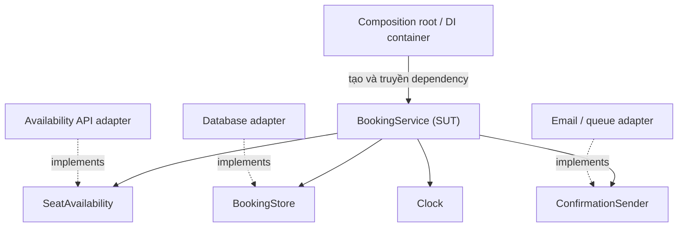
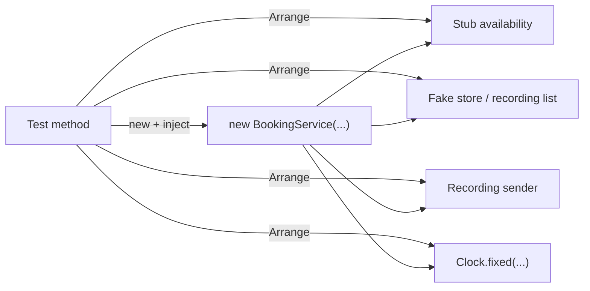

# Tạo đối tượng cần kiểm thử bằng cách truyền phụ thuộc trực tiếp

Trong chương **Kiểm thử** của module **Dependency Injection (DI)**, một lợi ích thiết thực của **constructor injection** là có thể tạo lớp cần kiểm thử bằng lệnh `new` và **truyền thẳng những dependency do test kiểm soát**. Không cần khởi động web server, mở kết nối cơ sở dữ liệu hoặc dựng DI container chỉ để xác minh một quy tắc nghiệp vụ.

Đây cũng là cách nhìn rõ **Inversion of Control (IoC)**: lớp nghiệp vụ không quyết định tạo các cộng tác viên; một thành phần bên ngoài quyết định và cấp chúng. Khi chạy thật, thành phần ấy thường là **composition root** hoặc DI container. Khi kiểm thử, **chính mã test đảm nhận phần lắp ghép tối thiểu**, chọn implementation đơn giản và có thể quan sát được.

Bài này tập trung vào đề bài **“Tạo đối tượng cần kiểm thử bằng cách truyền phụ thuộc trực tiếp”**. Ta sẽ xây dựng một ví dụ **Java thuần**, dùng constructor injection và những test double nhỏ, kiểm tra các nhánh thành công, từ chối và lỗi, rồi liên hệ với scope, vòng đời và thời điểm nên dùng integration test.

Sau bài học, bạn có thể:

- Nhận diện **SUT (System Under Test)** và các cộng tác viên cần cấp cho nó.
- Tạo SUT trực tiếp bằng constructor và truyền fake/stub/spy tự viết hoặc lambda theo hợp đồng interface.
- Tổ chức một test theo **Arrange – Act – Assert**, kiểm tra cả **giá trị trả về**, **tác dụng phụ** và **trường hợp không được gọi dependency**.
- Chủ động kiểm soát thời gian và các đầu vào phi tất định qua dependency như `Clock`.
- Cách ly trạng thái giữa các test và phân biệt unit test với integration test có container hoặc tài nguyên thật.
- Giải thích vì sao DI container hỗ trợ lắp ghép ở production nhưng **không bắt buộc** trong unit test của consumer được thiết kế tốt.

## 1. Tạo SUT là đang lắp một object graph tối thiểu

**SUT** là đối tượng hoặc đơn vị hành vi mà test muốn kiểm tra. Ví dụ, một `BookingService` xác nhận đặt chỗ cần:

1. `SeatAvailability`: trả lời chỗ còn trống hay không.
2. `BookingStore`: lưu thông tin đặt chỗ.
3. `ConfirmationSender`: gửi thông báo sau khi lưu thành công.
4. `Clock`: xác định thời gian tạo đặt chỗ mà không phụ thuộc thời gian thực của máy chạy test.

Trong production, graph có thể là:



Trong unit test, ta **giữ nguyên SUT** và thay các nhánh liên quan tới I/O bằng đối tượng do test kiểm soát:



Test không “giả vờ” thay đổi mã nghiệp vụ: nó **đưa vào các implementation hợp lệ của những hợp đồng đã công bố**. Lớp `BookingService` không cần biết dependency đến từ production hay test.

### Test cần lắp những gì?

Chỉ những thứ **constructor hoặc API của SUT thực sự yêu cầu**, cộng dữ liệu đầu vào cho hành vi được kiểm tra. Nếu test một quy tắc xác nhận đơn hàng, không nên khởi động toàn bộ HTTP router, connection pool, scheduler và email client.

**Lưu ý:** Không phải mọi lớp đều cần interface riêng chỉ để test. Một đối tượng giá trị bất biến như `Money` hay một `DiscountPolicy` đơn giản có thể được tạo trực tiếp. Tạo abstraction khi nó biểu đạt ranh giới trách nhiệm, hành vi có thể thay thế hoặc nguồn phi tất định; đừng tạo interface một cách máy móc.

## 2. Vì sao tự tạo dependency bên trong service gây khó kiểm thử?

Ví dụ về thiết kế bị ràng buộc với hạ tầng:

```java
// Minh họa vấn đề; các lớp hạ tầng bên dưới là giả định.
final class TightlyCoupledBookingService {
    void book(String bookingId) {
        JdbcBookingStore store = new JdbcBookingStore();
        store.save(bookingId);

        SmtpConfirmationSender sender = new SmtpConfirmationSender();
        sender.confirmed(bookingId);
    }
}
```

Muốn kiểm thử `book`, test có thể buộc phải truy cập cơ sở dữ liệu, cấu hình SMTP, chặn network hoặc thay đổi mã để cấy hook đặc biệt. Ngay cả khi có thể dùng framework mocking mạnh, vấn đề gốc vẫn là consumer **tự quyết định cách tạo dependency**.

Cách thay thế:

```java
interface BookingStore {
    void save(Booking booking);
}

interface ConfirmationSender {
    void confirmed(Booking booking);
}

final class BookingService {
    private final BookingStore store;
    private final ConfirmationSender sender;

    BookingService(BookingStore store, ConfirmationSender sender) {
        this.store = java.util.Objects.requireNonNull(store);
        this.sender = java.util.Objects.requireNonNull(sender);
    }

    void persistAndNotify(Booking booking) {
        store.save(booking);
        sender.confirmed(booking);
    }
}
```

Đây là mã minh họa cấu trúc, với kiểu `Booking` được định nghĩa trong ví dụ hoàn chỉnh ở phần sau. Consumer giờ có **hai phụ thuộc rõ ràng trong constructor**. Unit test có thể cung cấp hai implementation chỉ ghi nhận lời gọi, còn composition root production cấp adapter thật.

**Constructor injection không bắt test phải dùng mock framework:** nếu một interface có một phương thức, lambda là test double rất gọn; nếu cần lưu trạng thái hoặc hành vi phức tạp, có thể viết fake class riêng.

## 3. Chọn đúng loại test double

*Test double* là tên chung cho đối tượng thay thế một cộng tác viên trong test. Một số thuật ngữ thường dùng:

| Loại | Mục đích | Ví dụ trong bài |
| --- | --- | --- |
| **Dummy** | Lấp một tham số bắt buộc nhưng không được dùng trong kịch bản đó | Sender có thân rỗng khi chỉ test lỗi validation xảy ra trước I/O |
| **Stub** | Trả kết quả được lập trình sẵn để dẫn SUT vào một nhánh | `seatId -> false` khiến yêu cầu bị từ chối |
| **Fake** | Có implementation đơn giản và hoạt động được, thường thay hạ tầng thật | Repository lưu `Booking` vào `ArrayList` |
| **Spy / recording double** | Ghi lại lời gọi hoặc tham số để test kiểm tra | `booking -> notifications.add(booking)` |
| **Mock** | Đối tượng có kỳ vọng tương tác được lập trình và xác minh theo framework hoặc theo test | Kỳ vọng `confirmed` không chạy khi lưu thất bại |

Các tên trên giúp **diễn đạt ý định**, không phải hệ phân loại có ranh giới cứng. Một fake in-memory có thể vừa lưu dữ liệu vừa đóng vai trò spy nếu test kiểm tra danh sách đã ghi.

Nên chọn phương án **đơn giản nhất đủ biểu đạt hợp đồng**:

```java
SeatAvailability alwaysAvailable = seatId -> true;
SeatAvailability neverAvailable = seatId -> false;
```

Với port nhiều phương thức, một fake nhỏ có thể rõ hơn việc cấu hình hàng chục kỳ vọng mocking. Tránh stub quá nhiều phương thức không phục vụ kịch bản đang kiểm thử, và tránh khẳng định mọi lời gọi nội bộ theo đúng thứ tự nếu thứ tự đó **không phải yêu cầu nghiệp vụ**.

## 4. Quy trình Arrange – Act – Assert

Một test dễ đọc thường có ba giai đoạn:

| Bước | Việc cần làm | Ví dụ |
| --- | --- | --- |
| **Arrange** | Chuẩn bị dữ liệu, test doubles, clock cố định và **tạo SUT qua constructor** | `BookingService service = new BookingService(available, store, sender, clock)` |
| **Act** | Gọi **một hành vi chính** cần kiểm tra | `Booking result = service.book("B-01", "S-01")` |
| **Assert** | Kiểm tra kết quả và các tác dụng phụ liên quan tới yêu cầu | Kết quả có timestamp đúng; có một lần lưu và một thông báo |

Việc khởi tạo SUT nên hiển thị ngay trong phần Arrange để người đọc biết test thực sự đang cấp những phụ thuộc nào. Hãy tạo **fake mới cho mỗi test** nếu nó giữ trạng thái; không để `List` ghi nhận từ test trước ảnh hưởng test sau.

Một test nên kiểm tra **hành vi quan sát được** từ hợp đồng của SUT, không phụ thuộc reflection vào các field riêng tư, tên method nội bộ hoặc cách SUT chia thành nhiều helper. Nếu yêu cầu là “không gửi xác nhận khi lưu thất bại”, hãy kiểm tra sender không nhận lời gọi; đừng kiểm tra chi tiết không liên quan như phương thức private đã chạy bao nhiêu lần.

## 5. Ví dụ hoàn chỉnh: khởi tạo SUT trực tiếp và chạy test bằng JDK

Ví dụ dùng **Java 17 trở lên** để có `record` và `String.isBlank()`. Không dùng Spring, CDI, JUnit, Mockito hoặc server/database thật. Thay cho JUnit, `main` gọi các phương thức test và dùng `AssertionError` để báo thất bại. Mục tiêu là thấy rõ **cách lắp SUT**; khi chuyển sang JUnit, cách chuẩn bị dependency qua constructor **không đổi**.

Lưu toàn bộ nội dung vào một tệp `DirectInjectionTestingDemo.java`:

```java
import java.time.Clock;
import java.time.Instant;
import java.time.ZoneOffset;
import java.util.ArrayList;
import java.util.List;
import java.util.Objects;

public class DirectInjectionTestingDemo {
    record Booking(String bookingId, String seatId, Instant createdAt) { }

    @FunctionalInterface
    interface SeatAvailability {
        boolean isAvailable(String seatId);
    }

    @FunctionalInterface
    interface BookingStore {
        void save(Booking booking);
    }

    @FunctionalInterface
    interface ConfirmationSender {
        void confirmed(Booking booking);
    }

    static final class SeatUnavailableException
            extends RuntimeException {
        SeatUnavailableException(String seatId) {
            super("Seat unavailable: " + seatId);
        }
    }

    // Đây là SUT. Không phụ thuộc framework hoặc adapter hạ tầng.
    static final class BookingService {
        private final SeatAvailability availability;
        private final BookingStore store;
        private final ConfirmationSender sender;
        private final Clock clock;

        BookingService(
                SeatAvailability availability,
                BookingStore store,
                ConfirmationSender sender,
                Clock clock) {
            this.availability =
                    Objects.requireNonNull(availability, "availability");
            this.store = Objects.requireNonNull(store, "store");
            this.sender = Objects.requireNonNull(sender, "sender");
            this.clock = Objects.requireNonNull(clock, "clock");
        }

        Booking book(String bookingId, String seatId) {
            if (bookingId == null || bookingId.isBlank()
                    || seatId == null || seatId.isBlank()) {
                throw new IllegalArgumentException(
                        "Booking id and seat id must not be blank");
            }

            if (!availability.isAvailable(seatId)) {
                throw new SeatUnavailableException(seatId);
            }

            Booking booking = new Booking(
                    bookingId, seatId, Instant.now(clock));
            store.save(booking);
            sender.confirmed(booking);
            return booking;
        }
    }

    static Clock fixedClock() {
        return Clock.fixed(
                Instant.parse("2026-02-15T10:30:00Z"), ZoneOffset.UTC);
    }

    static void check(boolean condition, String reason) {
        if (!condition) {
            throw new AssertionError(reason);
        }
    }

    // 1. Happy path: kiểm tra kết quả và hai tác dụng phụ.
    static void testSuccessfulBooking() {
        // Arrange: mỗi test sở hữu các danh sách ghi nhận riêng.
        List<Booking> saved = new ArrayList<>();
        List<Booking> notified = new ArrayList<>();
        SeatAvailability available = seatId -> true;
        BookingStore store = saved::add;
        ConfirmationSender sender = notified::add;
        BookingService sut = new BookingService(
                available, store, sender, fixedClock());

        // Act.
        Booking result = sut.book("B-01", "S-01");

        // Assert.
        Booking expected = new Booking(
                "B-01", "S-01",
                Instant.parse("2026-02-15T10:30:00Z"));
        check(result.equals(expected), "Incorrect result");
        check(saved.equals(List.of(expected)), "Expected one save");
        check(notified.equals(List.of(expected)),
                "Expected one confirmation");
    }

    // 2. Từ chối: không lưu và không gửi thông báo.
    static void testUnavailableSeat() {
        List<String> calls = new ArrayList<>();
        SeatAvailability unavailable = seatId -> {
            calls.add("availability");
            return false;
        };
        BookingStore store = booking -> calls.add("save");
        ConfirmationSender sender =
                booking -> calls.add("notify");
        BookingService sut = new BookingService(
                unavailable, store, sender, fixedClock());

        boolean rejected = false;
        try {
            sut.book("B-02", "S-02");
        } catch (SeatUnavailableException expected) {
            rejected = true;
        }
        check(rejected, "Unavailable seat should be rejected");
        check(calls.equals(List.of("availability")),
                "No save or notification should run");
    }

    // 3. Lưu thất bại: không gửi thông báo thành công.
    static void testStoreFailureDoesNotNotify() {
        List<String> calls = new ArrayList<>();
        SeatAvailability available = seatId -> {
            calls.add("availability");
            return true;
        };
        BookingStore failingStore = booking -> {
            calls.add("save");
            throw new IllegalStateException("storage unavailable");
        };
        ConfirmationSender sender =
                booking -> calls.add("notify");
        BookingService sut = new BookingService(
                available, failingStore, sender, fixedClock());

        boolean failed = false;
        try {
            sut.book("B-03", "S-03");
        } catch (IllegalStateException expected) {
            failed = "storage unavailable".equals(expected.getMessage());
        }
        check(failed, "Storage error should propagate");
        check(calls.equals(List.of("availability", "save")),
                "Notification must not run after failed save");
    }

    // 4. Đầu vào không hợp lệ: không chạm tới các adapter.
    static void testInvalidInputCallsNoDependencies() {
        List<String> calls = new ArrayList<>();
        BookingService sut = new BookingService(
                seatId -> {
                    calls.add("availability");
                    return true;
                },
                booking -> calls.add("save"),
                booking -> calls.add("notify"),
                fixedClock());

        boolean rejected = false;
        try {
            sut.book("  ", "S-04");
        } catch (IllegalArgumentException expected) {
            rejected = true;
        }
        check(rejected, "Blank booking id must be rejected");
        check(calls.isEmpty(),
                "Invalid input must be rejected before I/O");
    }

    // 5. Hợp đồng constructor: dependency bắt buộc không được null.
    static void testConstructorRejectsMissingDependency() {
        boolean rejected = false;
        try {
            new BookingService(
                    null,
                    booking -> { },
                    booking -> { },
                    fixedClock());
        } catch (NullPointerException expected) {
            rejected = true;
        }
        check(rejected, "Constructor must reject missing availability");
    }

    public static void main(String[] args) {
        testSuccessfulBooking();
        testUnavailableSeat();
        testStoreFailureDoesNotNotify();
        testInvalidInputCallsNoDependencies();
        testConstructorRejectsMissingDependency();
        System.out.println(
                "PASS: 5 tests with direct constructor injection");
    }
}
```

Biên dịch và chạy:

```bash
javac DirectInjectionTestingDemo.java
java DirectInjectionTestingDemo
```

Kết quả dự kiến:

```text
PASS: 5 tests with direct constructor injection
```

**Phân tích lời gọi trọng tâm:**

```java
BookingService sut = new BookingService(
        available, store, sender, fixedClock());
```

- `sut` là đối tượng được kiểm thử; nó được **khởi tạo trực tiếp**, không cần đăng ký bean hay resolve từ container.
- `available` quyết định nhánh nghiệp vụ mà test muốn đi qua.
- `store` và `sender` ghi nhận tương tác để test quan sát kết quả, không thực hiện I/O thật.
- `fixedClock()` làm timestamp xác định; test không phụ thuộc thời điểm CPU thực thi, múi giờ máy hoặc thời gian mạng.
- Các test dựng dependency riêng, nên trạng thái các danh sách không rò sang test khác.

Ví dụ kiểm tra **thứ tự nghiệp vụ quan trọng** qua việc sender không chạy nếu store ném exception. Nó chưa giải quyết tính nguyên tử giao dịch phân tán: trong hệ thống thật, nếu `save` thành công nhưng `confirmed` lỗi, cần quy tắc retry/outbox hoặc hợp đồng khác. **Không suy rằng constructor injection tự tạo ra transaction**.

## 6. Chọn dữ liệu và hành vi cho mỗi nhánh

Một chiến lược unit test tốt là bắt đầu từ **hợp đồng hành vi**, sau đó chọn dependency giả để đưa SUT vào đúng trạng thái:

| Kịch bản | Cài đặt `SeatAvailability` | `BookingStore` | `ConfirmationSender` | Điều cần assert |
| --- | --- | --- | --- | --- |
| Thành công | Trả `true` | Ghi vào list | Ghi vào list | Booking đúng, lưu và xác nhận một lần |
| Không còn chỗ | Trả `false` | Spy ghi lời gọi | Spy ghi lời gọi | Báo từ chối, không lưu và không gửi |
| Lưu thất bại | Trả `true` | Ném lỗi dự kiến | Spy ghi lời gọi | Lỗi truyền ra, không gửi |
| Dữ liệu sai | Có thể ghi lời gọi nếu bị sử dụng | Có thể ghi lời gọi nếu bị sử dụng | Có thể ghi lời gọi nếu bị sử dụng | Lỗi validation xảy ra **trước** mọi I/O |
| Thiếu dependency bắt buộc | Không cấp một collaborator | Không liên quan | Không liên quan | Constructor từ chối ngay |

**Điểm quan trọng:** Đừng dùng dependency giả “luôn thành công” cho mọi test nếu điều đó khiến bạn không nhận ra một nhánh đã vô tình gọi I/O. Với nhánh không nên chạm hạ tầng, có thể dùng một fake **ném `AssertionError` nếu được gọi**:

```java
BookingStore forbiddenStore = booking -> {
    throw new AssertionError("Store must not be called");
};
```

Cách này khiến test thất bại ngay tại tương tác không được phép. Khi cần đối chiếu nhiều tương tác hoặc tham số, một recording double dùng `List` thường dễ quan sát hơn.

## 7. Vì sao inject Clock thay vì gọi Instant.now() trực tiếp?

Đồng hồ hệ thống là một dependency phi tất định. Nếu SUT gọi thẳng `Instant.now()`, test thường phải kiểm tra “timestamp nằm trong khoảng vài mili-giây” và có thể không ổn định khi máy chậm, scheduler thay đổi hoặc môi trường CI bị tải nặng.

Trong Java, `java.time.Clock` cho phép thay nguồn thời gian:

```java
Clock productionClock = Clock.systemUTC();

Clock testClock = Clock.fixed(
        Instant.parse("2026-02-15T10:30:00Z"),
        ZoneOffset.UTC);
```

Cả production lẫn test đều truyền `Clock` qua constructor, còn SUT dùng `Instant.now(clock)`. Mã nghiệp vụ vẫn nói về thời gian theo Java, không phải về cơ chế giả lập thời gian. Những nguồn phi tất định khác có thể là:

- Sinh ID hoặc số ngẫu nhiên: inject một `IdGenerator`/`RandomSource` phù hợp.
- Gọi HTTP hoặc database: inject port ứng dụng và thay bằng fake trong unit test.
- Đọc biến môi trường/file: parse ở composition root, inject giá trị cấu hình đã kiểm tra.
- Nhận event/request context: truyền qua tham số lời gọi hoặc một scope có chủ đích.

Không cần tạo interface riêng cho từng giá trị thuần dữ liệu; mục tiêu là **kiểm soát đầu vào và những tác dụng phụ cần cách ly**, không phải nhân thêm tầng abstraction.

## 8. Test fixture có nên tự dựng toàn bộ graph?

Khi SUT có vài dependency, có thể dựng trực tiếp trong từng test:

```java
BookingService sut = new BookingService(
        seatId -> true,
        saved::add,
        notified::add,
        fixedClock());
```

Nếu nhiều test phải lặp lại cùng một cách khởi tạo, có thể viết một **fixture hoặc factory dùng trong test** với giá trị mặc định và phương thức thay thế dependency. Tuy nhiên, fixture nên **làm rõ** những phụ thuộc đang được dùng, thay vì che chúng sau một global registry.

Ví dụ ý tưởng:

```java
static BookingService newService(
        SeatAvailability availability,
        BookingStore store,
        ConfirmationSender sender) {
    return new BookingService(
            availability, store, sender, fixedClock());
}
```

Một fixture tốt thường có những đặc điểm:

1. **Mỗi test có state riêng:** tạo list, fake và SUT mới; không chia sẻ mutable state toàn suite.
2. **Mặc định rõ:** giá trị mặc định không vô tình cho phép mọi thao tác khó phát hiện.
3. **Dễ đổi một phụ thuộc:** test có thể cấp một failing store mà không cần dựng thêm 20 thành phần.
4. **Không chứa quy tắc nghiệp vụ:** fixture chỉ hỗ trợ Arrange, không tự “tính hộ” kết quả mong đợi từ đúng thuật toán đang test.

Một số team dùng `TestDataBuilder` cho dữ liệu đầu vào và `ObjectMother` cho mẫu dữ liệu phổ biến. Đây là lựa chọn tổ chức test, **không phải** điều kiện của DI; ưu tiên tính rõ ràng khi đọc test.

## 9. Unit test không đồng nghĩa integration test

Test trực tiếp SUT với fake trả lời câu hỏi: **“Khi collaborator đáp ứng hợp đồng theo kịch bản đã dựng, use case xử lý đúng không?”** Nó chưa chứng minh adapter thật kết nối được với database, HTTP server hay queue.

| Loại kiểm thử | Cách dựng thành phần | Trọng tâm | Hạn chế |
| --- | --- | --- | --- |
| **Unit test consumer** | `new BookingService(fake1, fake2, ..., fixedClock)` | Nhánh nghiệp vụ, validation, kết quả, thứ tự tác dụng phụ quan trọng | Không kiểm tra JDBC/HTTP/SMTP thật |
| **Contract test adapter** | Chạy implementation thật với hạ tầng kiểm thử phù hợp | Adapter có tuân theo hợp đồng port không? | Cần tài nguyên hoặc môi trường kiểm thử |
| **Integration test composition** | Lắp nhiều adapter thật bằng root hoặc container | Binding, cấu hình, migration, serialization, resource lifecycle | Chậm hơn, phụ thuộc hạ tầng |
| **End-to-end test** | Chạy một luồng qua entry point thật | Tương tác end-user, routing, tích hợp nhiều hệ thống | Khó khoanh vùng nguyên nhân khi lỗi |

Thường nên có **nhiều unit test nhỏ**, cùng một tập integration/contract test có mục tiêu rõ. Đừng dùng unit test để chứng minh toàn bộ hệ thống chạy được; cũng đừng buộc mọi unit test khởi động container chỉ để test phép kiểm tra trạng thái.

### Khi nào test cần DI container?

Khi yêu cầu kiểm tra **chính việc lắp ghép**, chẳng hạn:

- Một qualifier chọn đúng một implementation trong nhiều adapter.
- Một bean request-scoped được cấp mới đúng theo request context.
- Những callback khởi tạo/đóng tài nguyên của framework thực sự chạy.
- AOP, transaction proxy hoặc interceptor được áp dụng ở ranh giới framework.
- Profile hoặc property cấu hình tạo đúng graph production.

Đó là **integration test của cấu hình container**, không phải unit test thuần của quy tắc nghiệp vụ. Hai loại test có thể cùng tồn tại; không cần ép một kiểu test thay thế kiểu kia.

## 10. Scope, vòng đời và quyền sở hữu trong test

Test doubles trong ví dụ giữ `ArrayList` và chỉ được dùng **tuần tự**; chúng không tự trở thành thread-safe. Nếu production service được dùng giữa nhiều request, cần kiểm tra thread-safety ở adapter thật và kiểm thử đồng thời khi yêu cầu đòi hỏi.

Một test dùng JDBC/HTTP client thật cần dọn tài nguyên đúng scope:

```java
// Minh họa cấu trúc của integration test:
// try (TestApplicationGraph graph = TestApplicationGraph.start()) {
//     graph.bookingService().book("B-01", "S-01");
//     // Assert kết quả thông qua adapter/hạ tầng thật.
// }
// graph.close() chịu trách nhiệm đóng tài nguyên mà graph sở hữu.
```

Đoạn trên là pseudocode được chú thích, không phải một class có sẵn trong bài. Nguyên tắc là:

- **Test tạo fake thì test quản lý fake**, và mỗi test nên có instance riêng nếu fake giữ state.
- **Composition root hoặc container sở hữu pool/client** thì phần setup/teardown của integration test phải đóng root/container theo hợp đồng.
- **Consumer được inject tài nguyên để mượn** không được tự ý gọi `close()` nếu resource còn được dùng chung.
- **Dữ liệu request/job** nên truyền theo lời gọi; không lưu vào singleton service chỉ để test tiện hơn.
- **Không dùng `Thread.sleep` để chờ thời gian giả** khi có thể inject `Clock`, executor hoặc scheduler testable theo yêu cầu.

Constructor injection giúp hiển lộ ownership **ở mức tham chiếu**, nhưng **không tự quyết định** ai đóng resource, scope của instance hoặc đảm bảo thread-safety. Những quy tắc này cần được kiểm tra ở lớp thích hợp.

## 11. Những lỗi thường gặp

| Lỗi | Vì sao có vấn đề | Cách sửa |
| --- | --- | --- |
| Dùng `new JdbcBookingStore()` trong SUT | SUT dính hạ tầng, khó kiểm soát test | Inject `BookingStore` qua constructor, chọn adapter ở composition root |
| Khởi động nguyên container cho mọi test nghiệp vụ | Test chậm và khó khoanh vùng cấu hình lỗi | Với unit test, dùng `new SUT(fake, stub, ...)` |
| Dùng một fake mutable cho toàn bộ suite | Test phụ thuộc thứ tự chạy và rò trạng thái | Tạo fixture/fake riêng cho từng test |
| Fake luôn trả thành công | Bỏ sót nhánh lỗi và tương tác không được phép | Viết stub phản hồi theo kịch bản; thêm recording/throwing double |
| Assert vào private field hoặc số lần helper nội bộ chạy | Test dễ vỡ khi refactor không đổi hành vi | Kiểm tra kết quả và tương tác tại port |
| Assert quá nhiều tương tác không thuộc hợp đồng | Test ràng buộc implementation hơn là hành vi | Chỉ kiểm tra những tương tác có ý nghĩa nghiệp vụ |
| Gọi `Instant.now()` trong SUT rồi so thời gian gần đúng | Test kém ổn định, lệ thuộc môi trường | Inject `Clock` và dùng `Clock.fixed(...)` |
| Mock cả kiểu giá trị đơn giản | Tăng cấu hình test không cần thiết | Tạo object dữ liệu thật bất biến |
| Cho rằng unit test fake đủ bảo đảm tích hợp thật | Không phát hiện mapping SQL, cấu hình client, transaction | Có contract/integration test riêng |
| Nhầm việc inject dependency với quyền sở hữu `close()` | Có thể đóng sớm client/pool dùng chung | Phân định owner và dọn tài nguyên ở đúng scope |

## 12. Bài tập thực hành và câu hỏi tự kiểm tra

### Bài tập 1 — Viết test đầu tiên bằng constructor injection

Chạy `DirectInjectionTestingDemo.java` và tìm đúng dòng tạo `BookingService sut = new BookingService(...)`. Chỉ ra SUT, bốn dependency, dữ liệu vào và nơi kiểm tra đầu ra. Thay port availability từ `true` thành `false` và dự đoán kết quả test.

### Bài tập 2 — Kiểm tra một nhánh không được chạm I/O

Với input có `bookingId` rỗng, thay `BookingStore` và `ConfirmationSender` bằng lambda ném `AssertionError` nếu được gọi. Chứng minh validation xảy ra trước mọi tác dụng phụ.

### Bài tập 3 — Thêm tình huống thông báo lỗi

Viết một `ConfirmationSender` luôn ném exception, trong khi fake store lưu thành công. Kiểm tra service hiện tại đã lưu booking trước khi lỗi gửi xảy ra. Giải thích vì sao đây là vấn đề **thiết kế giao dịch/độ tin cậy** cần giải pháp như outbox, không phải lỗi do test double.

### Bài tập 4 — Test thời gian cố định

Đổi `fixedClock()` sang thời điểm `2030-01-01T00:00:00Z`, kiểm tra timestamp chính xác trong `Booking` mà không dùng `Thread.sleep` hoặc so sánh khoảng sai số.

### Bài tập 5 — Cách ly state và test container

Tạo hai test, mỗi test có `List<Booking> saved` riêng. Chạy theo hai thứ tự khác nhau và kiểm tra chúng không ảnh hưởng nhau. Sau đó mô tả một integration test dùng DI container để xác minh đúng `BookingStore` implementation được đăng ký; giải thích vì sao việc đó khác test logic `BookingService`.

### Câu hỏi tự kiểm tra

- Vì sao `new BookingService(fake1, fake2, ...)` vẫn là một cách áp dụng DI?
- Ai đóng vai composition root khi test trực tiếp đối tượng bằng Java thuần?
- Khi nào một lambda đủ để làm stub, và khi nào cần một fake class ghi state?
- Vì sao `Clock.fixed(...)` tốt hơn so thời gian lấy từ đồng hồ thật?
- Vì sao kiểm tra “sender không được gọi” quan trọng khi `store.save` thất bại?
- Một unit test chạy tốt có đảm bảo adapter JDBC hoặc DI container được cấu hình đúng không?
- Constructor injection có tự quyết định scope và quyền sở hữu tài nguyên cho test không?

Khi lớp nghiệp vụ **không tự tạo phụ thuộc**, test có thể tạo chính lớp ấy bằng constructor và truyền **các collaborator nhỏ, có thể kiểm soát**. Đây là cách thực hành trực tiếp nhất để thấy giá trị của DI và IoC: production dùng composition root hoặc container để chọn adapter thật, còn test dùng fake/stub/spy để cô lập hành vi. Nắm vững cách dựng SUT bằng **Java thuần** trước sẽ giúp bạn viết unit test nhanh, rõ ràng và chỉ dùng DI container khi thực sự muốn kiểm tra phần lắp ghép hoặc tích hợp.
