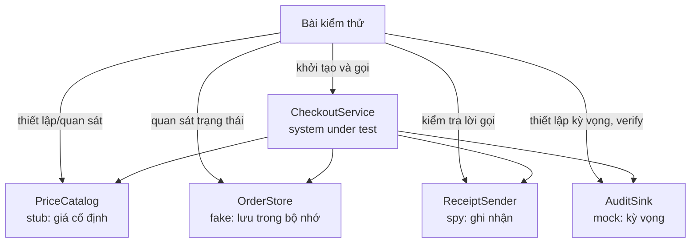

# Phân biệt dummy, stub, fake, spy và mock theo mục đích

Một lợi ích quan trọng của **Dependency Injection (DI)** là lớp nghiệp vụ có thể nhận các cộng tác viên qua constructor thay vì tự tạo chúng. Khi kiểm thử, ta có thể thay một dependency thật như cơ sở dữ liệu, dịch vụ gửi email hay hệ thống thanh toán bằng một **test double**: đối tượng thay thế đáp ứng hợp đồng mà lớp được kiểm thử cần.

Tuy nhiên, không phải đối tượng thay thế nào cũng có cùng nhiệm vụ. Có đối tượng chỉ **đứng chỗ** để gọi được constructor; có đối tượng **trả dữ liệu đã định**; có đối tượng **mô phỏng một phần hành vi thật**; có đối tượng **ghi nhận lời gọi**; và có đối tượng **xác minh tương tác kỳ vọng**. Các tên thường gặp là **dummy, stub, fake, spy và mock**.

Bài thuộc chương **Kiểm thử** của module **DEPENDENCY_INJECTION**. Ta sẽ phân biệt năm vai trò theo **mục đích của từng bài kiểm thử**, dùng **constructor injection**, **Java thuần**, test double tự viết và một chương trình có thể chạy độc lập, trước khi xem cách thư viện mocking và DI container hỗ trợ những kỹ thuật ấy.

## 1. Mục tiêu học tập

Sau bài học, bạn có thể:

- Giải thích được điểm chung của các loại **test double**, và lý do chúng giúp kiểm thử một lớp độc lập với việc lắp ghép hệ thống.
- Chọn **dummy**, **stub**, **fake**, **spy** hoặc **mock** theo câu hỏi kiểm thử đang cần trả lời.
- Phân biệt kiểm tra **trạng thái/kết quả** (*state-based verification*) và **tương tác** (*interaction-based verification*).
- Tự tạo các test double đơn giản bằng interface, lambda và class Java thuần; không cần thư viện mocking.
- Nhận diện bài test bị ràng buộc quá chặt vào chi tiết gọi hàm, cũng như các rủi ro khi fake không giữ đúng hợp đồng adapter thật.
- Biết khi nào vẫn cần **contract test** hoặc **integration test** bên cạnh unit test.

## 2. Test double là một vai trò, không nhất thiết là một kiểu class cố định

Giả sử lớp nghiệp vụ `CheckoutService` nhận bốn dependency:

```java
CheckoutService(
        PriceCatalog prices,
        OrderStore orders,
        ReceiptSender receipts,
        AuditSink audit)
```

Trong production, `OrderStore` có thể là adapter database và `ReceiptSender` có thể gọi dịch vụ email. Trong unit test, chúng ta muốn chủ động điều khiển giá, không gửi email thật, quan sát hóa đơn đã lưu và xác minh sự kiện audit. Ta thay từng dependency bằng đối tượng có nhiệm vụ phù hợp.

**Test double** là tên chung cho những đối tượng thay thế. Một cách phân loại thực dụng:

| Loại | Mục đích chính | Ví dụ | Thường kiểm tra điều gì? |
| --- | --- | --- | --- |
| **Dummy** | Truyền vào cho đủ tham số, **không được sử dụng** trong đường chạy đang kiểm thử | `AuditSink` không được gọi khi dữ liệu bị từ chối sớm | Đường chạy có kết thúc trước khi dùng dependency không? |
| **Stub** | Cung cấp **đầu ra đã định** để kiểm soát tình huống | `PriceCatalog` luôn trả 2.000 cent cho SKU thử nghiệm | Kết quả nghiệp vụ khi dependency trả giá trị đó |
| **Fake** | Có **triển khai đơn giản nhưng hoạt động thật** của một phần hợp đồng | `InMemoryOrderStore` lưu và đọc đơn hàng bằng `Map` | Trạng thái/kết quả sau thao tác, không cần database |
| **Spy** | **Ghi nhận điều đã xảy ra** để test xem lại sau | `RecordingReceiptSender` thu danh sách đơn được gửi | Những lời gọi thực tế, đối số, thứ tự nếu cần |
| **Mock** | Biểu diễn **kỳ vọng tương tác** và xác minh chúng | `ExpectedAuditSink` yêu cầu đúng một sự kiện xác định | Lời gọi nào bắt buộc xảy ra/không xảy ra |

Các mô tả này là một **hệ thuật ngữ phổ biến trong kỹ thuật kiểm thử**, không phải năm interface bắt buộc của Java. Một đối tượng tự viết có thể **vừa trả dữ liệu định sẵn vừa ghi nhận lời gọi**. Khi đó, vai trò của nó phụ thuộc vào **cách bài test sử dụng**.

Đặc biệt, thư viện như Mockito có thể gọi đối tượng được tạo qua API `mock(...)` là “mock” kể cả khi bạn chỉ cấu hình giá trị trả về như một **stub**. Ngược lại, “spy” trong một số thư viện có thể là **wrapper quanh đối tượng thật**, cho phép gọi phương thức thật rồi ghi nhận tương tác. Vì vậy hãy nêu rõ **mục đích và cách xác minh**, thay vì chỉ nhìn tên biến hoặc phương thức framework.

## 3. Bắt đầu từ câu hỏi kiểm thử, không bắt đầu từ công cụ

Một bài unit test thường có ba bước quen thuộc:

1. **Arrange**: tạo đối tượng cần kiểm thử (*system under test — SUT*) và thiết lập dữ liệu cùng các dependency cần thiết.
2. **Act**: thực thi hành vi đang kiểm thử.
3. **Assert**: xác minh kết quả/trạng thái hoặc tương tác có ý nghĩa đối với hợp đồng.

Sơ đồ:



Trong một bài test từ chối đầu vào **trước khi gọi dependency**, cả bốn đối tượng ở cạnh SUT có thể là dummy vì **không đối tượng nào được phép được sử dụng**. Ở bài test thành công, cùng vị trí constructor lại phù hợp với stub, fake, spy và mock.

Trước khi chọn double, hãy hỏi:

- Mình muốn **cấp dữ liệu đầu vào cho SUT** hay **quan sát một hiệu ứng**?
- Một hành vi nghiệp vụ có thể được kiểm tra qua **giá trị trả về/trạng thái** không?
- Có tương tác nào là **hợp đồng bắt buộc** (ví dụ gửi một yêu cầu thanh toán đúng một lần) không?
- Có cần một implementation hoạt động gần thật để thực hiện nhiều thao tác liên tiếp không?
- Có phải dependency hoàn toàn không được gọi trong nhánh đang thử không?

## 4. Dummy: chỉ đứng chỗ, không được sử dụng

**Dummy** tồn tại để thỏa mãn chữ ký constructor hoặc phương thức nhưng **đường chạy của test không dùng đến nó**. Ví dụ, `CheckoutService.place(...)` phải từ chối số lượng 0 **trước khi** tra giá hoặc lưu dữ liệu. Ta vẫn phải cung cấp các dependency constructor, nhưng chúng không cần hoạt động.

```java
// Mã minh họa: AuditSink là một interface có phương thức record(String).
AuditSink unusedAudit = event -> {
    throw new AssertionError("dummy must not be called");
};
```

Nếu test đi vào nhánh gọi dummy, lỗi trên giúp phát hiện điều bất ngờ. Trong trường hợp chỉ cần một giá trị không quan trọng và constructor cho phép `null`, một số bài test có thể dùng `null` làm dummy. Nhưng **không nên truyền `null` chỉ để tránh tạo double** nếu constructor có invariant `requireNonNull`: khi đó bài test sẽ thất bại ở bước Arrange, trước khi chạm đến hành vi cần kiểm tra.

**Dấu hiệu nhận diện:** test không quan tâm dummy **trả gì** hoặc **đã nhận bao nhiêu lời gọi**, vì nó không được sử dụng trong kịch bản đang xét. Nếu cần dummy trả giá trị, nó đang đóng vai trò stub; nếu cần kiểm tra nó đã được gọi, nó đang đóng vai trò spy/mock.

## 5. Stub: kiểm soát đầu ra của dependency

**Stub** trả về dữ liệu chuẩn bị trước để đặt SUT vào một tình huống xác định:

```java
// Ví dụ một hợp đồng tra giá theo SKU.
PriceCatalog prices = sku -> 2_000L;
```

Khi service mua 2 sản phẩm, một stub giá 2.000 cent giúp kiểm tra phép tính tổng tiền 4.000 cent mà không cần gọi dịch vụ báo giá thật.

Stub có thể:

- Trả một giá trị cố định.
- Trả giá trị theo đối số, ví dụ SKU A = 2.000, SKU B = 3.500.
- Ném exception có chủ đích để kiểm tra một nhánh lỗi.
- Trả dữ liệu theo một kịch bản được thiết lập sẵn.

Stub **không nhất thiết** kiểm tra cách SUT gọi nó. Mục đích thường là **điều khiển dữ liệu vào** để assert kết quả của SUT.

```java
// Dùng trong một bài kiểm tra xử lý lỗi của dependency.
PriceCatalog unavailablePrices = sku -> {
    throw new IllegalStateException("price source unavailable");
};
```

Test có thể chứng minh service báo lỗi đúng cách khi không tra được giá, nhưng một stub ném exception **không chứng minh** adapter network thật sẽ phát ra chính xác exception đó trong mọi hoàn cảnh. Cần kiểm tra hợp đồng lỗi của adapter ngoài đời.

## 6. Fake: một implementation đơn giản nhưng có hành vi

**Fake** cung cấp một bản triển khai hoạt động của hợp đồng, thường đủ cho nhiều lời gọi và trạng thái quan sát được. Ví dụ:

```java
final class InMemoryOrderStore implements OrderStore {
    private final java.util.Map<String, Order> orders =
            new java.util.LinkedHashMap<>();

    @Override
    public void save(Order order) {
        if (orders.putIfAbsent(order.id, order) != null) {
            throw new IllegalStateException("duplicate order id");
        }
    }

    java.util.Optional<Order> find(String id) {
        return java.util.Optional.ofNullable(orders.get(id));
    }
}
```

Đây là **mã minh họa**; các kiểu và bản chạy đầy đủ xuất hiện ở mục 9. Fake có trạng thái thật: `save` làm thay đổi `Map`, `find` cho phép tra cứu, ID trùng bị từ chối. Nó không chỉ đơn giản trả lời một giá trị đã dựng sẵn.

Fake hữu ích khi test cần **đọc sau khi ghi**, tạo nhiều dữ liệu hoặc tái hiện một quy trình nhỏ, nhưng nó không tương đương database:

- Không tự có transaction, khóa hoặc isolation giống database.
- Không mô phỏng đầy đủ lỗi kết nối, timeout hay sự cố dữ liệu.
- Một `LinkedHashMap` bình thường không an toàn cho nhiều thread cùng cập nhật.
- Không có độ bền dữ liệu qua lần chạy, trừ khi fake được thiết kế riêng cho điều đó.

Vì vậy fake nên **giữ những bảo đảm của hợp đồng mà test dựa vào**, nhưng vẫn cần **contract test** hoặc **integration test** với adapter thật. Đừng coi việc unit test chạy qua fake là bằng chứng database mapping hoặc transaction đã đúng.

## 7. Spy: quan sát lời gọi đã diễn ra

**Spy** lưu dấu vết tương tác để bài test kiểm tra **sau khi chạy**:

```java
final class RecordingReceiptSender implements ReceiptSender {
    final java.util.List<String> sentOrderIds =
            new java.util.ArrayList<>();

    @Override
    public void send(Order order) {
        sentOrderIds.add(order.id);
    }
}
```

Sau khi gọi SUT:

```java
// Giả sử spy đã được inject và service đã phát hành đơn O-1.
if (!spy.sentOrderIds.equals(java.util.List.of("O-1"))) {
    throw new AssertionError("unexpected receipt requests");
}
```

Vì sao đây là spy?

- Khi được tạo, spy **chưa cần một lời gọi cụ thể phải xảy ra** để định nghĩa tính hợp lệ của nó.
- Nó ghi những gì đã nhận: số lần, đối số hoặc thứ tự nếu cần.
- Bài test thực hiện **assert về dữ liệu đã ghi** sau Act.

Không phải spy nào cũng chỉ ghi nhận: một spy trong thư viện mocking có thể gọi qua đối tượng thật hoặc chạy hành vi mặc định. Nhưng nếu gọi phương thức thật khiến gửi email hoặc thanh toán thật, cần **tránh sử dụng spy bọc adapter thật trong unit test** khi chưa kiểm soát các hiệu ứng phụ.

**Cẩn thận với thứ tự:** chỉ xác minh thứ tự nếu nó quan trọng đối với hợp đồng. Nếu có thể lưu và audit theo hai thứ tự mà nghiệp vụ đều đúng, một test buộc “luôn audit trước save” sẽ trở nên giòn và cản trở refactor.

## 8. Mock: xác minh tương tác kỳ vọng

Theo cách phân biệt thiên về hành vi, **mock** được thiết lập với một **kỳ vọng tương tác** trước khi chạy và có cơ chế kiểm tra kỳ vọng ấy:

```java
final class ExpectedAuditSink implements AuditSink {
    private final String expectedEvent;
    private int calls;

    ExpectedAuditSink(String expectedEvent) {
        this.expectedEvent = expectedEvent;
    }

    @Override
    public void record(String event) {
        if (!expectedEvent.equals(event)) {
            throw new AssertionError("unexpected audit event");
        }
        calls++;
        if (calls > 1) {
            throw new AssertionError("audit called more than once");
        }
    }

    void verify() {
        if (calls != 1) {
            throw new AssertionError("audit must be called once");
        }
    }
}
```

Ở đây test thiết lập **kỳ vọng trước Act**: một sự kiện cụ thể phải được ghi **đúng một lần**. Khi SUT chạy, mock từ chối sự kiện sai hoặc lời gọi thừa, và `verify()` phát hiện **thiếu** lời gọi.

Điểm phân biệt hữu ích:

- **Spy:** “Đã có những lời gọi gì? Để tôi xem dữ liệu ghi nhận sau.”
- **Mock theo kỳ vọng:** “Tôi yêu cầu tương tác X phải xảy ra đúng quy tắc; hãy xác minh điều đó.”

Không nên biến mọi cộng tác viên thành mock chỉ để kiểm tra mỗi lời gọi nội bộ. Khi test xác minh cả số lần gọi `getPrice`, `save`, `send`, thứ tự từng hàm và cấu trúc thuật toán dù đầu ra vẫn đúng, test có thể bị **over-specification** (ràng buộc quá mức vào implementation). Hãy mock các **tương tác có ý nghĩa hợp đồng**, như không gọi gateway khi dữ liệu không hợp lệ hoặc chỉ yêu cầu thanh toán một lần.

## 9. Java thuần: một bài thực hành dùng cả năm vai trò

Chúng ta triển khai `CheckoutService` có bốn collaborator bắt buộc:

1. `PriceCatalog` cung cấp đơn giá.
2. `OrderStore` lưu đơn đã tính tiền.
3. `ReceiptSender` gửi yêu cầu biên nhận.
4. `AuditSink` ghi một sự kiện tạo đơn.

Để nhìn rõ từng vai trò, bài test thành công dùng **stub giá**, **fake store**, **spy sender** và **mock audit**. Bài test từ chối số lượng 0 dùng **dummy**, vì phải dừng trước khi bất kỳ dependency nào được gọi.

Lưu toàn bộ chương trình vào **`Main.java`**. Đây là ví dụ tự chứa, **không gửi email, không kết nối database, không gọi network và không cần framework kiểm thử**.

```java
import java.util.ArrayList;
import java.util.LinkedHashMap;
import java.util.List;
import java.util.Map;
import java.util.Objects;
import java.util.Optional;

public class Main {
    interface PriceCatalog {
        long unitPriceCents(String sku);
    }

    interface OrderStore {
        void save(Order order);
    }

    interface ReceiptSender {
        void send(Order order);
    }

    interface AuditSink {
        void record(String event);
    }

    // Value object đại diện kết quả nghiệp vụ.
    static final class Order {
        final String id;
        final String sku;
        final int quantity;
        final long totalCents;

        Order(String id, String sku, int quantity, long totalCents) {
            this.id = Objects.requireNonNull(id, "id");
            this.sku = Objects.requireNonNull(sku, "sku");
            if (id.isBlank() || sku.isBlank() || quantity <= 0
                    || totalCents < 0) {
                throw new IllegalArgumentException("invalid order");
            }
            this.quantity = quantity;
            this.totalCents = totalCents;
        }
    }

    // SUT: chỉ biết các hợp đồng, không tự tạo adapter.
    static final class CheckoutService {
        private final PriceCatalog prices;
        private final OrderStore orders;
        private final ReceiptSender receipts;
        private final AuditSink audit;

        CheckoutService(
                PriceCatalog prices,
                OrderStore orders,
                ReceiptSender receipts,
                AuditSink audit) {
            this.prices = Objects.requireNonNull(prices, "prices");
            this.orders = Objects.requireNonNull(orders, "orders");
            this.receipts = Objects.requireNonNull(receipts, "receipts");
            this.audit = Objects.requireNonNull(audit, "audit");
        }

        Order place(String orderId, String sku, int quantity) {
            Objects.requireNonNull(orderId, "orderId");
            Objects.requireNonNull(sku, "sku");
            // Phải từ chối đầu vào sai TRƯỚC khi gọi collaborator.
            if (orderId.isBlank() || sku.isBlank() || quantity <= 0) {
                throw new IllegalArgumentException("invalid order input");
            }

            long unitPrice = prices.unitPriceCents(sku);
            if (unitPrice < 0) {
                throw new IllegalStateException("negative catalog price");
            }

            long total = Math.multiplyExact(unitPrice, quantity);
            Order order = new Order(orderId, sku, quantity, total);
            orders.save(order);
            receipts.send(order);
            audit.record("created " + orderId);
            return order;
        }
    }

    // STUB: cung cấp đơn giá định trước cho một SKU.
    static final class FixedPriceCatalog implements PriceCatalog {
        private final String expectedSku;
        private final long price;

        FixedPriceCatalog(String expectedSku, long price) {
            this.expectedSku = Objects.requireNonNull(expectedSku);
            if (price < 0) {
                throw new IllegalArgumentException("negative stub price");
            }
            this.price = price;
        }

        @Override
        public long unitPriceCents(String sku) {
            if (!expectedSku.equals(sku)) {
                throw new IllegalArgumentException("unknown test SKU");
            }
            return price;
        }
    }

    // FAKE: lưu thật vào Map, nhưng chỉ trong bộ nhớ.
    static final class InMemoryOrderStore implements OrderStore {
        private final Map<String, Order> saved = new LinkedHashMap<>();

        @Override
        public void save(Order order) {
            Objects.requireNonNull(order, "order");
            if (saved.putIfAbsent(order.id, order) != null) {
                throw new IllegalStateException("duplicate order id");
            }
        }

        Optional<Order> find(String id) {
            return Optional.ofNullable(saved.get(id));
        }
    }

    // SPY: chỉ quan sát các yêu cầu gửi biên nhận.
    static final class RecordingReceiptSender implements ReceiptSender {
        final List<String> sentOrderIds = new ArrayList<>();

        @Override
        public void send(Order order) {
            sentOrderIds.add(order.id);
        }
    }

    // MOCK thủ công: thiết lập kỳ vọng trước, verify sau.
    static final class ExpectedAuditSink implements AuditSink {
        private final String expectedEvent;
        private int calls;

        ExpectedAuditSink(String expectedEvent) {
            this.expectedEvent = Objects.requireNonNull(expectedEvent);
        }

        @Override
        public void record(String event) {
            if (!expectedEvent.equals(event)) {
                throw new AssertionError("unexpected audit event: " + event);
            }
            calls++;
            if (calls > 1) {
                throw new AssertionError("audit called more than once");
            }
        }

        void verify() {
            if (calls != 1) {
                throw new AssertionError(
                        "expected one audit call; actual=" + calls);
            }
        }
    }

    static void checkHappyPath() {
        // Arrange: mỗi double có một vai trò trong bài test.
        PriceCatalog stub = new FixedPriceCatalog("BOOK", 2_000L);
        InMemoryOrderStore fake = new InMemoryOrderStore();
        RecordingReceiptSender spy = new RecordingReceiptSender();
        ExpectedAuditSink mock = new ExpectedAuditSink("created O-1");

        CheckoutService sut = new CheckoutService(
                stub, fake, spy, mock);

        // Act.
        Order actual = sut.place("O-1", "BOOK", 2);

        // Assert kết quả nghiệp vụ và trạng thái fake.
        if (actual.totalCents != 4_000L
                || actual.quantity != 2
                || fake.find("O-1").isEmpty()
                || fake.find("O-1").get() != actual) {
            throw new AssertionError("incorrect order result");
        }

        // Assert tương tác được spy ghi lại.
        if (!spy.sentOrderIds.equals(List.of("O-1"))) {
            throw new AssertionError("incorrect receipt requests");
        }

        // Xác minh kỳ vọng đã được thiết lập trong mock.
        mock.verify();
    }

    static void checkInvalidInputWithDummies() {
        // Arrange: mọi dependency đều chỉ là DUMMY cho nhánh này.
        PriceCatalog unusedPrices = sku -> {
            throw new AssertionError("dummy prices were used");
        };
        OrderStore unusedStore = order -> {
            throw new AssertionError("dummy store was used");
        };
        ReceiptSender unusedReceipts = order -> {
            throw new AssertionError("dummy receipts were used");
        };
        AuditSink unusedAudit = event -> {
            throw new AssertionError("dummy audit was used");
        };

        CheckoutService sut = new CheckoutService(
                unusedPrices, unusedStore, unusedReceipts, unusedAudit);

        // Act: quantity không hợp lệ; service phải dừng sớm.
        boolean rejected = false;
        try {
            sut.place("O-BAD", "BOOK", 0);
        } catch (IllegalArgumentException expected) {
            rejected = true;
        }
        if (!rejected) {
            throw new AssertionError("invalid quantity was accepted");
        }
    }

    public static void main(String[] args) {
        checkInvalidInputWithDummies();
        System.out.println("Dummy check: PASS");

        checkHappyPath();
        System.out.println("Stub/Fake/Spy/Mock check: PASS");

        System.out.println("Plain Java verification: PASS");
    }
}
```

Biên dịch và chạy với **JDK 11 trở lên**:

```bash
javac -encoding UTF-8 Main.java
java Main
```

Kết quả dự kiến:

```text
Dummy check: PASS
Stub/Fake/Spy/Mock check: PASS
Plain Java verification: PASS
```

### 9.1. Phân tích bài kiểm thử thành công

Trong `checkHappyPath()`:

1. `FixedPriceCatalog` là **stub** vì điều khiển **dữ liệu trả về**: đơn giá 2.000 cent cho `BOOK`. Test không cần biết cơ chế truy vấn giá thật.
2. `InMemoryOrderStore` là **fake** vì có hành vi lưu trạng thái đơn hàng và tra cứu sau đó. Nó có thể phục vụ nhiều thao tác, nhưng không mô phỏng toàn bộ database thật.
3. `RecordingReceiptSender` là **spy** vì chỉ ghi nhận mã đơn mà SUT đã yêu cầu gửi biên nhận; test xem lại danh sách sau Act.
4. `ExpectedAuditSink` là **mock** vì đã thiết lập trước kỳ vọng sự kiện `"created O-1"` được gửi đúng một lần; `verify()` bảo đảm không thiếu.
5. `CheckoutService` được tạo bằng **constructor injection**; nó không biết bốn dependency là thật, giả lập hay dùng trong test.

Bài test xác minh cả **kết quả nghiệp vụ** (tổng tiền) lẫn **hiệu ứng quan sát được** (đã lưu đơn, gửi biên nhận, audit). Không cần khởi động ứng dụng, gọi composition root hay DI container.

### 9.2. Phân tích bài kiểm thử từ chối đầu vào

Trong `checkInvalidInputWithDummies()`, cả bốn collaborator đều có implementation ném `AssertionError` nếu bị dùng. Dù chúng thực hiện một hành vi bảo vệ khi được gọi, **vai trò của chúng ở kịch bản này vẫn là dummy**: test không cần câu trả lời từ bất kỳ collaborator nào.

Nếu `CheckoutService` vô tình gọi `prices.unitPriceCents(...)` **trước** khi kiểm tra số lượng, bài test sẽ thất bại bằng `AssertionError`. Điều đó giúp khẳng định ranh giới “đầu vào không hợp lệ phải bị từ chối trước mọi tác dụng phụ”.

**Lưu ý quan trọng:** bài test hiện tại mới chứng minh *riêng nhánh quantity = 0* dừng đúng chỗ. Nó không tự chứng minh tất cả kiểu input sai như SKU rỗng, ID rỗng, giá âm hoặc overflow đều có chính sách tương ứng. Cần bổ sung các trường hợp đó khi kiểm thử sản phẩm thật.

### 9.3. Vì sao kết quả của fake chưa chứng minh transaction đúng?

SUT lưu đơn, yêu cầu gửi biên nhận rồi ghi audit. Nếu `ReceiptSender.send(...)` ném lỗi **sau khi fake store đã lưu**, dữ liệu vẫn còn trong store. Ví dụ **không thiết kế rollback** cho chuỗi nhiều hiệu ứng phụ này.

Trong production có thể cần transaction, outbox, idempotency hoặc chiến lược bù trừ tùy nghiệp vụ. **Unit test qua fake không tự bảo đảm tính nhất quán xuyên database và dịch vụ bên ngoài.** Hãy tách việc kiểm thử thiết kế DI khỏi việc kiểm thử giao dịch và vận hành thật.

## 10. State-based verification và interaction-based verification

Hai cách xác minh thường được dùng cùng nhau nhưng nhấn mạnh các khía cạnh khác nhau:

| Cách xác minh | Câu hỏi | Ví dụ | Double hay dùng |
| --- | --- | --- | --- |
| **State-based** | Sau hành vi, trạng thái/kết quả có đúng không? | Tổng tiền = 4.000 cent; fake store chứa đơn `O-1` | Stub cung cấp đầu vào, fake lưu trạng thái |
| **Interaction-based** | SUT đã cộng tác đúng với dependency chưa? | Sender được gọi cho `O-1`; audit được gọi đúng một lần | Spy hoặc mock |

Ưu tiên **kết quả/hành vi quan sát được** khi nó đủ để chứng minh hợp đồng. Chỉ thêm kiểm tra tương tác khi **việc gọi collaborator là một phần của yêu cầu**, chẳng hạn:

- Không được gửi tiền hai lần.
- Không phát sự kiện khi dữ liệu chưa hợp lệ.
- Phải hủy đăng ký listener khi đóng tài nguyên.
- Phải yêu cầu lưu dữ liệu trước khi trả thành công, nếu đó là hợp đồng của use case.

Ngược lại, các tương tác như gọi helper riêng bao nhiêu lần, dùng vòng lặp hay stream, gọi một phương thức đọc dữ liệu hai hay ba lần thường là **chi tiết implementation**. Mock chúng quá chặt khiến test thất bại khi refactor không thay đổi nghiệp vụ.

**Không có quy tắc tuyệt đối** rằng state-based luôn tốt và interaction-based luôn xấu. Một tác dụng phụ như gửi email thường không có trạng thái nội bộ của SUT để assert; spy/mock là lựa chọn phù hợp nếu kiểm tra được **biên cộng tác thật sự quan trọng**.

## 11. Một test double có thể mang nhiều vai trò

Ví dụ một đối tượng vừa trả giá trị định trước vừa ghi lại các SKU được tra cứu:

```java
// Mã khái niệm: interface PriceCatalog được định nghĩa ở mục 9.
final class RecordingPriceCatalog implements PriceCatalog {
    final java.util.List<String> queriedSkus =
            new java.util.ArrayList<>();

    @Override
    public long unitPriceCents(String sku) {
        queriedSkus.add(sku);
        return 2_000L;
    }
}
```

Nếu test chỉ dùng giá 2.000 để kiểm tra tổng tiền, đối tượng này đang phục vụ mục đích **stub**. Nếu test assert danh sách `queriedSkus`, nó còn đóng vai trò **spy**. Nếu test cấu hình “phải nhận đúng một SKU `BOOK`” rồi xác minh kỳ vọng ấy, ta có **hành vi kiểu mock**.

Điều đó giải thích vì sao phân loại theo **mục đích** hữu ích hơn phân loại theo tên class hoặc công cụ tạo double. Một thư viện mocking có thể cung cấp object hỗ trợ cả ba kiểu sử dụng nhưng bạn vẫn cần quyết định **nên assert điều gì**.

### 11.1. Sự khác nhau giữa stub và fake có phải lúc nào cũng rõ?

Không phải lúc nào. Một stub có thể trả theo bảng dữ liệu; fake cũng có thể chỉ chứa một `Map` nhỏ. Ranh giới thực dụng là:

- **Stub:** tập trung **trả câu trả lời đã dựng sẵn** để lái tình huống kiểm thử.
- **Fake:** cung cấp **một phiên bản hoạt động** của hệ thống phụ thuộc, thường duy trì trạng thái/quy tắc đơn giản để test có thể sử dụng nhiều lần.

Nếu việc phân loại không giúp test rõ hơn, đừng biến nó thành tranh luận về danh từ. Quan trọng hơn là test double có **hợp đồng rõ**, **phạm vi phù hợp** và **không che giấu lỗi nghiệp vụ**.

## 12. Lựa chọn double theo mục tiêu kiểm thử

| Mục tiêu | Lựa chọn khởi đầu | Vì sao |
| --- | --- | --- |
| Kiểm tra validation dừng trước khi dùng dependency | **Dummy** có guard nếu bị gọi | Không cần dựng hành vi không xuất hiện |
| Kiểm tra phép tính khi bảng giá trả mức cố định | **Stub** | Dễ kiểm soát đầu vào và mong đợi kết quả |
| Kiểm tra luồng ghi rồi đọc bằng repository đơn giản | **Fake** | Có trạng thái thật trong bộ nhớ, không cần database |
| Kiểm tra request gửi thông báo có chứa đúng ID | **Spy** | Quan sát sau Act, dễ đọc kết quả |
| Kiểm tra gateway bắt buộc được gọi đúng một lần | **Mock** hoặc spy với assert rõ | Tương tác là một phần của hợp đồng |
| Kiểm tra transaction, isolation và schema database | **Adapter thật trong integration test** | Fake không tái hiện đầy đủ hạ tầng |
| Kiểm tra cả object graph và cấu hình chọn adapter | **Composition/integration test** | Unit test với double không xác minh wiring production |
| Kiểm tra retry khi dependency ném exception | **Stub/programmable double** | Tạo tình huống lỗi có thể tái lập, nhưng chỉ assert retry nếu chính sách cho phép |

Một test có thể cần **nhiều loại double đồng thời**, như ví dụ Java ở trên. Việc đó không làm test kém “thuần unit” nếu nó kiểm tra một SUT và chủ động kiểm soát các collaborator ngoài phạm vi.

## 13. Cách dùng thư viện mocking mà không đánh mất tư duy thiết kế

Thư viện mocking giúp tự sinh implementation của interface/class, cấu hình giá trị trả về, bắt đối số và verify số lần gọi. Nhưng **không có thư viện nào tự chọn hộ bạn một assertion phù hợp với nghiệp vụ**.

Ví dụ **mã giả minh họa ý tưởng**, không phải một chương trình độc lập hoặc cú pháp API bắt buộc cho mọi framework:

```text
prices = mock(PriceCatalog)
when prices.unitPriceCents("BOOK") -> return 2000

sender = mock(ReceiptSender)
service = new CheckoutService(prices, store, sender, audit)

service.place("O-1", "BOOK", 2)

verify sender.send(order whose id == "O-1") exactly once
```

Trong ví dụ này, `prices` được tạo bằng API tên *mock*, nhưng vì nó chỉ **trả dữ liệu đặt sẵn**, nó đang đóng **vai trò stub**. `sender` được dùng để **xác minh tương tác**, gần với mục đích mock. Nếu công cụ có khái niệm spy bọc instance thật, hãy kiểm tra liệu phương thức thật có gây I/O hoặc side effect không.

Khi chuyển từ Java thuần sang JUnit/Mockito hoặc framework khác:

- Giữ các **assertion mô tả hành vi nghiệp vụ**, không sao chép toàn bộ danh sách lời gọi nội bộ.
- Không mặc định mọi giá trị trả về bị mock không cấu hình đều phù hợp với domain; `null`/0/false có thể gây lỗi giả.
- Không dùng mock để bỏ qua hoàn toàn contract của adapter thật.
- Cân nhắc dùng fake cho repository nếu nó làm test rõ ràng và giúp đánh giá trạng thái; cân nhắc dùng spy/mock cho các **output port** có tác dụng phụ.
- Không coi annotation tạo mock hoặc inject mock là bằng chứng rằng scope, lifecycle hay composition root production đã đúng.

## 14. Tác động của DI lên cách viết unit test

Với **constructor injection**, đối tượng nghiệp vụ công khai những hợp đồng bắt buộc:

```java
CheckoutService sut = new CheckoutService(
        priceCatalog,
        orderStore,
        receiptSender,
        auditSink);
```

Bài test tạo SUT **bằng Java thuần**, không cần chạy container. Đây là một dấu hiệu có ích của thiết kế dễ kiểm thử: test có thể chọn stub/fake/spy/mock tương ứng mục tiêu, không phải sửa cấu hình toàn cục.

Nhưng **DI không đồng nghĩa với tất cả dependency đều phải mock**. Một value object, bộ tính toán thuần hoặc chiến lược bất biến đơn giản thường có thể dùng bản thật. Mock chúng có thể làm test khó đọc hơn.

Ngược lại, nếu service tự gọi `GlobalContainer.get(ReceiptSender.class)` hoặc `new SmtpClient(...)`, test sẽ khó cung cấp double phù hợp. Tốt hơn là để **composition root** quyết định adapter khi chạy thật, còn test trực tiếp truyền collaborator vào constructor.

### 14.1. Khi nào cần test cả composition root?

Unit test của `CheckoutService` dùng double chỉ chứng minh service hoạt động **với những dependency được cung cấp**. Nó không chứng minh:

- Composition root chọn đúng adapter cho môi trường production.
- Các dependency bắt buộc đều được tạo và truyền đủ.
- Một singleton không giữ nhầm dependency request-scoped.
- Pool, client, listener được start/close đúng vòng đời.
- Adapter database/email thực giữ đúng contract đã giả định trong test.

Vì vậy, sau unit test vẫn nên có những kiểm tra ở cấp **composition/wiring** và **integration** phù hợp. Điều này đặc biệt quan trọng trước khi mở rộng từ DI thủ công sang DI container.

## 15. Những sai lầm thường gặp

| Sai lầm | Hệ quả | Hướng cải thiện |
| --- | --- | --- |
| Gọi mọi double là “mock” rồi kiểm tra mọi lời gọi | Test phụ thuộc chi tiết implementation | Chọn mục tiêu: dữ liệu, trạng thái hay tương tác |
| Dùng dummy nhưng service thực tế gọi nó | Test thất bại hoặc nhận `null` bất ngờ | Chỉ dùng dummy cho đường chạy thực sự không cần collaborator |
| Stub trả giá trị không phù hợp contract | Test cho kết quả không đại diện nghiệp vụ | Ghi rõ đơn vị, điều kiện lỗi và invariants |
| Fake làm việc khác adapter thật ở điều kiện quan trọng | Unit test xanh nhưng production lỗi | Contract test và integration test |
| Spy bọc client thật trong unit test | Gửi email/giao dịch thật ngoài ý muốn | Dùng recording double không side effect hoặc cô lập adapter |
| Mock kỳ vọng quá nhiều bước nội bộ | Refactor vô hại vẫn làm test đỏ | Verify tương tác thật sự là hợp đồng |
| Chỉ test happy path | Bỏ sót input sai, retry, lỗi dependency, cleanup | Bổ sung đường lỗi có chủ đích |
| Dùng test double có mutable state chia sẻ giữa nhiều test | Kết quả phụ thuộc thứ tự chạy | Tạo double mới cho từng bài test hoặc reset có kiểm soát |
| Dùng fake in-memory để kết luận transaction đã đúng | Bỏ sót isolation, rollback, concurrency | Kiểm thử tích hợp với database/adapter thật |
| Mock dependency của dependency thay vì của SUT | Test có quá nhiều cấu hình, khó hiểu ranh giới | Đặt test double đúng tại boundary của SUT |

## 16. Quy trình chọn test double cho một ca sử dụng

1. **Xác định SUT và hợp đồng cần chứng minh.** Ví dụ `CheckoutService.place` phải tính tổng đúng và yêu cầu gửi biên nhận khi đơn hợp lệ.
2. **Liệt kê các dependency mà SUT trực tiếp sử dụng.** Dựa trên constructor, không phải danh sách toàn bộ bean trong container.
3. **Đánh dấu dependency không được gọi** ở nhánh đang kiểm thử. Chúng có thể là dummy có guard.
4. **Đánh dấu dependency cần cung cấp dữ liệu** để lái tình huống. Dùng stub với giá trị/exception rõ ràng.
5. **Đánh dấu dependency cần một implementation hoạt động đơn giản** qua nhiều thao tác. Cân nhắc fake và phạm vi state của fake.
6. **Đánh dấu hiệu ứng cần quan sát** ở output port. Dùng spy để ghi nhận đối số hoặc mock khi kỳ vọng tương tác bắt buộc.
7. **Viết assertion theo hành vi.** Ưu tiên kết quả và trạng thái có nghĩa; verify số lần/thứ tự chỉ khi hợp đồng yêu cầu.
8. **Thêm nhánh lỗi**: đầu vào sai, dependency trả lỗi, overflow, duplicate, timeout hoặc hủy giao dịch nếu có liên quan.
9. **Rà soát giới hạn double.** Fake/spy không đại diện đầy đủ adapter thật; lên kế hoạch contract và integration test phù hợp.
10. **Tách vòng đời test khỏi production.** Không dùng adapter production chỉ để đạt coverage, không để recorder hay state fake rò sang test khác.

## 17. Tự kiểm tra

**Tình huống A.** `PaymentService` phải từ chối số tiền âm trước khi gọi gateway. Test truyền một gateway chỉ ném lỗi nếu bị gọi; vì tiền âm nên gateway không được gọi. Gateway này đóng vai trò gì?

**Gợi ý:** **Dummy** trong nhánh này. Test không cần dữ liệu hay hiệu ứng từ gateway, chỉ cần bảo đảm đường lỗi dừng trước khi dùng dependency.

**Tình huống B.** Test kiểm tra giảm giá khi `CustomerTierProvider` luôn trả `GOLD`. Đối tượng thay thế chỉ trả giá trị đó, không ghi lời gọi. Vai trò gì?

**Gợi ý:** **Stub**, vì nó kiểm soát dữ liệu mà SUT nhận để test một tình huống.

**Tình huống C.** Một repository dùng `HashMap` để hỗ trợ `save` và `find`, giúp test đọc lại dữ liệu sau khi lưu. Vai trò gì? Nó có chứng minh SQL transaction đúng không?

**Gợi ý:** **Fake**. Nó có triển khai đơn giản với trạng thái nhưng không đại diện đầy đủ database transaction, isolation hay mapping; cần kiểm thử adapter thật.

**Tình huống D.** Một sender lưu mọi mã đơn đã nhận vào `List`. Sau khi SUT chạy, test assert danh sách bằng `["O-1"]`. Vai trò gì?

**Gợi ý:** **Spy** theo mục đích ghi nhận tương tác rồi kiểm tra sau.

**Tình huống E.** Trước khi gọi SUT, test quy định audit phải nhận đúng một sự kiện `"created O-1"` và gọi `verify()` sau đó. Vai trò gì?

**Gợi ý:** **Mock** theo kỳ vọng tương tác.

**Tình huống F.** Mockito tạo một object bằng `mock(PriceCatalog.class)`, cấu hình trả giá cố định và test chỉ assert tổng tiền, không verify lời gọi. Theo mục đích, object đang đóng vai trò gì?

**Gợi ý:** **Stub**, dù API tạo đối tượng có tên “mock”.

**Tình huống G.** Một mock yêu cầu `OrderService` gọi ba helper đúng thứ tự, nhưng khi refactor sang một thuật toán khác có cùng kết quả và side effect nghiệp vụ, test đỏ. Có thể cải thiện ở đâu?

**Gợi ý:** Test bị ràng buộc vào chi tiết implementation. Nên xác minh kết quả và các tương tác có ý nghĩa hợp đồng thay vì thứ tự helper không quan trọng.

**Tình huống H.** Tất cả unit test dùng fake repository đều xanh nhưng production báo lỗi khi hai request đồng thời lưu cùng ID. Có mâu thuẫn không?

**Gợi ý:** Không. Fake thường không có concurrency/isolation/constraint giống database. Cần bổ sung contract/integration test và xem lại quy tắc đồng thời của adapter thật.

## 18. Ghi nhớ

- **Dummy** đứng chỗ và **không được dùng** trong kịch bản test.
- **Stub** cung cấp **đầu ra đã dựng trước** để kiểm soát tình huống.
- **Fake** là triển khai đơn giản nhưng có **hành vi/trạng thái thật** của một phần contract.
- **Spy** **ghi nhận tương tác** để test quan sát sau; **mock** thường mang **kỳ vọng tương tác** được xác minh.
- **Tên công cụ không quyết định vai trò.** Một đối tượng tạo từ API `mock()` có thể được dùng như stub; một object có thể kiêm nhiều vai trò.
- **State-based và interaction-based đều hữu ích** nếu assertion phản ánh hành vi nghiệp vụ thay vì chi tiết thực thi.
- **Constructor injection và composition root** giúp test cung cấp double phù hợp bằng Java thuần; DI container không phải điều kiện để có unit test tốt.
- **Test double không thay thế adapter thật** ở những nơi cần xác minh transaction, kết nối, cấu hình, concurrency và vòng đời tài nguyên.

Khi đứng trước một dependency trong bài test, hãy hỏi: **“Mình cần bỏ qua nó, cho SUT một câu trả lời, mô phỏng hành vi, ghi lại điều xảy ra hay buộc một tương tác phải xảy ra?”** Câu hỏi ấy giúp chọn dummy, stub, fake, spy hoặc mock đúng **mục đích**, thay vì chọn theo thói quen hay tên gọi của framework.
